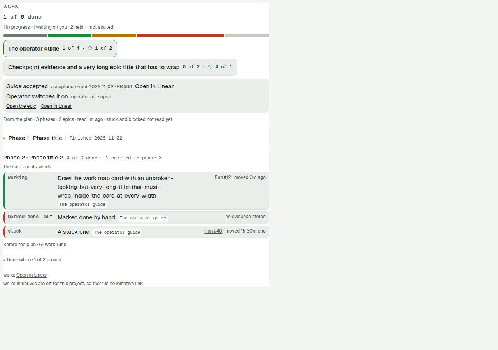
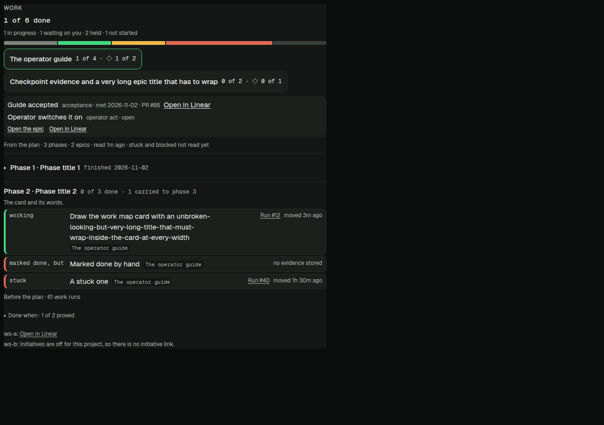
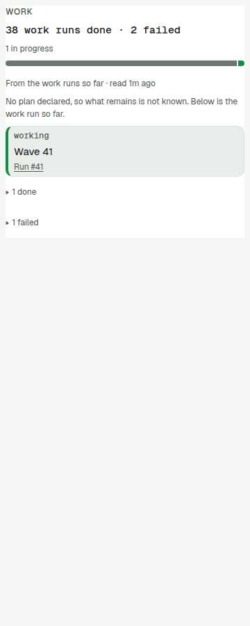
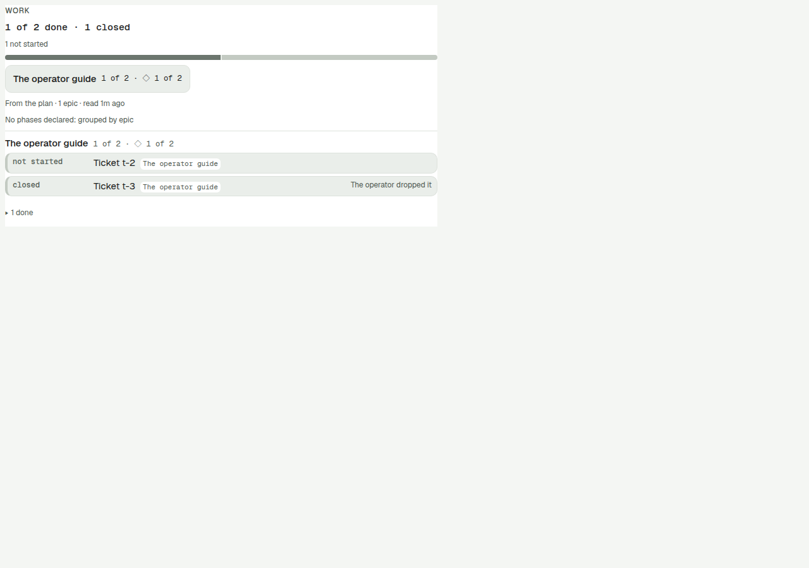

# Task WM3: the task note (desktop polish run 2859, D-8806)

The note for the programme work map's Task WM3, written by its worker for the coordinator to fold into the ledger. Each
claim says whether it was **measured** (read on the tree, in a browser or in a test run by this task) or **inferred**.

## 1. What was built

| Piece | Where | Basis |
|---|---|---|
| `WorkCard({ work, readAt, runHref, itemHref, epicHref? })`: the headline and bar, the epic strip (a tap filters, a second clears), the source line, the phases in order (a finished one folded to its line), each ticket's status word, epic tag and facts, "Not in a phase", the folded Done when line, the initiatives. One piece of local state (the epic filter), no store, no route, no last view | `pwa/src/ledgers/WorkCard.tsx` (L4, C5) | Measured: `work-card.test.tsx` |
| The words: `statusWord` (keyed by `WORK_STATUSES`), `headline`, `outstandingLine`, `sourceLine`, `phaseLine`, `foldLabel`, `epicChip`, `carriedWords`, `wholeEpicLine`, `doneWhenLine`, `initiativeNote`, and the notes of each plan state | `pwa/src/ledgers/workMapWords.ts` (L1, pure) | Measured: the same suite; the `rings`, `ownership`, `growth-check` and `growth-caps` suites pass with both files (§5). Its imports, read by hand: shared types, `@ccrc/ui`'s `elapsedWords`, `lib/format` |
| The styles at both layout rows of the plan's table, tokens only | `pwa/src/ledgers/ledgers.css`, the `.wk-` block | Measured: `contrast.test.ts` and the census suites pass with it (§5) |
| The suite | `pwa/test/work-card.test.tsx` (42 cases) | Measured |

Nothing mounts the card: WM4 puts it on the programme page. The card imports no stylesheet, as `GoalsPanel` does not;
`ProgrammeScreen` already imports `ledgers.css` (measured: its line 57).

## 2. Departures, named by slug (the plan's D-8806 entry carries the same list)

- `shipped-wire-wins`: WM2's shipped types differ from the plan's words in three fields and the card reads the shipped
  ones. `WorkItemView.title` is `string | null`, so a no-plan run row with no title reads "Wave N" (its run number when it
  has no wave). `lastMoveAt` is optional: a number draws "moved 3m ago", while null and absent draw nothing (the card cannot
  tell a quiet run from an unread one by wording, and the server already kept them apart). `runs.waves` is nullable and the
  card does not read it. Measured: `shared/plan.ts` at `main`.
- `unreadable-carries-the-last-view`: the plan says the page passes "the last `WorkMapView` it drew together with the
  failure's word". The interface has one `work` prop, so its `unreadable` arm may also carry `last`
  (`WorkCardAnswer`, `WorkCard.tsx`); the note draws over `last`, and with no `last` it draws alone. The card keeps no last
  view. WM4 builds the answer it passes.
- `phase-line-takes-targets`: `WorkPhaseView` carries only `carried`, a count, so "1 carried to phase 3" needs the target.
  `phaseLine(phase, carriedTo)` takes the target numbers and `carriedTargetsOf(phaseKey, items)` reads them off the view's
  items.
- `status-word-leads-the-sentence`: `done-unverified` is worded "marked done, but" in the status cell and its reason
  ("no evidence stored") is the row's first fact, so the pair reads as Table 6 row 4 says.
- `source-line-names-no-programme`: "From the plan · 3 phases · 3 epics · read 1m ago" and "From the work runs so far", not
  "From the programme's plan", under the operator's tidying notes of 2026-11-19. The card writes no "coordinator" word and
  draws no spot for the badge C50 adds, so there is no TODO to leave. Measured: a case reads the drawn text for both words.
- `layout-by-the-cards-width`: the plan's two layout rows switch at a container query on the card's own width (34rem), not
  at a viewport width, so WM4 may seat the card in either column. Measured in a browser (§6): one column at a 344 px card,
  three columns at a 684 px card.
- `bar-shows-left-open`: an ended plan's bar also draws its left-open work, so a closed plan with two left-open tickets is
  not a full "done" bar (seen in the first browser pass, then fixed).
- `fold-chevron-drawn`: a `
` drawn as a flex row loses the browser's marker, so the stylesheet draws the chevron;
  without it nothing said a folded phase, the done line or Done when could open (seen in the first browser pass).
- The card relies on `elapsedWords` from `@ccrc/ui` (one spelling of an elapsed time, the design system's own), so a read is
  "1m ago" and "moments ago", not "1 min ago" as the spec's example spells it. Inferred: the example is a sample, and a
  second spelling would be a parallel mechanism.

## 3. Cases, and what reds each

All 42 cases are in `pwa/test/work-card.test.tsx`. The plan's twenty named cases are there under their names; the rest pin
what the build added.

| Plan's case | Reds when |
|---|---|
| `the headline reads N of M done` | the "of M" leaves `held` out, or the counted groups change (mutant M3) |
| `the outstanding line names waiting on you and held apart` | a group is dropped from the line or reordered (M4) |
| `the no-plan card has no M and says what remains is not known` | the fallback prints "N of M", or loses its note |
| `a declared empty plan says so and draws no runs` | the empty state draws the runs list or the no-plan note |
| `an ended plan says how it ended and shows no outstanding work` | the ended headline or an outstanding line is drawn (the `.wk-outstanding` element) |
| `an ended plan words the left-open status WM2 sends for a ticket marked done whose evidence does not verify, and draws no outstanding line` | the card words that status as "marked done, but", or draws the line (mutant M2 reds it too) |
| `an unreadable answer says so` | the alert is missing |
| `verdicts not read are named on the source line` | the source line loses "stuck and blocked not read yet" |
| `a plan with no phases says it is grouped by epic` | the note or the epic grouping goes |
| `a finished phase is one line with its date` and `a finish with no date says date unknown` | the date or "date unknown" wording changes (M6) |
| `done tickets fold into one counted line` | the fold is open, or counts another number |
| `each ticket shows its epic` | the tag is not drawn |
| `a chip filters to its epic, shows its checkpoints, and a second tap clears it` | the filter, the checkpoint row, its facts or the clear goes |
| `a carried ticket reads carried to its later phase and from its earlier one` and its dropped-source case | "carried", "carried to phase 3", "from phase 2" or "from phase <key>, dropped" changes (M5) |
| `Done when counts the proved entries` | the count or a row's proved word changes |
| `no url draws no Open in Linear` | a link is drawn with no url |
| `initiatives off draws its note` | the note or its once-per-workspace count goes |
| `every status has a word` | a status has no word, an empty word or a word shared with another (M1, M2) |
| `a run link opens the run`, `an item link opens the item` | the link or its href changes |
| `a long title wraps inside the card` | a rule of the wrapping chain loses `overflow-wrap: anywhere` |

Also pinned: the two layout rows of the plan's table (a one-column row, a container-query one-row layout, a wrapping strip),
tokens-only colour, no drawn "Programme" or "coordinator", no inline colour, and the exact text of every word function.

## 4. Mutants

Three word functions were required; six were run. Each was applied to a saved copy's text, the suite run through the test
slice, and the file restored from the saved copy (verified byte-identical with `cmp` after the loop). Measured, all six red:

| # | Mutant | Cases that went red |
|---|---|---|
| M1 | the `in-review` status word emptied | `every status has a word`, `every status word is drawn for a row of that status`, `the exact words` |
| M2 | `left-open` worded "closed" (two statuses share a word) | `every status has a word`, two ended-plan cases, and one more |
| M3 | the headline's M leaves `held` out | `the headline reads N of M done` |
| M4 | the outstanding line loses "waiting on you" | `the outstanding line names waiting on you and held apart` |
| M5 | a carry from a dropped phase worded as a number | `a carry from a phase dropped since reads from phase <key>, dropped`, `the exact words` |
| M6 | a finish with no date reads as a date | `a finish with no date says date unknown`, `the exact words` |

The first M3 run was green: the headline case had no `held` tickets, so the mutant survived. The case now carries two held
tickets ("11 of 23 done"), and M3 then went red. Measured.

## 5. Test runs

Each through `ccrc test`, one at a time, cd'd into the package, with `--maxWorkers=2`. The box was loaded throughout (load
average 8 to 22 at the starts, recorded per row), and the slice's memory cap killed processes in several runs, because the
slice is shared with other sessions' runs. Where a run was killed or timed out, the file was re-run alone, once.

| Run | Load | Result |
|---|---|---|
| `work-card.test.tsx`, the modules moved aside (red first) | 14.1 | red: the file cannot load, "no tests" (measured) |
| `work-card.test.tsx` | 13.9 | two fixture slips in the test (a fixture string holding the struck-out word, a proved assertion reading the span), fixed in the test; then 42 of 42 |
| pwa `tsc --noEmit` | 13.3 | two type errors in the test's call of `doneWhenLine` (the word's parameter type was too narrow); fixed; clean |
| 24 pwa files: `contrast`, the census suites, `tap-targets`, `focus-ring`, `programme-screen`, `waiting-screen`, `goals-panel` and the rest of the css and words scanners | 10.8 | 891 cases passed; 4 files could not load (`typescript-api` is in `server/node_modules`, not yet installed here) |
| the same four files after `npm ci` in `server/` | 10.8 | `markup-census` red: the folded done rows were drawn by two components. Extracted one `Fold`; green |
| `work-card`, `contrast`, `markup-census`, `shape-census`, `hook-class-collision`, `tap-targets`, `control-census`, after the last styling changes | 7.8 | 545 cases passed in 7 files |
| pwa `tsc --noEmit` | 10.6 | killed by the memory cap (exit 137, 2 kills); re-run alone: clean (rc 0) |
| pwa `npm run build` | 22.5 | killed by the memory cap (exit 137); re-run alone at load 20: rc 0 |
| server: `single-definition` (the directory), `topology-clean`, `deviation-refs`, `dtbd`, `ci-ledger-guard` | 7.8 | 45 of 47 files passed; `deviation-refs`' "two real trees" case timed out at its 20 s (6 kills in the slice) |
| `deviation-refs` alone | 20.8 | killed mid-run by the memory cap (4 kills) |
| `deviation-refs` alone, again | 17.1 | 33 of 34; the same case timed out at 29.9 s |
| `deviation-refs` alone, `--testTimeout=180000` | 14.6 | 34 of 34 (rc 0) |
| server: `rings` (the directory), `ownership`, `growth-check`, `growth-caps` | 10.3 | 15 files passed, 221 cases (3 skipped by their own markers) |

So `deviation-refs` has **no green at its own timeout from this task**: the case that timed out scans two whole trees, and
it passed at a longer timeout on the same tree. Inferred: it is load, not this branch (the case reads two ledgers, and the
branch's only change to them is one bullet and five ticks). CI's quiet box is the arbiter; the PR's `select tests` summary
should list the file. Not run: the browser leg (the plan gives WM4 the browser file), the macOS legs, and the whole server
suite beyond the files above.

The ledger guard's script (`.github/ci/ledger-guard.mjs`) and the private-names scan read commits and the PR body, so they were run after the last commit; their results are in the PR body and the wave-done mail, not in this note.

## 6. What was seen in a real browser

Measured with a throw-away harness outside the repository (a Vite server over the real `WorkCard`, `ledgers.css` and the
design system's tokens, one fixture answer per state, a headless Chrome at 360 and 1280 px). The harness is not in the
tree. At 1280 the card sits in a 684 px column, as the programme page's left column will seat it; I did not draw it at the
full 1280 px, and the page's own layout is WM4's.

States drawn: a phased plan (a finished phase, an open one with a carried ticket, a phase that takes a whole epic, a stuck
row, a marked-done-but row, a waiting row with an item link, a failed-run link, the initiatives and Done when), the no-plan
fallback, a declared empty plan, an ended plan, a plan with no phases, an unreadable answer over the last view, and an
unreadable first read.

- At 360 px (a 344 px card): one column, a row stacks status, title with its tag, then facts; the strip wraps; a 120-character
  unbroken title wraps inside the card. Page `scrollWidth` equals `clientWidth` in all fourteen light cases and both dark
  ones: **no sideways scroll** (measured by script).
- At 1280 px (a 684 px card): a row is three columns (120 px, 303 px, 224 px, measured), the tag wraps under the title before
  the facts wrap.
- Dark: the phased plan at 1280 was viewed. At 360 px the dark phased plan was drawn and its scroll measured, but I did not
  look at that image.
- **Unviewed after the last styling change:** the declared-empty, unreadable-first-read and ended-1280 images. They were
  drawn, and measured for sideways scroll, but I did not look at them. The ones below were viewed after it.
- What the first pass found, and was fixed before the images below: a blank band under a folded phase (a `
` laid out
  as a grid), no chevron on any folded line, and an ended plan's bar drawn all done.
- Not done: a real programme's data, a touch device, a screen reader, and the two skins other than the default.

Screenshots (all viewed after the last styling change, except where §6 says otherwise):

| Image | What |
|---|---|
|  | phased, 684 px card, the first epic open |
|  | phased, 344 px card, the first epic open |
|  | phased, dark |
|  | the no-plan fallback |
|  | an ended plan |
|  | grouped by epic, with a closed ticket |
|  | an `unreadable` answer over the last view |

## 7. Records and claims

- Claim 5762 (this task's new files and `ledgers.css`, the note). The plan, `docs/superpowers/plans/2026-11-16-programme-work-map.md`,
  was held by WM6's worker (claim 5756); I asked for a co-edit of exactly two places and they consented by mail on
  2026-11-20: WM3's step ticks, and one bullet at the end of Deviations found. Their PR had landed on `main` by then, so the
  branch conflicted in that one section (`git merge-tree` exited 1, clause 16's first trigger); I absorbed `origin/main`
  with one `git merge`, kept both bullets (D-8780 then D-8806) and changed no line of theirs.
- The plan's Step 2 is ticked: the red was measured with the two modules moved aside (the file cannot load). That is a weaker
  red than a case-by-case one; the case-by-case red is the mutants (§4).
- Every commit that changes the plan, and the head, carries `Ledger-Edit: D-8806` in its last paragraph, with the
  `Co-Authored-By` trailer.
- A process kill by command-line pattern was run once, in error, while stopping the harness server (`pkill -f`). It ended
  that shell, and the harness was down afterwards (measured: nothing on its port). The server was restarted, and stopped by
  its PID. I cannot tell whether a pattern match also reached another session's process with the same command line.
  Reported to the coordinator.

## 8. Carries

- WM4 builds the `unreadable` answer with `last` (departure `unreadable-carries-the-last-view`) and gives `runHref`,
  `itemHref` and `epicHref`, the last as `epicPath(slug, key)`. The card draws "Open the epic" only when `epicHref` answers
  a path for that epic.
- `Open in Linear` appears only where a `url` is present, as the plan says; today's plans bind none (inferred from
  the plan's relation section: the sync is the hierarchy's wave 3).
