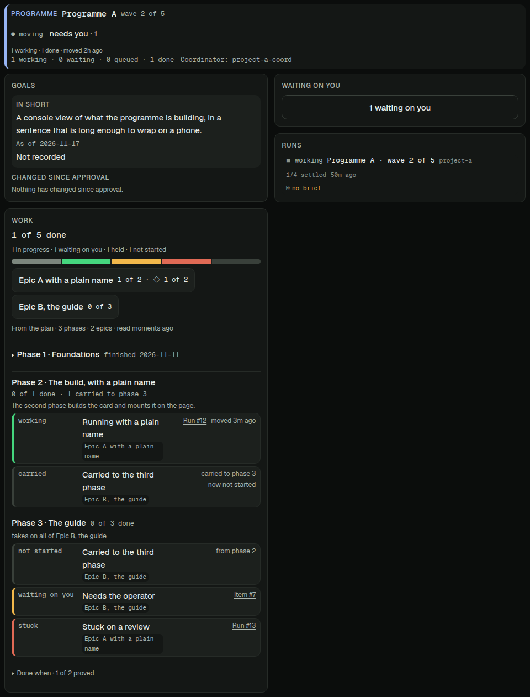
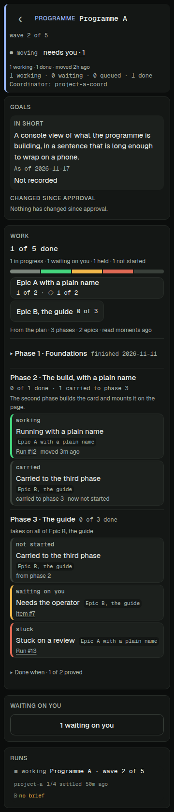

# Task WM4: the task note (desktop polish run 2903, D-8823)

The note for the programme work map's Task WM4, written by its worker for the coordinator to fold into the ledger. Each
claim says whether it was **measured** (read on the tree, in a browser or in a test run by this task) or **inferred**.

## 1. What was built

| Piece | Where | Basis |
|---|---|---|
| `api.plan(slug)` answers `{ ok: true; plan: PlanView; work?: WorkAnswer }`: one type change, the reader already existed | `pwa/src/lib/api.ts` | Measured: the diff is the import and the return type |
| The page's decisions about an answer: a view, an absent `work`, an unreadable `work`, a failed read, what the last view and its time do on each, and the key that moves a re-read | `pwa/src/ledgers/workRead.ts` (L1, pure) | Measured: the pure cases in `programme-screen.test.tsx` and their mutants (§4) |
| The page's state: reads on arrival and when the key moves, drops an answer that arrives after the key moved again | `pwa/src/ledgers/useWorkRead.ts` (L4) | Measured: the stale-answer case and its mutant |
| The card mounted in the left column under Goals, in a `.pv-card`; Waiting on you and Runs in a new right column `.pv-side`, Waiting on you first | `pwa/src/ledgers/ProgrammeScreen.tsx`, `ledgers.css` | Measured: jsdom order cases and the real-Chrome file |
| The card's third answer arm `{ readFailed, last? }`, and `WorkCardAnswer` moved to the words module | `WorkCard.tsx`, `workMapWords.ts` | Measured |
| The card's layout steps: 26rem (narrow tracks) and 40rem (roomy tracks) | `ledgers.css` | Measured in Chrome (§6) |
| The jsdom cases: 26 new in `programme-screen.test.tsx` (64 to 90: the six the plan names, the link cases and the pure cases of `workRead.ts`), 12 new in `work-card.test.tsx` | `pwa/test/` | Measured |
| The real-Chrome file for the card, 13 cases: the width table at 360, 390, 1280, 1470 and 1920 in both skins and both themes, an unreadable re-read, and ordinary titles | `pwa/browser/programme-work-page.browser.test.ts` | Measured |

## 2. Departures, named by slug (the plan's D-8823 entry carries the same list)

Each is **measured** unless it says inferred.

- `page-decides-in-l1`: the plan names `ProgrammeScreen.tsx` alone. The decisions are `workRead.ts` (L1), the state is the hook, and the screen
  only mounts it ("decide in L1, act in L4").
- `failed-read-arm`: the card's `work` prop gains `{ readFailed: string; last? }`. The server's `{ unreadable }` carries one of two words and has no
  place for a refusal's. `WorkCardAnswer` moved from `WorkCard.tsx` to `workMapWords.ts` so the L1 decider reads it without importing a component.
- `first-read-draws-nothing`: no card and no "Reading" line while the first read is pending. Inferred: an older server draws no card, and a card that
  came and went would shift the column.
- `not-ok-is-failed`: an answer that is not `ok`, or whose `work` is neither a view nor `{ unreadable }`, is a failed read ("unreadable answer" when it
  has no `error`). Pinned by two cases and a mutant.
- `work-card-in-pv-card`: the page seats the card in a `.pv-card`, as Goals is seated. Seen in the first picture of the page: the card has no border or
  padding of its own and its heading sat flush with the column edge.
- `pv-side-column`: the right column is a new `.pv-side` beside `.pv-main`; the grid's source order gives the phone's order (Goals, Work, Waiting on you,
  Runs) with no second layout.
- `card-width-steps`: see §6. The plan's "1280 and up: one row" held at 1920 only with one step at 34rem.
- `browser-file-exists`: the plan says Create `pwa/browser/programme-page.browser.test.ts`. That file exists (D-8075: the Runs section and Resume at
  every width, with the o8 column pins). Its column pins are updated to the new order, its fixture answers the plan read, and the Work card's
  cases are the new `programme-work-page.browser.test.ts`. The `run-tally`, `phone-bar` and `one-waiting-page` browser fixtures also open the page,
  so each answers its plan read with one line. Not re-run here (§5): they change a fixture line only.
- `phase-line-writes-every-apart-group`: review 2891 F5. The headline and the phase line share `apartParts`, over `WORK_APART_GROUPS` less `dropped`,
  keyed so a group added there is a compile error. The phase line therefore also writes "· N failed", a count that is zero in a phase today.
- `kicker-left`: inferred. The page head's "Programme" kicker has no programme icon beside it, and the coordinator-badge task (run 2883) does not edit
  `ProgrammeScreen.tsx` (measured from its branch's diff against `main`), so no co-edit was taken and the word stays. If the operator wants it gone
  too, it is a one-line change in the head.
- `step-2-red-after-the-code`: Step 2 is ticked, but the red was taken after the code was written (§3).

## 3. Cases, and what reds each

All in `pwa/test/programme-screen.test.tsx` (jsdom) unless named. The plan's Step 1 names six jsdom cases and the browser table; all six are there.

| Plan's case | Reds when |
|---|---|
| `the Work card sits below Goals` | the card is drawn above Goals, in the other column, or not at all (mutant P19) |
| `Waiting on you heads the right column` | Runs is drawn first (P18), or the card goes in the right column (P19) |
| `a run moving re-reads the plan` (and its item twin) | the key ignores `stuck` (P1), another programme's rows (P2, P3), or an item's state (P4); the read does not follow the key (P13) |
| `an answer with no work draws no card` | a card is drawn for an absent `work` (P7) |
| `a failed read keeps the last view` | the failed read drops the view (P5), or restamps the time (P6); the word is lost (P14) |
| `a failed first read says the work could not be read` | the refusal's word or the sentence changes (P14, P11) |

Added: an unreadable `work` over the last view and alone; the transport's word; a refused answer (`ok: false`); a slow answer arriving after a newer
read (P12, found surviving at first and pinned); a new slug never drawing the last programme's view (P8, P9); the run, item and epic links (P15 to
P17); the card writing neither "Programme" nor "coordinator"; the pure cases of `workRead.ts`. In `work-card.test.tsx`: review 2891 F1 (a) to (e),
F5, and the failed-read arm.

**Red first.** The cases were written before the code and run only once the page was built, so Step 2's red was taken afterwards: run against the
old `ProgrammeScreen.tsx` restored from `HEAD`, 17 of 89 cases were red (the other 72 were the file's existing cases and the pure cases, which load
`workRead.ts` and so pass against the old page). The browser file's red is its first runs: at the plan's 34rem step the 1280 and 1470 cases failed ("expected 1 to be 3" tracks, a
451px and a 532px card). Measured.

## 4. Mutants

Each was applied to a saved copy's text, the suite run through the test slice, and the file restored from the saved copy (verified byte-identical
after each, by the runner). Measured. **Words and card, 14 mutants, all red** (`work-card.test.tsx`): F1 (a) the no-plan source line, (b) the
abandoned plan with no reason, (c) the open checkpoint's state word, (d) the stale filter guard and the no-phases epic filter, (e) three status words;
F5 an apart group dropped from the headline, from the phase line, an outstanding word re-spelt; and three on the failed-read arm. **Page, 20
mutants, 19 red at the first run and one (P12, a late answer applied) survived** until its case was added, then red. The runner is not in the
repository.

## 5. Test runs

Each through `ccrc test`, one run at a time, cd'd into the package, `--maxWorkers=2`, load recorded at each start. The box was loaded throughout
(5 to 24) and the slice's memory cap killed several runs, one after the production build; each was re-run alone once, as the brief says.

| Run | Load at start | Result |
|---|---|---|
| pwa `programme-screen` against the old `ProgrammeScreen.tsx` (red) | 12 | 17 of 89 red |
| pwa `programme-screen` | 12 to 16 | 90 of 90 |
| pwa `work-card` | 12 | 72 of 72 |
| pwa mutants: 14 on the card and words (`work-card`), 20 on the page (`programme-screen`), one run each | 9 to 13 | 33 red at the first run, one survivor (P12) pinned and then red (§4) |
| pwa: `programme-box-card`, `app-lazy`, `control-census`, `contrast`, `waiting-screen` (the importers of `ProgrammeScreen`) | 24 | 4 files, 537 cases; `control-census` could not load (`server/node_modules` missing); after `npm ci` in `server/` it passed in the next run |
| pwa: 15 theme, skin, token, focus, hover, motion, tap-target and layer scanners | 12 | 15 files, 360 cases |
| pwa: 23 words, census and css scanners (`fleet-css`, `shell-css`, `literal-census`, `markup-census`, `role-census`, `shape-census`, `utility-pairs`, `plain-words`, `mockup-census`, `mockup-css`, `ledger-words`, and the rest) | 9 | 23 files, 629 cases |
| pwa: every test importing `lib/api` or `ProgrammeScreen` (175 files, six runs of at most 30) | 4.6 to 20 | 170 files green at the first run; 5 failed at 5 s and 31 s timeouts (`archive-sheet` 2, `ask-inline` 2, `docs-scans` 1, none near this change); the three files re-run alone with `--testTimeout=120000`: 372 of 372 |
| pwa `tsc --noEmit` | 11 | clean (rc 0); an earlier run caught `workRead.ts` importing a type from the component, fixed to the words module |
| pwa browser: `programme-work-page` (13 cases) | 13 to 14 | 13 of 13; its first runs were red at 1280 and 1470 (§3, §6) |
| pwa browser: `programme-page`, `run-tally`, `phone-bar`, `one-waiting-page`, `programme-work-page` together | 11 | 5 files, 119 of 119 |
| server: `single-definition` (the directory, 43 files) | 11 | 42 of 43 files, 1529 cases; `late-census` was killed by the memory cap; alone: 79 of 79 |
| server: `topology-clean` | 14 | killed by the memory cap twice; third run alone on one worker (load 8): 61 of 61 |
| server: `deviation-refs` (after `git fetch origin main`) | 13 | killed by the memory cap once; alone: 34 of 34 |
| server: `dtbd`, the ledger guard suite | 11 | 1 of 1, 32 of 32 |

Not run: the macOS legs, the whole server suite (CI's) and CI itself. A memory-cap kill was never counted as a result: each killed file was re-run
alone, and the table says so where it happened.

## 6. What was seen in a real browser

Measured, in Chrome over the production build, from the new file (13 cases) with `CCRC_SHOTS` set; each picture was viewed.

- **The width table** at 360, 390, 1280, 1470 and 1920, in both skins and both themes: the page does not scroll sideways, no element is wider than its
  box, no ellipsis, no phase title, ticket title, epic tag or chip title is clipped or outside the card, with a 130-character unbroken title and a long
  epic and phase title, and the folded groups opened as well as closed. Phone: one column, Goals, Work, Waiting on you, Runs, a row stacks. From 1280:
  Work under Goals at the same left edge, Waiting on you level with Goals' top and Runs under it, a row on three columns.
- **What the browser found that the jsdom could not**, and was fixed before the pictures: the card sat flush with the column edge (it has no box of its
  own), so the page seats it in a `.pv-card`; and the left column is a 451px card at a 1280 window and 532px at 1470, below the card's 34rem step, so a
  row stayed stacked at 1280 and 1470. Two steps now: from 26rem a row is a 6.75rem status, the title with its tag, and a 10rem facts column; from
  40rem it is 7.5rem and 14rem. The status column was 5.75rem first and wrapped "waiting on you" in two lines; 6.75rem keeps it on one.
- **The finished phase's heading**, which no one had seen in a browser (review 2891 F2): it reads "▸ Phase 1 · Foundations finished 2026-11-11" in the
  same size as an open phase's, with its chevron, at 360 and 1280, light and dark.
- **An unreadable re-read** (the fleet's runs frame moves the run, the page reads again, the server's answer is `{ unreadable }`): the alert reads
  "The work could not be read: the runs could not be read" over the last view, which stays drawn, at 360 and 1280.
- Not done: a touch device, a screen reader, a real programme's long plan on the page (§8 does the numbers, not the look), and the Instrument skin at
  1280 (it was in the width table's measurements, and its 360 picture was viewed).

Pictures, `docs/design/2026-11-16-programme-work-map-design/wm4/` (ordinary titles unless it says):

| Image | What |
|---|---|
|  | the page at a 1280 window, light |
|  | the same, dark |
|  | a phone, light |
|  | a phone, dark |
|  | the stress fixture, 130-character titles, 360 |
|  | an unreadable re-read over the last view, 1280 |
|  | the same on a phone, the Instrument skin, dark |

Four of WM3's stale pictures (`wm3/phased-1280-light.png`, `phased-360-light.png`, `phased-1280-dark.png`, `unreadable-1280-light.png`) are replaced in
place by the page's pictures of the same states, so the links in WM3's note keep working. Their captions in that note ("684 px card") now describe
a 451px card; that note is not edited here (an existing note under `programs/`).

## 7. Carried from review 2891 (WM3's review)

| Finding | What was done |
|---|---|
| F1 (a) to (e): five survivors | Pinned in `work-card.test.tsx` (a "review 2891 F1" block), each red under its mutant (§4) |
| F2: the card on the page in a browser, the finished phase's heading, fresh pictures | §6. The pictures replace WM3's stale ones |
| F3: does a note's link satisfy "linked from the spec"? | Not mine to rule: the images are linked from this note and the spec is unclaimed by this task. Left for the coordinator's ruling |
| F4: "left open" against Table 6's "left open when the plan closed" | Not mine to rule; the card keeps "left open" (the pinned word) |
| F5: derive the headline's apart groups from `WORK_APART_GROUPS` | Done (`phase-line-writes-every-apart-group`) |
| F6: `new Set(phase.carriedOut)` built twice | Carried: it touches no line this task changes, and the field is typed required |
| F7 to F9, F11, F12: counts and wording in WM3's note | Not edited: they are in an existing note under `programs/`. Noted: C7 is missing from the mutant list there, and the plan's "cannot load" reads "no case runs" |
| F10: the comment on `WORK_APART_GROUPS` | Not touched: `shared/plan.ts` is held by another worker's claim, and no line of it changes here |
| F13: the 400-character case asserts echo, and the words case checks one fixture | The new "neither Programme nor coordinator" case on the page covers the card as mounted; the 400-character case is layout, pinned in Chrome by the 130-character title |
| F14: the server tests compile check fails on agent files | Environmental, as WM3 measured (agent dependencies not installed here); CI's typecheck is the arbiter |

## 8. Acceptance

"On the live console, one programme with a stored plan and one without each match `plan show` and the runs list." The console is behind sign-in and
this workspace cannot reach it, so this is **measured on the local build against the live server's own answers**, and **the live check is the
operator's**. The live server already serves `work` (WM2 is deployed): `ccrc-api plan show` answered for each programme, and the page was drawn
from exactly that answer in Chrome (a throw-away case, not in the repository, and its fixture data stays on the box).

| Programme | `plan show` (the live server's answer) | The page, drawn from that answer (1280, Refined, light) | The runs list |
|---|---|---|---|
| One with a stored plan, no phases | `source: plan`, 10 tickets, done 7, in progress 3 | "7 of 10 done", "3 in progress", "From the plan · 7 epics", "No phases declared: grouped by epic", 10 rows, folds "2 done", "3 done", "1 done", "1 done" | 3 open runs, matching the 3 in progress |
| One with no plan | `source: runs`, 142 runs, done 130, in progress 3, failed 9 | "130 work runs done · 9 failed", "3 in progress", "From the work runs so far", "No plan declared, so what remains is not known…", 142 rows, folds "130 done" and "9 failed" | 3 open runs, matching the 3 in progress |

Measured: both pages' counts equal the answers' counts, and the open-run counts equal the runs list's (`ccrc-api runs list`, read the same minute). The
live console itself was not reached, so **what it shows, signed in, is the operator's to confirm.**

## 9. Records and claims

- Claims (measured from the claim list on 2026-11-20): 5877 (the page, the card, its words and css, the two jsdom files, the existing browser file, the
  note and the pictures' folder), 5880 (`workRead.ts`, `useWorkRead.ts`), 5884 (the new browser file), 5885 (`run-tally`, `phone-bar` and
  `one-waiting-page` browser fixtures), 5899 (the plan and WM3's stale pictures).
- `pwa/src/lib/api.ts`, claim 5826 (the Docs reader's range wave, run 2743): its worker consented by mail on 2026-11-20 to a co-edit of the
  `plan(slug)` lines only, and said that whoever lands second merges `main` and keeps both. My change to the file is the import and that line.
- The plan was held by WM3's worker (claim 5806); that session no longer exists (the mail to it was refused `unknown-recipient`) and the claim was
  off the list by the time this task edited the plan, so the edit is under this task's own claim 5899. Inferred: its PR (#3105) merged and its
  claim lapsed.
- Every commit that changes the plan, and the head, carries `Ledger-Edit: D-8823` in its last paragraph, with the `Co-Authored-By` trailer.
- One overwrite, caught at once: the first draft of the browser file was written to the path the plan names, which already held D-8075's file. It was
  restored from `HEAD` (`git show`) before anything else read it, and the new file has its own name.

## 10. Carries

- The kicker "Programme" on the page head stays (`kicker-left`).
- The F3 and F4 rulings of review 2891, and the plan's `epicHref` links to an epic page that exists (its Task 5.3 is built: the checkpoint row's "Open
  the epic" now opens it).
- `STATUS_WORD`, `CHECKPOINT_KIND_WORD` and `UNREADABLE_WHY` still have no fallback for a word from a newer server (WM3's F15, unchanged).
- The live render, on the operator's console, with a real programme's plan.
