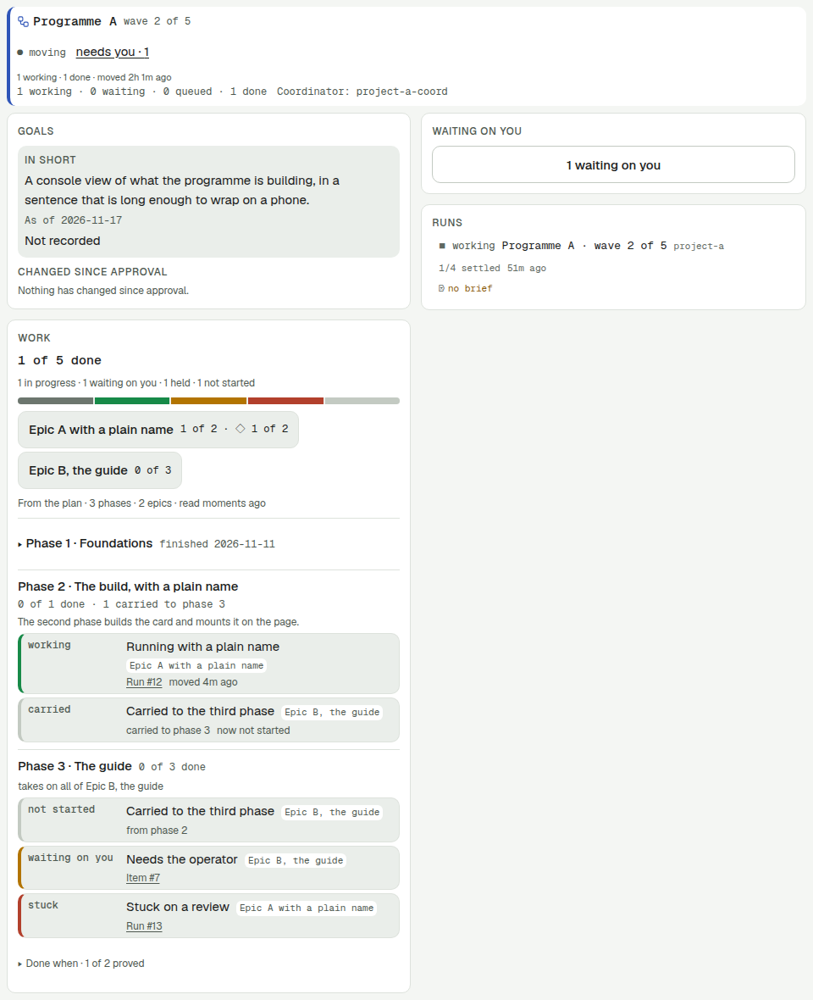
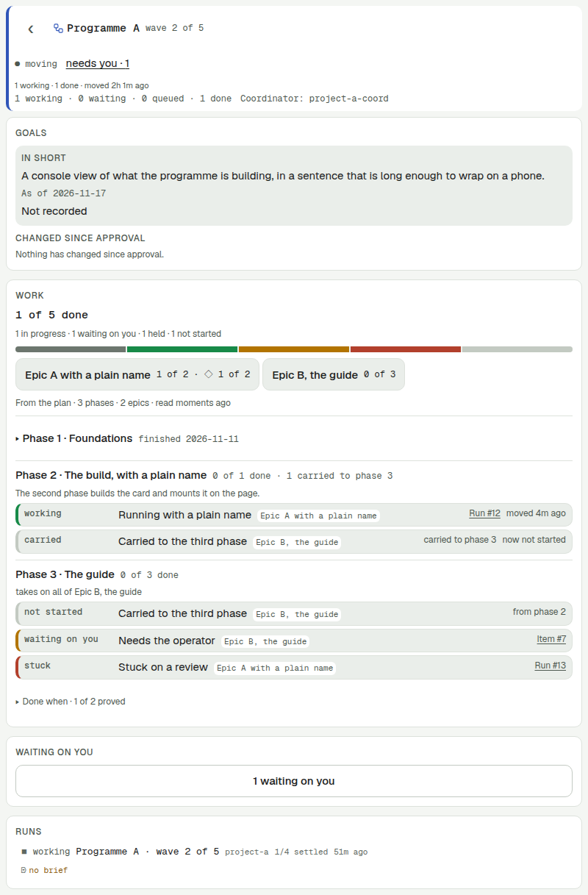
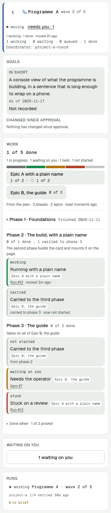
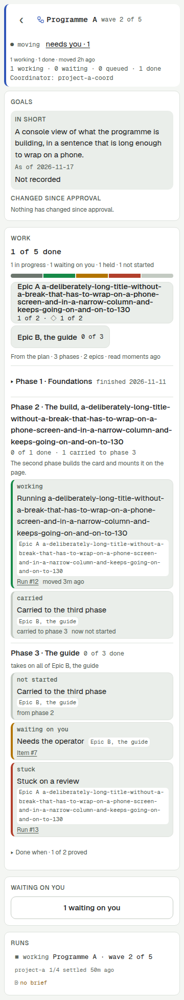
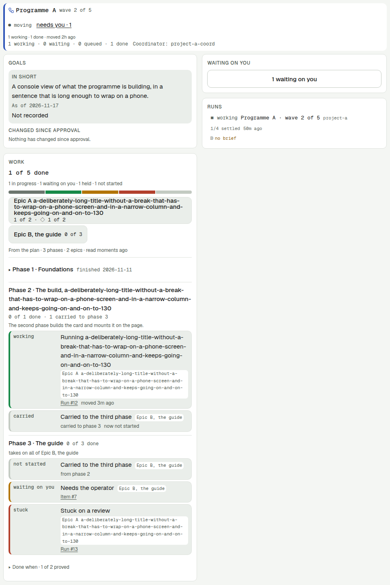
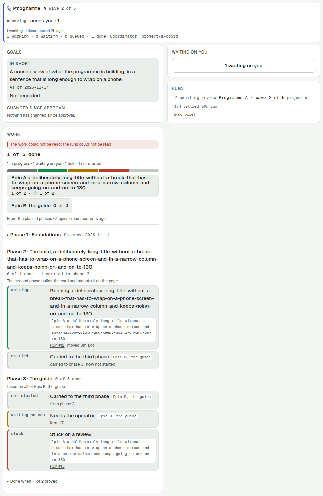
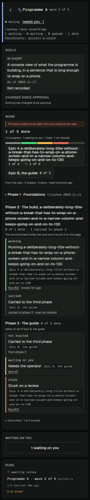

# Task WM4: the task note (desktop polish run 2903, D-8823)

The note for the programme work map's Task WM4, written by its worker for the coordinator to fold into the ledger. Each
claim says whether it was **measured** (read on the tree, in a browser or in a test run by this task) or **inferred**. It
describes the tip after fix round 1 (review 2922); where the first push differed, it says so.

## 1. What was built

| Piece | Where | Basis |
|---|---|---|
| `api.plan(slug)` answers `{ ok: true; plan: PlanView; work?: WorkAnswer }`: one type change, the reader already existed | `pwa/src/lib/api.ts` | Measured: the diff is the import and the return type |
| The page's decisions about an answer: a view, an absent `work`, an unreadable `work`, a failed read, what the last view and its time do on each, and the key that moves a re-read | `pwa/src/ledgers/workRead.ts` (L1, pure) | Measured: the pure cases in `programme-screen.test.tsx` and their mutants (§4) |
| The page's state: reads on arrival and when the key moves, drops an answer, success or failure, that arrives after the key moved again | `pwa/src/ledgers/useWorkRead.ts` (L4) | Measured: the two late-answer cases and their mutants |
| The card mounted in the left column under Goals, in a `.pv-card`; Waiting on you and Runs in a new right column `.pv-side`, Waiting on you first | `pwa/src/ledgers/ProgrammeScreen.tsx`, `ledgers.css` | Measured: jsdom order cases and the real-Chrome file |
| The card's third answer arm `{ readFailed, last? }`, `WorkCardAnswer` and `UNREADABLE_WORDS` in the words module | `WorkCard.tsx`, `workMapWords.ts` | Measured |
| The card's layout steps: two columns from a 26rem card (status beside the title, the facts under it), three from 40rem | `ledgers.css` | Measured in Chrome (§6) |
| The jsdom cases: 32 new in `programme-screen.test.tsx` (64 to 96), 12 new in `work-card.test.tsx` (60 to 72) | `pwa/test/` | Measured: the counts at the tip |
| The real-Chrome file for the card, 16 cases: the width table at 360, 390, 800, 1280, 1470 and 1920 in both skins and both themes, an unreadable re-read, ordinary titles | `pwa/browser/programme-work-page.browser.test.ts` | Measured |

## 2. Departures, named by slug (the plan's D-8823 entry carries the same list)

Each is **measured** unless it says inferred.

- `page-decides-in-l1`: the plan names `ProgrammeScreen.tsx` alone. The decisions are `workRead.ts` (L1), the state is the hook, and the screen
  only mounts it ("decide in L1, act in L4").
- `failed-read-arm`: the card's `work` prop gains `{ readFailed: string; last? }`. The server's `{ unreadable }` carries one of two words and has no
  place for a refusal's. `WorkCardAnswer` moved from `WorkCard.tsx` to `workMapWords.ts` so the L1 decider reads it without importing a component.
- `first-read-draws-nothing`: no card and no "Reading" line while the first read is pending. Inferred: an older server draws no card, and a card that
  came and went would shift the column.
- `not-ok-is-failed`: an answer that is not `ok`, or whose `work` is neither a view nor `{ unreadable }`, is a failed read ("unreadable answer" when it
  has no `error`). Pinned by cases and mutants.
- `work-read-checks-its-words` (review 2922 F3): the decider checks the unreadable word with `isOneOf` against `UNREADABLE_WORDS`, the keys of the
  card's own word table, and checks that `items`, `phases`, `notInPhase`, `epics`, `initiatives` and `doneWhen` are lists and `counts` an object. Anything
  less falls to the failed-read arm. The word list stays in `workMapWords.ts`, beside the table it is the keys of, and not in `shared/plan.ts` (no
  co-edit was needed); a home in `shared/plan.ts` is a carry (§8).
- `key-chosen-in-l1` (A5): `planKey(slug, runs, waiting)` takes the list and chooses which items count (its open and cleared ones); the screen only calls it.
- `work-card-in-pv-card`: the page seats the card in a `.pv-card`, as Goals is seated. Seen in the first picture of the page: the card has no border or
  padding of its own and its heading sat flush with the column edge.
- `pv-side-column`: the right column is a new `.pv-side` beside `.pv-main`; the grid's source order gives the phone's order (Goals, Work, Waiting on you,
  Runs) with no second layout.
- `card-width-steps` (review 2922 F2 changed it): see §6. The plan's "1280 and up: one row" held at 1920 only with one step at 34rem. The first fix (three
  tracks from 26rem) left a title about 146px of room at 1280 against about 280px on a phone. Now, from 26rem a row is two columns, a 6.75rem status track
  beside the title with its tag and the facts on a row of their own under the title; the plan's three-column row starts at 40rem. The choice was the cheapest
  of the three the coordinator named (a wider step, a narrower status track, facts under the title): facts under the title costs no new rule and gives a
  title more room than a phone's.
- `browser-file-exists`: the plan says Create `pwa/browser/programme-page.browser.test.ts`. That file exists (D-8075: the Runs section and Resume at
  every width, with the o8 column pins). Its column pins are updated to the new order, its fixture answers the plan read, and the Work card's cases are the
  new `programme-work-page.browser.test.ts`. The `run-tally`, `phone-bar` and `one-waiting-page` browser fixtures also open the page, so each answers its
  plan read with one line; they change a fixture line only, and were run once, together, at the first push (§5).
- `phase-line-writes-every-apart-group`: review 2891 F5. The headline and the phase line share `apartParts`, over `WORK_APART_GROUPS` less `dropped`,
  keyed so a group added there is a compile error. The phase line therefore also writes "· N failed", a count that is zero in a phase today.
- `head-icon-not-word` (the coordinator's amendment of fix round 1, F1, which replaced his first ruling to keep the word): the page head's visible "Programme"
  kicker is removed and the programme icon the box draws (`RoleBadge`, icon `workflow`, label and title "Programme", class `pv-ico`) stands before the title, in
  one box with it (`pv-name`) so it adds no line to the head, sized to the title's text (`1em`) and in the programme's hue. The operator's note of 2026-11-19
  reads: "We don't need to write the word "Programme" when we use the programme icon and colours and also the wave timer." The head already carries two of its
  three cues, the programme's colour and its wave line (`pv-sub`), and the operator ruled on 2026-11-20, weighing compactness and usability, that the word goes
  there too, so the head and the box speak one language and a screen reader still hears "Programme". The contrast audit's kicker row is the icon's now, one row
  per hue. Measured: the coordinator-badge task (run 2883, #3111) does not edit `ProgrammeScreen.tsx` (`git diff` of its branch against `main` is empty for that
  file, read while its PR was open and again after it merged); its badge reached this branch by the next departure.
- `absorbs-main-once`: on the coordinator's word, in the amendment's mail ("one `git merge` of `origin/main` into `ws/polish-wm4`, no rebase and no force; do not copy
  the files by hand"), one merge of `origin/main` as its own commit with `Ledger-Edit: D-8823`, because `RoleBadge` and the box's badge rows live only on main
  and the head's icon and the contrast row need them. The probe before it was clean (`merge-tree` exit 0) and the merge made no conflict. The merge commit and its
  two parents are in the wave-done mail.
- `step-2-red-after-the-code`: Step 2 is ticked, but the red was taken after the code was written (§3).

## 3. Cases, and what reds each

All in `pwa/test/programme-screen.test.tsx` (jsdom) unless named. The plan's Step 1 names six jsdom cases and the browser table; all six are there.

| Plan's case | Reds when |
|---|---|
| `the Work card sits below Goals` | the card is drawn above Goals, in the other column, or not at all (mutant P19) |
| `Waiting on you heads the right column` | Runs is drawn first (P18), or the card goes in the right column (P19) |
| `a run moving re-reads the plan` (and its item twin) | the key ignores `stuck` (P1), another programme's rows (P2, P3), an item's state (P4) or a cleared item (A5); the read does not follow the key (P13) |
| `an answer with no work draws no card` | a card is drawn for an absent `work` (P7) |
| `a failed read keeps the last view` | the failed read drops the view (P5), or restamps the time (P6); the word is lost (P14) |
| `a failed first read says the work could not be read` | the refusal's word or the sentence changes (P14, P11) |

Added at the first push: an unreadable `work` over the last view and alone; the transport's word; a refused answer (`ok: false`); a slow answer
arriving after a newer read (P12, found surviving at first and pinned); a different slug never drawing the last programme's view (P8, P9, pinned by the
pure case); the run, item and epic links (P15 to P17); the card writing neither "Programme" nor "coordinator"; the pure cases of `workRead.ts`. In
`work-card.test.tsx`: review 2891 F1 (a) to (e), F5, and the failed-read arm. **Fix round 1 (review 2922) added:** F3 (an unknown word and a view missing
any one list or `counts`, pure and on the page); F4 (a view, then an absent `work`, then a failed or unreadable read: `last` is null, pure and on the page);
F5 (the older read rejecting after the newer one answered); A5 (the cleared items count, the list chooses); and A6, the page case that claimed to pin the
slug guard is renamed "a different slug's page asks for its own plan and draws no card until that answers", since its rerender drops the key and React
mounts fresh; the pure case pins the guard.

**Red first.** The cases were written before the code and run only once the page was built, so Step 2's red was taken afterwards: run against the
old `ProgrammeScreen.tsx` (restored from the merge base with `git show`, the file restored from a saved copy and compared byte for byte), **21 of 96 cases were
red at fix round 1's tip** (18 of 90 at the first push; the first note said 17 of 89, which was one run earlier than the last case added). The other cases are
the file's existing ones and the pure cases, which load `workRead.ts` and so pass against the old page. The browser file's red is its first runs: at the
plan's 34rem step the 1280 and 1470 cases failed ("expected 1 to be 3" tracks, a 451px and a 532px card), and at fix round 1 the F2 pins are red under the first
fix's three-track layout (§4). Measured.

**The amendment's cases (red first, at the merged tip, before the head changed):** `draws no visible "Programme" word, and no kicker` (the head's text,
with a programme titled "Billing", names no programme, and it has no `.pv-kicker`) and `its programme icon is an image named Programme, with the same title,
standing before the title on its line` (an `img` with `aria-label` and `title` "Programme", an `svg`, the heading's previous sibling in one `pv-name` box). Measured:
2 of 98 red at that tip, the other 96 green; both green after the change. The Chrome file also pins, at every sampled width, no kicker, the icon before the title,
on its line and sized to its text. The contrast case now measures the icon's rule, one row per hue (`.pv-head .pv-ico`).

## 4. Mutants

Each was applied to a saved copy's text, the suite run through the test slice, and the file restored from the saved copy (the runner compares the
restored file byte for byte with the original after each; it is not in the repository). Every edit below is the whole mutation. Measured.

**The card and its words, 14 mutants, all red** (`work-card.test.tsx`):

| # | The edit | Red cases |
|---|---|---|
| F1a | the source line always writes "From the plan" | (a) the no-plan source line |
| F1b | the abandoned headline always appends ": " and the reason | (b) the abandoned plan with no reason |
| F1c | a checkpoint's state word is always taken from the met branch | (c) the open checkpoint's state |
| F1d-i | the held epic filter is no longer checked against the view's epics | (d) the stale filter |
| F1d-ii | the no-phases epic groups ignore the filter | (d) the no-phases chip tap |
| F1e-blocked, -queued, -stuck | `blocked` reads "held up", `queued` "waiting in line", `stuck` "stalled" | (e) the status words against Table 6 |
| F5-apart-failed | `failed` is removed from the apart groups | the headline and phase-line apart cases (4) |
| F5-phase-no-apart | the phase line no longer writes apart counts | five phase-line cases |
| F5-outstanding-word | the outstanding word for waiting on you reads "awaiting you" | two outstanding-line cases |
| A1 | the failed-read note is not drawn | two failed-read cases |
| A2 | the failed-read arm drops the last view | the over-the-last-view case |
| A3 | the failed-read sentence reads "The work could not be read - <word>" | three cases |

**The page, 27 mutants (`programme-screen.test.tsx`), all red; at the first push one, P12, survived until its case was added:**

| # | The edit |
|---|---|
| P1 | the key drops the stuck bit |
| P2 | the key takes every programme's runs |
| P3 | the key takes every programme's items |
| P4 | the key drops an item's state |
| P5 | a failed read drops the last view |
| P6 | a failed read restamps the time of the last good read |
| P7 | an absent `work` keeps the last view |
| P8 | the state held for another slug is carried into this slug's read |
| P9 | the card is drawn from a state held for another slug |
| P10 | an unreadable `work` restamps the time |
| P11 | an answer that is not `ok` passes as a view |
| P12 | the cleanup's `live = false` is removed, so a late answer is applied |
| P13 | the effect depends on the slug alone, not the key |
| P14 | a failed read's word is replaced by "failed" |
| P15 | the card is given no `epicHref` |
| P16 | `itemHref` links every item, held or not |
| P17 | `runHref` spells the run's path `/r/<id>` |
| P18 | Runs is drawn before Waiting on you |
| P19 | a "Work" section is drawn in the right column and the card removed from the left |
| P20 | the `.pv-side` rule is removed from the css, leaving `.pv-main` alone |
| F4 | an absent `work` keeps the last view (the pure and the page cases of review 2922 F4 are red; P7 is the first push's twin) |
| F5 | the failure arm applies even when stale (`if (live)` removed on the rejection arm only) |
| F3a | any string is accepted as an unreadable word |
| F3b, F3c, F3d | `epics`, `doneWhen`, or the `counts` check is removed from the view's shape |
| A5 | the key's items leave out the cleared ones |

**The amendment, 5 mutants on the head (`programme-screen.test.tsx`) and 2 on its colour (`contrast.test.ts`), all red** (H2 survived until the case read the
icon's `aria-label`: an `img` with no label takes its name from its `title`, so the accessible name was the same, and the label is now pinned by its attribute):

| # | The edit | Red cases |
|---|---|---|
| H1 | the kicker `Programme` is drawn again before the name box | the no-word case |
| H2 | the icon's `label` is "" | the icon case |
| H3 | the icon's `title` is "" | the icon case |
| H4 | the icon is drawn after the title | the icon case |
| H5 | the icon is drawn outside the title's box | the icon case |
| C1 | the icon's colour is a faint ink (`--ink-disabled`) | six contrast cases |
| C2 | the icon's rule is renamed (`.pv-icon`), so no row is measured for `.pv-ico` | the icon's per-hue case |

**The browser file, 4 mutants for the layout pins, all red** (`programme-work-page.browser.test.ts`): the first fix's three tracks from 26rem with the
facts beside the title (red at 1280, 1470, 1920, and the 1280 ordinary-titles cases); the 40rem step never applying (red at 800, the one sampled width
between 690 and 900); the status track 14rem wide (red at 1280 and up); and an epic tag capped at 4ch so it breaks inside its words (red in the six ordinary-
titles cases).

## 5. Test runs

Each through `ccrc test`, one file per process, cd'd into the package, `--maxWorkers=2`, load recorded at each start. The box was loaded throughout and
the slice's memory cap killed several runs; each killed file was re-run alone, and the table says so where it happened.

**Fix round 1 (the tip):**

| Run (one file per process) | Load at start | Result |
|---|---|---|
| pwa `programme-screen` | 15 | 96 of 96 |
| pwa `work-card` | 18 | 72 of 72 |
| pwa `contrast` | 18 | 367 of 367 |
| pwa words and css scanners: `plain-words`, `ledger-words`, `fleet-css`, `literal-census`, `markup-census`, `shape-census`, `role-census`, `utility-pairs`, `tap-targets`, `hook-class-collision`, `control-census` | 17 to 24 | 65, 86, 102, 5, 11, 7, 10, 26, 96, 10 and 12 cases, all passed |
| pwa `browser-dist` | 17 | 15 of 15 |
| pwa `tsc --noEmit` | 18 | red once: the new browser file's `want[0]` was possibly undefined (`noUncheckedIndexedAccess`); typed as a tuple; then clean (load 6, rc 0) |
| pwa browser `programme-work-page` | 17 | not run the first time: the Chrome the script named (`chromium-1248`) had been replaced on the box by `chromium-1243`; then 16 of 16 (load 19) |
| pwa browser `programme-page` | 7 | 17 of 20: three 1920 cases failed on the page's own heartbeat word ("last seen 40m ago") after a 31 s load stall, a time-dependent assertion of an existing case; re-run alone once at load 9: 20 of 20 |
| server `single-definition` (the directory) | 18 | 42 of 43 files, 1531 cases; `late-census` was killed by the memory cap, killed again alone at load 30, and passed 79 of 79 on its third run on one worker (load 23) |
| server `rings` (the directory, with the wire-guard kit's one-owner scan) | 9 | 12 files, 133 cases |
| server `topology-clean` (one worker) | 8 | 61 of 61 |
| server `deviation-refs` (after `git fetch origin main`) | 7 | 34 of 34 |
| server `dtbd`, the ledger guard suite | 8 | 1 of 1, 32 of 32 |
| the ledger guard script as CI runs it, and the private-names scan of the tree (the canonical scanner with the operator's local list) | after the commits | the guard passed by the `Ledger-Edit` trailer with the layout arm ok; the scan exited 0 with empty output |

**The F1 amendment (the tip), after the land-sync merge** (one file per process, `--maxWorkers=2`, load at each start; the Chrome was `chromium-1243`):

| Run | Load | Result |
|---|---|---|
| pwa `programme-screen` | 27 | 98 of 98 (the two head cases were red at the merged tip before the change: 2 of 98) |
| pwa `work-card` | 28 | 72 of 72 |
| pwa `contrast` (the icon's per-hue rows; mutants C1, C2 red) | 28 | 367 of 367 |
| pwa `programme-box-card`, `older-server-render` | 8 to 11 | 67 of 67, 1 of 1 |
| pwa `coordinator-badge` | 7 | 14 of 15 at the first run: the case that pinned the page head's kicker went red, as it should; edited with C51's consent (§10); alone: 15 of 15 |
| pwa words and css scanners: `plain-words`, `ledger-words`, `fleet-css`, `literal-census`, `markup-census`, `shape-census`, `role-census`, `utility-pairs`, `tap-targets`, `hook-class-collision`, `control-census` | 13 to 24 | all passed (65, 86, 102, 5, 11, 7, 10, 26, 96, 10, 12 cases) |
| pwa `browser-dist` | 22 | 15 of 15 |
| pwa `tsc --noEmit` | 26 | clean |
| pwa browser `programme-work-page` (16 cases, the head's icon pinned at every width), `programme-page`, `programme-box` (the head probe now reads the icon) | 6 to 8 | 16 of 16, 20 of 20, 60 of 60 |
| server `single-definition` (the directory) | 19 | 43 of 43 files, 1550 cases |
| server `rings` (the directory), `dtbd`, the ledger guard suite | 14 to 16 | 12 files and 133 cases, 1 of 1, 32 of 32 |
| server `topology-clean`, `deviation-refs` | 11 to 26 | **not green here**: killed by the test slice's memory cap in every one of eight runs each (alone, one worker, at load 11 to 26), after 6 to 43 cases. Both passed at the fix round's tip (61 of 61, 34 of 34) and read the branch's history, which the land-sync merge now makes larger. CI's `test (server)` is the arbiter; the PR's plan lists whether it ran them |

**First push (the earlier tip), for the record:**

| Run | Result |
|---|---|
| pwa `programme-screen` against the old page (red), then at the tip | 17 of 89 red; then 90 of 90 |
| pwa `work-card` | 72 of 72 |
| pwa mutants | 14 on the card, 20 on the page: 33 red at the first run, one survivor pinned (§4) |
| pwa: the importers of `ProgrammeScreen` (5 files), 15 theme, skin, token, focus, hover, motion, tap-target and layer scanners, 23 words, census and css scanners | 537, 360 and 629 cases, all passed; `control-census` could not load before `npm ci` in `server/` |
| pwa: every file that imports `lib/api` or `ProgrammeScreen`: 175 files, of which 172 are test files and 3 are fixtures, in six runs of at most 30 | 169 test files green at the first run; three files held five cases that failed at 5 s and 31 s timeouts in `archive-sheet`, `ask-inline` and `docs-scans`, none near this change, and the three files re-run alone with `--testTimeout=120000`: 372 of 372 |
| pwa `tsc --noEmit` | clean |
| pwa browser: `programme-work-page` (13 cases) | 13 of 13; its first runs were red at 1280 and 1470 |
| pwa browser: `programme-page`, `run-tally`, `phone-bar`, `one-waiting-page` and `programme-work-page` together in one process (against the one-file rule of fix round 1; they were not run apart at that push) | 5 files, 119 of 119 |
| server: `single-definition`, `topology-clean`, `deviation-refs`, `dtbd`, the ledger guard suite | 42 of 43 files then `late-census` alone 79 of 79; `topology-clean` killed twice, 61 of 61 on its third run alone on one worker; `deviation-refs` killed once, 34 of 34 alone; 1 of 1; 32 of 32 |

CI's first run of the PR's tip found two guards the lists had not reached: `browser-dist` (the new browser file served `sharedDist()` inline, not as
`dist = sharedDist()` then `serveDist(dist)`) and the wire-guard kit's one-owner scan in `server/test/rings` (`workRead.ts` had its own `isRecord`; it now
imports the kit's, from `lib/wire.ts`). Both were fixed in one commit and the files, with the whole `server/test/rings` directory, re-run green. A pwa change's
list of runs should name `server/test/rings` and `browser-dist`.

Not run: the macOS legs and the whole server suite (CI's).

## 6. What was seen in a real browser

Measured, in Chrome over the production build, from the new file (16 cases) with `CCRC_SHOTS` set; each picture below was viewed.

- **The width table** at 360, 390, 800, 1280, 1470 and 1920, in both skins and both themes: the page does not scroll sideways, no element is wider than
  its box, no ellipsis, no phase title, ticket title, epic tag or chip title is clipped or outside the card, with a 130-character unbroken title and a long
  epic and phase title, and the folded groups opened as well as closed. Under 900: one column, Goals, Work, Waiting on you, Runs. From 900: Work under Goals at
  the same left edge, Waiting on you level with Goals' top and Runs under it.
- **A ticket's row follows the card's own width** (`card-width-steps`): one column under 26rem (a phone), two from 26rem (a 451px card at a 1280 window and
  532px at 1470: a 6.75rem status track beside the title, the facts under it), three from 40rem (the 800 window, a card as wide as the page, and 1920: a
  7.5rem status track, the title, a 14rem facts column). The title's room (the `.wk-what` of an ordinary ticket) is at least its 360 room at every sampled width,
  and an ordinary epic tag stays on one line at 360, 800 and 1280, so it never breaks inside a word (review 2922 F2).
- **What the browser found that the jsdom could not:** the card sat flush with the column edge (`work-card-in-pv-card`); the left column is narrower than the
  plan's table assumed (one 34rem step stacked a row at 1280 and 1470); and the first fix for that squeezed the title (about 146px at 1280, review 2922 F2),
  which the facts-under-the-title layout cures.
- **The head** (the amendment): no "Programme" word; the programme icon, in the programme's hue, stands before the title on its line, as tall as its text, and
  the head is no taller than before. Seen in the pictures below at 360, 800 and 1280, light and dark.
- **The finished phase's heading**, which no one had seen in a browser (review 2891 F2): it reads "▸ Phase 1 · Foundations finished 2026-11-11" in the same size as
  an open phase's, with its chevron, at 360, 800 and 1280, light and dark.
- **An unreadable re-read** (the fleet's runs frame moves the run, the page reads again, the server's answer is `{ unreadable }`): the alert reads "The work
  could not be read: the runs could not be read" over the last view, which stays drawn, at 360 and 1280.
- Not done: a touch device, a screen reader, a real programme's long plan on the page (§9 does the numbers, not the look), and pictures at 390, 1470 and 1920 or
  of Instrument light (the geometry at every sampled width, skin and theme is asserted by the file; the regenerated pictures at those sizes show the same order and
  nothing clipped, per the reviewer, and were not committed).

Pictures, `docs/design/2026-11-16-programme-work-map-design/wm4/` (ordinary titles unless it says):

| Image | What |
|---|---|
|  | the page at a 1280 window, light |
|  | the same, dark |
|  | an 800 window: one column, the card as wide as the page, the three-column row |
|  | a phone, light |
|  | a phone, dark |
|  | the stress fixture, 130-character titles, 360 |
|  | the stress fixture at 1280 |
|  | an unreadable re-read over the last view, 1280 |
|  | the same on a phone, the Instrument skin, dark |

Four of WM3's stale pictures (`wm3/phased-1280-light.png`, `phased-360-light.png`, `phased-1280-dark.png`, `unreadable-1280-light.png`) are replaced in
place by the page's pictures of the same states (all pictures re-taken after the amendment, so every one shows the icon in the head), and their captions in `wm3.md` are corrected to say so (review 2922 A2; an edit of an existing note, with
this task's own claim 5951 and the coordinator's ask).

## 7. Carried from review 2891 (WM3's review)

| Finding | What was done |
|---|---|
| F1 (a) to (e): five survivors | Pinned in `work-card.test.tsx` (a "review 2891 F1" block), each red under its mutant (§4) |
| F2: the card on the page in a browser, the finished phase's heading, fresh pictures | §6. The pictures replace WM3's stale ones |
| F3: does a note's link satisfy "linked from the spec"? | Not mine to rule; left for the coordinator |
| F4: "left open" against Table 6's "left open when the plan closed" | Not mine to rule; the card keeps "left open" |
| F5: derive the headline's apart groups from `WORK_APART_GROUPS` | Done (`phase-line-writes-every-apart-group`) |
| F6: `new Set(phase.carriedOut)` built twice | Carried: it touches no line this task changes, and the field is typed required |
| F7 to F9, F11, F12: counts and wording in WM3's note | Not edited, except the four captions of F2: they are in an existing note under `programs/` |
| F10: the comment on `WORK_APART_GROUPS` | Not touched: `shared/plan.ts` is held by another worker's claim, and no line of it changes here |
| F13: the 400-character case asserts echo | Pinned in Chrome by the 130-character title |
| F14: the server tests compile check fails on agent files | Environmental (agent dependencies not installed here); CI's typecheck is the arbiter |

## 8. Review 2922 (this task's review) and the carries

| Finding | What was done |
|---|---|
| F1: the head's kicker | First kept by the coordinator's ruling, then replaced by his amendment (the operator's ruling of 2026-11-20): the word is removed and the programme icon stands before the title (§2 `head-icon-not-word`); two red-first cases and five mutants (§3, §4); the contrast row is the icon's; pictures re-taken |
| F2: a title's room on desktop | Fixed: the facts under the title from a 26rem card, three columns from 40rem; pinned in Chrome (title track at least the 360 one at every sampled width, an ordinary tag on one line); pictures re-taken |
| F3: the work read's checks | Fixed in `workRead.ts`; the word list is `UNREADABLE_WORDS` in `workMapWords.ts`; a home in `shared/plan.ts` is a carry (it needs a co-edit of a file other workers hold) |
| F4, F5: the two test gaps | Pure and page cases for F4, a rejection case for F5, each red under its mutant (§4) |
| A1 to A4, A8: the records | The note and the plan are corrected: the counts (172 test files and 3 fixtures in the importer run; 21 of 96 at the tip), the kicker's label (measured), the browser files run one per process this round, and every mutant is described as its edit (§4) |
| A5: the key's items | `planKey(slug, runs, waiting)`; the screen only calls it |
| A6: the slug-guard case's name | Renamed; the pure case pins the guard |
| A7: the second step sampled | An 800 window is sampled |
| A2 (records): WM3's four captions | Corrected in `wm3.md` |

Carries: the F3 and F4 rulings of review 2891; a home for `UNREADABLE_WORDS` in
`shared/plan.ts`; `STATUS_WORD`, `CHECKPOINT_KIND_WORD` and `UNREADABLE_WHY` still have no fallback for a word from a newer server (WM3's F15, unchanged for
the status and kind words); the live render, on the operator's console, with a real programme's plan.

## 9. Acceptance

"On the live console, one programme with a stored plan and one without each match `plan show` and the runs list." The console is behind sign-in and
this workspace cannot reach it, so this is **measured on the local build against the live server's own answers**, and **the live check is the
operator's**. The live server already serves `work` (WM2 is deployed): `ccrc-api plan show` answered for each programme, and the page was drawn
from exactly that answer in Chrome (a throw-away case, not in the repository, and its fixture data stays on the box). Read at the first push; the answers
are the server's, not this branch's, so they were not read again.

| Programme | `plan show` (the live server's answer) | The page, drawn from that answer (1280, Refined, light) | The runs list |
|---|---|---|---|
| One with a stored plan, no phases | `source: plan`, 10 tickets, done 7, in progress 3 | "7 of 10 done", "3 in progress", "From the plan · 7 epics", "No phases declared: grouped by epic", 10 rows, folds "2 done", "3 done", "1 done", "1 done" | 3 open runs, matching the 3 in progress |
| One with no plan | `source: runs`, 142 runs, done 130, in progress 3, failed 9 | "130 work runs done · 9 failed", "3 in progress", "From the work runs so far", "No plan declared, so what remains is not known…", 142 rows, folds "130 done" and "9 failed" | 3 open runs, matching the 3 in progress |

Measured: both pages' counts equal the answers' counts, and the open-run counts equal the runs list's (`ccrc-api runs list`, read the same minute). The
live console itself was not reached, so **what it shows, signed in, is the operator's to confirm.**

## 10. Records and claims

- Claims (measured from the claim list on 2026-11-20): 5877 (the page, the card, its words and css, the two jsdom files, the existing browser file, the
  note and the pictures' folder), 5880 (`workRead.ts`, `useWorkRead.ts`), 5884 (the new browser file), 5885 (`run-tally`, `phone-bar` and
  `one-waiting-page` browser fixtures), 5899 (the plan and WM3's stale pictures), 5951 (`wm3.md`, for the four captions of review 2922 A2), and 5974 (`programme-box.browser.test.ts`, whose head probe reads the icon now).
- `pwa/test/contrast.test.ts`, claim 5825 (the Linear hierarchy's wave 7, run 2846): its worker consented by mail on 2026-11-20 to a co-edit of the one case that
  measures the programme's name on the surface in each hue (its key moves from the kicker's rule to the icon's), and said wave 7's only line in that file is the
  `migration.css` entry in `APP_SHEETS`, so either landing order merges cleanly.
- `pwa/src/lib/api.ts`, claim 5826 (the Docs reader's range wave, run 2743): its worker consented by mail on 2026-11-20 to a co-edit of the
  `plan(slug)` lines only, and said that whoever lands second merges `main` and keeps both. My change to the file is the import and that line; fix round 1
  does not touch it.
- `pwa/test/coordinator-badge.test.tsx`, claim 5976 (the coordinator badge's move to the session header, run 2946): its worker consented by mail on 2026-11-20 to a
  co-edit of exactly the lines of the programme box header case that required the page head's visible kicker, and their comment, and said whoever lands second
  merges `main` and keeps both. The change requires the head's icon markup and no `pv-kicker` instead.
- The plan was held by WM3's worker (claim 5806); that session no longer exists (the mail to it was refused `unknown-recipient`) and the claim was
  off the list by the time this task edited the plan, so the edit is under this task's own claim 5899. Inferred: its PR (#3105) merged and its
  claim lapsed.
- Every commit that changes the plan, and the head, carries `Ledger-Edit: D-8823` in its last paragraph, with the `Co-Authored-By` trailer.
- One overwrite, caught at once, at the first push: the first draft of the browser file was written to the path the plan names, which already held
  D-8075's file. It was restored from `HEAD` (`git show`) before anything else read it, and the new file has its own name.
