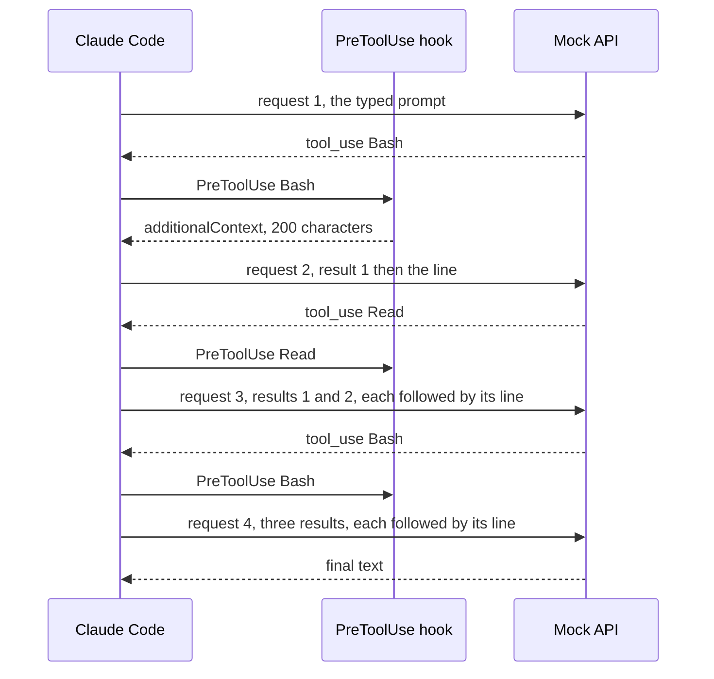

# Overlord, mid-turn mail PR 0: does E's line reach the model inside the turn?

The result of Task 0.1 of `docs/superpowers/plans/2026-11-19-mid-turn-mail.md` (run 2746, wave 172), for spec
`docs/superpowers/specs/2026-11-19-mid-turn-mail-design.md` §7. It is the answer that gates arming E (plan §7). No
D-number is defined here; departures are named by slug in `mid-turn-mail-pr0.md`.

## In short

- **Answer: yes.** On Claude Code **2.1.328**, the build the fleet runs, a `PreToolUse` hook's `additionalContext`
  line reaches the model's next request inside the same turn, after every tool call: three tool calls (Bash, Read,
  Bash), three lines, each whole, each placed right after its own tool result.
- **Also yes** on 2.1.327, 2.1.325 and 2.1.312, the older builds live sessions still ran on the day (a session moves
  to the launcher's build when it is rolled).
- **What kind of result this is:** a **rig** result, in the W0 spike's terms: what Claude Code sent to a mock API on a
  named build, never whether a real model heeded the line. It holds for the builds it ran on. On a newer build the
  scenario runs again before E's arm relies on it (plan §7).
- **One fact for PR 5:** Claude Code sends the line as a message of its own, `role: "system"`, right after the user
  message that carries the tool result, prefixed `PreToolUse:<tool name> hook additional context: `. It is not inside
  the `tool_result` block. E's fixed text is read after that prefix.

## The run

| | |
|---|---|
| Date | 2026-11-19, from 08:05Z |
| Scenario | `server/test/delegation-rig/scenarios-overlord/ov-pretool-context.json` |
| Command | `ccrc test --local -- bash server/test/delegation-rig/rig.sh run <version> <scenario> <out-dir>`, once per build |
| Builds | 2.1.328, 2.1.327, 2.1.325, 2.1.312 (`rig.sh versions`; each bundle's `version` file names its own) |
| The fleet's build | 2.1.328: the launcher runs the highest installed build, and no pin file stands |
| Rig | a private tmux server, a fixture HOME with ccrc's own hook installed by ccrc's installer, a mock API on loopback, tools granted by `permissions.allow` (no permission bypass) |
| Bundles | `notes` empty on all four (no failure), `labels` `["t1","t2","t3","t-done"]` on all four. Nothing from a run is committed. |
| Leftovers | `rig.sh reap`, then no `ccrc-dlg-rig.*` run root and no `dlg*` tmux socket |

*Table 1. The run.*

The scenario adds one `PreToolUse` hook, matcher `*`, beside ccrc's own:
`emit-context.mjs --event PreToolUse --chars 200 --tag pretool --log-payload`. Its text is exactly 200 characters,
`W0-HEAD-200-pretool-` then filler then `-pretool-W0-TAIL-200`, so the tail canary proves the whole line arrived. The
mock's main turn answers the typed prompt with a Bash call, the Bash result with a Read call, the Read result with a
second Bash call, and that result with its final text.

## What the requests carry


*Figure 1. One turn of three tool calls, as the mock saw it on every build.*

| Request | Tool results in it | Lines in it, whole | Build |
|---|---|---|---|
| 1 (the prompt) | 0 | 0 | all four |
| 2 | 1 | 1 | all four |
| 3 | 2 | 2 | all four |
| 4 (the last) | 3 | 3 | all four |

*Table 2. Each request's tool results and the hook lines it carries. "Whole" is the text after the prefix matching
`^W0-HEAD-200-pretool-x+-pretool-W0-TAIL-200$`, 200 characters.*

The last request's messages, in order, on every build:

```text
user  system  USE(Bash)  RESULT(1)  CTX(Bash)  USE(Read)  RESULT(2)  CTX(Read)  USE(Bash)  RESULT(3)  CTX(Bash)
```

`CTX(<tool>)` is a `role: "system"` message whose text is `PreToolUse:<tool> hook additional context: ` followed by the
hook's line. On 2.1.328 the last one is a one-block array of text and the earlier ones plain strings; the text is the
same.

**Inside the turn, on the main thread.** The emitter's log holds three `PreToolUse` lines per build (`Bash`, `Read`,
`Bash`, tool use ids 1 to 3), all with one `prompt_id` and no `agent_id`: one turn, main thread. The requests are the
mock's main-thread kind (the scenario's `mainMarker`).

## What this does and does not settle

- **Settled:** Claude Code delivers the line to the model's next request after every tool call, inside the turn, on
  2.1.328, 2.1.327, 2.1.325 and 2.1.312. Spec §7's first condition holds, so B does not return on this measurement.
- **Not settled here:** whether a real model acts on the line. That is the B trigger's two-week measurement once E is
  armed (plan §7), recorded in `mid-turn-mail-e-measurement.md`.
- **A newer build** needs the scenario run again before the arm relies on it. One run takes under a minute.
