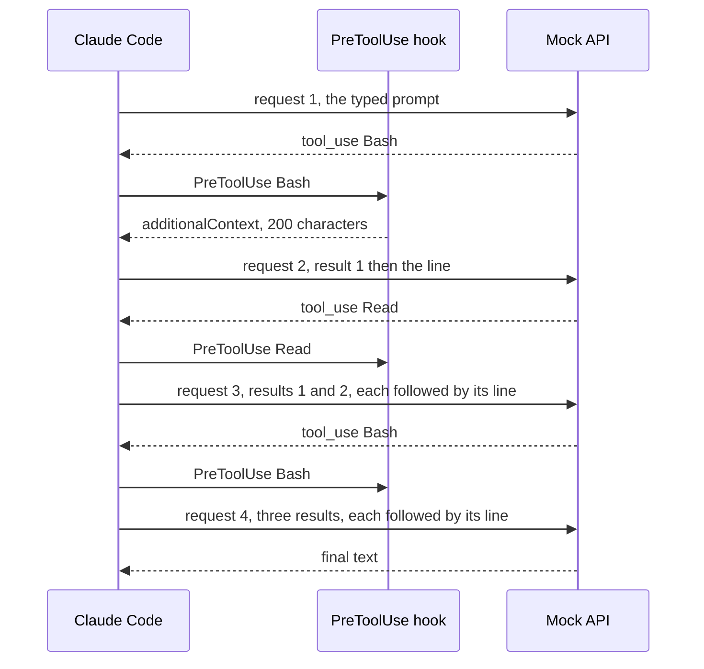

# Overlord, mid-turn mail PR 0: does E's line reach the next request inside the turn?

The result of Task 0.1 of `docs/superpowers/plans/2026-11-19-mid-turn-mail.md` (run 2746, wave 172), for spec
`docs/superpowers/specs/2026-11-19-mid-turn-mail-design.md` §7. It is the answer that gates arming E (plan §7). No
D-number is defined here; departures are named by slug in `mid-turn-mail-pr0.md`.

## In short

- **Answer: yes.** On Claude Code **2.1.328**, the build the fleet runs, a `PreToolUse` hook's `additionalContext`
  line reaches the next request Claude Code sends, inside the same turn, after every tool call: three tool calls (Bash,
  Read, Bash), three lines, each whole, each placed right after its own tool result.
- **Also yes** on 2.1.327, 2.1.325 and 2.1.312, the older builds live sessions still ran on the day (a session moves
  to the launcher's build when it is rolled). On 2.1.312 a token-budget trailer follows the line in the same message.
- **What kind of result this is:** a **rig** result, in the W0 spike's terms: what Claude Code sent to a mock API on a
  named build, never whether a real model heeded the line. Production Claude Code sends the same message, which is why
  this answer is a fair gate for arming; heeding is measured later, by the B trigger's read (plan §7). It holds for
  the builds it ran on. On a newer build the scenario runs again, and the reader below reads it, before E's arm relies
  on it.
- **The scenario asserts nothing.** It generates evidence, and the reader below judges it. The run stays green, with
  every label served and no note, when the hook is deleted or its matcher is narrowed to Read. The asserting check is
  a carry for PR 5.
- **One fact for PR 5:** Claude Code sends the line as a message of its own, `role: "system"`, right after the user
  message that carries the tool result, prefixed `PreToolUse:<tool name> hook additional context: `. It is not inside
  the `tool_result` block. E's fixed text is read after that prefix, from its start. The reader contract is below.

## The run

| | |
|---|---|
| Date | 2026-11-19, from 08:05Z |
| Scenario | `server/test/delegation-rig/scenarios-overlord/ov-pretool-context.json` |
| Command | `ccrc test --local -- bash server/test/delegation-rig/rig.sh run <version> <scenario> <out-dir>`, once per build |
| Builds | 2.1.328, 2.1.327, 2.1.325, 2.1.312 (`rig.sh versions`; each bundle's `version` file names its own) |
| The fleet's build | 2.1.328: the launcher runs the highest installed build, and no pin file stands |
| Rig | a private tmux server, a fixture HOME with ccrc's own hook installed by ccrc's installer, a mock API on loopback, tools granted by `permissions.allow` (no permission bypass) |
| Bundles | `notes` empty on all four (no failure), `labels` `["t1","t2","t3","t-done"]` on all four. Nothing from a run is committed. |
| Leftovers | `rig.sh reap`, then no `ccrc-dlg-rig.*` run root and no `dlg*` tmux socket |

*Table 1. The run.*

The scenario adds one `PreToolUse` hook, matcher `*`, beside ccrc's own:
`emit-context.mjs --event PreToolUse --chars 200 --tag pretool --log-payload`. Its text is exactly 200 characters,
`W0-HEAD-200-pretool-` then 160 `x` then `-pretool-W0-TAIL-200`, so the tail canary proves the whole line arrived. The
mock's main turn answers the typed prompt with a Bash call, the Bash result with a Read call, the Read result with a
second Bash call, and that result with its final text.

## What the requests carry


*Figure 1. One turn of three tool calls, as the mock saw it on every build.*

| Request | Tool results in it | Lines in it, whole | Build |
|---|---|---|---|
| 1 (the prompt) | 0 | 0 | all four |
| 2 | 1 | 1 | all four |
| 3 | 2 | 2 | all four |
| 4 (the last) | 3 | 3 | all four |

*Table 2. Each request's tool results and the hook lines it carries, as the reader below counts them. "Whole" is a
message whose text, read from its start, is the prefix and then the fixed 200 characters, tail canary included. On
2.1.312 the message goes on past the line (below), so the match never anchors at the message's end.*

The last request's messages, in order, on every build:

```text
user  system  USE(Bash)  RESULT(1)  CTX(Bash)  USE(Read)  RESULT(2)  CTX(Read)  USE(Bash)  RESULT(3)  CTX(Bash)
```

`CTX(<tool>)` is a `role: "system"` message whose text is `PreToolUse:<tool> hook additional context: ` followed by the
hook's line. The builds differ in two ways that do not change the counts:

- **The trailer on 2.1.312.** Each `CTX` message is 292 characters, not 241: after the line it carries
  `\n\n<total_tokens>…</total_tokens>`, a count of the tokens left. The line itself is whole, head and tail canary
  intact. 2.1.328, 2.1.327 and 2.1.325 carry no trailer: each `CTX` text is 241 characters, the 41 of the prefix and
  the 200 of the line.
- **The content's shape.** On 2.1.328 the newest `CTX` is a one-block array of text (the block carrying
  `cache_control`), and the earlier ones plain strings.

**Inside the turn, on the main thread.** The emitter's log holds three `PreToolUse` lines per build (`Bash`, `Read`,
`Bash`, tool use ids 1 to 3), all with one `prompt_id` and no `agent_id`: one turn, main thread. The requests are the
mock's main-thread kind (the scenario's `mainMarker`).

## The reader

The verdict is a read of the bundle's `reqs/`. This is that read, runnable as it stands; `B` is the run's out-dir:

```bash
B=<out-dir>
for f in "$B"/reqs/*-main.json; do jq -r --arg f "${f##*/}" '
  def txt: if (.content|type) == "string" then .content else ([.content[]? | .text // ""] | join("")) end;
  def results: if (.content|type) == "array" then [.content[] | select(.type == "tool_result")] | length else 0 end;
  .body.messages as $m
  | [range(0; $m|length) | select($m[.].role == "system" and ($m[.] | txt | startswith("PreToolUse:")))] as $ix
  | [$ix[] | select($m[.] | txt | test("^PreToolUse:[A-Za-z]+ hook additional context: W0-HEAD-200-pretool-x{160}-pretool-W0-TAIL-200"))] as $whole
  | [$whole[] | . as $i | select($i >= 2 and ($m[$i-1] | results) > 0
      and ([$m[$i-2].content[]? | select(.type == "tool_use") | .name] | index(($m[$i] | txt | capture("^PreToolUse:(?<t>[A-Za-z]+) ").t)) != null))] as $placed
  | "\($f) results=\([$m[] | results] | add // 0) lines=\($ix|length) whole=\($whole|length) placed=\($placed|length)"' "$f"; done
```

Per main-thread request it prints the tool results the request holds, the `role: "system"` messages whose text starts
`PreToolUse:` (`lines`), those whose fixed text is whole read from the start (`whole`), and those that sit right
after a tool result whose call names the same tool (`placed`).

**Pass condition:** in every request, `lines`, `whole` and `placed` all equal `results`, and the requests run 0, 1, 2
and 3: Table 2. Each of the four bundles passes it.

| Run on 2.1.328 | Labels, notes | Requests' `results` / `lines` | Reader |
|---|---|---|---|
| The scenario as committed | all four, none | 0/0, 1/1, 2/2, 3/3 | passes |
| The hook deleted (`del(.launch.settings)`) | all four, none | 0/0, 1/0, 2/0, 3/0 | fails |
| The matcher narrowed to `Read` | all four, none | 0/0, 1/0, 2/1, 3/1 | fails |

*Table 3. The scenario as committed against two mutants made from scratch copies (nothing in the tree touched). The
run itself serves every label and writes no note in all three; only the reader tells them apart.*

## The reader contract for PR 5

A reader of E's line, in PR 5's rig cases or anywhere else, must:

- **(a)** scan `messages[]` for `role: "system"` entries, not the `tool_result` block and not the last user message;
- **(b)** accept `content` as a string or as an array of text blocks (the newest is an array with `cache_control`;
  earlier ones become strings in later requests);
- **(c)** key on the prefix `PreToolUse:<tool name> hook additional context: `, not on the role alone, since the
  SessionStart context is a `role: "system"` message too;
- **(d)** read E's fixed text from the start of the text after the prefix, and test its tail, tolerating a trailer
  after it (2.1.312), never anchoring at the message's end;
- **(e)** expect the line one message after the result of the call whose `PreToolUse` added it, so the last tool
  call's line arrives in the next request, and a turn that ends without another request never carries it.

**Carry for PR 5:** a `mockapi.mjs` matcher for `role: "system"` messages, so a rig case can assert the line natively,
and a rig case that reds with the hook deleted and with its matcher narrowed to one tool. The mock's `lastUser` and
`system` matchers cannot see these messages today: `lastUser` reads user messages only, and `system` is the top-level
prompt.

## What this does and does not settle

- **Settled:** Claude Code puts the line in the next request it sends after every tool call, inside the turn, on
  2.1.328, 2.1.327, 2.1.325 and 2.1.312. Spec §7's first condition holds, so B does not return on this measurement.
- **Not settled here:** whether a real model acts on the line. That is the B trigger's two-week measurement once E is
  armed (plan §7), recorded in `mid-turn-mail-e-measurement.md`.
- **A newer build** needs the scenario run again, and the reader above run over its bundle, before the arm relies on
  it. One run takes under a minute.
