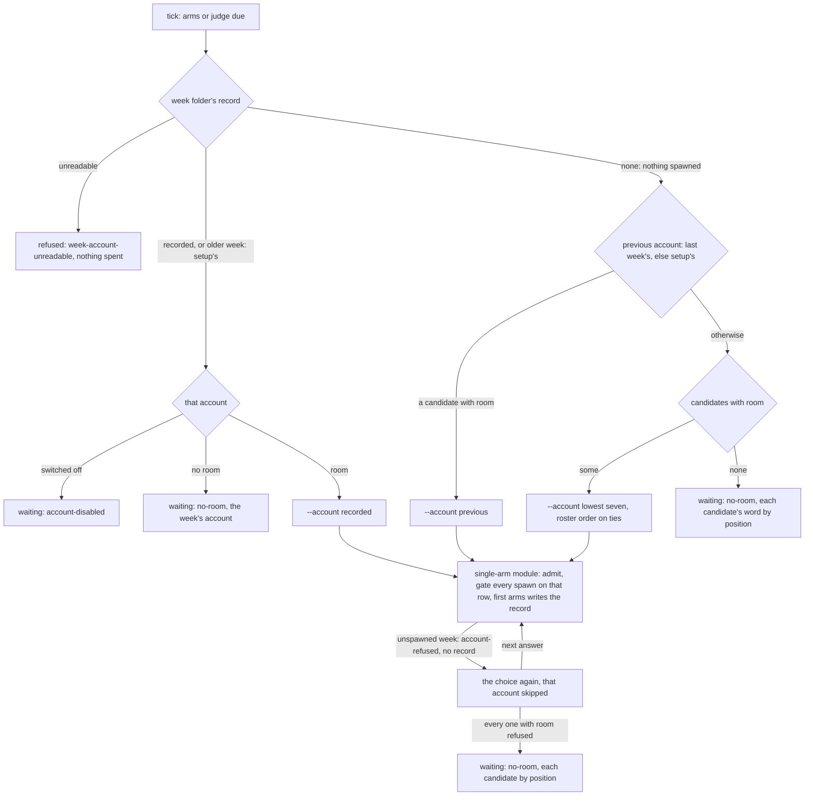

# Overlord W1a: the weekly quiz finds an account with room (run 3538)

The note of run 3538 (programme `overlord`, issue #2491, wave 216, ticket `quiz-account-room`), for the coordinator to fold
into the programme ledger. No D-number was issued, so departures are named by slug. It covers why, the rulings, what
changed, every account check the driver has and what became of it, the design question on measuring an idle account,
what was measured, and the known limits. It also carries review 3533's corrections of PR #3253 (section 7), and fix
round 1 after review 3545 (section 10).

## In short

- **Why.** The repaired weekly timer fired on the fleet box for the first time, and the week stopped before its pilot:
  `arms`, waiting, `no-room`, "the setup's account: limits-stale five-null". There were two causes. The driver's limits
  reading called every row with no five-hour figure stale, which most rows on the box are today, because their plans have
  no five-hour window. And the runner re-read only the account chosen once at setup, whose row is hours old because no
  session renders a status line for it, so the quiz would have waited for good.
- **Ruling 1, one room rule.** A row the status-line writer marks `fiveWindowMinutes: 0` is judged on its weekly figure
  alone, as the fleet's rule (`shared/limitRoom.ts`, the twin of ccd's `_limit_score`) judges it. The coordinator's
  answer on the reset rows tightens one more thing to that rule: a window rolled over by its resetAt is unknown too
  (`rolled-over`), where the driver admitted it as a measured reset. Nothing loosens beyond the marker.
- **Ruling 2, the week's account.** It is chosen per week by a pure function, `weekAccountChoiceOf`, with a table test.
  A week that has spawned stays on its account. One that has spawned nothing keeps the previous account when it has room,
  else takes the lowest weekly figure with room; when admission refuses that account, the next is tried, as setup does
  (fix round 1).
- **Ruling 3, the record.** The week's first `arms` records the account in the week's folder before anything spawns:
  one writer, one composer, one reader. An act given another account refuses `account-moved`. The setup is never re-made.
- **Rulings 4 and 5.** The budget stays one week's, and the pilot's checks run on the account in use. The status's
  account is the week's when recorded.
- **The design question** (section 5): the quiz cannot measure an idle account before its first spawn without spending
  on an unknown row. The fleet's keepalive already measures idle accounts through the one writer. Recommendation: rely on
  it, and measure its first fleet pass.
- **Not proven on the fleet box.** The pilot is still expected to stop on the plugins, persistence and skill checks.

## 1. The rulings this was built under

| Ruling | What |
|---|---|
| 1 (the brief) | One room rule. The quiz's limits stop applies the windows the plan applies. A markerless row with no five figure stays stale. The age bound, the 70 percent threshold, inferred-by-age, the future-skew bound and every other stale word stay. Unknown is never room. Characterization first, then the change as its own commit, and a parity table. |
| The reset rows (ask, answered "Tighten to the shared rule") | The driver read a window whose resetAt had passed as a measured 0 and admitted it; the shared rule reads any rolled-over window as unknown. The parity table could not agree on those rows. Ruled: tighten. The row is now `limits-stale rolled-over`. |
| 2 (the brief) | The account is chosen per week, by a pure function with a table test; the runner only acts on it. A week that has spawned stays and waits; one that has spawned nothing keeps the previous account (last week's, else the setup's) when it has room, else the lowest weekly figure, ties in roster order; with none, `no-room`, the detail naming each candidate's word as setup's does. Candidates and the kill switch are exactly setup's. |
| 3 (the brief) | The setup is not re-made. The week's acts take the week's account explicitly, admitted as setup admits one and gated on that account's row at every spawn. One writer and one composer, kept in the week's own folder; another account refuses with a word of its own; an older week with no record reads as the setup's account. |
| 4, 5 (the brief) | The budget is one week's, whatever the account; the pilot's checks run on the account in use. The status wire stays additive: its account is the week's when recorded. |
| The hook refusal (ruling after delivery 33103) | The session hook refused a shell call whose text named the fixture HOME's credentials folder. Ruled: write the test text with the Edit tool only, spell the folder once, run the cases by naming the test file alone. Section 6 says how. |

## 2. What changed, by file

| File | Change |
|---|---|
| `deploy/history-limits.mjs` (new) | The limits reading's pure rules, moved out of the driver whole (`parseLimitsRow`, `decideLimits`), then changed: `parseLimitsRow` keeps `fiveWindowMinutes`; `limitsWindowsOf` names the windows a row is judged on (`weekly` for the number 0 only, `both` otherwise); `decideLimits` reads five only on a `both` row, stops a rolled-over window (`rolled-over`), and words a weekly-only threshold stop `seven <n> at or over 70, no five-hour window`. It imports nothing. |
| `deploy/history-replay.mjs` | The two functions and their three constants leave; the driver imports and re-exports them, so every importer keeps its path. It keeps the file read (`readLimitsRow`) and the gate (`refuseOnLimits`, `batchGate`). Code lines 6793 to 6746, against its cap of 6796. |
| `deploy/history-quiz-single.mjs` | `arms` and `judge` take an optional `--account` (default the setup's). `WEEK_ACCOUNT_FILE` (`quiz/week-account.json`), its kind, its composer `weekAccountText`, its reader `weekAccountOf` (never throws: `recorded`, `recorded` with `older`, `none`, `unreadable`), and `settleWeekAccount`, which `arms` calls after its claim and before any spawn (writing the record when there is none) and `judge` calls without writing. The new word `account-moved`. |
| `deploy/history-quiz-unattended.mjs` | `weekAccountChoiceOf` (pure; since fix round 1 it also takes the act's admission refusals), `weekAccountInputsOf` (reads the record, setup's candidates and the previous account, once per act), `previousAccountOf`, `statusAccountOf`. The setup's room re-check before `arms` and `judge` gives way to the choice; both acts get `--account`, and an unspawned week's `arms` refused `account-refused` with no record walks on to the choice's next answer. The new own word `week-account-unreadable`. The header's account paragraph says all of it. |
| `server/src/continuity/quiz.ts`, `shared/lane-arm.ts`, `server/src/coord/schema.ts` (fix round 1, words only) | The mail for a quiz that has waited two weeks says the account is the week's, that an unspawned week picks again, and asks whether any candidate has room, where it said the account is never re-picked and advised a new setup. The status's `account` is described as the week's when recorded in the shared tick type and in the status table's column comment (a comment inside a migration's SQL text). No word, trigger or wire shape changes. |
| `server/test/quiz-limits-reading.test.ts` (new) | The characterization, parity and stricter tables (section 3). Its first push named it `history-limits.test.ts`, which the node floor's list in `ci.yml` must then name; that made the PR change a rules file beside everything else, and the review judge refused it (`rules-mixed`). It was renamed, and `ci.yml` is untouched: the reading is pure JavaScript with nothing tied to a Node version, and the driver's own limits section still runs on the node floor (departure `limits-table-off-the-node-floor`). |

*Figure 1. The week's account, from the runner's choice to the single-arm module's record.*

## 3. Ruling 1 in detail: the parity table, and where the quiz is stricter

`server/test/quiz-limits-reading.test.ts` holds three tables over the same bytes:

- **Characterization** (committed first and green against `main`): thirty rows at `ccfe49ff33` (twenty with no marker, ten
  marked), every answer the driver's; thirty-five at the tip (twenty-one and fourteen). The change commit `1bd9067849`
  edited the rows it moves, each labelled RULING 1 or RESET. It also added five rows, which never ran against `main`'s
  code (their "was ..." labels say what that code answered), and changed one row's input (the marked row at the
  threshold, its weekly figure 75 to 70).
- **Parity** (16 rows): each row goes through the driver's reading and through `shared/limitRoom.ts` over
  `server/src/limits.ts`'s `readLimits` (a fixture HOME), and both must agree on the windows (`limitsWindowsOf`; on the
  shared side, whether the five figure changes the answer once seven is measured) and on measured or unknown.
- **Stricter** (6 rows): rows the quiz stops where the fleet's rule reads room, each with its reason. The quiz is
  deliberately stricter here, and only here: the one-hour age bound (on window-less rows too), an undated row, a stamp
  more than a minute ahead, a figure outside 0 to 100 (the rule takes any number), and the 70 percent threshold (the
  rule's ceiling is its caller's, 98 for ccd).
- An invariant over every row in the file: whatever the quiz admits, the fleet's rule calls room at the quiz's own
  threshold. Unknown is never room.

The one room rule reaches every caller of the driver's limits gate (`batchGate`, `refuseSpawnAdmission`), the history
gate's own W2 batches included (step 0a, the pilot, parts 1 and 2, the writer), not the quiz alone: there too only the
marked row loosens, and a rolled-over window now stops.

A marked row with a five figure (no writer makes one) is judged on its weekly figure alone, as the shared rule judges it:
five is not read, so it is not range-checked or age-inferred either.

## 4. Every account check the driver has, and what became of it

The brief asked for every place a later step's account is compared with the setup's.

| Check | Where | Now |
|---|---|---|
| A recorded run is reused only by the same account, mode, model and settings mode (`run-json-mismatch`) | `history-replay.mjs`, the finished-outcome reader | Stays. Within a week every job's launch is the week's account, so it compares against the week's account. A week never changes account, so it cannot fire on a legitimate resume. |
| `arms` and `judge` bound the setup's account (`admitNode(home, s)`, the judge's `accountId: s.account`) | `history-quiz-single.mjs` | Now the week's account (`--account`, default the setup's), admitted the same way, compared with the week's record (`account-moved`). |
| The step 0b result names its account | `history-quiz-single.mjs`, `step0bOf` | Information only; its reuse checks never compared the account. It lives in the week's folder, whose account never changes, and now names the week's account. |
| The runner re-read the setup's account's room before `arms` and `judge` | `history-quiz-unattended.mjs` | Replaced by the weekly choice, which re-reads the week's account's room and kill switch. |
| The status's account | `history-quiz-unattended.mjs`, `postStatus` | The week's when recorded, else the setup's. |
| Step 0a's launch pin (`step0a-launch-mismatch`) and `step0a account … is not --account` | `history-replay.mjs`, W2's step 0a and pilot-source | Stay. They are W2's, not the quiz's. |
| `report` | `history-quiz-single.mjs` | Compares no account, and spends nothing. |
| The candidate filter (`eligibleAccountsOf`) against admission (`admitAccount`) | `history-quiz-unattended.mjs`, `history-replay.mjs` | Stay apart, by design: the filter checks hidden, the account kind, telemetry and the lane kill switch; admission also refuses an upstream account whose config folder is not `.claude`, a generated account whose provider is not anthropic, and one whose declared credentials file is undeclared, absent or unreadable. The filter does not make those checks, so a candidate can be refused at admission; since fix round 1 the week then tries the next one, as setup does. A launcher refusal (`launcher-<code>`) comes at the spawn, after the record, and closes the week as before. |

One consequence of the move, stated so nobody reads it as an accident: the gate's code hash (`CODE_SHA_FILES`, the four
files `gate_code` pins) covered `decideLimits` while it lived in the driver. In its own module it is covered as the
driver's other imports are: by the release tag and the tree-moved preflight (W2-D24). Adding the module to the hashed
four would change every recorded `code_shas` shape, which this wave does not do.

## 5. The design question: can the quiz measure an idle account's limits itself?

Built: nothing. From the code only:

**What is certain.**
- The only writer of `~/.cc-limits/<id>.json` is `ccd/statusline-command.sh`. It writes only from a rendered payload that
  carries a real `rate_limits` figure, and a print-mode turn renders no status line. So a quiz spawn refreshes nothing by
  itself.
- Since D-8957, `ccd/ccd-telemetry-keepalive` takes one minimal turn on an idle account (the cheapest model, an empty
  prompt, `--output-format stream-json --verbose`), takes the newest `rate_limit_event` whose `unifiedWindows` names the
  weekly window, and hands it to that same writer (`_ka_feed`), so the writer stays the only one. Its gates: idle longer
  than `CCRC_KEEPALIVE_FRESH` (1800 s by default), one attempt per window, a backoff, no live session on the account, not
  marked dead. Its timer runs every 15 minutes. Once it works on the fleet, an idle account's row should be at most about
  45 minutes old, under the quiz's one-hour bound. Its own header says the event was read from the build's schema and has
  never been seen on a fleet turn.
- The quiz's spawns already run with `--output-format stream-json --verbose`, and every run's stream is kept under the
  week's `--out`. If the build emits the event, the quiz's streams already carry it. The driver's stream reader (W2-D51)
  does not read that event today.
- The quiz's gate needs room before the week's FIRST spawn. A stream reading can only follow a spawn that was already
  admitted. To measure an idle account itself, the quiz would have to spawn on an unknown row, which is the one thing
  "unknown is never room" forbids.

**What a spawn would have to show.** A `rate_limit_event` line whose `rate_limit_info.unifiedWindows` names `seven_day`
(and `five_hour` when the plan has one), each with a numeric `utilization` and `resetsAt`. The keepalive's first fleet
pass reporting `refreshed` is the measurement of that.

**The options and their cost.**

| Option | What it needs | Cost |
|---|---|---|
| A. Rely on the keepalive (recommended) | Nothing in the quiz. With ruling 2, the quiz also moves to an account whose row is fresh, so the keepalive matters only when no account is in use. | The keepalive's own turns, already spent. |
| B. The quiz feeds its own streams' events to the one writer between spawns | Reuse `_ka_feed` (never a copy: one feeder), called after each batch. It keeps the row fresh through a long act, so the gate before each later spawn reads a fresh row. It does nothing for the first spawn. | About 20 lines in the driver, which sits under its cap; a new dependency of the driver on ccd's writer; one bounded writer run (jq, 10 s) per batch. |
| C. A probe spawn on an unknown row | — | Rejected: it spends on an unknown row, and it duplicates the keepalive. |

Recommendation: A, and measure the keepalive's first fleet pass; B only if weeks still stop on stale rows in the middle
of an act.

## 6. Measurements

Every count was taken as an ordinary user, in this workspace's `server` package, through `ccrc test`, unless it says
otherwise.

- **Characterization first.** `ccfe49ff33` pinned the driver's limits answers, thirty rows, green against `main` d5a032c409
  (thirty-five at the tip: section 3).
  The move (`7a9b08db28`) changed only the table's import, and kept it green. Ruling 1's change is `1bd9067849`.
- **Suites, green:**
  - `quiz-limits-reading` (40 cases; named `history-limits` until the rename), `history-quiz-unattended`, `history-quiz-single`, `history-quiz-single-characterization`,
    `continuity-quiz-lane`, `continuity-quiz-unattended`, `continuity-quiz-route`, `lifecycle`, `ccrc-doctor-quiz` and
    `limit-room-parity`: 10 files, 526 cases, at `e54a7ba3bc`.
  - `history-replay`: the limits, step 0a and record-subcommand sections, 830 cases with the limits table, after the move.
    The whole file (1895 cases) ran once after ruling 1's change: 100 cases failed. All of them came from the new module:
    the import census, and two fixture trees that copy the driver's files without it. Those were fixed in the move commit,
    and the 830-case run above is after that fix. Two later whole-file runs and the test tree's type check were stopped
    by the test slice's shared 6G memory cap (exit 137, OOM kills while other heavy runs held the slots; no test failed).
    CI is the arbiter for those two.
  - The tree guards: `growth-caps`, `growth-check`, `anchors`, `citations`, `deviation-refs`, `oss-metadata`,
    `topology-clean`, `ci-pipeline`, `ownership`, `dtbd`, `single-definition/*` and `rings/*`: 66 files, 2082 cases,
    3 skipped.
- **Mutants**, each applied to a scratch copy of the tree, its tests run, the file restored and checked byte for byte.
  Every one was killed:

| Mutant | Killed by |
|---|---|
| B1 the marker ignored (the brief's) | 17 cases: the marked rows, the parity table, the invariant |
| B2 a markerless row with no five figure admitted (the brief's) | 7 cases: five-null rows, the parity table |
| B3 the age bound skipped for a window-less row (the brief's) | the marked rows past the bound (2) |
| B4 the reset tightening removed | the reset rows, the parity table, the driver's own reset case (6) |
| B5 a marked row read on its five figure at the threshold | the marked threshold rows (2) |
| W1 a week that has spawned moved to another account (the brief's) | 77 runner cases |
| W2 an act run on an account other than the week's record (the brief's) | the `account-moved` cases (2) |
| W3a, W3b an account with no room chosen (the brief's): the previous kept without room; the recorded one without room | 4 and 4 cases |
| W4a, W4b the kill switch ignored in the choice (the brief's): the recorded account; the candidates | 3 and 3 cases |
| W5 the previous account ignored (always the lowest) | 3 cases |
| W6 the runner passes no `--account` | 13 cases |
| W7 the record never written | 5 cases |
| W8 an older week read as never spawned | the older-week case |
| W9 the status posts the setup's account | the status case |
| W10 an unreadable record read as none | the unreadable case |
| W11 the act admits the setup's account, not the week's | 2 cases, both at admission. The spawn gate's own use of the week's row was not pinned by them (review 3545, F2: a mutant reading the setup's row there survived); fix round 1 adds the case that pins it (section 10). |

- **The hook refusal.** One shell call that would have appended the single-arm cases by heredoc was refused whole by the
  session hook, because its text named the fixture HOME's credentials folder (the generated account's admission needs its
  declared file to exist). Nothing was written or run. It was reported to the coordinator and nothing was retried until
  the ruling. The cases were then written with the Edit tool. The folder's name is spelled once, as a constant
  (`CRED_DIR`), and the file planted there is empty, inside the fixture HOME under the run's temp parent. The driver's own
  tests build their generated accounts inline in each block and have no shared helper, so sharing one would have meant
  refactoring that file. The fixture is written the way they write theirs.

## 7. Review 3533's corrections of PR #3253

In tests and words only, in a commit of their own (`9ff5f20de8`), with no code line changed by it. The task note
`quiz-pilot-checks.md` now states:
- the kill windows as PR #3253's body states them: window (b) spends what the round had spent, and one later release
  reopens the week once;
- "a stop that is not resumable" as a kill or a driver failure, with the refusal case said;
- the two pin readers truthfully, neither the stricter, as a duplication to consolidate later;
- the mutants killed only as an ordinary user, corrected by running them: N3, N8 and R8/R9 are; N9 and N14 are not;
- the header line about PR #3252, which has landed;
- the mutant count as pairs.

The new or changed cases: a pin whose round is present but damaged reads as round 0; the empty pilot list is back among
the damaged-list rows; the kill variants' fixture check tells a kill from a driver failure; a refusal that is not
resumable closes the week on its own word. Each was red under its mutant (the note's section 5 says which).

Checked again in fix round 1 (review 3545 could not read review 3533's report, which is gone from the box): the record
of that review's findings is the last section of PR #3253's body, "Known limits from the final review (review 3533,
accepted as built)". I read its five bullets against `9ff5f20de8`. The kill windows: corrected in `quiz-pilot-checks.md`
(window (b) spends what the round had spent; one later release reopens the week once). "A stop that is not resumable":
reworded as a kill or a driver failure, the second variant's title now says "a driver failure", and the case for a
refusal that is not resumable is added. The two pin readers: stated as the bullet states them, a duplication to
consolidate. The damaged round: pinned for a fraction, a string and a negative number (1.5, '2', -3, 7.5, null). The
coverage left open: the kill fixture asserts the read-only root and that the last word is not `driver-failed`; `[]` is
back among the damaged lists; the root-only mutant list was measured by running the mutants. All five match.

## 8. Departures, by slug

- **limits-reading-own-module**: the driver stood three code lines under its cap, so the limits reading's pure rules moved
  into `deploy/history-limits.mjs` behind the characterization table, rather than being compressed. The driver re-exports
  them. Two fixture trees in the driver's tests and its import census name the new module.
- **reset-rows-tightened** (the coordinator's answer): a window rolled over by its resetAt is unknown, `rolled-over`. One
  existing driver case changed its answer, in ruling 1's commit.
- **account-flag-optional**: `--account` is optional on `arms` and `judge`, defaulting to the setup's, so the operator's
  runbook (which passes none) keeps working. The runner always passes it.
- **record-at-first-arms**: the week's record is written by the single-arm module's first `arms`, after its claim and
  before any spawn (the `--version` measure included), because the week's folder is the module's to make. So "a week that
  has spawned anything" is read as "a week whose record stands", which may include a week stopped between the record and
  its first spawn: it stays on its account, which is the safe direction.
- **older-week-by-its-pin**: a week with the release pin and no record ran on an older build, on the setup's account; it
  reads so, and is never given a record afterwards.
- **week-account-unreadable-waits-for-attention**: a record the runner cannot read is a `refused` tick with its own word,
  not a closed week: nothing is spent, and the coordinator hears of it through the status mail.
- **previous-is-newest-recorded-week**: "last week's account" is the newest earlier week whose folder records one; a week
  that spawned nothing is skipped; the setup's when none does.
- **gate-code-hash-not-widened**: see section 4.
- **admission-refused-falls-through** (fix round 1, the coordinator's ruling on review 3545 F1): the choice takes the
  act's admission refusals and answers the next account in its own order; the runner walks it, and only an admitted
  account becomes the week's record. When every candidate with room is refused, the tick waits `no-room` (each candidate
  named by position, a refused one as `account-refused <detail>`) and the next tick tries again.  While every candidate
  with room is refused, each tick runs the driver once per candidate, and each run stops at admission, spending nothing. A recorded
  week, and a refusal after the act recorded its account, close on the word as before.
- **limits-table-off-the-node-floor**: the limits table is `quiz-limits-reading.test.ts`, not a `history-*` test, so the
  node floor's list (`ci.yml`) need not name it and the PR changes no rules file. The node floor still runs the driver's
  own limits section in `history-replay.test.ts`, which goes through the same module.

## 9. Known limits and follow-ups

- Nothing here is proven on the fleet box. The pilot is still expected to stop on the plugins, persistence and skill
  checks (quiz-pilot-checks section 4).
- An idle fleet with no fresh row anywhere still waits `no-room` until the keepalive (or any session) refreshes a row;
  section 5's recommendation.
- Follow-up: the two release-pin readers (`armsPinOf`, `pinnedReleaseOf`) are a duplication to consolidate into one pure
  parser (review 3533, F3).
- A whole `history-replay` run and the test tree's type check after the final commit are CI's, because the test slice's
  shared memory cap stopped both locally. (Review 3545 ran the whole file alone: 1895 passed, so the stops were load.)
- The waiting mail keeps its word `setup-account-gone` and its subject, so a coordinator's match on it keeps working; only
  its body and two comments were reworded in fix round 1 (review 3545, F4). Renaming the word would be a wire change of
  its own.
- The candidate filter does not make admission's checks (section 4), so a candidate admission refuses is tried and
  refused again whenever it is an unspawned week's first answer; that spends nothing, and its refusal shows in the
  no-room detail only when every candidate with room is refused.

## 10. Fix round 1 (review 3545)

Review 3545 read `8339a7061e` and found no containment breach; six findings survived its refute pass. The coordinator's
rulings, and what was done:

| Finding | Ruling | Done |
|---|---|---|
| F1 the week's pick refused at admission closes the week | Fix: fall through as setup does | `1d400dd803` (code and runner tests); `9d2a9e77d7` pins that a refused account is never recorded. Departure `admission-refused-falls-through`; section 4 names the checks the filter does not make. |
| F2 no test fails if the spawn gate reads another account's row | Add the test | `9d2a9e77d7`. Section 6's W11 row corrected. |
| F3 no test fails if the record is written after the `--version` spawn | Add the tests | `9d2a9e77d7`: a failing `--version`, and a run killed while it runs. |
| F4 the server's waiting mail still advises a new setup | Words only | `ff74b536de`, under its own claim; section 9 says why the word stays. |
| F5 the row count and "exactly" | Words | Section 3 and the test header: thirty rows, then thirty-five. |
| F6 the rule reaches the history gate's batches too | One sentence | Section 3. |

**Red, then green.** Each new test, and where its red was measured (a scratch copy of the tree, each change restored and
checked byte for byte):

| Test | Red | Green |
|---|---|---|
| Three of the four new table rows (the recorded-week row passes on both) and the two fall-through runner cases | 5 red against `8339a7061e`'s runner | `1d400dd803` |
| A refusal after the act recorded its account closes the week | red under F1-M2b (the runner falls through though a record stands) | `1d400dd803`, and green against `8339a7061e`'s runner: it pins what did not change |
| A recorded week whose account is later refused closes on its word | a pin of unchanged behaviour: green against both runners | `1d400dd803` |
| The spawn gate reads the week's row (F2) | red under F2-S1 (the gate reads the setup's account), the reviewer's mutant | `9d2a9e77d7`; the driver did not change, so it was green against `8339a7061e`'s too |
| The record stands when `--version` fails, and when the run is killed there (F3) | both red under F3-S2′ (the record written after `freshExpected`), the reviewer's mutant | `9d2a9e77d7`, likewise |
| A refused account is never recorded (F1) | red under F1-M2a (the record written before admission) | `9d2a9e77d7`, likewise |

**Mutants** for the fix, all killed: F1-M1 the fall-through removed (the choice ignores the refusals): 5 runner cases;
F1-M2a a refused candidate recorded (the record written before admission): 11 single-arm cases; F1-M2b the runner falls
through though the act recorded its account: 1; F1-M3 the week closed on the first refusal: 2; F2-S1: 1; F3-S2′: 2.

**Suites**, green at the round's tip, as an ordinary user: the ten quiz files of section 6 (538 cases, the runner 202 and
the single-arm module 73 of them), the tree guards (65 files, 1990 cases, 3 skipped) and the server's type check.
