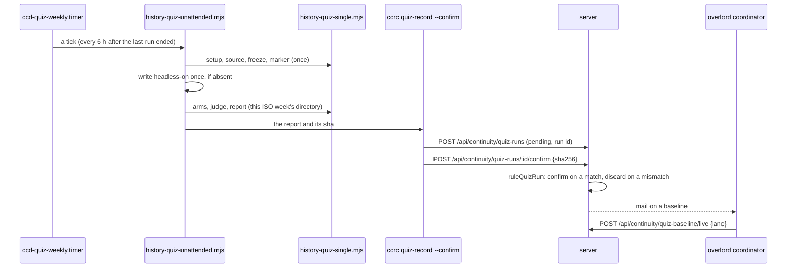

# Overlord W1a: the weekly replay quiz runs, records and confirms itself (run 3212)

The note of run 3212 (programme `overlord`, issue #2491), for the coordinator to fold into the programme ledger. It
records the design, the rulings it was built under, what landed, the measurements and the departures, each by slug. No
D-number was issued.

## Why

The operator's ruling of 2026-11-22: "Quiz results etc etc … I'm tired of you creating manual tasks for me that you should
be able to do yourself." It supersedes one condition of the W0-28 ruling, "the driver runs by your hand; ccrc never runs
it", and only that one. Before this change the operator had to run `deploy/history-quiz-single.mjs` by hand each week,
then `ccrc quiz-record`, then press Confirm on Settings, Automation, Shadow lanes.

## The rulings this was built under

The run put five questions to the coordinator, who ruled each one.

| Ask | Ruling |
|---|---|
| The weekly `arms` refuses `family-unlisted` until `~/.ccrc/history/headless-on` lists the frozen families, and nothing wrote that marker | Ask 694, option 0: the timer writes it **once**. It writes exactly the frozen families the driver's `marker` step printed, its sha checked, atomically (a temp file linked into place, never a rename over a file), 0600, and journals the write once in `~/.ccrc/quiz/journal.log`. A marker already there that lists every frozen family is kept, and any other stops the run with a word and writes nothing. Steer, agents-on, recall-off and every other marker stay the operator's. |
| `setup`'s values, which have no default | Ask 695, option 1: built-in defaults. Budget 5,000,000, settings mode `restricted`, and `claude-opus-5-5` for the writer, the judge and the arm, never Fable, frozen in `setup.json`. A model move is a new setup and a new baseline, never a silent one. |
| The account, "chosen automatically at each run" | Picked at setup from the placement reading: a subscription account (not hidden, `upstream` or `generated`, telemetry neither `openrouter` nor `codex`) with weekly room by the driver's own limits reading, the most room first. Its room is re-checked before every `arms` and `judge`; no room is the waiting word `no-room`, retried at the next tick. The driver itself stays unchanged. |
| What "the operator can still Discard from the card" means | The card is unchanged: Confirm and Discard act on pending runs. A timer run is confirmed at once. |
| How a stop word reaches the Shadow lanes card and the coordinator | A status door, `POST /api/continuity/quiz-status`, and one migration (slot 120, allotted beside run 3213's 119). |

## The design

*Figure 1. One week's run, from the timer's tick to the coordinator's Live.*

### 1. The runner and its timer

- `deploy/history-quiz-unattended.mjs` is the timer's one act. It refuses `in-session` when `CLAUDECODE` is set at all and
  `in-pane` when `TMUX_PANE` is set, before anything else. The timer's run is neither, so it passes honestly; nothing
  unsets either variable.
- It spawns the driver, `node --no-warnings <tree>/deploy/history-quiz-single.mjs <subcommand>`, exactly as the runbook's
  operator does, with a by-name environment (`HOME`, `LANG`, `PATH`), and reads each step's `sha256 <hex>` line and its
  refusal line from stderr. Every refusal the driver has stays: step 0b's probes, `release-moved`, the masking agreement,
  the weekly `--budget`, the read-only store and no writing form of `ccrc history`. The runner never opens the store.
- Its directories are under `~/.ccrc/quiz/` (0700): the setup `--out` at `setup.<n>`, and one `--out` per ISO week (UTC)
  at `weeks/<YYYY-Www>`. It keeps the newest four week directories and removes older ones it made. A week is one directory: a refusal that needs a fresh `--out` (`release-moved`, `pilot-failed`,
  `out-refused`) or that resuming cannot cure (`budget-exhausted`) closes the week as `failed` with its word, and the next
  week tries again. So one week never spends more than one `--budget`. A stop that resuming cures (the limits words,
  `interrupted`) is resumed on the same directory at the next tick.
- Its state is one file, `~/.ccrc/quiz/unattended.json`, written whole by rename. Its `last` block (the tick's time, act,
  outcome, word and detail) is what doctor reads.
- `ccd-quiz-weekly.timer` (`OnActiveSec=30min`, `OnUnitInactiveSec=6h`) starts `ccd-quiz-weekly.service`, a oneshot
  running `/usr/bin/env node --no-warnings %h/ccrc/deploy/history-quiz-unattended.mjs` under the account's real HOME. It
  is placed and enabled by `ccrc update`'s install spine on every role but `server` (a server box keeps no history
  store), and removed by `ccrc uninstall`.

### 2. Confirmation without the operator

- `ccrc quiz-record --confirm` records the run as before, then posts `{ sha256, by }` to the new box-token door
  `POST /api/continuity/quiz-runs/:id/confirm`, with the run id the record answered.
- The door asks the one ruler, `quizStore.ts#ruleQuizRun`, with the action `match`: a pending row whose report sha
  equals the sha is confirmed under the existing baseline rule (`quiz.ts#quizBaseline`), and a pending row whose sha
  differs is discarded. A row already ruled answers its own state when its sha matches (a resend), and is refused
  otherwise. The ruling stays the one writer of `state`, `ruledAt`, `ruledBy` and `baseline`.
- The baseline rule is unchanged: the first confirmed run while every W1a lane is in shadow becomes the baseline, and it
  is never a W2 result, a PASS or a measured benefit of recall.

### 3. Waking the coordinator, and its Live

- When a confirmation makes the baseline, the server queues one system mail to the programme's coordinator
  (`CoordStore.programmeCoordinator('overlord')`), subject `quiz-baseline-confirmed`.
- Taking a W1a lane Live was an operator switch: `POST /api/coord/lane-arm` is session-gated and refuses Live while
  sign-in is dark. The smallest door for the coordinator is `POST /api/continuity/quiz-baseline/live { fromId, fromUuid,
  lane }`: box-token gated, attribution-checked, ownership-checked (the caller holds an open run of `overlord`), a W1a
  row only, Live only, and only once a confirmed baseline exists (`laneArm.ts#decideLaneArmCoordLive`). It writes
  through `CoordStore.setLaneArm`, the one writer, and records a feed row naming the coordinator.

### 4. The weekly item

The weekly item said "ccrc never runs it". It now waits out a grace period after the week starts, so the timer has its
chance, and says the unattended run has not confirmed this week's run and where to read why (doctor's quiz line).

## What landed

| Piece | Where |
|---|---|
| The runner: setup once (the account by the placement reading), source, freeze, the marker and the one headless-on write, then each week's arms, judge, report and the record with `--confirm`; a setup-phase refusal latched to once a week; the tick's status posted | `deploy/history-quiz-unattended.mjs` |
| The timer and its install, uninstall and doctor check (`_check_quiz-weekly`, and the timer in `known`) | `deploy/systemd/ccd-quiz-weekly.{service,timer}`, `ccd/ccrc`, `ccd/ccrc-doctor-checks`, `deploy/deploy.sh` |
| `ccrc quiz-record --confirm` and the client's `quiz.confirm`, `quiz.status` and `quiz.live` rows | `ccd/ccrc-quiz-record`, `ccd/ccrc-api` |
| The `match` ruling inside the one ruler; the baseline mail; the status reader and its stop mail; the weekly item's grace and words (L1) | `server/src/continuity/quiz.ts` |
| The status row's one writer and reader | `server/src/continuity/quizStore.ts` |
| The confirm, status and Live doors | `server/src/continuity/quizRoutes.ts`, wired in `server/src/server.ts` |
| The coordinator's Live decider and the card's tick block | `server/src/coord/laneArm.ts`, `shared/lane-arm.ts` |
| `continuity_quiz_status` | `server/src/coord/schema.ts` (by position the entry after `main`'s 118; slot 120 by the coordinator's word) |
| The card's tick line | `pwa/src/fleet/laneArmWords.ts`, `pwa/src/fleet/ShadowLanesSection.tsx` |
| The runner's lifecycle class, and the single-arm `--out` class's new creator and collector | `shared/lifecycle.ts` |

Is taking a W1a lane Live a session's act today? No: it is an operator switch. `POST /api/coord/lane-arm` is session-gated, refuses Live while sign-in is dark, and no box token reaches it. So the smallest door for the coordinator is added: `POST /api/continuity/quiz-baseline/live`.

## Measurements

- **Red first.** The server doors' 13 cases were red against `HEAD`'s sources and green with the change. The client rows' censuses went red against `HEAD`'s client. The runner's and the doctor's tests were written beside the code, so their red was measured by mutation (the slug below).
- **Mutants**, each applied to a saved copy, its one test run, the file restored and checked with `cmp`:
  - The doors, 13: the confirm door's token check; the match comparing nothing; a resend answered for an unmatched ruled run; mail with no baseline; mail on a resend; a resend rewriting the row; the Live door's token check, its attribution, its ownership, the baseline not required, any lane, extra body keys; the Live decider's gate and an unreadable baseline read as missing. All killed. Two needed L1 unit cases, because the mail queue drops a duplicate outstanding mail.
  - The ruling's mutant set (`server/test/sim/quizSets.ts`) gains V6 to V10 for the match path, and the lane set L12 and L13 for the grace. Every quiz set passes at its floor.
  - The verb, 4: the flag dropped, a discarded run read as confirmed, another sha confirmed, the baseline tail always printed. All killed.
  - The card, 4: the tick line not rendered, the parser dropping it, a wait shown amber, a malformed tick dropping the block. All killed.
  - The runner, about 40 across its three rounds (the refusals, the exclusive and atomic marker write, the marker's completeness, the child environment, the resumable words, the latch, the account filters and room order, the weekly re-check, `week-ended`, the prune, the status post). All killed but one equivalent mutant: the marker's create mode, which the runner's umask masks to 0600 either way.
  - The install and doctor, 14. All killed.
- **Suites run, one file at a time through `ccrc test`, all green:**
  - The quiz, record and lane-arm suites: `continuity-quiz-unattended`, `continuity-quiz-route`, `continuity-quiz-lane`, `ccrc-quiz-record`, `history-quiz-unattended`, `history-quiz-single` and the `continuity/quiz.ts` and `laneArm.ts` mutant sets.
  - The client, route and census suites: `ccrc-api`, `ccrc-api-closed`, `auth-gate`, `box-token-census`, `overlord-other-lanes-census`, `coord-db`, `lifecycle` and `mail-routes`.
  - The guard suites: `anchors`, `citations`, `ccd-contexts`, `deviation-refs`, `topology-clean`, `oss-metadata`, `ccrc-cli`, every `single-definition` file and the `rings` files.
  - The install and doctor suites: `ccrc-doctor-quiz`, `ccrc-doctor-core`, `ccrc-doctor-core-state`, `ccrc-install-units`, `ccrc-install-role`, `ccrc-uninstall`, `census-w8/cadence`, `timer-first-run` and `agent/test/deploy-verify`.
  - The PWA's `shadow-lanes-section`.
- **The test slice's memory cap** (6G, shared fleet-wide) killed `history-replay`, `shellcheck-ratchet` (shellcheck of `ccd/ccrc`), the PWA typecheck and the first armed growth-check runs during this run. CI is the arbiter for those. The shellcheck warnings of `ccd/ccrc` (62) and `ccd/ccrc-doctor-checks` (34) were measured equal to the base. Net code lines: `ccd/ccrc` +3 and `ccd/ccrc-doctor-checks` +36, both under the limit of 40.

## Departures, by slug

- **headless-marker-by-timer** (ask 694): the operator's 2026-11-22 ruling supersedes "no history marker written" for headless-on alone. The runner writes it once, as above.
- **setup-defaults-auto-account** (ask 695): the defaults and the account rule above. The account is fixed in `setup.json` at the one setup and re-checked for weekly room each week, because the driver's later steps spend the setup's account, and the frozen list and every answer record are keyed on the setup's sha.
- **quiz-status-door** (the coordinator's ruling): the runner's word reaches the card and the coordinator through a box-token door and one stored row. A new stop word mails the coordinator once per week and word: a `refused` or `failed` tick, and `no-room` although it only waits. A limits stop does not mail, because the next tick resumes it. The mail's subject carries the week and word, because the system mail queue drops a mail whose subject is still outstanding.
- **match-ruling-in-the-one-ruler**: the server's confirmation is a third ruling of `ruleQuizRun`, never a second writer. A resend of a run already ruled under the same sha answers its state and writes nothing.
- **coordinator-live-skips-sign-in**: the card's door takes Live only from a signed-in operator. The coordinator's door takes the box token, attribution and ownership instead, and only for a W1a row once a confirmed baseline exists. That is what the brief asked for, stated so nobody reads it as a bend.
- **w1a-live-door-in-quiz-routes**: the coordinator's Live door lives in `continuity/quizRoutes.ts`, beside the baseline that gates it, not in `coord/routes.ts`, which run 1850 holds frozen. It writes through the one writer, `CoordStore.setLaneArm`, and decides in `coord/laneArm.ts`.
- **weekly-item-grace**: the weekly item is held until three days into the week (`QUIZ_UNATTENDED_GRACE_DAYS`) and says the unattended run runs the quiz; its titles are unchanged, so a week is never raised twice across the deploy.
- **week-is-one-directory**: a refusal that needs a fresh `--out` (`release-moved`, `pilot-failed`, `out-refused`) or that resuming cannot cure (`budget-exhausted`) closes the week `failed`, so one week never spends more than one `--budget`; the next week tries again. A week still running when the next ISO week starts closes `week-ended`.
- **setup-phase-latch**: a refusal in the one-time setup phase is retried at most once per ISO week, so a deterministic refusal never spends writer tokens every six hours.
- **runner-red-by-mutation**: the runner's, the doctor's and the install censuses' tests were written beside their code, so their red was measured by mutation (above), not before the code.
- **schema-and-readme-by-packet**: `server/src/coord/schema.ts` (run 3213's claim) and `README.md` (run 1850's) were changed by one additive packet each, applied on their holders' yes. The README packet's digest was checked against the holder's reading before it was applied.
- **no-room-detail-by-position**: a `no-room` detail names each candidate account by position, never by id.

## Fix round 1 (CI on the first push)

The pull request's fast run was red in six cases, none of them run locally in the build round:
- `ci-pipeline`'s node-floor case pins that the floor leg runs every `history-*.test.ts`. The build round had left
  `history-quiz-unattended.test.ts` off that list as a departure; the pin says otherwise, so the test is now on the list
  in `ci.yml`, and the departure is withdrawn. The `.github/` edit puts this pull request on the full run.
- `ccrc-versioned-audit`'s unit row walks every `%h/ccrc/...` path a shipped unit names: the install fixture now places
  `deploy/history-quiz-unattended.mjs`.
- `run-close-switch`'s migration case rebuilds a version-53 database by dropping every later table: it now drops
  `continuity_quiz_status` too.
- `lane-arm-route` and `continuity-quiz` pinned the card read and the ruler's answer exactly: they now carry the new
  `unattended` block and the ruler's `changed` and `reportSha`.

All five files pass, run together through `ccrc test`.

## An incident to report

While building the README packet in this session's temp root, a Python script went through an unquoted shell heredoc. Bash
command-substituted the backticked spans in its text, so three commands ran from inside this session's pane:
- `ccrc quiz-record --confirm` refused at once (`in-session`), before it read an argument or a file, so nothing was posted;
- `ccrc-api` with no arguments printed its help;
- three spans that began with `POST` were not found as commands.

Nothing was recorded or changed. The packet was rebuilt with a quoted heredoc, and the coordinator was told.

## Hook refusals

- A read-only search of a test file was refused as "printing the whole environment", because the search pattern held the
  short word for the process environment. The coordinator approved reading the file with the Read tool, and the same
  harmless act was done that way. The false refusal is carried as a hook follow-up.
