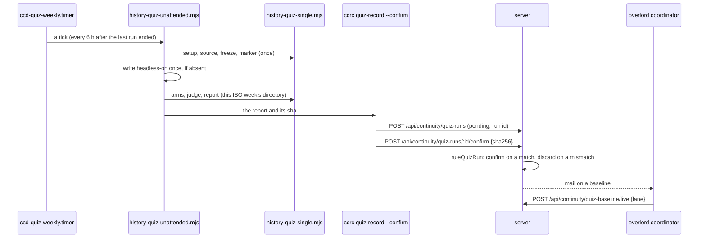

# Overlord W1a: the weekly replay quiz runs, records and confirms itself (run 3212)

The note of run 3212 (programme `overlord`, issue #2491), for the coordinator to fold into the programme ledger. It
records the design, the rulings it was built under, what landed, the measurements and the departures, each by slug. No
D-number was issued.

## Why

The operator's ruling of 2026-11-22: "Quiz results etc etc … I'm tired of you creating manual tasks for me that you should
be able to do yourself." It supersedes one condition of the W0-28 ruling, "the driver runs by your hand; ccrc never runs
it", and only that one. Before this change the operator had to run `deploy/history-quiz-single.mjs` by hand each week,
then `ccrc quiz-record`, then press Confirm on Settings, Automation, Shadow lanes.

## The rulings this was built under (the coordinator's answers to the run's three asks, 2026-11-21)

| Ask | Ruling |
|---|---|
| The weekly `arms` refuses `family-unlisted` until `~/.ccrc/history/headless-on` lists the frozen families, and nothing wrote that marker | The timer writes it **once**: the exact bytes the driver's `marker` step printed, its sha checked, only when the file is absent; it never edits or removes it. Steer, agents-on, recall-off and the rest stay the operator's. |
| `setup`'s values, which have no default | Built in: budget 5,000,000 (the weekly cap), settings mode `restricted`, `claude-opus-5-5` for the writer, the judge and the arm. The account is picked by the timer: the first roster account, in roster order, that is not hidden and that the driver admits. The pick is fixed in `setup.json` for every later week. |
| What "the operator can still Discard from the card" means | The card is unchanged: Confirm and Discard act on pending runs (one recorded by hand, or one whose confirmation failed). A timer run is confirmed at once. |

## The design

*Figure 1. One week's run, from the timer's tick to the coordinator's Live.*

### 1. The runner and its timer

- `deploy/history-quiz-unattended.mjs` is the timer's one act. It refuses `in-session` when `CLAUDECODE` is set at all and
  `in-pane` when `TMUX_PANE` is set, before anything else. The timer's run is neither, so it passes honestly; nothing
  unsets either variable.
- It spawns the driver, `node --no-warnings <tree>/deploy/history-quiz-single.mjs <subcommand>`, exactly as the runbook's
  operator does, with a by-name environment (`HOME`, `LANG`, `PATH`), and reads each step's `sha256 <hex>` line and its
  refusal line from stderr. Every refusal the driver has stays: step 0b's probes, `release-moved`, the masking agreement,
  the weekly `--budget`, the read-only store and no writing form of `ccrc history`. The runner never opens the store.
- Its directories are under `~/.ccrc/quiz/` (0700): the setup `--out` at `setup.<n>`, and one `--out` per ISO week (UTC)
  at `weeks/<YYYY-Www>`. A week is one directory: a refusal that needs a fresh `--out` (`release-moved`, `pilot-failed`,
  `out-refused`) or that resuming cannot cure (`budget-exhausted`) closes the week as `failed` with its word, and the next
  week tries again. So one week never spends more than one `--budget`. A stop that resuming cures (the limits words,
  `interrupted`) is resumed on the same directory at the next tick.
- Its state is one file, `~/.ccrc/quiz/unattended.json`, written whole by rename. Its `last` block (the tick's time, act,
  outcome, word and detail) is what doctor reads.
- `ccd-quiz-weekly.timer` (`OnActiveSec=30min`, `OnUnitInactiveSec=6h`) starts `ccd-quiz-weekly.service`, a oneshot
  running `/usr/bin/env node --no-warnings %h/ccrc/deploy/history-quiz-unattended.mjs` under the account's real HOME. It
  is placed and enabled by `ccrc update`'s install spine on every role but `server` (a server box keeps no history
  store), and removed by `ccrc uninstall`.

### 2. Confirmation without the operator

- `ccrc quiz-record --confirm` records the run as before, then posts `{ sha256, by }` to the new box-token door
  `POST /api/continuity/quiz-runs/:id/confirm`, with the run id the record answered.
- The door asks the one ruler, `quizStore.ts#ruleQuizRun`, with the action `match`: a pending row whose report sha
  equals the sha is confirmed under the existing baseline rule (`quiz.ts#quizBaseline`), and a pending row whose sha
  differs is discarded. A row already ruled answers its own state when its sha matches (a resend), and is refused
  otherwise. The ruling stays the one writer of `state`, `ruledAt`, `ruledBy` and `baseline`.
- The baseline rule is unchanged: the first confirmed run while every W1a lane is in shadow becomes the baseline, and it
  is never a W2 result, a PASS or a measured benefit of recall.

### 3. Waking the coordinator, and its Live

- When a confirmation makes the baseline, the server queues one system mail to the programme's coordinator
  (`CoordStore.programmeCoordinator('overlord')`), subject `quiz-baseline-confirmed`.
- Taking a W1a lane Live was an operator switch: `POST /api/coord/lane-arm` is session-gated and refuses Live while
  sign-in is dark. The smallest door for the coordinator is `POST /api/continuity/quiz-baseline/live { fromId, fromUuid,
  lane }`: box-token gated, attribution-checked, ownership-checked (the caller holds an open run of `overlord`), a W1a
  row only, Live only, and only once a confirmed baseline exists (`laneArm.ts#decideLaneArmCoordLive`). It writes
  through `CoordStore.setLaneArm`, the one writer, and records a feed row naming the coordinator.

### 4. The weekly item

The weekly item said "ccrc never runs it". It now waits out a grace period after the week starts, so the timer has its
chance, and says the unattended run has not confirmed this week's run and where to read why (doctor's quiz line).

## Departures, by slug

(filled in as the build goes)
