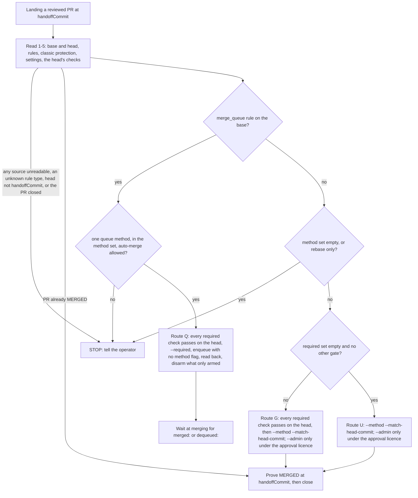

# Landing order and main churn — design

**Status:** design approved in the brainstorm by the operator 2026-09-23 (rulings in §3); rev 2 after a six-lens
adversarial review (61 findings survived, all applied) and a rev-3 verification pass; the operator's ruling on the
written spec's two open decisions recorded 2026-09-23 (R9, R10); reconciled with its first wave plans 2026-09-24,
and with `main` `b501698a` the same day (step 6 is #166's; stage 2's wave is re-planned, §9); stage 2 amended
2026-09-29, when its wave was re-planned on `main` `6da36f0b` and three reviews of that plan were applied (§4, §5.2,
§6, §9, §11, §12; the operator's four rulings of that day are §11's) ·
**Date:** 2026-09-23 · **Branch:** `ws/enhance-ccrc-for-parallel-agents` (based on `origin/main` `bbb5e714`) ·
**Companion:** `2026-09-23-session-continuity-design.md`. Two dependencies run between the specs (§9): the
continuity spec's stage 1 must land before this spec's stage 5, and the continuity spec's stage 5 appends its
skill clauses after this spec's stage 1.
**Parents:** `2026-08-07-build7-fleet-coordination-design.md` (runs, mail, the coordinator),
`2026-09-14-review-runs-design.md` (review runs; the fix-round channel this spec reuses),
`2026-09-08-crossrepo-programmes-design.md` (cross-project ordering stays that spec's discipline),
`2026-09-22-child-workspace-reclamation-design.md` (#166; stage 1's fresh child per wave is its rule 3),
`2026-09-18-release-rollout-design.md` (patch-per-merge tagging constrains the queue in stage 2).

The operator's complaint, 2026-09-22: *"the order in which commits land, then cancelled work for some tasks due
to main having moved on … wasted time by agents and constantly having to rebase/pull main into PRs
mid-workflow."* This spec makes landing order a recorded fact, stops the fleet manufacturing absorb rounds, and
lets the coordinator land a tested composition. **The coordinator merges, workers never do, and nothing merges
unattended** (§3, ruling R5).

Stages are numbered 1–5 and stage N is §5.N. References outside §5 use stage numbers.

---

## 1. The problem, measured

Measured on the fleet's six programme repositories over 2026-09-08..2026-09-22, re-derived by a second pass,
corrected by the adversarial passes. Instruments and inputs are archived beside this session's transcript
(`landing-baseline/`, with `instruments/`); §10 names what is committed with the plan so every baseline keeps its
tool.

| Last 14 days, six repositories | Value |
|---|---|
| Agent time spent syncing branches with main (deduplicated transcript episodes) | about 67 h/week, range 29–162 |
| Output tokens spent on the same | about 5M/week |
| Sync episodes | 359: 152 pure ritual, 78 conflict, 129 mixed |
| Share of sync hours inside conflict episodes | 72% (87.6 of 122.5 h) |
| Merges of main needing hand resolution, of those measurable | 112 of 471 (24%) |
| … caught by plain file overlap | 111 of 112 |
| PRs whose first sync happened while the PR was already green | 157 of 262 |
| Local merges of main repeating an earlier one on the same PR (all committers) | 185 of 336 |
| This repository's wait from green to merge | median 33.4 min, p90 18.2 h, max 243 h |
| This repository's merges credited to the fleet's single GitHub login, each past a ruleset approval nobody gives | 83 of 83 |
| Merge-of-main commits that were GitHub `update-branch` | 187 of 546, 183 inside one 55.7 h strict-protection window |
| Sync episodes from sessions that load no ccrc skill | 27% |

In order of cost:

1. **Conflicts are where the hours go, and this repository is the hotspot.** A conflict episode's median is 28
   active minutes plus a 16-minute local re-gate; a clean sync is two minutes. This repository runs a 46%
   conflict rate and 41 of its 64 merges of main were hand-resolved, because its suites pin exact tree-wide
   values that every landing moves. That is repository test design and gets its own programme (§8).
2. **Nobody decides landing order.** No table, route, field or verb records or enforces one (grep over
   `server/src`, `agent/src`, `shared`, `pwa/src`, `ccd`, `deploy`: 0 hits). Coordinators agree an order in
   mail and a batch merge overrides it: one programme ruled D→A→B and merged B, A, D within three minutes,
   costing a recovery PR, an abandoned 82-commit rebase and a follow-up PR. On this repository every merge goes
   past an approval rule nobody can satisfy, so every merge needs the admin bypass, whoever types it — the fleet
   has one GitHub login and transcripts show sessions issuing some of the 83.
3. **Ritual syncs are avoidable.** 60% of PRs that ever synced were already green before their first sync, and
   more than half of local merges of main were repeats on the same PR. On project-n, one of the two
   repositories with strict up-to-date protection, git reproduced 67 of 68 merges of main without a hand edit
   (93 of 99 across both strict repositories): strict mode is a queue done by hand, one worker round per sibling
   landing.
4. **The one ordering mechanism tried so far livelocked.** A coordinator turned on strict protection as its
   ordering mechanism (operator-approved); a co-owner's auto-update watcher then pushed main into every behind
   PR: 183 `update-branch` commits in 55 hours, 36 on one PR, each restarting CI. Nothing forbade either act.
5. **`update-branch` breaks the workspace↔PR binding.** `is_ours` (`ccd/ccd:5399`) binds a PR by ancestry from
   the workspace's LOCAL tip; a remote-side update produces a descendant, the sweep rebinds to an older PR, and
   the close refuses `pr-regressed` (run 47, 2026-09-16).
6. **A review or a wave-done is evidence about one sha.** `verifyDone` (`server/src/coord/fingerprint.ts:230`)
   and `verifyReviewDone` (`:309`) compare shas exactly, so a merge of main git makes with no hand edit still
   costs a fresh wave-done and, after review, a fresh review run.
7. **Main goes red and every open PR inherits it.** This repository's `ci` workflow was red on main for 111.2 h in
   9 intervals; 4 of them (36.0 h) failed only the non-required macOS legs, and 5 intervals lasting 75.2 h in
   total contained at least one required-leg failure. 50 of 92 PR CI failures fell inside those windows, measured against the whole workflow; the
   required-legs-only overlap is a plan prerequisite (§10).
8. **Skill text alone cannot fix it.** 27% of sync episodes come from sessions that never loaded a ccrc skill.

Measured and found NOT to help, so it is not re-proposed: the AST knowledge graph predicts hand resolution no
better than file overlap (0 of 15 extra flags caught; a git-only "two or more shared files" rule beats every
graph feature), orders concurrent PRs at a coin flip (43 agree, 51 reverse of 94 directed pairs), and has no
edges into the files where conflicts live (`ccd/ccd`, README, ledgers, lockfiles). File-lane serialisation
delayed most PRs in simulation. Third-party queue apps need a standing repo-write token on the repository that
takes untrusted input. GitHub's native queue is eligible on this repository only; the five private
repositories are on plans that exclude it.

## 2. What the parent designs already say

- Build 7 §7: the coordinator dispatches the SDD shape and does not reinvent it. It stays the one that rules and
  merges; this spec gives it a recorded order and a tested composition to rule on.
- Review runs §4: the worker persists until review clears and a send-back is a `fix-round` mail. Ejection from
  the landing line (stage 5) is the same mail on the `merging → working` edge, which exists.
- #166 rule 3: one PR per child; a spent child refuses a further run bind; the next run opens without a session
  id and dispatch mints a fresh child (`server/src/coord/dispatch.ts:418`). #166's wave 2 (#178) made that
  every PR-bearing wave's path on `main` ("One PR per child"); reclamation of spent children is its wave 3.
- Cross-repo ruling 4: a consumer wave is dispatched only after the producer's PR is proven merged at an exact
  sha. Ordering ACROSS repositories stays that discipline; the landing line orders within one repository.
- Release rollout: every push to `main` becomes a prerelease and `release-main.sh:60` tags HEAD only, so a push
  carrying several commits leaves the earlier ones untagged (stage 2's proof run).

## 3. Decisions settled in the brainstorm

| # | Ruling (operator, 2026-09-22/23) | What it fixes |
|---|---|---|
| R1 | The pain is LANDING (order, cancelled work after main moved, absorb rounds), not visibility. | The edit-ledger direction from the earlier analysis is out. |
| R2 | Two specs: landing (this) and session continuity. | §9. |
| R3 | Coordinators may enqueue on this repository's native queue on their own. | Stage 2. |
| R4 | A fresh workspace per wave. | Delivered by #166 rule 3 on `main` (#178), so stage 1 carries no step of its own (§5.1). |
| R5 | **No unattended lander.** "It's the coordinator's job to do merges, not the sub-workspace's, as it is the coordinator that bears ultimate merge responsibility (ultimate after the human)." | No timer holds MERGE authority; workers never merge; the coordinator composes, tests and merges from its own shell. |
| R6 | No headroom estimation. | Nothing here reads account headroom. |
| R7 | The knowledge graph is not used for landing (measured). | §1's closing paragraph; §13. |
| R8 | Mergify and other queue apps rejected; file-level lanes rejected. | §13. |
| R9 | Break-glass: the repository-admin role is the ruleset's only bypass actor (operator, 2026-09-23, on the written spec). The main ruleset also names the Maintain role as a bypass actor today; that entry comes off with the queue rule (confirmed by the operator, 2026-09-24). | Stage 2; §4's operator row; §11. |
| R10 | Strict protection comes off project-n and project-e after a week of coordinator landings with composition tests there (operator, 2026-09-23, on the written spec). | Stage 5; §11. |

## 4. Roles and authority

Identity on the fleet is attribution, not authentication: one UNIX user, one GitHub login, one box token shared
by every session. Where a row below says "may not", the column names the MECHANISM that holds it, or says there
is none.

| Actor | May | May not, and what holds it |
|---|---|---|
| **Worker** (a run's session in a child workspace) | commit and push its own branch; absorb main under clause 16's triggers; re-gate; report wave-done | merge (**the PreToolUse hook denies `gh pr merge` in a session whose hold names a programme wave, or whose workspace carries the child marker**, a reviewer's included, stage 2); rebase, force-push, `update-branch`, settings writes (clause 16, prose; `update-branch` absent from executable source, pinned) |
| **Coordinator** | declare order; run the composition; enqueue or merge at the pinned head; send fix rounds; pause the line | use the admin bypass (**the hook denies `gh pr merge --admin` in every fleet session**, stage 2); `update-branch`; settings writes (clause 15) |
| **ccd** | the read-only probe on a timer; compose a candidate; delete its own candidate refs; lineage | move a worker's branch; merge; push or delete anything outside `refs/heads/ccrc/land/*` (pinned) |
| **Server** | hold the line; mail "next to land"; re-measure what ccd wrote; refuse bad transitions | run git or `gh` (`EXEC_COMMANDS` stays `['tmux','ccd']`); take a run to `working` on its own; choose a successor |
| **Operator** | pause, withdraw, declare order; merge by hand (recorded as an inversion when out of order); break-glass through the admin bypass from their own shell or GitHub's UI (R9) | — |

The PWA cannot reach a merge: `gh` stays unwhitelisted, no ccd verb merges, and the session-gated landing routes
can pause or remove, never choose a successor (stage 5).

The hook cannot tell a coordinator from a worker by anything but the workspace: a coordinator whose own workspace
carries a programme-wave hold or the child marker — a self-claimed run's hold, or a reclaim heir that was the
programme's own worker — is refused `gh pr merge` like a worker, and has the operator enqueue from their own shell
(stage 2). (Added 2026-09-29.)

## 5. The design, in stages

### 5.1 Stage 1 — stop manufacturing churn (skills, hook, one CLI; no server change)

**Worker clause 16** (the pin moves from 15 to 16). A worker absorbs `origin/main` only on one of three triggers:

1. its own probe says the branch conflicts: `git merge-tree --write-tree --name-only --no-messages HEAD origin/HEAD`,
   after one fetch, exits 1 with a 40-hex tree id on stdout's first line. Exit 0 is clean; any other answer is
   unmeasured and licenses nothing, including exit 1 with an empty stdout, which git 2.43 on the fleet box
   returns for an unresolvable ref;
2. a required check on the PR is red while main passes the same tests: the worker re-runs the failing test files on a
   clean checkout of `origin/HEAD` (after the same one fetch), and a red there too is main's own. Ruled 2026-09-28:
   this replaces "main's latest push run of the same required job is green", because since CI test selection (#183)
   a push to main runs no test legs and reports every required check green;
3. the PR was ejected from the landing line with a base sha, or, in a strict-protection repository, the
   coordinator names it next to land (a land-sync). Both arrive on the `merging → working` edge as a fix-round
   mail, because worker clause 9 forbids pushing after wave-done; the worker absorbs, re-gates and sends a fresh
   wave-done. From stage 4 on, a land-sync whose only change is a clean merge of main is accepted by lineage
   with no new review, and the next `advance → merging` re-pins the landing entry.

Triggers 1 and 2 each license at most one absorption per PR; a second occurrence before the first absorption
lands is not a second license. Trigger 3 is bounded by the coordinator's naming. Under every trigger: `git merge`
only, never a rebase, a force-push or `update-branch` by any route including `gh api -X PUT`; a generated stamp is
never hand-resolved (take either side of the stamp line only, resolve every other hunk of the file as the source it
is, then run the regenerator — taking either side of the whole file drops the other side's hunks); a red that main also shows is reported once as
`main-red` and left alone; never maintain a local `main`, read `origin/HEAD` after one fetch.

**Coordinator clause 15** (14 → 15). The coordinator never calls `update-branch`, never writes rulesets,
protection, auto-merge or `allow_update_branch`, sends a rebase-check only on a conflict it has measured, sends
a land-sync only to the PR it named next in a strict repository, never merges main into any workspace but its
own, and commits programme-ledger documents on its own ledger PR, never inside a feature PR (the ledger file was
the hottest overlap file in three repositories).

**A fresh workspace per wave (R4) is #166's.** This section first drew it as step 6 of the wave lifecycle,
gated on #166's reclaim-on-close wave. #166's wave 2 (#178) made it live on `main` without a gate, as "One PR
per child" in the coordinator skill's step 6 and `wave-lifecycle.md` §5 step 3: a marked producer whose workspace
opened a PR is spent, wave N+1 opens without its `sessionId`, and a wave that builds on its predecessor's code
dispatches only once that PR is proven merged at its exact head. Stage 1 therefore adds no step 6; a producer
whose workspace opened no PR keeps it, as #166 rules. (Removed 2026-09-24, when the first plans were
re-measured against `main` `b501698a`.)

**The hook reaches sessions the skills do not.** `ccd/session-hook.sh`'s PreToolUse arm (matcher `*`) sees every
Bash call. On a command that merges, pulls or rebases `main` into the current branch, or asks GitHub to with
`update-branch`, it emits `additionalContext` naming the three triggers and the probe command. It never denies.
This covers the 27% of sync episodes in sessions with no skill.

**The regenerator gets a CLI.** `ccd/ccd`'s line 2 carries a digest of the file's body with the marker line
stripped; the regenerator exists as `markGenerated` in `shared/mark.mjs`, and `server/test/ownership.test.ts`
is already red on an unstamped file. Stage 1 adds a one-line CLI around it (`ccrc restamp <file>`, which refuses a
generator's own output under `~/.local/bin` or `~/.ccrc`) and clause 16 names it; 17 of 25 hand resolutions on that
file were the stamp alone.

**Pins.** `update-branch` is pinned ABSENT from executable source (`server/src`, `agent/src`, `shared/`,
`deploy/`, `ccd/ccd`, `ccd/ccd-*`, `ccd/ccrc`, `ccd/session-hook.sh`), with two allowed spellings, pinned as the
only ones, neither of which calls it: the advisory's detector in `ccd/session-hook.sh`, and the classifier in the
read-only instrument `deploy/measure-landing.py`, which counts past `update-branch` commits. In the skill corpora it is counted, not absent: the
clauses name it once each to forbid it, and a count pin in the style of `coordinator-skill.test.ts`'s existing
literal counts holds that number. The two skill pins move in the same commit as the clauses, together with the
clause-count words in `README.md` and `CLAUDE.md` that both pins read.

Removes: pure-ritual syncs outside strict repositories, every fleet `update-branch`, the repeat-absorption share,
and the class of act that opened the livelock window.

### 5.2 Stage 2 — GitHub's native merge queue on this repository

**Repository code.**
- `.github/workflows/ci.yml` gains `merge_group:` beside `pull_request:`, and a queue run runs what a pull request
  runs (operator ruling 2026-09-28): the selected server tests and every other required leg, the plain-bash
  pipeline check included, asked against `merge_group.base_sha` — `merge_group` joins the `pull_request` arm of
  `.github/ci/select.mjs` and `verdict.mjs`, and the mode table gains its row. The non-required macOS legs and
  `full-suite` skip a queue run (a selection fallback runs `full`, and `full-suite` would read the skipped macOS leg
  as red). The `pull_request` arm that cancels a superseded head is CI selection's (#183); a `merge_group` run gets
  a run-unique group of its own (`queue-<run id>`), never the shared push-to-main `refresh` group: GitHub keeps one
  pending run per group and cancels the older one even without `cancel-in-progress`, so a shared group would drop a
  queue entry's checks. No full run per merge (2026-09-23). (Amended 2026-09-29, on #183's shape.)
- `ccd pr-state` gains one GraphQL query per repository per sweep (`pullRequest.mergeQueueEntry` and the last
  queue act of either kind, `ADDED_TO_MERGE_QUEUE_EVENT` or `REMOVED_FROM_MERGE_QUEUE_EVENT`, in `timelineItems`:
  a removal alone cannot tell a merged PR the queue landed after a re-enqueue from one merged by hand after a
  dequeue), separate from its `gh pr list --json` call, under its own bounded timeout (`PR_GH_QUEUE_TIMEOUT`, 4 s;
  the query measured 0.72–1.39 s), answering `queued | dequeued | landed | none | unmeasured` in an additive
  `queue` field; the pr-state header's gh-call budget is updated to say so. The server's outer bound on
  `pr-state` (`CCD_VERB_TIMEOUT_MS`) rises from 20 s to 25 s, so the three calls' timeouts (8 + 5 + 4 s) stay
  within the 70% of it that `pr-timeout-budget.test.ts` allows across the two languages. The map is keyed by the
  verb, so `--session` rises with `--project` (ruled 2026-09-24); child reclamation's close gate reads it up to
  twice inside `coordMutex`, so a close's worst case is about 50 s against its 30 s client timeout — accepted by
  the operator 2026-09-29 (§11), and every comment that stated the old bound says 25 s.
- A dequeue (GitHub does not re-enqueue after a failed group) becomes a feed event of a new `NotifyEvent` kind,
  `queue` (added in place in `shared/api.ts`, line-neutral; the PWA's total `KIND_WORD` and `KIND_GLYPH` records
  name it), and, when an open run names the PR's workspace, a `status` mail to that run's coordinator, sent as
  `operator`: raised by the watcher on the operator's behalf, the ask nudge's precedent. The coordinator reads why
  from the queue's own `merge_group` run — the PR head's checks never include it and can read green — then
  re-enqueues or, disarming any armed auto-merge first, sends a fix round. A dequeued PR that no open run names
  gets the feed event and no mail. A PR that reads merged while the open run naming its workspace waits at
  `merging` is a `status` mail `merged:#<n>` to that run's coordinator, once — the wake-up for an asynchronous
  queue merge, since the coordinator never polls (included in stage 2 by the operator, 2026-09-29, §11). It reads
  the run's state, not whether the project has a queue, so a synchronous merge a sweep reads before the close is
  mailed too, and answered by the ordinary proof and close. The recipient is the open run the close itself would
  keep (`survivorOf`). Both notices need that run to be open, so on a native-queue project the producer lands
  before it closes (clause 15). A PR whose enqueue only ARMED auto-merge (below) reads `none` and gets no notice:
  the coordinator's read-back of the queue entry catches it. (Amended 2026-09-29.)
- **The merge gate becomes a mechanism.** Setting the approval count to zero means any session holding the
  fleet's login could land with a plain `gh pr merge`. So `session-hook.sh`'s PreToolUse arm DENIES `gh pr merge`
  in any session whose hold names a programme wave, a worker's or a reviewer's (`CCRC_HOLD_WAVE_RE`, the hook's
  one spelling of that grammar), or whose workspace carries the child marker `$REG/<id>.child` (a close releases the
  hold before the reclaim takes the pane; the marker is purged only with the registry row), and denies `--admin` in
  every fleet session, together with a `gh api` call that reaches the same merge — the pulls merge endpoint, or a
  GraphQL merge mutation (`mergePullRequest`, `enqueuePullRequest`, `enablePullRequestAutoMerge`), each measured
  passing the wave-hold deny. Mutation rows: a worker's merge is refused, and so is a released child's; a
  coordinator's exact-SHA enqueue passes; any session's `--admin` is refused; a session's `gh api` merge call is
  refused; each red when its arm is deleted. The operator's own shell, outside Claude Code, is unaffected. The hook
  is a contract the fleet honours, not an access boundary. A coordinator whose own workspace carries the hold or
  the marker (§4) is refused like a worker; it never closes to shed the hold — a final close of a child reclaims
  its own pane — and has the operator enqueue. (Amended 2026-09-29.)
- Coordinator clause 15 says: on a native-queue project, landing is `gh pr merge <n> --match-head-commit
  <handoffCommit>` — #178's exact-SHA binding, with no `--squash` (the queue's method applies) and no `--admin` —
  which enqueues, and the producer's run closes only once the PR reads MERGED at `handoffCommit`; until then it
  waits at `merging`, holding the child (`wave-lifecycle.md` §5, "Landing on a native-queue project"). The last
  wave's producer lands before its close too. That reference also says what makes the command an enqueue: gh
  reaches a required queue through its auto-merge mutation, and ARMS auto-merge, rather than queueing, a PR whose
  required checks have not passed, printing the same success line — so the coordinator measures that the project
  requires the queue (its `main` branch rules carry `merge_queue`) before each landing, enqueues only once
  `gh pr checks <n> --required` passes, reads the queue entry back, and disarms (`--disable-auto`) a request that
  only armed, and before any fix round from `merging`. (Amended 2026-09-29.)

**Operator configuration** (settings, not ccrc code): a ruleset requiring the merge queue on `main` — squash,
group size 1, build concurrency 1 — and `required_approving_review_count` 1 → 0 in the existing main ruleset.
Break-glass (R9): the repository-admin role is the ruleset's only bypass actor; the same change removes the Maintain
role, the main ruleset's second bypass actor today. The fleet's single login holds the admin role, so the bypass is
reachable from any session; the hook denies the spellings it can parse, which makes the
bypass the operator's by convention, not by credential. The operator uses it from their own shell or GitHub's UI.
A hand merge out of order is recorded as an inversion. gh reaches a required queue through the auto-merge
mutation and the repository has `allow_auto_merge: false` today; if the proof run's enqueue is refused for that,
the proof halts and the operator decides then — clause 15 forbids a coordinator to write it (§11, 2026-09-29).

**Rollout order inside stage 2**, because each step needs the one before it:
1. `ci.yml` gains `merge_group` (repository code, merged the ordinary way);
2. the operator enables the queue ruleset and sets approvals to 0 (a PR can be enqueued only once a queue rule
   exists; a scratch-branch queue ruleset is an alternative for the proof);
3. **the proof run**, which is stage 2's own gate: enqueue two or three trivial PRs at once and check one push
   event and one prerelease per merge; if a group lands several commits in one push, keep group size and
   concurrency at 1 or make release-main tag every commit in the pushed range; confirm `ours_of` still binds
   after a queue merge; measure whether GitHub records a removal event on a successful queue merge (if it does,
   a queue-merged PR reads `none`, not `landed`); measure that gh's enqueue binds `--match-head-commit` (a
   deliberately wrong sha is refused and nothing is queued); measure the armed path — an enqueue whose required
   checks have not passed arms auto-merge and queues nothing — and whether an armed request survives a push by the
   fleet's login (amended 2026-09-29);
4. only then does the hook's deny on `--admin` go live. Until approvals are 0, every merge here still needs
   `--admin`, so the deny shipping first would stop every fleet merge on this repository.

Removes: the operator-as-queue wait (median 33 min, p90 18 h), landing an untested tree here, and this
repository's fleet inversions (14 fleet-on-fleet pairs in the window, §10).

### 5.3 Stage 3 — the conflict radar (ccd, read-only)

A timer-driven sibling script, `ccd-land-probe`, in the shape of `ccd-pool-sync` and `ccd-tmp-sweep` (oneshot,
flock, pause file, env-overridable knobs, doctor check), acting only on projects listed in
`~/.ccrc/landing/<project>.conf`. Per project per tick:

1. fetch `origin/main` and every open fleet head (`refs/pull/N/head`) into a per-tick scratch object directory
   with alternates to the project repository, never a persistent mirror;
2. `git merge-tree --write-tree --name-only` for main × each head and pairwise across heads (at most 10):
   `clean | conflict <paths> | unmeasured`;
3. read the REQUIRED contexts' check-runs on main's tip as `main-health`;
4. compute each workspace branch's lineage (`refs/heads/ws/*` read from the project repository, not only PR
   heads): at most 8 first-parent steps, each a two-parent merge whose second parent is on the fetched base and
   whose tree equals `merge-tree(P1, P2)`;
5. write `$REG/landing/<project>/probe`, `<id>.lineage` and `main-health`; a failed fetch writes `unmeasured`.

The probe runs with the host credential, which carries repo-write scope; it is read-only by code. A literal
absence pin on `ccd/ccd-land-probe` forbids `push`, `gh pr merge`, any `gh api` method other than GET, and
`update-branch`, and is shown red by planting each.

The server gets one reviving reader in `FleetWatcher`; the wire gains optional `FleetSession.landing` and
`RunSummary.landing` (absence = unknown); the PWA shows a read-only predicted-conflict chip beside the hot-files
strip. `git count-objects` before and after a cycle is a doctor measurement.

Removes: coordinator sync and order threads sent without a measured conflict, inherited-red investigations, and
produces the lineage stage 4 consumes.

### 5.4 Stage 4 — a clean merge of main keeps its wave-done and its review (server, fixture-git tests)

The lineage path runs only for a project whose landing conf opts in. The conf lives on the fleet box, where the
agent's read whitelist does not reach, so the probe mirrors it as `$REG/landing/<project>/enabled`, which the
agent can read, and the server reads that marker through `readFileMeasured` so absent and unreadable stay
distinct. When the live tip differs from the claimed tip:

| Lineage state | Answer |
|---|---|
| marker absent (project not opted in) | `stale-tip` / `stale-review` exactly as today |
| marker unreadable | `stale-tip` / `stale-review`, with the distinct detail `landing-marker-unreadable` |
| probe paused for this project | `stale-tip` / `stale-review` exactly as today |
| lineage file older than the live tip's ref (not yet ticked) | NEW `lineage-unmeasured`, answered synchronously, recorded and mailed under its own subject so the worker or coordinator re-sends after the next tick |
| lineage current, claimed tip in a base-only chain ending at the live tip, fetched base named | accept, `measured.via:'base-only-merge'` |
| lineage current, no such chain | `stale-tip` / `stale-review` |

Nothing re-checks a claim later; the server stores no claim and advances nothing on its own. Fixture-git
mutation tests: a clean merge accepted; a hand-edited merge refused; a rebase refused; a second parent not on
base refused; a tip that moved between reads refused; a stale lineage answers `lineage-unmeasured`; a project
with no marker and a moved tip still answers `stale-tip`; an unreadable marker answers `stale-tip` with its own
detail; each red when its guard is removed. Worker clause 9 gains
its exception in the same PR.

Removes: refusals traced to main syncs (at least 6 of 11 mailed refusals), the discarded review after a clean
absorption, and the re-send round per land-sync in strict repositories.

### 5.5 Stage 5 — the landing line, and the coordinator lands (server data, one ccd verb)

**Data, split by authority.** One `coord.db` migration (the slot is a cross-branch namespace; check
`origin/main`'s `MIGRATIONS.length` at PR time) adds:

- `landing_entries(project, repo, pr, pinnedSha, handoffCommit, runId?, afterIds, fixesMain, state, baseSha,
  setBy, detail)`;
- `landing_projects(operatorPaused, mainRedHold)`: two booleans, because they have different remedies; the line
  is paused while either is set;
- `landing_intents(runId, project, key)`, keyed to runs, taken at dispatch, independent of entries.

Columns re-measured from ccd's files — `pinnedSha` and landed state — are recomputable; order edges,
`fixesMain`, pause, withdrawals and intents are **central authoritative state**, like `pool_edges`, journalled to
`~/.ccrc/landing.log`. On reconstruction the journal wins for authoritative columns and the sweep wins for landed
state. `CLAUDE.md`'s coord.db invariant is amended to name this second exception.

**Entries and pins.** An entry is created on `advance → merging`, pinned to the verdict's `measured.branchTip` —
the actual PR head, which after stage 4 may be a base-only merge — with `handoffCommit` kept as its own column.
`--match-head-commit` and the landed check both read `pinnedSha`. `POST /api/landing/entries` covers a PR with
no run. Order defaults to first-green; `POST /api/landing/order` sets `after` edges. Dispatch gains optional
`intents[]` answering 409 `intent-held` (28 PRs in 120 days were closed unmerged because a sibling landed the
same change first).

**Writes are attributed, not authorised.** The box token is shared by every session, so order edges, entries and
`fixesMain` record the calling session in `setBy`; a feed event fires when a session other than the run's
coordinator sets an order edge or `fixesMain`, and every `landing-inversion` event names who reordered. The
skills say `fixesMain` is the coordinator's or the operator's to set; nothing on the box can enforce that, and
the spec does not claim it.

**Landed state is PR-keyed.** `pr-state` gains a third form, `ccd pr-state --project 
 --pr <n>`: one
`gh pr view <n> --json state,mergedAt,mergeCommit,headRefOid` under its own timeout, answering
`open | merged | closed | unmeasured`, with no workspace binding. It rides the existing `['pr-state','--project']`
prefix grant, gets its own `CcdArgv` brand, and the pr-state header's gh-call budget counts one call per open
landing entry per sweep. A reader walks entries with it, separate from `sweepMerged`'s per-workspace loop, so
no-run entries and hand merges are seen. The coordinator's own merge step also reports the result.

**Next to land.** The radar names the head whose composition against the current base is clean; the server mails
the coordinator once. Mail is idle-gated: its latency to the coordinator's first nudge-started turn is a plan
prerequisite (§10), not a figure this spec asserts.

**The coordinator lands**, from its own shell, never from a timer or the PWA:

1. **On a native-queue project** (this repository) the queue is the composition test: the coordinator enqueues.
2. **Elsewhere** `ccd land-candidate --project 
 --pr <n> --base <sha>` composes
   `C = commit-tree(merge-tree(B, H)) -p B -p H`, with H the PR's head, and pushes it, non-force, to
   `refs/heads/ccrc/land/<project>/pr-<n>/<base12>` — a fresh name per base, so re-composing after main moves
   never needs force, and no coord.db id is needed on the fleet box. Each `lander:coordinator` repository declares how its CI runs on that ref (a push trigger
   on `ccrc/land/**`, or the coordinator's own `gh workflow run --ref`). The verb is not whitelisted to the PWA.
3. On green, the coordinator re-measures `origin/main == B` and merges with
   `gh pr merge <n> --<declared method> --match-head-commit <pinnedSha>`, never `--admin`. The window between that
   check and the merge remains on a plain merge and is stated, not hidden; `merge-tree` reproduced GitHub's squash
   tree on all 38 measurable of 40 PRs checked here (2 unmeasured, objects missing), and each repository's merge
   method is covered by a proof run before it is declared `lander:coordinator`.
4. When an entry lands, is withdrawn or is ejected, the coordinator runs `ccd land-candidate --project 
 --pr <n>
   --drop` from its own shell, which deletes that PR's `ccrc/land/<project>/pr-<n>/*` refs — the only delete ccd
   may issue, pinned to that family. A withdraw from the PWA reaches the coordinator as a notice mail, so the same
   actor drops the refs.
5. On a conflict, or a red after one automatic re-run of failed jobs, the coordinator sends the owning worker a
   `fix-round` mail naming base B and the paths or checks, on the `merging → working` edge; the entry goes
   `ejected` and is re-pinned on the next `advance → merging`. A fix round that changes content needs a new
   review run, as today; a clean base-only absorption does not, and stage 4 re-pins the entry to the new tip. A
   second ejection of the same entry becomes an operator ask.
6. When required contexts are red on main the line sets `mainRedHold`; only a green `main-health` reading clears
   it, and nothing automatic clears `operatorPaused`. Mutation rows: an operator pause survives a red-to-green
   transition; an operator pause set BEFORE main goes red survives the red and the later green. Entries with
   `fixesMain` jump the queue.

**PWA doors.** Two routes, both in the `SESSION_ONLY` class (session-gated, no box token, NOT the ungated
wedge-release class), registered in `server/src/coord/routes.ts` so the two scanners that read that file alone
see them: pause the project's line, and withdraw an entry with a coordinator notice. The pinned property:
a session-only route may pause the line or remove an entry, including the head, but never chooses or reorders
which entry becomes head — the successor is whatever the recorded order and the radar already say.
`landing-subtractive.test.ts` pins that; `coord-pause-route.test.ts`'s `SESSION_ONLY` set and
`box-token-census.test.ts` gain the routes in both directions, with `CLAUDE.md`'s box-token bullet.

**Strict protection comes off** project-n and project-e only after the coordinator has landed there
with composition tests for a week.

Removes: order negotiated in mail, fleet-controlled inversions, duplicate-intent races, and untested compositions
of the "main went red after two PRs landed 28 minutes apart" class.

### 5.6 Repository hygiene the operator owns (not ccrc code)

- Every repository: `concurrency` with `cancel-in-progress` on `pull_request` workflows.
- Append-only registries (a chat log, a ledger): `.gitattributes … merge=union` where the measured resolutions
  were union-shaped (18 of 46 and 23 of 32 on two such files).
- `delete_branch_on_merge` unchanged; fresh children remove the stacking hazard.
- The ruleset changes of stage 2 and the strict-protection flips of stage 5.

### 5.7 Stage 2 amendment — the landing route comes from the repository's own rules (skills only)

Stage 2 taught the coordinator to land on a native-queue project, and kept #178's squash merge for every other
repository. That squash is a fixed choice. A repository can forbid it, and a required check can live where the
skill does not look. This subsection makes the coordinator read the repository before each landing, derive what
it may do, and stop when the answers disagree. It adds no server code, no ccd verb, no merge endpoint and no gh
grant. It is written as a new subsection so that §5.2's text, which wave 3d also edits, stays as it is.
(Added 2026-10-21, on the operator's rulings of that day: §11, items 7 to 15.)

#### 5.7.1 What the coordinator reads, before each landing

The reads are all GETs, from the coordinator's own session, from a checkout of the PR's repository. They run
again before every landing, never from memory, because the operator can change any of them between two PRs.

| # | Read | What it gives | Confirmed absent | Unreadable (a STOP) |
|---|---|---|---|---|
| 1 | `gh pr view <pr> --json baseRefName,headRefOid,state,reviewDecision` | the base branch the PR targets; the head to compare with `handoffCommit`; whether the PR is open; whether its required approval is given | — | any error |
| 2 | `gh api --paginate 'repos/{owner}/{repo}/rules/branches/<base>'` | every rule from every ACTIVE ruleset that targets the base, repository and organisation alike, each with its `ruleset_id`: `pull_request` (with `allowed_merge_methods` and `required_approving_review_count`), `merge_queue` (with `merge_method`), `required_status_checks`, `required_linear_history`, and the other gating types of 5.7.3 | `[]` with status 200 means no rule applies | any non-200 |
| 3 | `gh api 'repos/{owner}/{repo}/branches/<base>/protection'` | classic protection: `required_status_checks` (`checks` with `app_id`, `contexts`, `strict`), `required_linear_history.enabled`, `enforce_admins.enabled`, `required_pull_request_reviews.required_approving_review_count`, `required_signatures.enabled` | status 404 AND message exactly `Branch not protected` | a 404 with any other message (`Branch not found`, `Not Found`), 5xx, a timeout; a 401 or 403 goes to read 3b |
| 3b | `gh api 'repos/{owner}/{repo}/branches/<base>'`, only when read 3 answered 401 or 403 | classic `protection.required_status_checks` (`checks` with `app_id`, `contexts`), readable with plain read access | `protection.enabled: false` | any non-200 |
| 4 | `gh api 'repos/{owner}/{repo}'` | `allow_squash_merge`, `allow_merge_commit`, `allow_rebase_merge`, `allow_auto_merge` | — | any non-200, or any of the four fields missing |
| 5 | `gh api --paginate 'repos/{owner}/{repo}/commits/<handoffCommit>/check-runs'` and `gh api --paginate 'repos/{owner}/{repo}/commits/<handoffCommit>/status'` | the head's check runs (`name`, `app.id`, `status`, `conclusion`; the endpoint's default `filter=latest` gives the newest run per name) and its commit statuses (`statuses[]`: `context`, `state`) | an empty list means nothing has reported, never a pass | any non-200 |
| 6 | `gh api 'repos/{owner}/{repo}/rulesets/<ruleset_id>'`, only when the admin licence is weighed (5.7.4) | `current_user_can_bypass` for a ruleset that read 2 named | — | any non-200: the login counts as able to bypass |

Read 2 answers for any branch name, including one that does not exist: GitHub returns the rules that would apply
to a branch of that name. This repository's `[]` for a missing branch comes only from its ruleset targeting `main`
alone; under a ruleset aimed at every branch, a misspelled base would return real rules. So the base always comes
from read 1, never from a guess, and read 5 runs only once read 1 has shown the head is `handoffCommit`.

Read 3 needs a login that may read the repository's administration settings. When it answers 401 or 403, read 3b
gives the classic check set with plain read access (§11, item 9). Strictness, linear history, `enforce_admins`, approvals and
signatures are then unknown, and the landing stops if the route would need one of them: the PR's head is behind the
base (`gh api 'repos/{owner}/{repo}/compare/<base>...<handoffCommit>'` answers `behind_by` above 0, so land-sync
would depend on strictness), the chosen method is `merge` (linear history), or the admin licence is weighed
(`enforce_admins`). Without those, `--admin` is never used under read 3b, and GitHub enforces approvals and
signatures at merge itself.

Read 5's combined `state` answers `pending` for a head that carries no status at all (measured, 5.7.7), so the
procedure reads the `statuses` array, never the combined state.

#### 5.7.2 The effective method set

The method set is an intersection. A method survives only if every source allows it.

- Start from the repository settings: `squash` if `allow_squash_merge`, `merge` if `allow_merge_commit`, `rebase`
  if `allow_rebase_merge`.
- Intersect with `allowed_merge_methods` of EVERY `pull_request` rule in read 2, not the first one. A
  `pull_request` rule with no `allowed_merge_methods` field allows all three.
- Remove `merge` if linear history is required: a read-2 rule of `type == "required_linear_history"`, or read 3's
  `required_linear_history.enabled == true`. The field's presence is not the test: classic protection always
  returns a `required_linear_history` object, `{"enabled": false}` when linear history is not required (5.7.7).
- Names are compared in lower case: rules spell `merge`, `squash`, `rebase`, and a queue rule spells `MERGE`,
  `SQUASH`, `REBASE`.

If a `merge_queue` rule applies, the queue owns the method: its `merge_method` must be in the method set, or the
landing stops (5.7.5). Read 2 returns one rule per ruleset, so two active rulesets can each carry a `merge_queue`
rule; if their `merge_method`s differ, the landing stops. Otherwise the coordinator picks from the set in a fixed
order (§11, item 7): `squash`, then `merge`. `rebase` alone is a stop (§11, item 8).

#### 5.7.3 The required check set and the other gates

The required set is a union: every `required_status_checks` rule's `parameters.required_status_checks` from read 2
(each a `context` and an optional `integration_id`), plus read 3's (or read 3b's) `required_status_checks.checks`
(each a `context` and an optional `app_id`; an `app_id` of null or -1 names no App) and its legacy `contexts`.
Strictness is the same union: a ruleset's `strict_required_status_checks_policy` or classic `strict` makes the
repository strict-protection, and clause 15's land-sync rule applies as it does today.

Required checks are not the only rules that gate a merge on results. Read 2's rule types `workflows` (required
workflow runs), `code_scanning`, `required_deployments` and `required_signatures`, and read 3's
`required_signatures.enabled == true`, are the **other gates**. The coordinator does not verify them itself.
GitHub enforces them at merge, but not against `--admin` from a login that may bypass them. So any of them rules
out route U and the admin licence (5.7.4), and with no `--admin` GitHub's own refusal is the stop.

The procedure understands these read-2 rule types and no others: `pull_request`, `merge_queue`,
`required_status_checks`, `required_linear_history`, `workflows`, `code_scanning`, `required_deployments`,
`required_signatures`, `non_fast_forward`, `deletion`, `creation`. Any other type is a stop, never read as absent.

Each required name is in one of four states, read from read 5, never from gh's exit code alone:

| State | Read 5 shows, on the exact head |
|---|---|
| **passing** | a check run of that name with `status` `completed` and `conclusion` `success`, `neutral` or `skipped` (GitHub's own passing set for a required check), and, where the rule names an App (`integration_id` in a ruleset, `app_id` in classic protection), `app.id` equal to it; or, for a name no App is named for, a status of that context with `state` `success` |
| **red** | a completed check run with any other conclusion (`failure`, `cancelled`, `timed_out`, `action_required`, `stale`), or a status `failure` or `error` |
| **pending** | a check run not yet `completed`, or a status `pending` |
| **not reported** | no check run or status of that name (from the named App, where one is named) |

A required name pinned to an App that read 5 shows only as a commit status cannot be verified, because a status
carries no App id. That is a stop.

`gh pr checks <pr> --required` is still read, but it judges only checks that have reported, and its exit 1 means
both "a required check failed" and "no checks reported at all" (measured, 5.7.7). So exit 1 is a failure only when
read 5 shows a required name red. A required name that is missing is not reported, whatever gh's exit code.

What follows from each state:

- **Pending or not reported:** wait in the foreground. The wait has an end: one `gh pr checks <pr> --required
  --watch` call, again if that call times out while a reported required check is still pending (as today), then
  one fresh read 5. A required name that read still shows as not reported has not reported within the bound, and
  that is a stop. `--watch` returns at once when every reported required check is green, so the plan fixes one
  bounded foreground spelling for a required name that has not reported at all, and states its bound.
- **Red, and the PR's own:** the existing fix-round rule (`wave-lifecycle.md` §5): a fix round to the owning
  worker on `merging → working`, after the disarm on route Q. This is not a stop.
- **Red, and not the PR's own:** the existing one `gh run rerun <run id> --failed` and the same wait, where the
  check is a GitHub Actions run. A red check a rerun cannot reach (one posted by another App), or one still red
  after the rerun, is a stop.

The discovered set gates every route. On route Q it gates the enqueue too: every discovered required name passes on
the head before `gh pr merge`, not only `--required` exiting 0, so a queue-route PR missing a required App check is
never enqueued (gh would arm auto-merge instead). On route U the set is empty and nothing waits.

#### 5.7.4 The three routes

| Route | When | Spelling | Method flag | `--admin` |
|---|---|---|---|---|
| **Q — native queue** | a `merge_queue` rule applies to the base, with one queue method | `gh pr merge <pr> --match-head-commit <handoffCommit>`, after every discovered required check passes on the head (5.7.3) and `--required` exits 0, then the read-back and the disarm rule (§5.2, `wave-lifecycle.md` §5) | none: the queue's method applies | never |
| **G — gated direct merge** | no queue rule; the required set is not empty, or another gate applies (5.7.3) | `gh pr merge <pr> --<method> --match-head-commit <handoffCommit>`, after every required check passes on the head, with `<method>` from 5.7.2; on a merge-commits-only repository, exactly `gh pr merge <pr> --merge --match-head-commit <handoffCommit>` | exactly one, from the method set | only under the approval licence below; never as a fallback (§11, item 10) |
| **U — ungated direct merge** | no queue rule; the required set is empty; no other gate applies; and every source was read, or read 3b stood in for read 3 | `gh pr merge <pr> --<method> --match-head-commit <handoffCommit>` | exactly one, from the method set | only under the approval licence below; never under read 3b; never as a fallback (§11, item 10) |

**The approval licence.** `--admin` is licensed on a direct route only when all three of these hold, each read
fresh for this landing:

1. **An approval the fleet cannot give is required, and missing.** Read 2's `pull_request` rule has
   `required_approving_review_count` above 0, or read 3's `required_pull_request_reviews.required_approving_review_count`
   is above 0, and read 1's `reviewDecision` is not `APPROVED`.
2. **Every required check has passed on the head** (5.7.3).
3. **`--admin` cannot skip a gate.** No other gate applies (5.7.3). Where read 3 carries required checks, its
   `enforce_admins.enabled` is true, so an admin cannot pass over them. Every ruleset in read 2 that carries a
   `required_status_checks` rule answers read 6 with `current_user_can_bypass: never`. Any other answer, or an
   unreadable read 6, counts as able to bypass.

If (1) holds and (2) or (3) does not, the landing stops. Without (1), `--admin` is never passed. An approval kept
in classic protection with `enforce_admins` true binds an admin too, so `--admin` does not help there, and GitHub's
refusal is the stop.

This is today's licence, stated precisely. Today's sentence, "(plus `--admin` where the repository's ruleset
requires it)", applies to every direct landing and names no gate. Read literally, it would also pass `--admin` over
a required check an admin may skip, and the licence above withdraws that reading. It keeps every landing that works
today: this repository's pre-queue configuration (5.7.7), which a queue rollback restores, goes to route G and
lands under the licence. It is also not the "admin fallback" the agreed scope rules out. A fallback is `--admin`
after a refusal. The licence is decided before the merge, from reads, and a refused merge is never retried with it.

On every route the merge is proven the same way it is today: MERGED, with `headRefOid` equal to `handoffCommit`.
A refused merge on route G or U is read, reported and stopped on. It is never retried with another method, with
`--admin` or with `--auto`.

*Figure 1. The landing route chosen from the repository's own rules. Every arrow into STOP goes to the operator,
never to another route. A required check that is red and the PR's own goes to the fix-round rule on routes Q and G,
not to STOP.*

#### 5.7.5 Stops

A stop leaves the run where it is (at `merging` or `awaiting-review`), enqueues nothing, merges nothing and
changes nothing. The coordinator says in its turn's text which stop fired and what it read, for the operator.

| Stop | Reading |
|---|---|
| A source is unreadable | read 1, 2, 4 or 5 is not a 200; read 3 is anything but a 200, the `Branch not protected` 404, or a 401/403 that read 3b answered with a 200 |
| Read 3b leaves the route unknowable | read 3b stands in for read 3, and the head is behind the base, or the method is `merge` (5.7.1) |
| The PR is not at the reviewed head | read 1's `headRefOid` is not `handoffCommit`, or its `state` is `CLOSED`. A `state` of `MERGED` is not a stop: it goes to the existing merge proof (MERGED with `headRefOid` equal to `handoffCommit`) |
| An unknown rule type | read 2 carries a rule type 5.7.3 does not list |
| The method set is empty | settings, every `pull_request` rule and linear history leave no method |
| Rebase is the only method | a stop (§11, item 8) |
| The queue's method is not allowed | the `merge_queue` rule's `merge_method` is not in the method set |
| Two queue methods | more than one `merge_queue` rule applies, with differing `merge_method`s |
| Auto-merge is off under a queue rule | a `merge_queue` rule applies and `allow_auto_merge` is false. A PRECAUTION, not measured: gh 2.45 reaches a required queue through the auto-merge mutation (read statically from the binary, not run), so the enqueue may be refused, but no enqueue has been tried with auto-merge off, since every recorded enqueue ran with it allowed. It holds until measured on a scratch repository. The wave 2 plan's Task 7 runbook, stop rule 4 (`docs/superpowers/plans/2026-09-24-landing-order-wave2-native-queue.md`), was conditional for the same reason |
| A required check cannot be verified | a required name pinned to an App shows on the head only as a commit status |
| A required check has not reported within the bound | the wait of 5.7.3 has ended, and a fresh read 5 still shows a required name as not reported |
| A red required check nothing here can reach | a required check red on the head that is not the PR's own and is not a GitHub Actions run, or one still red after the one rerun |
| The approval licence fails | an approval the fleet cannot give is required and missing, and a required check has not passed or `--admin` could skip a gate (5.7.4), an unreadable read 6 included |
| GitHub refuses the merge | any rule GitHub enforces at merge (reviews, signatures, deployments, code scanning, required workflows) and the coordinator does not. With `--admin` passed only under the licence, the coordinator never works around a refusal |

Not a stop: a required check red on the head that is the PR's own. That goes to the existing fix-round rule
(`wave-lifecycle.md` §5), on route G exactly as on route Q today.

#### 5.7.6 What does not change

- Route Q is §5.2's route with two differences. The queue test reads `<base>` from read 1 instead of the literal
  `main` (§11, item 15). The discovered required set gates the enqueue as well as `gh pr checks <pr> --required` (5.7.3).
  Everything else stays word for word: no `--squash`, no `--admin`, read the entry back, disarm a request that only
  armed.
- Every `gh pr merge` spelling binds `--match-head-commit <handoffCommit>`.
- `update-branch` stays named once, in clause 15, to forbid it.
- No repository name appears in the skill. The route comes from what the repository answers, never from a list.
- No new merge endpoint, no ccd verb, no gh exec-whitelist grant (`EXEC_COMMANDS` stays `['tmux','ccd']`).
- No setting is written. Clause 15's list of what the coordinator never writes gains the merge-method settings.
- The admin licence is today's, stated precisely (5.7.4): on a direct route only, for a missing approval only,
  never past a required check or another gate an admin could skip, never as a fallback. The literal reading of
  today's sentence, which would pass `--admin` over a required check an admin may skip, is withdrawn. The operator kept
  it on both direct routes (§11, item 10). Wave 2b's fleet-wide `--admin` deny retires it when it ships, and this
  amendment does not retire it in advance.

#### 5.7.7 Measured on this repository, 2026-10-21, 16:03Z to 16:19Z

| Read | Answer |
|---|---|
| `repos/{owner}/{repo}` | `allow_squash_merge: true`, `allow_merge_commit: false`, `allow_rebase_merge: false`, `allow_auto_merge: true`, `allow_update_branch: false`; the login holds the admin role |
| `rules/branches/main` | two rules from one repository ruleset: `pull_request` with `allowed_merge_methods: ["merge","squash","rebase"]` and `required_approving_review_count: 0`; `merge_queue` with `merge_method: "SQUASH"`, group size 1, build concurrency 1. No `required_status_checks` rule, and no other gate |
| `rulesets/<that ruleset>` | `current_user_can_bypass: pull_requests_only`; one bypass actor, the repository admin role, in pull-request mode |
| `branches/main/protection` | 200: classic `required_status_checks` requires `test (server)`, `test (agent)`, `test (pwa)`, `build-pwa`, each at one App id, `strict: false`; `enforce_admins.enabled: true`; `required_pull_request_reviews.required_approving_review_count: 0`; `required_linear_history: {"enabled": false}`, present although linear history is not required; `required_signatures.enabled: false` |
| `branches/main`, unauthenticated | 200: `protection.required_status_checks` lists the same four contexts at the same App id; no strictness, linear history or `enforce_admins` |
| `branches/stable/protection` | 404, `Branch not protected` (its ruleset carries `non_fast_forward` and `deletion` only); gh exits 1 |
| `branches/<no such branch>/protection` | 404, `Branch not found`; gh exits 1. The same status as "not protected", a different meaning |
| `rules/branches/<no such branch>` | 200, `[]`, because the ruleset targets `main` alone |
| `branches/main/protection`, unauthenticated | 401, `Requires authentication` (the rules read answered 200 unauthenticated) |
| `commits/<a PR head>/check-runs` | each run carries `name`, `app.id`, `status` and `conclusion`; `skipped` occurs among the conclusions |
| `commits/<a PR head>/status`, on a head with no statuses | `state: "pending"` with an empty `statuses` array |
| `gh pr checks <pr> --required`, on a public repository whose PR has no checks | prints "no checks reported on the '<branch>' branch" and exits 1, the same code as a failed check |
| `gh pr merge --help` (2.45.0) | `--merge`, `--squash`, `--rebase`, `--match-head-commit`, `--auto`, `--admin`; "When targeting a branch that requires a merge queue, no merge strategy is required"; `--admin` "Use administrator privileges to merge a pull request that does not meet requirements" |

So on this repository the effective set is `{squash}`, the queue's `SQUASH` is in it, and auto-merge is allowed:
route Q, as today, with the four classic checks now gating the enqueue as the discovered set. The required checks
live only in classic protection, so a coordinator that read the rules alone would see an empty required set here.
A 403 was not produced read-only. GitHub documents it for a token that may not read administration settings, and
the table sends it to read 3b.

The configuration this repository had before its queue, recorded read-only in the wave 2 plan (a ruleset
`pull_request` rule requiring one approval, the same four classic checks, `enforce_admins: true`, classic approvals
0, auto-merge off), is also what a queue rollback restores. Under this amendment it goes to route G, and it lands
under the approval licence: the approval is in a ruleset the login can bypass, the classic checks bind an admin, and
that ruleset holds no required-checks rule.

#### 5.7.8 The checks word (§11, item 11)

The server makes one checks word per PR from every entry in the rollup, required or not
(`server/src/prstate.ts` `checksFor`). A write-free observation on 2026-10-21 measured what that does:

- A non-required red makes the word `fail`. The PR keycap shows red and the sheet says "Checks failing", with all
  required checks green (measured on #1068: `gh pr checks --required` exit 0, GitHub's `mergeStateStatus`
  `UNSTABLE`). `ACTION_REQUIRED` is in the same failed set, so an App that reports "waiting" that way reads red too.
- A pending commit status makes the word `pending`, and any open PR reading `pending` moves the whole PR sweep
  from 120 s to 30 s (`watch.ts`, `PR_SWEEP_ACTIVE_MS`).
- gh writes a queued or running check run with `conclusion: ""`. `stateOf` keeps the empty string, because `??`
  skips only null and undefined, so a running check run, required or not, reads `pass` (measured on #1010).
- No gate reads the word. Close, advance, reclaim, dispatch, the landing lane and the stall watch read phase and
  number only, and the skill's landing reads `--required` and, under this amendment, read 5.

The operator ruled a separate small server wave for the running-check fix (§11, item 11); the
required/advisory split waits. None of it is needed for 5.7.1–5.7.6.

## 6. Surfaces touched

| Area | Change |
|---|---|
| `ccd/worker-skill/SKILL.md`, `ccd/coordinator-skill/SKILL.md`, `references/wave-lifecycle.md` | clauses 16 / 15, land-sync and ejection vocabulary; the native-queue landing (clause 15's sentence, `wave-lifecycle.md` §5's paragraph and §6, SKILL.md steps 6 and 7); pins in `worker-skill.test.ts`, `coordinator-skill.test.ts`; clause-count words in `README.md` and `CLAUDE.md` |
| `ccd/session-hook.sh` | PreToolUse advisory on main syncs and `update-branch`; deny on `gh pr merge` for programme-wave sessions (`CCRC_HOLD_WAVE_RE`) and any workspace carrying the child marker, and on `--admin` and `gh api` merge calls (REST and GraphQL) for all sessions |
| `ccd/ccd` | `pr-state` GraphQL queue query and the `--project --pr` form; `land-candidate` with `--drop`; lineage hooks; re-stamp and the citation-corpus procedure |
| `server/src/remote/runner.ts`, `server/src/coord/{childSpent,routes,close}.ts`, `server/test/pr-timeout-budget.test.ts` | `pr-state`'s outer bound 20 s → 25 s; the budget sums three timeouts; the four comments that stated 20 s (two in `childSpent.ts`, `routes.ts`'s rule-3 gate, `childGateAtClose`'s) say 25 s |
| `server/src/prstate.ts`, `server/src/watch.ts`, `server/src/coord/rundefs.ts`, `server/src/coord/store.ts`, `shared/api.ts`, `pwa/src/screens/MailScreen.tsx` | the one reader of `queue`; the landing lane: the dequeue feed event and mail, and the merged notice, with two durable "already told" reads (`hasMailWithSubject`, `hasFeedEvent`); the `operator` sender's gloss; `NotifyEvent` kind `queue` |
| `deploy/measure-landing.py` (new, read-only) | §10's instrument |
| `ccd/ccd-land-probe`, `deploy/systemd/ccd-land-probe.{service,timer}` | the radar and the `$REG/landing/
/enabled` marker; install spine, uninstall, doctor |
| `ccd/ccrc` | `ccrc restamp` |
| `server/src/coord/fingerprint.ts`, `shared/api.ts` | opted-in lineage path, `lineage-unmeasured`, `measured.via` |
| `server/src/coord/{schema,store,routes,landing}.ts`, `server/src/watch.ts` | landing tables, routes (doors in `routes.ts`), mail, inversion event, PR-keyed landed reader |
| `server/test/coord-pause-route.test.ts`, `box-token-census.test.ts`, `landing-subtractive.test.ts` (new) | the new doors in both directions |
| `agent/src/whitelist.ts`, `server/src/ccdargv.ts` | no grant for `land-candidate`; the `pr-state --project --pr` form rides the existing prefix grant with its own `CcdArgv` brand |
| `pwa/src` | predicted-conflict chip; the line on the project card; pause and withdraw |
| `.github/workflows/ci.yml`, `.github/ci/select.mjs`, `.github/ci/verdict.mjs` | `merge_group`: its mode row and the pull-request arm (a queue run runs the selected tests), the pipeline check on a queue run, the macOS and `full-suite` skip, a run-unique concurrency arm |
| `CLAUDE.md` | coord.db invariant (central landing state), box-token bullet, ccd-verb rule wording |
| `ccd/coordinator-skill/SKILL.md`, `references/wave-lifecycle.md`, `server/test/coordinator-skill.test.ts` | the landing route from the repository's own rules (§5.7): clause 15's route sentence, the route paragraph, the method-chosen direct spelling, the approval licence, and their pins |

(Stage 2's rows amended 2026-09-29, when its wave was re-planned on `main` `6da36f0b`.)

## 7. Invariants kept, and two amended

- `gh` has no whitelist entry; no ccd verb merges; `EXEC_COMMANDS` stays `['tmux','ccd']`; the PWA cannot reach a
  merge or choose a successor.
- Wire additive-only; `FLEET_PROTO` stays 1; one reader per field; absence means unknown.
- Box token gates every landing write except the two `SESSION_ONLY` doors; the census tests are extended.
- The done-fingerprint still re-measures the workspace tip; stage 4 widens acceptance only along a ccd-proven
  chain, only for opted-in projects.
- **Amended — coord.db.** Landing order, pauses, withdrawals and intents are central authoritative state with a
  journal, the second named exception after `pool_edges`.
- **Amended — ccd verbs.** "Zero new ccd verbs for coordination mutation" is read as written (runs and mail).
  `land-candidate` is a fleet git act in the `pr-open` class: it pushes and deletes only its own
  `refs/heads/ccrc/land/*` family, non-force. `ccd-land-probe` is read-only by code. The operator reshapes the
  rule's wording in `CLAUDE.md`; a worker does not.
- **R5 restated precisely:** no timer holds MERGE authority. The probe holds the repo-write credential and is
  read-only by code, pinned.

## 8. The companion programme: this repository's test design

The dominant conflict driver here is not the branch model. Suites pin exact tree-wide values: the session-hook
citation census, `ccd/ccd`'s generated stamp, call-count prose, `COORD_SCHEMA_VERSION` and migration slots,
cross-tree deviation checks. Each branch is green alone and red on the merge. A separate programme replaces exact
pins with values derived at check time where a derivation exists and documents the rest as deliberate. Metric:
hand-resolved merges of main per week here (baseline 41 of 64 in 14 days) and re-derivation commits per PR (45–48
headlines in the last 40 merged PRs). Stage 1's `ccrc restamp` is its first deliverable.

## 9. Sequencing

- Stage 1 first; stage 2 builds on stage 1's coordinator clause 15, so it lands with or after stage 1.
  Stage 2's wave was re-planned against #166 (2026-09-29): #166's "One PR per child" (#178) closes a
  PR-bearing producer's run before its PR merges, and its wave 3 reclaims that workspace on the close. On a
  native-queue project the producer therefore lands BEFORE it closes (clause 15), the last wave's included: its run
  waits at `merging`, holding the child, so the dequeue lane and the merge deny have the run, the row and the hold
  they read; the deny also keys on the child marker for the window after any close; every landing spelling keeps
  `--match-head-commit`. An independent wave N+1 still dispatches only after the producer closes, so on a
  native-queue project it waits about one queue CI run (operator ruling 2026-09-29, §11).
- Stage 3 next; stage 4 needs stage 3's lineage.
- Stage 5 needs stages 3 and 4 and **the continuity spec's stage 1** (the sidecar carry merge): a coordinator
  parked on a limit cannot land until rescued, and after a rescue it must find its journals on the new account.
- The continuity spec's stage 5 appends its skill clauses after this spec's stage 1 (clause numbers are assigned
  at merge; the pins derive nothing, so the later PR renumbers).
- Rollout inside each stage follows AGENT-FIRST: ccd and the skills reach every home through `ccrc update` before
  the server and PWA read what they write. Stage 2 is the exception, SERVER-FIRST (`ccrc rollout --server-first`):
  its server arm is a reader-widening — a new server reads an older ccd's lines as `absent` and stays silent, and
  an old server would kill a slower three-call sweep at 20 s — and the skill's `merged:` wake-up needs the server
  that sends it (amended 2026-09-29).
- CI test selection landed first (#183) and put pushes to `main` in one shared refresh group; stage 2 merged into its
  shape, keeps every `merge_group` run in a run-unique group, and runs the selected tests on a queue run like a
  pull request (operator ruling 2026-09-28) (§5.2). (Amended 2026-09-29.)

## 10. Measurement, targets and the kill rule

Baseline frozen at 2026-09-08..2026-09-22. `deploy/measure-landing.py` (read-only, run by hand on the fleet box)
is committed with the plan. It ports the archived instruments (the `--remerge-diff` classifier, the committer
classifier, the transcript episode scan deduplicated by tool-use id, the red-main scan, the green-to-merge and
inversion scans), with the paths, organisation names and login they hard-coded taken as arguments. Its inversion
scan dates a PR's readiness from commits alone; the archived scan's figures, which also read force-pushes from each
PR's timeline, are retired, and every inversion baseline below is the committed scan's.

**Prerequisites the plan measures before its first stage ships:** red-main from required contexts only, with its
PR-failure overlap; coordinator mail latency, measured on the fleet box from a mail's creation to the first turn a
delivery nudge starts in the coordinator's transcripts, with a mail whose transcripts cannot be found reported as
unmatched, never as zero; the repeat-absorption share over the fleet's committer identities — the fleet's gh login
and the placeholder identity fleet worktrees committed under before the 2026-09-23 identity rule, both passed to
the instrument as arguments — reported per PR and per merge. Stage 2's proof run is stage 2's own gate, not a
prerequisite.

| Stage | Metric | Baseline | Target |
|---|---|---|---|
| 1 | fleet `update-branch` commits; fleet repeat absorptions, per PR and per merge; pure-ritual episodes per week | 8; prerequisite; about 76 | 0; under a third, each; halved |
| 2 | this repository's green-to-merge wait; required-leg red hours on main; this repository's fleet inversions | 33 min median, 18 h p90; prerequisite (whole-workflow red hours in the intervals with a required failure: 75.2 h); 14 fleet-on-fleet pairs (19 for all actors) | under 10 min median; halved; 0 |
| 3 | coordinator sync/order mails without a measured conflict | about 14 of 629 feed rows | near 0 |
| 4 | done/review refusals caused by a clean main sync | at least 6 of 11 | 0 |
| 5 | fleet-on-fleet landing inversions on `lander:coordinator` repositories; duplicate-intent closed PRs | per repository, from the committed inversion scan before stage 5 ships; 28 in 120 d | under 3; under 5 |

A stage whose metric has not moved two weeks after rollout is retired or redesigned; stage 1's prose parts
(clauses, the advisory) are explicitly subject to this rule.

## 11. Operator decisions

Decided on the written spec, 2026-09-23:

1. **Break-glass on this repository's queue** — R9: the repository-admin role is the ruleset's only bypass
   actor; the Maintain role's bypass on the main ruleset comes off with the queue rule. The hook stops fleet
   sessions using `--admin`; the operator keeps a direct door for a broken CI or release lane.

2. **Strict-protection removal** — R10: on project-n and project-e, after a week of coordinator landings
   with composition tests there.

Decided on stage 2's re-planned wave, 2026-09-29 (each as the re-plan proposed):

3. **An independent wave N+1 waits for the producer's close.** §5's order stands: on a native-queue project the
   producer waits at `merging` until its PR lands, and wave N+1 dispatches only after that close, dependent or not.
   The queue's latency is accepted rather than a further lifecycle change.
4. **The `merged:#<n>` wake-up ships with stage 2**, sent only to a run waiting at `merging` (§5.2); landing
   wake-ups are not left to stage 5's PR-keyed reader.
5. **25 s stands for both `pr-state` modes** (the 2026-09-24 ruling), with the close's worst case of about 50 s
   against its 30 s client timeout that child reclamation's close gate brings (§5.2).
6. **An enqueue refused because auto-merge is disabled halts the proof run** (stop rule 4), and the operator
   decides then; no stage-2 task changes `allow_auto_merge`.

Decided on the draft of §5.7, 2026-10-21 (each as the draft recommended):

7. **Method order.** When more than one method is allowed and no queue rule picks one, the coordinator uses
   squash, then merge (§5.7.2).
8. **A rebase-only repository** stops the landing (§5.7.2).
9. **Classic protection that cannot be read.** On a 401 or 403 the check set comes from the branch's public
   protection view (read 3b). Strictness, linear history and `enforce_admins` are then unknown: a route that
   needs them stops, and `--admin` is never used. Every other unreadable answer stops (§5.7.1).
10. **The approval licence stays on both direct routes**, stated narrowly (§5.7.4), until wave 2b's deny
    retires it.
11. **The server's checks word.** A separate small server wave makes a running check run read `pending`, with
    the cost of the 30 s sweep cadence measured in its plan. The required/advisory split waits until a
    non-required App check is live here and the operator rules how an advisory red should look (§5.7.8).
12. **Sequencing.** The skill wave is planned after wave 3d merges and before wave 2b.
13. **Placement.** The amendment is a new §5.7, so §5.2's text stays as wave 3d leaves it.
14. **Rollout.** `ccrc rollout --to` the prerelease that carries the merge, then the installed skill text is
    verified in every home.
15. **The branch read.** The reads ask about the PR's own base branch, not the literal `main`.

## 12. Failure modes named

- A composition tested green at base B lands after main moved to B′: the native queue re-tests; on a plain merge
  the coordinator re-measures B and re-composes under a new ref name, then drops the old one.
- The probe's scratch objects grow: bounded per tick, measured by doctor.
- A worker pushes a clean merge after wave-done before stage 4: that is why clause 9's exception ships with
  stage 4.
- The coordinator is on a limit when "next to land" arrives: the mail waits; the continuity spec makes the
  rescued coordinator able to act.
- A hand merge out of order: recorded as an inversion, never refused.
- An enqueue that only ARMED auto-merge (the PR's required checks had not passed): nothing is queued and no
  notice comes; the coordinator's read-back of the queue entry catches it, and it disarms before any fix round,
  because an armed request would queue whatever head the branch carries once green (stage 2; added 2026-09-29).
- A coordinator the merge deny refuses (a self-claimed run, a reclaim heir): it has the operator enqueue; closing to
  shed the hold would reclaim its own pane (stage 2; added 2026-09-29).
- A session hand-edits `$REG` or the box token is used by a worker to reorder: recorded with `setBy` and a feed
  event; identity is attribution, and this spec does not claim otherwise.
- A repository whose rules allow merge commits only: route G lands with `--merge` at the reviewed head, never a
  squash or admin fallback (§5.7; added 2026-10-21).
- A required check kept only in classic protection, or only in a ruleset: the required set is their union
  (§5.7.3).
- A protection read the login may not make: read 3b gives the check set, and what it cannot show is a stop
  (§5.7.1).
- A required App check that has not reported: pending, then a stop after the bound, never passing (§5.7.3).
- A required App check visible only as a commit status: a stop (§5.7.3).
- A merge gated by a `workflows`, `code_scanning`, `required_deployments` or `required_signatures` rule: route G,
  with no `--admin` (§5.7.3, §5.7.4).
- A rule type the procedure does not know: a stop (§5.7.3).
- An `--admin` that could skip a required check: the approval licence fails, and the landing stops (§5.7.4).

## 13. Out of scope, named

The edit ledger and anchored review comments; the knowledge graph in any landing role (measured no signal);
third-party queue apps; file-level lanes; serialising dispatch by path ownership (reverses the advisory-claims
ruling); an unattended lander (R5); headroom estimation (R6); controlling actors outside the fleet (their
inversions are recorded, not prevented).
