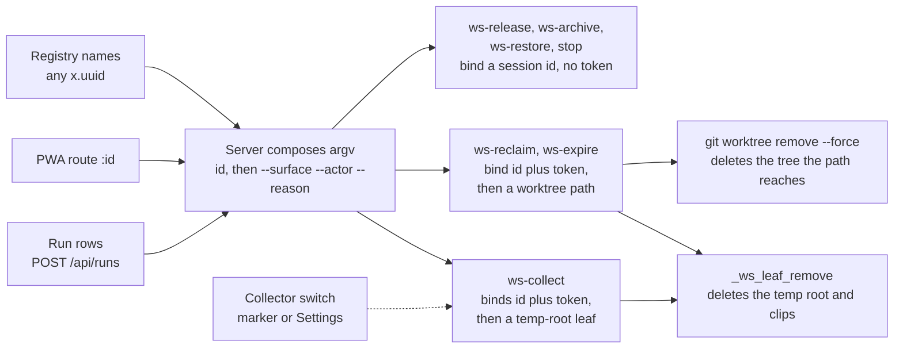
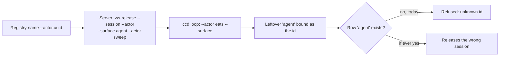
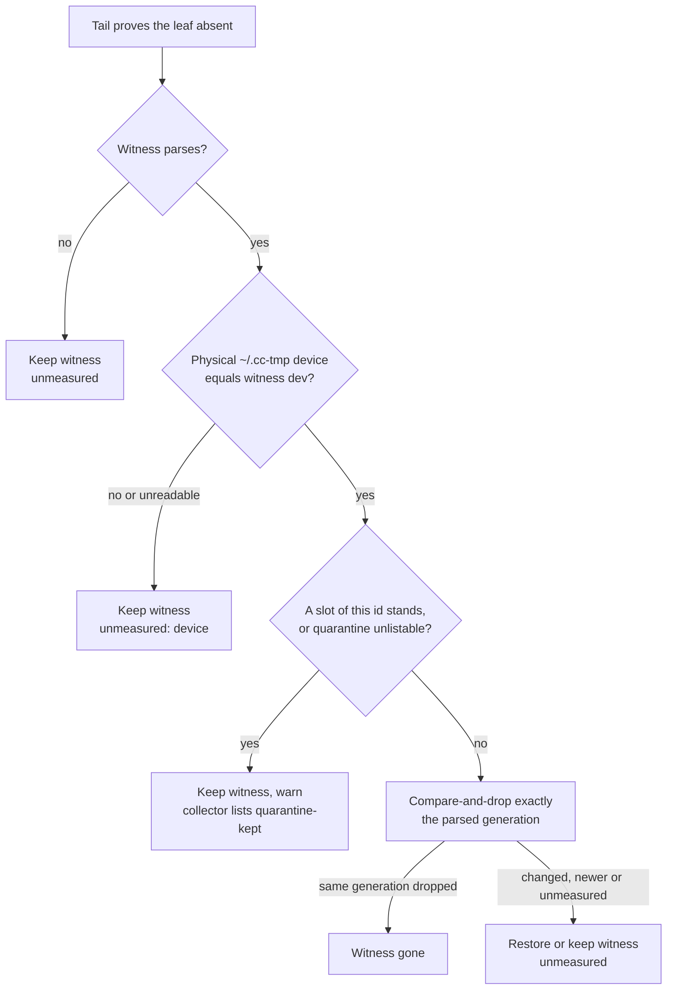
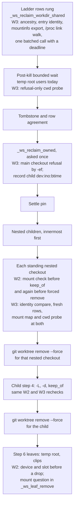
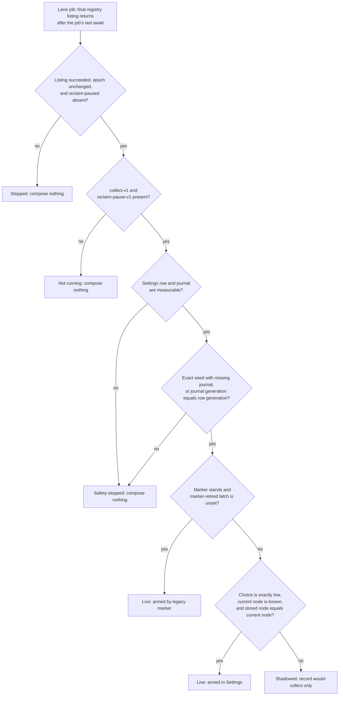
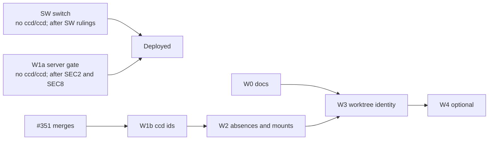

# Path identity: which id, which temp root, which worktree, and the collector switch

**Spec** · 2026-10-12 · Status: Draft · Owner: the ccrc coordinator · Linear: none · Related: `docs/superpowers/specs/2026-09-22-child-workspace-reclamation-design.md`, `docs/superpowers/programs/child-reclamation-contract.md`, `docs/superpowers/programs/reclaim-row-placement-safety.md`, `docs/superpowers/specs/2026-10-05-stall-watch-settings-design.md`

## In short

This is W0 of the path-identity follow-up programme: it designs fixes for the residuals that child-workspace reclamation (CCR-15) left open, and the collector switch the operator asked for on the Settings page.
It answers four questions about ccrc's destructive verbs: which session id a verb binds, what the tail and the collector may believe about a temp-root leaf, which worktree `git worktree remove --force` may delete, and what arms the temp-root collector.
Every change to ccd and to the server's id handling refuses or holds more at the verb it touches; three W2 changes keep or return an id to the collector's population, where it stays collectable only under the collector's full ladder, while today the leaf leaks.
The switch adds a signed-in console-session arm alongside the fleet-box marker, then moves control solely to Settings after the operator removes that marker and a successful listing journals its retirement; after that hand migration, a database-only rollback, re-created marker or other fleet box cannot arm deletion the operator turned off.
Two waves need no `ccd/ccd` change and may ship before workspace-lifecycle W6 (#351) merges once their operator decisions are ruled: the server half of the id gate and the switch. SW also updates `ccd/ccrc`'s backup and manual-downgrade instructions; the `ccd/ccd` waves follow in series. Independent review found and this revision now closes five omitted seams: the classified split across all 12 compatibility registry callers plus child-spent and the two non-persisted executor boundaries, witness-drop result propagation at all three callers, pre-lock admission for an aside-only witness crash, lifecycle-key survival through truncation, and Darwin skip proofs at every new mount check.
The operator rules on the rows marked Operator in each decision table, listed again under "Waiting on you".

## 1. Context

This section says what CCR-15 shipped, what it left open, and why identity is the common thread. It also records the fleet box layout this design was measured against.

### 1.1 What CCR-15 shipped

CCR-15 built child-workspace reclamation in nine waves. Its last wave, the temp-root collector's server lane, merged as `28e8dc1b2` and is deployed (sourced: the programme ledger; the git log of the home repo).

- `ws-reclaim` removes a dead child's worktree, branch and temp root. It runs behind a ladder of refusals and a token that is re-proved on the box.
- `ws-expire` (workspace-lifecycle's verb) removes an archived workspace after seven days, through the same ladder and tail.
- `ws-collect` removes an orphaned, witnessed temp root after two idle audits. It moves the leaf into a quarantine slot and re-proves it there.
- The collector's lane composes `ws-collect` only while `$REG/collect-lane-live` exists (sourced: `server/src/collectLane.ts:30-35`; contract R82 `:2681-2710`). ccd never reads that file (measured: grep finds no `collect-lane-live` in `ccd/ccd` or `ccd/ccrc`), so the server lane is the only gate.

### 1.2 What it left

The pre-flight found 37 items: 29 that the contract and reviews carried to "the path-identity follow-up", and 8 fold-ins that no source carries explicitly (sourced: pre-flight `scope.md:3`). Review 388 added three wording items. They fall into four groups:

- SECURITY: an id starting with `-` can rebind a flag-scanning verb to another session.
- Temp-root tail and collector: what an absent leaf proves, recordless slots, mounts inside a leaf, when a kept-leaf item ends, and small parser and test gaps.
- Worktree identity: a re-pointed alias, a bind spelling, the gone-row basis, and the window before `git worktree remove`.
- Prose and test-only carries.

Section 7 lists every item with its wave and decision, and maps the pre-flight's 13 operator questions to decision IDs.

### 1.3 Why identity matters

Every residual has the same shape. ccd compares a spelling (an id string, a path string) where the safety argument needs an identity (the session the id means, the inode the path reaches). Figure 1 shows the destructive verbs and what each one binds.


*Figure 1. Where ids come from and what each destructive verb binds. Section 2 covers the first hop (which id). Section 3 covers the temp-root leaf, section 4 the worktree, and section 5 the dotted switch that decides whether ws-collect runs at all.*

### 1.4 The fleet box layout this was measured against

The readers measured the fleet box read-only on 2026-10-12, with find, stat, findmnt, readlink of `/proc/*/cwd` and `/proc/self/mountinfo`. They took counts only and printed no ids or paths. The exact mount layout and permissions stay in the evidence archive outside the repo, because this repo is public. The layout makes two residuals live-relevant that the contract had called out of model.

| Fact | Value | Footing |
|---|---|---|
| Registry rows (`*.uuid`, `*.workdir`) | 96 each; 76 made by ws-add, 42 `.child`, 15 `.archived` | Measured |
| The worktrees root and `~/.cc-tmp` | each is a bind mount, and the volume under them is also mounted whole | Measured |
| A second physical spelling | every worktree has one, with the same dev:ino | Measured |
| Rows or live cwds using the second spelling | 0 of 96 rows; 0 live processes | Measured |
| Two rows sharing a dev:ino, or nested by ancestry | none; 458 prefixes, depth at most 7 | Measured |
| btime of the 96 workdirs | non-zero for all | Measured |
| Git admin back-links of linked worktrees | 77 of 77 equal the row's own spelling | Measured |
| Mount points or mount roots under a child or temp root | none | Measured |
| What a same-uid process can mount in ccd's namespace | a FUSE mount, but not a bind | Measured |
| `$REG` device versus `~/.cc-tmp` device | different; an unmounted bind would read as `$REG`'s device | Measured |

> [!IMPORTANT]
> The design fact, stated for any stock Linux box: a same-uid process can make a FUSE mount in ccd's namespace but cannot make a bind (unprivileged user namespaces assumed blocked), and the design must hold either way. "Only root can make a mount" is false here. Section 3.5 amends the contract's R49 `:1259-1260` and the spec's `:1764` to say so, and to say the crossing is live on the measured box.

### 1.5 Operator rulings so far

| Date | Ruling | Status |
|---|---|---|
| 2026-10-12 11:02 UTC | The collector lane was armed: the marker was created on the fleet box at the operator's instruction, before W2 | Ruled |
| 2026-10-12 | Whether arming should wait for W2 is answered: no | Ruled |
| 2026-10-12 | "Yes proceed with next work": start this W0 spec and W1 planning | Ruled |
| 2026-10-12 | "Yes add setting to the settings UI": a Settings switch for the collector lane | Ruled |
| 2026-10-12 | Programme shape: path identity is its own follow-up programme (the coordinator took contract R71's default) | Agreed |

Since it was armed, the collector has removed three orphaned temp roots cleanly. It refused a fourth as containment-unproven: a temp root holding a nested git worktree whose git dir is gone (measured: the lifecycle journal, parsed with ids withheld).

## 2. SECURITY: ids are never flags

ccd's verbs can read an id that starts with `-` as a flag, so a verb meant for one session binds another. This section traces where that happens. It then proposes a server gate and a ccd fix, split so the server half may ship before the ccd half once SEC2 and SEC8 are ruled.

### 2.1 The defect

The server appends its decision flags after the id on the decision-carrying workspace verbs: `<verb> --session <id> --surface <s> --actor <a> [--reason <r>]` (sourced: `server/src/ccdargv.ts:104-108`). The eight affected workspace loops collect unrecognised tokens, strip their decision flags from any position, and only then bind the required `--session <id>` residue, so they can strip a token supplied as the id. Other `--session` verbs use different parsers: `route` consumes each key with its value atomically, and `ws-audit` binds positionally without a decision-flag loop.

So with an id of `--actor`, ccd reads `--actor --surface` as one pair, and `agent` (the sweeps' surface word) or `pwa` lands as the id. Today this fails closed only because no row named `agent` or `pwa` exists, and ccd cannot mint one: roster ids begin with `[a-z]`, and workspace ids are `<project>-<slug>` (sourced: `shared/roster.ts:331`, `ccd/ccd:6337`, `:7248`).


*Figure 2. How a dash-leading id redirects a token-less verb. Read left to right. The only thing that stops it today is that no row is named after the surface word.*

### 2.2 Which verbs redirect

These verdicts come from reading the loops, not from running them. Only the token verbs' redirect is recorded as measured, in contract R90 `:3207-3209`. W1b's Task 0 confirms each verdict on the real binary with fixture HOMEs.

| Verb | Composed by | Outcome for a dash-leading id, and the source | Footing and source |
|---|---|---|---|
| ws-release | child-reclaim release, run close, PWA | Redirects to the surface word on `--actor`, `--surface` or `--reason`; no token binds the id (`:8842-8857`) | Judgement from the loop |
| ws-archive | failed-run close, PWA | Redirects the same way; no token (`:9761-9776`) | Judgement from the loop |
| ws-restore | PWA restore route | Redirects the same way; no token (`:10233-10274`) | Judgement from the loop |
| stop | PWA stop, `['stop', id, '--surface', surface]` (`ccdargv.ts:309-310`) | Redirects to `pwa` on an id of `--surface` only; `--actor` and `--reason` stay the literal id (`:25904-25913`) | Judgement from the loop |
| ws-reclaim | the reclaim lane | Redirects at the parse, refused at the act (the token binds the id) | Measured in R90 |
| ws-expire | the expiry lane | Same as ws-reclaim | Measured in R90 |
| ws-collect | the collector lane | Same; takes `.reap-agent.lock` only if `tmproots/agent` or its record exists (`:34024-34035`) | Judgement from the loop |
| ws-hold | run close | Decision-flag-shaped ids (`--surface` or `--actor`) are refused by arity; an id of `--reason` remains the literal id because that token is the verb's required positional key, so it does not redirect (`:8714-8757`) | Judgement from the loop |
| ws-rename | naming sweep | Decision-flag-shaped ids (`--surface`, `--actor` or `--reason`) are refused by arity; an id of `--branch` remains the literal id because that token is the verb's required positional key, so it does not redirect (`:8079-8156`) | Judgement from the loop |
| forget, swap | PWA | Refused by arity or `:?usage` | Judgement from the loop |
| prefer | none | No builder, no whitelist entry; unreachable (`:25788-25789`) | Sourced |
| start, enable | PWA | Composed only as `<wrapper> <project>` (`ccdargv.ts:259-265`) | Sourced |
| ws-audit | lanes | No flag loop; binds `$2` positionally (`:12814-12823`) | Judgement from the loop |
| ws-add | coordinator dispatch | A project of `--actor` becomes project `agent`: a create, not a deletion (`:6966`) | Judgement from the loop |

The pre-flight's scope listed ws-hold and ws-rename among the redirecting loops, and its W1 rationale implied a redirect for ws-rename. Neither redirects to another row: decision-flag-shaped ids are refused by arity, while ws-hold's own `--reason` spelling and ws-rename's own `--branch` spelling remain literal ids. Stop is the one positional-id verb that redirects, and only for an id of `--surface`.

### 2.3 The server gate (W1a)

The gate is one L0 predicate, `isRegistryId(id: unknown): id is string`, placed in `shared/api.ts` right after `isSessionIdShape` (about `:6231`). It accepts a string of at most 255 characters that passes `isSessionIdShape` and does not start with `-` or `.`.

- `isTmpRootId` (`shared/api.ts:9696-9699`) is re-derived from it, so `single-definition.test.ts` sees one rule. `TMPROOT_ID_MAX_CHARS` becomes a `REGISTRY_ID_MAX_CHARS` that `isTmpRootId` reuses. The accepted set is unchanged.
- `readSessionRecord` (`server/src/registry.ts:1223-1228`) and its `SingleRead` union (`:1190-1192`) move from a `found` boolean to a `kind: 'found' | 'absent' | 'unlistable' | 'bad-id'` discriminant. The immutable baseline has 14 direct callers: `fleet.ts:330`; `sessionws.ts:494`; `coord/close.ts:748`; `coord/childBind.ts:60`; `coord/childReclaim.ts:1045` and `:1444`; `server.ts:1623`, `:2076`, `:2997`, `:3131` and `:3300`; `coord/reclaim.ts:128` and `:314`; and `registry.ts:1302`. Every caller becomes an exhaustive switch ending in a `never` check or equivalent, so every site must place `bad-id` deliberately. Merely adding a third reason under `found:false` is rejected because existing non-`unlistable` arms would otherwise treat it as absence (`reclaim.ts:171` already says the next consumer must widen the type).
- Every absence-acting caller (`reclaim.ts:128`, `close.ts:748`, `childReclaim.ts:1045`, `childBind.ts:60`) treats `bad-id` as unmeasured, never as absent, with a pin each.
- `readRegistryMeasured` (`:1114`) keeps every raw name in `names` and adds each invalid `.uuid` basename to `refused: ReadonlySet<string>`. Its seven direct application callers place that distinction explicitly: fingerprint holds when the run's id is refused; post-spawn dispatch refuses when a refused name can affect candidate-by-subtraction identity; resume dispatch holds when the requested id is refused; the main, hook-state and task-state watches retain prior state for refused ids rather than observing their absence; and mail holds a delivery to a refused recipient rather than classifying the recipient as vanished or unknown. `readRegistry` (`registry.ts:1179-1181`) is an eighth direct consumer and currently erases every distinction except `records`; it has 12 direct production callers (`commands.ts:52`, `lifecycle.ts:163`, `fleet.ts:506`, `watch.ts:3013`, `:6725`, `:7166`, `server.ts:3207`, `coord/routes.ts:620`, `:825`, `:1055`, `:3158`, and `coord/dispatch.ts:548`). The reviewed split migrates four callers to `RegistryRead`: lifecycle project enumeration, the fleet fallback, project-scoped peer enumeration, and dispatch's pre-spawn subtraction read. Commands and PR-task reads may keep the wrapper only behind mutation-pinned `knownId`; the three watch sweeps may keep it because omission suppresses observation while retaining prior state; and attribution, mail creation and mail acknowledgement may keep it because their independent raw-name ladder maps a listed-but-omitted row to registry-unmeasurable, never absence. Each retained reason and each migrated caller gets a mutation pin for its terminal behavior. Refused basenames are logged once as `ccrc-server: ...`; they are never composed.
- `knownId` (`server/src/server.ts:1921-1928`) returns false for any id that fails `isRegistryId`, before its readdir. That is one choke point for every request-id route: it gates 18 of them (sourced: `:1901`; measured: 19 `await knownId(` call sites against 13 `isSafeSessionId(` in `server.ts`). The per-route `isSafeSessionId` stays the clip path-component rule (`server/src/clip.ts:10-13`).
- `POST /api/runs` refuses a `claimedBy` or `sessionId` that fails the predicate with a 400 `bad-session` (`server/src/coord/routes.ts:1290`, `:1294`).
- Every persisted `claimedBy` or `sessionId` that can reach an id-taking `CCD_ARGV` builder is validated where the stored row enters the id-taking flow and before builder construction. W1a carries a checked inventory of those stored-row flows through `coord/close.ts`, `coord/dispatch.ts`, `coord/routes.ts`, `coord/fingerprint.ts`, `coord/childSpent.ts` and `coord/childReclaim.ts`, including nested calls from close into fingerprint and child-spent live measurement, with a mutation pin showing that each invalid stored id refuses before `runCcd`. The POST check is not relied on because existing coord.db rows predate that gate. `coord/expireArchived.ts` and `coord/collectTempRoot.ts` are separate non-persisted residual seams: expiry receives a registry-derived `sessionId` and validates it with `isRegistryId` at the executor boundary before either `CCD_ARGV.wsExpireAudit` or `CCD_ARGV.wsExpire`; collection receives a collector-population id and retains its existing `isTmpRootId(job.id)` refusal before either `CCD_ARGV.wsCollectAudit` or `CCD_ARGV.wsCollect`. Each residual seam carries a mutation pin showing that a bad id cannot reach `runCcd`.
- The stop builders (`stopId`, `stopPair`, `ccdargv.ts:309-312`) move respectively to `['stop', '--surface', surface, id]` and `['stop', '--surface', surface, w, p]`. This is a change, safe on every ccd that advertises the stop-surface capability (`stopSurfaceSupported`, `:980`), because cmd_stop's loop accepts the flag in any position, and the builder sends no flag at all to a ccd without it.

The PWA's `:id` routes check membership with a raw registry listing (`knownId`), called at `server.ts:3383` and `:3480` for release and restore. That goes through neither `readRegistryMeasured` nor `readSessionRecord`, so a registry-reader gate alone, which is R90's wording, would leave the console path open whenever a dash-named row exists. Some `knownId` routes, `/prompt` among them, carry no `isSafeSessionId` (sourced: `:1923-1925`), so a check placed beside `isSafeSessionId` would miss them. That is why the gate sits in `knownId`.

The counted id-taking builder vocabulary is `ensure`, `stopId`, `stopPair`, `forget`, `swap`, `swapCross`, `prStateSession`, `prOpen`, `wsArchive`, `wsRestore`, `wsAudit`, `wsReap`, `wsReclaimAudit`, `wsReclaim`, `wsExpireAudit`, `wsExpire`, `wsCollectAudit`, `wsCollect`, `wsAttic`, `wsHold`, `wsRelease`, `wsRename`, `route`, `routeApply`, `routeSet` and `winSize`. Excluding definitions and comments, the immutable baseline has 41 direct calls across 10 files: `server.ts` 15, `coord/close.ts` 7, `coord/dispatch.ts` 5, `coord/routes.ts` 3, `coord/childReclaim.ts` 3, `watch.ts` 2, `coord/collectTempRoot.ts` 2, `coord/expireArchived.ts` 2, `coord/childSpent.ts` 1 and `coord/fingerprint.ts` 1. Parser behaviour or an earlier measured read makes some calls fail closed today, but that is not structural coverage. SEC2 must rule whether all 41 calls are guarded or only the enumerated stored-row seams.

### 2.4 The ccd fix (W1b)

Both halves are needed (judgement). The rebound id is the surface word, which passes every id regex, so predicates alone cannot stop the redirect. Loops alone would leave ccd able to mint a dash id.

- Loops: in every loop W1b touches, each value-taking key consumes its key and value atomically, so a value is never scanned again as a flag. Identity values (`--session`, `--child-of`, and positional ids) and closed-grammar values keep or gain their own domain checks, and every post-loop id check refuses a leading `-`. Free-form `--actor` and `--reason` prose, including ws-hold's positional reason, remains non-blank and bounded but may begin with `-`; atomic consumption closes the rebinding defect without narrowing that existing input domain. `--surface`, `--expect`, and `--branch` retain their existing verb-specific grammars.
- Why the builder order still changes for stop: with the id first, its loop cannot tell an id that spells `--surface` from the key itself. Moving the surface pair before the positional id gives the parser one atomic closed-grammar pair and leaves the final token or pair as the id. The post-loop id check then refuses `stop --surface pwa --surface`, rather than redirecting it to `pwa` (sourced: `ccdargv.ts:309-312`; `ccd/ccd:25904-25913`).
- Predicates: `_ws_tmproot_id_ok` (`:21072`) and `_ws_project_valid` (`:6414-6431`) refuse a leading `-`. Making `_ws_project_valid` refuse it closes the only mint path (project `-` plus slug `actor`).
- What was measured before tightening `_ws_project_valid`: 96 rows and 18 distinct projects, with 0 dash- or dot-leading project values. No workdir has a dash-leading path component, `~/projects` has no dash-leading entry, and there is no `~/.cc-sessions/pools/` directory. The comment warns that a tag you can create but not remove is worse (`:6421-6427`), but there is nothing to strand. W1b's Task 0 repeats the ls-only count on both boxes immediately before the edit and stops if any dash-leading name appears.

### 2.5 The reap lock is taken too early

The collect audit and verb open, and so create, `$REG/.reap-<id>.lock` after the id predicate and population membership. Membership means a witness name exists or at least one record filename parses for this id through `_ws_collect_records_of`; record bodies are not parsed until `_ws_collect_resume_eval`, after the reap lock is held. Dot-locks are never unlinked (contract R38), so a witness whose body is malformed, or a record whose filename is valid but whose body is malformed, can still cause a permanent lock to be created.

Proposed: move the pure checks and an advisory population parse ahead of the lock open: the id predicate, `*-*` on the id string, and at least one parseable witness body or matching parseable record body. Re-list, re-read and re-parse all authoritative evidence under the lock before any act. The pre-lock pass grants nothing, so a race can only cause refusal or under-lock re-evaluation. Unlinking the lock on a refusal remains rejected: it contradicts R38 and races another holder.

Measured: 203 `.reap-*.lock` files, 175 of them for ids with no live `.uuid` (normal R38 accumulation). None is dash-leading, and none fails `*-*`.

### 2.6 Fold-ins

- No-dot-leading entry rule (contract `:1734-1736`): ws-reclaim and ws-expire refuse a dot-leading id at entry, before the journal line, as ws-collect does at `:34053`. Every path site already refuses one, so this only makes the three token verbs agree with `isRegistryId`. Measured: 0 dot-leading `.uuid` rows.
- NAME_MAX-safe length: ids of 223 to 244 bytes can hold a reap lock, but they cannot name a slot `slot.<id>.<ns>.<pid>` within 255 bytes (sourced: spec `:1918-1920`; R89 `:3186-3187`).
  - Proposed: cap the COMPOSED id at 222 characters at each mint site, with its own die line: `cmd_ws_add` after the slug is chosen, and `cmd_start` and `enable` after `_id` (sourced: `_id` composes `<wrapper>-<project>` at `:2882`; `cmd_start` calls `_ws_project_valid` at `:22388`). W1b's Task 0 lists every `_id` mint site.
  - A cap on the project alone is not enough: `_ws_project_valid` also guards `cmd_start`, where a roster id may be 32 characters (sourced: `shared/roster.ts:328-331`), and 32 plus 1 plus 190 is 223.
  - Measured: the longest registry id is 31 characters and the longest project is 18.
  - Capping at the collector instead would hide a long id from the lane rather than refuse it per id, which is the quieter failure (judgement).

### 2.7 Decisions

The operator rules on the rows marked Operator. The rows marked Coordinator are the coordinator's call, recorded here so the reviewer can check them; the operator may take any of them back.

| ID | Decision | Options | Recommended, and why | Who rules | Status |
|---|---|---|---|---|---|
| SEC1 | Which ccd verbs W1b fixes | A: R90's three token verbs. B: all eight `--session` verbs. C: B plus every positional-id verb. D: B plus stop, plus ws-add's loop | D, with the dash-value rule in every loop it touches. The live redirects are release, archive, restore and stop. Hold and rename get the same loop shape, so one pin covers all eight | Operator | Proposed |
| SEC2 | Which server id sources W1a gates | A: registry only (R90). B: registry readers, `knownId`, POST /api/runs, and the run-row-to-argv seam. C: B plus a `RegistryId` brand on every builder. D: B plus an `isRegistryId` assertion inside each id-taking builder in `ccdargv.ts`, so a failing id composes an argv that is refused before exec | B now. A leaves the PWA path open; C touches about 40 callers. D is one file and covers future callers, but changes how a builder fails, so it is worth its own ruling | Operator | Proposed |
| SEC3 | ccd's fix: predicates, loops, or both | A: predicates. B: loops. C: both | C. Each closes a hole the other leaves | Operator | Proposed |
| SEC4 | Tighten `_ws_project_valid` on the measurement | A: now, with a Task 0 re-count. B: only after both boxes are re-measured by hand. C: leave it | A. The measurement found no dash-leading names, and the re-count keeps that current | Operator | Proposed |
| SEC5 | NAME_MAX-safe id length cap | A: residual. B: cap at the collector (222). C: cap the composed id at each mint site. D: B and C | C. It prevents the long id from existing. 223 to 255 stays a residual for hand-planted names | Operator | Proposed |
| SEC6 | No-dot-leading entry rule at ws-reclaim and ws-expire | A: in. B: out | A. Two lines, nothing to strand, and one id rule across the three token verbs | Operator | Proposed |
| SEC7 | Take the collect reap lock only after parsing | A: pure checks before the lock. B: unlink on refusal. C: residual | A. It bounds dotfile growth; B contradicts R38 | Coordinator | Proposed |
| SEC8 | Split W1 into W1a (server) and W1b (ccd) | A: W1a now, W1b after #351. B: one PR after #351 merges. C: A plus `--flag=value` decision flags | A. W1a closes every server-composed path enumerated in 2.3, against every deployed ccd. The `=` form is redundant once the gate exists | Operator | Proposed |

### 2.8 Proof

- Server mutation rows: each gate site goes red when `isRegistryId` is bypassed. `readSessionRecord`'s `bad-id` is distinct from `absent`, and each absence-acting caller holds on it. Deleting the `isRegistryId` arm in `knownId` turns a release, a restore and a prompt case red for the id `--actor`.
- `ccdargv-dec-parity` on the real binary (`ccdargv.ts:109-116`) with the ids `--actor`, `--surface`, `--reason`, `--expect` and `--defer-expired`. These go green only with W1b's loops, so they ride W1b.
- A fixture-HOME case for each verb in section 2.2, answering refused and never redirected. Among them: `stop --surface --surface pwa` is refused, and no stop of `pwa` happens; `ws-release --session --actor ...` is refused.
- One pin per mint site at 222 and 223 characters.

### 2.9 As built (W1b)

W1b built ccd's half of this section. This subsection records where what it built narrows, corrects or spells out
§2.2 to §2.8, and names the residuals it leaves. It amends, and rewrites none of the text above. Every claim is
measured at the wave's tip unless it says otherwise.

**One rule for an id a verb binds (SEC1, SEC3).**
- `_reg_id_ok` is the rule: the registry charset, read under `LC_ALL=C`, and no leading `-`. The locale is fixed, so
  a locale whose letter ranges admit a non-ASCII letter cannot widen it.
- The eight `--session` verbs take each identity key and its value as one pair: `--session` at all eight, `--expect`
  at ws-reclaim, ws-expire and ws-collect, `--child-of` at ws-reclaim, ws-hold's positional `--reason`, and
  ws-rename's `--branch`. The pair goes to the loop's residue, never into a variable, so each verb's own arity and
  order checks still refuse a duplicate key, a wrong order and a lone key, with the words they used before. No
  identity arm refuses anything itself, and a value is never scanned again as a flag.
- Every post-loop id check in those eight verbs refuses a leading `-` through `_reg_id_ok`. The three token verbs
  reach it through `_ws_tmproot_id_ok`, which is built on it (SEC4 below).
- Apart from the dot rule and the collector's pre-lock pass below, a call to these verbs that spells no id as a flag
  answers as before, byte for byte.
  A call whose id spells a flag may now answer `bad session id` where it answered a usage line, a "needs a value"
  line, or bound another row. A few inputs change because a value itself spells a flag and is now taken whole:
  - a token or run id at the token verbs answers `bad token` or `bad run id` where it answered the usage line, and
    ws-reclaim journals that refusal against the real id; no server builder composes such a token or run id;
  - a ws-rename `--branch` value answers `bad-branch` where the surface word became the new branch name;
  - a hold reason is held verbatim where the surface word was held or the usage line answered;
  - a `--session` key with no value of its own, followed by a decision flag, takes that flag as its id. So
    `ws-release --session --actor ''` dies on the usage line where it died on `--actor must be non-blank`, and
    `--expect <token> --session --surface=w` at a token verb answers `bad session id` where it answered the usage
    line. At ws-restore the refusal row now names the flag as its id (`--surface`, for example), where it named `''`.
    Each is still a refusal, with the same exit code and before any act: §2.4's atomic consumption.
- `--actor` and `--reason` prose, and a hold reason, may still begin with `-`.
- No refusal word, probe word or journal act was added, and the refusal scan's sanctioned `die` set is unchanged. The
  verbs reuse `bad session id` and their usage lines. Stop's two new refusals print `bad session id: ` followed by
  the token or the id they refused.

**Corrections to §2.4.**
- §2.4's "`--surface`, `--expect`, and `--branch` retain their existing verb-specific grammars" holds everywhere
  except at stop and ws-add. Those are the two positional-id verbs, and there a `--surface` value that begins with
  `-` is refused with the verb's usage line, in both the `--surface <v>` and the `--surface=<v>` spellings, because
  there it closes a redirect. The eight `--session` verbs keep their surface grammar, since the `--session` pair
  already closes their redirect.
- `stop --surface pwa --surface` is refused by the loop's arity check, not by the post-loop id check.
- §2.4's "remains non-blank and bounded": bounded holds for the `--actor` and `--reason` decision fields only.
  ws-hold's positional reason is checked for blankness only, and W1b adds no byte cap to it.
- Stop also refuses a residue token that begins with `-`, and a composed id that `_reg_id_ok` refuses (one holding a
  `/` or a space, for example), before any unit call or journal row. In the two-argument form that includes a third,
  dash-leading token: `stop <wrapper> <project> --x` was silently ignored, and now answers `bad session id: --x`. No
  server builder composes it.
- ws-add refuses a second `--actor`, in either spelling or any mix of them, with its usage line. That closes a
  project spelled `--actor` without any change to the server's builder order.

**The predicates (SEC4).**
- `_ws_project_valid` refuses a leading `-` on a line of its own, beside its leading-`.` line. Its four callers that
  print its refusal, `enable`'s new project check among them, say "no LEADING dot or dash". This closes the only mint
  path for a dash-leading id. Before the edit, the wave's entry check counted no dash-leading name in the registry,
  `pools/`, `tmproots/`, `tmpquarantine/`, the project directories or the worktrees, on either box (measured; counts
  only, no names).
- `_ws_tmproot_id_ok` is `_reg_id_ok` plus no leading `.`. It is ccd's mirror of `isTmpRootId` without the length
  rule, pinned against it name by name.
- `enable <wrapper> <project>` checks its project with `_ws_project_valid` before it journals anything. It refuses
  more than before: a dot- or dash-leading project leaves no `enable` row. Ahead of it, enable asks its wrapper with
  `cmd_start`'s own check and words, so an unrostered wrapper, or a flag-spelled one that reaches the two-argument
  form, leaves no `enable` row and no reap lock either.

**Dots (SEC6).**
- ws-reclaim, ws-expire and ws-collect refuse a dot-leading id at entry through `_ws_tmproot_id_ok`. So do
  `ws-audit --reclaim` and `ws-audit --expire`, for symmetry with `isRegistryId`. Plain `ws-audit` keeps the check it
  had.
- ws-release, ws-archive, ws-restore, ws-hold, ws-rename and stop still accept a dot-leading id
  (`dot-rule-only-at-the-token-verbs`). A dot rule there is the operator's option, and was not built.
- A dot-leading id at the reclaim and expire audits now exits 1, which the server's expiry and reclaim lanes read as
  an unreadable audit, where it got a terminal `no-such-session` document at exit 0. It is reachable only through a
  hand-planted run row, until the server's id gate lands.

**The composed-id cap, in place of §2.6's 222 (SEC5).**
- The cap comes from a census of every name derived from an id, in every file under `ccd/` (skill and doc text
  excluded) and in `server/src`. The census covers:
  - the registry fields and their dot-leading temp names;
  - the hook-state and turn files and the supervise log;
  - the compaction and generation locks and the start counter;
  - the reap and ws-add locks, and the quarantine slot;
  - the `claude-session@<id>.service` unit;
  - the history sweep's draining name and the server's per-id usage file;
  - the session hook's own temp and stage names.
- The widest overhead is 81 bytes, for `.<id>.compactcard.<pid>.<nonce>.session-claim.tmp`, so 255 minus 81 is 174.
  §2.6's 222 fit only the slot name.
- The session hook bounds ids too:
  - `CCRC_ID_MAX` is 128. The hook's peer census skips a longer id, and its `.project` reads stop at that length.
  - `CCRC_PROJ_MAX` is 64. A session whose project is longer gets no ccrc peer card (`_ct_probe` refuses it, and
    `_hook_ccrc_card` stays silent), and so does a session with no project whose id is longer.
- `_REG_ID_MAX` is 128: the smaller of 174 and the hook's 128, so ccd never mints an id the hook's peer census would
  skip.
- ccd applies the cap at every mint site, before any row, worktree, branch or `.uuid` is created or journaled. Each
  site has its own die line, ending "nothing was created", and the sentence before it lives once, in
  `_REG_ID_CAP_WHY`. The sites:
  - ws-add, once the slug is chosen and before `git fetch` and `git worktree add`, for a positional slug and for
    `CCD_WS_SLUG` alike;
  - start's creating form, even when the row already exists;
  - enable's two-argument form, before its journal row.
- The one thing a cap refusal can leave behind is ws-add's per-project add lock, which ws-add takes before it chooses
  a slug, as every ws-add refusal after that lock does.
- `ccd-id-cap.test.ts` holds the census table, the files it left out, and the number. A template added in a scanned
  file without a row reds it.
- The census left out `server/src/token/files.ts`, because its `${id}` is a box-token generation id, never a session
  id, so `mail-pending-<generation>.token` embeds no registry id (`files-outside-the-name-census`).
- Two sets of names are built from a bare id or a file name that the census scanner's spellings do not match, and are
  stated residuals:
  - `history-spool-names-outside-the-census-patterns`: the hook's `spool/<id>.jsonl` and the sweep's `.obs` sidecar.
    The table holds the draining name, `<id>.<ms>.<pid>.jsonl`, and neither of the other two is wider than it.
  - `quarantine-record-names-outside-the-census-patterns`: the quarantine record `tmpquarantine/<id>.<ns>.<pid>`, 28
    bytes, and the temp `.<id>.<ns>.<pid>.<pid>.<R>.tmp` its writer makes, 47 bytes, spell the id `$name`. The
    witness writer's temp, `.<id>.<pid>.<R>.tmp` at 19 bytes, is built the same way. Each is narrower than the widest
    row, so the cap is unaffected.
- §2.8's "One pin per mint site at 222 and 223 characters" reads: one pin per mint site at `_REG_ID_MAX` and at one
  byte more.

**The reap lock is taken after a parse (SEC7).**
- The collect audit and the collect verb open `$REG/.reap-<id>.lock` only after an advisory pass. The pass grants
  nothing, prints nothing and writes no registry, lock, journal or quarantine state; listing the records makes two
  scratch files and removes them before the pass returns. In order:
  1. The id must contain a `-`. If it does not, the answer is unmeasured `registry`, in the same words the locked
     evaluation uses.
  2. Records are listed, and a listing that fails is unmeasured `records`. A record whose body parses and names the id
     lets the lock open. If records exist but none both parses and names the id, the answer is the one the locked
     resume gives: `quarantine-kept`, or unmeasured `records` or `quarantine`. At the audit every answer that the
     locked evaluation also gives carries its word and detail byte for byte. The two second-look answers (a record
     or a witness that reads sound only on a second look) are the pass's own, with details of their own. The verb
     keeps the pass's word and detail, and adds its no-lock clause after the detail of an unmeasured answer, so the
     clause never pushes the detail toward the reason cap: a cut takes the clause first, and reaches the detail only
     when the detail alone passes the cap. It puts "no lock was taken: " before the detail of a refusal.
  3. With no record, a witness whose body parses lets the lock open.
  4. A witness that does not parse first gets a registry peek, and the lock opens unless all three of these hold:
     `$REG/<id>.child` and `$REG/<id>.uuid` are proven absent; `$REG` can be listed; and the id's slug is free across
     every `$REG/<id>.<field>` and every dot family. When the lock opens, the locked evaluation answers `registered`
     or unmeasured `registry`, as before. Only when all three hold is the witness's answer given before the lock.
- So a live row of any kind still answers `registered` ahead of `witness-mismatch`. The audit leaves `registered`
  unjournaled, as it leaves every word that is not terminal; the verb journals it, as it journals every refusal document.
  A junk witness or junk record of an id that no row names creates no permanent lock.
- Under the lock every input is listed, read and parsed again before any act. A race between the pass and the lock
  can therefore only refuse, or be judged again.
- The verb reads the cleanup pause under the lock, so its pre-lock answers now come ahead of the cleanup pause. A
  junk witness or record is refused with its own word and a detail saying "no lock was taken", even while the pause
  stands. Nothing moves either way.
- The pre-lock answers also come ahead of the lock's own. At the audit they precede unmeasured `lock` and
  `in-progress`, and its `mv` and `flock` checks still run first. At the verb they precede `flock-unavailable`,
  `lock-unopenable` and `in-progress`. So junk input answers terminal `witness-mismatch` or `quarantine-kept` while
  another process holds the lock, as it does when none does: ccd writes a witness or a record by temp file and
  rename, so a junk body is never a write in progress.
- For an id with no `-`, unmeasured `registry` now comes ahead of every answer the resume gave before its registry
  rung, ahead of a standing `.child` or `.uuid`'s `registered`. Once the id is in the collector's population, it also
  comes ahead of the listing's unmeasured `records`; an id with no witness is asked its population first, so a failed
  listing, or `not-witnessed`, answers before the pass. The audit document prints `records: []` for it. This is unreachable in practice: every mint composes `<a>-<b>`, and the
  entry check counted no dash-free name on either box.

**Proof (§2.8, §8).**
- The real-binary proof is a file of its own, `ccdargv-dash-id-parity.test.ts`. It is not `ccdargv-dec-parity`,
  which this wave leaves unedited.
  - It composes every argv through the server's own builders and runs it on `ccd/ccd` under `bash -p`, with fixture
    HOMEs.
  - For stop it adds one typed argv: the order W1a composes.
  - An anti-whitelist keeps every decision-appending verb in it.
- §8's "the verb verdicts of section 2.2" were not measured by the entry check, which writes nothing. They were
  measured by that matrix, run once against the pre-wave binary (a copy outside the tree). Of its 259 cases, 188 went
  red there and 71 stayed green, and all 259 are green at the tip. The matrix agrees with §2.2's readings of the
  loops, and shows more. Wherever no decision flag ate an id that spells a flag, the pre-wave binary bound it
  literally and looked it up. At stop, stopPair, start and enable it also acted on it (stopped it, or created it), and
  at ws-restore, ws-reclaim and ws-expire it also took a reap lock and journaled a line. And one verdict is wider than §2.2's: its stop row names the one-argument form, but the
  two-argument form redirected too, since a project of `--surface` stopped `<wrapper>-pwa`.

| Verb | Ids that went red before W1b | What the pre-wave binary did | At the tip |
|---|---|---|---|
| ws-release | all eight | `--actor`, `--surface` and `--reason` bound the surface word `agent` and released it; the other five bound the literal id and looked it up | Refused before any act |
| ws-archive | all eight | Bound an id and looked it up as a row | Refused before any act |
| ws-restore | all eight | Created a reap lock and journaled a line naming a decoy or the id | Refused before any lock |
| ws-hold | `--reason`, `--expect`, `--defer-expired`, `--session`, `--branch`, `--child-of` | Bound the literal id and looked it up | Refused before any act |
| ws-rename | `--expect`, `--defer-expired`, `--session`, `--branch`, `--child-of` | Bound the literal id and looked it up | Refused before any act |
| ws-reclaim | all but `--defer-expired` | Looked the id up as a row, created a reap lock and journaled a line | Refused before any lock |
| ws-expire | all eight | As ws-reclaim; `--defer-expired` also stayed literal and created a lock | Refused before any lock |
| ws-collect | all eight | `--actor`, `--surface` and `--reason` bound `agent`, took its reap lock because a witness stood for it, and journaled a line; the other five answered `not-witnessed` and journaled a line | Refused before any lock |
| ws-add | `--actor`, `--surface` as the project | Bound project `agent`, which is a create: a worktree, rows, a unit and a pane | Refused before any worktree |
| stop | all eight in the builder's order, and all but `--surface` in the order W1a composes | The builder's order stopped the literal id, and an id of `--surface` stopped `pwa`; the other order stopped the literal id | Refused before any unit call |
| Ids that arity already refused: ws-hold's `--actor` and `--surface`; ws-rename's `--actor`, `--surface` and `--reason`; ws-reclaim's `--defer-expired`; stop's `--surface` in the order W1a composes | None | Refused | Refused, as before |

*Table 1. The decision-carrying verbs, under a decision with and without a reason (ws-add without only).*

| Builder | Values that went red before W1b | What the pre-wave binary did | At the tip |
|---|---|---|---|
| `stopPair` | A dash-leading wrapper, `--surface` excepted, and a dash-leading project | Stopped `<dash>-<project>` or `<wrapper>-<dash>`, with a unit and a pane; a project of `--surface` stopped `<wrapper>-pwa` | Refused before any unit call |
| `start`, `enable` | A dash-leading project | Created `<wrapper>-<dash>`: a unit, a pane and rows; a dash-leading wrapper was refused already | Refused before any row, start or journal line |
| `forget`, `swap`, `swapCross` | None: their arity or usage checks refused them | Refused | Refused, as before |
| `wsReclaimAudit`, `wsExpireAudit`, `wsCollectAudit` | All eight, for each | Answered an audit document at exit 0 for the dash-leading id, and took no lock | Refused at entry |
| `wsAudit` | Not a refusal row: it audits the literal id | Audited the literal id | Kept as before (`verbs-outside-sec1-keep-the-inline-regex`) |

*Table 2. The verbs that take a positional id and carry no decision.*

**Comment carries (§7 items 29 to 31).** Each edit kept its line count. The collector's header now says three things:
- the cleanup pause stops a witness-only collection;
- the audit pays one kill grace, about 73 s, or 78 s at the widest grace, against ws-audit's 90 s row;
- the lane acts only once the operator arms it, by the fleet box's legacy marker or by the Settings switch where it
  has shipped.

**Stated residuals.**
- `dot-rule-only-at-the-token-verbs`: release, archive, restore, hold, rename and stop still accept a dot-leading id.
  Refusing it there is an operator option.
- `verbs-outside-sec1-keep-the-inline-regex`: ws-attic, pr-open, plain ws-audit, ws-reap, forget, `start <id>`,
  `pr-state --session <id>` and `route --session <id>` keep the inline id check they had, which admits a leading
  `-`. `ensure <id>` and `swap <id> <wrapper>` take their id with no shape check and need an existing row. Among
  all these verbs the server gives only `route` any of the decision flags (`--actor` and `--reason`), and `route`
  binds `--session` as a pair, so an id that spells one of them is bound literally and looked up. `forget` parses a
  `--reason` of its own, which no server builder sends: an id that spells it dies on the usage line or is refused
  `bad-args`, and never names another row. None of the other verbs parses the decision flags, so none can be
  redirected by an id that spells one, and neither `route` nor `swap` redirects.
  The inline checks, `route`'s included (`swap` has none), run without `LC_ALL=C`, so under a widening locale they
  admit a non-ASCII id and bind it literally. Plain ws-audit audits a dash-leading id literally and acts on no
  other row (pinned).
- `enable-one-arg-journals-an-unchecked-id`: `enable <id>` journals its row before any check of the id, as it did
  before the wave. `cmd_start`, which it calls next, applies the inline charset check and needs an existing row.
- `stripped-flag-positional-collapses-to-the-id-form`: start and enable strip `--cross-pool`, `--`,
  `--route=<f>=<v>` and the two-token `--route <v>`, and stop strips `--surface` and `--surface=`, from any position
  before their arity rule, so a positional spelled as one of those never reaches the two-argument checks, and the
  call collapses to the one-argument (id) form. The two-token `--route <v>` takes the next token whole as the route
  pair, so it also eats the positional that follows it. For example, `enable --cross-pool <existing-id>` and
  `enable <wrapper> --` journal `enable` against the other positional and start that existing id,
  `start <existing-id> --route compact=50` (a project spelled `--route`, a workdir spelled as a route pair) restarts
  that row and writes the pair, where an eaten token that is no valid route pair is refused by the route check, and
  `stop <wrapper> --surface=x --surface pwa` stops `<wrapper>`. This is not a regression: the pre-wave binary does
  the same. ccd never mints such a name (`=` is outside the charset and a leading `-` is refused). At start and
  enable it is reachable only through an operator-typed request body to the server's session-creation route, whose
  guard (refuse a wrapper outside the roster and a project failing the project rule) is carried to a later server
  wave. Stop's half is reached through the stop route's `stopPair`, which takes the project from the registry row, so
  it needs a hand-planted row whose project spells `--surface=<w>`.
- `hand-planted-ids-over-the-cap`: a row planted by hand above `_REG_ID_MAX` is not refused. ccd never mints one.
- `files-outside-the-name-census`: the file the cap's census left out, listed above.
- `history-spool-names-outside-the-census-patterns` and `quarantine-record-names-outside-the-census-patterns`: the
  names listed above, whose spelling the census scanner does not match.
- `random-slug-decides-the-cap-near-the-boundary`: ws-add caps the id after it chooses the slug. For a project of 114
  to 118 bytes given no slug, the random slug's length, 9 to 14 bytes, decides whether the add succeeds or is refused.
- `projects-over-64-get-no-hook-card`: the cap bounds the composed id, not the project. A project longer than
  `CCRC_PROJ_MAX` still gets no ccrc peer card.
- `hold-card-workdir-quote-silent-near-the-cap`: the hook's `CCRC_WD_MAX` is 127, one under the length its reads stop
  at, and the hold card quotes a workspace's directory only when the path fits it. A worktree path past 127
  characters, which an id near the cap can reach, loses the quote. The card degrades to silence, never to a false
  statement.
- `btime-less-witness-takes-the-lock`: a witness that parses but records no birth time opens the lock. Its
  `witness-mismatch` stays an answer given under the lock.
- `dash-leading-pool-tag-unclearable-on-an-upgraded-box`: on a box that already holds the pool tag of a dash-leading
  project, `ccd project-pool --project -lead --clear` now refuses. The entry check counted none on either box, and the
  doctor's text for a tag it cannot print as a command already says to remove it by hand.
- `server-docstrings-call-ccds-predicate-dot-only`: the docstrings of `isTmpRootId` (`shared/api.ts`) and
  `childReclaimLeafKept` (`server/src/childReclaimSweep.ts`) still describe ccd's `_ws_tmproot_id_ok` as refusing a
  leading `.` only. They are carried to the next wave that edits those files.
- `comments-say-ccd-scans-the-session-value`: the `isTmpRootId` docstring (`shared/api.ts`) and the comment above the
  dash-leading rows of `collect-l0.test.ts` still say ccd's destructive verbs read their decision flags from any
  position, `--session`'s value included. That is true only of a box on an older ccd: the eight `--session` verbs now
  take each identity key and its value as one pair. It is carried to the next wave that edits them.

## 3. The temp-root tail and the collector

This section hardens what the reclaim and expiry tail and the collector believe about a temp-root leaf, and what any removal is licensed against when a mount stands inside the tree. Everything here uses identity ccd already records (the witness's `dev=`) and helpers that already exist, so it needs no format change.

### 3.1 What is live and what is latent on this layout

On the measured layout, the two tail-drop items differ in reach (measured: findmnt and stat; sourced lines below).

- The collector's own witness-only arm asks the device first (`_ws_collect_root_dev`, `ccd/ccd:32970-32993`). If the `~/.cc-tmp` bind were unmounted, the physical root would read as `$REG`'s device rather than the witnesses' device. The collector would then answer unmeasured `device` and write no `done`. All 20 standing witnesses read `v=1` and the right device, so R89's kept-leaf residual cannot fire here today.
- The tail's own drops ask no device at all (`:30298`, `:30935`, `:30941`). A reclaim or expire tail that runs while the bind is unmounted reads the leaf as gone, drops its witness and journals "temp root gone". That route is reachable here.

Since arming there have been 3 collect `done` rows, all written by the finish after a real removal, and 0 witness-only dones. Each ended its kept-leaf item correctly (measured: the journal plus lstat).

### 3.2 An absence needs the recorded device

All three witness-drop sites call one generation-exact `_ws_tmproot_witness_drop` helper. The helper reads and parses the witness, asks `_ws_collect_root_dev "$_WS_WIT_DEV"`, lists quarantine slots for the id, and compare-drops only that parsed generation. Its caller-visible result distinguishes complete, kept and unmeasured and carries the reason; complete includes an already missing witness. `_ws_tmproot_remove` propagates kept or unmeasured through the tail instead of returning 0, and both direct step-6 callers set `tmpkept` and `tmpwhy` from the same result; none of the three callers suppresses it with `|| :`. An unparseable witness, a root-device answer of 1 or 2, a standing or unlistable slot, a changed witness, or an indeterminate compare-and-drop keeps the witness and makes the temp-root outcome unmeasured. A newer witness is restored or left standing, never unlinked. Mutation pins delete propagation independently at each of the three callers.

This is the collector's existing rule (spec section 5.10), and it matches `tmpRootKept`'s documented meaning, "kept means not proven gone". One side effect: a `~/.cc-tmp` that was deleted whole now holds its witnesses instead of dropping them. That is already one of the collector's standing residuals (judgement).

A kept witness keeps the id in the collector's population (sourced: contract R89 `:3180-3185`). So this change does more than refuse at the tail: the leaf becomes collectable later, under the collector's full ladder, where today it leaks with no witness. The In short says so.

### 3.3 A drop asks the quarantine

`_ws_tmproot_witness_drop` (`:30309-30322`) never asks whether a quarantine slot of the id stands, and all three callers currently suppress its status. The check and the complete/kept/unmeasured result go inside that helper, because it is the one place a witness dies (`:30302-30308`); every caller must propagate the result as section 3.2 specifies. If a slot of the id stands, or the quarantine cannot be listed, the helper keeps the witness and reports why. The collector's witness-only arm then answers `quarantine-kept`, which is terminal and listed. Measured: 0 quarantine slots and 0 records, so there is no live instance.


*Figure 3. What the tail must prove before it drops a witness, after W2. Today the tail goes straight from the first box to the last one.*

### 3.4 When a kept-leaf item ends

Today a kept-leaf item on /runs ends on any later collect `done` (sourced: `server/src/childReclaimSweep.ts:1696-1701`; `server/src/coord/store.ts:6012-6014` selects no meas). The witness-only `done` ("no leaf stood", `:33677`) and a real removal (`:33707`) carry the same keys. When the witness-only arm fires, the named physical leaf has normally been measured absent on the witness device and no quarantine slot is known. The residual is narrower: under a same-device namespace replacement, or after an earlier tail drop falsely proved absence, the line can disappear while the original leaf remains hidden on disk with no standing witness, so no later audit names it. That is a silent leak, not data loss (judgement from the sourced code).

Proposed: ccd writes `meas.leaf=removed|absent`, and `_lc_json` preserves that discriminator when its truncation ladder drops other measurement fields.
- `removed` is written once, on `_ws_collect_finish`'s done line (`:33707`), which both the finish after a removal (`:33798`) and the resume past a removal (`:34010`) reach.
- `absent` is written at the witness-only arm.
- The lifecycle type, closed key map, reviver, store projection and `ChildReclaimLeafEndRow` carry the discriminator and distinguish an absent property from an invalid one.
- The server ends the item only for exact `leaf=removed`, keeps it open for exact `leaf=absent`, and fails closed for a present malformed or out-of-vocabulary value.
- On `absent`, the line stays until the 7-day horizon, with one added clause: the collector found nothing there and dropped its witness; if `~/.cc-tmp` is a mount, check that it is mounted.

A genuinely absent key retains today's behavior only for a non-truncated event written by an older ccd after rollback. Not ending that old event would bring back, on the day of the deploy, the 3 lines whose leaves were measured gone. A truncated event whose discriminator is absent is not a legacy row and fails closed. A truncation mutation pin forces the encoder through its `meas` rung and proves that `leaf` survives and still drives the same decision.

### 3.5 Mounts inside a tree ccd removes

Two removals can cross a mount today, and on this box the crossing is live, not latent (measured: a same-uid process can make a FUSE mount in ccd's namespace; section 1.4).

- `_ws_leaf_remove` compares st_dev only (`:30237-30242`) and removes with `rm -rf --one-file-system` (`:30256`). GNU rm skips only a directory on a different device. It therefore crosses a same-device bind inside the leaf and deletes the source's content outside the leaf (measured: the rm 9.4 help text; sourced: contract `:1689-1692`). A FUSE mount is on another device, so rm already skips it. The collector asks `_ws_collect_mounts_clear` before its removal (`:33487`); the tail never does.
- Step 4 of the reclaim and expiry tail tests only `-L` on the workdir (`:30779`) and `keep_of` (`:30785`) before `git worktree remove --force` (`:30787`). Git's recursive delete has no device test (judgement from git's source, not measured here), so a FUSE or sshfs mount inside a child or an archived worktree is crossed and its contents deleted: remote data, or a bindfs view of another tree. ccd's own comment names "a session's own FUSE or sshfs mount" as a real shape (sourced: `:30143-30146`). Supervised units use `KillMode=process` (sourced: CLAUDE.md), so a FUSE daemon can survive the pane kill.

Proposed, both halves in W2:
- Leaf: `_ws_leaf_remove` asks `_ws_collect_mounts_clear` immediately after the `lreal` check (`:30245-30247`), before `_ws_leaf_checkouts` (`:30248-30250`) and `_ws_reclaim_normalise` (`:30251`), and again directly before `rm` (`:30254`). The first ask matters: normalise runs `find -P -xdev ... chmod u+rwx` over the leaf (`:26431-26470`), and `-xdev` does not stop at a same-device bind, so it would change modes in the bind's source before a later check refused.
- Worktrees: before every `git worktree remove --force`, including each standing nested checkout in step 3 and the child's own worktree in step 4, ask `_ws_collect_mounts_clear` of that checkout's physical path directly before its `keep_of` and again directly before the forced remove. An answer of 1 or 2 fails with `worktree-remove-failed` and leaves the breadcrumb and that checkout standing.
- Either ask answers 2 (unmeasured) when a mount point stands at or under the path or when the table is unreadable, as ruling T6 does for the collector. The tail, ws-expire and the collector then all get the leaf check from one helper, and the collector's step-5 ask becomes a harmless second read.
- On Darwin both classes of check are skipped and today's behaviour stays. The proof table includes Darwin mutation pins for `_ws_leaf_remove`, every standing nested-checkout forced removal, and the child's standing forced removal: poison `_ws_collect_mountinfo` so any call fails the case, then prove each clean destructive path still reaches its existing Darwin removal. Deleting any Darwin guard makes its case red.
- It refuses nothing on today's layout (measured: no mount point under any leaf or child) and costs one read of the 55-line table per ask (measured: 1 ms).
- W0 amends R49 to say this crossing is live on the measured box, not latent.

### 3.6 Smaller fixes

- C5, the orphaned compare-and-drop aside. A sole parseable `.<id>.drop.<pid>` aside is recovery evidence before the reap lock: the server population includes its id, and ccd's pre-lock admission admits that id when no witness or quarantine record stands. Under the id's reap lock, in the verb before its fork and in the tail before step 6 (`:31058`, `:31884`), ccd re-lists and parses the evidence exactly.
  - If no witness stands, it restores the aside with a NOREPLACE rename. That returns the witness to the ordinary collector population, where it stays collectable only under the full ladder.
  - If an equal witness stands, it unlinks the aside. Otherwise it leaves the aside and warns.
  - An ambiguous, malformed or competing aside remains standing and the attempt is unmeasured; an unparseable aside is never admitted as sole population evidence, so the order pin at `ccd-ws-collect-order.test.ts:215-232` stays green.
  - Measured: no asides stand today.
- The floor knob's zero strip (`:32678`) is quadratic.
  - It took 2.05 s at 30,000 leading zeros and 43.3 s at 131,000 (measured: bash 5.2.21 on the fleet box). The pre-flight measured 1.53 s and 31.9 s on a less loaded box; both are quadratic.
  - A regex capture, `[[ $o =~ ^0*([0-9]*)$ ]]; o=${BASH_REMATCH[1]:-0}`, took 0.010 s and 0.025 s, with the same result.
  - The padded rows at `ccd-collect-idle-token.test.ts:262-272` stay, and a timing-free large-input row is added.
- The NUL back-link. `_ws_leaf_read_small` turns each NUL into a newline (`:29914`), so a back-link with a NUL at the offset of a newline in the `.git` path is accepted.
  - The reader will report whether it saw an inner NUL, and a back-link holding one is refused (rc 1), because git never writes one.
  - Pins on both sides: a NUL at a newline's offset (accepted today, refused after the fix), and a NUL elsewhere (refused).

### 3.7 Residuals this programme keeps, with their cures

- rec==f, the recycled admin entry. A foreign worktree is moved into a dead child's temp root, pruned, and re-added by `git worktree add` at the pre-move spelling. After a putback it is accepted as the leaf's own, and the first pass or the tail would delete it too (sourced: review 369 F1; `:29998-30027`). This needs an out-of-model actor.
  - Option A (keep the leaf in its slot) was rejected in wave 7, because it displaces a live foreign worktree.
  - Option B binds the admin entry's identity in the accepted pair. A putback clears that pair, so B needs a format change and still misses the first pass and the tail.
  - A new option D refuses an outside admin entry that was created after the `.git` file it names. It would reach all three paths with no format change, but git's creation order and btime availability are unmeasured (judgement).
- Four collector residuals: the device test cannot see a same-device bind (`:32989`); a permanent device change; a `~/.cc-tmp` deleted whole; and a source parent without owner write. All fail closed and are standing (sourced: R89 `:3180-3183`; spec `:1615-1620`). None is live on the measured layout.
  - If W4 runs, a single root sentinel `$REG/tmproots/.root`, holding the physical `~/.cc-tmp`'s dev:ino:btime, is preferred to a per-line `v=2`.
  - An older ccd ignores a dot-leading file (`:21072`). After a rollback, however, the v1 reader's anchored regex (`:21083`) would read every v2 line as malformed.
  - The sentinel is also the only shape that cures device renumbering.
- The temp-root in-use probe misses a process that entered the leaf through the whole-volume spelling (sourced: `:29652-29656`; measured: that second spelling exists, but no live process uses it). The collector's 24-hour changed-recently floor still holds any leaf that is being written. If W4 runs, derive the leaf's other spellings once from mountinfo and keep the string compare against each one.

### 3.8 Decisions

| ID | Decision | Options | Recommended, and why | Who rules | Status |
|---|---|---|---|---|---|
| TR1 | The kept-leaf meas key and when an item ends | A: `meas.leaf` set to removed or absent, end on removed only. B: same key, end on both. C: three words. D: no key | A. It can only keep a line longer, never drop one early; the key is additive | Operator | Proposed |
| TR2 | A collect `done` with no `meas.leaf` | A: end, as today. B: do not end. C: end only rows written before a new cap | A. B brings back 3 correctly ended lines on the day of the deploy and after any rollback | Operator | Proposed |
| TR3 | Tail drop over an absent leaf | A: ask the recorded device before each drop. B: the tail never drops. C: residual | A. It is the collector's own rule; B leaves witnesses forever on Darwin and on shadowed boxes | Coordinator | Proposed |
| TR4 | Tail drop with a recordless slot | A: check inside the drop helper. B: kept arms only. C: residual | A. It is the one place a witness dies | Coordinator | Proposed |
| TR5 | Mounts inside a tree ccd removes | A: tail leaf only. B: inside `_ws_leaf_remove`. C: B plus asks before every standing nested-checkout and child `git worktree remove --force`. D: residual | C, both halves in W2. Every forced removal must refuse the crossing this uid can make today | Operator | Proposed |
| TR6 | C5 aside | A: admit one valid aside before the lock, then restore under it. B: widen population without exact aside admission. C: residual | A. It is the only option that reaches an aside-only crash state without admitting malformed or competing evidence | Coordinator | Proposed |
| TR7 | Floor knob strip | A: regex capture. B: length refusal. C: residual | A. Measured linear, same semantics, no new refusal | Coordinator | Proposed |
| TR8 | NUL in a back-link | A: refuse (rc 1). B: unmeasured (rc 2). C: residual | A. A NUL back-link is never git's record; refusing it keeps the tree | Coordinator | Proposed |
| TR9 | rec==f | A: keep in slot. B: bind admin identity. C: stated residual. D: birth-order refusal | C now; measure D in W4 if W4 runs | Operator | Proposed |
| TR10 | Temp-root root identity format | A: per-line `v=2`. B: one root sentinel. C: no format change. D: an operator re-adopt verb | C now; B if W4 runs; never D (a new verb beside the destructive ones) | Operator | Proposed |
| TR11 | Temp-root in-use probe and another mount | A: dev:ino ancestry walk. B: spellings from mountinfo, string compare against each. C: residual | B in W4 if W4 runs; otherwise C, with the second spelling recorded as measured | Operator | Proposed |
| TR12 | Recycled-spawn pins (C1's 13 cases) | A: all 13. B: a representative 6 in a new Linux-only file. C: none | B. Each of the 6 is a distinct path; the file joins CLAUDE.md's load-flake list | Operator | Proposed |

### 3.9 Proof

- Pins that go red when each guard is deleted:
  - A fake mountinfo table with a mount under the leaf answers unmeasured inside `_ws_leaf_remove`, and the modes inside the faked mount are untouched (the first ask sits before normalise).
  - A fake mountinfo table with a mount under a standing nested checkout or the child workdir fails that checkout's removal with `worktree-remove-failed`, before `keep_of`, and leaves its breadcrumb and tree.
  - A witness whose `dev=` differs from the physical root is kept on all three tail drops. A witness replaced after any read is restored or left standing; deleting or bypassing the generation comparison makes the recycled-spawn case go red.
  - Each of the three callers has an independent mutation pin proving it propagates the helper's kept or unmeasured result instead of suppressing it.
  - A planted slot keeps the witness.
  - A sole parseable aside is admitted to server population and ccd pre-lock admission, restored when no witness stands, and left beside a newer witness; ambiguous, malformed and competing asides stay unmeasured.
  - A truncation case drives `_lc_json` through the rung that drops other measurement fields and proves `meas.leaf` survives.
  - Darwin pins poison `_ws_collect_mountinfo` and prove the clean ordinary-leaf, standing nested-checkout and standing child-worktree removals never call it.
- Real binds cannot be made unprivileged on this box (measured). Pins therefore fake `_ws_collect_mountinfo` and the proc-root seams, as the collector suites do.
- The six recycled-spawn cases: fresh `emptied`, `witnessed` and `dropped`, the putback's `restoring`, the witness-only arm's `witnessed`, and one resume past `removed`.
- Other test changes:
  - C13's sibling-entry case.
  - The quarantine maker run under the `bsdOrderEnv` shim (`ccd-child-tmpdir.test.ts:44-70`).
  - The four collect-why cases rewritten to assert before the 300-byte cut.
  - Race-spawn's header re-pointed.
  - Race-crash's header and `:160-163` rewritten as closed, in the same commit as TR4.

> [!NOTE]
> An observation for the operator, outside this design: `~/.cc-tmp` holds 219 leaves, 183 of them unregistered, and only 1 of those has a witness. They take about 23 GiB in all, registered leaves included (measured: ls and du). By design the collector reaches only directories ccrc recorded handing out, so it will never reclaim that backlog.

## 4. Worktree path identity

This section is about which tree `git worktree remove --force` may delete. Today the other sessions' rows are placed against the child by string comparison. The design adds identity captured at entry, dev:ino ancestry, one mountinfo read, a refusal-only cwd probe and identity re-checks in the tail window, and every one of them may only add a hold.

### 4.1 Today: placement by strings

`_ws_reclaim_workdir_shared` places every other registry row against the child by string: SHARED is equality, NESTED is a component prefix, and THROUGH and the leaves work the same way (sourced: `ccd/ccd:26927-26943`). The row's spelling is resolved by `cd -L` and then `pwd -P` (`:27225-27229`). Two residuals follow (sourced: contract R31 `:526-529`):

- A re-pointed alias. Session B entered `<alias>/server` while the alias led into child A. The alias is then re-pointed. B's row now resolves `complete` and outside A, and A's tree is removed with B's cwd inside it. Stat-based ancestry of the current spelling cannot see this, because nothing in the namespace links B's row to A any more (judgement, from the sourced comment at `:26819-26824`).
- A bind spelling. `pwd -P` never collapses a bind, so a row spelled through a bind of the child resolves outside it. On the fleet box every worktree has such a spelling (measured, section 1.4).

### 4.2 Where each check sits


*Figure 4. The reclaim sequence from the ladder to the leaves, with what W2 and W3 add at each step. Every addition only refuses or holds. ws-expire shares the ladder, and the tail from the owned check down.*

### 4.3 Identity captured at entry

The pane's cwd is set at spawn, not when the registry row is written: every spawn re-enters the logical `.workdir` spelling (sourced: `_spawn_start` reads it at `:21185` and runs `cd '$workdir' && exec ...` at `:21546` and `:21604`; swap and the supervisor's respawn go through `_spawn`, `:21710`). Identity captured only at ws-add and start therefore goes stale exactly when an alias is re-pointed and the session respawns.

Proposed: one field, `$REG/<id>.workdirid`. ws-add (`:7357`) and start (`:22614`) write an initial value after `.workdir`. Every primary and retry spawn then replaces it from inside the command run in the new pane, after that process's `cd` to the logical `.workdir` succeeds and before `exec`. The in-pane writer resolves `pwd -P` and stats `.`; a parent-process resolution before `_tmux_new_session` is not entry identity. Every write is temp-then-rename and refuses control characters as `.workdir` does:

`v1<TAB><dev>:<ino>:<btime or -><TAB><at_ms><TAB><physical pwd -P><TAB><logical spelling>`

- At ws-add and start, the path comes from the same CDPATH-emptied builtin resolver that start uses (`:22464-22480`). At spawn, the path and dev:ino:btime are measured from `.` inside the new pane after its `cd` and before `exec`. The btime comes from `_plat_btime` (`:264`), following the witness precedent (`:21104-21113`).
- A reader treats the field as stale (a legacy row) when its logical spelling differs from the current `.workdir`, or when it is missing, unparseable or a link. Because the field carries the logical spelling, it checks itself.
- `_reg_purge`'s loop already unlinks every dot-free suffix (`:4034`), so purging needs no code. Only the inventory comment at `:3895-3900` changes from 46 to 47. No test enumerates that list (measured: grep).
- The server reads ids only from `*.uuid` names (`registry.ts:1119`), so the wire is untouched (the change is additive).
- Measured: no suffix named `workdirid`, `wdid`, `entryid` or `workdirident` exists in ccd, server or shared.

Option C, entering the recorded physical path at spawn, was considered and rejected. It would change every session's spawn, and where Claude Code writes transcripts (they follow the physical cwd, `:5174-5180`), for no added refusal power (judgement).

### 4.4 Legacy rows

All 96 rows would be legacy the day W3 ships, and 15 of them are archived and never respawn on their own (measured). Holding every child while any legacy row exists would hold every reclaim, expiry and collect audit on the box, with no natural end.

Proposed: a legacy row falls back to today's string rule, strengthened by the current-spelling identity of section 4.5, which is strictly stronger than strings. The row converts at its next spawn. A doctor line or an audit detail counts the remaining legacy rows, so the residual stays visible.

There is no audit-time backfill. An audit that writes another session's row is a new write class, and for a re-point that already happened a backfill proves nothing more (judgement). The re-pointed-alias residual stays for legacy rows until they respawn. The cwd probe of section 4.6 covers them while a process lives in the directory.

### 4.5 Ancestry and mounts

Two readers proposed different shapes. They agree on what each mechanism can see (measured and judgement):

- dev:ino ancestry (stat every prefix of a row's resolved spelling) catches a bind whose source is the child or one of its ancestors, which is the live case here. It cannot see a bind whose source lies inside the child, and it never sees a re-pointed alias.
- Only mountinfo field 4 (a mount's root within its file system) shows a bind sourced inside the child.
- Only entry identity sees a re-pointed alias.

The proposal combines them with one table read, not a per-row canonicalisation. Each step can only add a placement or a hold:

1. Every row is placed by dev:ino ancestry of its resolved spelling, as well as by today's strings: SHARED if the identities are equal, NESTED if the child's identity is in the row's ancestor chain.
2. The entry field can only add a placement. A row is SHARED, NESTED, THROUGH or unmeasured if today's string rule, step 1's ancestry, or the recorded physical path says so. If a valid field's dev:ino:btime differs from the current one and the recorded path cannot be placed, the row is unmeasured. A recorded path outside the child never moves a row out of any placement the other rules give it. A row whose current spelling is gone or `unres` is released only by R54's git-record or breadcrumb arm, exactly as today.
3. One mountinfo read per reclaim or expiry. It holds at `unmeasured` when any mount on the child's device has a root at or under the child's device-relative path (a `//deleted` suffix counts), or when any mount point lies at or under the child. On the measured layout this refuses nothing.
4. R54's gone-row recovery gains an identity moved-check beside the git and breadcrumb arms. Each nested checkout's dev:ino:btime is compared with every gone row's recorded identity, and a match adds a hold. It never releases a row. Its limit: a gone row whose workdir was a subdirectory of a moved tree is not matched.

Why step 2 is written this way. Today a gone row holds every child until R54's git-record arm or breadcrumb arm places it on positive evidence (sourced: contract `:1385`). The blanket hold on a gone row is what keeps a foreign main checkout moved into a leaf from being removed with its object store (sourced: contract `:1595`, `:1601-1605`). A rule that let "recorded path outside the child" release a gone row would turn negative evidence into a licence: the moved-check misses a subdirectory of a moved tree, asks only the worktree and not the clips or temp-root leaves, and in a repository with a blank admin entry neither R54 arm can place the row (sourced: `ccd/ccd:28785-28786`). So the field never releases.

The fuller option translates every row's spelling through mountinfo. It does the same work per row, inside a rung with no bound of its own, and adds parsing of octal escapes and stacked mounts, for no extra coverage (judgement).

Stated out of scope: other mount namespaces (their mounts are not in this namespace's table), FUSE views such as bindfs, and overlay.
- The contract's "only root can make one" becomes: in ccd's namespace, a same-uid process can make a FUSE mount but not a bind.
- The mount-point arm still sees a FUSE mount at or inside a child.
- Darwin has no mountinfo, so the ancestry arm stands alone there.

### 4.6 A refusal-only cwd probe

Contract R31 `:539-540` says a pane's cwd "is not an input". Yet ws-expire already refuses on `_ws_expire_cwd_users` (`:31484`). It compares readlink strings, so it does not see a process that entered through another mount, the same limit `_ws_path_users` states (`:29652-29656`).

Proposed:
- Amend R31's sentence to "process state never grants deletion consent; it may only refuse".
- Add one shared probe, asked inside the existing post-kill bounded wait and again at step 4. It answers in-use when today's string compare OR the dev:ino ancestry of `/proc/<pid>/cwd` matches the child.
- It skips a process only on ENOENT or ESRCH of that process's own cwd link or stat file, or on the ruled EACCES exception, exactly as `_ws_expire_cwd_users`'s header requires (sourced: `:31516-31530`). Any other failure in the walk, such as a prefix or the `..` of a deleted cwd that cannot be stat'd, answers unmeasured, never "not inside".
- An in-use or unmeasured answer is retryable and keeps the tree, the branch and the breadcrumb.
- ws-expire's probe moves onto the same helper. Because the string arm is kept, no process the string compare sees today goes unseen.
- On Darwin, the probe falls back to ws-expire's lsof arm. `_ws_path_users` always answers unmeasured there (`:29672-29680`) and would block every reclaim.

What the readers found:
- Measured cost: an ancestry walk over 431 same-uid processes took 1538 stats, in 9 to 13 ms at a load of about 34. Asked through the whole-volume spelling, it found the same 223 processes as through the worktrees root; a string compare through that spelling found none.
- The probe crosses mount namespaces: both private-namespace processes answered with a dev:ino (measured).
- It is a belt, not a cure: it sees session B only while B has a live process inside A (judgement). Entry identity is the cure.
- Costs: a surviving background job of the child's own pane holds the reclaim until it exits, as it holds an expiry today (measured: at most 6 of 212 processes under the worktrees root are parented by the user's systemd, an upper bound). Suites gain a walk per reclaim case unless the case points the seam at a fixture proc root.
- Open file descriptors are left out of the worktree probe (judgement: the probe after the kill is for cwd holders, and fds add a failure surface).

### 4.7 The tail window before `git worktree remove`

`_ws_reclaim_owned` is asked once (`:30565`). Step 4 re-tests only `-L` on the workdir (`:30779`) and `keep_of` (`:30785`) before `git worktree remove --force` (`:30787`). Four things are not asked again:
- a row placed inside the child in the meantime (the reap lock does not serialise another id's `ccd start`);
- a re-pointed ancestor;
- the main checkout's identity;
- any mount inside the child (W2 adds this ask, section 3.5).

Proposed in W3, narrowing both forced-removal windows:
- Record the child's workdir identity and the main checkout's identity at the owned call. For each standing nested checkout, record the identity proved by `_ws_reclaim_nested_proven` before any later keep or removal.
- Directly before each checkout's `keep_of`, and again directly before its `git worktree remove --force`, re-derive the leaf from its physical parent and compare it with that checkout's recorded identity.
- At the same points, freshly re-list and re-read the registry rows, rebuild the identity and mount maps, and rerun the refusal-only cwd probe against the child. A timeout answers unmeasured. No destructive recheck reads the ladder's or a prior checkout's cached map.

What remains is the instant between the last compare and git's own opendir. Git's record validation backstops it: the comment at `:30762-30770` notes that it refused a swapped tree.

Closing the window instead would move the tree into a slot under the same bind, re-prove it there, and remove the slot. That is a second deletion mechanic in a verb shared with ws-expire, and it adds three new exposures:
- a `git worktree prune` exposure while the tree sits in the slot;
- an EXDEV refusal class for children off the slot's mount (worktrees and main checkouts sit on two different binds, measured);
- an extension of the alias acceptance.
It belongs in its own later wave, if ruled.

### 4.8 Smaller items

- m1, a row spelled through a link to `/proc/self/cwd`.
  - The /proc arm matches only the literal spelling (`:26899`).
  - The resolved value is a real directory, so checking it for /proc would not help (judgement: magic-link semantics).
  - Fix: walk the spelling's link components and refuse (`unproc`, retryable) any link whose raw target matches `^/+proc(/|$)`, covering `/proc`, `//proc` and additional leading-slash spellings alike, inside the one batched call of section 4.9.
  - For rows with a field, the entry-identity mismatch covers it as well.
- The `..` unres detail (`:26955`) tells a false story for a row that is the child. Keep the fail-shut order (the reverse order was reverted after a measured bypass) and reword the detail. A row whose valid entry field equals the child's answers terminal SHARED instead (a hold, not a release).
- The two `//` remedies (`:26867`, `:26949`) say "re-point the link", which R31 forbids. Reword them to "restore the link to its original target, or stop the session and purge its row; never replace a link to clear this". The remedy pins move with the text.
- The main-checkout compare. `_ws_reclaim_owned`'s arm compares `_ws_realpath` strings (`:29447`), an ambient resolver that echoes its input when the cd fails.
  - Keep the string compare and add `-ef` as a second refusal disjunct in `_ws_reclaim_owned`. A failed stat answers rc 2.
  - `_ws_reclaim_record`'s match (`:26629`) is NOT widened. A hit there grants: at the ladder, no record is the terminal `no-worktree-record` refusal, and a hit passes it and takes the child's branch from the matched stanza (sourced: `:27687`, `:27703-27707`, `wthead` at `:27725`); in `_ws_reclaim_owned`, a standing tree with no record answers 2 and a hit passes (`:29443-29445`). An `-ef` disjunct there would turn both refusals into passes whenever git records the same directory under another spelling, and every worktree here has one.
  - Identity is used in the record reader only to refuse. After the string scan: if the first (main) stanza's path `-ef` the workdir, set `RECLAIM_REC_MAIN=1`; if any stanza other than the string-matched one `-ef` the workdir, return 2 ("two records name one tree"), which fails closed at `:27687`, `:29443` and `:27084`. Identity never sets `m`, `hit` or any `RECLAIM_REC_*` value read from a stanza.
  - Correct the comments at `:26784` and `:27205` that say no `_ws_realpath` answer is read.
  - Measured: 96 builtin `-ef` tests take 4 ms.
- A blank admin entry (`:28785-28786`) holds every child on the box through rung 9 while a gone row of that repository exists (sourced: review 378). W0 states this reach in the contract. Entry identity does not shrink it: under section 4.5 step 2 the field never releases a gone row, so the reach stays as it is today, a hold.

### 4.9 Bounding the walk

The rows rung is shared by the reclaim, expire and collect audits and has no bound of its own (sourced: spec `:1627-1628`; callers `:27650`, `:29448`, `:32754`). The runner allows 90 s for ws-audit and 240 s for each act (`server/src/remote/runner.ts:49`, `:55-68`).

| Walk over 96 rows (458 prefixes), load 28 to 33 on 16 cores | Time | Footing |
|---|---|---|
| A fork per prefix (`stat`) | 1036 ms | Measured |
| One batched `stat` call | 5 ms | Measured |
| One `python3 -I` stat pass | 27 ms | Measured |
| The existing resolver's 96 subshells | 166 ms | Measured |
| 96 builtin `-ef` tests | 4 ms | Measured |
| One read of `/proc/self/mountinfo` (55 lines) | 1 ms | Measured |

Proposed: one batched exec per `_ws_reclaim_workdir_shared` call (stat, link walk and mountinfo together), with its own deadline. On expiry it answers `unmeasured`, never "no row". The row identity map and mountinfo are cached for one `_ws_reclaim_workdir_shared` call only, never for the whole invocation, so every nested or child forced-removal re-ask builds its own. A budget pin sits beside `server/test/collect-audit-budget.test.ts`, with a mutation row showing that a timed-out walk answers unmeasured.

### 4.10 Decisions

| ID | Decision | Options | Recommended, and why | Who rules | Status |
|---|---|---|---|---|---|
| PI1 | Entry-time identity field | A: at ws-add and start. B: also replace it inside every primary and retry spawn after `cd` and before `exec`. C: B, and spawn enters the physical path. D: no field | B, as `$REG/<id>.workdirid` v1. Only the in-pane post-`cd` measurement records where that process actually entered; C changes every transcript path | Operator | Proposed |
| PI2 | Legacy rows | L1: string rule plus current identity, convert at next spawn. L2: hold every child. L3: L1 plus a doctor backfill. L4: L2 for link-spelled rows only | L1, with a visible count. L2 holds every audit with no end (15 archived rows never respawn) | Operator | Proposed |
| PI3 | Ancestry and mount semantics | A: ancestry only. B: ancestry, an add-only entry identity check, one mountinfo export refusal. C: per-row mountinfo canonicalisation plus identity. D: residual | B. The same coverage as C in this namespace, with one table read and no per-row parsing; the field never releases a row | Operator | Proposed |
| PI4 | Refusal-only cwd probe, and ws-expire's probe by identity | A: no probe. B: probe in ws-reclaim. C: B plus fds. D: B plus ws-expire on the same helper | D, as an R31 amendment ("may only refuse"): string OR identity, skip only on proof of vanishing, lsof on Darwin | Operator | Proposed |
| PI5 | The tail window | A: narrow (identity compare and fresh re-asks before every standing nested-checkout and child forced removal). B: close (slot, then re-prove). C: residual | A in W3; B only as its own later wave, if ruled | Operator | Proposed |
| PI6 | m1, the /proc link row | M1: link walk. M2: sentinel cwd. M3: entry identity. M4: M1 and M3 | M4. It covers legacy rows too, inside the batched call | Coordinator | Proposed |
| PI7 | The `..` detail and the `//` remedies | P1: reword. P2: P1 plus identity-first SHARED. P3: leave | P1 in W3; P2 for rows with a valid field | Coordinator | Proposed |
| PI8 | Bounding the walk | B1: fork per prefix. B2: one batched call with a deadline. B3: B2 plus once-per-invocation maps | B2, maps scoped to one call. B3 would make the step-4 re-ask read the ladder's snapshot | Coordinator | Proposed |
| PI9 | Blank admin entry reach | K1: state it. K2: K1 plus identity placement shrinks it. K3: narrow by name | K1 in W0. K2 rejected: it releases a gone row on negative evidence. K3 rejected (git renames entries) | Coordinator | Proposed |
| PI10 | Main checkout compare | O1: replace with `-ef`. O2: add `-ef` as a second refusal in the owned arm; identity in the record reader only to refuse. O3: leave | O2. A widened record match would grant, so the record reader gains only refusals | Coordinator | Proposed |

### 4.11 Proof

- Pins fake `_ws_collect_mountinfo` and the proc-root seams, because real binds cannot be made here.
- Real-mount cases for git's crossing at both a standing nested checkout and the child, plus the EXDEV class, need a root-capable box. W2's and W3's Task 0 run them on a disposable VM or a CI runner with sudo, never on a fleet box (judgement).
- Mutation rows:
  - A stale `.workdirid` never reads as outside.
  - A recorded identity mismatch places a row NESTED or unmeasured.
  - A gone row whose valid `.workdirid` records a path outside the child, in a repository with a blank admin entry, still holds the child unmeasured.
  - A standing row whose current spelling resolves inside the child, but whose recorded path lies outside, still holds.
  - A row written inside the child after the ladder's map was built is caught before every standing nested-checkout or child forced removal and refuses it.
  - A timed-out batched walk answers unmeasured.
  - `/proc/self/cwd`, `//proc/self/cwd` and `///proc/self/cwd` link targets all answer `unproc`; weakening the one-or-more-leading-slashes rule makes the row red.
  - Primary and retry spawn cases re-point an alias after the parent can measure it but before the pane enters; the field records the directory reached after `cd`, and failure to replace the field remains a hold.
  - The cwd probe's dev:ino arm goes red when it is replaced by a string compare.
  - Deleting the probe's string arm goes red for a process whose cwd is a removed directory under the worktree.
  - A walk failure in the probe answers unmeasured, never "not inside".
  - `-ef` on the main checkout refuses a bind spelling.
  - A record that names the child's directory only through another spelling answers rc 1 or 2 at the ladder, never a hit.

## 5. The collector switch in Settings

The operator asked for a Settings switch for the collector lane. This section adds a signed-in console-session arm alongside the fleet-box marker, then moves control solely to Settings after one operator hand step. Before that migration, a standing marker remains an independent arm and Settings refuses to call the lane Off. The implementation needs no `ccd/ccd` or agent behavior change, but it does update `ccd/ccrc` so backup and manual-downgrade output preserve the live generation journal.

### 5.1 Today

The lane is live only while the marker file stands. Its name is spelled once (`server/src/collectLane.ts:30-35`) and read from one registry listing (`server/src/coord/collectTempRoot.ts:290-296`). An unlistable registry counts as paused, never as shadowed (`:293`). Nothing in the tree writes the marker (contract R82; `single-definition.test.ts:5638-5668`), and the server can reach the fleet box's filesystem only through whitelisted agent frames.

In the stall-watch precedent, a chosen level overrides the marker files in both directions (sourced: the stall-watch spec, section 6.3). This design breaks that parity on purpose: stall-watch's fallback re-sends notices, while this lane deletes.

### 5.2 State model, durable generation and precedence

Proposed: legacy-marker OR Settings, bounded by one generation-protected marker latch and one current-node binding. The stored choices are `off` and `live`; any other token is readable but ineffective.

The durable state is one singleton `collect_lane_settings` row:

| Field | Meaning |
|---|---|
| `choice` | Raw stored token. Only exact `live` arms through Settings |
| `fleet_node_id` | The directly measured fleet node confirmed by the operator; null for `off` |
| `marker_retired_at` | Null until a successful listing proves the legacy marker absent; once non-null it is never cleared |
| `generation` | The database half of the external monotonic-generation proof |
| `updated_at` | Diagnostic wall time, not an arming input |

The exact seed is `{choice:'off', fleetNodeId:null, markerRetiredAt:null, generation:0, updatedAt:0}`. The migration writes that row. An absent or malformed row is not the seed and arms nothing. The table deliberately has no SQL check on `choice`, so a future token does not prevent an older build from opening the database and treating it as ineffective.

The server also owns `~/.ccrc/collect-lane-generation.log`, resolved once through `cfg.ccrcDir`. It is append-only NDJSON with one generation-only record per accepted transition:

```json
{"generation":1}
```

The journal never stores or replays intent: choice, node and latch remain authoritative only in the database row. Current writers emit exactly one positive safe-integer `generation`; readers may ignore future extra properties, but every record must carry a generation and the sequence must be strictly increasing. A final newline is allowed; blank records are not.

A missing journal is valid only beside the exact untouched seed, where it represents generation 0. An existing empty, whitespace-only, malformed, truncated, unreadable or non-regular journal is unmeasurable. A missing journal beside any non-seed row is unmeasurable. Every such state stops the lane and refuses a write; the implementation never reconstructs the journal from the row it exists to distrust.

For allocation only:

```text
nextGeneration = max(journalMaximum, rowGeneration) + 1
```

For arming, maximum is not proof. The row is coherent only when:

```text
journalMaximum == rowGeneration
```

The exact missing-journal seed is the sole bootstrap exception. In particular, `rowGeneration == max(journalMaximum, databaseGeneration)` is forbidden: it would accept a database generation the journal never recorded.

Every accepted `live`, `off` and marker-retirement transition runs synchronously inside `BEGIN IMMEDIATE`: re-read the complete row; read and validate the journal; make the conflict, confirmation and policy decisions; append the next generation; update the complete row to that generation; commit. A rejection or true no-op consumes no generation. Append success followed by a database failure leaves the journal ahead, which is stopped until a fresh operator write repairs it. `off` clears the node and preserves the latch. The latch is monotonic.

The current fleet identity is not the persisted update-inventory row. The server keeps `{connectionEpoch, nodeIdState}` in memory. Every accepted ready and every close invalidates it synchronously. An inventory read may publish a directly measured node id only while the epoch it captured still stands; a result from an earlier connection is discarded. The connection-label fallback is not node identity for this switch. The final registry listing captures the epoch before its await and requires it to be unchanged after it returns.


*Figure 5. The collector's effective-state resolver. Pause, an unstable connection, missing capabilities, an unmeasurable control state or generation incoherence all compose nothing. The marker arms only before its journaled latch. Settings arms only an exact `live` for the node measured on the current connection.*

The pure L1 resolver, `collectLaneEffective`, lives in `collectLane.ts`. It receives discriminated measured inputs and imports neither SQLite nor the filesystem. A filesystem adapter reads the journal; `CoordStore` owns the row and sole writer; delivery code only orchestrates. One journal instance is composed in `server/src/index.ts`, following the update-intent precedent.

The migration slot is re-measured against `origin/main` and open branches before the PR and before merge. The parse is closed: `isCollectLaneChoice` uses no `in`, so `toString`, `LIVE` and `shadowed` remain ineffective.

### 5.3 Rollback, snapshot and crash safety

An older server ignores the new table, and `ccrc rollback` changes code without restoring `coord.db`. The generation journal is not restored by update rollback either. It follows the existing monotonic-journal rule: a database snapshot may move backward while the external generation floor stays current.

| Event | Effective result |
|---|---|
| Rollback to a build before this switch | That build knows only the marker. A removed marker is shadowed; a standing marker remains live |
| Roll forward with coherent stored `live` | Stopped until the current connection's node is measured; then live only if it equals the stored node |
| Restore an older `coord.db` while preserving the journal | Journal and row generations differ; safety-stopped |
| Restore a pre-latch database snapshot | The later journal generation disagrees; the restored null latch cannot revive the marker |
| Lose or corrupt the journal after any transition | Safety-stopped; it is never regenerated from the database |
| Append journal, then fail database commit | Journal is ahead; safety-stopped |
| Restore both database and journal to the same older point | The older pair is coherent; this design cannot detect a whole-state rollback |
| Read a future choice token | Coherent but ineffective; shadowed |
| Connect a different or unmeasured fleet node | Settings Live is ineffective until freshly confirmed for that node |

The normal backup may snapshot `coord.db`, but restore instructions preserve the live `collect-lane-generation.log`. The journal is not copied back with a database snapshot and is never rolled backward by update, rollback or watchdog tooling. Manual downgrade wording explicitly says to leave it in place.

A whole-home or whole-filesystem restore that rolls both files backward is outside the proof. After such a restore, the operator raises the broad cleanup pause and performs a fresh confirmed Settings transition before permitting Live. No generation file on the same restored filesystem can prove that the whole filesystem moved backward.

The journal has no automatic replay or rebuild path. A parseable ahead or behind pair may be repaired by a fresh operator transition that allocates above both maxima. A missing-after-use, malformed or unreadable journal has no trustworthy maximum and requires operator repair outside the route. Journal-only and database-only persistence both yield incoherence and compose nothing.

### 5.4 The marker hand transition and pre-latch Off

The move to phone control remains one hand transition:

1. Deploy the switch-aware build.
2. Confirm Settings `live` for the currently connected fleet node.
3. The operator removes `collect-lane-live` by hand on the fleet box.
4. The next successful same-epoch listing proves absence and records `markerRetiredAt` through the journal-before-database writer.

The effective boolean remains live from step 2 through step 4, so changing the arming source alone does not clear observation pairs. Automatic latch retirement runs only from an already coherent row and journal. It never heals a mismatch. A recreated marker after a coherent latch is reported and ignored by this build.

Before the latch, Settings cannot provide a rollback-safe collector-only Off while an older rollback target still honours the marker. The policies are:

1. Store a pending Off while remaining live by marker.
2. Let Off override the marker on this build, accepting that rollback re-arms it.
3. Refuse Off while the marker controls the lane.
4. Remove the marker by hand first.
5. Raise the existing broad cleanup pause.
6. Add a later collector-specific ccd control.

This spec recommends SW2 option 3: `POST Off` returns `409 marker-still-controls` until a successful listing has retired the marker. This changes the first SW2 proposal and requires the operator's ruling. If option 1 is selected instead, the API and PWA call it "pending marker retirement", never "Off".

`POST /api/coord/reclaim-pause` remains the phone-accessible emergency stop. Its UI says that it pauses all cleanup: child reclamation and archived-workspace expiry as well as this collector. Removing marker support from source is later work, once no kept server version predates this switch.

### 5.5 Final reread and change detection

The destructive decision remains in the collector executor. The final registry listing is the job's last await. The executor captures the connection epoch before that await. From its answer through argv composition, every operation is synchronous.

Step 6 rechecks, in order:

1. the listing succeeded under the same connection epoch and no cleanup pause stands;
2. the two-observation licence still stands;
3. nobody is visibly viewing the session;
4. the open-run hold remains clear;
5. the current fleet capability remains present;
6. the complete Settings row and generation journal are read again;
7. the current connection-bound node identity is read again;
8. `collectLaneEffective` resolves the boolean and source.

The marker latch may be written here only from coherent state and successful same-epoch absence. The executor then re-reads the row and journal before resolving. No await, callback or promise boundary stands between this final resolver and `CCD_ARGV.wsCollect(...)`.

The lane flips on the effective boolean, not its source. A boolean flip clears every observation pair and the current job composes nothing. Marker-to-Settings handoff while both resolve live writes no flip. Generation mismatch, unreadability, node mismatch or connection-epoch change is safety-stopped, not shadow execution.

The existing collector transition event remains a `kind:'run'` event and is emitted only when the effective live boolean flips; its body names the measured source (`legacy marker`, `Settings`, `both`, or `neither`) or the bounded safety-stop reason. A marker-to-Settings handoff that remains live emits no transition event. An accepted POST that writes control state records a separate `kind:'coord'`, `sessionId:''`, `runId:null` event, names the authenticated device actor or `flag-off`, and records nothing for a true no-op. Source remains encoded in title/body; `NotifyEvent` gains no `source` field. Warn latches prevent the same stuck read state from logging every pass.

### 5.6 Route and failure contract

`GET /api/coord/collect-lane` returns the raw stored choice, coherent/mismatch/unmeasurable control state, effective state, arming source, marker-latch state, current-node state and a bounded remedy. It may return 200 with a safety-stopped view; it never folds malformed, unreadable and absent into one value.

`POST /api/coord/collect-lane` accepts `{choice:'off'|'live', confirm?:string}`:

- `400 bad-request`: malformed body, unknown keys or malformed confirm.
- `501 not-configured`: no coordination store.
- `403 sign-in-unarmed`: `live` requested while sign-in is dark, if SW4 selects that gate.
- `409 confirm-required`: Live needs a fresh confirmation.
- `409 confirm-stale`: a confirmed fact, expected row, journal maximum, connection epoch, current node, marker state or capability changed.
- `409 marker-still-controls`: Off requested while the marker stands and the latch is unset, if SW2 selects the recommendation.
- `409 conflict`: the expected database row changed before the transaction.
- `503 state-unmeasurable`: row, journal, marker listing or current identity cannot be measured safely.
- `503 write-failed`: journal append, database update or commit failed.
- `200`: only after a synchronous re-read proves the requested durable state.

A well-formed ahead or behind journal is a measurable mismatch. A fresh confirmed Live may repair it by allocating above both maxima. Off may repair it without Live confirmation after the marker latch permits Off. A missing-after-use, malformed or unreadable journal is not route-repairable.

Live uses expected-row comparison and a confirmation key over all safety-relevant facts, including connection epoch and directly measured node. Off intentionally wins over a concurrent Live: inside its transaction it rereads the latest row, preserves a set latch, clears the node, appends the next generation and writes the complete row. It never clears the latch from stale route state. The automatic latch uses the same store writer but has no mismatch-repair authority.

`GET` and `POST /api/coord/collect-lane` are ordinary non-EXEMPT PWA routes: when `CCRC_AUTH` is armed, the global session gate requires a live session; when it is dark, both are open unless the handler adds a stricter refusal. Neither consults the box token. Under recommended SW4, the POST handler additionally returns `403 sign-in-unarmed` for a requested `live` while sign-in is dark; `off` and the read retain the ordinary open-dark behavior. Live arming remains an operator action. The coordinator, worker and reviewer skills remain forbidden from naming or using the route or marker. Route failures log bounded details with `console.warn`; responses never expose the journal path.

### 5.7 Settings

Settings gets a separate "Temp root collector" section in `pwa/src/fleet/CollectLaneSection.tsx`, mounted in `pwa/src/screens/SettingsScreen.tsx` after stall watch, or after Notifications if that branch has not merged.

The Now line is one of:

- **Live:** removes an orphaned temp root only after two licensed observations.
- **Shadowed:** reports what it would remove and removes nothing.
- **Stopped - cleanup paused:** the broad cleanup pause stands.
- **Safety-stopped:** collector control state cannot be proved coherent; removes nothing.
- **Not running:** the fleet box lacks `collect-v1` or `reclaim-pause-v1`.
- **Unknown fleet:** the registry, connection epoch or current node cannot be measured.

The Armed by line says Settings, the fleet box's legacy file, both during handoff, or neither. After the latch, a recreated file reads: "The fleet box's legacy file was re-created; this server no longer honours it." A stored Live for another node asks for confirmation again. A generation mismatch says that the collector is safety-stopped because its database and monotonic journal disagree.

Before marker retirement, the Off radio does not claim to stop the collector. Under the recommended SW2 policy it is disabled with: "The fleet box's legacy file still controls this lane. Remove it by hand before Settings can turn the collector off." The adjacent action is labelled "Pause all cleanup" and names child reclamation and archived-workspace expiry.

Live opens a confirm sheet naming the current directly measured node, connection freshness, both capabilities and the existing before-arming facts. A replacement connection invalidates that measurement until inventory completes under its new epoch. The section also shows would-collect and held counts from existing attention state, never by scanning feed titles. An older server's 404 reads "Not available on this server." No string names a device.

The update apply sheet and rollout report may announce coherent stored Live, but say it becomes effective only after the same fleet node is measured on the new server connection. They never predict Live from persisted inventory alone.

L0 additions to `shared/api.ts` are `CollectLaneChoice`, `COLLECT_LANE_CHOICES`, `isCollectLaneChoice`, `CollectArmedBy`, `CollectLaneView` and `CollectLaneConfirmRequired`. The PWA never spells the marker's name.

### 5.8 Decisions

| ID | Decision | Options | Recommended, and why | Who rules | Status |
|---|---|---|---|---|---|
| SW1 | State and rollback model | A: OR with generation-journaled latch and connection-bound node. B: three-state override. C: retire marker now. D: add ccd control. E: plain OR | A. Exact generation coherence prevents database-only snapshot revival; the latch and node binding are part of the same proof | Operator | Proposed |
| SW2 | Off while the legacy marker stands | 1: pending Off but remain live. 2: override marker and accept rollback re-arm. 3: refuse Off. 4: retire marker now. 5: add ccd control | 3. Return `409 marker-still-controls`; it is the only honest rollback-safe server-only behavior | Operator | Proposed; changed from first draft |
| SW3 | Change detection | 1: final synchronous resolver and flip on effective boolean. 2: route clears pairs. 3: source changes also flip | 1. The destructive executor retains the decision, and source-only handoff leaves the licence unchanged | Coordinator | Proposed |
| SW4 | Route gate | 1: session gate and confirm. 2: also refuse Live while sign-in is dark. 3: box token | 2. Arming unattended deletion requires a signed-in operator | Operator | Proposed |
| SW5 | Placement | 1: own Settings section. 2: /runs. 3: section plus durable feed query | 1 | Coordinator | Proposed |
| SW6 | Programme | A: CCR-15 wave 10. B: path-identity wave | A, because it changes what arms CCR-15's destructive lane | Operator | Proposed |
| SW7 | Stored Live across a version change | A: eligible to re-arm after the same node is freshly measured. B: require a new confirm for every version | A, with the post-ready state stopped until same-epoch identity is known | Operator | Proposed |

SW1 does not cover a whole-state restore that rolls both database and journal backward together. Approval of SW1 option A accepts that boundary and the required pause plus fresh confirmation after such a restore. It also accepts the server-memory connection-epoch identity cache; persisted inventory alone is not sufficient.

### 5.9 Proof

Journal parser and bootstrap:

- Missing journal plus the exact untouched seed is generation 0.
- Missing journal plus any non-seed field or positive generation is unmeasurable.
- Existing empty, whitespace-only, malformed, truncated, unreadable and non-regular journals stop the lane.
- Negative, zero-record, fractional, overflow, duplicate and non-increasing generations are rejected.
- Unknown choice tokens remain readable but ineffective.

Resolver and writer:

- Pause, unlistable registry, epoch change and missing capabilities beat both arming sources.
- The regression `{journal:4, row:5}` is stopped; replacing exact equality with `row == max(...)` makes the test red.
- Generation incoherence suppresses marker arming as well as Settings arming.
- A set latch makes a recreated marker ineffective.
- Coherent exact Live arms only for the known current node.
- A fake journal observes the old database row when append occurs, proving append precedes mutation.
- Append failure leaves the row unchanged; database failure after append leaves the journal ahead.
- Conflict, confirmation rejection and true no-op consume no generation.
- Off rereads inside the transaction, clears node and preserves latch.
- Automatic latch retirement refuses to heal either direction of mismatch.

Snapshot and connection identity:

- A stale same-node Live database snapshot is stopped by the later journal.
- A pre-latch snapshot cannot make a recreated marker effective.
- Manual database restore instructions preserve the journal.
- A test and documentation state the whole-state-restore limitation.
- Ready and close invalidate identity before it is usable.
- An old-epoch inventory completion cannot repopulate current identity.
- A final marker listing returned under an old epoch composes nothing.
- The connection-label fallback is never accepted as switch identity.

Executor, route and census:

- The final Settings-row, journal and identity reads occur after the last await.
- There is no await between effective resolution and `CCD_ARGV.wsCollect`.
- Off, mismatch, unreadability, node change or epoch change during the second audit composes no collector argv.
- Live covers sign-in gate, confirm-required, stale confirm, expected-row conflict and mismatch-repair confirmation.
- Off covers the ruled pre-latch policy, transaction-local reread and write failure.
- A 200 response is backed by a post-write re-read.
- Exactly one database writer and one journal append adapter exist; only POST and automatic latch call the writer.
- `SESSION_ONLY` adds the path so its source scan covers the POST and its auth assertion proves both GET and POST absent from `EXEMPT`; the no-box-token census and its CLAUDE.md prose add the POST coordination write. A separate route test proves the GET also consults no box token. The exempt-from-naming list and all three skill forbid-mention suites cover both methods and the marker.
- PWA tests cover every state, the confirm sheet, pre-latch Off policy, other-node view, mismatch and 404.

## 6. The waves

This section orders the work. One rule shapes it: every `ccd/ccd` edit waits for workspace-lifecycle W6 (#351, which holds `ccd/ccd`) to merge, and the ccd waves then go in series. Anything shared with ws-expire also needs the consent of workspace-lifecycle's coordinator for each wave (the cross-programme precedent).

SW is listed here for ordering only. If SW6 rules A, it runs as CCR-15 wave 10 under that programme's ledger and contract; if B, as a wave of this programme.

| Wave | Content | Size | Touches | Gating | Order |
|---|---|---|---|---|---|
| W0 | This spec, the contract's rulings section (R31, R49 and R82 wording, the blank-entry reach, the review-388 contract line), and the programme ledger | Docs only | docs | Operator approval | Now |
| SW | The collector switch: generation journal, resolver, latch, connection-epoch node binding, route, final lane reread, Settings section, backup wording and pins | About 2.5k to 4.5k insertions (judgement) | server, PWA and `ccd/ccrc` | Operator rulings SW1, SW2, SW4, SW6, SW7; sign-in state read; migration slot re-measured; merge order with #322 | May ship before #351 because it does not edit `ccd/ccd`; deploy class remains server |
| W1a | Server id gate: `isRegistryId`; `readSessionRecord.kind`; `RegistryRead.refused`; classification or migration of all 12 `readRegistry` callers; `knownId`; POST /api/runs; every stored-row argv seam including child-spent; stop builder order | About 1.5k to 2k (judgement, from W1's 2.5k to 4k) | server | Rulings SEC2, SEC8 | Ships first, in parallel with SW |
| W1b | ccd id fix: loops with the dash-value rule, predicates, composed-id cap, reap-lock order, fold-ins, comment carries, real-binary parity pins | About 1.5k to 2.5k (judgement) | ccd/ccd | #351 merged; Task 0 re-count | First ccd wave after #351 |
| W2 | What a removal is licensed against, absences and mounts: generation-exact witness drops with caller propagation, device and slot checks, the mount question in `_ws_leaf_remove` and before every standing nested-checkout and child forced removal, C5 aside admission plus under-lock restoration, floor knob, NUL back-link, truncation-stable kept-leaf key and server filter, test pins | About 4.5k to 6.5k | ccd/ccd and server | After W1b (ccd edits are serial); workspace-lifecycle's coordinator's consent (shared tail, step 4) | Can be built while W1b is in review |
| W3 | Worktree path identity: entry field, add-only ancestry and mountinfo, cwd probe, tail-window re-checks, m1, wordings, main checkout refusals, bounding | About 6k to 9k; expect 3 to 4 review rounds | ccd/ccd | W0 approved; after W2; workspace-lifecycle's coordinator's consent (ladder, tail, ws-expire's probe) | Third ccd wave |
| W4 | Optional: root sentinel, rec==f option D measured, temp-root probe over other spellings | About 3k to 5k | ccd/ccd | The operator wants it (PG1); after W3 | Last, if at all |
| Later | Closing the tail window with a slot, only if PI5 rules B | Not sized | ccd/ccd | Its own spec and panel | Not scheduled |


*Figure 6. Wave order. SW and W1a need no `ccd/ccd` change and can ship before #351 once their listed operator rulings are made; SW also updates `ccd/ccrc`'s backup and manual-downgrade instructions. The `ccd/ccd` waves run in series after #351 merges, W2 carries the live mount crossing, and W3 also waits for this spec's approval.*

Each wave is one PR with one safety subject (contract R38 and R48):

| Wave | Safety subject |
|---|---|
| W1 | Which id a destructive verb binds |
| W2 | What a removal or witness drop is licensed against: absences and mounts |
| W3 | Which tree `git worktree remove` may delete |
| W4 | The collector's identity proof |
| SW (CCR-15 wave 10 if SW6 rules A) | What arms the collector's deletion |

Scheduling conflicts (measured or sourced):
- SW and #322 both edit `SettingsScreen.tsx`, and CLAUDE.md's session-only sentence and its census.
- SW may race other branches for the next schema-migration slot; Task 0 re-measures it before the PR and before merge.
- Among W1's candidate files, #351's tip changes `ccd/ccd` (+24 lines) and `server/src/watch.ts` (+142 lines) (measured: `git diff --stat` from #351's merge base to its tip). W1a therefore keeps its gate in the readers and `knownId`, not in `watch.ts`'s composers.

| ID | Decision | Options | Recommended, and why | Who rules | Status |
|---|---|---|---|---|---|
| PG1 | Is W4 wanted | A: run W4. B: accept its residuals as standing | B, unless the operator wants the root sentinel. Each W4 residual loses a witness, never data, and none is live on the measured layout | Operator | Proposed |
| PG2 | Workspace-lifecycle consent | A: per wave, for W2 and W3. B: once for the programme | A, the existing cross-programme precedent; each wave changes a different shared surface | Operator | Proposed |

## 7. Inventory

This table has one row for every carried item (37 from the pre-flight and three from review 388's addendum) and one for the Settings switch. Classes follow the pre-flight. The What cell names the decision ID that rules on the item.

| # | Slug | Class | Wave | Status | What |
|---|---|---|---|---|---|
| 1 | r31-repointed-alias-resolves-complete | safety | W3 | Proposed | entry identity at every spawn, cwd probe for legacy rows (PI1, PI2, PI4) |
| 2 | r31-bind-mount-spelling-resolves-complete | safety | W3 | Proposed | ancestry plus one mountinfo export refusal (PI3) |
| 3 | r54-recorded-basis-dev-ino-ancestry | safety | W3 | Proposed | identity moved-check beside the git and breadcrumb arms, add-only: it may hold, never release (PI3) |
| 4 | owned-to-worktree-remove-window | safety | W3 | Proposed | narrow with identity compares and fresh re-asks; closing is a later wave (PI5) |
| 5 | proc-symlink-row-places-at-ccds-cwd (m1) | safety | W3 | Proposed | link walk plus entry identity mismatch (PI6) |
| 6 | unres-false-detail-for-row-that-is-the-child | prose | W3 | Proposed | reword; identity-first SHARED for valid fields (PI7) |
| 7 | double-slash-remedy-wordings | prose | W3 | Proposed | "restore the link", never "re-point" (PI7) |
| 8 | owned-main-checkout-ambient-realpath | correctness | W3 | Proposed | `-ef` as a second refusal in the owned arm; record reader gains refusals only (PI10) |
| 9 | rows-rung-git-reads-unbounded (constraint) | correctness | W3 | Proposed | one batched call with a deadline, maps per call, budget pin (PI8) |
| 10 | corrupt-admin-entry-box-wide-reach-via-rung9 | correctness | W0 | Proposed | state the reach in the contract; it stays a hold (PI9) |
| 11 | tail-drop-believes-an-absent-leaf | correctness | W2 | Proposed | ask the recorded device before each drop (TR3) |
| 12 | tail-drop-ignores-a-recordless-slot | correctness | W2 | Proposed | slot check inside the drop helper (TR4) |
| 13 | device-test-cannot-see-a-same-device-bind-mount | correctness | W4 or standing | Proposed | standing; root sentinel only if W4 runs (TR10) |
| 14 | kept-leaf-end-filter-needs-a-removal-meas-key | correctness | W2 | Proposed | `meas.leaf`, end on removed; keyless rows end (TR1, TR2) |
| 15 | rec-eq-f-recycled-admin (alias-refusal-ends-at-the-putback) | safety | standing, W4 | Proposed | stated residual; measure birth order in W4 (TR9) |
| 16 | nul-back-link-corner (+C10 pins) | safety | W2 | Proposed | refuse a back-link holding a NUL, pins on both sides (TR8) |
| 17 | c5-compare-and-drop-aside-orphan | safety | W2 | Proposed | admit one valid aside into population and ccd admission, then restore it under the reap lock (TR6) |
| 18 | floor-knob-zero-strip-is-quadratic | correctness | W2 | Proposed | linear regex capture (TR7) |
| 19 | same-fs-bind-at-or-inside-leaf (removal helper) | safety | W2 | Proposed | mount question in `_ws_leaf_remove` before normalise and before rm, and before every standing nested-checkout and child forced removal (TR5) |
| 20 | in-use-probe-misses-another-mount | safety | W3, W4 | Proposed | worktree half by string OR dev:ino (PI4); temp-root half in W4 (TR11) |
| 21 | ccd-cured-standing-residuals | correctness | standing, W4 | Proposed | standing; root sentinel cures renumbering only (TR10) |
| 22 | registry-id-shape-gate (SECURITY) | security | W1a | Proposed | `isRegistryId`, `readSessionRecord.kind`, `RegistryRead.refused`, and classification or migration of all 12 compatibility callers (SEC2) |
| 23 | run-and-pwa-session-ids-unshaped | security | W1a | Proposed | gate `knownId`, POST /api/runs, every stored-row argv seam including child-spent, and stop builder order (SEC2) |
| 24 | ccd-id-predicates-admit-leading-dash | security | W1b | Built (W1b) | refuse a leading dash after the Task 0 re-count (SEC3, SEC4) |
| 25 | ccd-flag-loops-scan-session-value | security | W1b | Built (W1b) | eight loops plus stop and ws-add, dash values refused (SEC1) |
| 26 | collect-audit-creates-reap-lock-for-junk-names | security | W1b | Built (W1b) | pure checks and a parse before the lock (SEC7) |
| 27 | entry-id-dot-leading-rule | security | W1b | Built (W1b) | refuse at ws-reclaim and ws-expire entry (SEC6) |
| 28 | id-223-to-244-bytes-name-no-slot | correctness | W1b | Built (W1b) | cap the composed id at 222 at every mint site (SEC5) |
| 29 | witness-only-header-omits-the-pause-rung | prose | W1b, else W2 | Built (W1b) | line-neutral comment fix, rides the first ccd restamp |
| 30 | collector-budget-header-sums-a-grace-per-probe (F22) | prose | W1b, else W2 | Built (W1b) | one grace, 73 s or 78 s; drop the stale wave-9 clause |
| 31 | collect-v1-ships-it-inert | prose | W1b, else W2 | Built (W1b) | say the lane is armed by the switch (marker or Settings) |
| 32 | stale-wave9-carry-comments-in-tests | prose | W2 | Proposed | re-point race-spawn; race-crash closed with TR4 |
| 33 | c1-resume-boundary-spawn-pins | test-only | W2 | Proposed | a representative 6 in a Linux-only file (TR12) |
| 34 | c13-reach-to-another-admin-entry | test-only | W2 | Proposed | add the sibling-entry case |
| 35 | maker-under-bsd-order-unpinned | test-only | W2 | Proposed | run the maker under the bsdOrderEnv shim |
| 36 | collect-why-cases-red-past-the-cut | test-only | W2 | Proposed | assert before the 300-byte cut |
| 37 | macos-purge-refused-red | correctness | Later | Deferred | stated residual; reopen if the macOS red recurs |
| 38 | r1-lane-case-title-overclaims-order | prose | W2, or SW | Proposed | retitle "ahead of the forgotten-id return" |
| 39 | task5-corrections-line-counts-three-indents | prose | W0 | Proposed | "the watcher's two indented at fix round 2" |
| 40 | probes-at-arrival-says-latest-change | prose | SW, else W2 | Proposed | "rebuilt", at all four measured sites |
| 41 | collector-lane-settings-switch | safety | SW | Ruled in principle | wanted (2026-10-12); detailed shape awaits SW1 to SW7 |

Notes on placement (judgement unless marked):

- Items 29 to 31 ride the first wave that restamps `ccd/ccd`. They are reworded line-neutrally, because the collector header sits under the frozen citation corpus anchors (sourced: `ccd/ccd:32765-32767`). EXPIRE-V1's comment (`:32167`) is stale in the same way, but it is workspace-lifecycle's text, so it is reported to them and not edited here.
- Item 40: the addendum's two sites are `collectBoxProbesAtArrival`'s docstring (`server/src/collectLane.ts`, above `:1121`) and the describe title (`collect-lane-leaving.test.ts:155`). "latest change" also appears at `server/src/watch.ts:4411` and `collect-lane-leaving.test.ts:11` (measured: grep).
- Item 10 moved from "W0, W3" to W0 alone: under section 4.5 the entry field never releases a gone row, so W3 does not shrink this reach.
- Item 37: no reader placed it. It failed once on macOS, its cause was never measured, and the macOS legs are advisory by ruling.
- Some citations drifted at the export (measured: read at the export with sed):

| Item | Cited as | Export has |
|---|---|---|
| The unres detail | `:26958` | `:26955` |
| R31's process-state bullet | contract `:536-537` | contract `:539-540` |
| The watch.ts composers | `:3078`, `:3115` | `:3086`, `:3123` |
| The `_ws_leaf_remove` device compare | `:30241` | `:30237-30242` |
| `_reg_purge` and its unlink loop | `:3046-3052` | `:3849`, loop at `:4034` |
| Step 4's `-L` test | `:30778` | `:30779` |
| Step 4's `keep_of` | `:30784` | `:30785` |
| `_ws_reclaim_record`'s match | `:26625` | `:26629` |
| The NUL-to-newline translation | `:29912` | `:29914` |
| The witness v1 regex | `:21084` | `:21083` |
| `_ws_path_users`'s Darwin arm | `:29684-29687` | `:29672-29680` |

### 7.1 The pre-flight's 13 questions

Each question the pre-flight put to the operator maps to decision IDs here. Three of them (Q10, Q13, and some Q11 items) were proposed in the first draft as the coordinator's call; Q10 and Q13 are now marked Operator, and the Q11 items still marked Coordinator are recorded so the operator may take them back.

| Question | Decision IDs | Who rules |
|---|---|---|
| Q1 Programme shape, and is W4 wanted | 1.5 (programme shape), PG1 | Operator |
| Q2 Entry identity and legacy rows | PI1, PI2 | Operator |
| Q3 Bind mounts through mountinfo | PI3 | Operator |
| Q4 Process state as a refusal-only input | PI4 | Operator |
| Q5 Narrow or close the tail window | PI5 | Operator |
| Q6 rec==f | TR9 | Operator |
| Q7 Kept-leaf key and keyless rows | TR1, TR2 | Operator |
| Q8 Should arming wait for W2 | 1.5 | Ruled: no |
| Q9 SECURITY scope | SEC1, SEC2, SEC3 | Operator |
| Q10 Measure before tightening `_ws_project_valid` | SEC4 | Operator |
| Q11 Fold-ins in or out | SEC5, SEC6, TR5, TR10, TR11 (Operator); PI9, PI10 (Coordinator); item 37 (Deferred) | Mixed |
| Q12 Consent per wave, and W1's server half first | PG2, SEC8 | Operator |
| Q13 Test cost of C1's 13 cases | TR12 | Operator |

## 8. What each wave's Task 0 measures

Each wave starts with a read-only Task 0, so the guarantees in this spec are still true at merge time. No Task 0 runs a `ccd ws-*` verb on a live box.

- W1b: the ls-only count of dash- and dot-leading names in `$REG`, the pools and the project directories on both boxes, stopping on any hit. Also the verb verdicts of section 2.2, on the real binary with fixture HOMEs, and the list of every `_id` mint site.
- W2: the witness device census and the quarantine listing, counts only; mount points under any child or leaf, counts only. A disposable root-capable box for git's mount crossing at standing nested checkouts and the child.
- W3: the bind layout, the second spelling, and any row or live cwd that uses it. A disposable root-capable box for the EXDEV class.
- SW: the migration slot on `origin/main` and every open branch; the direct node-id source and every ready/close lifecycle seam needed for the connection-epoch identity cache; whether any `~/.cc-tmp` device is available on the audit wire. Whether sign-in is armed on the server box is read by the operator.

## Where things stand

### Agreed

- The collector lane is armed, before W2 (operator, 2026-10-12 11:02 UTC).
- Work proceeds on this W0 spec and on W1 planning (operator, 2026-10-12).
- A Settings switch for the collector lane is wanted (operator, 2026-10-12). Its detailed SW1 to SW7 shape still awaits the operator's ruling.
- Path identity runs as its own follow-up programme (the coordinator's default, from contract R71).
- Every `ccd/ccd` edit waits for #351 and goes in series. Anything shared with ws-expire needs the consent of workspace-lifecycle's coordinator.

### Waiting on you

- SECURITY: SEC1 (which verbs), SEC2 (which id sources, including refused registry basenames, the classified split across all 12 compatibility callers, every stored-row argv seam and the two non-persisted executor boundaries), SEC3 (predicates and loops), SEC4 (tighten on the measurement), SEC5 (composed-id cap), SEC6 (dot-leading entry rule), SEC8 (server half first).
- Temp roots and mounts: TR1 (the truncation-stable kept-leaf key), TR2 (rows without the key, distinct from malformed or truncated rows), TR5 (the mount question in the removal helper and before every standing nested-checkout and child forced removal, all in W2), TR9 (rec==f), TR10 (the root identity format), TR11 (the temp-root probe and another mount), TR12 (how many recycled-spawn pins).
- TR3 and TR4 keep an id in the collector's population; TR6 first makes one valid aside-only id visible to both server composition and ccd admission, then restores its witness under the reap lock. These W2 changes refuse at the tail but let the collector reach a leaf that leaks today. The coordinator proposes them; say if you want them held.
- Worktree identity: PI1 (an entry field at every spawn), PI2 (legacy rows), PI3 (add-only ancestry and mounts), PI4 (the R31 amendment and the cwd probe), PI5 (narrow or close the tail window).
- The switch: SW1 (generation-journaled OR, latch, connection-bound node, and the whole-state-restore boundary), SW2 (pre-latch Off; recommendation changed to refusal), SW4 (the sign-in gate for Live), SW6 (CCR-15 wave 10), SW7 (a version change with Live stored). The switch adds a signed-in console-session arm now and moves control solely to Settings only after the marker hand step; please confirm that is what you want.
- Before SW ships: tell us whether sign-in (`CCRC_AUTH`) is armed on the server box; its env file is outside what a session may read.
- The programme: PG1 (whether W4 is wanted), PG2 (consent per wave).
- When the switch is deployed: set Settings to live, then remove the marker by hand on the fleet box. That act is yours, never a session's.

### Later

- Closing the tail window with a slot: its own wave, only if PI5 rules for it.
- Removing the marker's code path: once no kept server tree predates the switch.
- A structural argv gate (a `RegistryId` brand, or an assertion in each id-taking builder): SEC2 options C and D, after W1.
- The cleanup pause's `off` has no sign-in requirement; whether it should get the same 403 rule as the switch's `live`, by its own ruling.
- W4 (root sentinel, rec==f birth order, temp-root probe over other spellings): only if PG1 wants it.
- The macOS purge-refused red: reopen if it recurs.
- The unregistered `~/.cc-tmp` backlog: outside the collector's reach by design. Say so if you expect that space back.

---

*Written by Claude for the ccrc coordinator. Diagrams are Mermaid text; the Copy Mermaid button on the docserver or the spec viewer copies the source, which pastes into Lucid as editable shapes.*
