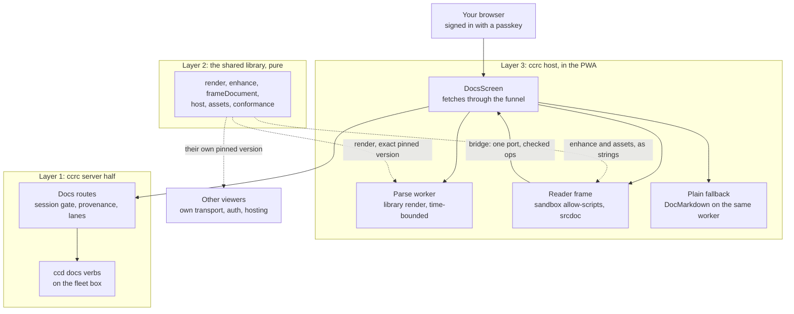
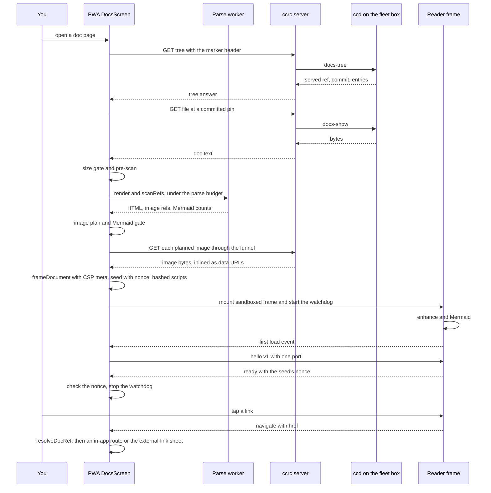
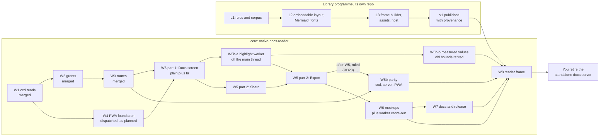
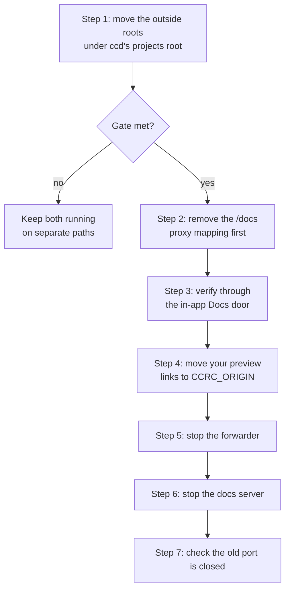

# Rich Docs reader and a shared renderer — design

**Spec** · 2026-10-12 · Status: Approved by the operator 2026-10-12 (R-g) · Owner: the operator · Linear: none · Related: docs/superpowers/specs/2026-10-01-native-docs-reader-design.md, docs/superpowers/programs/native-docs-reader.md

## In short

This spec amends the 2026-10-01 Docs reader spec (the "base spec") in two ways.

- **One shared renderer.** The rich reading layout becomes one small public library, named `docserver` and published as `@synapsium-labs/docserver` under the MIT licence. It is pure and pinned by exact version. ccrc and other viewers each keep their own transport, auth, content source and hosting.
- **ccrc's reader becomes your docs server.** It runs at ccrc's own public address, behind the same passkey session, at feature parity. It replaces the tailnet-only standalone docs server for you.

What changes in ccrc:

- **W4 is unchanged.** W5 stays plain, plus a real `<br>`.
- **A new wave, W5b,** touches ccd, the server and the PWA. It adds the `vision` and `promise` sections, a read-only per-doc history verb, and a commit key `at=<sha>` in page URLs (ruled R-d).
- **A new wave, W8,** mounts the library. The library's `render()` runs in W4's parse worker, which has a time bound. Its layout runs in a sandboxed frame. The frame has no network and talks to ccrc over one port that checks every message. If the frame fails, the W4/W5 plain pipeline draws the doc instead.
- **A new wave, W5h,** comes before W8, both its runs (amended 2026-10-15; W5h). It moves ccrc's own code colouring off the main thread, into a separate highlight worker, as two runs: W5h-a, the worker path, and W5h-b, the values measured on your phone and the retirement of W5 part 1's main-thread highlight bounds. That worker serves chat, the plain fallback, text leaves and Export on the plain tree, and W8 inherits it. On the reader path, the library's `render()` keeps its own colouring rule, C24. §7 (A6, A22) and §8 (the W8 row) say what W8 must rule on.

Please check:
- the items under "Waiting on you" (none since 2026-10-13);
- the amendment table in §7, including A21, which lets the library's name into the PWA;
- the security walls in §5, especially the rows marked UNMEASURED. Every lab result so far comes from desktop Chromium only.

## 1. Context

This section covers the rulings, what is already built, and why the standalone docs server cannot simply sit behind ccrc's login. Citations are `path:line` on `origin/main` at `28e8dc1b2`. The base spec is cited by its § numbers.

### 1.1 The rulings (2026-10-12)

| Id | Ruling | What it means here |
|---|---|---|
| R-a | Recorded by the coordinator: "ccrc has its own docs server (its native reader). Other viewers keep their own. The RENDERING is one shared library: one public repo, permissively licensed, pulled in as a pinned dependency." You accepted the recommendation in full: each product keeps its transport, auth, content source and hosting; the library holds the pure parts only; its own small programme builds it first; ccrc mounts it in a sandboxed frame in a later wave; W5 stays plain plus the `<br>` fix; W4 is unchanged. | §2, §3, §4, §8 |
| R-b | In your words: "ccrc access right now is set up via duckdns, and a passkey, I'm suggesting same auth for [the docs server] applies." | ccrc's Docs reader, at `CCRC_ORIGIN` behind the passkey session, is your docs server. It replaces the standalone docs server at parity (§6, §9). |
| R-c | 13:15, in your words: "yes to MIT license". | The library is MIT (§3.6). |
| R-d | 13:15, in your words: "doc's address - yes". | Page URLs may carry a commit as `at=<sha>` for the version view. This amends the base rule "page URLs never carry a commit". G6 is unconditional in W5b (§6, A14). |
| R-e | 13:15, in your words: "[the docs server's] roots - move". | Roots outside ccd's projects root are moved under it. This is your step in the retirement gate, done only when no live session works in them (§6 G3, §9). |
| R-f | 13:16, in your words: "name: docserver". | The library and its repo are named `docserver`. The unscoped npm name is taken, so the package is `@<scope>/docserver`. The scope is the only naming item still waiting. W4's M7.9 forbids the word in the PWA, so A21 amends it (§7). |
| R-g | About 14:07, in this session: start the library programme now; the `docserver` repo stays private until v1 and becomes public with v1; the npm scope is `@synapsium-labs`; the spec is approved as written. | The package is `@synapsium-labs/docserver` (§3.6). The library programme starts at once (§8). Its first public release is v1, which ccrc's W8 pins. |

### 1.2 What exists

| Wave | State | Evidence |
|---|---|---|
| W1 ccd reads docs | Merged 2026-10-06 (#301) | `shared/docs.ts:20` (`DOC_SECTIONS`), `ccd/ccd:34676` (`SECTIONS`) |
| W2 grants and adapter | Merged 2026-10-09 (#319) | `agent/src/whitelist.ts:330`, `server/src/remote/runner.ts:148` |
| W3 routes | Merged 2026-10-09 (#339). The operator's dark rollout and the R1/R2 field measurements are still to record. | `server/src/docs/hooks.ts:59` |
| W4 PWA foundation | Dispatched 2026-10-12 (run 367) | programme ledger, wave 4 row |
| W5-W7 | Not started | base §7.7 |

There is no Docs UI on `main` yet. The PWA has `react-markdown`, `remark-gfm` and `highlight.js`, and no Mermaid (`pwa/package.json:14-26`).

### 1.3 Why the standalone docs server cannot simply sit behind ccrc's login

| Reason | Detail | Footing |
|---|---|---|
| No route without a tailnet | It is reachable only through a tailnet proxy and a forwarder. ccrc's server reaches the fleet only through whitelisted agent frames (`EXEC_COMMANDS = ['tmux','ccd']`, `agent/src/whitelist.ts:194`), never by proxying to a listener. ccrc must never take a tailnet dependency. | Sourced |
| The console's origin power | Anything served on ccrc's origin runs with the console's session cookie, and that origin drives the fleet. The standalone server passes raw HTML through. Mounted on ccrc's origin, that HTML would run as the console (base §7.4 warning; lab E6 shows same-origin content carries the cookie). | Measured: E6 |
| Not ccrc's to ship | It is your own tool, outside this repository. ccrc must not know it exists (base M7.9). It has no licence and no tests, and the repository is public. | Sourced |

### 1.4 Words used here

| Term | Meaning |
|---|---|
| Base spec | `docs/superpowers/specs/2026-10-01-native-docs-reader-design.md` |
| The library | The shared rendering library this spec introduces |
| `docserver` | Since R-f, the name of the shared library and its repo, and nothing else. Its package is `@synapsium-labs/docserver`. This spec never uses the word for the standalone docs server. |
| Reader frame | ccrc's `<iframe sandbox="allow-scripts" srcdoc>` that runs the library's layout |
| Bridge | The one `MessagePort` between the reader frame and the PWA |
| Nonce | A fresh random value the parent puts only in the srcdoc's seed. The frame echoes it in `ready`, which ties the port to that srcdoc. |
| Parse worker | W4's `docsRunner` worker. On the reader path it runs the library's `render()` under a time budget. |
| Plain pipeline | W4/W5's `DocMarkdown` on W4's parse worker, which renders raw HTML as text |
| Funnel | The PWA's one `request()` path, which carries the `x-ccrc-docs` marker header |
| Reader prefix | `ccrc:reader:v1:`, the only localStorage prefix the frame can write through, which no console key uses |
| Fragment grammar | The ids a `#` jump can name in a rendered doc: the library's heading slugs (such as `3-the-shared-library`) and `<!-- id:X -->` anchor ids. The library documents it, and its corpus pins it. |
| External-link sheet | A sheet in ccrc's chrome, outside the frame, that names a link's host and opens it only on your tap |
| Phone engine | The browser engine on the phone you read on. No lab has run on it yet. |
| Standalone docs server | Your tailnet-only preview server, which this work retires for you |
| Highlight worker | W5h's worker that colours ccrc's code blocks off the main thread: two singletons, `docsHighlighter` and `chatHighlighter`, in a second worker chunk, one block per job under its own deadline (amended 2026-10-15; W5h) |
| C24 | The library's colouring rule: a fence of at most 256 characters is coloured whole and a longer one line by line; a fence with any line over 256 characters stays plain; at most 256 Ki characters are coloured per document (amended 2026-10-15; W5h) |

## 2. The three layers

Each layer has one job, and only layer 2 is shared. Layers 1 and 3 stay ccrc's, so the shared code never gets a network, a cookie or a git command.


*Figure 1. The three layers. Start at your browser. Every byte of a doc crosses layer 1 and the funnel. The library's `render()` runs in ccrc's parse worker, and its layout runs inside the frame on strings that ccrc hands it.*

| Layer | Owner | Holds | Never holds |
|---|---|---|---|
| 1. Server half | ccrc | The ccd verbs and routes, unchanged in kind, plus the parity additions in §6 | Rendering |
| 2. Library | Its own repo: private until v1, public from v1 (R-g) | Rules, layout, CSS, fonts, a Mermaid build, the frame document builder, the frame bootstrap and click guard, the host helper for other viewers, the corpus | Network, storage backends, auth, git, URLs, hosting |
| 3. Host | ccrc | The parse-worker job, the reader frame, the bridge, the asset inlining, the fallback, ccrc's own chrome | A second Markdown renderer for docs, apart from the fallback |

## 3. The shared library

This section says what the library holds, its API, what it leaves out, its rules, how it is tested, how it ships, and how it is versioned. The library is built by its own small programme in its own repo (§8). This spec states only what ccrc needs from it.

### 3.1 Contents

| Part | What it is | Source today |
|---|---|---|
| Rules | Markdown to HTML on markdown-it (TypeScript) | The standalone server's Python renderer, about 285 lines |
| Layout | The rich reading layout as `enhance()`: contents sidebar, scroll-spy, quick jump, figure cards, status labels, glossary hover, Index of IDs, read marks, changes view | The standalone server's layout script, 2129 lines and 158 KB (47.7 KB gz) |
| Styles | The layout CSS, the base prose styles it relies on, and footnote styles | 935 lines and 84 KB, plus about 390 lines of base styles that today live in the server. Footnotes have no styles today. |
| Fonts | Source Serif 4 and Source Sans 3, Latin subsets, woff2, with `OFL.txt` | 4 files, 310 KB, shipped today with no licence text |
| Mermaid | One self-hosted, single-file build | Today it loads from a public CDN |
| Frame builder | `frameDocument()`, which builds the whole `srcdoc` string | New |
| Frame bootstrap and click guard | Inert asset scripts that the srcdoc carries. The bootstrap receives `hello` and reads the seed. | New |
| Host helper | `mountDocFrame()`, with adapters, for other viewers. ccrc does not use it (§4.7). | New |
| Corpus | Golden inputs and outputs plus hostile cases | New: the standalone server has no tests |

Footing: the sizes were measured on the standalone server's files on 2026-10-12 (research A and D).

### 3.2 API (Agreed)

All entry points are ESM with `.d.ts`. Only `./enhance` and `./host` touch the DOM.

```ts
// ./render: pure, deterministic, Node, browsers and workers. ccrc runs it in W4's parse worker.
render(markdown: string, o?: { maxBytes?: number; lineAttrs?: boolean }): RenderResult;
// html, front, frontList, title, mermaidKinds, and meta: headings with their ids, figure and table counts
scanRefs(markdown: string): {
  images: string[];
  mermaid: { fences: number; largestBytes: number; totalBytes: number };
};   // linear, bounded
// ./frame: builds the srcdoc or a static document string
frameDocument(r: RenderInput, o: FrameOptions): string;
// ./enhance: runs inside the frame; no import-time side effects
enhance(root: HTMLElement, o: EnhanceOptions): Promise<void>;
// ./host: runs in the parent; framework-neutral; for other viewers, ccrc does not import it
mountDocFrame(el: HTMLElement, o: { document: RenderInput; adapters: HostAdapters }):
  { update(d: RenderInput): void; setPrefs(p: Prefs): void; destroy(): void };
// ./assets/*: css, the enhance bundle, frame bootstrap, click guard, fonts, the Mermaid file,
//             assets.json {path, sha256, bytes}
// ./conformance: corpus/*.md, expected/*.html, runCorpus(renderFn)
```

These `enhance` options replace today's defaults, which read `location`, `localStorage` and `fetch`. Each was a URL or ambient state before; each becomes a host adapter or a stated setting.

| Option | Replaces | ccrc supplies |
|---|---|---|
| `storage` (snapshot plus write-behind) | `localStorage`, `sessionStorage` | A seed snapshot of the reader prefix, and the bridge op `store.set` |
| `onLink(href)` | Links navigating the frame | The bridge op `navigate` |
| `changes(sha)` returning a Promise | `fetch(changesUrl)` | The bridge op `changes`, answered by `changes.result` |
| `openVersion({sha, only})` | `versionUrl`, `latestUrl`, `onlyBase`: the "only this day" link and "Back to the latest" | The bridge op `version` |
| `onHash(id)`, `initialHash` | `pushState`, `location.hash` | The bridge op `hash`, and the seed |
| `copy(text)` | `navigator.clipboard` | The bridge op `copy` |
| `storageKey`, `posKey` | `location.pathname` | `project:section:path`. The parent forces it to the current doc. |
| `prefs`, `chrome` | The layout's own top bar and Aa menu defaults | ccrc's current theme as the starting value. Later changes arrive by the `prefs` op. Reader prefs are stored apart from console prefs. |
| `mermaid` (`maxTextSize`, `maxEdges`, `secure`) | Mermaid's own defaults | The library's pinned defaults (§3.4), unchanged |
| Rules plugin (rule pills, rules index, facts panel) and document kinds | Always on today | On, with the library's documented grammar, because the `vision` and `promise` docs you read rely on it |
| ID grammar | Hard-coded today | The library's documented default |
| Plan conventions (`Task X:`, `Step N (who)`) | Hard-coded today | The library's documented defaults |
| Status words and status-column patterns | Hard-coded today | The library's documented defaults |
| `itemLink(key)` | A hard-coded issue-tracker workspace | Not supplied: the link is off |

**What another viewer asked for** (received by mail 2026-10-12, from the coordinator of a viewer that will pin the library). Each point is met by the API above:

| Need | How the library meets it |
|---|---|
| Exact versions, installable from a lockfile; signed tags if possible | npm with provenance and an exact pin (§3.6); release tags are signed |
| Rendering in Node with no DOM | `render()` returns `html` and `meta` (front matter, headings with ids, figure and table counts) |
| The layout as an ES module, with today's URL options | `enhance(root, options)` keeps `mermaidUrl`, `resolveLink`, `changesUrl`, `storageKey`, `keyboard`, `meta`, `bar` and the issue-tracker base for hosts that serve the layout from their own origin. The adapters above are additions for a sandboxed host such as ccrc. Nothing hard-codes a server's paths or a CDN. |
| Assets the host serves from its own origin, under a strict CSP | `assets.json` lists every file with its sha256 and size. `enhance` uses no `innerHTML`, no `eval` and no inline handlers. |
| The corpus with each release, runnable in a consumer's CI | `./conformance` ships `runCorpus(renderFn)` with the golden and hostile cases (§3.5) |
| One raw-HTML allowlist, identical in Node and the browser | One `render()` for both (§3.4) |
| A first release before that viewer's own phase that needs it | Library v1 (§8). Interim builds are fine. |

### 3.3 What the library excludes

- Transport, auth, cookies and any `fetch`.
- Git, listings, refs, drafts and freshness.
- Routing and page URLs: mount paths, `?ref=`, and the standalone server's variant switch.
- Storage backends. It gets a snapshot and calls a writer.
- Hosting: no server, footer, title or section list.
- Product vocabulary turned on by default (see the scrub list in §3.7).
- The standalone server's other layouts: the design-prototype variants and the old `classic` layout. Only the default layout ships.

### 3.4 Rules (Agreed)

The library uses CommonMark plus GFM on markdown-it, with raw HTML off. One allowlist applies, the same one the standalone server uses today.

| Rule | Behaviour |
|---|---|
| Inline HTML allowlist | `<br>`, `<br/>`, `<br />`, `sup`, `sub`, `kbd` and their closers, with no attributes. Everything else is escaped text. |
| Block HTML allowlist | `<details>`, `<details open>`, `</details>` and `<summary>text</summary>`, one per line, with the summary text escaped. Unbalanced tags are repaired. A line `<!-- id:X -->` becomes an anchor. Every other comment is dropped. |
| GFM | Tables (in a wrapper), strikethrough, task lists, footnotes |
| Alerts | `> [!NOTE\|TIP\|IMPORTANT\|WARNING\|CAUTION]` become callouts, as a token rule rather than a regex pass |
| Figures | A `mermaid` fence becomes a figure. A following `*Figure N. ...*` line becomes its caption. |
| Front matter | YAML (js-yaml) becomes a definition strip, capped at 40 keys, 500 characters each, under 20 KB |
| Heading ids | The standalone server's slug, pinned by the corpus, so existing `#fragment` links keep working (judgement). The library never looks up its own elements by an id that a slug or an anchor could produce. |
| Line attributes | `data-line="a-b"` on every block. The changes view and reading position depend on it. |
| Links | markdown-it's link check: `javascript:`, `vbscript:` and `data:text/html` stay text. In ccrc the parent checks every link again (§4.4). |
| Highlighting | highlight.js replaces Pygments. The CSS is remapped to `hljs-*` classes. In ccrc this rule colours the reader path only. ccrc's own components colour code in W5h's highlight worker (A22) (amended 2026-10-15; W5h). |
| Mermaid configuration | `securityLevel: 'strict'`. `maxTextSize` and `maxEdges` are pinned in the defaults. `secure` is extended with `themeCSS`, `themeVariables`, `fontFamily` and every other style-bearing key, so a diagram's init directive cannot inject CSS. |

### 3.5 The conformance corpus

| Level | What | Where it runs | Tolerance |
|---|---|---|---|
| 1 | Markdown to HTML, compared byte for byte | Node, in the library's CI | Exact, except token classes inside highlighted code, which must be equal as text |
| 2 | `enhance()` to a structural DOM | A real browser, because the layout measures sizes | Structural |

- **Golden source.** Run today's Python renderer once over the seeds to produce the golden HTML. The seeds are the spec template's rules, real specs and plans, and the probe cases from research A §11: slugs and duplicates, alerts, the allowlist against `<script>`, `<div>` and ``, details, front matter, captions, task lists, footnotes, `\|` in table code, and `javascript:` and `data:` links.
- **Hostile cases.** The base spec's measured crash shapes: `>` repeated 10 000 times, a 4 096-long delimiter run, 100-deep nested emphasis, 90 000 `<hr>`s, and super-linear tables (base §4.10, M4.P1-P12).
- **Hostile Mermaid.** An init directive whose `themeCSS` holds `position:fixed`, a `click` directive, an HTML label, and diagrams over `maxTextSize` and `maxEdges`. The expected output carries no injected style and no handler. E15 checks them under `READER_CSP`.
- **DOM clobbering.** Headings and `<!-- id:X -->` anchors named like the library's globals and like the seed and bootstrap. The expected output leaves the library's lookups and the seed untouched.
- **Mermaid's internals.** Play and the edge animation depend on Mermaid's internal SVG ids. Level 2 pins the Mermaid version against them.

### 3.6 Packaging and licences

| Item | Choice | Why | Status |
|---|---|---|---|
| Name | The library and its repo are `docserver`. The package is `@synapsium-labs/docserver`. | R-f. The unscoped npm name is taken. The scope is `@synapsium-labs` (R-g; amended 2026-10-13). | Ruled |
| Registry | npm with provenance, through trusted publishing (OIDC, no stored token). Each release also carries a GitHub build attestation of its tarball. | The lock keeps a sha512 `integrity`, like all 636 entries in today's PWA lock. A git dependency loses `integrity` (measured with npm 11.11.0) and would build in every CI shard, because the shard action runs `npm ci` in `pwa/`. | Agreed |
| Pin | Exact version in `pwa/package.json`, with no `^`. Bumped only by its own PR, which runs the full suite because it changes `package.json`. | There is no dependency policy in a test today. This spec is the explicit ruling a new dependency needs. | Agreed |
| CI check | In the `build-pwa` leg (`.github/workflows/ci.yml:646`): `npm audit signatures`, then a check that the pinned tarball's provenance names the library's own repo and release workflow (for example `gh attestation verify` with `--repo` and `--signer-workflow`) | Nothing verifies registry signatures today. The release build runs `npm ci --no-audit` (`deploy/build-release.sh:85`). A valid signature alone would also pass a package published from someone else's repo. | Agreed |
| Precache | Mermaid's directory is in the service worker's `globIgnores`, an entry A21 allows. The core library and the woff2 fonts are precached (A9). | The parent reads these files to inline them, and those reads do pass through the worker. A bundled Mermaid would put 116 chunks (5.1 MB) in the precache, about four times today's shell. | Agreed |
| Licence | MIT | R-c. It is one-way compatible with AGPL ccrc. | Ruled |
| Fonts | SIL OFL 1.1 with `OFL.txt` and notices. Use unmodified upstream files, or the fontsource packages with their LICENSE. | The OFL requires the licence text to travel with the fonts. The current copies lack it. | Agreed |
| Mermaid | MIT, plus `THIRD-PARTY-NOTICES` for everything bundled with it | Its bundle carries third-party code | Agreed |
| elkjs | Check whether it is in the Mermaid build. If it is, exclude it. | It is EPL-2.0. The flowchart chunk set carries an `elk` chunk of 1.6 MB. | Agreed |

The release lane ships `dist-pwa` in the tarball and MANIFEST (`deploy/build-release.sh:104-116`, `:162-188`). The library therefore reaches the boxes as built files, never as a box-side install.

### 3.7 Scrub list

These operator-specific parts of today's layout are removed or made into options before v1.

| Item | Action |
|---|---|
| A default issue-tracker workspace URL | Remove. `itemLink(key)` is off unless the host supplies it. |
| Issue-key pattern, the "Linear:"-style byline field, and the item line of a delta fence | An optional plugin, off by default |
| The rule-id grammar and document kinds of another product | A plugin or an option, off by default. ccrc turns it on (§3.2). |
| The ID grammar (`R14`, `F3`, `P0-1`, ...) | An option |
| Plan conventions (`Task X:`, `Step N (who)`) and the word "operator" | Options. The defaults are documented as the format contract. |
| Status words and the status-column patterns | Configurable |
| Spec template headings ("In short", "Where things stand", "Words used here") | Kept, and documented as the format contract |
| Internal brief references in comments | Scrubbed |
| The CDN Mermaid URL and the hashed chunk list | Removed. Mermaid is self-hosted as one file. |
| Storage keys without a prefix (`doc-theme`, ...) | A namespace option |
| Mount path, footer, title, section list, labels, roots, bind address, default ref | Host concerns. Never shipped. |
| Unused hosted-font CSP allowances | Dropped |

### 3.8 Versioning and the bridge protocol version

- **Library version.** Semver. Its rules, its corpus and its `assets.json` hashes are versioned together.
- **Bridge protocol version.** It is separate from the library version. It starts at `BRIDGE_PROTOCOL = 1` and is carried in the parent's `hello`.
  - Changes are additive only. A new op is ignored by an older peer: an older parent drops and counts it, and an older frame ignores a parent op it does not know.
  - A breaking change would be a new protocol version. ccrc's parser refuses it, and the watchdog then falls back to the plain pipeline.
- **CSP hashes.** ccrc's build hashes the exact script bytes it embeds and writes them into `READER_CSP`. A test pins them against `assets.json` (M8.12).

## 4. ccrc's reader frame

This section is layer 3: the frame's shape, its CSP, how bytes reach it, the bridge, what happens when it fails, and what ccrc imports from the library. It lands in W8 (§8).

### 4.1 Shape (Agreed)

| Property | Value |
|---|---|
| Element | `<iframe sandbox="allow-scripts" srcDoc csp={READER_CSP} referrerPolicy="no-referrer">` in `pwa/src/docs/ReaderFrame.tsx` |
| Sandbox tokens | Exactly `['allow-scripts']`. Never `allow-same-origin`, `allow-popups*`, `allow-top-navigation*`, `allow-forms`, `allow-modals` or `allow-downloads`. |
| Attributes not set | `src`, `name`, `allow`, `allowfullscreen` |
| Scripts | On from the first render. The code is the library's, and the input is rendered HTML, not a script (A4). |
| Size | Sized to the Docs pane, and the frame scrolls itself |
| Focus | The parent focuses the frame on mount, so the layout's keys work at once |
| Remount | Every new document, ref or `at=` commit is a remount: a new React key, a new `MessageChannel` and a new nonce. ccrc never updates a srcdoc in place. |
| Chrome | ccrc's header, truth line, banners and sheets stay outside the frame |

### 4.2 `READER_CSP` (Agreed)

```ts
export const READER_CSP =
  "default-src 'none'; script-src 'sha256-…' 'sha256-…'; style-src 'unsafe-inline' data:; " +
  "font-src data:; img-src data:; base-uri 'none'; form-action 'none'";
```

- It allows script hashes only: no hosts, no `'self'`, no `'unsafe-eval'`.
- It has no `connect-src` or `frame-src`, so both fall back to `'none'`.
- It lives in `pwa/src/docs/reader/policy.ts`, separate from `MOCKUP_CSP`. W6's "Load external" choice can therefore never widen it (A5).
- `style-src 'unsafe-inline'` is there for Mermaid's injected styles, as in the mockup policy. §3.4's `secure` keys stop a diagram from choosing those styles.
- The srcdoc carries the same policy as a meta. The `csp` attribute is Chromium's alone, so on other engines the meta is the frame's only policy.

### 4.3 What reaches the frame, and how

The frame never fetches (A8). The PWA fetches every docs byte through its own funnel with the marker header, then hands the frame strings.

| Content | Route into the frame | Bound |
|---|---|---|
| Rendered HTML | The parent runs the base spec's size gate and pre-scan. The library's `render()` and `scanRefs()` then run in W4's `docsRunner` as a new job kind. The HTML goes into a `<script type="application/json">` seed inside the srcdoc, with `<` escaped as `\u003c` and U+2028/2029 escaped. | The base spec's 2 MiB document cap, size gate and pre-scan, then `DOCS_PARSE_BUDGET_MS` in the worker, with terminate and respawn |
| Meta | The same seed: project, section, path, served ref, commit, draft flag, history, the `only` base when `history.state` holds one, and the nonce | Small |
| Images | The worker's `scanRefs` lists the image refs. W6's asset planner and pin rule then fetch and rewrite each one to `data:` (A7). The frame gets a map from ref to `data:` URL. | W6's budgets: 64 assets and 5 MiB in total. A ref past the budget, or one the scan missed, shows a "not loaded" chip whose link uses `navigate`. |
| Fonts | `data:` inside the inlined CSS | About 415 KB as base64 |
| Library code | Inline `<script>` blocks, allowed by hash: the click guard, the bootstrap and the enhance bundle | About 160 KB plus CSS |
| Mermaid | The single-file build, inlined only when `scanRefs` finds a `mermaid` fence and the doc passes the Mermaid gate (§4.6) | Size UNMEASURED until L2 builds it |
| Reader state | A snapshot of the reader prefix in the seed (G7) | Only keys under the reader prefix |

- **Order.** The click guard, the seed and the bootstrap come first in the body, in that order, before any content. The bootstrap runs before any content exists. It reads the seed by position: the element just before its own script. It never looks the seed up by id, so a heading id cannot stand in for the seed (M8.3, M8.8).
- **Footing.** Lab E4 measured srcdocs up to 11.2 M characters rendering in 0.18-1.35 s. The worst reader page (a 2 MiB doc, 5 MiB of images and Mermaid) could come near that size. W8 measures the worst case and lowers the reader's image budget if it is over.

### 4.4 The bridge (Agreed)

- **Handshake.** The parent creates a `MessageChannel`. On the frame's **first** `load` only, it calls `contentWindow.postMessage({t:'hello', v:1}, '*', [port2])`. The target is `'*'` because an opaque origin cannot be named. `hello` carries no secret. This is the parent's only `contentWindow.postMessage` per mount. Every later parent message goes on the port, and is `prefs` or `changes.result`.
- **Binding the port to the srcdoc.** The parent puts a fresh 128-bit nonce in the seed, and only there. The frame's `ready` must echo it. Until a `ready` with the right nonce arrives, the parent drops every other op. A wrong or missing nonce counts as a watchdog failure and falls back. So if some engine lets the frame navigate before its first `load`, the document that receives the port cannot act through it.
- **No window listener.** The parent registers no window `message` listener anywhere in `pwa/src`. A stray `parent.postMessage` from the frame is therefore ignored. M8.B5 checks this at run time, which also covers bundled dependencies.
- **Teardown.** A second `load` (lab E11) or an unmount closes the port.
- **Checking.** Every message goes through one pure L0 parser, `parseBridgeMessage`, in `shared/`. The parser refuses unknown ops, extra keys, `__proto__`, oversize values, a wrong version, and data that is not a plain object of strings and numbers. It also refuses a message that carries ports (`ports.length > 0`). A `messageerror` counts as a refused message.
- **Limits (Agreed).** At most 20 messages per second over a 1-second window, with a burst of 40. At most 10 `store.set` per second. One `changes` in flight; a second one is dropped. `navigate` and `version` are coalesced: the latest within 250 ms wins. After 16 refused messages in one mount, the parent closes the port and falls back. Ordinary reading never meets this limit: `hash` accepts every id the layout can jump to (the fragment grammar), so contents and heading links are never refused.
- **What the caps bound.** The browser deserialises a message before the parser sees it. The caps therefore bound effects, not the cost of the clone. The frame is the only sender on the port.

| Op | Direction | Payload | Parent check | Effect |
|---|---|---|---|---|
| `hello` | parent to frame | `{t:'hello', v:1}` plus one port | Sent once, on first load only, through `contentWindow.postMessage`. Carries no nonce. | The frame keeps the port and drops its window listener |
| `prefs` | parent to frame | `{theme, width, font}` | ccrc's own values. Sent on the port, any number of times. | The frame applies them without a remount |
| `changes.result` | parent to frame | `{sha, ranges}` or `{sha, unavailable: true}` | Built by the parent. Sent on the port, once per `changes`. | The frame marks changed blocks |
| `ready` | frame to parent | `{v, nonce}` | `v` must be supported, and `nonce` must equal the seed's | Stops the watchdog and opens the port to the other ops |
| `error` | frame to parent | `{why}`, one of `boot`, `render`, `mermaid`, `assets`, `protocol` | Closed set | Unmounts the frame and falls back. `why` is never shown. It goes only to the browser console. |
| `store.set` | frame to parent | `{key, value}` | `key` is a pref name on the allow-list or a per-doc field name. The parent builds the stored key itself: the reader prefix plus `pref:<name>`, or plus `doc:<project:section:path>:<field>` for the current doc only. The value is JSON of at most 64 KiB. | Writes ccrc's localStorage under the reader prefix, within a 1 MiB total budget. Past the budget, the least recently written doc's keys inside the prefix are evicted. The value only ever returns as seed data. |
| `navigate` | frame to parent | `{href}` | `resolveDocRef` from the current doc. The query is dropped, as base §4.11 does. `self-contained` and `refused` answers (`javascript:`, `data:`, root-relative such as `/api/...`, protocol-relative, backslash forms, paths above the root) do nothing. | A doc opens an in-app route. A fragment scrolls. An external link, or a `repo` answer mapped through `githubBlobUrl`, opens the external-link sheet. |
| `copy` | frame to parent | `{text}` | At most 64 KiB, and the hidden-character check below | The parent calls `writeText`. If the text holds hidden characters, or `writeText` is blocked (E16), a sheet shows the text selected instead. |
| `changes` | frame to parent | `{sha}` | 40 or 64 hex characters, naming any commit | The parent reads the base pin through the funnel, diffs it (G5) and replies with `changes.result`. The frame never receives a URL. |
| `hash` | frame to parent | `{id}` | At most 256 characters, in the fragment grammar: the library's heading slugs (such as `3-the-shared-library`) and `<!-- id:X -->` anchor ids. Not the ID grammar alone. | The parent calls `replaceState` with the fragment |
| `version` | frame to parent | `{sha?, only?}` | Each 40 or 64 hex characters | With `sha`, the parent opens the page at `at=<sha>` (R-d) and keeps `only` in `history.state` for the visit. Without `sha`, it drops `at=`: "Back to the latest". |

**The external-link sheet.** A `navigate` that resolves outside ccrc never opens directly. The sheet sits in ccrc's chrome, outside the frame. It names the full scheme and host, and it highlights a host whose registrable name differs from `CCRC_ORIGIN`'s. Its Open button is a tap in the parent. That tap supplies the user activation for `window.open(url, '_blank', 'noopener,noreferrer')`. Today's `openExternal` takes that click event (`pwa/src/session/MessageBubble.tsx:47-51`).

**Hidden characters in a copy.** Before `writeText`, the parent looks for C0 controls other than tab and newline, DEL, ESC, bidi controls (U+202A-202E, U+2066-2069) and zero-width characters (U+200B-200D, U+2060, U+FEFF). If any are present, it never writes silently. The copy sheet shows each one as a visible marker, with a warning, and copies only from there.

### 4.5 One page load


*Figure 2. One page load. Every request to the server comes from the PWA, never from the frame. Parsing happens in the worker, under its time budget. If `ready` with the right nonce does not arrive in time, the parent unmounts the frame and draws the plain pipeline instead.*

### 4.6 The watchdog and the fallback

| Trigger | What the parent does |
|---|---|
| The size gate or pre-scan refuses (base §4.10) | Never mounts the frame. The plain pipeline's own gate and notes apply. |
| The library's `render()` exceeds `DOCS_PARSE_BUDGET_MS` in the worker | The worker is terminated and respawned (base §4.10). The page shows base §4.10's timeout outcome. The frame never mounts. |
| No `ready` within the budget, or a `ready` with a wrong or missing nonce | Unmounts the frame and renders the plain pipeline, with the note "The rich view did not start; shown in the plain view." No remount loop. |
| An `error` message, or an unsupported protocol version | Same. The note is the fixed text above; `why` is never shown. |
| 16 refused messages in one mount | Closes the port, then the same |
| No library assets (for example a build without them) | Plain pipeline |

- **What the watchdog can bound.** It only bounds a frame that yields. If the frame shares the parent's event loop (WebKit/iOS, UNMEASURED, E17), the parent's timer cannot fire while the frame spins, and the parent cannot unmount it until then. The parse is therefore bounded in the worker, and the frame runs only `enhance()` and Mermaid.
- **The Mermaid gate (Agreed).** Before inlining Mermaid, the parent reads the worker's counts. A doc gets Mermaid only with at most 24 fences, at most 16 KiB per fence and at most 128 KiB in all. A fence over the per-fence cap shows as its source with a note. A doc over the count or total cap renders with every figure as source. The library's `maxTextSize` and `maxEdges` also bound each diagram (§3.4). W8 re-measures these numbers against the committed specs.
- **Budget (Agreed).** The same formula as `DOCS_PARSE_BUDGET_MS` (base §4.9), plus a Mermaid allowance that W8 measures on your phone (E17).
- **Contingency `reader-mermaid-on-tap`.** If E17 shows the console stops answering, this lands as a W8 fix before W8 merges. Each figure shows its source with a Render button. Mermaid runs only on that tap, one figure at a time. It mirrors base `mockup-scripts-confirm`.
- **The fallback** is W4/W5's `DocMarkdown` on W4's parse worker, docs profile, with `<br>` as a line break. W4's foundation therefore stays load-bearing for docs as well as chat. Its code blocks are coloured by W5h's highlight worker, not by `render()`, so the fallback and the reader can colour the same fence differently (A22) (amended 2026-10-15; W5h).

### 4.7 What ccrc imports, and who owns what

ccrc imports only what it needs where it needs it. Its own code builds the frame and the port, so ccrc's tests check the code that ccrc runs.

| Library subpath | Where ccrc uses it | Why |
|---|---|---|
| `./assets/*` (CSS, fonts, the enhance bundle, bootstrap, click guard, Mermaid) | In `docs/reader/`, as inert strings that it inlines | They run only inside the frame |
| `./frame` | In `docs/reader/` | A pure string builder for the srcdoc |
| `./render` | In W4's worker closure only | It runs under a time budget, and the worker can be terminated |
| `./enhance` | Never imported. It ships inside the frame as an asset. | It runs only in the frame |
| `./host` | Never | It is for other viewers |

- ccrc builds the iframe in `ReaderFrame.tsx`, the port in `reader/bridge.ts` and the seed in `reader/seed.ts`. It calls `frameDocument()` with ccrc's `READER_CSP` meta.
- The frame-side bootstrap, which listens for `hello`, and the click guard are library assets. `pwa/src` therefore holds no window `message` listener.
- Library code in the worker and in the srcdoc is trusted like any other pinned dependency. `react-markdown` already runs in the console today. A bump goes through the provenance identity check (§3.6).
- M8.10 pins this import list.

## 5. Security

This section lists the walls between hostile Markdown and ccrc, then the risks that remain. Each row gives its footing: measured by a lab, sourced from code, judgement, or UNMEASURED with the new lab row that will measure it.

Every lab in this spec and the base spec ran on desktop Chromium 153. Firefox, WebKit/iOS and Android Chrome are UNMEASURED throughout. You read on a phone, so lab E18 re-runs the core batteries on your phone's engine. Passing it is a retirement-gate condition (§9).

### 5.1 Walls

| Wall | What it stops | Footing | Engines | Evidence |
|---|---|---|---|---|
| Opaque origin | Access to the parent, `document.cookie`, storage and IndexedDB | Measured: lab 1-2 | Desktop Chromium; others UNMEASURED (E18) | base §5.0 |
| No cookie on any frame request, when `CCRC_AUTH` is armed | A frame request that rides your session | Measured: lab 1-2 | Desktop Chromium; others UNMEASURED (E18) | Its requests carry no Lax cookie. `credentials:'include'` from an opaque origin is still cross-site (spec fact). Re-proved with the real library by M8.B2. On a dark box there is no session to ride and the API answers without one, so `READER_CSP` is the only wall (M8.B1). |
| Preflight never answered for the marker | A frame `fetch` carrying `x-ccrc-docs` | Measured: M-f | Desktop Chromium | The server sends no CORS headers anywhere |
| Origin `null` refused on writes, when `CCRC_AUTH` is armed | A frame POST | Sourced | Any engine (the check is server side) | `server/src/auth/gate.ts:857` runs it only when armed (`deps.enabled`); `:692`, `:885` give the 403 `foreign-origin`. On a dark box, the frame's `connect-src` fallback to `'none'` is the only wall (M8.B1). |
| Frame CSP `default-src 'none'` | Every exfiltration channel | Measured for `MOCKUP_CSP`: lab 3, E3 | Desktop Chromium; others UNMEASURED (E18). The `csp` attribute is Chromium's alone. | 0/27 channels. `READER_CSP` with the real library is re-proved by M8.B1. |
| No top navigation, no popups | Leaving the frame | Measured: lab 7, E1 | Desktop Chromium; others UNMEASURED (E18) | The sandbox tokens plus the shell's `frame-src 'none'` |
| Shell `frame-src 'none'` | The frame navigating itself, which also keeps the `'*'` port target safe | Measured: E1, E11 | Desktop Chromium; others UNMEASURED (E18) | A blocked navigation fires a second `load`, which closes the port |
| Port bound to the srcdoc | A navigated or foreign document acting through the port | Judgement | Any | The nonce lives only in the seed and is echoed in `ready`. Ops before it are dropped. Pinned by M8.5, M8.6 and M8.B5. |
| Bridge checked op by op | A hostile message reaching a host effect | Judgement | Any | Pinned by M8.5, M8.7 and M8.9 |
| External links only through a parent sheet | The frame sending you to a look-alike host | Judgement | Any | Pinned by M8.7 |
| No message listener in the console window | A stray `parent.postMessage` reaching an effect | Judgement | Any | Pinned by M8.10 and M8.B5 |
| No ambient state | The library failing open on storage | Measured: lab 1-2 | Desktop Chromium; others UNMEASURED (E18) | Re-proved by M8.B3 |
| Parse time bound in a worker | A hostile doc freezing the console while it parses | Sourced | Any | base §4.10: the worker can be terminated on every engine. Pinned by M8.21. |

### 5.2 Residual risks

| Risk | Mitigation | Footing |
|---|---|---|
| Phishing inside the frame, such as a fake "sign in again" box or a link to a look-alike host | ccrc's chrome stays outside the frame. The frame cannot send anything out (0/27, `form-action 'none'`). Every external link opens only from the external-link sheet, which names the host (§4.4). `error`'s text is never shown. | Judgement |
| A shared process on WebKit/iOS: a long `enhance()` or Mermaid layout blocks the console | The watchdog bounds only a frame that yields. The parse runs in the worker. The Mermaid gate and Mermaid's `maxTextSize` and `maxEdges` bound layout. If E17 fails, contingency `reader-mermaid-on-tap` lands before W8 merges. | Pending: UNMEASURED on phones, lab E17 |
| A shell meta gaining `script-src` would also block the frame's scripts, because the frame inherits and intersects the shell's policy | A3: never widen the shell meta without re-measuring | Pending: UNMEASURED, lab E14 |
| Mermaid needing `'unsafe-eval'` under `READER_CSP` | The standalone server already runs Mermaid without it | Pending: sourced there, unmeasured here, lab E15 |
| A Mermaid init directive restyling the frame, for example with `themeCSS` | `secure` extended in L2 (§3.4), plus hostile corpus cases | Pending: lab E15 |
| Clipboard in an opaque frame, and user activation reaching the parent | The `copy` op, with a select-text sheet as fallback | Pending: UNMEASURED, lab E16 |
| Copied text carrying invisible controls (pastejacking) | The parent shows them in the copy sheet and never writes them silently (§4.4) | Judgement |
| `pushState` on `about:srcdoc` | The `hash` op. The library already wraps it in try/catch. | Pending: UNMEASURED, lab E16 |
| A doc filling localStorage, or writing another doc's state | The reader prefix, per-doc keys that the parent builds for the current doc only, and a 1 MiB budget with eviction inside the prefix. Console keys are never touched. | Judgement |
| A large or odd bridge message costing the parent before the parser sees it | Caps and rate limits bound its effects. The port closes after repeated violations. | Judgement |
| Library supply chain | npm provenance, `npm audit signatures`, a provenance identity check on the repo and workflow, the exact pin, the hash pin, and the import list (§4.7) | Judgement |
| Walls measured on desktop Chromium only | E18 on your phone's engine, before retirement | Pending: UNMEASURED, lab E18 |
| Reader state from the standalone server's origin does not move | Accepted. Per-device state starts fresh. | Judgement |

### 5.3 New lab rows (A10)

| Id | Question | Setup | Engines | Pass |
|---|---|---|---|---|
| E14 | Does a shell CSP meta's `script-src` apply inside a srcdoc child? | Shell meta `script-src 'self'` and a srcdoc with an inline script | Desktop Chromium and your phone's engine | Confirms inheritance and intersection. A3's rule stands either way. |
| E15 | Does Mermaid render under `READER_CSP`, and do hostile directives stay inert? | The real library and the single-file Mermaid, with no `'unsafe-eval'`, plus `data:` fonts and the hostile Mermaid corpus | Desktop Chromium and your phone's engine | Flowchart, sequence and gantt render. 0/27 channels. No injected style takes effect. |
| E16 | Do `pushState`, `clipboard.writeText` and user activation work in an opaque srcdoc? | A scripted frame. A tap followed by a parent-side `writeText`. | Desktop Chromium and your phone's engine | Records the behaviour. The bridge ops are the path either way. |
| E17 | Does the console stay live on your phone? | A heavy-Mermaid doc and a busy-loop fixture in the reader frame | Your phone's engine | The console answers, and the watchdog falls back within its budget. If not, contingency `reader-mermaid-on-tap` lands before W8 merges. |
| E18 | Do the measured walls hold on your phone? | Re-run lab 1-2, E1, E11 and the M8.B1, M8.B2 and M8.B4 batteries | Your phone's engine; Firefox and Android Chrome where available | The same results as desktop Chromium. A miss blocks retirement (§9). |

## 6. Parity additions to ccrc's server half

These close the gaps found against the standalone docs server (research B). Each row says what changes and which base-spec rule it amends. A full parity table follows, so you can check R-b's "at parity" against every capability.

| Gap | What changes | Wave | Amends | Status |
|---|---|---|---|---|
| G1 sections | `vision: 'docs/vision'` and `promise: 'docs/promise'` join `DOC_SECTIONS` (`shared/docs.ts:20`) and ccd's parity literal `SECTIONS` (`ccd/ccd:34676`). Everything derived from them follows. In the PWA, `SECTION_ORDER` in `docs/docsTree.ts` gains two entries, and the project and index views show six section rows and counts. A new cap token `docs-sections-v2` keeps the rule that a new server only ever under-calls an old fleet: without the token it answers `unsupported`. W5b is rolled `--server-first` (A23). With fleet first, and W5b after W5 as recommended, ccd would list the two new sections to W5's server and PWA, whose `SECTION_ORDER` and page grammar know only four. Between ccd's swap and the agent's restart, `docs-log` can answer `not-granted` (manual retry), as base §7.1 describes. The largest measured project has 712 entries across six sections, under `DOCS_MAX_ENTRIES` (5000) and the 1 MiB listing cap. | W5b | §0 Scope, non-goal and `sections`, §1 `shared/docs.ts` row, §2 (a), §4.1, §4.3, §7.1, §7.5 "four" | Agreed |
| G4 history | A new read verb, `docs-log --project P --commit C --section S --path X`. It is read by fixed index under its own cap, `docs-log-v1`. The grant is `['docs-log','--project']`. It adds a runner budget row and the shared redactor. `log` joins `READ_ALLOW` only with fixed flags. The verb logs the fixed section with `--name-only -z` and no `-n`. The helper keeps the first 100 entries whose path equals the doc's by exact bytes, then stops, so the caller's path never enters an argv. The helper deadline and the 16 MiB stdout cap bound the walk. If either ends it first, the answer carries `truncated: true` rather than a silently short list. Each entry carries sha, first parent, ISO date, author and subject. Measured on this repo's largest section (2223 commits): the full section log takes 0.17 s cold and 0.01 s warm. The route is `GET /api/docs/:project/history`, with at most 100 entries, subjects of at most 200 characters (redacted), and a wire cap of about 128 KiB. | W5b | §2 (a) verbs, the "Never used" list, row 16, §3.4 routes, §3.13 census, §7.2 doctor | Agreed |
| G5 changes since | No new verb. The PWA reads the base and head through two existing `docs-show` pins and diffs the lines itself, keyed to `data-line`. The base may be any 40 or 64 hex commit, because a committed pin reads any commit, still inside the sections (base §0 `evidence`). "Since last visit" sends the stored served commit, and the oldest day window sends a commit's parent; neither need be in the doc's history. A draft answers "unavailable". `diff` stays on the never-used list. The alternative is a `docs-diff` verb. | W8 | §4 gains a pure diff module | Agreed |
| G6 version view | Page URLs gain `at=<sha>` (40 or 64 hex), a change to "page URLs never carry a commit". The page opens a committed pin at that commit, and the truth line names it and links back to the latest. "Only this day" keeps its base, and "Back to the latest" its ref, in `history.state` for the visit, not in the URL. Inside the frame, the `version` op asks for a version (§4.4). | W5b (the key and the page), W8 (the menu) | §0 `http` row, §3.1, §4.3, M3.2 | Ruled |
| G7 reader state | Theme, width, marks and last visit live in ccrc's own localStorage, per device, under the reader prefix `ccrc:reader:v1:`, which no console key uses. They are written through the allow-listed `store.set` and seeded back on mount. Reader prefs are kept apart from console prefs. No server storage in v1. | W8 | §4 gains `docs/reader/store.ts` | Agreed |
| G3 roots outside ccd's projects root | Moved under it as git repos (R-e). This is your step in the retirement gate (§9 Step 1), done only when no live session works in them. Two small non-git directories (28 files) are affected. One stale entry has nothing to move. Once moved, ccd serves them like any other project. | none: your step | None: restates base §0 | Ruled |
| G9 HTML specs and mockups | They use W6's mockup frame unchanged. An HTML spec that loads a CDN script needs two taps: Run scripts, then Load external. Those two taps hold only once W6's script-text census lands (base §5.6.3): until then, a spec whose inline script imports from a CDN never offers Load external (amended 2026-10-13, Share/Export). The sandbox is deliberately stricter than the standalone server's. | W6 | None | Agreed |

**Parity, capability by capability.** "Yes" means the base spec already covers it. "Agreed" means a gap that this spec closes. "Dropped" is an accepted loss.

| Capability of the standalone docs server | Verdict | Where |
|---|---|---|
| Index, project and directory pages | Yes, base §4.4 | The index's "newest five" cards are Later (G10) |
| Recursive listings | Yes, base §2 (a) | Listings already recurse (`ccd/ccd:35878`); the path grammar allows 16 components (G2) |
| Draft badges and banner | Yes, base §4.5 | More precise than today |
| `?ref=<branch>` | Yes, base §3.1 | Stricter. `?ref=origin/<b>` reads as a local branch named `origin/<b>`; rewrite old links to the bare `?ref=<b>` (§9 Step 4). |
| Fetch on miss | Yes, base §2 (a) and §4.3 | `docs-fetch`, auto-refresh and the chip |
| GitHub link | Yes, base §3.11 | |
| Honest errors | Yes, base §4.7 | |
| Render-failure fallback | Yes, base §4.10 | The plain pipeline |
| Six sections | Agreed, G1 | W5b |
| Per-doc history | Agreed, G4 | W5b |
| Changes since | Agreed, G5 | W8 |
| Version view, "only this day", "Back to the latest" | Agreed, G6 | W5b and W8 |
| Read marks, last visit, reader settings | Agreed, G7 | W8 |
| Rich layout (G8) | Agreed, the library plus W8 | |
| Figures: Play, Animate edges, Full screen, Copy Mermaid | Agreed, W8 | |
| Keys (`/`, `?`, j/k and the rest) | Agreed, W8 | The parent focuses the frame on mount (§4.1) |
| Front matter strip | Agreed, §3.4 | |
| Footnotes | Agreed, L2 adds styles | They have no styles today |
| Fonts | Yes, same as today | Latin subsets only; other scripts fall back to system fonts |
| HTML specs and mockups | Yes, base §5.6, with a stricter sandbox (G9) | |
| The `classic` old layout and the design-prototype variants | Dropped | Only the default layout ships (§3.3) |
| The figure overlay's Back-to-close | Dropped | The frame keeps no history entries of its own (`hash` uses `replaceState`). Esc and the close button still close it. |
| Files over 2 MiB, and PDFs | Dropped | Download only. Larger reads wait for the reserved `docs-show-range` verb. |
| Issue-tracker item links | Dropped | Off. ccrc has no per-project docs config. |
| Print | Later | It needs `allow-modals`, which is forbidden |
| Reader state kept on the old server's origin | Dropped | Per-device state starts fresh |

## 7. Amendments to the 2026-10-01 spec

One table holds every rule this spec changes. New mutation rows are numbered M8.x (the reader frame and packaging), M8.Bx (real-browser rows) and M9.x (parity), so they never collide with the base spec's rows or with its R1-R3 and R19 field measurements (amended 2026-10-15; W5h).

| # | Base rule | Change | Why | Rows | Status |
|---|---|---|---|---|---|
| A1 | §5.6.1 "No message channel in either direction" | It stays for `MockupFrame`. A new `ReaderFrame` and `docs/reader/bridge.ts` are the only holders of a port. | Parity needs write-back | M8.6 | Agreed |
| A2a | M5.16 source scans (W6) | `postMessage(` and `.onmessage` are allowed in `lib/markdownWorker.ts` and `lib/markdownRunner.ts` only (W4 plan, refinement (w)). The base spec's M5.16 owns this carve-out: the Share/Export amendment, which rewrites M5.16, wrote it there, so M5.16 changes once. This row and M9.14 cross-refer to it (amended 2026-10-13, Share/Export). W5h's amendment of M5.16 admits a third file, the highlight worker `lib/markdownHighlightWorker.ts`, with its own planted control (amended 2026-10-15; W5h). | W4's worker files would make M5.16 red the day W6 lands | M9.14 | Agreed |
| A2b | M5.16 source scans (W8) | `<iframe` and `srcDoc` only in `MockupFrame.tsx`, `ReaderFrame.tsx` and `docs/export/buildExport.tsx`, the mockup export's wrapper. `default-src 'none'` only in `mockup/policy.ts`, `reader/policy.ts` (A5) and `docs/export/policy.ts`. Both keep the base M5.16's export allowances (amended 2026-10-13, Share/Export). In `pwa/src/docs`, `postMessage(`, `MessageChannel` and `.onmessage` only in `reader/bridge.ts`. Across all of `pwa/src`: no `addEventListener('message'`, no `window.onmessage`, and no `self.onmessage` outside `lib/markdownWorker.ts` and W5h's `lib/markdownHighlightWorker.ts` (amended 2026-10-15; W5h). Library import specifiers are limited to §4.7's list. | The reader's port, and no second channel anywhere in the console | M8.10 | Agreed |
| A3 | §5.6.1 shell meta, M5.19 | The meta is unchanged: exactly `frame-src 'none'`. New rule: never add `script-src`, `default-src`, `style-src` or `font-src` to it without re-measuring. | The frame inherits and intersects the shell's policy | M8.13, M8.B6 | Agreed |
| A4 | §5.6.5 scripts off, M5.13, M5.14 | These do not apply to the reader. The reader's tokens are exactly `['allow-scripts']`. | The library is first-party code | M8.1 | Agreed |
| A5 | §5.6.4 `MOCKUP_CSP` | A separate `READER_CSP` with hashes only. `default-src 'none'` may appear in `reader/policy.ts` too. | A mockup widening must never reach the reader | M8.2 | Agreed |
| A6 | §4.10 "the worker is the only time bound" | It stays true for parsing. On the reader path, the library's `render()` runs in W4's `docsRunner` as a new job kind, under `DOCS_PARSE_BUDGET_MS`, with terminate and respawn. The `ready` watchdog bounds only `enhance()` and Mermaid, and only when the frame yields; E17 measures whether it can fire on WebKit. W4's worker purity scan gains the one specifier `@synapsium-labs/docserver/render`. Chat is unchanged. That holds because, from W5h, chat's code colouring is already off the main thread: W5h's highlight worker colours code for chat, the plain fallback, text leaves and Export on the plain tree. It is a separate runner in a separate chunk, so a `render()` job and a highlight job never share a queue or a terminate, and W5h's highlight-worker purity row stays as W5h wrote it. On the reader path, `render()` keeps its own colouring under C24, inside `DOCS_PARSE_BUDGET_MS` (amended 2026-10-15; W5h). | The parent cannot terminate a hung frame the way it terminates a worker | M8.11, M8.17, M8.21 | Agreed |
| A7 | §4.11 images | Reader images go through §5.6.3's planner, pin rule and budgets, as `data:`. No per-image op. | One asset rule | M5.8-M5.12 apply | Agreed |
| A8 | §5.4, §3.8 | One sentence: the reader frame never fetches, and receives strings only | Keeps provenance whole | M8.4, M8.B2 | Agreed |
| A9 | §3.10 "No configuration change", §7.3 | Precache `woff2`. Mermaid's directory goes in `globIgnores`. | A bundled Mermaid would quadruple the precache | M8.14 | Agreed |
| A10 | §5.0 labs | Add E14-E18 | They measure the UNMEASURED rows of §5.2 | M8.B1-B8 | Agreed |
| A11 | §0 Scope paragraph, `sections` and non-goals; §1 `shared/docs.ts` row ("the four slugs"); §2 `SECTIONS`; §4.1 and §4.3 (`SECTION_ORDER`, the section rows); §7.5 | Six sections, plus `docs-sections-v2` | G1 | M9.2, M9.3 | Agreed |
| A12 | §0 `approach` "four narrow verbs", §2 (a), the "Never used" list, row 16, §3.4, §3.13, §6.1, §7.2 | Add `docs-log`; `log` with fixed flags and no `-n`, the 100-entry stop living in the helper; a fifth route; the census and doctor token | G4 | M9.4-M9.9, M9.12, M9.13 | Agreed |
| A13 | §4 | A pure client line diff over two committed pins | G5 | M9.10 | Agreed |
| A14 | §0 `http` row and §3.1 "page URLs never carry a commit", §4.3, M3.2 | Add the page key `at=<sha>`. The other pin keys stay refused. | G6, R-d | M9.11 | Ruled |
| A15 | §4 | Reader state in ccrc's localStorage via `store.set`, under the reader prefix | G7 | M8.15 | Agreed |
| A16 | §4.10 step 3, docs profile only | `<br>`, `<br/>` and `<br />` with no attributes become a real `br` element, never parsed HTML. All other raw HTML stays text. Chat is unchanged. W5 also amends W4's profile-equality case (W4 plan, refinement (f)): the two profiles' outcomes are equal, except on inputs that hold `<br>`, which differ only by `br` elements in the docs profile. | W5 ruling | M9.1 | Agreed |
| A17 | §1 units, §4.1 files | Add `docs/ReaderFrame.tsx`, `docs/reader/{bridge,policy,store,seed,diff}.ts`, the L0 `parseBridgeMessage`, the `docsRunner` render job, the exact library pin in `pwa/package.json`, and §4.7's import rule: ccrc never imports `./host`, `./enhance` or `./render` into the main thread | Layer 3 | M8.10, M8.12 | Agreed |
| A18 | §7.4 | A retirement gate before the base steps (§9) | R-b at parity | none | Agreed |
| A19 | §7.7 | Waves W5b and W8 and their dependencies (§8) | Sequencing | none | Agreed |
| A20 | §0 `features` | The rich layout, history, changes since and the version view join what carries over from the old preview | R-b | none | Agreed |
| A21 | §7.10 M7.9 (W4's row; W4 plan, refinement (v)) | The PWA name rule gains one exception. The exact specifier `@synapsium-labs/docserver` and its subpaths may appear as an import specifier in `pwa/src`, in `pwa/package.json` and `pwa/package-lock.json`, and in the `globIgnores` entry of `pwa/vite.config.ts`. Every other occurrence, in any case, stays red. The directory needle is unchanged. It lands in W8, which edits M7.9's block in `docs-parity.test.ts` in place: the one exception to that file's append-only header, recorded in W8's plan. | R-f: the word now names the library | M8.18 | Agreed |
| A22 | §4.10 steps 2-5; §4.11's `detachUrls`, `DocLink` and `DocImage` contract and "no heading ids are generated"; §7.5 README "rendering" bullet | These apply to the plain fallback only. On the reader path, §3.4's rules (the inline and block HTML allowlists, heading ids, `data-line`) apply inside the opaque frame, whose walls are §5.1. The parent re-resolves every link through `navigate`. A `repo` answer maps to `githubBlobUrl`, as in §4.11. W8 amends the README's "rendering" bullet. Code colouring splits the same way (amended 2026-10-15; W5h). On the plain fallback, and in chat, text leaves and Export on the plain tree, it comes from W5h's highlight worker: whole-block colouring under a per-block deadline, a line-by-line retry only for a block that timed out or hit the HTML cap, a plain first frame, and the worker's HTML checked by a strict linear validator on the main thread before the one `dangerouslySetInnerHTML` in `lib/markdown.tsx`. On the reader path it comes from `render()` under C24, inside the frame. The same fence can therefore colour differently on the two paths. W8 rules on that (§8, W8 row). | The reader renders allowlisted markup inside the frame | M8.7, M8.B1 | Agreed |
| A23 | §7.1 "No wave needs `--server-first`" | W5b is rolled `--server-first`. Every other wave stays fleet first. | With W5b after W5 (ruled 2026-10-13, RD23), G1's new slugs would reach W5's PWA before it knows them. If you rule W5b before W5, the order stays, and the reason narrows to W3's server, whose `DOC_SECTIONS` would otherwise meet two unknown slugs (§8). | M9.3 | Agreed |

### 7.1 Mutation rows: the reader frame and packaging (W8)

| # | Guard | Test | Mutation that goes red |
|---|---|---|---|
| M8.1 | Frame attributes | Tokens exactly `['allow-scripts']`. `srcdoc` set. No `src`, `name`, `allow` or `allowfullscreen`. `referrerpolicy=no-referrer`. The `csp` attribute equals the meta. The frame takes focus on mount. | Add `allow-same-origin`, `allow-popups` or `allow-top-navigation`; add `allow=`; set `src`; drop `sandbox` |
| M8.2 | `READER_CSP` | Re-tokenised: only the listed directives; `script-src` holds `sha256-` sources only; no host, `'self'`, `connect-src` or `frame-src`; `base-uri` and `form-action` are `'none'`; `mockupCsp(origins)` never changes it | Add a CDN host, `'self'`, `connect-src` or `'unsafe-eval'`; derive it from `MOCKUP_CSP` |
| M8.3 | Srcdoc prefix | Starts with the CSP meta, then the click guard, the seed and the bridge bootstrap, in that order, each once, before any content. The seed is the element immediately before the bootstrap's script. | Append the meta; omit the guard; put the seed after the content; put any element between the seed and the bootstrap |
| M8.4 | No URL in the srcdoc | Outside the inlined script and seed bodies, no `src`, `href`, `srcset`, `@import` or `url()` holds an `http(s)` or `//` value. No `modulepreload` or `preconnect` link. Script bodies are covered by M8.B1. | Keep the library's CDN default in a `src`; emit preloads |
| M8.5 | Bridge parser | Fixtures: unknown op, extra keys, `__proto__`, each oversize value, a disallowed key, a wrong version, data that is not a plain object, a message carrying a port, a `messageerror`, an op before `ready`, a `ready` with a wrong or missing nonce, an `error` reason outside the closed set, a burst over each rate limit, a second `changes` in flight, and 16 refusals closing the port. A `hash` with a heading slug (such as `3-the-shared-library`) or an `<!-- id:X -->` anchor id is accepted and never counts as a refusal; a `hash` outside the fragment grammar is refused. | Accept any op; skip a cap, the key allow-list, the nonce or the rate limit; check `hash` against the ID grammar alone |
| M8.6 | Handshake | One `contentWindow.postMessage` per mount, carrying only `hello`, on the first `load` only, target `'*'`, exactly one port, payload exactly `{t:'hello',v:1}`. Every other parent message goes on the port and is `prefs` or `changes.result`, any number of times. The nonce is in the seed and never in `hello`. A second `load` closes the port. A new document is a remount with a new channel and a new nonce. | Send `hello` on every load; send a token; send any other op through `contentWindow.postMessage`; send an op other than `prefs` or `changes.result` on the port; keep the port after a second load; re-send `hello` after an srcdoc update |
| M8.7 | `navigate` | `javascript:`, `data:`, `//h/x`, `/api/x`, backslash forms and `../` above the root are refused. A doc routes in-app, with its query dropped. An external link, or a `repo` answer through `githubBlobUrl`, opens only the external-link sheet. `window.open` runs only from the sheet's Open tap. The sheet names the host and highlights a foreign registrable name. | Pass `href` straight to the router or `window.open`; open an external link without the sheet; keep the query |
| M8.8 | Seed serialiser and placement | A value with `</script><script>` and U+2028 round-trips inert. The bootstrap reads the seed as the element immediately before its own script. A heading or anchor whose id matches the seed's or a library global changes nothing. | Raw `JSON.stringify`; read the seed by id |
| M8.9 | `changes` | Any 40 or 64 hex commit is accepted, including a stored served-commit base and a commit's parent. A non-hex sha is refused. The funnel request carries the marker. The frame never receives a URL. The reply is `changes.result`. | Restrict the base to the history list; forward a path; drop the marker |
| M8.10 | Source scans (A2b) | As A2b, with planted controls: a `postMessage(` planted in `MockupFrame.tsx`, an `addEventListener('message'` planted in `lib/`, and an import of `@synapsium-labs/docserver/host` planted in `pwa/src` are each red. The base allowances stay green: `<iframe` and `srcDoc` in `docs/export/buildExport.tsx`, and `default-src 'none'` in `docs/export/policy.ts` (amended 2026-10-13, Share/Export) | Add any of them; drop an export allowance |
| M8.11 | Watchdog | A frame that never sends `ready`, or sends a wrong nonce, is unmounted, and the plain pipeline renders once. The fallback note is the fixed text, and `why` appears nowhere in the DOM. | Remove the timer; remount in a loop; show `why` |
| M8.12 | Library pin | An exact version with no `^`. The CSP hashes equal the embedded script bytes. `assets.json` sha256 matches. | Change one library byte without its hash |
| M8.13 | Shell meta (M5.19 extended) | Exactly one CSP meta, exactly `frame-src 'none'` | Add `script-src`, `default-src` or `'self'` |
| M8.14 | Precache split | The built `sw.js` lists no Mermaid file and lists the `woff2` fonts | Drop the `globIgnores` entry |
| M8.15 | `store.set` | Keys land under the reader prefix. A value over 64 KiB is refused. A frame-supplied doc key for another doc lands under the current doc's key. A flood past the 1 MiB budget evicts only reader-prefix keys and leaves `ccrc.fleet-snapshot.v1` writable. The seed holds only reader-prefix keys. | Store the raw key; trust the frame's doc key; skip the cap or the budget |
| M8.16 | CI signatures and provenance | `ci.yml`'s `build-pwa` leg runs `npm audit signatures` after `npm ci`, then the provenance identity check. A tarball attested by another repo is red. | Delete either step; accept any repo |
| M8.17 | Gate before mount | A doc over the size gate, or one the pre-scan refuses, mounts no frame | Mount first, then gate |
| M8.18 | M7.9's library exception (A21) | Planted controls: an import of `@synapsium-labs/docserver/frame` in a `pwa/src` file, and the exact `globIgnores` entry, stay green. The bare word in a `pwa/src` comment, in a string that is not an import specifier, under another scope (`@other/docserver`), as a longer name (`@synapsium-labs/docserverx`), and in `pwa/vite.config.ts` outside the `globIgnores` entry, are each red. The directory needle is unchanged. | Allow any line that holds the word; allow the specifier anywhere in a file; drop the scope check |
| M8.19 | Copy hygiene | Text with ESC, a bidi control or a zero-width character is never passed straight to `writeText`. The sheet shows each one as a marker, with the warning. Clean text is written directly. | Call `writeText` on any text |
| M8.20 | Mermaid gate | A doc over the fence count or total cap gets no Mermaid inlined and shows its figures as source. A fence over the per-fence cap shows as source. | Inline Mermaid for every fence; skip a cap |
| M8.21 | Render in the worker | The library's `render()` is called only through `docsRunner`. A render over budget terminates the worker and mounts no frame. | Call `render()` on the main thread; skip the budget |
| M8.22 | `version` | `{sha}` opens the page at `at=<sha>`. `only` lands in `history.state` and never in the URL. The remount seeds that `only`, and the new frame's first `changes` asks for it. No `sha` drops `at=`. A non-hex value is refused. `navigate` never produces an `at=` URL. | Put `only` in the URL; accept short hex; drop `only` from the seed |

### 7.2 Real-browser rows (the `browser (pwa)` leg)

| # | Property | Row | Control |
|---|---|---|---|
| M8.B1 | Frame CSP wall (E15) | The 27-channel battery, with the real library and Mermaid running: 0/27 to A and B. Mermaid renders and fonts load. The hostile Mermaid cases inject no style. | Without the meta, B is reached on at least 20/27 |
| M8.B2 | No cookie to ccrc | `fetch` to `/api/docs/...` with `credentials:'include'`, with and without the marker, plus XHR, `sendBeacon`, WebSocket and `Image`: no request carries the session cookie | With `allow-same-origin`, the cookie rides |
| M8.B3 | No ambient state | Storage, IndexedDB, cookie and `caches` throw or are empty. The library boots with zero uncaught errors. | Add an unguarded storage read |
| M8.B4 | No popup, no top navigation | `window.open` returns null, `top.location=` throws, and `target=_blank` is inert | Add `allow-popups` |
| M8.B5 | Bridge end to end | `store.set` persists in the parent. An oversize or unknown message is dropped. An op sent before `ready` has no effect. A frame that fired a second `load` has lost the port. A well-formed `navigate` or `store.set` sent with `parent.postMessage` has no effect. | Without the shell's `frame-src 'none'`, a navigated child receives the port and still achieves no effect |
| M8.B6 | Shell inheritance (E14) | A meta with `script-src 'self'` blocks the frame's inline scripts, and the fallback renders | Control only |
| M8.B7 | Phone budget (E17) | Manual: a heavy-Mermaid doc does not stop the console answering | Control only |
| M8.B8 | Phone walls (E18) | Manual: lab 1-2, E1, E11, M8.B1, M8.B2 and M8.B4 on your phone's engine give the desktop results | Control only |

### 7.3 Mutation rows: parity (W5, W5b, W6, W8)

| # | Guard | Test | Mutation that goes red |
|---|---|---|---|
| M9.1 | Docs-profile `<br>` | `a<br>b`, `<br/>` and `<br />` give one `br` element in the docs profile. `<br class=x>` and `<br onclick=x>` stay text. Chat output equals M4.M1's snapshots. W4's profile-equality case passes in its amended form (A16). | Enable it in chat; accept attributes; add `rehype-raw` |
| M9.2 | Six sections, one definition | `DOC_SECTIONS` holds six. ccd's literal equals it (`docs-parity`). The `single-definition` scans are updated. | Add a section on one side only |
| M9.3 | Sections cap gate | `vision` or `promise` without `docs-sections-v2` gives `unsupported` with zero execs. A new server and PWA over a four-section fleet show four section rows. | Drop the gate |
| M9.4 | `docs-log` argv | Fixed index, 8 tokens, arity checked in the bash front, `REQUIRED_VERB_FLAG` entry. A bare-verb grant fails to compile. | Parse flags by name; drop the entry |
| M9.5 | `log` hygiene | `log` only with its fixed flags (`--no-show-signature`, `-c log.showSignature=false`, `-c log.follow=false`, `-c log.mailmap=false`, `--encoding=UTF-8`, `--no-merges`) and no `-n`. The PATH recorder sees no `fetch`. | Drop any flag; add `-n`; add `fetch` |
| M9.6 | Pathspec rule | The caller's path never appears in any argv. A path containing `*` matches only itself. | Pass the path as a pathspec |
| M9.7 | Log wire | Each entry carries sha, first parent, ISO date, author and subject. At most 100 entries and 200-character subjects, redacted. A walk ended by the deadline or the stdout cap answers `truncated: true`. Over the wire cap gives the over-size word. | Skip the redactor or a cap; drop the parent; answer a short list without `truncated` |
| M9.8 | Route census | Route count 4 to 5. `DOCS_DOORS` checked both ways. Zero box-token calls. M5.4's derived route list includes `history`. | Register it outside the plugin |
| M9.9 | Cap tri-state | `docs-log` is in `CAP_GATED_VERBS`. The token is in `KNOWN_CAPABILITY_TOKENS`. A list without it gives `unsupported` with 0 execs. | Drop the gate |
| M9.10 | Changes since | Two committed pins give ranges matching `data-line`. A draft gives "unavailable". No `diff` verb is called. | Diff against a draft; add a verb |
| M9.11 | `at=` key | Round-trips with 40 or 64 hex only. The other pin keys still give `commit-in-page`. A page at `at=` reads a committed pin at that commit. | Accept `commit=`; accept short hex |
| M9.12 | Log budget | Runner budget > helper deadline + 2 s + 5 s (`docs-budget.test.ts`) | Shrink the runner row |
| M9.13 | Deep history | A doc whose last change is older than the newest 100 commits in its section still lists its history | Put `-n 100` back in git's argv |
| M9.14 | Worker carve-out (A2a, W6) | = base M5.16's worker carve-out, which owns the clause and its planted controls (amended 2026-10-13, Share/Export): `postMessage(` and `.onmessage` pass in `lib/markdownWorker.ts` and `lib/markdownRunner.ts`, and a `postMessage(` planted in any other `lib/markdown*` file, or in `pwa/src/docs`, is red. From W5h, they also pass in `lib/markdownHighlightWorker.ts`, which base M5.16 admits with its own planted control (amended 2026-10-15; W5h). | = base M5.16 |

## 8. Waves and sequencing

Two programmes run side by side. The library comes first because W8 needs it. ccrc's waves before W8 do not wait for it. W5b follows W5, as you ruled on 2026-10-13 (RD23) (amended 2026-10-13, Share/Export). The order is W5 part 1, then W5h and Share in parallel, then Export after W5h-a, then W5b. W5h-b follows the phone measurement and comes before W8 (amended 2026-10-15; W5h).


*Figure 3. Read left to right. W8 needs W5b (history and the version key), W6 (the asset planner), W7 (W8 amends the README prose that W7 writes) and library v1. The edge from W5 to W5b is ruled: W5b follows W5 (RD23) (amended 2026-10-13, Share/Export). Retirement follows W8. W5 runs as part 1, then W5h and Share in parallel, then Export, which waits for W5h-a only; W5h-b follows the phone measurement and holds back only W8, not Export or W7; W5b follows Export (amended 2026-10-15; W5h).*

| Wave | Ships | Depends on | Rows | Status |
|---|---|---|---|---|
| W4 | As planned: extraction, `RenderBoundary`, chat hardening, `docs-sw` | W1 | Its own. Later waves amend three of them: A16 (W5), A6 and A21 (W8). W5h amends M4.M1 and M4.P10 (settled output, under the injected test store) and re-proves M4.H1 through the store (amended 2026-10-15; W5h). | Kept |
| W5 | The Docs screen, plain, plus the docs-profile `<br>` (A16), plus Share and Export as already decided. It amends W4's profile-equality case. It runs as part 1 (the Docs screen), then Share, then Export, which waits for W5h-a (amended 2026-10-15; W5h). | W3, W4; Export also W5h-a (amended 2026-10-15; W5h) | Base rows plus M9.1 | Amended |
| W5h-a | Code colouring off the main thread, the worker path: a separate highlight worker (`docsHighlighter` and `chatHighlighter`, a second worker chunk); one block per job under its own deadline, where an overrun terminates the worker and leaves only that block plain; a content-keyed highlight store per page, text leaf or chat message, read by `CodeBlock`; a plain first frame on every code block, chat included; no main-thread fallback; `highlight.js` absent from the main bundle; the one `dangerouslySetInnerHTML` kept in `lib/markdown.tsx` behind a strict linear check of the worker's HTML; the base spec's measurement page; the new constants at provisional starting values. W5 part 1's bounds stay in force beside it. W8 inherits the worker unchanged. | W5 part 1 | Base rows, as W5h amends them | Ruled 2026-10-15; the split into W5h-a and W5h-b Agreed (coordinator) (amended 2026-10-15; W5h) |
| W5h-b | The measured values from the base spec's phone measurement (its §7.8), then, in a commit of its own, all of W5 part 1's main-thread highlight bounds retired: the word, line and whitespace bounds, the per-grammar block caps, and the scan and markdown page budgets. The xml strip and the 64 KiB block and 512 KiB page caps stay, as bounds on input crossing to the worker | W5h-a, and the phone measurement | Base rows, as W5h amends them | Ruled 2026-10-15; the split into W5h-a and W5h-b Agreed (coordinator) (amended 2026-10-15; W5h) |
| W5b | G1, G4 and G6, on ccd, the server and the PWA. PWA files (with W5b after W5): `shared/docs.ts` (`DOC_SECTIONS`, the `at` page key, `parseDocsPage`, `docsPageUrl`, `docsApi.history`), `docs/docsTree.ts` (`SECTION_ORDER`), the index and project section counts, `DocsScreen` and `useDocsVisit` opening the `at=` commit, and `api.docs.history`. `ccd/ccd` is restamped. The rollout is `--server-first` (A23), and the agent restarts for the grant. | W3 and W5 (RD23, ruled (amended 2026-10-13, Share/Export)) | M9.2-M9.9, M9.11-M9.13 | Agreed; placement Ruled |
| W6 | Mockups, plus the M5.16 worker carve-out (A2a) | W5 | Base rows plus M9.14 | Amended |
| W7 | Docs and release, unchanged | W6 | Base rows | Kept |
| W8 | Reader frame, bridge, `READER_CSP`, library pin, the `docsRunner` render job and its purity-scan specifier (A6), asset inlining, the Mermaid gate, fallback, G5, G7, the version menu, labs E14-E18, A21's change to M7.9, and README prose for the reader (A22). It owns the decision on what Export means on the reader path: keep Export on the plain render, with the provenance saying so, or the no-JS static variant under Later (base §4.13). Its reader copy op goes through `copyText` in `docs/share.ts`, the one clipboard writer under `pwa/src/docs` (base M4.SH7), so M8.19's check wraps that writer (amended 2026-10-13, Share/Export). It inherits W5h's highlight worker unchanged, after W5h-b, so part 1's main-thread highlight bounds are gone when W8 runs: chat, the plain fallback, text leaves and Export on the plain tree keep colouring code there, and `render()` runs on `docsRunner` beside it, keeping C24. It rules on three divergences W5h leaves: (1) colouring, because the fallback colours whole blocks under a deadline and the reader colours line by line under C24, so one fence can colour two ways; (2) the `highlight.js` version, because ccrc's lock has 11.11.1, on which every W5 bound was measured, and the library pins 11.12.0 exactly, so two copies ship, one per worker chunk; (3) the grammar sets, because ccrc's 15 grammars include php, which the library lacks, and the library has ini/toml, java, shell and plaintext. It takes the library's answers to requests (a)-(c) below (amended 2026-10-15; W5h) | W5b, W6, W7, library v1; W5h-b (amended 2026-10-15; W5h) | M8.1-M8.22, M8.B1-B8, M9.10 | Agreed |
| L1 | Scaffold, the corpus generated from today's Python renderer (golden, hostile, hostile Mermaid and clobbering cases), the markdown-it rules | none | Library CI | Agreed |
| L2 | The layout made embeddable: options, namespaced keys, scrubbed defaults, footnote styles; a self-hosted single-file Mermaid with elkjs checked, `secure` extended and `maxTextSize`/`maxEdges` pinned; fonts with the OFL | L1 | Library CI | Agreed |
| L3 | `frameDocument`, the frame bootstrap and click guard as hashed assets, and `host` for other viewers; v1 published with provenance and a build attestation | L2 | Library CI | Agreed |

**If W5b had come before W5 (not taken: RD23 placed W5b after W5 on 2026-10-13; kept as the record of the option).** W5b would then have depended on W3 only, with no Docs screen yet.
- **Files.** W5b ships its ccd, server and `shared/docs.ts` parts only. `docs/docsTree.ts`, the section counts, `DocsScreen`, `useDocsVisit` and `api.docs.history` are W5's new files (base §4.1), so W5 builds them with six sections and the `at=` key from the start.
- **Rows.** M9.3's PWA half (four section rows over a four-section fleet) and M9.11's page half (a page at `at=` reads that commit) move into W5's rows.
- **A23.** The rollout stays `--server-first`. Its reason narrows to W3's server, whose `DOC_SECTIONS` would otherwise meet two slugs it does not hold.

What stays unchanged:
- W4 ships as planned, with the plan, scope and rows it was dispatched with. W5 and W8 later amend three of those rows: W4's profile-equality case (A16, W5), its worker purity scan (A6, W8) and M7.9's block (A21, W8). W5h amends M4.M1 and M4.P10 (settled output, under the injected test store) and re-proves M4.H1 through the store (amended 2026-10-15; W5h). A2a removes the scan conflict that W6 would have met.
- W5's R1/R2 merge gate.
- Release order: fleet first, except W5b, which rolls `--server-first` (A23).

**Requests to the library programme (amended 2026-10-15; W5h).** W5h files three asks with the library programme. None blocks W5h or W8, and v1 may carry them.

| # | Request | Why ccrc needs it |
|---|---|---|
| (a) | A public `./highlight` subpath that carries C24 | The library exports no highlighter today. With one, ccrc's highlight worker can swap its engine for the library's as a one-file change behind the same block wire, if W8 rules that both paths should colour alike. M8.10's import list then gains the subpath. |
| (b) | A `highlight?: boolean` option on `render()` | Today a reader page whose colouring runs past the budget gets the whole-page timeout outcome. With `highlight: false`, the reader path can fall back to formatted but uncoloured. |
| (c) | The stock xml grammar's embedded `<script>` and `<style>` cost under C24, with a hostile corpus case | Measured on highlight.js 11.11.1, on a loaded 16-core server: about 6.7 s and 3.0 s per 256 KiB. The first is over the 6 s parse budget for a 256 KiB document, so one such fence would time out a whole reader page. The library's hostile corpus has no xml `<script>` case. ccrc strips xml's subLanguages for this reason, and keeps the strip. |

Other viewers take pinned library versions on their own schedule.

## 9. Retiring the standalone docs server for you

ccrc performs none of these steps (base §7.4). This section adds a gate in front of the base steps, so that retiring loses nothing you use.


*Figure 4. Retirement. Start with the move of the outside roots, which is part of the gate. After the gate, removing the mapping comes first, so one URL is never answered by two apps.*

**The gate.** All of these hold on both boxes, on a release:

| Condition | Delivered by |
|---|---|
| Every section you read is served, `vision` and `promise` included | W5b (G1) |
| The outside roots are moved under ccd's projects root | Your Step 1 (R-e) |
| `<br>` renders | W5 |
| Mermaid renders | W8 |
| History and changes since | W5b (G4) and W8 (G5) |
| The version view, with "only this day" and "Back to the latest" | W5b and W8 (G6) |
| Reader state with the rich layout: theme, width, marks, last visit | W8 (G7) |
| The walls hold on your phone's engine, and the console stays live there | W8: E18 and E17 |
| Doctor `docs` PASS on the fleet box, and `docs-sw` PASS on the server box | W1, W4 |

**Your steps** (operator-only; base §7.4):

| Step | Act | Notes |
|---|---|---|
| 0 | Drop `/docs` from `CCRC_SW_DENYLIST` in your deploy env before the W4 deploy | The W4 build refuses that entry (base §7.3) |
| 1 | Move each root outside ccd's projects root under it, as a git repo | Only when no live session works in that root. Part of the gate. |
| 2 | Remove the `/docs` proxy mapping on every origin that also serves the PWA | First after the gate, before any check |
| 3 | Verify by content through the Docs door, never by status code | The shell answers 200 for any path |
| 4 | Move the preview links in your global instructions to `https://<your-origin>/docs/<project>/<section>/<path>` | Use the bare `?ref=<branch>`, not `origin/<branch>`. `<project>` is the directory name. Durable links stay GitHub blob URLs. |
| 5 | Stop the forwarder unit | On the proxy's box |
| 6 | Stop the docs-server unit | Keep its directory, which is yours |
| 7 | Check the old port is closed | `ss -ltn` |

> [!NOTE]
> Until the gate is met, both run. The standalone server stays on its tailnet path and ccrc's reader on `CCRC_ORIGIN`. An armed ccrc cannot sign in on a tailnet origin: the cookie is host-only and the passkey is bound to `CCRC_RP_ID` (`server/src/auth/cookie.ts:110`, `server/src/auth/webauthn.ts:216`). Read marks and settings from the old server do not carry over.

## 10. Decisions

Rows marked Ruled restate the operator's rulings: R-a to R-g, and the ruling of 2026-10-13 for RD23 (amended 2026-10-13), and the rulings of 2026-10-15 for RD33 (amended 2026-10-15; W5h). Rows marked Agreed are the coordinator's and need your approval. Rows marked Waiting need your ruling.

| # | Decision | Options considered | Chosen, and why | Status |
|---|---|---|---|---|
| RD1 | One shared rendering library | One per product; a shared library | One public, permissive, pinned library (R-a) | Ruled |
| RD2 | What stays per product | Share transport or hosting; keep them apart | Each keeps transport, auth, content source and hosting (R-a) | Ruled |
| RD3 | Your docs server | Keep the standalone server; ccrc's reader | ccrc's reader at `CCRC_ORIGIN` behind the passkey, at parity (R-b) | Ruled |
| RD4 | W4 and W5 | Fold the library into W4 or W5 | W4 unchanged, W5 plain plus `<br>` (R-a) | Ruled |
| RD5 | Layering | Library with I/O; pure library | Three layers, with the library pure (§2) | Agreed |
| RD6 | Library API | Today's script as is; adapters | `render`, `frameDocument`, `enhance`, `host`, `assets`, `conformance`; versioned bridge | Agreed |
| RD7 | Rules | Python port; markdown-it in TypeScript | CommonMark plus GFM on markdown-it, with today's allowlist | Agreed |
| RD8 | Highlighter | Pygments CSS; highlight.js | highlight.js, already a PWA dependency. Code tokens are compared as text. | Agreed |
| RD9 | Distribution | Git dependency; vendoring; npm | npm with provenance, exact pin, `npm audit signatures`, a provenance identity check, Mermaid kept out of the precache | Agreed |
| RD10 | Licence and name | MIT; Apache-2.0 | MIT (R-c). The library and its repo are `docserver`, the package `@synapsium-labs/docserver` (R-f). | Ruled |
| RD11 | Third-party licences | Ship as is; fix | Fonts with the OFL text, Mermaid notices, elkjs excluded if present | Agreed |
| RD12 | Frame shape | Same-origin frame; opaque srcdoc | `sandbox="allow-scripts"` srcdoc, `READER_CSP` with hashes only | Agreed |
| RD13 | Bytes into the frame | Frame fetches; parent fetches | Parent only. Images and fonts as `data:`. Mermaid only when there is a fence and the doc passes the Mermaid gate. | Agreed |
| RD14 | Bridge | Window messages; one port | One `MessageChannel` on first load, bound by a nonce; 8 frame-to-parent ops and 3 parent-to-frame ops; an L0 parser with stated limits | Agreed |
| RD15 | Failure path | Error page; plain pipeline | A watchdog, then W4/W5's plain pipeline | Agreed |
| RD16 | G1 sections | Keep four; add two | Add `vision` and `promise`, with `docs-sections-v2` | Agreed |
| RD17 | G4 history | Literal pathspec; section-wide filter | New `docs-log` verb, filtered over the section, stopping after 100 matches | Agreed |
| RD18 | G5 changes since | A `docs-diff` verb; a client diff | Client diff of two `docs-show` reads | Agreed |
| RD19 | G6 commit in page URLs | In-visit state; `at=<sha>` | `at=<sha>` (R-d). `only` and `latest` stay in-visit state. | Ruled |
| RD20 | G7 reader state | Server storage; per-device | ccrc localStorage through `store.set`, per device, under its own prefix and budget | Agreed |
| RD21 | G3 outside roots | Serve non-git trees; move; drop | Moved under ccd's projects root by you, as a retirement-gate step (R-e) | Ruled |
| RD22 | G9 HTML specs | A looser sandbox; W6's frame | W6's frame, unchanged | Agreed |
| RD23 | W5b placement | Before W5; after W5 | After W5, as you ruled on 2026-10-13 (amended 2026-10-13, Share/Export). | Ruled |
| RD24 | When the frame lands | In W5; a new W8 | W8, gated on library v1 | Agreed |
| RD25 | Library programme start | After W5; now | Now, in parallel with W4 and W5 (R-g; amended 2026-10-13) | Ruled |
| RD26 | Retirement | ccrc acts; you act | A parity gate, then your steps only, mapping removed first | Agreed |
| RD27 | npm scope | Any scope you hold | `@synapsium-labs` (R-g; amended 2026-10-13) | Ruled |
| RD28 | Where `render()` runs | In the frame; in W4's parse worker | The parse worker, which can be terminated. Only `enhance()` and Mermaid run in the frame. | Agreed |
| RD29 | W5b rollout order | Fleet first, with W5 dropping unknown slugs; server first | Server first, so W5 needs no change | Agreed |
| RD30 | Port binding | First load only; first load plus a nonce echoed in `ready` | The nonce, because the first-load rule rests on desktop Chromium labs only | Agreed |
| RD31 | External links from the frame | Open on the frame's tap; a parent sheet | A parent sheet that names the host and supplies the tap | Agreed |
| RD32 | The base spec's Share/Export amendment (2026-10-13) | Edit this spec in a later revision; edit it in the same change | In the same change, each edit marked (amended 2026-10-13, Share/Export): A2a, A2b, M8.10, M9.14, G9, the W8 row, and RD23 with its §8 wording | Agreed |
| RD33 | Where ccrc's own code colouring runs, beside the reader | On the main thread, as W5 part 1 ships; in the parse worker; in a separate highlight worker | A separate highlight worker, W5h, which W8 inherits for chat, the plain fallback, text leaves and Export on the plain tree. `render()` keeps C24 on the reader path, and W8 rules on the divergence, the `highlight.js` version included. You ruled W5h, the retirement of all of W5 part 1's main-thread highlight bounds once the worker path is measured, the measurement on your phone, Share in parallel with W5h, and Export waiting for W5h. The coordinator ruled the rest (Agreed): W5h runs as two runs, W5h-a (the worker path) and W5h-b (the measured values and the retirement), and Export waits for W5h-a only. The coordinator also ruled that W5h does not bump `highlight.js`. Each edit is marked (amended 2026-10-15; W5h). | Ruled; the two-run split and the no-bump position Agreed (coordinator) |

## Where things stand

### Agreed

- One shared, permissive, pinned rendering library, holding pure parts only. Each product keeps its transport, auth, content source and hosting. Its own programme builds it first, and ccrc mounts it in a sandboxed frame in a later wave. You ruled this on 2026-10-12 (R-a).
- W4 is unchanged. W5 stays plain plus the `<br>` fix (R-a).
- ccrc's reader, at ccrc's own address behind the passkey session, replaces the standalone docs server for you at parity. You ruled this on 2026-10-12 (R-b).
- The library is MIT (R-c).
- Page URLs may carry a commit as `at=<sha>` for the version view (R-d).
- Roots outside ccd's projects root are moved under it, by you, as a retirement-gate step, only when no live session works in them (R-e).
- The library and its repo are named `docserver`, and the package is `@<scope>/docserver` (R-f), with the scope `@synapsium-labs` (R-g).
- The library programme starts now. The repo is private until v1 and public from v1 (R-g).
- This spec, its Agreed rows in §10 and its Agreed amendments in §7, approved as written (R-g). Each wave's plan still comes to you for review.
- W5 runs as part 1, then W5h (W5h-a, then W5h-b) and Share in parallel, then Export after W5h-a, then W5b. You ruled W5h on 2026-10-15, and the coordinator split it into W5h-a and W5h-b (RD33) (amended 2026-10-15; W5h).

### Waiting on you

Nothing listed here now. W5b's placement was ruled on 2026-10-13: after W5 (RD23) (amended 2026-10-13, Share/Export).

### Later

- Server-side reader state for sync across devices. It needs a `coord.db` migration and a write route. It comes back if per-device state proves too thin.
- `only` and `latest` in the URL beside `at=`, if in-visit state proves too thin.
- `docs-show-range`, for files over 2 MiB and PDFs, once a real file needs it.
- Issue-tracker item links. They need a per-project docs config, which ccrc does not have.
- Print from the reader, which needs `allow-modals` (forbidden), and Ctrl/Cmd+K clashing with ccrc shortcuts. Both come back after W8's phone pass.
- A no-JS static variant from `frameDocument`, for the Export action, once W8 lands.
- Index page "newest five" cards (G10), as a presentation follow-up.
- W8's ruling on the three colouring divergences W5h leaves (policy, `highlight.js` version, grammar set), and the library's answers to requests (a)-(c) (§8) (amended 2026-10-15; W5h).
- Any earlier plan for another viewer to own the renderer is settled outside this repo: under R-a, that viewer pins the library like any other.

---

*Written by Claude for the operator. Diagrams are Mermaid text.*