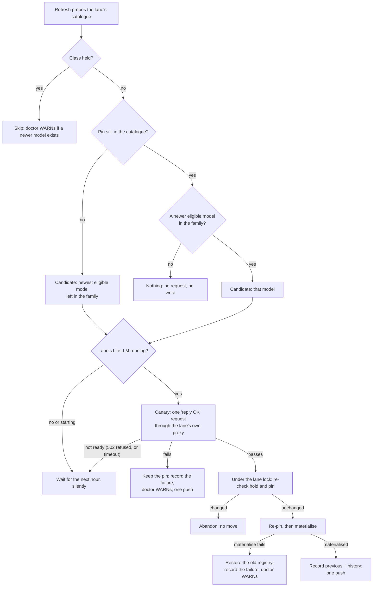
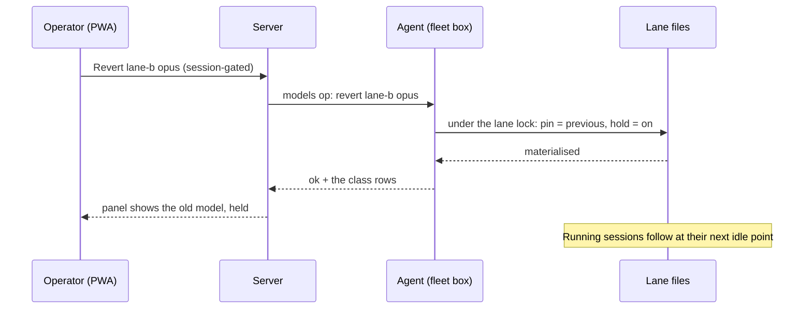

# Model classes follow new releases automatically

**Spec** · 2026-10-13 · Status: Accepted 2026-10-15 · Owner: ccrc · Linear: none · Related:
`docs/superpowers/specs/2026-09-08-model-class-registry-design.md` (amended here),
`docs/superpowers/specs/2026-09-20-gpt-lane-ownership-design.md`

## In short

Today a lane's model classes (`haiku`, `sonnet`, `opus`, `fable`) move only when someone runs
`ccrc models <id> set-class` by hand, so a Codex lane keeps routing a class to an older model long after its
provider ships a newer one. This spec makes the hourly `ccrc models refresh` move each class to the newest model
of its own family on its own: it sends one canary request through the lane first, keeps the previous pin, and
honours a per-class hold. Anthropic lanes already launch on the newest model, so for them the same step derives
what ccrc keeps by hand and moves running sessions. The operator approved the four design parts in
conversation (D1 to D10). Writing them down surfaced gaps, answered here as D11 to D22, and the operator accepted
the written spec with them on 2026-10-15.

## 1. Context

This section says what goes wrong today, and why it needs a design change rather than a bug fix.

- **The rule being reversed.** The class-registry spec ruled that a newly advertised model is "surfaced, never
  auto-classed": it is reachable by its concrete name and listed as unclassified, and it is in a class only when
  the operator assigns one (`2026-09-08-model-class-registry-design.md`, its decision table). The README says the
  same in its `ccrc models` section.
- **What it cost** (measured 2026-10-07 and 2026-10-13 with `ccrc models <id> show`). On both Codex lanes of the
  reference fleet, the classes `opus` and `haiku` still pinned version-5.6 models. Meanwhile, newer models of the
  families those classes follow had been listed as unclassified for at least six days: a 6.1 and a 6 for `opus`,
  a 6 for `haiku`. One lane's `fable` slot was empty, although a model of its family was listed. Nothing warned:
  doctor's `models` check tests catalogue freshness only (`_check_models`, `ccd/ccrc-doctor-checks`).
- **The operator's ruling (2026-10-07).** A class follows new releases automatically: "the ccrc user should not
  be doing this kind of stuff by hand". It covers every provider, Codex and Anthropic first and OpenRouter later.
- **A stopgap is in place (2026-10-13).** On the operator's go, each new model got one test request through each
  lane, and then the classes were moved by hand. Every test passed and doctor stayed clean. This spec removes the
  hand step.

## 2. Design

The hourly refresh gains an **advance step**, run per lane after that lane's catalogue probe. An advance is data
the refresh changes, so it never waits for a ccrc release; only the code that reads that data ships in releases.
The conversation that approved this design had four parts, mapped here once:

- the registry: §2.1 to §2.2;
- one hour's advance on a Codex lane: §2.3 to §2.4;
- Anthropic lanes: §2.5;
- holds, revert, the panel and doctor: §2.7 to §2.8.

### 2.1 Where the advance state lives, and who writes it

The approved design adds four facts per class: `family`, `hold`, `previous` and `history`. The class registry
cannot carry them. Today's parser refuses any top-level key it does not know, and any class value that is not a
string (`REGISTRY_KEYS` and `parseRegistry`, `shared/models.mjs`). So an older ccrc, after a rollback for example,
would refuse every lane's registry.

**D13 (Agreed): a sibling file.** The four facts live in `~/.ccrc/models/<id>.advance.json`, one per lane of
either kind.
- The class registry keeps its format, so an older ccrc keeps reading it, and an older ccrc never opens the new
  file.
- `ccrc models <id> rm` reaps the new file with the lane's other model files.
- An absent advance file is normal (a lane not yet backfilled, or one initialised by an older build). The step
  then derives each family from its pin and leaves an empty class unseeded until the backfill runs.
- Only a file that is present but unreadable or malformed blocks the lane (§2.8).
- The rejected alternative ships a reader that tolerates and round-trips unknown keys one release before any
  writer of them. It works, but a rollback past that release still breaks every lane.

| Fact | What it holds |
|---|---|
| `family` | The family the class follows (§2.2), stored. |
| `hold` | Absent by default. When set: who set it and when. |
| `previous` | The pin before the last advance, so Revert is one step (approved meaning). |
| `history` | The last few moves: time, from, to, and how (advance, revert or hand), with the canary result. |

**D21 (Agreed): one writer, and its integrity rules.** One function writes the advance file. It runs on both
kinds of lane; today's registry writer, `deploy/models-op.mjs`, refuses every operation but `show` on an
Anthropic lane, so this is a new path for the advance file only. The advance, Revert, Hold and release, and
`set-class` all go through it:
- **A hand `set-class`** adds a `history` entry with how = hand, and rewrites `family` from the new pin when that
  pin parses (§2.2). It leaves `previous` alone, so Revert still undoes the last advance.
- **The lock.** Each lane has one lock, and every write of its files takes it. The canary runs outside the lock.
  After the canary, the step takes the lock, re-reads the files and re-checks the hold and the pin, and it
  abandons the move if a hold appeared or the pin changed. So a Hold tapped during a canary wins, and the class
  does not move.
- **Commit after materialise.** Today's writer renames the new registry into place before it materialises the
  lane's files (`deploy/models-op.mjs`). An advance whose materialise fails therefore restores the previous
  registry under the lock and materialises again. It writes `previous`, a successful `history` entry and the push
  only after materialise succeeds. A failed materialise records a failed `history` entry and counts as a failed
  advance (§2.8).

### 2.2 The family rule

A class follows one family, and a family is not a class. On a Codex lane, the family is the last part of the model
id, a word such as a tier name, and the class `opus` follows whichever family it was seeded with. This section
applies to Codex lanes. Anthropic lanes take their families from Claude Code's catalogue (§2.5).

- **Id grammar (D16, Agreed).** A candidate id has exactly three dash-separated parts,
  `<vendor>-<version>-<family>`, where `<version>` is dot-separated integers. Any other id is never a candidate
  and never a seed. Judgement: the grammar is the provider's convention, not a contract, so an id that breaks it is
  ignored rather than guessed at. A class whose own pin breaks the grammar has no family and cannot advance, and
  doctor names it (§2.8), so it never goes quiet the way §1's lanes did.
- **Order.** Versions compare part by part as integers, so `6.1` > `6` > `5.6`. A tie (two ids with the same
  version and family) is never a candidate until one of them leaves the catalogue.
- **Eligible.** A model is eligible when the catalogue lists it as visible and it is inside the lane's discovery
  scope.
- **Forwards, with one exception.** A class moves only to a newer version. The exception: when its pin has left
  the catalogue, it moves to the newest eligible model left in its family, through the same canary.
- **Seeding.** `family` is stored. The backfill derives it from each pin. A class that is empty has no pin, so
  `init codex` writes the family of each class it seeds into the advance file as data, and the backfill gives an
  existing lane's empty class the family `init` would have seeded. A family with no eligible model leaves its
  class as it is.

### 2.3 One hour's advance on a Codex lane

Figure 1 shows one class on one lane during one refresh. Most hours end at "Nothing".

*Figure 1. One class on one Codex lane during one hourly refresh.*

1. **Choose** the candidate by §2.2. If it is already the pin, nothing happens.
2. **Check the lane is ready (D22, Agreed).** The shim answers its lane probe by itself, without asking LiteLLM
   (`GET /ccgpt/lane`, `ccd/ccgpt-proxy.py`), so it cannot tell when LiteLLM is starting. The step asks the
   question the refresh already asks: whether the lane's LiteLLM tier is ours and running, rather than ours and
   starting (`_codex_tier_ours`, `ccd/ccrc`). This matters because a new model's arrival re-renders the lane's
   LiteLLM list and restarts it in that same hour. A lane whose LiteLLM is down or starting waits for the next
   hour, with no history entry, no WARN and no push.
3. **Canary.** One tiny request for the candidate goes through the lane's own proxy, the path a session's requests
   take: a "reply OK" prompt, a few tokens, the lowest effort the model offers. It passes on a 200 with text.
   - It authenticates with the lane's own key, which ccrc already owns. The key is read in-process and never put in
     a child's argv or environment.
   - Since D-4933, the shim waits out a refused gateway connection for up to 60 s and then answers 502. A canary
     that ends in that 502, or in its own timeout, means the lane is not ready, not that the model failed, so it
     waits silently like step 2.
   - Each canary's timeout is longer than the shim's 60 s wait. The step runs canaries until its time budget, which
     fits inside the refresh unit's start timeout (`TimeoutStartSec=300`, `deploy/systemd/ccrc-models.service`),
     is spent. Any class it did not reach waits for the next hour.
4. **Re-pin** under the lane lock (D21), through the writer `set-class` uses (`deploy/models-op.mjs`). That writer
   validates the registry and materialises it into the lane's `settings.json` env block and its sibling files.
   - The class keeps its effort level if the new model offers it. Otherwise it takes the highest level the model
     offers below it in the catalogue's own order, or the model's lowest level if none is below.
   - Nothing restarts, and the LiteLLM list is not re-rendered, because it already names every visible catalogue
     model (sourced: `renderLitellmConfig`, `shared/litellm.mjs:67`). If that list is stale, the canary fails.
5. **Commit** after materialise succeeds (D21). Then `previous` and `history` are written, and one push goes out,
   for example "lane-b: opus model-5.6 → model-6.1".
6. **A failed canary or materialise** keeps the old pin and records the failure. It raises
   `model-advance-held-back` and sends one push, not one an hour. The next hour retries, and the WARN clears when an
   advance succeeds.

### 2.4 Running sessions on a Codex lane

Running sessions move at their next idle point (ruled). On 2026-10-13 the stopgap re-pinned both Codex lanes at
23:28:32Z. The model of every reply each running session sent after that was read from the session's transcript,
which gave this measurement:

- **The next turn moved.** A session whose next turn began after the re-pin, at 23:30:34Z, ran on the new model,
  with no relaunch.
- **A running turn did not.** A session that was mid-turn at the re-pin kept the old model for the rest of that
  turn: 41 replies, up to 23:32:10Z.

Judgement, from one observation each: Claude Code re-reads the `settings.json` env block when the file changes,
so on a Codex lane the next turn is the idle point, and nothing has to be typed into the pane.

**D11 (Agreed): drop the typed step if the measurement holds.** This changes the approved Codex part, in which
ccd types `/model` into a session at an idle tick once its record shows the new pin. The plan's first task
re-measures the next-turn pickup across several sessions on both lanes, by reading transcripts only.
- **If it holds,** the Codex arm drops the typed step.
- **If it does not,** the approved order stands: first find out whether a typed `/model` reaches the new pin in a
  running session. That measurement types into a session, so it runs on a throwaway session, with the operator's
  explicit go. If it works, ccd types it at the next idle tick (§2.5 item 5 gives the trigger). If neither works,
  sessions move only on relaunch, and that choice goes back to the operator.

**Re-measured on 2026-10-16: it does not hold.** The same re-pin was read again from transcript metadata, across
every session that was on a replaced model before it: four sessions, two per lane.
- The two that were idle at the re-pin moved at their next turn.
- One that was mid-turn kept the old model for about 15 minutes, over two more turns, then switched mid-turn with
  no relaunch.
- One that was mid-turn kept the old model for about 26 hours, over many turns, and moved only when it was
  relaunched on a newer Claude Code.

So the fallback applies. The Codex arm's plan has no typed step, and a running session keeps the old model until it
picks the new one up by itself or is relaunched. The typed-`/model` measurement waits for the operator's go.

`model-sessions-behind` (§2.8) is the backstop either way.

### 2.5 Anthropic lanes

Launching already follows new models here. ccrc routes Anthropic lanes by alias only (`ROUTE_CLASSES` in `ccd/ccd`,
and its tests), and Claude Code resolves each alias to its family's newest model at launch. What lags behind is
what ccrc keeps by hand, and the sessions already running.

1. **The source (D18, Open).** The approved design read Claude Code's own model catalogue cache,
   `<home>/cache/model-catalog/*.json`, in every home. Measured on 2026-10-13 by listing those files on a box
   running Claude Code 2.1.296: only 4 of its 15 Anthropic homes hold one, and the freshest was 4 h old. The files
   are named per credential, so a home could hold several.
   - **A home with a cache** reads its newest file.
   - **A home without one** has no source today, and ccrc records no organisation that would let it borrow
     another home's cache. The two options are a grouping the operator declares in the roster, or Claude Code's
     own account state in that home, read in-process and never printed. Either way, one organisation meaning one
     catalogue, Fable entitlement included, is a judgement.
   - This stays open until the Anthropic plan's first task measures what writes the cache and when. Until then, a
     home without a source gets no Anthropic advance, and doctor names it (§2.8).
2. **A per-lane file, `~/.ccrc/models/<id>.aliases.json`,** is written from that source. It holds each class's
   current model id, label and effort levels. The name keeps it apart from a Codex lane's class registry. A Fable
   row appears only when the source lists Fable.
3. **What ccrc keeps by hand is derived from that file.**
   - ccd's rule "class haiku takes no effort level" (`ccd/ccd`) becomes "a model that lists no effort levels takes
     none". This matters because a Codex lane's `haiku` class does take an effort level.
   - Pricing needs no new row, because the usage sweep prices by family. A provider's price change still needs a
     hand edit (Later).
4. **Canary by real use.** A synthetic request would gate nothing, because every new launch already goes to the new
   model. So running sessions move only after one session on that lane has completed a turn on the new model, which
   ccd already records.
5. **Moving running sessions, with the model id in ccd's record.** ccd's existing step compares class names only
   (`_route_apply_check` → `_route_apply_now` → `_route_type_model`, `ccd/ccd`), so it never fires when an alias's
   model changes. Its readback confirms by family (`_route_readback` through `_model_family_class`), so an id change
   alone has nothing to confirm it.
   - On every lane, ccd's routing record gains the model id beside the class, and the readback compares the id when
     the pending change is an id change.
   - A changed id counts as pending always on an Anthropic lane, and on a Codex lane only under D11's fallback.
   - On an Anthropic lane ccd then picks the alias row in the `/model` picker and makes it session-only, as it does
     today. This also closes a known leak: a session resumed without `--model` comes back on its old model.
6. **One push** per family per lane.

The home's `settings.json` belongs to Claude Code, and ccrc never writes it on an Anthropic lane.

### 2.6 PWA labels on every lane

**D17 (Agreed): labels from data on both kinds of lane.** The PWA's model labels are hard-coded for both kinds
(`pwa/src/lib/models.ts`), so the Codex lanes' labels are stale right now.
- A Codex lane's label comes from its registry plus the catalogue row's `label` (`CatalogueModel`,
  `shared/models.ts`).
- An Anthropic lane's label comes from its `aliases.json`.
- Which source applies is decided by the roster's lane kind, never by a wrapper name.

A test turns red when a class moves and its label does not.

### 2.7 Holds, revert, and the Models panel

Each lane's page gets a Models panel. Figure 2 shows the Revert tap; Hold and release take the same path.

*Figure 2. Revert from the PWA, on a Codex lane.*

- **The panel.** Each class shows its model, when it last moved and what it replaced, a **Hold** switch, and a
  **Revert** button that appears only after an advance.
- **Revert is one act.** It puts `previous` back and turns Hold on, so the next hour cannot move the class again.
  Turning Hold off lets the next hour advance, canary first.
- **The `models` agent operation.** Hold, release and revert travel as one new agent operation, the way the
  existing `update` operation carries the update tap (`agent/src/server.ts`).
- **How the panel reads (D14, Agreed).** This changes the approved Section 4, in which the panel reads the class
  files through the agent's existing file read. That read's whitelist does not admit `~/.ccrc/models/`, so instead
  the `models` operation also answers a read-only `show`.
- **The operation is security-sensitive.** It is a third wire-triggered spawn outside the exec whitelist, after the
  two that `agent/CLAUDE.md` counts today.
  - Its child is `ccrc models`, in exactly two argv shapes: `ccrc models <id> show` and
    `ccrc models <id> <hold|release|revert> <class>`.
  - The request is validated before any spawn: the id against the models writer's stricter id pattern
    (`ACCOUNT_ID_RE`, `deploy/models-op.mjs`), the class against the four classes, and the action against the
    four actions.
  - The child gets an explicit `HOME`, `PATH` and `LANG` and nothing else.
  - A source-scan test pins all of this, as the update operation's tests do.
- **The server route** is session-gated, with no box token, and it joins the route census the way the update routes
  do.
- **The rejected alternative:** the server stores holds and the fleet box pulls them. A revert would then wait up to
  an hour, and a revert means a model is misbehaving now.
- **On an Anthropic lane,** the hold, `previous` and `history` live in that lane's advance file (§2.1), written by
  D21's writer. A hold works by ccd launching the lane's sessions with the held model's id in the launch
  environment, which ccd owns. This is the one case in which ccrc puts a concrete model id on an Anthropic lane,
  and a test pins that it does so only while a hold stands.
- **D19 (Agreed): a Revert or Hold reaches a running Anthropic session at its next relaunch.** The approved part
  had it move at the next idle point. That is unreachable without writing the home's `settings.json`:
  - the `/model` picker's rows on an Anthropic lane are the class aliases, so none of them offers an older concrete
    id;
  - a `/model` typed with a name saves the account default (sourced: `ccd/ccrc-doctor-checks:7111`).
- **D12 (Agreed): shell verbs.** The same `ccrc models <id> hold|release|revert <class>` the operation spawns are
  documented for shell use, for a box whose console is down. The verbs exist either way, because the operation
  needs them; D12 decides only whether the README offers them to the operator.

### 2.8 What doctor reports

Doctor gets four new WARNs. They are named here so that a doctor-clean gate that allow-lists WARNs by name can
accept them before they ship. The approved design named the first three; D15 (Agreed) adds the fourth.

| WARN | When it fires | When it clears |
|---|---|---|
| `model-advance-held-back` | A canary or a materialise failed. Names the lane, class and candidate. | An advance succeeds |
| `model-held-behind` | A held class has a newer eligible model in its family. | The hold is released |
| `model-sessions-behind` | A session is still on the old model 24 h after a move. Names the session and ccd's reason. | The session moves |
| `model-advance-blocked` | A lane or class cannot advance: its advance file, registry or catalogue is present but unreadable, its pin breaks the id grammar, or an Anthropic home has no source. Names which. | The cause is gone |

`model-sessions-behind` is the backstop for "not by hand": if the idle-point switch quietly fails, the operator
hears about it. Failures fail shut: a pin never moves on data that cannot be read.

## 3. Decisions

D1 to D6 were questions with options, which the operator answered. D7 to D10 are the four design parts, which the
operator approved as presented. D11 to D22 were proposed while writing this spec, and the operator accepted
them with the written spec on 2026-10-15; D18 stays open until the measurement it names.

| # | Decision | Options considered | Chosen, and why | Status |
|---|---|---|---|---|
| D1 | Which model a class follows | Same family, newest version; best model overall per class; a rule list written once | Same family, newest version: a tier keeps its meaning | Agreed |
| D2 | What guards a move | Canary, then switch; switch, auto-revert on errors; switch, no guard | A canary through the lane first, so a broken model never reaches sessions | Agreed |
| D3 | An escape hatch | Optional hold, off by default; no hold at all; hold per lane, not per class | An optional per-class hold, off by default | Agreed |
| D4 | Where advancing lives | A: the hourly refresh; B: the server; C: LiteLLM aliases | A: one owner on the box that holds the catalogue | Agreed |
| D5 | Running sessions | Next idle point; next relaunch; idle switch but skip coordinators mid-wave | At their next idle point | Agreed |
| D6 | Pause for an operator window | No window, hold only; obey a window switch | No window: the hold is the only brake | Agreed |
| D7 | The registry part | - (approved as presented) | `family`, `hold`, `previous`, `history` per class | Agreed |
| D8 | The Codex advance part | - (approved as presented) | Choose, canary, re-pin through the writer, move sessions, push | Agreed |
| D9 | The Anthropic part | - (approved as presented) | Catalogue cache, canary by real use, no `settings.json` writes | Agreed |
| D10 | Holds, revert, panel, doctor | - (approved as presented) | The panel, an agent `models` op, three named WARNs | Agreed |
| D11 | Codex sessions need no typed `/model` | Keep the typed step; drop it if the next-turn pickup holds | Drop it only if the plan's first task confirms §2.4. Re-measured 2026-10-16: it did not, so the fallback applies | Agreed |
| D12 | Shell verbs documented | Taps only in the README; taps plus the verbs | Document the verbs, for a box whose console is down | Agreed |
| D13 | Where the advance state lives | Inside the registry after a reader release; a sibling file | A sibling file, so a rollback never breaks a lane | Agreed |
| D14 | How the panel reads | Widen the agent's file read; a `show` action on the op | `show` on the op, with no file-read widening | Agreed |
| D15 | A WARN for a lane that cannot advance | Report nothing; a named fourth WARN | `model-advance-blocked`, named now | Agreed |
| D16 | Id grammar | Loose parsing; exactly three parts | Exactly three parts, anything else ignored | Agreed |
| D17 | Labels from data | Anthropic only; both kinds of lane | Both kinds, chosen by lane kind | Agreed |
| D18 | The Anthropic source for a home with no cache | A roster grouping; Claude Code's account state | Open until the Anthropic plan's first task measures the cache | Open |
| D19 | Revert on a running Anthropic session | Next idle point; next relaunch | Next relaunch: the idle point needs a settings write | Agreed |
| D20 | Delivery order | Both arms in one plan; Codex first, Anthropic second | Codex first, since that is where classes are stale today | Agreed |
| D21 | One writer for the advance state | Each path writes its own; one writer with a lock | One writer, a lock, commit after materialise | Agreed |
| D22 | When a canary counts | Any failure fails; not-ready waits silently | Not-ready waits; only a real refusal fails | Agreed |

## 4. What this amends

Three written statements change once this design ships.

- **`2026-09-08-model-class-registry-design.md`:** its ruling "surfaced, never auto-classed" is superseded for a
  model of a family some class follows. A model of a family no class follows is still listed as unclassified, and
  it joins a class only when the operator assigns one.
- **README, `ccrc models`:** its "never classed on its own" sentence changes to match. If D12 is agreed, the section
  also gains the three shell verbs.
- **`agent/CLAUDE.md`:** "two wire-triggered spawns" becomes three, naming the `models` operation and its guards.

## 5. How it is tested

Each part ships with tests that go red when its guard is removed, measured, per the project's mutation-table rule.

- **The family rule:** pure unit tests.
  - The id grammar: ids with two or four parts, or a non-integer version, are never candidates.
  - Version order and ties, and forwards-only with the retired-pin fallback.
  - Discovery scope, seeding, and a hand `set-class` rewriting `family`.
- **The writer (D21):**
  - A Hold tapped during a canary leaves the class unmoved.
  - A failed materialise restores the old registry pin.
  - `rm` reaps the advance file.
  - The class registry's format is byte-for-byte what an older parser accepts with an advance file beside it.
- **The Codex advance:** a fixture home with a fake lane proxy that answers the canary with a 200, a 500, a
  refused-connect 502 and a timeout, while the LiteLLM tier reads running or starting. Only the 500 raises a WARN.
- **Running sessions:** §2.4 was re-measured from transcripts on 2026-10-16 and did not hold. Any step that would
  type into a session runs on a throwaway session, with the operator's explicit go.
- **The Anthropic arm:**
  - Fixture caches: one, several and none.
  - The canary by real use: no move before a completed turn on the new model, and a move after one.
  - ccd's routing record with the model id: a newer id counts as pending on an Anthropic lane, and the readback
    compares the id.
  - The hold's launch-environment id is present only while held.
- **The panel and the op:**
  - The op's two argv shapes, its validation and its child environment, by a source scan.
  - The server route in the census.
  - A label that follows a moved class.
- **Doctor:** each of the four WARNs fires and clears on fixture data.
- **Live acceptance:** the 2026-10-13 stopgap's procedure, run by the code: a canary per new model, a check
  through the class alias, then doctor.

## Where things stand

### Agreed

- D1 to D10: the design as presented in conversation on 2026-10-07. Its last part was approved on 2026-10-13.
- The written spec, with D11 to D17 and D19 to D22, accepted by the operator on 2026-10-15.
- The stopgap of 2026-10-13: both Codex lanes now pin the newest model of each family, until this ships.

### Waiting on you

- Review of the Codex arm's plan, which comes first (D20).
- A go for the typed-`/model` measurement on a throwaway session (§2.4, D11's fallback).
- D18 stays open until the Anthropic arm's plan measures what writes Claude Code's catalogue cache, and when.

### Later

- **OpenRouter lanes.** Their catalogue is an open marketplace, so "the newest in a family" needs its own rule
  (judgement). Brought back by the first OpenRouter lane with a non-empty discovery list.
- **A provider renaming or splitting a family.** Today it reads as a new family that no class follows, and it
  surfaces as unclassified. Brought back by the first such catalogue.
- **Price changes within a family.** They still need a hand edit of the usage sweep's rate row. Brought back by the
  first advance whose new model is priced differently.
