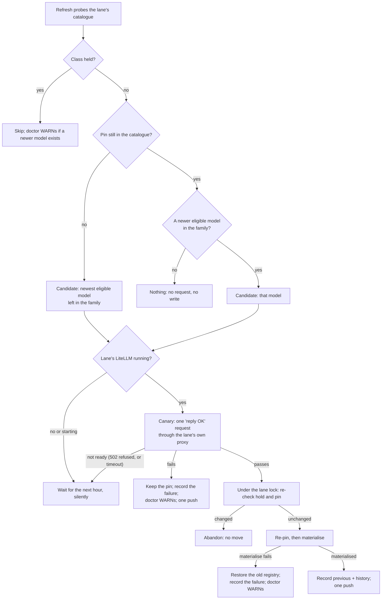
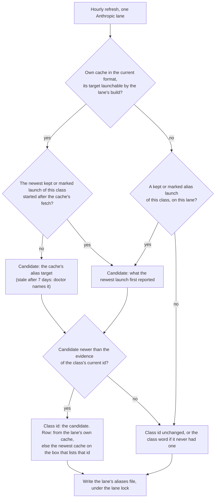
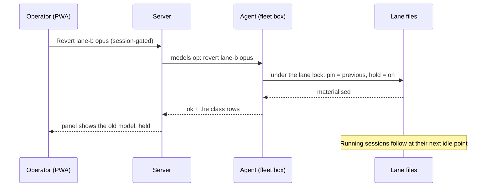

# Model classes follow new releases automatically

**Spec** · 2026-10-13 · Status: Accepted 2026-10-15, amended 2026-11-16 and 2026-11-18 · Owner: ccrc · Linear: none · Related:
`docs/superpowers/specs/2026-09-08-model-class-registry-design.md` (amended here),
`docs/superpowers/specs/2026-09-20-gpt-lane-ownership-design.md`

## In short

Today a lane's model classes (`haiku`, `sonnet`, `opus`, `fable`) move only when someone runs
`ccrc models <id> set-class` by hand, so a Codex lane keeps routing a class to an older model long after its
provider ships a newer one. This spec makes the hourly `ccrc models refresh` move each class to the newest model
of its own family on its own: it sends one canary request through the lane first, keeps the previous pin, and
honours a per-class hold. Anthropic lanes already launch on the newest model: a measurement of 2026-11-16 found
Claude Code's own `opus`, `sonnet` and `haiku` aliases resolving to it on every home (Fable is unmeasured). So ccrc
never re-pins an Anthropic class. It reads which id each alias resolves to, from Claude Code's catalogue cache or from
a fresh launch ccd marked, and from that derives labels, effort and holds, and moves running sessions (§2.5, amended
2026-11-18).
The operator approved the four design parts in
conversation (D1 to D10). Writing them down surfaced gaps, answered here as D11 to D22, and the operator accepted
the written spec with them on 2026-10-15.

## 1. Context

This section says what goes wrong today, and why it needs a design change rather than a bug fix.

- **The rule being reversed.** The class-registry spec ruled that a newly advertised model is "surfaced, never
  auto-classed": it is reachable by its concrete name and listed as unclassified, and it is in a class only when
  the operator assigns one (`2026-09-08-model-class-registry-design.md`, its decision table). The README says the
  same in its `ccrc models` section.
- **What it cost** (measured 2026-10-07 and 2026-10-13 with `ccrc models <id> show`). On both Codex lanes of the
  reference fleet, the classes `opus` and `haiku` still pinned version-5.6 models. Meanwhile, newer models of the
  families those classes follow had been listed as unclassified for at least six days: a 6.1 and a 6 for `opus`,
  a 6 for `haiku`. One lane's `fable` slot was empty, although a model of its family was listed. Nothing warned:
  doctor's `models` check tests catalogue freshness only (`_check_models`, `ccd/ccrc-doctor-checks`).
- **The operator's ruling (2026-10-07).** A class follows new releases automatically: "the ccrc user should not
  be doing this kind of stuff by hand". It covers every provider, Codex and Anthropic first and OpenRouter later.
- **A stopgap is in place (2026-10-13).** On the operator's go, each new model got one test request through each
  lane, and then the classes were moved by hand. Every test passed and doctor stayed clean. This spec removes the
  hand step.

## 2. Design

The hourly refresh gains an **advance step**, run per lane after that lane's catalogue probe. An advance is data
the refresh changes, so it never waits for a ccrc release; only the code that reads that data ships in releases.
The conversation that approved this design had four parts, mapped here once:

- the registry: §2.1 to §2.2;
- one hour's advance on a Codex lane: §2.3 to §2.4;
- Anthropic lanes: §2.5;
- holds, revert, the panel and doctor: §2.7 to §2.8.

### 2.1 Where the advance state lives, and who writes it

The approved design adds four facts per class: `family`, `hold`, `previous` and `history`. The class registry
cannot carry them. Today's parser refuses any top-level key it does not know, and any class value that is not a
string (`REGISTRY_KEYS` and `parseRegistry`, `shared/models.mjs`). So an older ccrc, after a rollback for example,
would refuse every lane's registry.

**D13 (Agreed): a sibling file.** The four facts live in `~/.ccrc/models/<id>.advance.json`, one per lane of
either kind.
- The class registry keeps its format, so an older ccrc keeps reading it, and an older ccrc never opens the new
  file.
- `ccrc models <id> rm` reaps the new file with the lane's other model files.
- An absent advance file is normal (a lane not yet backfilled, or one initialised by an older build). The step
  then derives each family from its pin and leaves an empty class unseeded until the backfill runs.
- Only a file that is present but unreadable or malformed blocks the lane (§2.8).
- The rejected alternative ships a reader that tolerates and round-trips unknown keys one release before any
  writer of them. It works, but a rollback past that release still breaks every lane.

| Fact | What it holds |
|---|---|
| `family` | The family the class follows (§2.2), stored. |
| `hold` | Absent by default. When set: who set it and when. |
| `previous` | The pin before the last advance, so Revert is one step (approved meaning). |
| `history` | The last few moves: time, from, to, and how (advance, revert or hand), with the canary result. |

**D21 (Agreed): one writer, and its integrity rules.** One function writes the advance file. It runs on both
kinds of lane; today's registry writer, `deploy/models-op.mjs`, refuses every operation but `show` on an
Anthropic lane, so this is a new path for the advance file only. The advance, Revert, Hold and release, and
`set-class` all go through it:
- **A hand `set-class`** adds a `history` entry with how = hand, and rewrites `family` from the new pin when that
  pin parses (§2.2). It leaves `previous` alone, so Revert still undoes the last advance.
- **The lock.** Each lane has one lock, and every write of its files takes it. The canary runs outside the lock.
  After the canary, the step takes the lock, re-reads the files and re-checks the hold and the pin, and it
  abandons the move if a hold appeared or the pin changed. So a Hold tapped during a canary wins, and the class
  does not move.
- **Commit after materialise.** Today's writer renames the new registry into place before it materialises the
  lane's files (`deploy/models-op.mjs`). An advance whose materialise fails therefore restores the previous
  registry under the lock and materialises again. It writes `previous`, a successful `history` entry and the push
  only after materialise succeeds. A failed materialise records a failed `history` entry and counts as a failed
  advance (§2.8).

### 2.2 The family rule

A class follows one family, and a family is not a class. On a Codex lane, the family is the last part of the model
id, a word such as a tier name, and the class `opus` follows whichever family it was seeded with. This section
applies to Codex lanes. Anthropic lanes take their families from Claude Code's catalogue (§2.5).

- **Id grammar (D16, Agreed).** A candidate id has exactly three dash-separated parts,
  `<vendor>-<version>-<family>`, where `<version>` is dot-separated integers. Any other id is never a candidate
  and never a seed. Judgement: the grammar is the provider's convention, not a contract, so an id that breaks it is
  ignored rather than guessed at. A class whose own pin breaks the grammar has no family and cannot advance, and
  doctor names it (§2.8), so it never goes quiet the way §1's lanes did.
- **Order.** Versions compare part by part as integers, so `6.1` > `6` > `5.6`. A tie (two ids with the same
  version and family) is never a candidate until one of them leaves the catalogue.
- **Eligible.** A model is eligible when the catalogue lists it as visible and it is inside the lane's discovery
  scope.
- **Forwards, with one exception.** A class moves only to a newer version. The exception: when its pin has left
  the catalogue, it moves to the newest eligible model left in its family, through the same canary.
- **Seeding.** `family` is stored. The backfill derives it from each pin. A class that is empty has no pin, so
  `init codex` writes the family of each class it seeds into the advance file as data, and the backfill gives an
  existing lane's empty class the family `init` would have seeded. A family with no eligible model leaves its
  class as it is.

### 2.3 One hour's advance on a Codex lane

Figure 1 shows one class on one lane during one refresh. Most hours end at "Nothing".

*Figure 1. One class on one Codex lane during one hourly refresh.*

1. **Choose** the candidate by §2.2. If it is already the pin, nothing happens.
2. **Check the lane is ready (D22, Agreed).** The shim answers its lane probe by itself, without asking LiteLLM
   (`GET /ccgpt/lane`, `ccd/ccgpt-proxy.py`), so it cannot tell when LiteLLM is starting. The step asks the
   question the refresh already asks: whether the lane's LiteLLM tier is ours and running, rather than ours and
   starting (`_codex_tier_ours`, `ccd/ccrc`). This matters because a new model's arrival re-renders the lane's
   LiteLLM list and restarts it in that same hour. A lane whose LiteLLM is down or starting waits for the next
   hour, with no history entry, no WARN and no push.
3. **Canary.** One tiny request for the candidate goes through the lane's own proxy, the path a session's requests
   take: a "reply OK" prompt, a few tokens, the lowest effort the model offers. It passes on a 200 with text.
   - It authenticates with the lane's own key, which ccrc already owns. The key is read in-process and never put in
     a child's argv or environment.
   - Since D-4933, the shim waits out a refused gateway connection for up to 60 s and then answers 502. A canary
     that ends in that 502, or in its own timeout, means the lane is not ready, not that the model failed, so it
     waits silently like step 2.
   - Each canary's timeout is longer than the shim's 60 s wait. The step runs canaries until its time budget, which
     fits inside the refresh unit's start timeout (`TimeoutStartSec=300`, `deploy/systemd/ccrc-models.service`),
     is spent. Any class it did not reach waits for the next hour.
4. **Re-pin** under the lane lock (D21), through the writer `set-class` uses (`deploy/models-op.mjs`). That writer
   validates the registry and materialises it into the lane's `settings.json` env block and its sibling files.
   - The class keeps its effort level if the new model offers it. Otherwise it takes the highest level the model
     offers below it in the catalogue's own order, or the model's lowest level if none is below.
   - Nothing restarts, and the LiteLLM list is not re-rendered, because it already names every visible catalogue
     model (sourced: `renderLitellmConfig`, `shared/litellm.mjs:67`). If that list is stale, the canary fails.
5. **Commit** after materialise succeeds (D21). Then `previous` and `history` are written, and one push goes out,
   for example "lane-b: opus model-5.6 → model-6.1".
6. **A failed canary or materialise** keeps the old pin and records the failure. It raises
   `model-advance-held-back` and sends one push, not one an hour. The next hour retries, and the WARN clears when an
   advance succeeds.

### 2.4 Running sessions on a Codex lane

Running sessions move at their next idle point (ruled). On 2026-10-13 the stopgap re-pinned both Codex lanes at
23:28:32Z. The model of every reply each running session sent after that was read from the session's transcript,
which gave this measurement:

- **The next turn moved.** A session whose next turn began after the re-pin, at 23:30:34Z, ran on the new model,
  with no relaunch.
- **A running turn did not.** A session that was mid-turn at the re-pin kept the old model for the rest of that
  turn: 41 replies, up to 23:32:10Z.

Judgement, from one observation each: Claude Code re-reads the `settings.json` env block when the file changes,
so on a Codex lane the next turn is the idle point, and nothing has to be typed into the pane.

**D11 (Agreed): drop the typed step if the measurement holds.** This changes the approved Codex part, in which
ccd types `/model` into a session at an idle tick once its record shows the new pin. The plan's first task
re-measures the next-turn pickup across several sessions on both lanes, by reading transcripts only.
- **If it holds,** the Codex arm drops the typed step.
- **If it does not,** the approved order stands: first find out whether a typed `/model` reaches the new pin in a
  running session. That measurement types into a session, so it runs on a throwaway session, with the operator's
  explicit go. If it works, ccd types it at the next idle tick (§2.5 item 5 gives the trigger). If neither works,
  sessions move only on relaunch, and that choice goes back to the operator.

**Re-measured on 2026-10-16: it does not hold.** The same re-pin was read again from transcript metadata, across
every session that was on a replaced model before it: four sessions, two per lane.
- The two that were idle at the re-pin moved at their next turn.
- One that was mid-turn kept the old model for about 15 minutes, over two more turns, then switched mid-turn with
  no relaunch.
- One that was mid-turn kept the old model for about 26 hours, over many turns, and moved only when it was
  relaunched on a newer Claude Code.

So the fallback applies. The Codex arm's plan has no typed step, and a running session keeps the old model until it
picks the new one up by itself or is relaunched. The typed-`/model` measurement waits for the operator's go.

`model-sessions-behind` (§2.8) is the backstop either way.

### 2.5 Anthropic lanes

> [!NOTE]
> **Amended 2026-11-18 (D18 resolved; D-8683 confirmed for `opus`, `sonnet` and `haiku`; D-8744 to D-8748, D-8750 and
> D-8751).** A0
> measured the premise read-only on 2026-11-16 (§2.5.1), and it holds for those three classes; Fable is unmeasured
> (§2.5.8). Claude Code's own alias resolution, with its catalogue cache, is the source of truth, and **ccrc never
> re-pins an Anthropic class**. The arm stays as D-8683 narrowed it. §2.5.2 resolves D18 (D-8744), replacing the
> roster grouping D-8684 would have adopted. §2.5.3 to §2.5.8 say what ccrc adds. The programme's operator approved
> this amendment in wave 6's review. The text it replaces is in this file's history (#2918).

ccrc routes Anthropic lanes by alias only (`ROUTE_CLASSES` in `ccd/ccd`, and its tests), and Claude Code resolves
each alias to its family's newest model at launch. So launching already follows new models. What lags behind is
what ccrc keeps by hand, the effort a home has saved, and the sessions already running.

#### 2.5.1 What A0 measured

A0 read every Anthropic home on the reference fleet box on 2026-11-16, read-only, with stand-in names. Per-home
figures stay out of this repository.

- **For `opus`, `sonnet` and `haiku`, the alias resolves to the newest model on every measured home.** The newest id
  of each of those classes was the id in use on every home, including the homes with no catalogue cache. A0 never
  separated "resolves from the cache" from "resolves from the seed the build bundles": every observation had the two
  agree. Every older id in use
  was explained: an explicit model choice (subagents, and one session that mixed several ids), or a session started
  before the release and kept open (a running session keeps its model, §2.4).
- **Claude Code writes the catalogue cache itself,** at a session's start, but not at every start and not after its
  own update. Only a minority of homes hold one: exactly the homes whose account state records an organisation. None
  was fresh by its own `staleAt`, which falls about an hour after the fetch, and Claude Code kept launching on the
  newest ids over files several days old. A home can hold one file per credential.
- **The cache's format changed** between early October and mid-November. The older files carry no alias targets;
  the newer ones are named `tok-…`, carry `resolution: token_org` and a map from each alias to its target id.
- **One organisation, one catalogue, has no pair to test:** no two cached homes share an organisation. Across
  organisations, the caches of one week list the same model ids and the same alias targets; the only difference
  seen was by date.
- **Each Claude Code build bundles a signed catalogue seed** with a seven-day window, so a home with no cache still
  resolves its aliases. A row is gated by the installed build (`min_claude_code_version`), and the served catalogue
  can be masked per organisation.
- **Effort settings are keyed by model id, never by alias.** Several homes keep a saved effort under an older opus
  id while every opus turn they run is on the newer id, so the setting silently stops applying; two keep one under an
  older Fable id. The catalogue's default effort for each newest id is lower than for its predecessor, so the lost
  level is not what the new id runs at by default. A session ccd launches is not exposed: ccd composes `--effort`
  from its routing record, keyed by class (`SPAWN_EFFORT`, `ccd/ccd`).
- **No home ran a Fable turn in the week read** (§2.5.8).

#### 2.5.2 The source (D18, D-8744)

For each class on an Anthropic lane, ccrc answers two questions: which id the alias resolves to on that lane, and
what the catalogue says about that id.

1. **The alias's id** comes from the newest of two kinds of evidence:
   - **the lane's own cache:** its newest file in the current format, whose alias target's row does not need a newer
     Claude Code than the lane runs (§2.5.8). When the lane's build cannot be read, a target whose row names a
     minimum build is not taken. A cache fetched more than seven days ago is stale (D25, D-8745): doctor names it,
     and it stays evidence until newer evidence comes;
   - **a fresh alias launch:** a session ccd spawned new on that lane that launched the class by its alias, with no
     explicit model, no hold on that class and no resume. ccd marks such a launch at spawn with its process start and
     its lane, and fills the mark once with the id the session first reported strictly after its process started
     (the status line's usage sidecar), from a step of the supervise tick of its own. That is Claude Code's own resolution, measured, and the same
     observation as the canary by real use (§2.5.6). A resume, a respawn, a held launch and a typed older id are
     never marked, and a `/model` typed after the launch but before its first reading drops the mark. The aliases
     file keeps the newest filled reading of each class that an hourly refresh has read, so a mark that goes with a
     swap or a wake never lowers it; a reading filled and removed between two refreshes is lost (D-8744's cost).

   A marked launch whose process started after the cache's fetch outranks the cache's target, and a cache fetched
   after the newest kept launch outranks that launch: newest evidence wins. **An id only ever moves to newer
   evidence:** a lost mark or a stale cache never hands a class back to older evidence. The one exception is a kept
   id whose row needs a newer Claude Code than the lane now runs (a rollback, or a build that cannot be read): it is
   dropped from the label, so a label never names a model the lane cannot launch, the class reads unobserved and
   names the lane's build, and no move is recorded, then or when the build returns. `show` and `lanes` carry both ids
   when they disagree. With neither, the class has no current id on that lane and shows its class word. A held class
   whose id rests on evidence older than its hold reads as **unobserved**, a field on the aliases file and the wire,
   and shows its held id, with the held id's own row for its label and effort levels; a hold stops marks for its own
   class only. Unobserved exempts a class from `model-held-behind` only (§2.8). Claude
   Code reports a 1M-context session's id with a `[1m]` suffix; one reader on each side strips it, and every
   comparison of ids goes through it.
2. **The id's row** (its label, its effort levels and its default effort) comes from the lane's own cache when it lists
   that id, else from the newest current-format cache on the box that lists it. No alias target is ever taken from
   another home. That a row says the same in every organisation's catalogue is unmeasured: A0 compared id lists and
   alias targets across organisations, not row contents.
3. **A home with no source** is one where no class has an id: no usable cache and no marked launch. It keeps class
   words and cannot be held, and doctor names it (`model-advance-blocked`, cause `alias-source-absent`) once that
   box's ccd marks launches. A home whose newest cache is older than seven days, or in the older format, is named too
   (`alias-cache-stale`), even while marked launches give its classes an id.

*Figure 2. Where an Anthropic lane's class id and its row come from, each hour.*

The rejected options:
- **A roster grouping** (D-8684's choice: one home's cache serves the homes the roster groups with it). A0 found no
  pair of cached homes in one organisation to check a grouping against, and the uncached homes record no
  organisation at all, so a grouping would be an unchecked declaration. It would also lend one organisation's
  entitlement, Fable included, to another.
- **Claude Code's account state.** The homes that need a source are exactly those whose account state records no
  organisation.
- **The seed bundled in the binary.** Claude Code does not publish it as a file; reading it means scanning an
  executable.

#### 2.5.3 The aliases file

`~/.ccrc/models/<id>.aliases.json`, one per Anthropic lane, is written by D21's one writer, under the lane lock, by
the hourly refresh. Its name keeps it apart from a Codex lane's class registry.
- **Per class:** the current id, where it came from (`cache` or `use`), when that evidence dates from and when the id
  was first written; the cache's target and the newest filled launch reading, kept when its mark goes; whether the
  class is unobserved (§2.5.2); the row (label, effort levels or "takes none", default effort, the minimum Claude Code
  build) and where the row came from; and any orphaned saved effort (§2.5.5). A Fable row appears only when the
  source names a Fable id.
- **Per lane:** the cache it read (when it was fetched, and its format), or why it read none.
- **A class whose id changed** from one id to another gets a `history` entry and a `previous` in the lane's advance
  file (§2.1), written by the same refresh under the same lock, so Revert has something to put back, and one push.
  The advance file is written first and the aliases file second; a move is known by the class's newest history
  entry when that entry is later than the time the aliases file's id was first written (the same two ids while the
  aliases file still reads the old one), so a second record of it is refused, even when newer evidence for the new id
  has arrived, a genuine repeat of an earlier move gets its own entry, and a write the refresh lost is re-derived by
  the next one (D-8747). A
  change of source alone is not a move. A class's first id is not a move either: a release that lands while the class
  has no id becomes its first id, with no history and no push, and sessions are compared against it from then. An
  Anthropic lane's advance file is created without a registry: each class's `family` is its own class word (D-8747).
- **The hourly refresh reaches Anthropic lanes** through the `lanes` op and the push the Codex step already uses, both
  widened to the Anthropic lane kind (D-8751).
- **Reaped** with the advance file when the lane's model files are removed.
- **A file that is absent, unreadable or invalid** never stops a launch or a tick: every reader falls back to today's
  behaviour (class words, the class rule of §2.5.4), and doctor names the file. Only an absent file is a fresh start:
  the refresh never writes over an unreadable or invalid one, so what it last said is not lost, and doctor names it
  until the operator moves it aside.

#### 2.5.4 What ccrc derives from it

- **Effort levels.** ccd's rule "class haiku takes no effort level" (`ccd/ccd`) becomes "a class whose current model
  lists no effort levels takes none". On an Anthropic lane the levels come from the aliases file; on a Codex lane,
  from the class's pin in the registry and its catalogue row, because a Codex lane's `haiku` class does take a
  level. "The row says the model takes none" and "the row has no effort field" are two answers, never one (D-8750). A
  Codex catalogue does not tell them apart, so there data only relaxes the rule. When the files cannot say, the haiku
  rule stands.
- **Labels** (§2.6).
- **Pricing** needs no new row, because the usage sweep prices by family. A provider's price change still needs a
  hand edit (Later).

#### 2.5.5 Effort carried to the alias's current id (D23, D-8746)

- **ccrc's own effort is keyed by class.** ccd's routing record and its box default (`SPAWN_EFFORT`) name a level per
  session, never per model id, so a session ccd launches keeps its level when the class's id moves. A test pins
  that the composed `--effort` is the same before and after a move.
- **The level a home has saved stays Claude Code's.** A plain `/effort` writes `modelSettings.<id>.effortLevel` into
  the home's `settings.json`, and ccrc never writes that file. When the aliases file finds a saved level under an
  older id of the class's family and none under the current id, it records the level as orphaned.
- **ccd carries an orphaned level to the current id at launch,** session-only (`--effort`), when the routing record
  says `auto`, which means "the lane decides". That is the case this carry covers: the saved level is the lane's
  decision, and carrying it keeps that decision across the move.
- **A launch outside ccd** is Claude Code's and the operator's. The Models sheet shows the orphaned level (§2.7).

#### 2.5.6 Canary by real use, and running sessions

- **The canary is a marked launch.** A synthetic request would gate nothing, because every new launch already goes to
  the new model. So running sessions move only after a fresh alias launch on that lane has reported the new id
  (§2.5.2): the newest kept launch reading must be the class's current id, never merely present.
- **ccd's routing record gains the model id beside the class,** on every lane, and its readback compares the id when
  the pending change is an id change (`_route_readback` confirms by family today, through `_model_family_class`, so an
  id change alone has nothing to confirm it). The id is recorded from the session's own reading, never typed, by a
  step of the supervise tick of its own, beside the applier and outside its pending check: in the steady state
  nothing is pending, and the applier returns before it reads anything. The same step fills a launch's mark. A
  reading counts only when it is strictly later than the record's stamp and the process start, as the readback holds
  it today. Every spawn rewrites the routing record, and a class change drops the id, so the id is recorded again
  after either. A session with no routing record gets none, and a session with no recorded id is never pending. The
  step costs the tick no fork while nothing has changed.
- **A model picked by hand is never typed over, and a move is typed at most once.** A move is typed only while a
  fresh reading of the session shows the recorded id and its transcript holds no `/model` since the record's stamp
  that ccd's own keystroke journal does not explain. When ccd types a move, acknowledged or not, or stands down for a
  positive hand pick (a fresh reading of another id, or an unexplained `/model` since the stamp), it records the new
  id in the routing record as picked, without moving the record's stamp, and a session whose picked id is the class's
  current id is not pending. A session with no fresh reading is no hand pick: it waits for its next render, so it runs
  at most one turn on the old model. A re-pick that lands is recorded from the session's next reading. One that does
  not land leaves the session to its next spawn, and `model-sessions-behind` names it after a day. A newer id reopens
  the session. The stood-down state costs the tick nothing. A changed id counts as pending on an Anthropic lane when
  the class is not held, and on a Codex lane only under D11's fallback.
- **The move is a re-pick of the alias row** in the `/model` picker, session-only, as ccd applies a class today
  (`_route_type_model`). Whether a re-pick re-resolves the alias in a running session is unmeasured, so the
  Anthropic plan's ccd wave measures it first, on a throwaway session (D-8748). If it does not, a running session moves at
  its next relaunch, and `model-sessions-behind` names it with that remedy. Either way this closes a known leak: a
  session resumed without `--model` came back on its old model.
- **One push** per class move, in the Codex step's own line shape, through the same push (D-8751).

#### 2.5.7 Holds at launch (D19, D24)

- **A hold records the held id.** On an Anthropic lane the advance file's `hold` gains `model`: the class's current id
  when held, or `previous` on Revert. A release clears the hold and is kept as the class's `releasedAt`, never as a
  history entry, so it spends none of the history's ten slots and never reads as a move (D-8747). An older reader
  keeps both unknown keys, so the file stays readable after a rollback. An Anthropic lane has its own path to the writer's `hold`, `release` and `revert`, past the gates that
  refuse a lane with no registry (D-8747).
- **ccd launches the lane's sessions with `ANTHROPIC_DEFAULT_<CLASS>_MODEL=<held id>`** in the launch environment, so
  `--model <class>`, the `/model` picker's alias row and a subagent naming the alias all resolve to the held id. It
  does so only while a hold stands, and a test pins that, on a fresh launch and on a resume. The ccd wave measures
  first that Claude Code honours the variable on an Anthropic lane (D-8748); if it does not, ccd passes
  `--model <held id>` instead, and a subagent naming the alias is not held.
- **A home whose `settings.json` env names that variable defeats a hold,** because a settings env block beats the
  launch environment (`shared/modelenv.mjs`). The writer refuses such a hold (`settings-overrides-hold`) rather than
  record one that cannot reach a launch.
- **An advance file ccd cannot read** launches on the alias and never refuses a launch; doctor names the file.
- **The home's `settings.json` belongs to Claude Code:** ccrc never writes a model or effort choice into it. The one
  write ccrc has there, `rm`'s removal of the keys ccrc itself wrote (`LANE_ENV_KEYS`), stays.

#### 2.5.8 Fable: open questions

These stay open, and none of them blocks a wave.
- **Does the `fable` alias resolve to the newest Fable id?** Unmeasured: no home ran a Fable turn in the week A0 read.
  It is measured the first time a fresh alias launch on that class reports one (§2.5.2).
- **What does an older build do?** Claude Code builds older than the first one that carries the newest Fable id cannot
  launch it, whatever a catalogue lists. Whether such a build's alias then resolves to the older Fable id or refuses
  is unmeasured. Meanwhile §2.5.2 skips a cache target whose row needs a newer build than the lane runs, or names a
  minimum on a lane whose build cannot be read, so a label never names a model the lane cannot launch.
- **Is Fable entitlement per organisation?** Unmeasured. §2.5.2 never lends an alias target across homes, only a row.
- **The orphaned Fable levels** A0 found are carried under §2.5.5 like any other.

### 2.6 PWA labels on every lane

**D17 (Agreed): labels from data on both kinds of lane.** The PWA's model labels are hard-coded for both kinds
(`pwa/src/lib/models.ts`), so the Codex lanes' labels are stale right now.
- A Codex lane's label comes from its registry plus the catalogue row's `label` (`CatalogueModel`,
  `shared/models.ts`).
- An Anthropic lane's label comes from its `aliases.json`: the row of the class's current id (§2.5.2). A class with
  no id there, or a file that cannot be read, shows its class word.
- Which source applies is decided by the roster's lane kind, never by a wrapper name.

> [!NOTE]
> **2026-11-16.** Until the server box's roster is measured (an owner item), R1 keeps the wrapper check as a
> fallback. This is a temporary exception to D17 set by the 2026-11-16 route, and it ends with the definition of
> done's item 4 (the plan's "Re-plan of 2026-11-16").

A test turns red when a class moves and its label does not.

### 2.7 Holds, revert, and the Models panel

Each lane's page gets a Models panel. Figure 3 shows the Revert tap; Hold and release take the same path.

*Figure 3. Revert from the PWA, on a Codex lane.*

- **The panel.** Each class shows its model, when it last moved and what it replaced, a **Hold** switch, and a
  **Revert** button that appears only after an advance.
- **Revert is one act.** It puts `previous` back and turns Hold on, so the next hour cannot move the class again.
  Turning Hold off lets the next hour advance, canary first.
- **The `models` agent operation.** Hold, release and revert travel as one new agent operation, the way the
  existing `update` operation carries the update tap (`agent/src/server.ts`).
- **How the panel reads (D14, Agreed).** This changes the approved Section 4, in which the panel reads the class
  files through the agent's existing file read. That read's whitelist does not admit `~/.ccrc/models/`, so instead
  the `models` operation also answers a read-only `show`.
- **The operation is security-sensitive.** It is the sixth wire-triggered spawn outside the exec whitelist, after the
  five `agent/CLAUDE.md` counts (re-measured 2026-11-16).
  - Its child is `ccrc models`, in exactly two argv shapes: `ccrc models <id> show` and
    `ccrc models <id> <hold|release|revert> <class>`.
  - The request is validated before any spawn: the id against the models writer's stricter id pattern
    (`ACCOUNT_ID_RE`, `deploy/models-op.mjs`), the class against the four classes, and the action against the
    four actions.
  - The child gets an explicit `HOME`, `PATH` and `LANG` and nothing else.
  - A source-scan test pins all of this, as the update operation's tests do.
- **The server route** is session-gated, with no box token, and it joins the route census the way the update routes
  do.
- **The rejected alternative:** the server stores holds and the fleet box pulls them. A revert would then wait up to
  an hour, and a revert means a model is misbehaving now.
- **On an Anthropic lane,** the hold (with the held id), `previous` and `history` live in that lane's advance file
  (§2.1), written by D21's writer. A hold works by ccd launching the lane's sessions with the held model's id in the
  launch environment, which ccd owns (§2.5.7). This is the one case in which ccrc puts a concrete model id on an
  Anthropic lane, and a test pins that it does so only while a hold stands. The panel there also shows where each
  class's id came from (§2.5.2) and any orphaned saved effort (§2.5.5).
- **D19 (Agreed): a Revert or Hold reaches a running Anthropic session at its next relaunch.** The approved part
  had it move at the next idle point. That is unreachable without writing the home's `settings.json`:
  - the `/model` picker's rows on an Anthropic lane are the class aliases, so none of them offers an older concrete
    id;
  - a `/model` typed with a name saves the account default (sourced: `ccd/ccrc-doctor-checks:7111`).
- **D12 (Agreed): shell verbs.** The same `ccrc models <id> hold|release|revert <class>` the operation spawns are
  documented for shell use, for a box whose console is down. The verbs exist either way, because the operation
  needs them; D12 decides only whether the README offers them to the operator.

### 2.8 What doctor reports

Doctor gets four new WARNs. They are named here so that a doctor-clean gate that allow-lists WARNs by name can
accept them before they ship. The approved design named the first three; D15 (Agreed) adds the fourth.

| WARN | When it fires | When it clears |
|---|---|---|
| `model-advance-held-back` | A canary or a materialise failed. Names the lane, class and candidate. | An advance succeeds |
| `model-held-behind` | A held class has a newer eligible model in its family. | The hold is released |
| `model-sessions-behind` | A session is still on the old model 24 h after a move. Names the session and ccd's reason. | The session moves |
| `model-advance-blocked` | A lane or class cannot advance: its advance file, registry or catalogue is present but unreadable, its pin breaks the id grammar, or, on an Anthropic lane, the home has no source, its newest cache is stale or in the older format, or its aliases file cannot be read (§2.5.2, §2.5.3). Names which. | The cause is gone |

`model-sessions-behind` is the backstop for "not by hand": if the idle-point switch quietly fails, the operator
hears about it. Failures fail shut: a pin never moves on data that cannot be read.

On an Anthropic lane the four read the aliases file beside the advance file. `model-held-behind` fires when a held
class's alias now resolves to a newer id than the one held. `model-sessions-behind` fires for a running session
on an id other than the one it should run: the held id while the class is held, whether or not the class is
observed, else the class's current id. A session's class is its routing record's served class; a session with no
class, or `default`, is never named. As on a Codex lane, a session on another class's model is not behind, and only a
render after a turn begun after the move counts; with no turn marker, the reading's own time is the turn. A held class
that is unobserved (§2.5.2) raises no `model-held-behind`, and an unheld class with no id, or an id the lane cannot
launch, names no session. The day counts from the hold while held, else from the later of the move (or the class's
first id) and the release of a hold. A session ccrc cannot judge, its routing record unreadable or its sidecar
absent or unreadable, is counted as unmeasured, never passed. A session with no routing record has no class and is
outside the check. The Anthropic rows carry the fields the Codex rows carry, so one
check reads both. `model-advance-held-back` has no Anthropic
cause, because there is no canary to fail. The Anthropic causes of `model-advance-blocked` are `alias-source-absent`,
`alias-cache-stale`, `aliases-file-unreadable` and `aliases-file-invalid`; `alias-source-absent` WARNs only once the
box's ccd marks alias launches, and before that it is a note.

## 3. Decisions

D1 to D6 were questions with options, which the operator answered. D7 to D10 are the four design parts, which the
operator approved as presented. D11 to D22 were proposed while writing this spec, and the operator accepted
them with the written spec on 2026-10-15; D18 stayed open until the measurement it names. D23 to D25, and D18's
answer, were proposed on 2026-11-18 from that measurement, and the programme's operator approved them in wave 6's
review the same day.

| # | Decision | Options considered | Chosen, and why | Status |
|---|---|---|---|---|
| D1 | Which model a class follows | Same family, newest version; best model overall per class; a rule list written once | Same family, newest version: a tier keeps its meaning | Agreed |
| D2 | What guards a move | Canary, then switch; switch, auto-revert on errors; switch, no guard | A canary through the lane first, so a broken model never reaches sessions | Agreed |
| D3 | An escape hatch | Optional hold, off by default; no hold at all; hold per lane, not per class | An optional per-class hold, off by default | Agreed |
| D4 | Where advancing lives | A: the hourly refresh; B: the server; C: LiteLLM aliases | A: one owner on the box that holds the catalogue | Agreed |
| D5 | Running sessions | Next idle point; next relaunch; idle switch but skip coordinators mid-wave | At their next idle point | Agreed |
| D6 | Pause for an operator window | No window, hold only; obey a window switch | No window: the hold is the only brake | Agreed |
| D7 | The registry part | - (approved as presented) | `family`, `hold`, `previous`, `history` per class | Agreed |
| D8 | The Codex advance part | - (approved as presented) | Choose, canary, re-pin through the writer, move sessions, push | Agreed |
| D9 | The Anthropic part | - (approved as presented) | Catalogue cache, canary by real use, no `settings.json` writes | Agreed |
| D10 | Holds, revert, panel, doctor | - (approved as presented) | The panel, an agent `models` op, three named WARNs (a fourth since D15) | Agreed |
| D11 | Codex sessions need no typed `/model` | Keep the typed step; drop it if the next-turn pickup holds | Drop it only if the plan's first task confirms §2.4. Re-measured 2026-10-16: it did not, so the fallback applies | Agreed |
| D12 | Shell verbs documented | Taps only in the README; taps plus the verbs | Document the verbs, for a box whose console is down | Agreed |
| D13 | Where the advance state lives | Inside the registry after a reader release; a sibling file | A sibling file, so a rollback never breaks a lane | Agreed |
| D14 | How the panel reads | Widen the agent's file read; a `show` action on the op | `show` on the op, with no file-read widening | Agreed |
| D15 | A WARN for a lane that cannot advance | Report nothing; a named fourth WARN | `model-advance-blocked`, named now | Agreed |
| D16 | Id grammar | Loose parsing; exactly three parts | Exactly three parts, anything else ignored | Agreed |
| D17 | Labels from data | Anthropic only; both kinds of lane | Both kinds, chosen by lane kind | Agreed |
| D18 | The Anthropic source | A roster grouping; Claude Code's account state; the newest of the lane's own cache and a marked alias launch | The newest of the lane's own cache and a fresh alias launch ccd marked; each id's row from the lane's own cache, else any cache on the box that lists it (§2.5.2, D-8744). Replaces D-8684's roster grouping, which A0 found nothing to check against | Agreed 2026-11-18 |
| D19 | Revert on a running Anthropic session | Next idle point; next relaunch | Next relaunch: the idle point needs a settings write | Agreed |
| D20 | Delivery order | Both arms in one plan; Codex first, Anthropic second | Codex first, since that is where classes are stale today | Agreed |
| D21 | One writer for the advance state | Each path writes its own; one writer with a lock | One writer, a lock, commit after materialise. Its Anthropic scope narrowed (D-8683, confirmed by A0 for `opus`, `sonnet` and `haiku`; Fable unmeasured, §2.5.8) to holds, revert and history, plus the aliases file | Amended |
| D22 | When a canary counts | Any failure fails; not-ready waits silently | Not-ready waits; only a real refusal fails | Agreed |
| D23 | Effort across an Anthropic id change | Rewrite the home's saved level; keep ccrc's level by class and carry an orphaned saved level at launch | By class, plus a session-only carry of an orphaned saved level when the record says `auto`. ccrc never writes a model or effort choice into `settings.json` (§2.5.5, D-8746) | Agreed 2026-11-18 |
| D24 | How a hold reaches an Anthropic launch | `--model <held id>`; the alias's environment key | `ANTHROPIC_DEFAULT_<CLASS>_MODEL`, so subagents are held too, measured first; `--model <held id>` if Claude Code ignores the key (§2.5.7, D-8748) | Agreed 2026-11-18 |
| D25 | When an Anthropic cache is stale | Its own `staleAt`; seven days | Seven days, the window of the seed each build bundles. Its own `staleAt` lapses within the hour, and Claude Code keeps launching over it. A stale cache is named by doctor and stays evidence until newer evidence comes (D-8745) | Agreed 2026-11-18 |

> [!NOTE]
> **Amended 2026-11-16, by the programme's operator.**
> - **D18 (D-8684).** A home with no cache takes its catalogue from a source the roster declares: one
>   home's fresh cache serves the homes the roster groups with it. That is adopted only after A0 measures what
>   writes Claude Code's catalogue cache, when, and whether one organisation means one catalogue, Fable entitlement
>   included. Until then a home with no source gets no advance, and doctor names it (`model-advance-blocked`). D18
>   stays Open until A1.
> - **D21 (D-8683, provisional until A0).** The one writer, its lock and its rules stand. On an
>   Anthropic lane it carries only what the narrowed arm keeps (§2.5's note): holds, revert and their history, with
>   no hourly canary-and-commit, because there is no Anthropic class registry to re-pin. If A0 refutes the alias
>   premise, D21's scope widens back with §2.5.

> [!NOTE]
> **Amended 2026-11-18, approved by the programme's operator in wave 6's review.**
> - **A0 confirmed D-8683's premise for `opus`, `sonnet` and `haiku`.** Their aliases resolved to the newest model on
>   every measured home, so D21's narrowed scope is no longer provisional; Fable stays unmeasured (§2.5.8). On an
>   Anthropic lane the writer also writes the aliases file and the history of an alias's moves (§2.5.3), and holds
>   take their own path past the no-registry gate (D-8747).
> - **D18 is answered (§2.5.2, D-8744).** The newest of the lane's own cache and a fresh alias launch ccd marked; a
>   row from the lane's own cache, else any cache that lists the id. This replaces D-8684's roster grouping, which A0
>   found nothing to check against.
> - **D23 to D25** are new: effort across an id change (D-8746), how a hold reaches a launch (D-8748), and when a
>   cache is stale (D-8745).

## 4. What this amends

Three written statements change once this design ships.

- **`2026-09-08-model-class-registry-design.md`:** its ruling "surfaced, never auto-classed" is superseded for a
  model of a family some class follows. A model of a family no class follows is still listed as unclassified, and
  it joins a class only when the operator assigns one.
- **README, `ccrc models`:** its "never classed on its own" sentence changes to match. If D12 is agreed, the section
  also gains the three shell verbs.
- **`agent/CLAUDE.md`:** its five wire-triggered spawns become six (re-measured 2026-11-16), naming the `models`
  operation and its guards.
- **ccd's class rule "class haiku takes no effort level"** (the routing work's ruling S1-R5, spelled in `ccd/ccd`)
  becomes "a class whose current model lists no effort levels takes none", with the haiku rule kept as the fallback
  when the lane's files cannot say (§2.5.4).

## 5. How it is tested

Each part ships with tests that go red when its guard is removed, measured, per the project's mutation-table rule.

- **The family rule:** pure unit tests.
  - The id grammar: ids with two or four parts, or a non-integer version, are never candidates.
  - Version order and ties, and forwards-only with the retired-pin fallback.
  - Discovery scope, seeding, and a hand `set-class` rewriting `family`.
- **The writer (D21):**
  - A Hold tapped during a canary leaves the class unmoved.
  - A failed materialise restores the old registry pin.
  - `rm` reaps the advance file.
  - The class registry's format is byte-for-byte what an older parser accepts with an advance file beside it.
- **The Codex advance:** a fixture home with a fake lane proxy that answers the canary with a 200, a 500, a
  refused-connect 502 and a timeout, while the LiteLLM tier reads running or starting. Only the 500 raises a WARN.
- **Running sessions:** §2.4 was re-measured from transcripts on 2026-10-16 and did not hold. Any step that would
  type into a session runs on a throwaway session, with the operator's explicit go.
- **The Anthropic arm:**
  - The source (§2.5.2), on fixture homes: a fresh current-format cache, a stale one, an older-format one, several
    files in one home, none; a target that needs a newer build, or a build that cannot be read; a marked launch newer
    than the cache; a row borrowed by id and never a target borrowed by home.
  - The launch marker: a fresh alias launch is marked, and a resume, a swap, a held launch, an explicit model and a
    typed older id never are; a `/model` typed before the first reading drops the mark; the mark is filled with
    nothing pending.
  - The kept reading: a swap and a wake that remove the newest mark record no backward move, and neither does a
    stale cache; a class's first id is not a move; a release is kept as `releasedAt`, never as history.
  - Unobserved: a held class with only older evidence raises no `model-held-behind`, and its sessions are still
    judged against the held id (a session still on the newer id after a revert is named); a class with no id, or an
    id the lane cannot launch, names no session.
  - The aliases file: an unreadable or invalid one is never written over; a move cut short between its two writes is
    recorded once.
  - A model picked by hand in a running session is never typed over, a re-pick of a given id is typed at most once,
    and a cache target with only an older kept launch reading types nothing.
  - The canary by real use: no move before a marked launch reports the new id, and a move after one.
  - ccd's routing record with the model id: a newer id counts as pending on an Anthropic lane, and the readback
    compares the id.
  - The hold's launch-environment id is present only while held, and an unreadable advance file still launches.
  - Effort: the composed `--effort` is unchanged by an id move, and an orphaned saved level is carried only under
    `auto`.
  - The effort-level rule on both kinds of lane, and its haiku fallback.
- **The panel and the op:**
  - The op's two argv shapes, its validation and its child environment, by a source scan.
  - The server route in the census.
  - A label that follows a moved class.
- **Doctor:** each of the four WARNs fires and clears on fixture data.
- **Live acceptance:** the 2026-10-13 stopgap's procedure, run by the code: a canary per new model, a check
  through the class alias, then doctor.

## Where things stand

### Agreed

- D1 to D10: the design as presented in conversation on 2026-10-07. Its last part was approved on 2026-10-13.
- The written spec, with D11 to D17 and D19 to D22, accepted by the operator on 2026-10-15.
- The stopgap of 2026-10-13: both Codex lanes pinned the newest model of each family until W2 shipped.
- 2026-10-19: the operator approved the Codex arm's plan, and gave the go for the typed-`/model` measurement on a
  throwaway session (§2.4, D11's fallback).
- Shipped:
  - #713: this spec and the Codex arm's plan.
  - #867: W1, the advance file, its one writer, the lane-files lock, and hold, release and revert.
  - #1099: W2, the hourly advance step, canary first, with one push per move.
  - #2701 (D-8384): doctor's `models` row names a move that lowered a lane's window, and history records why a class
    moved.
  - #2736 (D-8406): the pickers name each class's model from the lane registry, through `GET /api/models/:lane`
    (a file-read grant departing from D14 under D-8406; retired in R3b, D-8688).
  - #2761 (D-8564): a lane's window follows the provider's promise, so an unmeasured model no longer halves it.
  - #2918: R0, the re-plan of 2026-11-16 and its rulings.
  - #2942: R1, picker labels keyed on the roster's lane kind.
  - #2960: R3, the agent's `models` op, read first by `GET /api/models/:lane`.
  - #3023: the programme's wave 1, the Codex catalogue asked as the current Codex client.
- 2026-11-16: the owner delegated this programme's operator role to its coordinator, with merge authority through
  the merge queue; box-level acts stay the owner's.
- The rulings of 2026-11-16 (D-8683 to D-8690, issued by the allocator):
  - D-8683: the Anthropic arm builds only what the alias does not give (§2.5's note).
    Provisional until A0; A0 confirmed it on 2026-11-16 for `opus`, `sonnet` and `haiku` (§2.5.1).
  - D-8684: D18's source is a roster-declared one, adopted only after A0 measures the cache. D18 stays
    Open until A1. Superseded on 2026-11-18 by §2.5.2 (D-8744).
  - D-8685: #2607's options 1 and 2 are overtaken by D-8564. Its residual, a stale catalogue under an
    unmeasured model, is covered by extending #2701's window notice, not by a fifth WARN.
  - D-8686: W4 is a delta on #2736. It extends the existing route and its read type, uses the roster's
    existing kind, and puts the Models sheet in the account sheet.
  - D-8687: the `models` agent op has a local arm and a remote arm, so local mode answers.
  - D-8688: #2736's file-read grant is retired in a later PR than the op's, once both boxes run
    the op.
  - D-8689: W3's four checks go before `docs-sw`, and W3 merges only after the Codex bridge's check week
    closes on 2026-11-21.
  - D-8690: #1441 closes with W4's sheet. The Fable share ceiling and per-lane effort move to a separate
    issue.
- Recorded on 2026-11-16, not departures:
  - The typed-`/model` test keeps the 10-19 go. It runs on a Codex lane at the next real model release, with a watch
    armed for that moment, as part of the natural-event acceptance. It blocks no wave.
  - R-O9, the gate before any wave reached the fleet, was replaced by ruling on 2026-10-17, and its replacement
    criteria were verified met on 2026-10-19.
  - A stray temporary registry file left in the models directory on 2026-10-23 is reaped by the writer in W3, never
    by hand.
- 2026-11-16: A0, the read-only Anthropic measurement (§2.5.1). Its evidence stays off the repository, with
  stand-in home names.
- 2026-11-18: the 2026-11-18 amendment (§2.5, D18's answer, D23 to D25) and the Anthropic arm's plan
  (`docs/superpowers/plans/2026-11-18-model-class-advance-anthropic-arm.md`, departures D-8744 to D-8748, D-8750 and
  D-8751), approved by the programme's operator in wave 6's review. The go for the ccd wave's two throwaway-session
  measurements is the operator's too, given when that wave is dispatched (D-8748).
- 2026-11-18: the owner asked for this work to become a programme with a plan to completion. Its ledger is
  `docs/superpowers/programs/model-class-advance.md` (#3020), and its ten waves follow the route below; A1 is its
  wave 6, and A2 to A4 its waves 7 to 9.
- The route to done: R0 (these docs), R1 (picker labels by lane kind), R2 (W3, doctor), R3 (W4a, the `models` op),
  R3b (the grant retired), R4 (W4b, the POST and the Models sheet), then A0 (Anthropic measurement), A1 (spec
  amendment and plan), A2 (shared and writer), A3 (ccd) and A4 (PWA). R1, R2, R3 and A0 can run side by side after
  R0. The plan's "Re-plan of 2026-11-16" section gives each wave's scope, waits and gates, and the definition of
  done.

### Waiting on you

- **The server box's build.** It must run v0.0.1259 or later before the grant is retired (the programme's item 406).
- **The server box's roster.** Both Codex lanes need `exec.kind: "codex"` there (read on the wire as `kind: 'codex'`,
  `managed: true`; the plan's runbook step 7). It can be
  measured only through the console.
- **Any rollback** of a wave that reached the fleet.
- **Reaping the throwaway workspaces** the typed-`/model` test and the ccd wave's measurements leave behind, once
  they have run.

### Later

- **OpenRouter lanes.** Their catalogue is an open marketplace, so "the newest in a family" needs its own rule
  (judgement). Brought back by the first OpenRouter lane with a non-empty discovery list.
- **A provider renaming or splitting a family.** Today it reads as a new family that no class follows, and it
  surfaces as unclassified. Brought back by the first such catalogue.
- **Price changes within a family.** They still need a hand edit of the usage sweep's rate row. Brought back by the
  first advance whose new model is priced differently.
- **Fable's open questions** (§2.5.8): whether its alias resolves to the newest Fable id, what an older build does,
  and whether entitlement is per organisation. Brought back by the first Fable turn a ccd launch reports.
