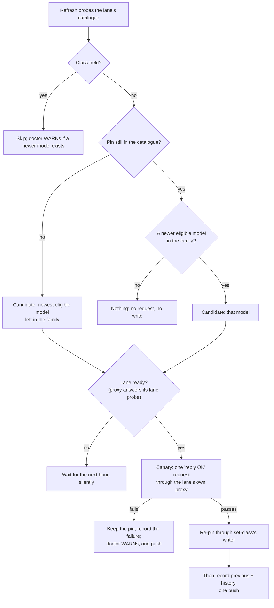
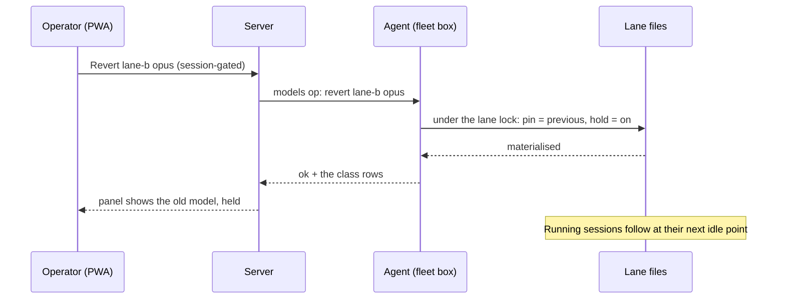

# Model classes follow new releases automatically

**Spec** · 2026-10-13 · Status: Draft, for review · Owner: ccrc · Linear: none · Related:
`docs/superpowers/specs/2026-09-08-model-class-registry-design.md` (amended here),
`docs/superpowers/specs/2026-09-20-gpt-lane-ownership-design.md`

## In short

Today a lane's model classes (`haiku`, `sonnet`, `opus`, `fable`) move only when someone runs
`ccrc models <id> set-class` by hand, so a Codex lane keeps routing a class to an older model long after its
provider ships a newer one. This spec makes the hourly `ccrc models refresh` move each class to the newest model
of its own family on its own, after one canary request through the lane, keeping the previous pin and honouring
a per-class hold. Anthropic lanes already launch on the newest model, so for them the same step derives what
ccrc keeps by hand and moves running sessions. The operator approved the four design parts in conversation;
writing them down surfaced gaps, and each gap's answer is a **Proposed** decision (D11 to D20) that waits on
the operator alongside the review of this text.

## 1. Context

This section says what goes wrong today and why it needs a design change, not a bug fix.

- **The rule being reversed.** The class-registry spec ruled that a newly advertised model is "surfaced, never
  auto-classed": reachable by its concrete name, listed as unclassified, and in a class only when the operator
  assigns one (`2026-09-08-model-class-registry-design.md`, its decision table). The README says the same in its
  `ccrc models` section.
- **What it cost** (measured 2026-10-07 and 2026-10-13 with `ccrc models <id> show`). On both Codex lanes of the
  reference fleet, the classes `opus` and `haiku` still pinned version-5.6 models, while newer models of the
  families those classes follow (a 6.1 and a 6 for `opus`, a 6 for `haiku`) had been listed as unclassified for
  at least six days. One lane's `fable` slot was empty although a model of its family was listed. Nothing warned:
  doctor's `models` check tests catalogue freshness only (`_check_models`, `ccd/ccrc-doctor-checks`).
- **The operator's ruling (2026-10-07).** A class follows new releases automatically: "the ccrc user should not
  be doing this kind of stuff by hand". It covers every provider, Codex and Anthropic first, OpenRouter later.
- **A stopgap is in place (2026-10-13).** On the operator's go, each new model got one test request through each
  lane, and then the classes were moved by hand; every test passed and doctor stayed clean. This spec removes
  the hand step.

## 2. Design

The hourly refresh gains an **advance step**, run per lane after that lane's catalogue probe. An advance is data
the refresh changes, so it never waits for a ccrc release; only the code that reads the data ships through
releases. The conversation that approved this design had four parts, mapped here once: the registry (§2.1 to
§2.2), one hour's advance on a Codex lane (§2.3 to §2.4), Anthropic lanes (§2.5), and holds, revert, the panel
and doctor (§2.6 to §2.8).

### 2.1 Where the advance state lives

The approved design adds four facts per class: `family`, `hold`, `previous` and `history`. The class registry
cannot carry them: today's parser refuses any top-level key it does not know and any class value that is not a
string (`REGISTRY_KEYS` and `parseRegistry`, `shared/models.mjs`), so an older ccrc, after a rollback for
example, would refuse every lane's registry.

**D13 (Proposed):** the four facts live in a sibling file, `~/.ccrc/models/<id>.advance.json`, one per lane of
either kind. The class registry keeps its format, so an older ccrc keeps reading it, and an older ccrc never
opens the new file. The rejected alternative ships a reader that tolerates and round-trips unknown keys one
release ahead of any writer; it works, but a rollback past that release still breaks.

| Fact | What it holds |
|---|---|
| `family` | The family the class follows (§2.2). |
| `hold` | Absent by default; when set, who set it and when. |
| `previous` | The pin before the last advance, so Revert is one step. |
| `history` | The last few moves: time, from, to, how (advance, revert, hand), and the canary result. |

One writer owns this file, and the advance, Revert, Hold and release, and `set-class` all go through it. A hand
`set-class` records a `history` entry and leaves `previous` alone, so Revert still means "undo the last advance"
(approved meaning). Every mutation of one lane, the canary included, runs under one per-lane lock, and the writer
re-reads the files under that lock and re-checks the hold and the pin before writing, so a Hold tapped during a
canary is never lost.

### 2.2 The family rule

A class follows one family, and a family is not a class: on a Codex lane the family is the last segment of the
model id, a word such as a tier name, and the class `opus` follows whichever family it was seeded with.

- **Id grammar (D16, Proposed).** A candidate id has exactly three dash-separated parts,
  `<vendor>-<version>-<family>`, where `<version>` is dot-separated integers. Anything else is never a candidate
  and never a seed, and nothing is reported for it. Judgement: the grammar is the provider's convention, not a
  contract, so an id that breaks it is ignored rather than guessed at.
- **Order.** Versions compare part by part as integers, so `6.1` > `6` > `5.6`. A tie, two ids with the same
  version and family, is never a candidate until one of them leaves the catalogue.
- **Eligible.** A model is eligible when the catalogue lists it as visible and it is inside the lane's discovery
  scope.
- **Forwards, with one exception.** A class moves only to a newer version, except when its pin has left the
  catalogue: then it moves to the newest eligible model left in its family, through the same canary.
- **Seeding.** `family` is derived from the pin. A class that is empty has no pin, so `init codex` writes the
  families it seeds as data in the advance file, and a one-time backfill gives an existing lane's empty class the
  family `init` would have seeded. A family with no eligible model leaves its class as it is.

### 2.3 One hour's advance on a Codex lane

Figure 1 shows one class on one lane during one refresh; most hours end at "Nothing".

*Figure 1. One class on one Codex lane during one hourly refresh.*

1. **Choose** the candidate by §2.2. If it is already the pin, nothing happens.
2. **Check the lane is ready.** The shim answers a lane probe (`GET /ccgpt/lane`, `ccd/ccgpt-proxy.py`). A lane
   that is down or still starting means wait for the next hour, with no history entry, WARN or push. This matters
   because a new model's arrival re-renders the lane's LiteLLM list and restarts it in that same hour.
3. **Canary.** One tiny request for the candidate through the lane's own proxy, the path a session's requests
   take: a "reply OK" prompt, a few tokens, the lowest effort the model offers. It passes on a 200 with text.
   - It authenticates with the lane's own key, which ccrc already owns, read in-process and never put in a
     child's argv or environment.
   - Each canary has its own timeout, and the step's total stays within the refresh unit's start timeout.
4. **Re-pin** through the writer `set-class` uses (`deploy/models-op.mjs`, which validates the registry and
   materialises it into the lane's `settings.json` env block and its sibling files). The class keeps its effort
   level if the new model offers it; otherwise it takes the highest level the model offers below it, in the
   catalogue's own order. Nothing restarts, and the LiteLLM list is not re-rendered: it already names every
   visible model (sourced: `renderLitellmConfig`, measured 2026-10-09).
5. **Commit** only after materialise succeeds: then `previous` and `history` are written and one push goes out,
   for example "lane-b: opus model-5.6 → model-6.1". A materialise failure leaves the old pin, writes a failed
   `history` entry, and the next hour tries again.
6. **A failed canary** keeps the pin, records the failure, raises `model-advance-held-back` and sends one push
   (not one an hour). The next hour retries, and the WARN clears when a canary passes.

### 2.4 Running sessions on a Codex lane

Running sessions move at their next idle point (ruled). Measured on 2026-10-13, when the stopgap re-pinned both
Codex lanes at 23:28:32Z, by reading each running session's transcript for the `model` of every reply after
the re-pin:

- A session whose next turn began after the re-pin (23:30:34Z) ran on the new model, with no relaunch.
- A session that was mid-turn at the re-pin kept the old model for the rest of that turn (41 replies, to
  23:32:10Z).

Judgement, from one observation each: Claude Code re-reads the `settings.json` env block when the file changes,
so on a Codex lane the next turn is the idle point and nothing has to be typed into the pane.

**D11 (Proposed):** the plan's first task re-measures this across several sessions on both lanes.
- If it holds, the Codex arm drops the approved step "ccd types `/model` at an idle tick".
- If it does not, the approved order stands. First measure whether a typed `/model` reaches the new pin in a
  running session; if it does, ccd types it at the next idle tick. If neither works, sessions move only on
  relaunch, and that choice goes back to the operator.

`model-sessions-behind` (§2.8) is the backstop either way.

### 2.5 Anthropic lanes

Launching already follows new models here: ccrc routes Anthropic lanes by alias only (`ROUTE_CLASSES` in `ccd/ccd`
and its tests), and Claude Code resolves each alias to its family's newest model at launch. What lags is what
ccrc keeps by hand and the sessions already running.

1. **The source (D18, Proposed).** The approved design read Claude Code's own model catalogue cache,
   `<home>/cache/model-catalog/*.json`, from every home. Measured on 2026-10-13 by listing those files: only 4 of
   the box's 15 Anthropic homes hold one (one of them 6 days old), and the freshest was 4 h old. So each Anthropic lane reads its own cache
   when it has one, and otherwise the freshest cache of a home signed in to the same organisation. The cache's
   organisation id is compared in-process and never copied or printed. A lane with no source gets no advance and
   is named by `model-advance-blocked` (§2.8). The Anthropic plan's first task measures what writes the cache, and
   when.
2. **A per-lane class file** is written from that source: class, current model id, label and effort levels. A
   Fable row appears only when the source lists Fable for that organisation.
3. **What ccrc keeps by hand derives from that file.**
   - ccd's rule "class haiku takes no effort level" (`ccd/ccd`) becomes "a model that lists no effort levels takes
     none". This matters because a Codex lane's `haiku` class does take an effort level.
   - Pricing needs no new row, since the usage sweep prices by family. A provider's price change still needs a
     hand edit (Later).
4. **Canary by real use.** A synthetic request would gate nothing, because every new launch already goes to the
   new model. So running sessions move only after one session on that lane has completed a turn on the new model,
   which ccd already records.
5. **Moving running sessions.** ccd's existing step compares class names only, so it never fires when an alias's
   model changes. Here, unconditionally (outside D11), ccd's routing record gains the model id beside the class,
   and a newer model for the alias counts as a pending change for the next idle tick, where ccd types `/model`.
   This also closes a known leak: a session resumed without `--model` comes back on its old model.
6. **One push** per family per lane.

The home's `settings.json` belongs to Claude Code, and ccrc never writes it on an Anthropic lane.

### 2.6 PWA labels on every lane

The PWA's model labels are hard-coded for both kinds of lane (`pwa/src/lib/models.ts`), so the Codex lanes' labels
are stale right now. **D17 (Proposed):** both kinds take labels from data. A Codex lane's label comes from its
registry plus the catalogue row's `label` (`CatalogueModel`, `shared/models.ts`), and an Anthropic lane's from its
class file, chosen by the roster's lane kind, never by a wrapper name. A test turns red when a class moves and its
label does not.

### 2.7 Holds, revert, and the Models panel

Each lane's page gets a Models panel. Figure 2 shows the Revert tap, and Hold and release take the same path.

*Figure 2. Revert from the PWA, on a Codex lane.*

- **The panel.** Each class shows its model, when it last moved and what it replaced, a **Hold** switch, and a
  **Revert** button shown only after an advance.
- **Revert is one act.** It puts `previous` back and turns Hold on, so the next hour cannot move the class again.
  Turning Hold off lets the next hour advance, canary first.
- **The `models` agent operation.** Hold, release and revert travel as one new agent operation, the way the
  existing `update` operation carries the update tap (`agent/src/server.ts`). The approved design had the panel
  read the class files through the agent's existing file read. That read's whitelist does not admit
  `~/.ccrc/models/`, so **D14 (Proposed):** the `models` operation also answers a read-only `show`.
  - It is security-sensitive: a wire-triggered spawn outside the exec whitelist. Its argv is a frozen template,
    and its request is validated before any spawn: an account id by the existing id pattern, a class from the
    four classes, an action from the four actions. The child gets an explicit `HOME`, `PATH` and `LANG` only. A
    source-scan test pins all of it, as the update operation's tests do.
  - The server route is session-gated, with no box token, and it joins the route census the way the update routes
    do.
  - The rejected alternative: the server stores holds and the fleet box pulls them. A revert would then wait up to
    an hour, and a revert means a model is misbehaving now.
- **On an Anthropic lane,** the hold, `previous` and `history` live in that lane's advance file (§2.1), and a
  hold works by ccd launching the lane's sessions with the held model's id in the launch environment, which ccd
  owns. This is the one case where ccrc puts a concrete model id on an Anthropic lane, and a test pins that it
  does so only while a hold stands. **D19 (Proposed):** a Revert or Hold reaches a running Anthropic session at
  its next relaunch, unless the plan's first task shows that a typed `/model <id>` changes the session without
  writing the home's `settings.json`. In that case ccd types it at the next idle tick.
- **From a shell (D12, Proposed).** `ccrc models <id> hold|release|revert <class>` do what the taps do, for a box
  whose console is down.

### 2.8 What doctor reports

Doctor gets four new WARNs, named here so that a doctor-clean gate that allow-lists WARNs by name can accept them
before they ship. The approved design named the first three; the fourth is D15 (Proposed).

| WARN | When it fires | When it clears |
|---|---|---|
| `model-advance-held-back` | A canary failed. Names the lane, class and candidate. | A canary passes |
| `model-held-behind` | A held class has a newer eligible model in its family. | The hold is released |
| `model-sessions-behind` | A session is still on the old model 24 h after a move. Names the session and ccd's reason. | The session moves |
| `model-advance-blocked` | A lane's registry, advance file or source cannot be read, so no advance runs. Names the file. | The file reads again |

`model-sessions-behind` is the backstop for "not by hand": if the idle-point switch quietly fails, the operator
hears about it. Failures fail shut: a pin never moves on data that cannot be read.

## 3. Decisions

D1 to D6 were questions with options that the operator answered, D7 to D10 are the four design parts the operator
approved as presented, and D11 to D20 are proposals made while writing this spec, not yet put to the operator.

| # | Decision | Options considered | Chosen, and why | Status |
|---|---|---|---|---|
| D1 | Which model a class follows | Same family, newest version; best model overall per class; a rule list written once | Same family, newest version: a tier keeps its meaning | Agreed |
| D2 | What guards a move | Canary, then switch; switch, auto-revert on errors; switch, no guard | A canary through the lane first, so a broken model never reaches sessions | Agreed |
| D3 | An escape hatch | Optional hold, off by default; no hold at all; hold per lane, not per class | An optional per-class hold, off by default | Agreed |
| D4 | Where advancing lives | A: the hourly refresh; B: the server; C: LiteLLM aliases | A: one owner on the box that holds the catalogue | Agreed |
| D5 | Running sessions | Next idle point; next relaunch; idle switch but skip coordinators mid-wave | At their next idle point | Agreed |
| D6 | Pause for an operator window | No window, hold only; obey a window switch | No window: the hold is the only brake | Agreed |
| D7 | The registry part | - (approved as presented) | `family`, `hold`, `previous`, `history` per class | Agreed |
| D8 | The Codex advance part | - (approved as presented) | Choose, canary, re-pin through the writer, move sessions, push | Agreed |
| D9 | The Anthropic part | - (approved as presented) | Catalogue cache, canary by real use, no `settings.json` writes | Agreed |
| D10 | Holds, revert, panel, doctor | - (approved as presented) | The panel, an agent `models` op, three named WARNs | Agreed |
| D11 | Codex sessions need no typed `/model` | Keep the typed step; drop it if the next-turn pickup holds | Drop it only if the plan's first task confirms §2.4 | Proposed |
| D12 | Shell verbs | Taps only; taps plus `hold`, `release`, `revert` verbs | Both, so a box whose console is down can still revert | Proposed |
| D13 | Where the advance state lives | Inside the registry after a reader release; a sibling file | A sibling file, so a rollback never breaks a lane | Proposed |
| D14 | How the panel reads | Widen the agent's file read; a `show` action on the `models` op | `show` on the op, with no file-read widening | Proposed |
| D15 | A WARN for unreadable data | Report nothing; a named fourth WARN | `model-advance-blocked`, named now | Proposed |
| D16 | Id grammar | Loose parsing; exactly three parts | Exactly three parts, anything else ignored | Proposed |
| D17 | Labels from data | Anthropic only; both kinds of lane | Both kinds, chosen by lane kind | Proposed |
| D18 | The Anthropic source | Each home's own cache only; same-organisation fallback | Own cache, else the freshest of the same organisation | Proposed |
| D19 | Revert on a running Anthropic session | Next relaunch; typed `/model <id>` if it writes nothing | Next relaunch, unless the plan measures the typed step safe | Proposed |
| D20 | Delivery order | Both arms in one plan; Codex first, Anthropic second | Codex first, since that is where classes are stale today | Proposed |

## 4. What this amends

Two written rules change once this design ships.

- **`2026-09-08-model-class-registry-design.md`:** its ruling "surfaced, never auto-classed" is superseded for a
  model of a family some class follows. A model of a family no class follows is still listed as unclassified and
  joins a class only when the operator assigns one.
- **README, `ccrc models`:** its "never classed on its own" sentence changes to match, and, if D12 is agreed, the
  section gains the three shell verbs.

## 5. How it is tested

Each part ships with tests that go red when its guard is removed, measured, per the project's mutation-table rule.

- **The family rule:** pure unit tests for the id grammar (two-part, four-part and non-integer versions are never
  candidates), version order, ties, forwards-only with the retired-pin fallback, discovery scope, and seeding.
- **The Codex advance:** a fixture home with a fake lane proxy answering the canary with a 200, a 500, a refused
  connection and "not ready"; the lock (a Hold tapped during a canary survives); commit-after-materialise.
- **Running sessions:** the plan's first task measures §2.4 and D19 on the live fleet, read-only, before anything
  depends on them.
- **The Anthropic arm:** fixture caches (own, same-organisation, none) for D18; ccd's routing record with the model
  id (a newer model counts as pending, the same model does not); the hold's launch-env id appears only while held.
- **The panel and the op:** the agent op's argv template, request validation and child env by a source scan; the
  server route in the census; a label that follows a moved class.
- **Doctor:** each of the four WARNs fires and clears on fixture data.
- **Live acceptance:** the 2026-10-13 stopgap's procedure, run by the code: a canary per new model, a check
  through the class alias, then doctor.

## Where things stand

### Agreed

- D1 to D10: the design as presented in conversation on 2026-10-07, its last part approved on 2026-10-13.
- The stopgap of 2026-10-13: both Codex lanes now pin the newest model of each family, until this ships.

### Waiting on you

- Review of this written spec.
- D11 to D20, the proposals made while writing it. The four that change an approved part are D13 (where the state
  lives), D14 (how the panel reads), D18 (the Anthropic source) and D19 (revert on running Anthropic sessions).

### Later

- OpenRouter lanes: their catalogue is an open marketplace, so "the newest in a family" needs its own rule
  (judgement). Brought back by the first OpenRouter lane with a non-empty discovery list.
- A provider renaming or splitting a family: today it reads as a new family that no class follows and surfaces
  as unclassified. Brought back by the first such catalogue.
- Price changes within a family still need a hand edit of the usage sweep's rate row. Brought back by the first
  advance whose new model is priced differently.
