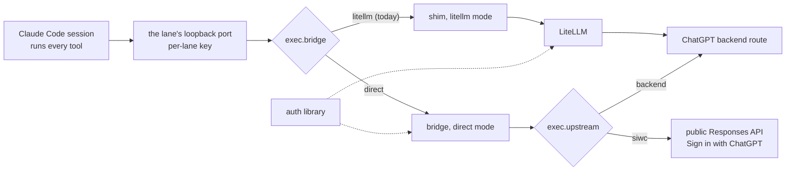
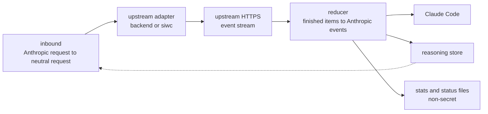
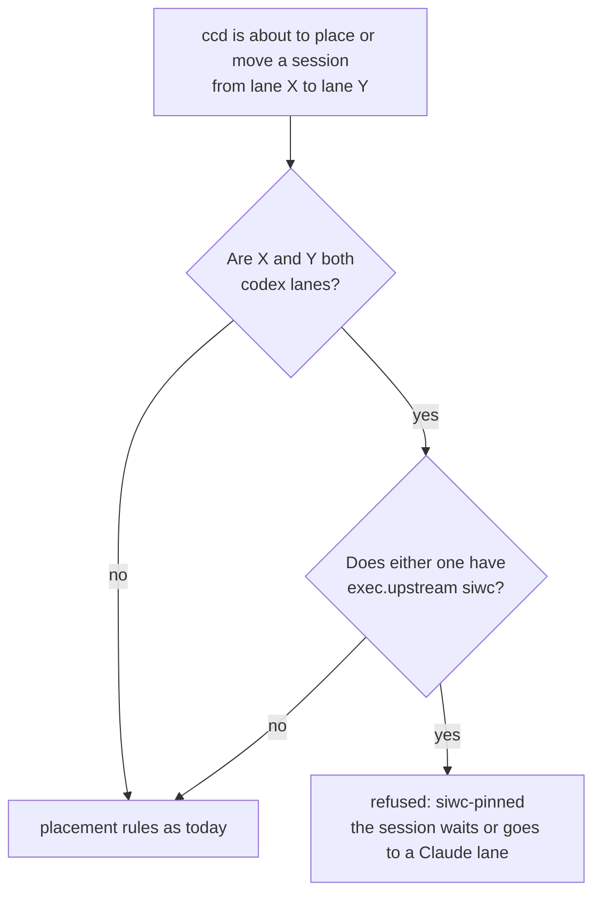
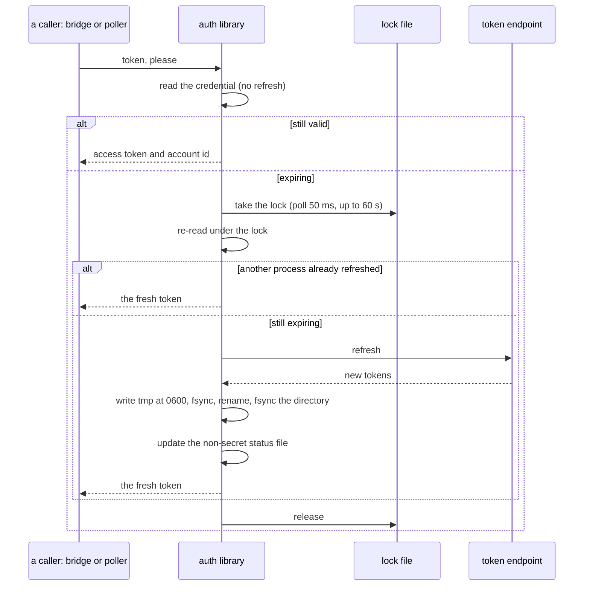
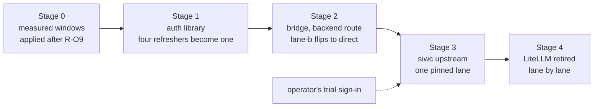

# The Codex bridge: a ccrc-owned path from Claude Code to a ChatGPT plan

**Spec** · 2026-10-15 · Status: Accepted 2026-10-15 · Owner: ccrc · Linear: none · Related:
`docs/superpowers/specs/2026-09-20-gpt-lane-ownership-design.md` (amended here),
`docs/superpowers/specs/2026-09-08-model-class-registry-design.md` (amended here),
`docs/superpowers/specs/2026-10-13-model-class-auto-advance-design.md`

## In short

A Codex lane runs ordinary Claude Code sessions on a ChatGPT plan. Today each request passes through two
processes, ccrc's shim and LiteLLM, and LiteLLM's generic translation causes most of the lane's measured defects:
its own prompt outranks Claude Code's, parallel tool calls arrive empty, refusals read as server errors, and the
features Codex itself relies on are dropped. This spec replaces both processes with one **ccrc-owned bridge per
lane**. Claude Code stays in front and runs every tool, and it sees an Anthropic-compatible endpoint. The bridge
speaks the Responses API the way the Codex CLI does. It targets the **official Sign in with ChatGPT route first**,
with today's backend route as the fallback, and **one auth library** owns every credential. The same spec raises
the lanes' context window from a fixed 200k to a **measured** one: every model the lanes use accepted about 511k
on 2026-10-15. The operator approved the design in eight sections in conversation on 2026-10-15 (D1 to D17).
Writing it down surfaced ten gaps, answered here as D18 to D27, and the operator accepted the written spec with
them on 2026-10-15.

## 1. Context

This section says what is wrong with today's path, what was measured, and what the operator ruled before any
design was drawn.

### 1.1 What goes wrong today

Every row below is a defect of the translation, not of the backend: the Codex CLI talks to the same backend
without any of them.

| Defect | Footing |
|---|---|
| LiteLLM sends its own 7,572-character Codex prompt as top-level `instructions`. The backend ranks that above the developer message that carries Claude Code's system prompt. | Sourced: LiteLLM 1.105.0's ChatGPT provider; the Codex CLI 0.162 sends no top-level `instructions` and puts its base prompt in the first developer message (codex-rs `core/tests/suite/personality.rs`). |
| LiteLLM forwards only eleven request keys. `parallel_tool_calls`, `prompt_cache_key`, `text` and `client_metadata` are dropped. | Sourced: the same provider's request builder. |
| Parallel tool calls can reach Claude Code with empty inputs, because replies are built from deltas, which this backend may skip. | Measured on a lane, 2026-10-12; a patch ccrc ships into the LiteLLM runtime covers the known shapes (D-4859, `2026-10-12-gpt-lane-fidelity-fixes.md`); the cause, building from deltas, stays. |
| A content-policy refusal reaches Claude Code as an HTTP 500, which it retries, and the retry usually refuses again. | Measured on a lane, 2026-10-08. |
| A refused context overflow arrives as an opaque 400. Claude Code's own recovery compaction never starts. | Sourced: Claude Code 2.1.300 parses only `prompt is too long: N tokens > M maximum`. |
| Four separate programs refresh each credential, with no lock between them, and LiteLLM rewrites the file in place. The refresh token is single-use. | Sourced: §2.5's caller table. |
| A lane's working room after a compaction is about 70k tokens. GPT-model sessions auto-compact in 2.35% of calls; Claude-model sessions in 0.08%. | Measured 2026-10-15, 14 days, every home, deduplicated by record id and attributed by the model that answered. |
| LiteLLM is a 731 MB environment that ccrc pins, patches and upgrades. | Measured on the reference fleet. |

### 1.2 The context wall was never 196k

The model-class-registry spec (§6.1) caps a lane's window at 200k because the largest prompt ever accepted was
196,341 tokens. A whole-fleet scan on 2026-10-15 refutes that figure: it was the maximum of one July sample from
one home.

- **Accepted in practice.** A 548,799-token prompt on 2026-09-09 and a 584,415-token prompt on 2026-09-19, on two
  different models. Measured: every transcript on the reference fleet, deduplicated by message id.
- **Refused in practice.** Six context refusals in total, all on one model, five of them in late July, near
  373k. The limit moves over time.
- **Probed on 2026-10-15.** Each of the four models the lanes' classes name accepted prompts of about 260k, 386k
  and 512k through one lane, with no refusal (12 requests, stepped, stopping rule unused). The client's window was
  raised for those requests only.
- **Compaction time does not grow with size.** Over 75 days, 1,508 GPT-model compactions took a median of 239 to
  271 s in every size band from 100k up. The nine above 250k took 225 to 403 s. Measured from each compaction
  record's `durationMs`.

### 1.3 What the operator ruled before the design

- **Purpose: all four aims.** Native GPT behaviour, a full fleet citizen, retiring the shim and LiteLLM, and more
  context room.
- **Claude Code runs everything.** Hooks, plugins, skills, MCP servers and every ccrc protocol must keep working,
  so the lane is not a Codex terminal pane, not Codex app-server threads, and not the codex-plugin-cc plugin (judged
  a review lens, not a lane).
- **A ccrc-owned bridge**, grown from the shim, rather than a different third-party proxy.
- **The official route first**: the public Responses API through Sign in with ChatGPT. OpenAI's own docs for that
  route say not to point clients at the ChatGPT backend.
- OpenRouter needs none of this: it already offers an Anthropic-compatible endpoint, which ccrc's `openrouter`
  and `compatible` providers use as they are.

## 2. Design

The bridge is described in the order a request meets it: the lane's shape, the two upstream routes and their
terms, request translation, reply building, the reasoning store, the auth library, context room, rollout and the
drift watch.

### 2.1 The shape of the lane

A Codex lane stays a `codex` roster row, and its sessions stay ordinary Claude Code sessions launched by
`ccrc-codex`. Only what answers at the lane's `ANTHROPIC_BASE_URL` changes.

*Figure 1. One lane's request path. The two switches are per lane, in the roster. In `litellm` mode the path is
today's, byte for byte; in `direct` mode one ccrc process replaces both tiers. Dotted lines are credential reads.*

- **One process per lane, on loopback**, guarded by the lane's existing gateway key. To Claude Code it is an
  Anthropic endpoint: `/v1/messages`, `/v1/messages/count_tokens` and `/v1/models`. So a Codex lane becomes one
  more Anthropic-compatible lane, like an OpenRouter row.
- **Three parts inside, each depending only on the one before it.** Inbound turns an Anthropic request into a
  neutral request. The upstream adapter is the seam: `backend` speaks today's route, `siwc` the public one. The
  reducer turns the upstream event stream into Anthropic events.
- **Two per-lane switches.** `exec.bridge` chooses `litellm` or `direct`. It stays `litellm` until the GPT-lane
  soak's final sample (R-O9), and a flip stops one set of processes before starting the other, which is also the
  moment the credential's ownership passes between them. `exec.upstream` chooses `backend` or `siwc`.
- **Stdlib Python, run by the system `python3`.** No virtual environment.

*Figure 2. Inside the bridge. Inbound reads the reasoning store to re-insert earlier reasoning; the reducer writes
new reasoning and the per-model measurements that §2.6 uses.*

### 2.2 The two upstream routes, and the terms that bind the official one

The `siwc` adapter targets Sign in with ChatGPT's plan route; the `backend` adapter targets today's route. They
differ in a handful of rules, all in the adapter.

| Rule | `siwc`: public Responses API | `backend`: today's route |
|---|---|---|
| Endpoint | `POST https://api.openai.com/v1/responses` | the Codex backend's `/responses` |
| Credential | the SIWC access token (1 h), from the auth library | today's ChatGPT credential, from the auth library |
| Required | `store:false`, `stream:true`, the full history in `input` | the same |
| Tools | grouped in one namespace, `functions` | top level |
| Forbidden | `max_output_tokens`, `temperature`, `top_p`, `metadata`, `user`, `prompt_cache_retention`, `previous_response_id`, `system`-role items, hosted tools | none beyond the backend's own |
| Identity | `originator: ccrc`, a ccrc User-Agent | the same, first measured live (§3, D27) |

Sourced: developers.openai.com/siwc (token sharing for open source: models and inference, preview limitations,
errors and recovery), read 2026-10-15.

**The terms.** The Sign in with ChatGPT terms (the 2026-09-29 text; the live page refused automated reads, so it
was read from the 2026-10-07 web archive) say, among other things:

> Do not impersonate OpenAI, another application, or another open-source project.
>
> Requests must originate from the user's local runtime or a remote runtime only that user controls. [...]
> Obtain express consent before background use.
>
> Do not provide general-purpose API access for other tools or unrelated requests.
>
> You must not enable or encourage: Creating multiple accounts, splitting usage, rotating accounts, or otherwise
> bypassing usage limits.

So the bridge serves only ccrc-launched sessions (loopback, per-lane key), identifies itself as ccrc, and an SIWC
lane is **pinned**: while either of two ChatGPT-account lanes uses `siwc`, ccd never moves a session between them,
in either direction. On a usage limit a pinned lane's session waits, or moves to a Claude lane. Unattended use
needs a recorded consent per lane. The operator accepted the storage sentence (tokens "local and under the user's
control, not in a remote or managed environment") for a box they control.

*Figure 3. The pinned-lane rule. ccd decides it at every placement, swap and swap-follow; the server forecasts and
refuses with the same word (D21).*

**Eligibility is unmeasured.** Plus and Pro plans are documented, and the server can refuse an app or an account
(`subscription_sharing_*_not_enabled`, `…_user_not_eligible`). Only a sign-in can tell, so the operator signs in
once, outside ccrc, with a throwaway helper, before the `siwc` adapter is built against real recordings.

### 2.3 Request translation

Inbound maps every Anthropic request field to the Responses API, or drops it on purpose and counts it.
Frequencies are from one lane's access log and transcripts, 2026-10-07 to 2026-10-15.

| Anthropic side | Responses side | Notes |
|---|---|---|
| `system` (string or blocks) | the first `input` item, a developer message | No top-level `instructions`, so nothing outranks it. A per-lane switch keeps the `instructions` form. `cache_control` is consumed. |
| A mid-conversation system entry | a developer message in place | Today's shim turns these into user text. |
| User text and images | a user message with `input_text` and `input_image` | |
| Assistant text | an assistant message with `output_text` | Its `phase` (commentary or final answer) is replayed. |
| `tool_use` (418,236 blocks) | `function_call` with `call_id`, `name`, `namespace` on `siwc`, and JSON `arguments` | Claude-written `toolu_…` ids pass through unchanged. |
| `tool_result` (14.3% errors, the largest 680,040 characters) | `function_call_output`, text or text plus images | No error flag exists upstream, so Claude Code's own error text is kept. No size cap. |
| Tool definitions (537 offered, 63 called) | `function` tools, in namespace `functions` on `siwc` | The 11 names over 64 characters are cut and suffixed with a short hash, and mapped back from the same request's tool list, so no state is kept. |
| `tool_choice` | `auto`, `required`, a named function, `none` | |
| `disable_parallel_tool_use` | `parallel_tool_calls` (22.2% of replies carry two or more calls) | |
| Effort (`output_config.effort`) | `reasoning.effort`, through the shim's existing per-model resolution | `thinking` is dropped. |
| None | `include: ["reasoning.encrypted_content"]` | §2.5. |
| Earlier reasoning | `reasoning` items, from the store | §2.5. |
| `cache_control`, the session id header | a stable `prompt_cache_key` from the session and agent ids | |
| `context_management` | applied by the bridge itself (`clear_tool_uses`) | Never dropped silently: dropping it would grow context faster. Whether Claude Code sends it is measured offline first (§3). |
| `max_tokens`, `temperature`, `top_p`, `top_k`, `metadata`, `stop_sequences` | dropped on `siwc`; counted | The route forbids them. No output cap remains. |
| `stream:false` (9,928 requests, all refused today) | the upstream stream folded into one reply | Served once the offline stub has named the features that send them, with a counter per feature (D12). |
| `count_tokens` (11,498 requests) | answered locally | Calibrated per route and model from the bridge's own measurements (D24). No upstream call. |
| Server tools such as hosted web search | a clear 400 | None seen. |
| `anthropic-beta` values | consumed, never forwarded | Used only to detect features. |
| Anything unknown | passed or dropped by rule, and its **name** counted | §2.8. |

### 2.4 Reply building

The reducer builds each Anthropic block only from the upstream's **finished** items, so a missing or partial delta
cannot produce an empty tool call. A throwaway prototype proved the rules against 32 streams, fed whole and in 1-
and 13-byte chunks, and caught all 14 deliberate faults. Only 8 of those streams came from this repository; the
operator's trial recordings replace the other 24.

- **Order.** Blocks are released in `output_index` order, duplicates are dropped, and the completed response's
  `output` fills any item that never got a finished event.
- **Live text.** Text deltas are forwarded as they arrive and checked against the finished item; a mismatch is
  repaired by sending the missing suffix, or logged. Tool arguments are sent only once complete.
- **Stop reasons.** A refusal or a content filter becomes `refusal`, an output cap `max_tokens`, an interruption a
  normal stop. A reply the model marks as not finished (`end_turn:false`) becomes `pause_turn`, which Anthropic
  clients continue by re-sending; Claude Code's reaction is checked offline first.
- **Usage.** Zeros in `message_start` and the real figures in `message_delta`, which is what Claude Code already
  reads today. Input is reported net of cached tokens, and cached tokens as cache reads.
- **Timers.** A `ping` after 15 s of upstream silence, so long reasoning never looks dead. An upstream idle timeout
  of 300 s, as in Codex. On restart the bridge stops taking requests and finishes the streams in flight.

| Upstream error | What Claude Code gets | Why |
|---|---|---|
| Context overflow | 400 with exactly `prompt is too long: N tokens > M maximum` | Claude Code 2.1.300 parses that text and compacts. Today it gets an opaque 400. |
| Usage limit (`…_usage_limit_exceeded`) | 429 `rate_limit_error`; the lane's status reads `limit-paused` | |
| Not eligible | 403 `permission_error`; status `ineligible`; never a sign-in loop | |
| Upstream unavailable | 529 or 503, retryable | |
| Unsupported capability | 400 naming the field; a drift counter | |
| Expired or invalid token | one library refresh, then 401; status `needs-signin` | |
| Policy refusal | 400, not retried | Today it is a 500, which Claude Code retries. |
| Any of them | the upstream request id kept in the status file | |

Errors known before the stream starts become real HTTP statuses; errors mid-stream become an Anthropic `error`
event with no `message_stop`.

### 2.5 The reasoning store

The Codex CLI replays the model's encrypted reasoning on every request, which is part of how the model keeps its
train of thought between tool calls. Today nothing carries it.

- **Where.** A store in the lane's directory: stdlib `sqlite3`, mode 0600 (D23).
- **Key.** The `call_id` of the first tool call that followed the reasoning, or, for a reply with no tool call, a
  hash of the assistant text. When that id or text reappears in a later request, inbound re-inserts the reasoning
  item just before it.
- **Expiry.** 14 days, and a size cap that evicts the oldest first.
- **Why not in the transcript.** Carrying it inside the thinking block's signature needs no state, but a session
  that moves to a Claude lane would then send GPT-signed thinking to Anthropic, which may refuse it, and every
  transcript and history row would grow. A session that moves between the two GPT lanes loses its reasoning, which
  is harmless: that is today's behaviour.

### 2.6 One auth library

Today four programs refresh each ChatGPT credential on their own: the LiteLLM tier, the usage poller, the models
probe and the login verb. Nothing locks between them, and LiteLLM truncates the file and rewrites it in place. The
refresh token is single-use, so two refreshes at once can lose the credential, and with SIWC's one-hour tokens a
lane refreshes about 24 times a day.

*Figure 4. One refresh. The lock is a separate file, because a rename replaces the credential's inode. A failed
write keeps the new token in memory and retries, so a full disk loses nothing.*

- **The only path to the token endpoint.** Callers read the current token, which never refreshes, or ask for a
  refresh. Bash callers use the same library through a small command-line entry point.
- **One designated refresher**: the lane's bridge, at about half the token lifetime, and never before
  `earliest_refresh_at`. A timer keeps an idle lane's 30-day SIWC refresh token from lapsing. Every other caller
  refreshes only as a fallback, under the same lock. In `litellm` mode LiteLLM, which ignores the lock, is the only
  refresher and every other caller only reads.
- **A dead credential is a state, `needs-signin`**, never retried and never answered with a sign-in flow inside a
  request. Today a dead token starts a 15-minute device-code poll in the request path. `invalid_grant`,
  `invalid_refresh_token`, `token_expired`, `refresh_token_expired`, `refresh_token_invalidated` and
  `refresh_token_reused` all mean `needs-signin`; `invalid_client` is a configuration error.
- **A non-secret status file per credential**: `ok`, `needs-signin`, `limit-paused`, `ineligible` or
  `plan-disabled`, with expiry, last refresh, last error code, last request id and the consent stamp. The doctor,
  the PWA and `ccrc codex start` read that, never the secret.
- **Two formats, never mixed.** The backend credential keeps LiteLLM's format while any LiteLLM tier exists. The
  SIWC credential is a new versioned file with a family tag, and the library refuses to write over another
  family's file. One non-secret host id per box, shared by every registration on it.
- **Sign-in verbs.** Device code for the backend route; for SIWC, the paste-the-callback flow (the browser's
  failed loopback URL is pasted back; the code is useless without the verifier kept on the box) or a tunnel.
  `ccrc auth import` takes a credential made on another machine.
- **ID tokens** are trusted through TLS from the token endpoint, as OpenID Connect allows for a token received
  directly from it; there is no hand-written RSA check.
- **Redaction.** Every credential file is registered in history's secret sources.
- **The rule this changes.** The ownership spec says ccrc never reads an OAuth file's contents (§9, §21.7). That
  becomes: **exactly one ccrc library reads and writes them**. The tests that pin the old rule change on purpose.

| Caller | Today | Becomes |
|---|---|---|
| The LiteLLM tier | an unlocked refresher | the only refresher in `litellm` mode; retired in `direct` mode |
| The usage poller (every 15 min) | an unlocked refresher, and a real inference request every 15 min to read usage headers, presenting as another client | reads through the library; in `direct` mode reads the usage the bridge saw on real traffic and asks upstream only when the lane is idle; sends the account id and `originator: ccrc` |
| The models probe, Codex arm | a refresher behind its own guard | the library; on `siwc`, `GET /v1/models` |
| The models probe's older arm | reads the credential directly; dead on the reference fleet | deleted |
| `ccrc codex login` and its pane | runs LiteLLM's device flow, no lane lock | the library's sign-in verbs |
| `ccrc codex start` | checks the file exists | reads the status file |
| The doctor | checks existence only, though its comment says mode too | status file and file mode; fails if a retired refresher is enabled again |
| Account removal | waits for an in-flight poll | takes the library lock and offers revocation |

### 2.7 Context room

Two changes give a GPT session room: a measured window, which ships first and on its own, and what the bridge
measures once it runs.

**The measured-window rule** amends the model-class-registry spec's eighth key (§4):

- Each lane may record a **measured window per model**, set by a new
  `ccrc models <id> set-window <model> <tokens>` and removed by `clear-window`, beside `set-effort`. A value is an
  integer from 1,000 to 1,000,000. The operator sets it from a measurement; a catalogue number never sets it.
- The windows live in a sibling file, `~/.ccrc/models/<id>.windows.json`, not in the class registry (amended at
  acceptance, D-5160). The registry's parser refuses any key it does not know
  (`REGISTRY_KEYS`, `shared/models.mjs`), so a `windows` key there would make an older ccrc, after a rollback,
  refuse every lane's registry. An older ccrc never opens the sibling file, so its lanes fall back to 200k, the
  safe direction. This is the auto-advance spec's D13 reasoning, applied to one more per-lane fact.
- The lane's `CLAUDE_CODE_MAX_CONTEXT_TOKENS` is the **smallest** measured window among the models the lane's
  classes name, rounded down to 1k and capped at 1,000,000. Claude Code applies the one value to every model in
  the session, subagents and quick tasks included, so the smallest is the only safe one.
- If any of those models has no measured window, the lane keeps today's rule, `min(catalogue context, 200000)`. A
  class that moves to a new model, by hand or by auto-advance, therefore falls back to 200k until the new model is
  measured.
- It goes onto the lanes after R-O9, so the soak measures one unchanged system. Up to about 511k is measured
  today. Each call then carries more context, so a large window spends more of the plan per call; the value is
  chosen when it is applied.

**What the bridge adds.**

- It records every request's real prompt size and every context refusal, per route and model, in a non-secret
  stats file.
- A refusal **lowers** that model's measured window automatically: the hourly `ccrc models refresh` reads the stats
  file and sets the window just below the refused size (D25). Raising stays a deliberate `set-window`.
- It drops LiteLLM's 7,572-character prompt, about 2k tokens on every request.

The rest of the room is outside the wire: after a compaction, Claude Code re-attaches about 100k tokens of skills,
instructions, hook output and summary (measured 2026-10-15). Trimming that is separate work (Later).

### 2.8 Rollout

Each stage ships, runs and is measured before the next starts.

*Figure 5. The stages. Stage 0 is independent of the bridge. Stage 3 waits on the operator's trial proving the
account eligible; the account used for the trial becomes the pinned lane's account.*

- **Stage 1** moves every caller to the library while LiteLLM still serves, so the credential race ends before any
  new traffic.
- **Stage 2** builds the bridge on the backend route, tests it offline, then flips the lane with more quota
  headroom (lane-b on the reference fleet) to `direct`. Flipping back stops the bridge and starts LiteLLM.
- **A lane leaves LiteLLM** after 7 days on `direct` with zero empty tool calls, a 5xx rate and compaction rate no
  worse than its own LiteLLM baseline, no credential incident, and no unexplained new name in the drift counters.
  The LiteLLM environment is removed once both lanes have passed.

### 2.9 The drift watch

Codex's wire protocol renamed nothing in the 60 days to 2026-10-15, but about five commits a week touch it, mostly
new error codes and request-body changes. Sign in with ChatGPT is a preview with no changelog, and Codex source
names none of its error codes, so Codex cannot warn about it.

| Watch | What it does | Footing |
|---|---|---|
| D1, Codex source | On each Codex stable release, a scheduled CI job diffs the nine wire-contract files and opens an issue on any change. Its own test checks that it reports the 0.162.0 move of `instructions` and the 0.155.0 removal of the compaction endpoint. | Measured: 30 stable releases in 60 days, 23 of them touching those files. |
| D2, SIWC docs | The SIWC pages and terms are fingerprinted daily; a change opens an issue with the diff. | Judgement. |
| D3, bridge counters | Names only, never content: unknown request fields, event types, item types, error codes, incomplete reasons, response headers, unsupported-field names, model substitutions. They go to the status file, and the doctor warns on a new name. | Judgement. |
| D4, replay | Recorded streams and fixtures replay in CI on every bridge change. | Judgement. |
| D5, canary | About five tiny requests per lane per day, and whenever D1 or D2 fires, under the lane's consent. During the soak a red canary flips the lane back to `litellm` (D26); afterwards it alerts the operator. | Judgement. |

## 3. Decisions

D1 to D17 were ruled by the operator in conversation on 2026-10-15. D18 to D27 are gaps that writing this text
surfaced; the operator accepted them with the written spec on 2026-10-15.

| # | Decision | Options considered | Chosen, and why | Status |
|---|---|---|---|---|
| D1 | Purpose | any subset of four aims | All four: native GPT behaviour, full fleet citizen, retire the shim and LiteLLM, more context room | Agreed |
| D2 | Who runs the tools | Codex pane; app-server threads; the plugin; Claude Code | Claude Code runs everything, so hooks, plugins and ccrc protocols keep working | Agreed |
| D3 | Who owns the translation | keep LiteLLM; another third-party proxy; ccrc-owned | ccrc-owned, grown from the shim | Agreed |
| D4 | Upstream | backend route; official route | Official route first, backend route as fallback | Agreed |
| D5 | The terms | pinned lanes; backend first; ask OpenAI first | Pinned SIWC lanes, recorded consent, tokens on a box the operator controls | Agreed |
| D6 | Context window | keep 200k; main model only; smallest measured across class models | Smallest measured window across the lane's class models, 1M cap, 200k when any is unmeasured | Agreed |
| D7 | Measurement | probe the main model; probe every class model | Every class model, stepped, through one lane: all accepted about 511k | Measured |
| D8 | When the window moves | as soon as it ships; after R-O9 | After R-O9, so the soak measures one system | Agreed |
| D9 | The lane's shape | one shared bridge; one per lane | One per lane, on loopback, per-lane key, Anthropic-compatible | Agreed |
| D10 | The trial's probes | operator runs a helper; agent probes with an exception | The operator runs a helper; the token never passes through an agent | Agreed |
| D11 | Request translation | developer-first; `instructions` first | Developer-first, with `instructions` behind a per-lane switch; the §2.3 table | Agreed |
| D12 | Non-streaming requests | keep refusing; serve | Name the features offline first, then serve them, with a counter per feature | Agreed |
| D13 | Reply building | text only when complete; live text | Finished items only, live text repaired at the finish, the §2.4 error table | Agreed |
| D14 | Reasoning between turns | none; in the transcript; a bridge store | A store on disk in the lane's directory, 14-day expiry | Agreed |
| D15 | Credentials | keep LiteLLM's auth; one library | One library owns every credential; the "never reads" rule becomes "exactly one library reads and writes" | Agreed |
| D16 | Context room and rollout | the §2.7 and §2.8 text; lane-a first | As written, lane-b first | Agreed |
| D17 | Drift watch and testing | alert-only canary; canary may flip | As written; during the soak a red canary may flip its lane back | Agreed |
| D18 | Where the code lives | grow one file; new package; a separate program | The shim gains a `direct` mode, and the new code lives in a stdlib package beside it, so `litellm` mode keeps today's code path exactly | Agreed |
| D19 | Port, key and unit | new port and unit; reuse the shim's | Reuse the shim's port, gateway key and unit in both modes, so `ccrc-codex` and `ANTHROPIC_BASE_URL` do not change | Agreed |
| D20 | Roster fields | one combined field; two fields | `exec.bridge` (`litellm` when absent) and `exec.upstream` (`backend` when absent), additive, one reader each | Agreed |
| D21 | Pinned rule's home | the server; ccd | ccd decides at every placement, swap and swap-follow, with the reason word `siwc-pinned`; the server forecasts and refuses with the same word | Agreed |
| D22 | Consent | a roster flag; a recorded stamp | `ccrc codex consent <id>` records who and when in the lane's status file; without it an `siwc` lane answers 403 and the doctor fails | Agreed |
| D23 | Reasoning store format | flat files; sqlite | Stdlib sqlite, mode 0600, keyed per §2.5, 14 days, oldest-first eviction past 256 MB | Agreed |
| D24 | `count_tokens` | a fixed ratio; calibrated | A running bytes-to-tokens ratio per route and model, seeded at 3.5 bytes per token, rounded up, so an estimate errs towards compacting early | Agreed |
| D25 | Automatic lowering | manual only; lower to the refused size; lower below it | A refusal at size R sets that model's window to R × 0.9, rounded down to 1k, through the hourly models refresh; never raises | Agreed |
| D26 | The canary's flip | alert only; flip | During the soak only, the canary runs `ccrc codex switch <id> litellm` itself and records why in the status file | Agreed |
| D27 | Identity on the backend route | `ccrc`; the Codex CLI's | Send `originator: ccrc`. If the first live step shows the backend refusing it, that lane stays on `litellm` until the operator rules | Agreed |

## 4. What this amends

- **The model-class-registry spec, §6.1, the eighth key.** `min(catalogue.context, 200000)` becomes the
  measured-window rule of §2.7. Its premise, a 196k wall, is withdrawn (§1.2). Each lane gains an optional sibling file of
  per-model windows (§2.7), and `ccrc models` gains `set-window` and `clear-window`. The comments in
  `shared/modelenv.mjs` that repeat the old premise are rewritten.
- **The GPT-lane ownership spec, §6 (the proxy).** The shim gains `direct` mode (D18, D19).
- **The same spec, §9 and §21.7 to §21.8 (who reads an OAuth file).** "ccrc never reads credential contents"
  becomes "exactly one ccrc library reads and writes them" (D15), and LiteLLM's in-request device flow ends.
- **ccd placement.** The pinned rule (D21) adds one refusal reason.
- **The README**, its `ccrc models` and Codex-lane sections, in the plans that ship each stage.

## 5. Testing and proof

Every guard ships with a test that goes red when the guard is removed or weakened, measured before and after.

- **An offline stub, before this spec is final.** Claude Code 2.1.300 runs in a fixture home against a local
  stub, with a dummy key and non-essential traffic off; never a live home. It records what Claude Code sends:
  beta flags, `context_management`, `cache_control`, the shape of system entries, tool flags such as deferred
  loading, `metadata`, and which features send non-streaming and `count_tokens` requests. It also tests Claude
  Code's reaction to each reply shape in §2.4: refusal, `pause_turn`, a mid-stream error, the prompt-too-long text,
  and a 429 with no retry time.
- **Reducer tests.** The prototype's 32 streams and 14 faults, re-based on the operator's trial recordings
  (scrubbed: tiny synthetic prompts, no account data), plus: namespace replay, a stream with no content type, every
  SIWC error code before and during the stream, the exact prompt-too-long text, pings, the idle timeout, drain,
  live-text repair, `phase` replay, `end_turn:false`, the non-streaming fold, `count_tokens`, long tool names, an
  image in a tool result, and a `toolu_` id in history.
- **Auth library tests.** Two processes racing a refresh make exactly one token request; a crash between the
  token request and the write is recoverable from the checkpoint; a full disk loses nothing; another family's file
  is refused; each refresh error code lands in the right state.
- **Lane tests.** The existing Codex-lane fixtures, in fixture homes only, gain `direct` mode, the flip in both
  directions, and the pinned rule.
- **Measured-window tests.** The smallest across class models; the cap; 200k when any class model is unmeasured; a
  class moving to an unmeasured model; `set-window` refusing a value outside 1,000 to 1,000,000.
- **The first live step on the backend route.** At most six tiny requests on lane-b, sending `originator: ccrc`
  and no `instructions` (D27).
- **The operator's trial.** About twenty tiny requests through the official route: the developer-first shape,
  `instructions`, namespaced and top-level and late-added tools, a tool round trip with a `toolu_` id, an image in a
  tool result, parallel calls, `tool_choice`, a 70-character tool name, reasoning with replay, effort levels,
  structured output, and caching with and without `prompt_cache_key`. It also records which usage headers, if any,
  the route returns.

## Where things stand

### Agreed

- D1 to D17, ruled by the operator in conversation on 2026-10-15, section by section.
- The window probe (D7) ran on 2026-10-15 with the operator's go: four models, about 511k each, no refusal.
- The written spec, with D18 to D27, accepted by the operator on 2026-10-15. At acceptance, the measured windows
  moved from the class registry to a sibling file (§2.7).

### Waiting on you

- The trial sign-in, which decides whether Stage 3 can start and which account its lane uses.
- Review of each stage's plan, starting with Stage 0's measured windows.

### Later

- Trimming the roughly 100k tokens Claude Code re-attaches after every compaction: its own spec, once Stage 0 has
  shown how much the window alone buys.
- How usage is reported on an SIWC lane, once the trial shows which headers the route returns.
- The route's WebSocket transport, which allows continuing a response on the same connection: only if HTTP proves
  too slow.
- The codex-plugin-cc review trial, paused on 2026-10-15 with nothing installed.

---

*Written by Claude for the ccrc operator. Diagrams are Mermaid text; the Copy Mermaid button on the docserver or
the spec viewer copies the source, which pastes into Lucid as editable shapes.*
