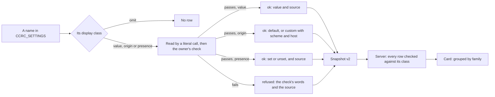

# Box settings in the console

**Spec** · 2026-10-25 · Status: wave 1 built (#2193); wave 2 agreed (revision 5) · Owner: the coordinator · Issue: #1417 · Related:
`docs/superpowers/plans/2026-10-23-centralised-update-w24-settings-live-in-ccrc-config.md` (#1237),
`docs/superpowers/specs/2026-09-20-centralised-update-management-design.md`,
`docs/superpowers/specs/2026-08-10-architecture-ddd-clean-solid.md`,
`docs/superpowers/specs/2026-10-19-ccrc-consolidation-wave-design.md`

## In short

Before this work, the console could not show any of ccrc's settings, because only the `ccrc` CLI on each box reads them. This design
keeps the CLI as their one reader.

- **The CLI:** a new read-only verb, `ccrc settings`, prints what each setting resolves to and where it came from.
  With `--write`, it records that answer as `~/.ccrc/box-settings.json`.
- **A timer:** a new timer on every Linux box runs `ccrc settings --write` every five minutes. It runs under the user
  manager, which is the environment a console-driven update's detached child runs in.
- **The server:** on each inventory sweep, a small reader fetches that file through the inventory's own capped read. It
  is carried the way the tmp-sweep census is: as a node file the sweep leaves out. FleetWatcher keeps the last read per
  node, and `GET /api/updates` adds it to each node as `NodeWire.settings`, working out its age with the request's
  clock.
- **The console:** a read-only **Box settings** card under Settings › Updates.

Nothing writes a setting. No route, agent op or box-token door is added, and coord.db gains no column. Wave 1 built
this for seven settings (#2193, 2026-11-04).

**Wave 2 (revision 5, section 5; agreed 2026-11-04).** The card shows the 54 other settings a node reads, all of them used
on the fleet box, each with a display class. A checked number or choice shows as it is. A path, key file, address,
list or free text shows only whether it is set. The test box's own 28 settings are left out. A refused setting never
records its raw text, which also retires wave 1's accepted residual, and the server checks every row against its
class. The snapshot becomes version 2, which the server and an updated console read beside version 1, so the rollout
goes server first. The operator approved D11 to D22 as proposed on 2026-11-04.

**Revision history:**
- Revision 2 folded in an adversarial design review: two critical findings, five important and seven minor.
- Revision 3 aligns the design with the DDD/Clean/SOLID refactor in flight: the rings, decide-in-L1, the shared
  kernels, refusal and wire totality, and the bash anti-corruption layer. Four Opus lenses checked it, each verified.
- Revision 4 (2026-11-03, the coordinator's ruling on review 1396, F8; plan D-7874): §2.4's closed list of failure words
  gains an eighth, `unmeasured`, for a node the server holds no read of since it started. `unreadable` stays only for a
  read that was tried and failed. The build carried the word before the spec did; this revision makes the spec true.
- Revision 5 (2026-11-04, the operator's ruling for a wave 2): adds section 5 and decisions D11 to D22 for the
  remaining settings, from a read-only census of all 82 names and a measurement of wave 1's parser, wire and card at
  `724d7683a`. Three Opus lenses (leaks, facts, decisions) then checked the draft against the code; their findings are
  folded in, and sections 2.1 to 2.6 are marked where section 5 supersedes them. D1 to D10 now read Agreed: the operator approved revision 3 on 2026-10-26, and wave 1 was built to it. The operator approved D11 to D22 as proposed on 2026-11-04, so they read Agreed too.

Changes from either revision are marked "(review)" or "(refactor)".

## 1. Context

This section says what exists today and why the console has nothing to show.

| Fact | Footing |
|---|---|
| The seven settings are `CCRC_BACKUP_KEEP`, `CCRC_BACKUP_DATA_KEEP`, `CCRC_VERSIONS_KEEP`, `CCRC_UPDATE_HEALTH_S`, `CCRC_UPDATE_DEADLINE_MS`, `CCRC_RELEASE_BASE_URL` and `CCRC_MODELS_ADVANCE_BUDGET_S`. Each resolves from the process environment, else `~/.ccrc/ccrc.env`, else its default, through one reader, `_ccrc_knob`. | Sourced: `ccd/ccrc`'s `CCRC_SETTINGS` and `_ccrc_knob` (#1237) |
| The CLI reads them, and the server ignores them. | Sourced: `deploy/ccrc.env.example`'s header |
| A console-driven update's detached child runs under the user manager's environment (`_upd_detach` runs `systemd-run --user`). Its parent, and a rollback's release check, run in the spawning service's environment: the agent's on the fleet box, `ccrc.service`'s on the server. That environment includes `agent.env`, or `ccrc.env` and `exposure.env`. | Sourced (review): `_upd_detach`, `agent/src/server.ts` `makeUpdateSpawn`, `server/src/update/spawn.ts` |
| Four settings have no callable validator. The health gate's parse is inline in `_upd_gate`. The models budget clamps rather than refuses. The deadline answers by return code only. The base URL has no validator. Each default is a literal at its call sites. | Sourced (review): `_upd_gate`, `_models_advance_budget_secs`, `_upd_deadline_ms` |
| The inventory sweep reads the node files that become each node's coord.db row, and `toNodeWire` maps only that row. The tmp-sweep census and the box-token generation are node files the sweep leaves out, each read by its own reader. | Sourced (review): `server/src/update/inventory.ts` `MEASURED_FILE_KEYS`, `server/src/update/routes.ts` `toNodeWire` |
| The agent admits only the names in `NODE_FILE_BASENAMES`, so an older agent refuses a new name as `unreadable`, not `absent`. Caps words are read every sweep. | Sourced (review): `agent/src/whitelist.ts`, `inventory.ts` `readNodeFile` |
| A file's ring is decided by its imports (`server/test/rings/ring.ts`). An undeclared file that imports `readNodeFile` from the L3 `inventory.ts` is an L1 file with an outward edge, which `rings/outward-edges` refuses. The tmp sweep splits the work into a pure `tmpSweep.ts` and a delivery `tmpSweepLane.ts` whose state FleetWatcher owns. FleetWatcher is the only scheduler, and periodic work rides `LANE_SCHEDULE` rows. | Sourced (refactor): ENF and DECIDE epics; `tmpSweep.ts:1-2`, `tmpSweepLane.ts:1`, `laneSchedule.ts`'s `inventory` row |
| `_upd_redact` is the one bash redactor for userinfo and `$HOME`. `_ccrc_usage_die` is the one usage refusal (exit 2). `_tmp_guard` and the EXIT chain are the one temp-file discipline. | Sourced (refactor): the KERNEL epic's redaction and write primitives; `ccd/ccrc` |
| On the server box, 5 timestamped backups hold 12.1 GB: 4 carry the coordination data at about 3.0 GB each, and 1 is thinned to 14 MB. The disk has 18 GB free of 150 GB. | Measured: 2026-10-25 17:08 UTC, read-only `du` and `df` |
| Wave 24 declined a read-only `ccrc config` verb to save verb-pin churn, and left doctor as the one read-only door. | Sourced: the #1237 plan, "out of scope" |

## 2. Design

Sections 2.1 to 2.6 are wave 1 as built. Where section 5 changes them (the version, the row list, what a
refused row records, the validator's checks and the trust footing), section 5 governs.

The CLI measures, a timer records, a lane on the inventory's schedule fetches the record, and the console shows it.

```mermaid
flowchart LR
  T["ccrc-settings.timer<br/>every 5 min, user manager"] --> C["ccrc settings --write<br/>one resolver per setting"]
  C --> F["~/.ccrc/box-settings.json<br/>0600, atomic"]
  F -- "fleet box: agent read op" --> L["box-settings lane<br/>inside the inventory row's run"]
  F -- "server box: local read" --> L
  L --> S["FleetWatcher lane state<br/>last read per node"]
  S --> V["boxSettingsView, L1<br/>age with the request's clock"]
  V --> G["GET /api/updates<br/>NodeWire.settings"]
  G --> P["Box settings card<br/>Settings › Updates"]
```


*Figure 1. The path of one measurement. Only the CLI resolves a setting. Every step after it carries the answer and
never re-derives it. Judgement lives in two pure functions, the parse and the view. The lane and the route only move
the data.*

### 2.1 The verb

`ccrc settings` prints one line per setting: its key, its value, its source (`environment`, `ccrc.env`, `ccrc.env
(empty line)` or `default`), and the verdict of the act that reads it.

- **One resolver per setting (review).** Each setting gets one resolver, called both by its act and by the verb. The
  resolver answers the value, the source, `ok`, `refused` or `unmeasured`, and its sentence.
  - Four resolvers are carved out of inline code: `_upd_gate`'s health parse, `_models_advance_budget_secs`,
    `_upd_deadline_ms`, and the base URL's read. Each resolver calls `_ccrc_knob` or `_keep_knob` with its key and
    default as literals, moved byte for byte from its act, so each default and each rule is spelled once.
  - The carve-outs land characterization first (refactor): a pin of each act's exact behaviour, green on main, before
    any code moves. Each act then refuses, clamps and prints exactly as before.
  - The three keeps use `_keep_knob`, with `_bak_data_keep`'s lowest bound of 2 for the data keep.
- **The verb dispatches by a literal `case`** (refactor). It walks `CCRC_SETTINGS` for order only, and dispatches
  through a literal `case` over the keys. It never builds a function name from a key, and it never calls `_ccrc_knob`
  with a variable key. Wave 24's settings census holds that rule.
- **The deadline (review)** shows its plain reading, and the `min` and `max` readings the server and the watchdog take.
- **The base URL (review, refactor)** shows only `default`, or `custom` with its scheme and host. It is never a path, a
  query or userinfo. One named projection, `_upd_url_origin`, does this beside `_upd_redact`. It runs `_upd_redact`
  first and then keeps the scheme, if there is one, and the authority up to the first `/`, `?` or `#`. So a scheme-less
  base (`user:secret@host/r`, deviation 6748) and a repeated `u:p@x@host` lose their userinfo as well. Nothing writes
  the userinfo rule a fifth time, and ARCH-67 folds the helper in with `_upd_redact`.
- **Every string is redacted, then clipped (review, refactor).**
  - Each `value` and `why` goes through `_upd_redact` first, which turns userinfo and any `$HOME` prefix, wherever it
    appears, into `~/`.
  - Then the string is clipped to at most 480 bytes, ending `…` when cut, and under `LC_ALL=C` each byte outside
    printable ASCII becomes `?`. Redaction comes first, so a clip cannot cut a pattern in half.
  - A real `BUE_WHY` sentence runs 150 to 290 characters, so the snapshot keeps it whole.
  - A host path outside `$HOME` is not rewritten.
  - Wave 1's accepted residual: a refused numeric setting records its raw value, in `value` and in its sentence,
    through `_upd_redact` alone (the verb's header; reviews 1385, 1396 and 1398). Wave 2 retires it (5.3, D14).
- **The environment it read (review).** `--from timer` (the unit's own argument) records `reader: "timer"`, and any
  other run records `reader: "shell"`. An interactive `ccrc settings` can disagree with the card, and says so.

**Output and errors.**
- `--json` prints the snapshot document.
- `--write` writes it to `~/.ccrc/box-settings.json` with ccrc's existing idiom (refactor): `tmp="$dest.tmp.$$";
  _tmp_guard "$tmp"`, a write under `umask 077` in a subshell, then `chmod 600` and `mv -f`, and `rm -f` on failure.
  It sets no `trap` of its own, and prints nothing on success. A failed or interrupted write (a die, or SIGTERM through
  the EXIT chain) leaves no `box-settings.json.tmp.*` and keeps the last good file. Nothing promises to clean up after a
  SIGKILL.
- The verb answers rc 0 whenever it answered.
- An unknown argument, including a `--from` value other than `timer`, goes through `_ccrc_usage_die`: exit 2, with
  `ccrc: unknown argument: …`. `-h` or `--help` prints usage at exit 0, as `backup` does.
- The verb never prunes, never takes `update.lock`, and never changes a setting.

### 2.2 The snapshot

One JSON document, version 1, far below the 64 KiB node-file cap.

```json
{
  "v": 1,
  "at": 1792948000,
  "reader": "timer",
  "settings": [
    { "key": "CCRC_BACKUP_KEEP", "state": "ok", "value": "5", "from": "environment" },
    { "key": "CCRC_UPDATE_HEALTH_S", "state": "refused", "value": "ninety", "from": "file", "why": "…" },
    { "key": "CCRC_VERSIONS_KEEP", "state": "unmeasured", "why": "…" }
  ],
  "deadline": { "plainMs": 900000, "minMs": 900000, "maxMs": 900000 },
  "backups": { "state": "ok", "kept": 5, "withData": 4, "bytes": 12694000000 },
  "disk": { "state": "ok", "availBytes": 19327352832, "sizeBytes": 161061273600 }
}
```

The three `state` values follow the "unmeasured is not unset" rule (D-6365):

- `ok`: the act would use the value.
- `refused`: the act would refuse it, or fall back as its own text says.
- `unmeasured`: the reader could not decide it.

`settings` lists all seven keys, once each, in `CCRC_SETTINGS` order. This is wave 1's version 1; version 2 lists 61
rows, and a refused row there carries no value (5.4).

**One vocabulary, two languages (refactor).** Each vocabulary is spelled once in `shared/api.ts`, as a named union with
a sibling `Record<X, true>` map on the `SESSION_ROLE_MAP` idiom. The vocabularies are:
- the setting `state` (`ok`, `refused`, `unmeasured`);
- `from` (`environment`, `file`, `empty`, `default`);
- `reader` (`timer`, `shell`);
- the reader's failure words (§2.4).

The server's validator and the console's word tables derive from those maps. A test holds each map set-equal, in both
directions, to the literals `cmd_settings` emits in `ccd/ccrc`. It also holds the seven keys set-equal to the one
`CCRC_SETTINGS=(…)` line, so a word or key added on one side only goes red (wave 1; in wave 2 the class table
holds every key, 5.4).

Today `refused` covers three cases: an act that refuses, one that falls back, and one that clamps. The `why` sentence
is display text only. No server or console code branches on it.

**Constants (refactor).** The cadence is declared once: `BOX_SETTINGS_TIMER_S = 300`, which names
`deploy/systemd/ccrc-settings.timer` and is pinned equal to that unit's `OnUnitActiveSec`. Staleness is the derivation
`BOX_SETTINGS_STALE_S = 3 * BOX_SETTINGS_TIMER_S`. The clock-ahead bound, `BOX_SETTINGS_CLOCK_AHEAD_S = 300`, is a
separate safety bound, not tied to the cadence.

### 2.3 Backups and disk

`kept` and `withData` come from `_bak_list` (review), the prune's own list, so a hand-made sibling is never counted and
nothing restates its matcher. `withData` counts the backups that still hold `coord.db`. The verb checks that
`~/ccrc-backups` is a readable directory before listing it, because the list's glob answers empty for a root that is a
file. A root that cannot be listed answers `unmeasured` with its reason, never zero. `bytes` comes from `du` and `disk`
from `df` of the home filesystem, each under `timeout` and `nice` (review).

### 2.4 The server: a pure parse and view, and a lane

Two files, one per ring (refactor):

- **`server/src/update/boxSettings.ts` is L1.** It imports `shared/` only, with a header in `tmpSweep.ts`'s words. It
  holds `parseBoxSettings`, a validator with no clock, and `boxSettingsView`, which works out the age, `stale` and
  `clock-ahead` from a held read and a clock it is given.
- **`server/src/update/boxSettingsLane.ts`** declares its ring in its header, in `tmpSweepLane.ts`'s words. It reads
  the file through `readNodeFile`, the inventory's lstat-gated, capped read.

**When it reads.** The read runs inside the `inventory` LANE_SCHEDULE row's run (`runInventory` → `sweepThenProject`,
after `sweepInventory`), using that sweep's caps and node ids. It has no clock, flag or throttle of its own. Like
`tmpSweep` and `tokenGeneration`, `boxSettings` is left out of `MEASURED_FILE_KEYS`.

**Where the reads are kept.** The last read per node is lane state that FleetWatcher owns, never module scope.
- On each inventory run, the read for each node the sweep reached is overwritten.
- A node the sweep could not reach keeps its last read, so its age grows into `stale`.
- A node the server has not read since it started holds no read, and answers `unmeasured` (revision 4). A read that was
  tried and failed answers its own word, never `unmeasured`.
- An entry whose node id is no longer in `coord.nodes()`, after a rekey or a removal, is dropped.

**How it is served.** `GET /api/updates` joins the held read into each node's `NodeWire.settings` through
`boxSettingsView`, with the request's clock. So a lane that stops running shows as stale rather than freezing a fresh
verdict. coord.db and `toNodeWire`'s row stay unchanged (review). The lane never logs, and the card is its only surface.

**The cap word (review, refactor).** A new Linux cap word, `settings`, says the node's tree can write the file. It is
read every sweep with the other caps.
- A node whose caps were measured (`os` is not `unknown`) and do not include the word is not read, and answers
  `not-supported`.
- A node whose caps were not measured this sweep is not read either, and answers its own word, `caps-unmeasured`.

| What the lane and view find | `NodeWire.settings` | What the card shows |
|---|---|---|
| A node whose measured caps lack `settings` (an older build, or macOS) | `not-supported` | "This box's build does not report its settings" |
| A node whose caps could not be measured this sweep | `caps-unmeasured` | "This box's capabilities could not be read, so its settings were not read" |
| The server holds no read of this node since it started (revision 4) | `unmeasured` | "Not read since the server started." |
| No file | `absent` | "Not measured on this box yet" |
| A valid document, `at` within 15 minutes of the request | `ok`, `stale: false` | The values |
| A valid document, older than 15 minutes, including a node the sweep could not reach | `ok`, `stale: true` | The values, labelled "measured 42m ago" in a warning tone |
| A document whose `at` is more than 5 minutes ahead of the request | `clock-ahead` | "This box's clock is ahead; its settings are not shown" (review) |
| A file over the cap, not regular, or not valid v1 | `too-large`, `unreadable` or `malformed` | "Could not be read", with that word |
| A field this console's build does not recognise (a new word, or the wrong shape) | read as `unrecognised` | "This box's settings came in a form this console does not read" |
| A server that predates this field | the field is missing | "This server does not report box settings" |

The reader's failure words are a closed list of eight: `not-supported`, `caps-unmeasured`, `unmeasured`, `absent`,
`clock-ahead`, `too-large`, `unreadable` and `malformed` (`unmeasured` since revision 4). The console reads any other word
as unrecognised.

### 2.5 The card

Settings › Updates gains a fourth card, **Box settings**, after the nodes card. It is rendered from the section's one
`/api/updates` poll, so it adds no poll of its own (refactor). It holds one block per node, in the nodes card's order,
labelled "reported by the box" (review). Each block has:

- the seven settings (wave 1; 61 grouped rows in wave 2, 5.5), each with its value and its source as a word ("from the environment", "from ccrc.env", "the
  default");
- a refused or unmeasured setting in the danger tone, with its sentence (in wave 2, the check's words, 5.3);
- on a server-role node, `CCRC_MODELS_ADVANCE_BUDGET_S` read as "not used on a server box", since no models timer runs
  there (review);
- one line for the backups ("5 backups, 4 with data, 12.1 GB") and one for the disk ("18 GB free of 150 GB");
- the measurement's age, and which environment it read.

The card's text tables are total records over the shared vocabularies, never a switch (refactor).

The card has no controls. A note under it says that a setting is changed in the box's `ccrc.env`, and that the source
column shows when the environment overrides the file.

### 2.6 Trust

The snapshot is same-user-writable by every session on the box, like every node file (design 2026-09-20, decision 13).
So it is a display, never an authority. No act reads it, and every act re-resolves its setting at the moment it runs.
A session that could forge the file can already run `ccrc` itself, and `update.json`'s reported detail already shows
box-written text. React escapes it.

The validator (L1 `parseBoxSettings`, with no clock) bounds the file before it reaches a row:

- the version, the seven known keys once each (wave 1; wave 2 checks each row against its class, 5.4), and the `state`, `from` and `reader` vocabularies, read from their
  shared maps;
- printable ASCII, with each string capped at 512 characters;
- non-negative safe integers.

A document that fails any check is `malformed`, whole, never partly shown. The `at` bound and staleness are judged when
the document is served, by the pure view, not by the validator. On the console, the field's one reader checks the
shape with `lib/wire.ts`'s guards, and checks that every document string is a string before it renders, so a bad
field blanks nothing.

## 3. Decisions

D1 to D10 are wave 1's, agreed and built. D11 to D22 are wave 2's (section 5), approved as proposed on 2026-11-04.

| # | Decision | Options considered | Chosen, and why | Status |
|---|---|---|---|---|
| D1 | Who resolves a setting for the console | (a) a TypeScript copy of the reader; (b) an agent op that runs the CLI on demand; (c) the CLI writes a snapshot | (c): the byte-wise model stays one implementation, and no exec surface widens | Agreed |
| D2 | What runs the snapshot | (a) the update watchdog or the update-sync tick; (b) a new timer on every role; (c) only at update time | (b): the safety units stay single-purpose, the timer reads the manager environment a detached update reads, and a fleet-role box has no watchdog | Agreed |
| D3 | Cadence | every minute; every 5 minutes; every 15 minutes | Every 5 minutes, stale after 15: a changed `ccrc.env` shows within 5 minutes at small cost | Agreed |
| D4 | Transport | (a) a new box-token POST; (b) a node file in the sweep; (c) a node file with its own reader | (c), the tmp-sweep census and `tokenGeneration` precedent: no new door, no coord.db migration, and the read rides the existing `inventory` lane row with no clock of its own | Agreed |
| D5 | Editing | from the console; read-only | Read-only. Writing a box's file from the server needs a new agent op and a new trust argument | Agreed |
| D6 | macOS | a launchd job; not supported | Not supported for now, said as such through the cap word: a console-driven update never runs there | Agreed |
| D7 | A shell read | doctor only; `ccrc settings` | `ccrc settings`, which reverses wave 24's "no verb": it writes the snapshot anyway | Agreed |
| D8 | Validators the verb needs | restate them in the verb; extract one resolver per setting | Extract, characterization first and behaviour-preserving (review): a restated rule would be a second definition | Agreed |
| D9 | A stopped timer | the stale label only; doctor's units check too | Both (review): doctor's known units gain the timer with its own sentence. It stays hand-kept until ARCH-69 | Agreed |
| D10 | Where the carve-outs land | inside this wave's PR; a behaviour-identical PR first | Inside this PR, characterization first. A separate PR first is the operator's call (refactor) | Agreed |
| D11 | Which settings wave 2 shows | (a) all 89; (b) every setting a fleet or server node reads; (c) some families only | (b): 54 more, 61 in all, every one used on the fleet box. The test box's own 28 are read only on the test box, so a node could only ever show their defaults | Agreed |
| D12 | How each setting shows | (a) every value through `_upd_redact`, as doctor does; (b) one display class per setting: `value`, `origin`, `presence` or `omit` | (b): the class decides what may leave the box. 43 `value`, 11 `presence`, 28 `omit` (5.1) | Agreed |
| D13 | Where a verdict comes from | (a) copy each check's rule into the verb; (b) call each owner's check, moving the ones that cannot be called; (c) show values with no verdict | (b), characterization first as D8. `_tshape` moves into `ccrc`; the keepalive, usage and carry checks become functions in `ccrc`, the first two shipped to the sweeps through the generated settings library, which widens its purpose; checks with no value-free words gain them (5.2) | Agreed |
| D14 | What a refused setting records | (a) its raw value through `_upd_redact` (wave 1, an accepted residual); (b) the check's words and the source, never the value | (b), for all 61 rows, so wave 1's seven change too and the residual retires (5.3) | Agreed |
| D15 | The wire | (a) keep version 1 and grow the list, which a wave-1 server reads as malformed; (b) version 2, read beside version 1; (c) version 2 in a new field beside a version-1 copy of the seven | (b), rolled out `--server-first`. A console tab on wave 1's build shows version-2 nodes as unreadable until it reloads; (c) avoids that at the cost of a second reader (5.4) | Agreed |
| D16 | Where the class table lives | (a) a new sourced file; (b) `ccd/ccrc`, beside `CCRC_SETTINGS`, mirrored in L0 | (b): the verb and doctor already run in `ccrc`'s shell, and the settings census already scans that file. The table holds each setting's class, family and roles | Agreed |
| D17 | The card with 61 rows | (a) one flat list; (b) grouped by family, folded unless a row needs attention; (c) only rows that differ from their default | (b), with the native `details` element so the card holds no control (5.5) | Agreed |
| D18 | Doctor's `box-settings` line | (a) unchanged, printing every set value; (b) the same class table | (b): a `presence` setting prints as set, and a refused `value` prints the check's words, never the value (5.6) | Agreed |
| D19 | The test box's address, `CCRC_TESTBOX_URL` | (a) `presence`; (b) `origin`, showing its host | (a): its host is a private address, and the card has no need of it (judgement). Wave 1's release base keeps `origin`, since a release mirror is an address meant to be named; a private mirror raises the same question, under Later | Agreed |
| D20 | Wave-2 read mode, and settings applied at install | (a) each setting in its consumer's mode; (b) `ccrc.env` alone, with install-time settings labelled | (b): an environment-first read would report the timer's own environment (5.7) | Agreed |
| D21 | What a server-role node shows for the fleet's settings | (a) a row each, reading "not used on a server box"; (b) one folded line per family, "not used on this role"; (c) no rows | (b): the server box uses none of the 54, and a line per family says so without 54 rows of noise | Agreed |
| D22 | What a refused row's `why` may hold | (a) the check's words, cut at 240 bytes, on the writer's promise; (b) a closed set of the checks' words, mirrored in L0 and checked by the server | (b): a `why` is the one free string left in a refused row, and only a closed set lets the server prove it holds no value. The cost is one more vocabulary held set-equal, as the failure words are | Agreed |

## 4. What this does not change

- No default, range or refusal of any setting. The resolvers carved out in D8 answer exactly as the inline code did.
- No act reads the snapshot.
- Wave 1 makes no change to `ccrc doctor`'s `box-settings` check; D9 adds a units entry only. Wave 2 changes what it
  prints (D18).
- No change to the server's own reading of `CCRC_UPDATE_DEADLINE_MS`.
- Wave 2 changes no default, range or refusal either. Every check it moves (D13) answers exactly as before, pinned
  first.

## 5. Wave 2: every setting a node reads (revision 5, agreed)

Wave 1 shows seven settings. The operator ruled on 2026-11-04 that a second wave covers the rest. This section says
which of them the card shows, how each one shows, and what that changes in the verb, the wire, the server, the card
and doctor. Where it changes sections 2.1 to 2.6, this section governs. Code is cited at `main` `724d7683a`.

### 5.1 Which settings, and how each shows

`CCRC_SETTINGS` lists 89 names (measured). Wave 1 shows 7, so 82 remain. 28 of them are the test box's own table,
read only on the test box from its root-owned file (sourced: `ccd/testbox-knobs:186-215`). A fleet or server node
never reads them, and its read of them would only ever answer the defaults, so the card leaves them out. It shows
the other 54, all of them used on the fleet box. A node's snapshot holds 61 rows.

Each setting has one **display class**:

| Class | What the row shows | Used for |
|---|---|---|
| `value` | The value, once the setting's own check passes it | Counts, sizes, durations, percents, choices from a fixed list |
| `origin` | `default`, or `custom` with the scheme and host of an `http` or `https` address | `CCRC_RELEASE_BASE_URL` (wave 1) |
| `presence` | Whether it is set, and where from. Never the value | Paths, key and token files, addresses, lists, globs, model names, free text |
| `omit` | No row | The test box's own table |

The class decides what may leave the box, so it is a security decision, not a layout one. A `presence` row of a
setting set to an empty line reads "set to empty, from ccrc.env", and, where its consumer treats empty as unset,
says that the default applies.

Of the 82: 43 are `value`, 11 are `presence` and 28 are `omit`. The 54 the card shows ("next update" marks a
setting the installer renders into a unit, sourced: `deploy/systemd/ccd-graph-sweep.service:6-7` and
`ccd-graph-sweep.timer:2,7` for the four graph ones):

| Setting | Family | Takes effect | Default | Class | Check |
|---|---|---|---|---|---|
| `CCRC_SESSION_SLICE_MEMORY_MAX` | Session slice | next update | `24G` | value | `_slice_limit_ok` |
| `CCRC_SESSION_SLICE_SWAP_MAX` | Session slice | next update | `6G` | value | `_slice_limit_ok` |
| `CCRC_TEST_SLICE_MEMORY_MAX` | Test runs | each run | `6G` | value | `_tshape`, moved into `ccrc` |
| `CCRC_TEST_SLICE_SWAP_MAX` | Test runs | each run | `1G` | value | `_tshape`, moved into `ccrc` |
| `CCRC_TEST_SLICE_CPU_WEIGHT` | Test runs | each run | `20` | value | `_tshape`, moved into `ccrc` |
| `CCRC_TEST_SLICE_CPU_QUOTA` | Test runs | each run | `400%` | value | `_tshape`, moved into `ccrc` |
| `CCRC_TEST_SLICE_IO_WEIGHT` | Test runs | each run | `20` | value | `_tshape`, moved into `ccrc` |
| `CCRC_TEST_HEAVY_SLOTS` | Test runs | each run | `2` | value | `_tshape`, moved into `ccrc` |
| `CCRC_TEST_WIDE_FILES` | Test runs | each run | `3` | value | `_tshape`, moved into `ccrc` |
| `CCRC_TEST_PRESSURE_MAX` | Test runs | each run | `0` | value | `_tshape`, moved into `ccrc` |
| `CCRC_GRAPH_STORE` | Graph | each run | a path under the home | presence | `_gr_fits` |
| `CCRC_GRAPH_SOURCE_REF` | Graph | each run | `origin/HEAD` | presence | `_gr_fits` |
| `CCRC_GRAPH_REPOS_EXCLUDE` | Graph | each run | empty | presence | `_gr_fits` |
| `CCRC_GRAPH_REFRESH_SECS` | Graph | next update | `900` | value | `_gr_fits` |
| `CCRC_GRAPH_FETCH_SECS` | Graph | each run | `900` | value | `_gr_fits` |
| `CCRC_GRAPH_FULL_REBUILD_SECS` | Graph | each run | `86400` | value | `_gr_fits` |
| `CCRC_GRAPH_INCREMENTAL_MAX_FILES` | Graph | each run | `0` | value | `_gr_fits` |
| `CCRC_GRAPH_FULL_FAIL_MAX` | Graph | each run | `2` | value | `_gr_fits` |
| `CCRC_GRAPH_FAIL_BACKOFF_SECS` | Graph | each run | `21600` | value | `_gr_fits` |
| `CCRC_GRAPH_BUDGET` | Graph | next update | `4` | value | `_gr_fits` |
| `CCRC_GRAPH_BUILD_TIMEOUT` | Graph | next update | `600` | value | `_gr_fits` |
| `CCRC_GRAPH_SLOT_WAIT_SECS` | Graph | next update | `600` | value | `_gr_fits` |
| `CCRC_GRAPH_BUILD_NICE` | Graph | each run | `15` | value | `_gr_fits` |
| `CCRC_GRAPH_MAX_WORKERS` | Graph | each run | `4` | value | `_gr_fits` |
| `CCRC_GRAPH_MAX_SHRINK_PCT` | Graph | each run | `20` | value | `_gr_fits` |
| `CCRC_GRAPH_KEEP_BUILDS` | Graph | each run | `2` | value | `_gr_fits` |
| `CCRC_GRAPH_BUILD_GRACE_SECS` | Graph | each run | `3600` | value | `_gr_fits` |
| `CCRC_GRAPH_MIGRATE_BUDGET` | Graph | each run | `8` | value | `_gr_fits` |
| `CCRC_GRAPH_HOOKSTATE_FRESH_SECS` | Graph | each run | `1800` | value | `_gr_fits` |
| `CCRC_GRAPH_GATE_MAX_DIFF_PCT` | Graph | each run | `25` | value | `_gr_fits` |
| `CCRC_GRAPH_GATE_MAX_DENIALS` | Graph | each run | `3` | value | `_gr_fits` |
| `CCRC_GRAPH_CARD_DIFF_LIST_MAX` | Graph | each run | `20` | value | `_gr_fits` |
| `CCRC_GRAPH_PRESSURE_MAX` | Graph | each run | `60` | value | `_gr_fits` |
| `CCRC_KEEPALIVE_MODEL` | Keepalive | each run | `haiku` | presence | none: its consumer has none |
| `CCRC_KEEPALIVE_PROMPT` | Keepalive | each run | a one-line prompt | presence | none: its consumer has none |
| `CCRC_KEEPALIVE_FRESH` | Keepalive | each run | `1800` | value | its sweep's check, moved into `ccrc` |
| `CCRC_USAGE_SWEEP_DAYS` | Usage sweep | each run | `7` | value | its sweep's check, moved into `ccrc` |
| `CCRC_TESTBOX_URL` | Test box | each run | empty | presence | `_tb_shape` |
| `CCRC_TESTBOX_TOKEN_FILE` | Test box | each run | a path under the home | presence | `_tb_shape` |
| `CCRC_TESTBOX_GIT_URL_BASE` | Test box | each run | empty | presence | `_tb_shape` |
| `CCRC_TESTBOX_GIT_KEY` | Test box | each run | a path under the home | presence | `_tb_shape` |
| `CCRC_TESTBOX_UNTRACKED_FILE_MAX` | Test box | each run | `5M` | value | `_tb_shape` |
| `CCRC_TESTBOX_SNAPSHOT_MAX` | Test box | each run | `64M` | value | `_tb_shape` |
| `CCRC_TESTBOX_STATUS_DEADLINE` | Test box | each run | `3s` | value | `_tb_shape` |
| `CCRC_TESTBOX_RECONNECT_DEADLINE` | Test box | each run | `60s` | value | `_tb_shape` |
| `CCRC_TESTBOX_LOST_RUN` | Test box | each run | `local` | value | `_tb_shape` |
| `CCRC_TESTBOX_QUEUE_LIMIT` | Test box | each run | `20` | value | `_tb_shape` |
| `CCRC_TESTBOX_QUEUE_WAIT` | Test box | each run | `10m` | value | `_tb_shape` |
| `CCRC_TESTBOX_BUDGET` | Test box | each run | `15m` | value | `_tb_shape` |
| `CCRC_TESTBOX_DENY_GLOBS` | Test box | each run | six globs | presence | `_tb_shape` |
| `CCRC_TESTBOX_POLL` | Test box | each run | `30s` | value | `_tb_shape` |
| `CCRC_TESTBOX_FALLBACK_INSTALL` | Test box | each run | `install` | value | `_tb_shape` |
| `CCRC_TESTBOX_TIMES` | Test box | each run | a path under the home | presence | `_tb_shape` |
| `CCRC_CARRY_COPY_WARN_BYTES` | Carry copies | each run | 10737418240 | value | doctor's check, moved into `ccrc` |

The 28 left out: `CCRC_TESTBOX_RUNS`, `CCRC_TESTBOX_WORKERS`, `CCRC_TESTBOX_RUN_TMPDIR`, `CCRC_TESTBOX_RUN_MEMORY_MAX`, `CCRC_TESTBOX_RUN_SWAP_MAX`, `CCRC_TESTBOX_RUN_CPU_QUOTA`, `CCRC_TESTBOX_ROOT`, `CCRC_TESTBOX_REPOS`, `CCRC_TESTBOX_FETCH_EVERY`, `CCRC_TESTBOX_RETENTION`, `CCRC_TESTBOX_PRISTINE_KEEP`, `CCRC_TESTBOX_PRISTINE_RETRY`, `CCRC_TESTBOX_REPORT_MAX`, `CCRC_TESTBOX_TOOLS_DIR`, `CCRC_TESTBOX_OS_MIRROR`, `CCRC_TESTBOX_EGRESS_ALLOW`, `CCRC_TESTBOX_PUSH_USER`, `CCRC_TESTBOX_ENV_FORWARD`, `CCRC_TESTBOX_RUN_USER_PREFIX`, `CCRC_TESTBOX_REGISTRY_PROXY`, `CCRC_TESTBOX_REGISTRY_UPSTREAM`, `CCRC_TESTBOX_TMPFS`, `CCRC_TESTBOX_LOG_TAIL`, `CCRC_TESTBOX_SESSION_RUNS`, `CCRC_TESTBOX_SERVICE_USER`, `CCRC_TESTBOX_LISTEN`, `CCRC_TESTBOX_SERVICE_TOKEN_FILE`, `CCRC_TESTBOX_UNIT_MAX`.


*Figure 2. One setting's path in wave 2. Every value is read and checked in memory on the box; only an `ok` row of
class `value` or `origin` writes it, and the server refuses any other row that carries one.*

### 5.2 Every verdict comes from the setting's own check

A row's verdict comes from the check that the setting's own consumer runs. The verb calls that check and never
copies its rule (D8's argument; the settings census forbids a second copy). It reads every setting through a literal
call, as wave 1 does, never `_ccrc_knob` with a variable key: the class table only shapes what is written (sourced:
the census's variable-key row, `server/test/ccrc-settings-census.test.ts:394-404`). It never reads the consumers'
warning lists, `TBK_WARN` or `GK_WARN`, which quote the raw value.

- **Session slices:** `_slice_limit_ok` is already in `ccrc` and pure (sourced: `ccd/ccrc:17269`). The verb never
  calls `_slice_limit`, which falls back to the installed drop-in and warns with the value.
- **Graph:** read with `_graph_knobs file`, checked with `_gr_fits` and `_gr_shape`, worded with `_gr_says` (sourced:
  `ccd/graph-resolve:28-80`). `ccrc` already sources that file at install (`ccd/ccrc:17334`).
- **Test box, host side:** read with the same literal `_ccrc_knob <KEY> <default> file` calls as `_tb_host_table`,
  checked with `_tb_shape`, worded with `_tb_shape_says` (sourced: `ccd/testbox-knobs:111-184`). `_tb_load` is not
  used: it swaps a refused value for the default and keeps the value only in a warning. The verb sources
  `testbox-knobs`, which `ccrc` does not do today.
- **Test runs:** `_tshape` and `_tshape_says` live in `ccd/ccrc-test`, an executable that cannot be sourced (sourced:
  `ccd/ccrc-test:148-171`). Both move into `ccrc`, which `ccrc-test` already sources (`ccd/ccrc-test:128`).
- **Keepalive and usage sweep:** their checks are inline in the two sweep scripts (sourced:
  `ccd/ccd-telemetry-keepalive:282-292`, `ccd/ccd-usage-sweep:43-48`). Each becomes a check and a words function
  defined in `ccrc`, added to `SETTINGS_LIB_FUNCTIONS` in `deploy/gen-settings-lib.mjs`, and regenerated into
  `ccd/lib/ccrc-settings.sh`, which both scripts already source. That widens the library from "the reader's closure"
  to the reader and these checks; its headers say so.
- **Carry copies:** doctor's inline check (sourced: `ccd/ccrc-doctor-checks:11229`) becomes a check and a words
  function in `ccrc`. Doctor calls them.
- **Wave 1's seven:** each resolver gains fixed refusal words that never name the value (5.3).

Where a check has no words today (the session slice, keepalive, usage sweep, carry copies and wave 1's seven), the
move adds a words function beside it. Each move is behaviour-preserving and lands characterization first, as D8's
carve-outs did: a pin of the consumer's exact answers, green on `main`, before any code moves. No default, range or
refusal changes.

### 5.3 A refused setting records no raw text

Wave 1 records a refused value as written, through `_upd_redact` alone, and accepts the residual: a query token, or a
userinfo the redactor does not know, can reach the snapshot (sourced: wave 1's verb header in `ccd/ccrc`, and
`shared/agent-protocol.ts`). That was accepted for seven numeric settings that an operator would have to mistype.
Across 61 rows, many of them paths and addresses, it is not (judgement).

So in wave 2 a `refused` row of any class carries its source and its check's words for what the value must be (for
example "a size of at least 1G"), and never the value. The acts' own sentences quote the value, so the verb never
uses them. This covers wave 1's seven too. Which words a `why` may hold is D22.

### 5.4 The snapshot becomes version 2, and the server reads both

Wave 1's server parse is strict: exactly seven rows, exactly three row shapes, and `v` equal to 1 (sourced:
`server/src/update/boxSettings.ts:100-118`). A longer document reads `malformed` by design.

- **The rows.** The writer emits `v: 2`. A row carries its key, state and source. Only an `ok` row of class `value`
  or `origin` carries a value; only a `refused` or `unmeasured` row carries a `why`.
- **The class table.** One table in `ccd/ccrc`, beside `CCRC_SETTINGS`, gives each setting its class, its family and
  the roles that use it. It is mirrored in L0 (`shared/api.ts`) and held set-equal to the bash table by a test.
- **The server's check.** `parseBoxSettings` (L1, `server/src/update/boxSettings.ts`) checks every row against its
  class. A `value` row's value must match a digits-and-unit pattern or one of its setting's fixed words; an `origin`
  value must be `default`, or `custom` with an optional `http` or `https` scheme and host. A row of any other class or
  state that carries a value is `malformed`, as is a `why` outside D22's rule. The lane (L4) still only asks and
  stores. So the promise is a check the server makes, not only the writer's habit, which matters because the file
  is writable by the box's user.
- **Reading version 1.** The server and the console keep reading version 1 (wave 1's seven). The server drops the
  value of every refused version-1 row before the console sees it, so wave 1's residual retires when the server is
  upgraded, whatever the boxes run.
- **The rollout** is `--server-first`, a reader-widening (review 1385's ruling), so no node reads `malformed` on the
  server. A console tab still on wave 1's build reads every version-2 node as "came in a form this console does not
  read" until it reloads (sourced: `pwa/src/fleet/boxSettingsWords.ts:95`). That is accepted (judgement): the words
  are honest, and a reload cures them. The alternative, a second wire field carrying a version-1 copy of the seven,
  costs a second reader.
- **Size.** Every string is still cut at 480 bytes, and in version 2 a `why` is cut at 240. A `value` row's value
  matches the server's pattern, so it is short. The worst case, every row refused with the longest words, is about
  half the 64 KiB node-file cap (sourced: `server/src/update/inventory.ts:55`). A test pins the largest document the
  writer can produce.

### 5.5 The card groups by family

61 rows per node is too long for one list. The card groups rows by family (backups and updates, session slice, test
runs, graph, test box, keepalive, usage sweep, carry copies), taken from the L0 table, never parsed from the name.

- A family whose rows are all `ok` folds to one line, such as "Graph: 23 settings, 2 set in ccrc.env".
- A `refused` or `unmeasured` row is always shown, with its family open.
- Folding uses the native `details` element. The card still holds no act: no button, input or link. The `summary`
  only folds. The wave measures the card's no-control test with a `summary` present and names `summary` in that pin.
- The L0 table's role column replaces wave 1's one hard-coded case (`MODELS_BUDGET_KEY`, sourced:
  `pwa/src/fleet/boxSettingsWords.ts:137`). What a server-role node shows for the fleet's settings is D21.
- The note under the card says the environment can override the file only for backups and updates (wave 1's seven).
  Every other family is read from `ccrc.env` alone (5.7).

### 5.6 Doctor shares the table

Doctor's `box-settings` check prints `KEY=value` for every name the box's `ccrc.env` sets, valid or not, through
`_upd_redact`, with the release base's userinfo masked first (sourced: `ccd/ccrc-doctor-checks:11164-11195`). Its
output stays on the box, but it is the same leak in another form. In wave 2 it reads the same class table:

- a `value` setting prints its value only when its check passes, and otherwise `KEY (refused: <the check's words>)`;
- a `presence` setting prints as set, never its value;
- an `omit` setting is still read, but not printed.

The single-definition pin on the release base's mask (`server/test/single-definition/docs-l0.test.ts:451`) moves
with it if the mask moves. The carry-copies check uses its new words function (5.2). Doctor's graph check still
relays `GK_WARN`, which quotes a refused value; that stays, under Later.

### 5.7 Read mode, and settings applied at install

- Every wave-2 setting is read from `ccrc.env` alone, as doctor reads it. An environment-first read would report the
  timer's own environment, which is not the environment of the sweep or service that uses the setting (sourced:
  `_graph_knobs`' file mode is what the sweep's unit reads, `ccd/ccrc:28682-28683`; `ccrc-settings.service` sets
  no `Environment=`). `ccrc test` reads `CCRC_TEST_PRESSURE_MAX` environment-first (`ccd/ccrc:28675`); the verb reads
  it from the file with its own literal call. Wave 1's seven keep their mode.
- The session slice and the four graph settings rendered into the sweep's units take effect at the next
  `ccrc update`. Their rows say so; the card shows the configured value, not the one installed.

## Where things stand

**Agreed**
- A read-only Box settings panel under Settings › Updates (the operator, 2026-10-25: "yes please do that").
- It is built as the wave after #1410, in line with the DDD/Clean/SOLID refactor in flight (the operator, 2026-10-25).
- D1 to D10, approved 2026-10-26. Wave 1 was built to them and merged as #2193 on 2026-11-04.
- A wave 2 for the remaining settings (the operator, 2026-11-04: "Yes: plan a wave 2 for the remaining settings").
- D11 to D22, wave 2's design in section 5, approved as proposed (the operator, 2026-11-04). Among them:
  - D12, the display class of each setting (the table in 5.1);
  - D14 and D22, a refused setting records no raw text, wave 1's seven included, and its words come from a closed set;
  - D15, a version-2 snapshot and a server-first rollout, with a reload for any open console tab;
  - D19, the test box's address shows only whether it is set;
  - D21, a server-role node shows one folded line per family of the fleet's settings.

**Waiting on you**
- Nothing on this design. The wave-2 plan follows it.

**Later**
- Editing a setting from the console.
- A macOS snapshot.
- A push when a setting turns `refused`.
- A `reason` token vocabulary (for example `nul-byte`, `not-a-number`, `below-floor`, `clamped`), held set-equal to the
  bash literals the way `CCD_REFUSAL_TOKENS` is, if the card ever words causes. Today `refused` folds refuse, fall back
  and clamp into one word.
- Doctor reading the timer's cadence from its unit file (ARCH-69). Until then its known-units entry is hand-kept.
- The test box's own 28 settings, shown from the test box itself, if it ever reports to the console.
- Reading the installed slice and graph-unit values rather than the configured ones (5.7).
- Doctor's graph check relays `GK_WARN`, which quotes a refused value (5.6).
- Whether a private release mirror should show its host (D19).
