# Box settings in the console

**Spec** · 2026-10-25 · Status: Draft, revision 3 · Owner: the coordinator · Issue: #1417 · Related:
`docs/superpowers/plans/2026-10-23-centralised-update-w24-settings-live-in-ccrc-config.md` (#1237),
`docs/superpowers/specs/2026-09-20-centralised-update-management-design.md`,
`docs/superpowers/specs/2026-08-10-architecture-ddd-clean-solid.md`,
`docs/superpowers/specs/2026-10-19-ccrc-consolidation-wave-design.md`

## In short

The console cannot show any of ccrc's seven settings, because only the `ccrc` CLI on each box reads them. This design
keeps the CLI as their one reader.

- **The CLI:** a new read-only verb, `ccrc settings`, prints what each setting resolves to and where it came from.
  With `--write`, it records that answer as `~/.ccrc/box-settings.json`.
- **A timer:** a new timer on every Linux box runs `ccrc settings --write` every five minutes. It runs under the user
  manager, which is the environment a console-driven update's detached child runs in.
- **The server:** on each inventory sweep, a small reader fetches that file through the inventory's own capped read. It
  is carried the way the tmp-sweep census is: as a node file the sweep leaves out. FleetWatcher keeps the last read per
  node, and `GET /api/updates` adds it to each node as `NodeWire.settings`, working out its age with the request's
  clock.
- **The console:** a read-only **Box settings** card under Settings › Updates.

Nothing writes a setting. No route, agent op or box-token door is added, and coord.db gains no column. **To approve:**
the new timer on every Linux box, the five-minute cadence, and the new verb.

**Revision history:**
- Revision 2 folded in an adversarial design review: two critical findings, five important and seven minor.
- Revision 3 aligns the design with the DDD/Clean/SOLID refactor in flight: the rings, decide-in-L1, the shared
  kernels, refusal and wire totality, and the bash anti-corruption layer. Four Opus lenses checked it, each verified.

Changes from either revision are marked "(review)" or "(refactor)".

## 1. Context

This section says what exists today and why the console has nothing to show.

| Fact | Footing |
|---|---|
| The seven settings are `CCRC_BACKUP_KEEP`, `CCRC_BACKUP_DATA_KEEP`, `CCRC_VERSIONS_KEEP`, `CCRC_UPDATE_HEALTH_S`, `CCRC_UPDATE_DEADLINE_MS`, `CCRC_RELEASE_BASE_URL` and `CCRC_MODELS_ADVANCE_BUDGET_S`. Each resolves from the process environment, else `~/.ccrc/ccrc.env`, else its default, through one reader, `_ccrc_knob`. | Sourced: `ccd/ccrc`'s `CCRC_SETTINGS` and `_ccrc_knob` (#1237) |
| The CLI reads them, and the server ignores them. | Sourced: `deploy/ccrc.env.example`'s header |
| A console-driven update's detached child runs under the user manager's environment (`_upd_detach` runs `systemd-run --user`). Its parent, and a rollback's release check, run in the spawning service's environment: the agent's on the fleet box, `ccrc.service`'s on the server. That environment includes `agent.env`, or `ccrc.env` and `exposure.env`. | Sourced (review): `_upd_detach`, `agent/src/server.ts` `makeUpdateSpawn`, `server/src/update/spawn.ts` |
| Four settings have no callable validator. The health gate's parse is inline in `_upd_gate`. The models budget clamps rather than refuses. The deadline answers by return code only. The base URL has no validator. Each default is a literal at its call sites. | Sourced (review): `_upd_gate`, `_models_advance_budget_secs`, `_upd_deadline_ms` |
| The inventory sweep reads the node files that become each node's coord.db row, and `toNodeWire` maps only that row. The tmp-sweep census and the box-token generation are node files the sweep leaves out, each read by its own reader. | Sourced (review): `server/src/update/inventory.ts` `MEASURED_FILE_KEYS`, `server/src/update/routes.ts` `toNodeWire` |
| The agent admits only the names in `NODE_FILE_BASENAMES`, so an older agent refuses a new name as `unreadable`, not `absent`. Caps words are read every sweep. | Sourced (review): `agent/src/whitelist.ts`, `inventory.ts` `readNodeFile` |
| A file's ring is decided by its imports (`server/test/rings/ring.ts`). An undeclared file that imports `readNodeFile` from the L3 `inventory.ts` is an L1 file with an outward edge, which `rings/outward-edges` refuses. The tmp sweep splits the work into a pure `tmpSweep.ts` and a delivery `tmpSweepLane.ts` whose state FleetWatcher owns. FleetWatcher is the only scheduler, and periodic work rides `LANE_SCHEDULE` rows. | Sourced (refactor): ENF and DECIDE epics; `tmpSweep.ts:1-2`, `tmpSweepLane.ts:1`, `laneSchedule.ts`'s `inventory` row |
| `_upd_redact` is the one bash redactor for userinfo and `$HOME`. `_ccrc_usage_die` is the one usage refusal (exit 2). `_tmp_guard` and the EXIT chain are the one temp-file discipline. | Sourced (refactor): the KERNEL epic's redaction and write primitives; `ccd/ccrc` |
| On the server box, 5 timestamped backups hold 12.1 GB: 4 carry the coordination data at about 3.0 GB each, and 1 is thinned to 14 MB. The disk has 18 GB free of 150 GB. | Measured: 2026-10-25 17:08 UTC, read-only `du` and `df` |
| Wave 24 declined a read-only `ccrc config` verb to save verb-pin churn, and left doctor as the one read-only door. | Sourced: the #1237 plan, "out of scope" |

## 2. Design

The CLI measures, a timer records, a lane on the inventory's schedule fetches the record, and the console shows it.

```mermaid
flowchart LR
  T["ccrc-settings.timer<br/>every 5 min, user manager"] --> C["ccrc settings --write<br/>one resolver per setting"]
  C --> F["~/.ccrc/box-settings.json<br/>0600, atomic"]
  F -- "fleet box: agent read op" --> L["box-settings lane<br/>inside the inventory row's run"]
  F -- "server box: local read" --> L
  L --> S["FleetWatcher lane state<br/>last read per node"]
  S --> V["boxSettingsView, L1<br/>age with the request's clock"]
  V --> G["GET /api/updates<br/>NodeWire.settings"]
  G --> P["Box settings card<br/>Settings › Updates"]
```


*Figure 1. The path of one measurement. Only the CLI resolves a setting. Every step after it carries the answer and
never re-derives it. Judgement lives in two pure functions, the parse and the view. The lane and the route only move
the data.*

### 2.1 The verb

`ccrc settings` prints one line per setting: its key, its value, its source (`environment`, `ccrc.env`, `ccrc.env
(empty line)` or `default`), and the verdict of the act that reads it.

- **One resolver per setting (review).** Each setting gets one resolver, called both by its act and by the verb. The
  resolver answers the value, the source, `ok`, `refused` or `unmeasured`, and its sentence.
  - Four resolvers are carved out of inline code: `_upd_gate`'s health parse, `_models_advance_budget_secs`,
    `_upd_deadline_ms`, and the base URL's read. Each resolver calls `_ccrc_knob` or `_keep_knob` with its key and
    default as literals, moved byte for byte from its act, so each default and each rule is spelled once.
  - The carve-outs land characterization first (refactor): a pin of each act's exact behaviour, green on main, before
    any code moves. Each act then refuses, clamps and prints exactly as before.
  - The three keeps use `_keep_knob`, with `_bak_data_keep`'s lowest bound of 2 for the data keep.
- **The verb dispatches by a literal `case`** (refactor). It walks `CCRC_SETTINGS` for order only, and dispatches
  through a literal `case` over the keys. It never builds a function name from a key, and it never calls `_ccrc_knob`
  with a variable key. Wave 24's settings census holds that rule.
- **The deadline (review)** shows its plain reading, and the `min` and `max` readings the server and the watchdog take.
- **The base URL (review, refactor)** shows only `default`, or `custom` with its scheme and host. It is never a path, a
  query or userinfo. One named projection, `_upd_url_origin`, does this beside `_upd_redact`. It runs `_upd_redact`
  first and then keeps the scheme, if there is one, and the authority up to the first `/`, `?` or `#`. So a scheme-less
  base (`user:secret@host/r`, deviation 6748) and a repeated `u:p@x@host` lose their userinfo as well. Nothing writes
  the userinfo rule a fifth time, and ARCH-67 folds the helper in with `_upd_redact`.
- **Every string is redacted, then clipped (review, refactor).**
  - Each `value` and `why` goes through `_upd_redact` first, which turns userinfo and any `$HOME` prefix, wherever it
    appears, into `~/`.
  - Then the string is clipped to at most 480 bytes, ending `…` when cut, and under `LC_ALL=C` each byte outside
    printable ASCII becomes `?`. Redaction comes first, so a clip cannot cut a pattern in half.
  - A real `BUE_WHY` sentence runs 150 to 290 characters, so the snapshot keeps it whole.
  - A host path outside `$HOME` is not rewritten. The accepted residual is an env-file location outside `$HOME`.
- **The environment it read (review).** `--from timer` (the unit's own argument) records `reader: "timer"`, and any
  other run records `reader: "shell"`. An interactive `ccrc settings` can disagree with the card, and says so.

**Output and errors.**
- `--json` prints the snapshot document.
- `--write` writes it to `~/.ccrc/box-settings.json` with ccrc's existing idiom (refactor): `tmp="$dest.tmp.$$";
  _tmp_guard "$tmp"`, a write under `umask 077` in a subshell, then `chmod 600` and `mv -f`, and `rm -f` on failure.
  It sets no `trap` of its own, and prints nothing on success. A failed or interrupted write (a die, or SIGTERM through
  the EXIT chain) leaves no `box-settings.json.tmp.*` and keeps the last good file. Nothing promises to clean up after a
  SIGKILL.
- The verb answers rc 0 whenever it answered.
- An unknown argument, including a `--from` value other than `timer`, goes through `_ccrc_usage_die`: exit 2, with
  `ccrc: unknown argument: …`. `-h` or `--help` prints usage at exit 0, as `backup` does.
- The verb never prunes, never takes `update.lock`, and never changes a setting.

### 2.2 The snapshot

One JSON document, version 1, far below the 64 KiB node-file cap.

```json
{
  "v": 1,
  "at": 1792948000,
  "reader": "timer",
  "settings": [
    { "key": "CCRC_BACKUP_KEEP", "state": "ok", "value": "5", "from": "environment" },
    { "key": "CCRC_UPDATE_HEALTH_S", "state": "refused", "value": "ninety", "from": "file", "why": "…" },
    { "key": "CCRC_VERSIONS_KEEP", "state": "unmeasured", "why": "…" }
  ],
  "deadline": { "plainMs": 900000, "minMs": 900000, "maxMs": 900000 },
  "backups": { "state": "ok", "kept": 5, "withData": 4, "bytes": 12694000000 },
  "disk": { "state": "ok", "availBytes": 19327352832, "sizeBytes": 161061273600 }
}
```

The three `state` values follow the "unmeasured is not unset" rule (D-6365):

- `ok`: the act would use the value.
- `refused`: the act would refuse it, or fall back as its own text says.
- `unmeasured`: the reader could not decide it.

`settings` lists all seven keys, once each, in `CCRC_SETTINGS` order.

**One vocabulary, two languages (refactor).** Each vocabulary is spelled once in `shared/api.ts`, as a named union with
a sibling `Record<X, true>` map on the `SESSION_ROLE_MAP` idiom. The vocabularies are:
- the setting `state` (`ok`, `refused`, `unmeasured`);
- `from` (`environment`, `file`, `empty`, `default`);
- `reader` (`timer`, `shell`);
- the reader's failure words (§2.4).

The server's validator and the console's word tables derive from those maps. A test holds each map set-equal, in both
directions, to the literals `cmd_settings` emits in `ccd/ccrc`. It also holds the seven keys set-equal to the one
`CCRC_SETTINGS=(…)` line, so a word or key added on one side only goes red.

Today `refused` covers three cases: an act that refuses, one that falls back, and one that clamps. The `why` sentence
is display text only. No server or console code branches on it.

**Constants (refactor).** The cadence is declared once: `BOX_SETTINGS_TIMER_S = 300`, which names
`deploy/systemd/ccrc-settings.timer` and is pinned equal to that unit's `OnUnitActiveSec`. Staleness is the derivation
`BOX_SETTINGS_STALE_S = 3 * BOX_SETTINGS_TIMER_S`. The clock-ahead bound, `BOX_SETTINGS_CLOCK_AHEAD_S = 300`, is a
separate safety bound, not tied to the cadence.

### 2.3 Backups and disk

`kept` and `withData` come from `_bak_list` (review), the prune's own list, so a hand-made sibling is never counted and
nothing restates its matcher. `withData` counts the backups that still hold `coord.db`. The verb checks that
`~/ccrc-backups` is a readable directory before listing it, because the list's glob answers empty for a root that is a
file. A root that cannot be listed answers `unmeasured` with its reason, never zero. `bytes` comes from `du` and `disk`
from `df` of the home filesystem, each under `timeout` and `nice` (review).

### 2.4 The server: a pure parse and view, and a lane

Two files, one per ring (refactor):

- **`server/src/update/boxSettings.ts` is L1.** It imports `shared/` only, with a header in `tmpSweep.ts`'s words. It
  holds `parseBoxSettings`, a validator with no clock, and `boxSettingsView`, which works out the age, `stale` and
  `clock-ahead` from a held read and a clock it is given.
- **`server/src/update/boxSettingsLane.ts`** declares its ring in its header, in `tmpSweepLane.ts`'s words. It reads
  the file through `readNodeFile`, the inventory's lstat-gated, capped read.

**When it reads.** The read runs inside the `inventory` LANE_SCHEDULE row's run (`runInventory` → `sweepThenProject`,
after `sweepInventory`), using that sweep's caps and node ids. It has no clock, flag or throttle of its own. Like
`tmpSweep` and `tokenGeneration`, `boxSettings` is left out of `MEASURED_FILE_KEYS`.

**Where the reads are kept.** The last read per node is lane state that FleetWatcher owns, never module scope.
- On each inventory run, the read for each node the sweep reached is overwritten.
- A node the sweep could not reach keeps its last read, so its age grows into `stale`.
- An entry whose node id is no longer in `coord.nodes()`, after a rekey or a removal, is dropped.

**How it is served.** `GET /api/updates` joins the held read into each node's `NodeWire.settings` through
`boxSettingsView`, with the request's clock. So a lane that stops running shows as stale rather than freezing a fresh
verdict. coord.db and `toNodeWire`'s row stay unchanged (review). The lane never logs, and the card is its only surface.

**The cap word (review, refactor).** A new Linux cap word, `settings`, says the node's tree can write the file. It is
read every sweep with the other caps.
- A node whose caps were measured (`os` is not `unknown`) and do not include the word is not read, and answers
  `not-supported`.
- A node whose caps were not measured this sweep is not read either, and answers its own word, `caps-unmeasured`.

| What the lane and view find | `NodeWire.settings` | What the card shows |
|---|---|---|
| A node whose measured caps lack `settings` (an older build, or macOS) | `not-supported` | "This box's build does not report its settings" |
| A node whose caps could not be measured this sweep | `caps-unmeasured` | "This box's capabilities could not be read, so its settings were not read" |
| No file | `absent` | "Not measured on this box yet" |
| A valid document, `at` within 15 minutes of the request | `ok`, `stale: false` | The values |
| A valid document, older than 15 minutes, including a node the sweep could not reach | `ok`, `stale: true` | The values, labelled "measured 42m ago" in a warning tone |
| A document whose `at` is more than 5 minutes ahead of the request | `clock-ahead` | "This box's clock is ahead; its settings are not shown" (review) |
| A file over the cap, not regular, or not valid v1 | `too-large`, `unreadable` or `malformed` | "Could not be read", with that word |
| A field this console's build does not recognise (a new word, or the wrong shape) | read as `unrecognised` | "This box's settings came in a form this console does not read" |
| A server that predates this field | the field is missing | "This server does not report box settings" |

### 2.5 The card

Settings › Updates gains a fourth card, **Box settings**, after the nodes card. It is rendered from the section's one
`/api/updates` poll, so it adds no poll of its own (refactor). It holds one block per node, in the nodes card's order,
labelled "reported by the box" (review). Each block has:

- the seven settings, each with its value and its source as a word ("from the environment", "from ccrc.env", "the
  default");
- a refused or unmeasured setting in the danger tone, with its sentence;
- on a server-role node, `CCRC_MODELS_ADVANCE_BUDGET_S` read as "not used on a server box", since no models timer runs
  there (review);
- one line for the backups ("5 backups, 4 with data, 12.1 GB") and one for the disk ("18 GB free of 150 GB");
- the measurement's age, and which environment it read.

The card's text tables are total records over the shared vocabularies, never a switch (refactor).

The card has no controls. A note under it says that a setting is changed in the box's `ccrc.env`, and that the source
column shows when the environment overrides the file.

### 2.6 Trust

The snapshot is same-user-writable by every session on the box, like every node file (design 2026-09-20, decision 13).
So it is a display, never an authority. No act reads it, and every act re-resolves its setting at the moment it runs.
A session that could forge the file can already run `ccrc` itself, and `update.json`'s reported detail already shows
box-written text. React escapes it.

The validator (L1 `parseBoxSettings`, with no clock) bounds the file before it reaches a row:

- the version, the seven known keys once each, and the `state`, `from` and `reader` vocabularies, read from their
  shared maps;
- printable ASCII, with each string capped at 512 characters;
- non-negative safe integers.

A document that fails any check is `malformed`, whole, never partly shown. The `at` bound and staleness are judged when
the document is served, by the pure view, not by the validator. On the console, the field's one reader checks the
shape with `lib/wire.ts`'s guards, and checks that every document string is a string before it renders, so a bad
field blanks nothing.

## 3. Decisions

The coordinator proposes these. The operator rules on the ones marked Proposed.

| # | Decision | Options considered | Chosen, and why | Status |
|---|---|---|---|---|
| D1 | Who resolves a setting for the console | (a) a TypeScript copy of the reader; (b) an agent op that runs the CLI on demand; (c) the CLI writes a snapshot | (c): the byte-wise model stays one implementation, and no exec surface widens | Proposed |
| D2 | What runs the snapshot | (a) the update watchdog or the update-sync tick; (b) a new timer on every role; (c) only at update time | (b): the safety units stay single-purpose, the timer reads the manager environment a detached update reads, and a fleet-role box has no watchdog | Proposed |
| D3 | Cadence | every minute; every 5 minutes; every 15 minutes | Every 5 minutes, stale after 15: a changed `ccrc.env` shows within 5 minutes at small cost | Proposed |
| D4 | Transport | (a) a new box-token POST; (b) a node file in the sweep; (c) a node file with its own reader | (c), the tmp-sweep census and `tokenGeneration` precedent: no new door, no coord.db migration, and the read rides the existing `inventory` lane row with no clock of its own | Proposed |
| D5 | Editing | from the console; read-only | Read-only. Writing a box's file from the server needs a new agent op and a new trust argument | Agreed |
| D6 | macOS | a launchd job; not supported | Not supported for now, said as such through the cap word: a console-driven update never runs there | Proposed |
| D7 | A shell read | doctor only; `ccrc settings` | `ccrc settings`, which reverses wave 24's "no verb": it writes the snapshot anyway | Proposed |
| D8 | Validators the verb needs | restate them in the verb; extract one resolver per setting | Extract, characterization first and behaviour-preserving (review): a restated rule would be a second definition | Proposed |
| D9 | A stopped timer | the stale label only; doctor's units check too | Both (review): doctor's known units gain the timer with its own sentence. It stays hand-kept until ARCH-69 | Proposed |
| D10 | Where the carve-outs land | inside this wave's PR; a behaviour-identical PR first | Inside this PR, characterization first. A separate PR first is the operator's call (refactor) | Proposed |

## 4. What this does not change

- No default, range or refusal of any setting. The resolvers carved out in D8 answer exactly as the inline code did.
- No act reads the snapshot.
- No change to `ccrc doctor`'s `box-settings` check. D9 adds a units entry only.
- No change to the server's own reading of `CCRC_UPDATE_DEADLINE_MS`.

## Where things stand

**Agreed**
- A read-only Box settings panel under Settings › Updates (the operator, 2026-10-25: "yes please do that").
- It is built as the wave after #1410, in line with the DDD/Clean/SOLID refactor in flight (the operator, 2026-10-25).

**Waiting on you**
- D2 and D3: a new `ccrc-settings.timer` on every Linux box, running every five minutes.
- D7: the new read-only `ccrc settings` verb.
- D10: the resolver carve-outs inside this PR (proposed), or as their own PR first.

**Later**
- Editing a setting from the console.
- A macOS snapshot.
- A push when a setting turns `refused`.
- A `reason` token vocabulary (for example `nul-byte`, `not-a-number`, `below-floor`, `clamped`), held set-equal to the
  bash literals the way `CCD_REFUSAL_TOKENS` is, if the card ever words causes. Today `refused` folds refuse, fall back
  and clamp into one word.
- Doctor reading the timer's cadence from its unit file (ARCH-69). Until then its known-units entry is hand-kept.
