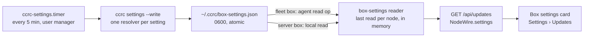

# Box settings in the console

**Spec** · 2026-10-25 · Status: Draft, revision 2 · Owner: the coordinator · Issue: #1417 · Related:
`docs/superpowers/plans/2026-10-23-centralised-update-w24-settings-live-in-ccrc-config.md` (#1237),
`docs/superpowers/specs/2026-09-20-centralised-update-management-design.md`

## In short

The console cannot show any of ccrc's seven settings, because only the `ccrc` CLI on each box reads them. This design
keeps the CLI as their one reader.

- **The CLI:** a new read-only verb, `ccrc settings`, prints what each setting resolves to and where it came from.
  With `--write`, it records that answer as `~/.ccrc/box-settings.json`.
- **A timer:** a new timer on every Linux box runs `ccrc settings --write` every five minutes. It runs under the user
  manager, which is the environment a console-driven update's detached child runs in.
- **The server:** a small reader on the server fetches that file the way the tmp-sweep lane fetches its census. It keeps
  the last read per node in memory, and `GET /api/updates` adds it to each node as `NodeWire.settings`.
- **The console:** a read-only **Box settings** card under Settings › Updates.

Nothing writes a setting. No route, agent op or box-token door is added, and coord.db gains no column. **To approve:**
the new timer on every Linux box, the five-minute cadence, and the new verb.

Revision 2 folds in an adversarial design review of revision 1: two critical findings, five important and seven minor.
Each change below is marked "(review)".

## 1. Context

This section says what exists today and why the console has nothing to show.

| Fact | Footing |
|---|---|
| The seven settings are `CCRC_BACKUP_KEEP`, `CCRC_BACKUP_DATA_KEEP`, `CCRC_VERSIONS_KEEP`, `CCRC_UPDATE_HEALTH_S`, `CCRC_UPDATE_DEADLINE_MS`, `CCRC_RELEASE_BASE_URL` and `CCRC_MODELS_ADVANCE_BUDGET_S`. Each resolves from the process environment, else `~/.ccrc/ccrc.env`, else its default, through one reader, `_ccrc_knob`. | Sourced: `ccd/ccrc`'s `CCRC_SETTINGS` and `_ccrc_knob` (#1237) |
| The CLI reads them, and the server ignores them. | Sourced: `deploy/ccrc.env.example`'s header |
| A console-driven update's detached child runs under the user manager's environment (`_upd_detach` runs `systemd-run --user`). Its parent, and a rollback's release check, run in the spawning service's environment: the agent's on the fleet box, `ccrc.service`'s on the server. That environment includes `agent.env`, or `ccrc.env` and `exposure.env`. | Sourced (review): `_upd_detach`, `agent/src/server.ts` `makeUpdateSpawn`, `server/src/update/spawn.ts` |
| Four settings have no callable validator. The health gate's parse is inline in `_upd_gate`. The models budget clamps rather than refuses. The deadline answers by return code only. The base URL has no validator. Each default is a literal at its call sites. | Sourced (review): `_upd_gate`, `_models_advance_budget_secs`, `_upd_deadline_ms` |
| The inventory sweep reads the node files that become each node's coord.db row, and `toNodeWire` maps only that row. The tmp-sweep census and the box-token generation are node files that the sweep leaves out, each read by its own reader. | Sourced (review): `server/src/update/inventory.ts` `MEASURED_FILE_KEYS`, `server/src/update/routes.ts` `toNodeWire` |
| The agent admits only the names in `NODE_FILE_BASENAMES`, so an older agent refuses a new name as `unreadable`, not `absent`. Caps words are read every sweep. | Sourced (review): `agent/src/whitelist.ts`, `inventory.ts` `readNodeFile` |
| On the server box, 5 timestamped backups hold 12.1 GB: 4 carry the coordination data at about 3.0 GB each, and 1 is thinned to 14 MB. The disk has 18 GB free of 150 GB. | Measured: 2026-10-25 17:08 UTC, read-only `du` and `df` |
| Wave 24 declined a read-only `ccrc config` verb to save verb-pin churn, and left doctor as the one read-only door. | Sourced: the #1237 plan, "out of scope" |

## 2. Design

The CLI measures, a timer records, a server reader fetches the record, and the console shows it.


*Figure 1. The path of one measurement. Only the CLI resolves a setting. Every step after it carries the answer and
never re-derives it.*

### 2.1 The verb

`ccrc settings` prints one line per setting: its key, its value, its source (`environment`, `ccrc.env`, `ccrc.env
(empty line)` or `default`), and the verdict of the act that reads it.

- **One resolver per setting (review).** Each setting gets one resolver, called both by its act and by the verb. The
  resolver answers the value, the source, `ok`, `refused` or `unmeasured`, and its sentence. Four of them are carved
  out of inline code (`_upd_gate`'s health parse, `_models_advance_budget_secs`, `_upd_deadline_ms`, and the base URL's
  read), so each default and each rule is spelled once. The carve-outs preserve behaviour: every act refuses, clamps
  and prints exactly as before. The three keeps use `_keep_knob`, with `_bak_data_keep`'s lowest bound of 2 for the
  data keep.
- **The deadline (review)** shows its plain reading, and the `min` and `max` readings the server and the watchdog take.
- **The base URL (review)** shows only `default`, or `custom` with its scheme and host. Never a path, a query or
  userinfo.
- **Every string is clipped by the verb (review)** to at most 480 bytes, ending `…` when cut. Under `LC_ALL=C`, each
  byte outside printable ASCII becomes `?`. A real `BUE_WHY` sentence runs 150 to 290 characters, so the snapshot keeps
  it whole.
- **The environment it read (review).** The verb says which one: `--from timer` (the unit's own argument) records
  `reader: "timer"`, and any other run records `reader: "shell"`. An interactive `ccrc settings` can disagree with the
  card, and says so.

`--json` prints the snapshot document. `--write` writes it to `~/.ccrc/box-settings.json` through a temporary file and a
rename, mode 0600, and prints nothing on success. The verb never prunes, never takes `update.lock`, and never changes a
setting.

### 2.2 The snapshot

One JSON document, version 1, far below the 64 KiB node-file cap.

```json
{
  "v": 1,
  "at": 1792948000,
  "reader": "timer",
  "settings": [
    { "key": "CCRC_BACKUP_KEEP", "state": "ok", "value": "5", "from": "environment" },
    { "key": "CCRC_UPDATE_HEALTH_S", "state": "refused", "value": "ninety", "from": "file", "why": "…" },
    { "key": "CCRC_VERSIONS_KEEP", "state": "unmeasured", "why": "…" }
  ],
  "deadline": { "plainMs": 900000, "minMs": 900000, "maxMs": 900000 },
  "backups": { "state": "ok", "kept": 5, "withData": 4, "bytes": 12694000000 },
  "disk": { "state": "ok", "availBytes": 19327352832, "sizeBytes": 161061273600 }
}
```

The three `state` values follow the "unmeasured is not unset" rule (D-6365):

- `ok`: the act would use the value.
- `refused`: the act would refuse it, or fall back as its own text says.
- `unmeasured`: the reader could not decide it.

`settings` lists all seven keys, once each, in `CCRC_SETTINGS` order.

### 2.3 Backups and disk

`kept` and `withData` come from `_bak_list` (review), the prune's own list, so a hand-made sibling is never counted and
nothing restates its matcher. `withData` counts the backups that still hold `coord.db`. The verb checks that
`~/ccrc-backups` is a readable directory before listing it, because the list's glob answers empty for a root that is a
file. A root that cannot be listed answers `unmeasured` with its reason, never zero. `bytes` comes from `du` and `disk`
from `df` of the home filesystem, each under `timeout` and `nice` (review).

### 2.4 The server reader, freshness and absence

The reader runs on the update sweep's tick. It reads the file through `readNodeFile`, the inventory's lstat-gated,
capped read, but the sweep never measures it: like `tmpSweep` and `tokenGeneration`, `boxSettings` is excluded from
`MEASURED_FILE_KEYS`. It keeps the last read per node in memory. `GET /api/updates` joins that read into each node's
`NodeWire.settings`. coord.db and `toNodeWire`'s row stay unchanged (review).

A new Linux cap word, `settings`, says the node's tree can write the file (review). It is read every sweep with the
other caps. Without it, the reader does not read at all.

| What the reader finds | `NodeWire.settings` | What the card shows |
|---|---|---|
| A node without the `settings` cap (an older build, or macOS) | `not-supported` | "This box's build does not report its settings" |
| No file | `absent` | "Not measured on this box yet" |
| A valid document, `at` within 15 minutes | `ok`, `stale: false` | The values |
| A valid document, older than 15 minutes | `ok`, `stale: true` | The values, labelled "measured 42m ago" in a warning tone |
| A document whose `at` is more than 5 minutes in the future | `clock-ahead` | "This box's clock is ahead; its settings are not shown" (review) |
| A file over the cap, not regular, or not valid v1 | `too-large`, `unreadable` or `malformed` | "Could not be read", with that word |
| A server that predates this field | the field is missing | "This server does not report box settings" |

### 2.5 The card

Settings › Updates gains a fourth card, **Box settings**, after the nodes card. It holds one block per node, in the
nodes card's order, labelled "reported by the box" (review). Each block has:

- the seven settings, each with its value and its source as a word ("from the environment", "from ccrc.env", "the
  default");
- a refused or unmeasured setting in the danger tone, with its sentence;
- on a server-role node, `CCRC_MODELS_ADVANCE_BUDGET_S` read as "not used on a server box", since no models timer runs
  there (review);
- one line for the backups ("5 backups, 4 with data, 12.1 GB") and one for the disk ("18 GB free of 150 GB");
- the measurement's age, and which environment it read.

The card has no controls. A note under it says that a setting is changed in the box's `ccrc.env`, and that the source
column shows when the environment overrides the file.

### 2.6 Trust

The snapshot is same-user-writable by every session on the box, like every node file (design 2026-09-20, decision 13).
So it is a display, never an authority. No act reads it, and every act re-resolves its setting at the moment it runs.
A session that could forge the file can already run `ccrc` itself, and `update.json`'s reported detail already shows
box-written text. React escapes it.

The validator bounds the file before it reaches a row:

- the version, the seven known keys once each, and the `state`, `from` and `reader` vocabularies;
- printable ASCII, with each string capped at 512 characters;
- non-negative safe integers, and an `at` no later than 5 minutes past the server's clock.

A document that fails any check is `malformed`, whole, never partly shown.

## 3. Decisions

The coordinator proposes these. The operator rules on the ones marked Proposed.

| # | Decision | Options considered | Chosen, and why | Status |
|---|---|---|---|---|
| D1 | Who resolves a setting for the console | (a) a TypeScript copy of the reader; (b) an agent op that runs the CLI on demand; (c) the CLI writes a snapshot | (c): the byte-wise model stays one implementation, and no exec surface widens | Proposed |
| D2 | What runs the snapshot | (a) the update watchdog or the update-sync tick; (b) a new timer on every role; (c) only at update time | (b): the safety units stay single-purpose, the timer reads the manager environment a detached update reads, and a fleet-role box has no watchdog | Proposed |
| D3 | Cadence | every minute; every 5 minutes; every 15 minutes | Every 5 minutes, stale after 15: a changed `ccrc.env` shows within 5 minutes at small cost | Proposed |
| D4 | Transport | (a) a new box-token POST; (b) a node file in the sweep; (c) a node file with its own reader, held in memory | (c), the tmp-sweep precedent (review): no new door, and no coord.db migration | Proposed |
| D5 | Editing | from the console; read-only | Read-only. Writing a box's file from the server needs a new agent op and a new trust argument | Agreed |
| D6 | macOS | a launchd job; not supported | Not supported for now, said as such through the cap word: a console-driven update never runs there | Proposed |
| D7 | A shell read | doctor only; `ccrc settings` | `ccrc settings`, which reverses wave 24's "no verb": it writes the snapshot anyway | Proposed |
| D8 | Validators the verb needs | restate them in the verb; extract one resolver per setting | Extract, behaviour-preserving (review): a restated rule would be a second definition | Proposed |
| D9 | A stopped timer | the stale label only; doctor's units check too | Both (review): doctor's known units gain the timer with its own sentence | Proposed |

## 4. What this does not change

- No default, range or refusal of any setting. The resolvers carved out in D8 answer exactly as the inline code did.
- No act reads the snapshot.
- No change to `ccrc doctor`'s `box-settings` check. D9 adds a units entry only.
- No change to the server's own reading of `CCRC_UPDATE_DEADLINE_MS`.

## Where things stand

**Agreed**
- A read-only Box settings panel under Settings › Updates (the operator, 2026-10-25: "yes please do that").
- It is built as the wave after #1410.

**Waiting on you**
- D2 and D3: a new `ccrc-settings.timer` on every Linux box, running every five minutes.
- D7: the new read-only `ccrc settings` verb.

**Later**
- Editing a setting from the console.
- A macOS snapshot.
- A push when a setting turns `refused`.
