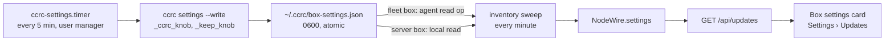

# Box settings in the console

**Spec** · 2026-10-25 · Status: Draft · Owner: the coordinator · Issue: #1417 · Related:
`docs/superpowers/plans/2026-10-23-centralised-update-w24-settings-live-in-ccrc-config.md` (#1237),
`docs/superpowers/specs/2026-09-20-centralised-update-management-design.md`

## In short

The console cannot show any of ccrc's seven settings, because only the `ccrc` CLI on each box reads them. This design
keeps the CLI as their one reader.

- **The CLI:** a new read-only verb, `ccrc settings`, prints what each setting resolves to and where the value came
  from. With `--write`, it records that answer as `~/.ccrc/box-settings.json`.
- **A timer:** a new timer on every Linux box runs `ccrc settings --write` every five minutes. It runs under the user
  manager, which is the same environment a console-driven update runs in.
- **The server:** the inventory reads that file the way it reads a node's other files. `NodeWire.settings` carries it
  to a read-only **Box settings** card under Settings › Updates.

Nothing writes a setting, and no route, agent op or box-token door is added. **To approve:** the new timer on every
Linux box, the five-minute cadence, and the new verb.

## 1. Context

This section says what exists today and why the console has nothing to show.

| Fact | Footing |
|---|---|
| The seven settings are `CCRC_BACKUP_KEEP`, `CCRC_BACKUP_DATA_KEEP`, `CCRC_VERSIONS_KEEP`, `CCRC_UPDATE_HEALTH_S`, `CCRC_UPDATE_DEADLINE_MS`, `CCRC_RELEASE_BASE_URL` and `CCRC_MODELS_ADVANCE_BUDGET_S`. Each resolves from the process environment, else `~/.ccrc/ccrc.env`, else its default, through one reader, `_ccrc_knob`. | Sourced: `ccd/ccrc`'s `CCRC_SETTINGS` and `_ccrc_knob` (#1237) |
| The CLI reads them, and the server ignores them. | Sourced: `deploy/ccrc.env.example`'s header |
| A console-driven update runs under the user manager's environment (`systemd-run --user`), not a shell's, so the effective value can differ from what an interactive shell would read. | Sourced: the #1237 plan's environment table |
| The inventory reads ten small node files every minute (`NODE_FILES`). Each read is lstat-gated, capped at 64 KiB and validated. No setting, backup or disk figure is among them. | Sourced: `shared/agent-protocol.ts`, `server/src/update/inventory.ts` |
| `ccrc doctor`'s `box-settings` check reads `ccrc.env` alone (`file` mode), never the environment, so it cannot say what a console update would see. | Sourced: `_ccrc_knob`'s `file` mode |
| On the server box, 5 timestamped backups hold 12.1 GB: 4 carry the coordination data at about 3.0 GB each, and 1 is thinned to 14 MB. The disk has 18 GB free of 150 GB. | Measured: 2026-10-25 17:08 UTC, read-only `du` and `df` |
| Wave 24 declined a read-only `ccrc config` verb to save verb-pin churn, and left doctor as the one read-only door. | Sourced: the #1237 plan, "out of scope" |

## 2. Design

The CLI measures, a timer records, the inventory carries the record, and the console shows it.


*Figure 1. The path of one measurement. The CLI is the only code that resolves a setting. Every step after it carries
the answer and never re-derives it.*

### 2.1 The verb

`ccrc settings` prints one line per setting: its key, its value, and its source (`environment`, `ccrc.env`, `ccrc.env
(empty line)` or `default`). A setting that cannot be measured prints the reader's own `KNOB_WHY` sentence. A value
that the act reading it would refuse prints that act's refusal sentence. The three keeps go through `_keep_knob`.
`CCRC_RELEASE_BASE_URL` is printed through `_upd_redact`, as every `fetching …` line already is. The verb also prints
the backups and the free disk (2.3).

- `--json` prints the same answer as the snapshot document.
- `--write` writes the document to `~/.ccrc/box-settings.json` through a temporary file and a rename, mode 0600, and
  prints nothing on success.

The verb never prunes, never takes `update.lock`, and never changes a setting.

### 2.2 The snapshot

One JSON document, version 1, small enough for the inventory's 64 KiB cap.

```json
{
  "v": 1,
  "at": 1792948000,
  "settings": [
    { "key": "CCRC_BACKUP_KEEP", "state": "ok", "value": "5", "from": "environment" },
    { "key": "CCRC_UPDATE_HEALTH_S", "state": "refused", "value": "ninety", "from": "file", "why": "…" },
    { "key": "CCRC_VERSIONS_KEEP", "state": "unmeasured", "why": "…" }
  ],
  "backups": { "state": "ok", "kept": 5, "withData": 4, "bytes": 12694000000 },
  "disk": { "state": "ok", "availBytes": 19327352832, "sizeBytes": 161061273600 }
}
```

The three `state` values follow the "unmeasured is not unset" rule (D-6365):

- `ok`: the act would use the value.
- `refused`: the act would refuse it, or fall back as its own text says.
- `unmeasured`: the reader could not decide it.

`settings` lists all seven keys, in `CCRC_SETTINGS` order.

### 2.3 Backups and disk

`kept` counts the timestamped directories under `~/ccrc-backups`, with the same matcher the prune uses, so a hand-made
sibling is never counted. `withData` counts those that still hold `coord.db`. `bytes` is their total size in bytes,
from `du`. `disk` is `df` of the home filesystem. A directory that cannot be listed answers `unmeasured` with its
reason, never zero.

### 2.4 Freshness and absence

The inventory reads the file every minute, like the others, and keeps its own read state beside the document.

| What the inventory finds | What `NodeWire.settings` says | What the card shows |
|---|---|---|
| A valid document, `at` within 15 minutes | `ok`, with the document | The values |
| A valid document, older than 15 minutes | `ok` with `stale: true` | The values, labelled "measured 42m ago" in a warning tone |
| No file | `absent` | "Not measured on this box yet": an older build, no timer, or macOS |
| A file over the cap, not regular, or not valid v1 | `too-large`, `unreadable` or `malformed` | "Could not be read", with that word |
| A server that predates this field | the field is missing | "This server does not report box settings" |

### 2.5 The card

Settings › Updates gains a fourth card, **Box settings**, after the nodes card. It holds one block per node, in the
nodes card's order. Each block has:

- the seven settings, each with its value and its source as a word ("from the environment", "from ccrc.env", "the
  default");
- a refused or unmeasured setting in the danger tone, with its sentence;
- one line for the backups ("5 backups, 4 with data, 12.1 GB") and one for the disk ("18 GB free of 150 GB");
- the measurement's age.

The card has no controls. A note under it says that a setting is changed in the box's `ccrc.env`, and that the source
column shows when the environment overrides the file.

### 2.6 Trust

The snapshot is same-user-writable by every session on the box, like every node file (design 2026-09-20, decision
13). So it is a display, never an authority. No act reads it, and every act re-resolves its setting at the moment it
runs.

The inventory validates it before it reaches a row:

- the version, the seven known keys, and the `state` and `from` vocabularies;
- printable ASCII, with each value and sentence capped at 200 characters;
- non-negative safe integers for every count and byte figure.

A document that fails any check is `malformed`, whole, never partly shown.

## 3. Decisions

The coordinator proposes these. The operator rules on the ones marked Proposed.

| # | Decision | Options considered | Chosen, and why | Status |
|---|---|---|---|---|
| D1 | Who resolves a setting for the console | (a) a TypeScript copy of the reader; (b) an agent op that runs the CLI on demand; (c) the CLI writes a snapshot | (c): the byte-wise model stays one implementation, and no exec surface widens | Proposed |
| D2 | What runs the snapshot | (a) the update watchdog or the update-sync tick; (b) a new timer on every role; (c) only at update time | (b): the safety units stay single-purpose, the timer gets the same manager environment as a console update, and a fleet-role box has no watchdog | Proposed |
| D3 | Cadence | every minute; every 5 minutes; every 15 minutes | Every 5 minutes, stale after 15: a changed `ccrc.env` shows within 5 minutes at small cost | Proposed |
| D4 | Transport | (a) a new box-token POST; (b) an eleventh node file | (b): no new door, and the box token still writes nothing to the control plane (design 2026-09-20, decision 15) | Proposed |
| D5 | Editing | from the console; read-only | Read-only. Writing a box's file from the server needs a new agent op and a new trust argument | Agreed |
| D6 | macOS | a launchd job; not measured | Not measured on macOS for now: a console-driven update never runs there (`_upd_detach_os_check`) | Proposed |
| D7 | A shell read | doctor only; `ccrc settings` | `ccrc settings`, which reverses wave 24's "no verb": it is the snapshot's writer anyway | Proposed |

## 4. What this does not change

- No default, range, reader or refusal of any setting.
- No act reads the snapshot.
- No change to `ccrc doctor`'s `box-settings` check.
- No change to the server's own reading of `CCRC_UPDATE_DEADLINE_MS`.

## Where things stand

**Agreed**
- A read-only Box settings panel under Settings › Updates (the operator, 2026-10-25: "yes please do that").
- It is built as the wave after #1410.

**Waiting on you**
- D2 and D3: a new `ccrc-settings.timer` on every Linux box, running every five minutes.
- D7: the new read-only `ccrc settings` verb.

**Later**
- Editing a setting from the console.
- A macOS snapshot.
- A push when a setting turns `refused`.
