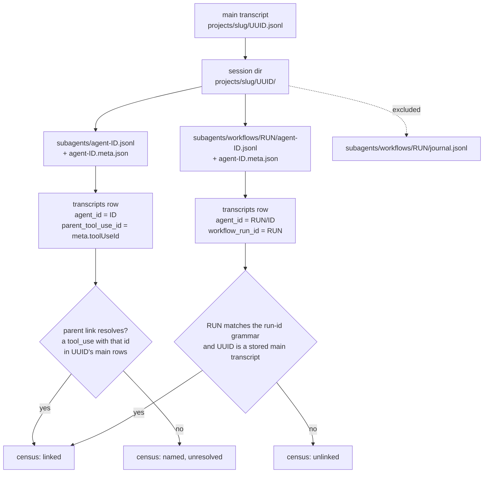
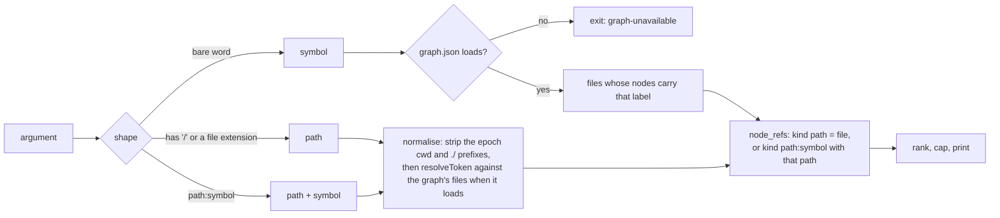
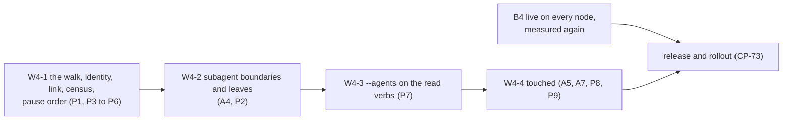

# ccrc history W4: subagent history and `touched` (spec addendum)

**Spec** · 2026-10-29 · Status: Draft, for the operator's approval · Owner: the operator approves; the programme's coordinator drafts · Linear: none · Related: `docs/superpowers/specs/2026-10-05-ccrc-history-lossless-dag-design.md` (rev 3.6: §6.2, §7.4, §8.2, §9.3, §9.15, §10.4, §10.6 item 5, §10.7), `docs/superpowers/programs/ccrc-history.md` (Stage 7, CP-70 to CP-73), `docs/superpowers/plans/2026-10-29-ccrc-history-w3-steering.md` (W3, independent of this)

> [!CAUTION]
> **W2-PASS gate. This is a draft, and it authorises nothing.** It was drafted under CP-70 while the W2 window waits. Drafting and review may go ahead now.
> This addendum authorises none of the following:
> - its own approval or merge;
> - a W4 plan's merge, or a W4 implementation;
> - a live read of any store;
> - a release or a rollout.
>
> Approval and merge wait for CP-50, the operator's W2 gate decision, to read **pass**. A release also waits for CP-51's close acts and for W1-B4 being live on every session-hosting node, measured again at that time. On a fail, this addendum is cancelled with the verdict as its reason.
> - The operator's rulings R-B1 to R-B4 stand as ruled. In particular R-B2: from act 6 to act 28, no release is installed and no wrapper changes.
> - W2 is not shortened or waived here.
> - Nothing here claims that W1's acceptance or its migration integrity is complete. W1-k's miss of 2026-10-01 still waits on the operator's ruling, and W1-b, W1-e and W1-f are still to be re-measured (CP-37).

## In short

- **What W4 adds.** The approved spec gives W4 two things:
  - the transcripts of subagents and workflow agents join the lossless store, each linked to its parent;
  - a read-only `ccrc history touched <path|symbol>` verb that names the history nodes whose refs name a file, resolved through the project's graphify graph.
- **What this addendum does.** It turns spec §10.4's five bullets into decisions a plan can be built from: a pin table, a failure table, the rules that find subagent boundaries, the parent link and its acceptance bar, `touched`'s output and ranking, what the store's growth does to the cap, file ownership, and a PR split.
- **Approved and proposed are kept apart.** Section 2 lists what the operator has already approved, with its source. Section 4 lists every choice the spec leaves open as a **proposal**, with a recommendation.
- **What the operator checks.** The proposals P1 to P9, above all:
  - P5, subagent capture pausing before main capture does;
  - P6, no automatic backfill of past subagent text;
  - P7, subagent rows opt-in in the read verbs;
  - P8, `touched`'s meaning, which is not the compaction card's `touched` tag.

## 1. Context

Spec §10.4 is W4's whole approved text. What already exists on `main` (`ce0c2c5ca`, read in source):

| Already on `main` | Where | Footing |
|---|---|---|
| The `transcripts` columns `agent_id`, `parent_tool_use_id`, `workflow_run_id` and `agent_type`, in schema v1 and empty for every row today | `ccd/history/store.mjs`, the `transcripts` DDL; `UNIQUE (cc_session_uuid, agent_id)` | Sourced |
| The export carries those columns for a due row | spec §9.15, "A due row is exported whole"; `sweep.mjs`'s replay `transcriptUpsert` | Sourced |
| Discovery reads main transcripts only: `<home>/projects/<slug>/<uuid>.jsonl` | `sweep.mjs` `walkTranscripts`, `discoverTranscripts` | Sourced |
| Leaves and their refs, with each ref's origin `model`, `tool_use` or `meta` | `store.mjs` `node_refs`; `derive.mjs` `minedRefs` (a mined ref keeps no edited or read tag) | Sourced |
| The graph loaders | `ccd/compact-card.mjs` `loadGraph` (bounded by `GRAPH_MAX_BYTES`, 96 MiB), `loadLabels`, `fileFacts`, `resolveToken`; `derive.mjs` already imports `compact-card.mjs` | Sourced |
| The read-verb list | `lib.mjs`: "The read verbs (§8.2): derived from the whitelist, never listed twice. `touched` joins in W4." | Sourced |
| The server's own reader of the workflow layout, with its run-id grammar `^wf_[0-9a-f]{8}-[0-9a-f]{3}$` | `server/src/workflows/model.ts` `RUN_ID_RE`, and its layout note (measured on 2.1.203 to 2.1.302) | Sourced |
| The source sizes: 36.7 GB of subagent JSONL against 9.3 GB main and 15.8 GB `tool-results`, deduplicated; 276 of 1,454 metas carry `toolUseId` | spec §15.2 and G14 | Measured 2026-10-05, on one box |

## 2. Already approved (constraints, not proposals)

These come from the approved spec and the programme. This addendum does not reopen any of them.

| # | Constraint | Source | Status |
|---|---|---|---|
| A1 | Ingest `<uuid>/subagents/agent-*.jsonl`, linked through its `.meta.json` `toolUseId` to the parent `tool_use` | §10.4 | Agreed |
| A2 | Ingest `subagents/workflows/<runId>/agent-*.jsonl`, linked through `runId` | §10.4, G14 | Agreed |
| A3 | `journal.jsonl` is excluded: it is not a transcript | §10.4, G14 | Agreed |
| A4 | Subagent boundaries are found by the scan, because delegated-observation subagents fire no PostCompact or SessionStart(compact). They never parse blocks | §10.4, §7.4 item 2 | Agreed |
| A5 | `touched <path\|symbol>` resolves `node_refs` and tool-mined paths against `graphify-out/graph.json` with `loadGraph`, `loadLabels` and `fileFacts`. It is read-only. graphify ids are a cache key, never a foreign key | §10.4 | Agreed |
| A6 | Store growth is about ×2.7, because subagents are 63% of bytes (inferred). The cap and the floor govern | §10.4, §9.3 | Agreed |
| A7 | `touched` accepts `--project` or `--workspace` like every read verb, both together is exit 2, and the whitelist is built from one list | §8.2 | Agreed |
| A8 | **B4-live prerequisite.** W4 does not ship before W1-B4 is live on every session-hosting node. Subagent text then reaches the export from its first ingest | §10.6 item 5; CP-72 depends on CP-34 | Agreed |
| A9 | **Acceptance bar.** At least 95% of subagent and workflow transcripts carry a parent link, by census | §10.7 W4 row; CP-73 | Agreed |
| A10 | W4 is gated on W2. W3 and W4 are independent | §10.4 "Wave independence" | Agreed |
| A11 | The addendum is a new product decision, so the operator approves it before any W4 plan merges | CP-70 | Agreed |

On A8: CP-34(b) recorded B4 live on the only session-hosting node on 2026-10-27. That record is not taken as the prerequisite. It is measured again at W4's dispatch and again before its release, on every session-hosting node then named.

## 3. Design

### 3.1 Discovery, identity and the parent link

A subagent's file sits under its parent's session directory, so the parent session comes from the path. The link names the call that made it.

*Figure 1. Where a subagent transcript comes from, the identity its row takes, and how the census counts its link. A dotted edge is a file the walk lists and never ingests.*

The rules:
- **The walk.** Only regular, non-link files are read, inside a session directory that is a real directory. A name must be `agent-<ID>.jsonl` with `<ID>` in `[A-Za-z0-9_-]`, at most 128 chars. That is the hook's own shape gate in `_hook_compact_scope` and `CCRC_ID_MAX`. A run directory must match `RUN_ID_RE`. Anything else is skipped and counted (`agent_file_refused:<reason>`).
- **The meta file.** It is read bounded (proposed 64 KiB), as JSON. `toolUseId` is the only field the spec measured. `agent_type` is filled from the meta's agent-type field if the W4 plan's base measures one on the installed version, else it is left NULL. It is never guessed from text.
- **Identity** (proposal P1). An Agent-tool subagent's `agent_id` is `<ID>`. A workflow agent's is `<RUN>/<ID>`, because nothing has measured that agent ids are unique across the runs of one session, and the row key is `UNIQUE (cc_session_uuid, agent_id)`. A `/` cannot occur in an Agent-tool id, so the two forms never meet.
- **A parent link resolves** when:
  - for an Agent-tool subagent: its `parent_tool_use_id` names a `tool_use` block's `id` in an assistant row of the parent's main transcript (same `cc_session_uuid`, `agent_id = ''`), in the store;
  - for a workflow agent: its run directory matches the grammar and its session directory's uuid is a stored main transcript.

  This matches A2: workflows are linked through `runId`, not through a `tool_use`.

### 3.2 Subagent boundaries (the scan rules)

- A subagent transcript's boundaries are found during ingest by the same rule as a main one's: the boundary row, and the summary through `preservedSegment.anchorUuid` (§7.4 item 1, PX1). That rule includes the `anchor_is_boundary` case.
- **No hook, no receipt, no steer.** A leaf of a transcript whose `agent_id` is not `''` never looks a receipt up. Its status is `not-requested`, so it can never be `steered_leaf`. It never writes or consumes a `card/` or `steer/` file, and it never counts toward the card measure, the W3 breaker or the W2 counters.
- **Its own chain** (proposal P2). Subagent leaves form a chain per transcript. Fan-in (§6.3) never mixes a subagent's leaves with the main thread's, and W4 condenses no subagent leaves into parents. Their link to the main thread is the transcript row's link, not a DAG edge.
- **When it is read** (proposal P3). Subagent files have no spool hint. A subagent file is read:
  - at a scan tick, inside the CP-39 discovery budget (rotating, resumable);
  - on a tick with no scan due, only when its parent's main file was taken by CP-39d's active read (`decideActiveRead`), sharing that rule's per-tick cap (`ACTIVE_STAT_MAX`, 256).

  So a busy fan-out costs no more stats per tick than today's cap allows.

### 3.3 `touched <path|symbol>`

**What it means** (proposal P8). `touched X` lists the history nodes whose refs name the file X resolves to, by any origin: a ref the session wrote (`model`), one mined from a tool call (`tool_use`), or one from PR metadata (`meta`).
- It is **not** the compaction card's `touched` tag (`compact-card.mjs` `TAGS`: a Read path or a Bash regex hit, below `edited`). The shared word is the spec's verb name. Its meaning is set here, and nothing is borrowed from the card's tag.
- History's mined refs keep no edited or read tag (`minedRefs`), so `touched` cannot tell an edit from a read without a schema change. P9 rules that out for W4.

*Figure 2. How `touched` turns its argument into files, then into nodes. Only a bare symbol needs the graph. A path still answers without one, matched exactly against the stored refs.*

- **Scope and identity** are every read verb's (§8.2, A7). The graph read is `<root>/graphify-out/graph.json` for each project root the scope resolves (the epochs' `cwd_real` roots). Each root is its own group.
- **Ranking** (proposal P8):
  1. the strongest origin among the node's matching refs: `tool_use`, then `model`, then `meta`;
  2. the node's `latest_ms`, newest first;
  3. `node_id`.

  The default cap is 20 rows (`--limit` up to the CLI cap). A cut always prints `(+k not shown)`, the card's rule, so a short list never reads as a small history.
- **Output, text:** a header line per group, `touched <file> (graph built at <sha>, or "no graph")`, then one line per node: `<node id> <kind> <earliest>..<latest> <family> [<origins>] <first sentence of the gist, redacted, at most 120 chars>`. Subagent nodes are marked `agent:<agent_id>`, and are shown only under `--agents` (P7).
- **Output, `--json`:** an array of `{nodeId, kind, earliestMs, latestMs, family, origins, gist, agentId, file}`.
- **Read-only.** Nothing graph-derived is stored, and the graph's mtime and `built_at_commit` are reported, never cached.
- **Cost** (proposal P9). `node_refs` has no index on `value` (its key is `(node_id, kind, value)`). The W4 plan measures the row count and a scan's p95 on a fixture of the measured size. W4 adds an index only if that p95 is over 1 s, and an index means a schema v3 migration behind §6.11's snapshot. The target is W1-f's chosen bound for a CLI read, under 2 s at p95.

### 3.4 Cap and growth

| Figure | Value | Footing |
|---|---|---|
| Subagent source | 36.7 GB of JSONL, against 25.1 GB main and sidecars | Measured (§15.2, 2026-10-05, one box) |
| Store growth after W4 | about ×2.7 | Inferred (§10.4) |
| Time to the 50 GB default cap | about 8 to 12 months for W1, about 4 to 6 after W4 | Inferred (§15.2's table) |
| A one-time backfill of today's subagent text | about 15 to 20 GB compressed, at §9.3's 0.4 to 0.55 ratio | Inferred here from the two rows above |

At the cap or below the floor, §9.3 pauses **all** capture. W4 therefore makes subagent text the likeliest cause of a main-session capture pause.

Proposals P5 and P6 answer that:
- **P5:** subagent ingest pauses first, at 90% of the cap (*chosen*), counted `capture_paused_agents_at_cap`, with a doctor WARN. Main capture continues to the cap as today.
- **P6:** W4 ingests subagent files written after its install only. Older ones arrive through an operator `import --apply --agents`, whose dry run prints the forecast size first.

The export (§9.15) grows on the home filesystem at the store's rate once subagent text nears its retention. Its own `planCopy` floor governs it, unchanged.

Repo growth: W4's PRs edit `ccd/history/*.mjs`, which are not on growth-check's list. The help paragraph in `ccd/ccrc` (`_usage_history_paragraph`) gains `touched`, and that file is on the list, so that PR runs `GROWTH_CHECK=1` growth-check.

## 4. Decisions

The operator rules on each proposal, or accepts the recommendation. A build question inside a PR stays the coordinator's (G7).

| # | Decision | Options considered | Recommended, and why | Status |
|---|---|---|---|---|
| P1 | A workflow agent's `agent_id` | `<ID>`; `<RUN>/<ID>` | `<RUN>/<ID>`: the row key is per session, and uniqueness across runs is not measured | Proposed |
| P2 | Subagent leaves in the DAG | Their own chain with no parents; condensed per transcript; children of the parent's leaf | Their own chain, no condensation in W4: subagents rarely compact, and a cross-thread edge has no approved rule | Proposed |
| P3 | When subagent files are read | Scan ticks only; every tick; scan plus the active parent's | Scan plus the active parent's, inside CP-39d's cap: fresh without a new per-tick cost | Proposed |
| P4 | What counts as a parent link in the census | Any named id; only a resolving one | Only a resolving one counts toward 95%. Named but unresolved is reported apart, so a gap is visible | Proposed |
| P5 | Subagent text against the cap | One cap for all (the spec); subagents pause first at 90%; a separate subagent cap file | Subagents pause first at 90% (*chosen*): main history, the part W2 evaluated, is never starved by W4 | Proposed (NEW product decision) |
| P6 | Past subagent text | Backfill on the first tick; operator import with a forecast | Operator import with a dry-run forecast: up to about 20 GB at once is the operator's call | Proposed (NEW product decision) |
| P7 | Subagent rows in `grep`, `describe`, `expand`, `tree` | Included by default; opt-in `--agents` | Opt-in `--agents`: the default output stays what W2 evaluated, and subagent noise is opt-in | Proposed (NEW product decision) |
| P8 | `touched`'s meaning and ranking | Any-origin refs ranked by origin, then recency; by ref count; edited only | Any origin, ranked `tool_use` > `model` > `meta`, then newest. It is not the card's `touched` tag | Proposed (NEW product decision) |
| P9 | An index for `touched`, and the edit/read tag | No schema change; v3 adds a `node_refs(value)` index; v3 adds a tag column | No schema change in W4, unless the plan's measurement shows a scan p95 over 1 s; then an index only. No tag column | Proposed |
| P10 | Where the run-id grammar lives | A second copy in `ccd/history` (another process, recorded as legitimately different); one copy in a `shared/*.mjs` both import | One `shared/*.mjs` holder with a single-definition pin, if the W4 plan measures that `shared/` ships beside `ccd/` on every session-hosting node; else the recorded copy with a parity pin | Proposed (build question) |

Unapproved departures from the approved spec, listed for the coordinator to number once approved, never numbered here: P5 (§9.3's "the cap and the floor govern" gains an order), and P7 (the read verbs' default scope).

## 5. Pin table

New pin ids `SA` (subagents) and `TC` (`touched`). Each pin ships with a test that goes red when its guard is removed, and a measured mutant.

| # | Guard | Red test |
|---|---|---|
| SA1 | journal excluded | a run directory holding `journal.jsonl` and one agent file → one transcripts row; the journal is never opened. CONTROL: a mutant that admits `*.jsonl` goes red |
| SA2 | Agent-tool link | meta `toolUseId` = the id of a `tool_use` in the parent's main rows → `parent_tool_use_id` set, census `linked` +1; an id that names no row → `named-unresolved` +1, never `linked` |
| SA3 | workflow identity | two runs with one agent id under one session → two rows, `RUN_A/ID` and `RUN_B/ID`. CONTROL: a bare `<ID>` mutant collides and goes red |
| SA4 | run-id grammar | a directory `wf_bad` → skipped and counted `agent_file_refused:run-id`; one matching `^wf_[0-9a-f]{8}-[0-9a-f]{3}$` → read |
| SA5 | regular files only | a symlink, a FIFO and a directory named `agent-x.jsonl` → none read, each counted, the FIFO never blocks (a bounded test) |
| SA6 | meta bounded | a meta over 64 KiB, or not JSON → the row stands with NULL link columns, counted `agent_meta_unreadable`; the transcript is still ingested |
| SA7 | no receipt on a subagent leaf | a subagent summary quoting a full `<ccrc-leaf>` block, with a planted `steer_receipts` row for the parent → status `not-requested`, kind never `steered_leaf` |
| SA8 | own chain | 8 main leaves and 8 subagent leaves of one session → no parent mixes them; the subagent leaves have no parent in W4 |
| SA9 | no card or steer side effects | a subagent boundary → no `card/` or `steer/` file is written or removed, and the card measure and the breaker are unchanged |
| SA10 | read cadence | a non-scan tick with an inactive parent → its subagent files are not stat'ed; an active parent → they are, inside `ACTIVE_STAT_MAX` |
| SA11 | pause order (P5) | a store at 90% of a fixture cap → main rows ingested, subagent rows held with cursors unmoved, counted; at 100% → both paused |
| SA12 | no backfill (P6) | a subagent file whose mtime is older than the install record → not ingested by a tick; `import --agents` (dry run) prints its size and writes nothing |
| SA13 | census | `measure-history.py`'s W4 row equals hand-computed `linked / (linked + named-unresolved + unlinked)` on a fixture |
| TC1 | path, no graph | no `graph.json` → `touched ccd/x.mjs` answers from the stored refs; `touched someSymbol` → `graph-unavailable` |
| TC2 | symbol | a graph whose two files carry label `foo` → two groups, each with its nodes |
| TC3 | ranking | three nodes with `tool_use`, `model` and `meta` refs for one file → that order; a tie → newest first, then `node_id` |
| TC4 | cut shown | 25 matches at limit 20 → 20 rows and `(+5 not shown)` |
| TC5 | read-only | a run against a store and a graph → the store's bytes, mtime and `user_version` unchanged, and no file written under `graphify-out/` |
| TC6 | not the card's tag | a node whose only ref for the file is `model`-origin → listed. CONTROL: a mutant that admits only `tool_use` refs goes red |
| TC7 | graph bounded | a `graph.json` over `GRAPH_MAX_BYTES` → `graph-unavailable` for a symbol, and a path still answers |
| TC8 | scope | `--project` and `--workspace` together → exit 2; neither, outside a session → the identity rule's own exit |
| TC9 | agents opt-in (P7) | a subagent node naming the file → hidden without `--agents`, listed with `agent:<id>` with it |

## 6. Failure table

| Input | When it cannot decide | Direction |
|---|---|---|
| `subagents/` | absent, a link, or not a directory | nothing read; no count (the common case) |
| agent file | a link, not regular, a name outside the grammar | skipped and counted; the walk continues |
| run directory | outside `RUN_ID_RE`, a link | skipped and counted |
| `journal.jsonl` | any | never read (A3) |
| meta | absent, over 64 KiB, unreadable, not JSON, no `toolUseId` | row kept with NULL link; counted; census `unlinked` |
| `toolUseId` | names no `tool_use` in the stored parent rows (the parent truncated, forked, or not yet ingested) | `named-unresolved`; re-checked on the next scan, never guessed |
| parent main transcript | not in the store (the session was never registered) | the subagent row is kept under its uuid; census `unlinked` |
| agent id | the same id in two runs | two rows under P1; under a rejected P1, refused as a collision and counted |
| subagent boundary | its anchor names no row | `raw_leaf` (DM25), as on main |
| cap or floor | at 90% of the cap | subagent ingest paused (P5); at the cap or the floor, all paused (§9.3) |
| `history-off` | present | nothing read, as for main |
| `graph.json` | absent, over 96 MiB, malformed, no nodes or links | `touched` on a symbol answers `graph-unavailable`; on a path it answers from the refs |
| symbol | no file carries the label | an empty result with the header line, exit 0 |
| path | outside every scope root, or `ambiguous` under `resolveToken` | listed by its exact stored spelling only; `ambiguous` printed in the header |
| store | unreadable, migrating, recovering | the read verbs' existing exits (§8.8) |

## 7. Files and ownership

| File | W4 change | Ring and context |
|---|---|---|
| `ccd/history/lib.mjs`, `lib.d.mts` | pure deciders: the agent-file grammar, the identity (P1), the link verdict, the pause order (P5), `touched`'s ranking and cut | pure policy, ccrc history |
| `ccd/history/sweep.mjs` | the walk of `subagents/`, the meta read, the cadence (P3), the pause (P5) | adapter and tick |
| `ccd/history/derive.mjs` | subagent leaves on their own chain, no receipt lookup | adapter |
| `ccd/history/recall.mjs`, `cli.mjs` | `touched`; `--agents` on the four read verbs | adapter and delivery |
| `ccd/compact-card.mjs` | unchanged, imported for `loadGraph`, `loadLabels`, `resolveToken` | none |
| `ccd/ccrc` | the help paragraph gains `touched` and `--agents` | delivery |
| `ccd/history-skill/SKILL.md` | one line on `touched` | skill text |
| `deploy/measure-history.py` | the W4 census row | deploy |
| `shared/*.mjs` (P10, if measured shippable) | the run-id grammar, imported by `server/src/workflows/model.ts` and `ccd/history` | L0 kernel |
| `README.md` | the history section names `touched` and `--agents` | docs |

No lifecycle row is added: every file W4 writes is inside the store. No wire, no `coord.db`, no exec surface and no box-token route changes (§13).

## 8. Proposed PR split

*Figure 3. The order. W4-1 carries the pause order, so no release ever ingests subagent text without it. W4-3 and W4-4 both edit `cli.mjs` and `recall.mjs`, so they run one after the other. The release waits for the B4 measurement.*

| PR | Claims | Pins |
|---|---|---|
| W4-1 | `ccd/history/lib.mjs`, `lib.d.mts`, `sweep.mjs`, `deploy/measure-history.py`, `shared/*.mjs` and `server/src/workflows/model.ts` (P10 only), their tests | SA1 to SA6, SA10 to SA13 |
| W4-2 | `ccd/history/derive.mjs`, `lib.mjs`, their tests | SA7 to SA9 |
| W4-3 | `ccd/history/recall.mjs`, `cli.mjs`, `ccd/ccrc`, their tests | TC9, and each read verb's `--agents` case |
| W4-4 | `ccd/history/recall.mjs`, `cli.mjs`, `lib.mjs`, `ccd/ccrc`, `ccd/history-skill/SKILL.md`, `README.md`, their tests | TC1 to TC8 |

Each PR is its own run, opened before the previous run closes, with a held-out review, landed under rule L. A W4 plan (CP-71) is written only after this addendum is approved.

## 9. Testing and proof

- Every pin in section 5 is red first, then green, with its mutant measured, on fixture HOMEs only, through `ccrc test --`.
- **Acceptance** (A9): after the release and rollout, `measure-history.py`'s census per node reports linked, named-unresolved and unlinked. W4 is accepted at a linked share of 95% or more.
- G14's 276 of 1,454 is a risk to that bar: it counts metas carrying `toolUseId`, workflow ones included. The census reports Agent-tool and workflow transcripts apart, so a miss names its kind.
- `touched` is accepted when TC1 to TC9 pass and its p95, measured on a fixture of the measured `node_refs` size, is under 2 s.

## Where things stand

### Agreed

- A1 to A11 (section 2), from the approved spec rev 3.6 and the programme's Stage 7.

### Waiting on you

- Approval of this addendum, after CP-50 reads pass.
- P5, P6, P7 and P8: new product decisions, each with a recommendation in section 4.
- P1 to P4, P9 and P10: their recommendations, which the W4 plan builds on unless you rule otherwise.

### Later

- The W4 plan (CP-71), after approval.
- An edit/read tag on mined refs, and an index on `node_refs(value)`: only if a measurement asks for them (P9).
- Condensing subagent leaves, or linking them as children of a main leaf (P2), once real subagent compaction rates are measured.
- A workflow agent's link to the exact `tool_use` that launched its run, once the installed version's run result is measured to name it.

---

*Drafted for the operator by Claude. Diagrams are Mermaid text.*
