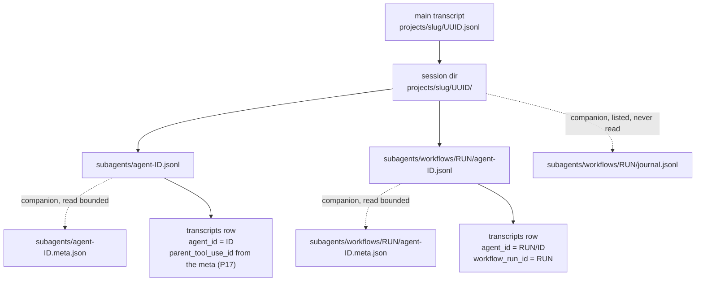
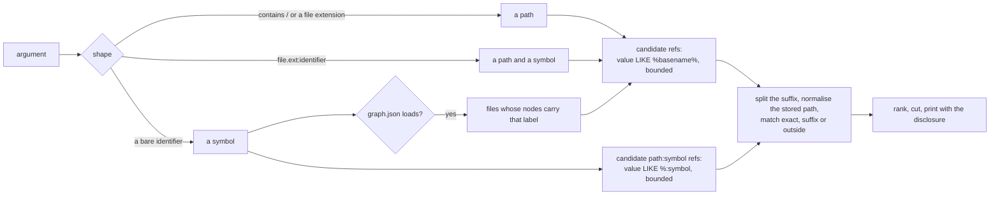
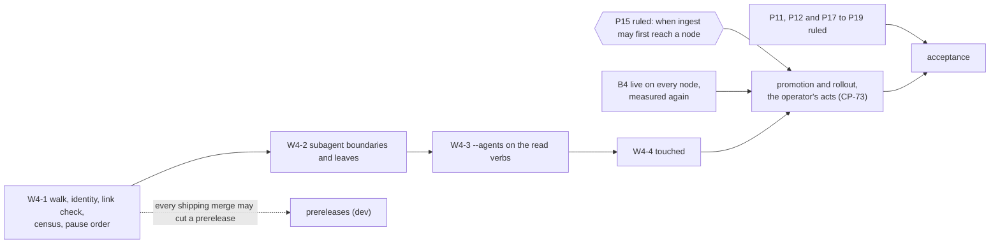

# ccrc history W4: subagent history and `touched` (spec addendum)

**Spec** · 2026-10-29 · Status: Draft, for the operator's approval · Owner: the operator approves; the programme's coordinator drafts · Linear: none · Related: `docs/superpowers/specs/2026-10-05-ccrc-history-lossless-dag-design.md` (rev 3.6: §6.2, §7.4, §8.2, §9.3, §9.15, §10.4, §10.6 item 5, §10.7), `docs/superpowers/programs/ccrc-history.md` (Stage 7, CP-70 to CP-73), `docs/superpowers/plans/2026-10-29-ccrc-history-w3-steering.md` (W3, independent of this)

> [!CAUTION]
> **A held draft. It authorises nothing.** It was drafted under CP-70 and is not accepted: its review findings still need disposition.
> This addendum authorises none of the following:
> - its own approval or merge;
> - a W4 plan's merge, or a W4 implementation;
> - a store read, a release, a promotion or a rollout.
>
> **W2 is not this addendum's gate.** The operator's conditional skip ruling of 2026-11-02 (the programme's "Current route", recorded by #2070) takes the full W2 replay and seven-day A/B off the progress path. It records W2 as **evaluation not run**: not passed, not failed, and not scheduled. W2 PASS is no longer W4's prerequisite (the route's step 3), so this addendum cites that ruling where it used to wait for CP-50 to read pass. It claims no W2 result and no benefit, and it changes no scientific threshold and no runtime default.
>
> What still gates W4 under that route:
> - **the operator's approval of this addendum** (A11, CP-70). It must settle parent linkage, subagent boundary handling, `touched`'s output and ranking, and cap and growth policy;
> - **an accepted W4 plan**, with independent review (CP-71);
> - **W1-B4 live before any subagent capture** (A8), on every session-hosting node, measured again at that time;
> - **the parent-link coverage check** (A9, by the census) and **the resource-bound checks** (P5, P9);
> - **CP-51's W2 close acts, which are not waived.** Before a W4 release, the operator measures on the node any W2 live state those acts name. None is assumed absent, and closing one is the operator's act.
>
> - The operator's rulings R-B1 to R-B4 stand as ruled. R-B2's span (acts 6 to 28) is a W2 window, and none is scheduled under the current route. If W2 is expressly resumed, no W4 release is installed inside that span.
> - Nothing here claims that W1's acceptance or its migration integrity is complete. W1-k's miss of 2026-10-01 still waits on the operator's ruling, and W1-b, W1-e and W1-f are still to be re-measured (CP-37).
> - **W4's acceptance is blocked.** The canonical bar stands at 95% (A9), but five things it rests on are open decisions: which population it is measured over (P11), what a workflow link must prove (P12), what a transcript's meta files prove when they disagree or cannot be read whole (P17), what counts as one transcript when a swap leaves copies in several homes (P18), and when a parent's window is complete enough to call a link unresolved (P19).
> - **When subagent ingest may first reach a node is open** (P15). Every shipping merge may cut a prerelease, and this addendum authorises no promotion or rollout.

## In short

- **What W4 adds.** The approved spec gives W4 two things:
  - the transcripts of subagents and workflow agents join the lossless store, each linked to its parent;
  - a read-only `ccrc history touched <path|symbol>` verb that names the history nodes whose refs name a file.
- **What this addendum does.** It turns spec §10.4's five bullets into decisions a plan can be built from: the link and how it is resolved, the census and its populations, the scan rules for subagent boundaries, `touched`'s matching, output and ranking, what growth does to the cap, file ownership, a pin table, a failure table and a PR split.
- **Approved and proposed are kept apart.** Section 2 lists what the operator has already approved, with its source. Section 4's decision table lists every open choice, P1 to P19, as a **proposal**. Each row gives its options, its recommendation, its PR and its first blocked consumer. Nothing in a proposal is approved by this draft.
- **What the operator checks first:**
  - P5, subagent capture pausing before main capture does;
  - P6, no automatic backfill of past subagent text. Its import would be a new operator writing form, `import --agents --apply`, proposed here; no such option exists today (section 3.6);
  - P7, subagent rows opt-in in the read verbs;
  - P8, what `touched` means, how it matches and how it ranks, which is not the compaction card's `touched` tag;
  - P11 and P12, the census denominator and the workflow link, without which W4 cannot be accepted. The census itself never turns an unknown count into a zero. It withholds every share while a directory it could not enter stands, at any level from the projects root down;
  - P17 and P18, also needed for acceptance. A swap leaves one subagent transcript in several homes, as hardlinks or as copies. That is ordinary, so the census keeps holdings, transcripts and conflicting content apart (section 3.1). P18 is what it counts as one transcript. P17 is what a transcript's meta files prove when they disagree, or when one is absent, oversized, unreadable, malformed or changed, on one holding or several;
  - P19, also needed for acceptance: when a parent's window is complete enough for a search with no match to be a definite `unresolved`, rather than a gap in the store. P17 and P19 decide whether missing evidence can read as a definite verdict. This draft recommends that it never does, and chooses nothing;
  - P15, when subagent ingest may first reach a node, since every shipping merge may cut a prerelease.

## 1. Context

This section says what W4 builds on: spec §10.4's approved text, and what `main` already holds (`ce0c2c5ca`, read in source, re-checked at `8de56f255`).

| Already on `main` | Where | Footing |
|---|---|---|
| The `transcripts` columns `agent_id`, `parent_tool_use_id`, `workflow_run_id` and `agent_type`, in schema v1, empty on every row today; `UNIQUE (cc_session_uuid, agent_id)` | `store.mjs`, the `transcripts` DDL | Sourced |
| The export carries those columns for a due row | spec §9.15, "A due row is exported whole"; `sweep.mjs`'s replay `transcriptUpsert` | Sourced |
| Discovery reads main transcripts only: `<home>/projects/<slug>/<uuid>.jsonl` | `sweep.mjs` `walkTranscripts`, `discoverTranscripts` | Sourced |
| A swap carries a session's whole `<uuid>/` directory, `subagents/` included, into the destination home: a hardlink tree when link(2) succeeds, directly or through the link route, and otherwise a copy. A return visit merges, and nothing removes the source | `ccd/ccd` `_swap_carry_sidecars`, `_swap_carry_merge_walk` | Sourced |
| One `transcripts` row per `(cc_session_uuid, agent_id)`. One `ingest_files` row per inode (`UNIQUE (dev, ino, source_key)`), each path an alias in `file_paths`. `bindFile` retires an inode whose transcript, birth time or first-line sha differs (`inode_recycled`). Entries are unique by message uuid, and a second body for one uuid is an `entry_variants` row | `store.mjs`, the DDL; `sweep.mjs` `bindFile` and its ingest statements | Sourced |
| `node_refs` keeps **one origin per `(node_id, kind, value)`** | `store.mjs`: `PRIMARY KEY (node_id, kind, value)`, `origin IN ('model','tool_use','meta')` | Sourced |
| A leaf's refs are `capRefs([...modelRefs, ...minedRefs])`. The first of each `(kind, value)` wins, so a file both named by the session and touched by a tool is stored as `model`. At most 40 are kept (`REFS_MAX`), and refs past 40 are dropped | `derive.mjs` `leafFields`; `lib.mjs` `capRefs` | Sourced |
| **No writer in `ccd/history` produces origin `meta`** today; only the check constraint allows it | `grep "'meta'" ccd/history/*.mjs` | Measured in source |
| Mined refs come from Edit-shaped and Read `file_path` and `notebook_path` only (the miner gets no regex, so Bash is never mined). They are stored as the tool input spelled them, usually absolute, after redaction | `derive.mjs` `minedRefs` | Sourced |
| `classifyRef` tests the `test` kind before `path`. So a path shaped `*.test\|spec.[cm]?[jt]sx?`, relative or absolute, mined or written by the model, is stored as kind `test`, never `path`. The same path with a `:N` suffix no longer has that shape and is stored as `path`, so one file can be stored under two kinds. A `path` ref may carry a `:N` or `:N-M` line suffix; a `path:symbol` ref is `<file.ext>:<identifier>` | `lib.mjs` `classifyRef`; `derive.mjs` `minedRefs` | Sourced |
| A `tool_use` block's id lives only inside the compressed row body. `entries.tool_name` holds only the first named `tool_use`'s name. `entries.source_tool_use_id` is a row's own top-level `sourceToolUseID`, not the id of a block it contains | `store.mjs` `entries`; `lib.mjs` `entryOf` | Sourced |
| Decoding a body to find a `tool_use` by id has precedents | `lib.mjs` `toolUseInputPath`; `sweep.mjs` `pairedFromStore` | Sourced |
| The graph loaders | `compact-card.mjs` `loadGraph` (bounded by `GRAPH_MAX_BYTES`, 96 MiB), `loadLabels`, `fileFacts`, `resolveToken`; `derive.mjs` already imports `compact-card.mjs` | Sourced |
| The graph's `built_at_commit` | `loadGraph` returns `{nodes, byFile, files, index, links, degree}` and drops it. The key is graph.json's last, a decoy may stand at its head, and `JSON.parse` keeps the last. Its one reader is the hook's `_hook_graph_measure` (`tail -c 4096`, last match, D-1361), which hands the card `--built` | Sourced |
| No column marks a tool-result row: `entries.tool_name` is set on assistant rows only, and a row's `source_tool_use_id` is its own top-level `sourceToolUseID`. A body over `blobOverDecodeCap` is never decoded whole | `lib.mjs` `entryOf`; `sweep.mjs` `pairedFromStore` | Sourced |
| The read-verb list | `lib.mjs`: "The read verbs (§8.2): derived from the whitelist, never listed twice. `touched` joins in W4." | Sourced |
| The server's reader of the workflow layout, with `RUN_ID_RE = /^wf_[0-9a-f]{8}-[0-9a-f]{3}$/` | `server/src/workflows/model.ts` (measured there on 2.1.203 to 2.1.302) | Sourced |
| Source sizes: 36.7 GB of subagent JSONL against 9.3 GB main and 15.8 GB `tool-results`, deduplicated; 276 of 1,454 metas carry `toolUseId` | spec §15.2, G14 | Measured 2026-10-05, one box |
| A workflow agent's `agent-<id>.meta.json` is "written once at its start", beside its transcript and the run's `journal.jsonl`; a run's summary is `S/workflows/<runId>.json`, outside `subagents/`. Nothing measures when an Agent-tool subagent's meta is written relative to its transcript's rows, or whether every transcript has one | `server/src/workflows/model.ts`, its header | Measured there on 2.1.203 to 2.1.302, workflow agents only |
| Each ingested file's read state is kept: `offset`, `size`, `eof_ms`, `status`, and the retry columns `retry_attempts`, `next_attempt_ms` and `last_error_code`. `entries.ts_ms` is nullable | `store.mjs`, the `ingest_files` and `entries` DDL | Sourced |
| `import` takes `--apply`, `--session` and `--file` only, and has no `--agents`. `WRITING_FORMS` holds `import-apply` (not irreversible) and `import-session-apply` (irreversible: a TTY outside every `cc-*` pane) | `lib.mjs` `parseOpVerbArgs`, `WRITING_FORMS` | Sourced |

## 2. Already approved (constraints, not proposals)

These come from the approved spec and the programme. This addendum does not reopen any of them.

| # | Constraint | Source | Status |
|---|---|---|---|
| A1 | Ingest `<uuid>/subagents/agent-*.jsonl`, linked through its `.meta.json` `toolUseId` to the parent `tool_use` | §10.4 | Agreed |
| A2 | Ingest `subagents/workflows/<runId>/agent-*.jsonl`, linked through `runId` | §10.4, G14 | Agreed |
| A3 | `journal.jsonl` is excluded: it is not a transcript | §10.4, G14 | Agreed |
| A4 | Subagent boundaries are found by the scan, since delegated-observation subagents fire no PostCompact or SessionStart(compact). They never parse blocks | §10.4, §7.4 item 2 | Agreed |
| A5 | `touched <path\|symbol>` resolves `node_refs` and tool-mined paths against `graphify-out/graph.json` with `loadGraph`, `loadLabels` and `fileFacts`. It is read-only. graphify ids are a cache key, never a foreign key | §10.4 | Agreed |
| A6 | Store growth about ×2.7, since subagents are 63% of bytes (inferred). The cap and the floor govern | §10.4, §9.3 | Agreed |
| A7 | `touched` accepts `--project` or `--workspace` like every read verb, both together is exit 2, and the whitelist comes from one list | §8.2 | Agreed |
| A8 | **B4-live prerequisite.** W4 does not ship before W1-B4 is live on every session-hosting node, so subagent text reaches the export from its first ingest | §10.6 item 5; CP-72 depends on CP-34 | Agreed |
| A9 | **Acceptance bar.** At least 95% of subagent and workflow transcripts carry a parent link, by census | §10.7 W4 row; CP-73 | Agreed |
| A10 | W3 and W4 are independent. §10.4 also gated W4 on W2; the operator's ruling of 2026-11-02 lifts that gate (the programme's current route, step 3) | §10.4 "Wave independence"; the programme's current route | Agreed; its W2 gate lifted by the 2026-11-02 ruling |
| A11 | The addendum is a new product decision, so the operator approves it before any W4 plan merges | CP-70 | Agreed |

On A8: CP-34(b) recorded B4 live on the only session-hosting node on 2026-10-27. That record is not taken as the prerequisite. It is measured at W4's dispatch, again before its release, and again before subagent capture first starts on a node (P15), on every session-hosting node named then. It is a release gate, not a test, and section 5 says so.

## 3. Design

This section describes each W4 mechanism. Every choice the spec does not make is marked with its proposal number from section 4.

### 3.1 Discovery and identity

A subagent's file sits under its parent's session directory, so the parent session comes from the path.


*Figure 1. Where a subagent transcript comes from, and the identity its row takes. A solid edge from the session directory is a transcript candidate. A dotted edge is a recognised companion: the meta is read for the link and the journal is listed and never read, and neither is a transcript or a census unit.*

- **The walk** reads only regular, non-link files inside a session directory that is a real directory.
  - **Its levels, from the top:**
    - the projects root, `<home>/projects`;
    - a project directory: every entry of the root;
    - a session directory: an entry of a project directory named as a session id (`UUID_RE`, with no `.jsonl`);
    - `subagents/`, `subagents/workflows/` and a run directory.

    An entry of a project directory with any other name is not a session directory (a main transcript `<uuid>.jsonl`, or a directory not named as a session id), and the walk never looks inside it.
  - **What a listed file is.** Each entry the walk lists in `subagents/` (other than `workflows/`, a level it descends into) or in a run directory is, by its name, a transcript candidate or a recognised companion. The two are told apart the same way in the walk, the census's parts, Figure 1 and SA13:
    - a **recognised companion** is `agent-<ID>.meta.json`, in `subagents/` or a run directory, or `journal.jsonl`, in a run directory only. A companion is read as its role says, the meta bounded and the journal never, and it is never a transcript candidate, a holding or a census unit. A meta with no transcript of its `<ID>` beside it is counted `agent_meta_orphan`, beside the units;
    - every other listed file is a **transcript candidate**. It is admissible when it is a regular, non-link file named `agent-<ID>.jsonl`, with `<ID>` in `[A-Za-z0-9_-]` and at most 128 chars, the hook's own shape gate (`_hook_compact_scope`, `CCRC_ID_MAX`). Any other candidate is refused and counted `agent_file_refused:<reason>`, and it stays a unit in `R` (section 3.3): nothing shows that it is not a transcript, so it is never dropped to raise a share.
  - A run directory must match `RUN_ID_RE`. A real directory whose name does not is listed, and each candidate in it is refused, counted `agent_file_refused:run-id`, with none read.
  - **At any level, a directory that is a link, is not a directory, or cannot be listed is never entered.** It is counted `agent_dir_refused:<level>:<reason>`, and what lies below it is unknown (section 3.3). Main discovery (`walkTranscripts`) differs here: it lists a linked project directory, and it skips an unlistable one silently. This walk does neither. So when a session's project directory is a link, the session keeps its main transcript, and its subagent files are unknown.
- **One walker.** This walk is discovery's own, not a second one. W4-1 extends `walkTranscripts` in `sweep.mjs`, after a characterization case pins today's main output. One traversal of each projects root then yields today's main transcripts, unchanged, and below each session directory every subagent entry with its verdict: an admissible file, a refused file and its reason, or an unentered directory with its level and reason.
  - Ingest takes the admissible files. The census's op arm (section 3.3) runs the same function and hands its whole answer to the census, so the two never disagree about what the tree holds.
  - Nothing else lists the subagent tree, so no second walker needs a "legitimately different" reason.
  - The levels above a session directory are walked once. Main's rules decide what main reads there. This section's stricter rules decide whether the subagent arm goes below each level, and count the directory in `K` where it does not.
- **The meta file** is a companion, read bounded (64 KiB, *chosen*), as JSON.
  - `toolUseId` is the only field the spec measured. G14 counts 276 of 1,454 metas carrying it. It does not count transcripts with no meta beside them, and nothing has measured when Claude Code writes an Agent-tool subagent's meta relative to its transcript's rows (section 1). That a meta can arrive after its transcript was first read is a possibility, not a measurement.
  - **Its lifecycle, as proposed.** The sweep reads a holding's meta when it first writes the key's `transcripts` row or binds a further holding of it, and it writes `parent_tool_use_id` from a meta read whole that names one. Whether a later holding's meta can replace a stored link, whether a NULL link left by an incomplete read is retried on later ticks, and what the census reads are P17's options, and none is chosen here. Under every option, the census's verdicts are recomputed at each census and never stored (section 3.2).
  - `agent_type` is filled only from a field the W4 plan measures on the installed version. Otherwise it is NULL, never guessed.
- **Identity (P1):** an Agent-tool subagent's `agent_id` is `<ID>`; a workflow agent's is `<RUN>/<ID>`.
  - Nothing has measured that agent ids are unique across one session's runs, and the row key is per session.
  - A `/` cannot occur in an Agent-tool id, so the two forms never meet.
- **No new table or column.** Every W4 field already exists in schema v1.

**Several holdings of one transcript (P17, P18).** One subagent transcript is often held by more than one home. A swap carries the session's whole `<uuid>/` directory, `subagents/` included, into the destination home (section 1). It is a hardlink tree when link(2) succeeds, and a copy when it fails, as it does across the per-home mounts unless the link route finds a common mount. Nothing removes the source. So after a swap, the homes the session ran under can each list the same agent file, and the census walks every rostered home. That is ordinary, not a collision. Three things are kept apart:
- **a holding:** one listed path;
- **a physical file:** the inode a holding resolves to. `bindFile` already checks it by `(dev, ino)`, then by the transcript, the birth time and the first line's sha, so a recycled inode is retired (`inode_recycled`). Inode identity alone is not enough: a copy is a new inode holding the same transcript, and a recycled inode can hold another one;
- **a logical transcript:** the row key `(cc_session_uuid, agent_id)`, the `UNIQUE` pair of `transcripts`. Every holding whose path names one session uuid and one agent id holds that one transcript, whatever its home or project directory.

**Ingest of several holdings (proposed).** Goal 1 of the approved spec asks for one copy per Claude Code uuid however many homes hold it, and for no message dropped on a content conflict. W4 applies main capture's existing rules to subagent rows, with no new table or column:
- each holding binds through `bindFile`'s rule. Hardlinked paths share one `ingest_files` row, each path an alias in `file_paths`, and a copy is an `ingest_files` row of its own;
- every holding of one key binds to that key's one `transcripts` row;
- rows are entries keyed by message uuid, and each holding keeps its own positions in `memberships`. A second body for one uuid is an `entry_variants` row (the spec's failure table: on a content conflict, keep both). Nothing is overwritten or dropped;
- a subagent leaf's span comes from the copy that holds its boundary (§6.1). So a holding that lacks rows another one has loses none of them: `rows_unspanned` and `transcript_forked` count it, as on main;
- `workflow_run_id` comes from the path, so every holding of a key gives the same one. `parent_tool_use_id` comes from a meta file, and each holding carries its own. When they disagree, or one cannot be read whole, what counts is P17.

**The content shapes**, each a planned case (section 5):

| Shape | What the holdings show | Ingest | Census |
|---|---|---|---|
| hardlinks | two paths, one inode | one `ingest_files` row with two `file_paths` aliases (SA24) | one transcript |
| identical copies | two inodes, the same rows and bytes | two `ingest_files` rows; one entry per row, with a membership in each (SA25) | one transcript |
| growing copies | one holding's rows are a prefix of the other's: an in-place append after a copy, or a shorter log the carry's merge has not yet replaced | the entries' union, and no variant (SA26) | one transcript |
| forked copies | a shared prefix, then rows only one holding has | every row stored; leaves from the copy that holds each boundary; `transcript_forked` (SA27) | one transcript |
| a true conflict | one message uuid with two different bodies | one entry and one `entry_variants` row, nothing dropped (SA27) | one transcript |
| disagreeing or incomplete metas | metas naming different `toolUseId`s, or one naming none; or a meta absent, oversized, unreadable, malformed or changed | as P17 rules (SA6, SA28) | as P17 rules (section 3.3), and never `L` while it is open |
| disjoint holdings | two holdings with at least one row each and no row in common | every row stored, under the one key | `identity_collision`. The key may name more than one transcript (P1's uniqueness is unmeasured), so the count is unknown, and every share is withheld while one stands (SA29) |
| unbound holdings | a holding not yet read; one that cannot be opened or read (ingest's retry columns record why); or one changed since its read other than by growth: another inode at the path, a changed first line, or a shrink, which `bindFile` retires or rescans | the existing retry, retire and rescan rules | `holding_unbound`, by cause. It may hold another transcript, so under P18 (a) it widens the share's range and never narrows it (section 3.3, SA30) |

A holding that only grew since its read stays bound: its cursor resumes, and its stored rows are a prefix of the file. The census compares holdings from the store's memberships, so it reads no transcript file to tell copies from collisions.

### 3.2 The parent link and how it is resolved

A row *names* a link when its link column is set. It *resolves* only when the parent holds the call the link names. The two are counted apart, so a named but unresolved link never counts as linked.

**An Agent-tool link (P4, mechanism)** resolves when the parent's main transcript holds an assistant row with a `tool_use` block whose `id` equals `parent_tool_use_id`. Ids live only inside compressed bodies, so the check is a bounded decode:
1. Let `t0` be the subagent transcript's first timed row. With none, the verdict is `unmeasured`. With no main transcript of the parent session in the store, it is `unmeasured` too (reason `parent-not-stored`), since nothing could be checked.
2. Take the parent's candidates with `entries_ts` (`transcript_pk, ts_ms`): assistant rows with `tool_name IS NOT NULL` (at least one named `tool_use`) and `ts_ms` in `[t0 − 15 min, t0]` (*chosen*), newest first.
3. Decode at most 64 of them (*chosen*). Each body's `tool_use` blocks are tested by id, the precedent being `toolUseInputPath`, so a block that is not a row's first `tool_use` is still found.
4. The verdict is `linked` on a match. With every candidate decoded and no match, it is `unresolved` only when the window is complete, as P19 rules (below). It is `unmeasured` when the 64-decode bound stopped the search, a candidate could not be decoded, or a candidate's body is over `blobOverDecodeCap` and so is never decoded.

The check runs only in the census, a read-only pass in Node (Python never decodes blobs). Nothing stores its verdict, so W4 needs no schema change. The cost is at most 64 decodes per subagent transcript, about 93,000 at G14's 1,454 metas. The W4 plan measures it on a fixture of that size.
- Unapproved alternative: store the verdict, or add a side table or index of `tool_use` ids, in a schema v3 behind §6.11's snapshot.

**When a window is complete (P19).** A window decoded whole with no match proves `unresolved` only if every row that could match was stored, and timed, when the census ran. Four things leave a window incomplete, and none of them shows as a candidate:
- **a parent not stored:** no main transcript of the parent session is in the store (`parent-not-stored`, step 1);
- **an ingest backlog:** a holding of the parent's main transcript is not yet read past the window's end, so rows on disk are not in the store. Read past it means a stored row of that holding timed after the window's end, or the holding read to its end at the last tick;
- **an unread copy:** a holding of the parent is not yet bound, and it may hold rows the bound ones lack (section 3.1);
- **untimed rows:** a parent assistant row with `tool_name` set and a NULL `ts_ms` (the column is nullable) lies outside every window.

P19 rules what each gives, and section 3.3 lists the outcomes under each option. The census's verdicts are recomputed at every census and never stored, so a later census can move a unit from `M` to `L` or `U` as the parent's ingest catches up. That changes nothing the current census prints. P12 (b)'s lookup has the same four causes, and P19 rules them for it too.

**A workflow link (P12, predicate).** A2 says workflows are linked "through `runId`". What that proves is open. Every workflow row names a link, because `workflow_run_id` is set from its path, so a workflow file is never `X`. Its verdict is the predicate P12 rules:
- **(a) placement.** The run directory matches `RUN_ID_RE` under the session's directory. That is true by construction for every admitted file, so under (a) every admitted workflow file is `L`, and the option measures nothing. Proposed, not recommended as the bar;
- **(b) run named.** A parent user row carries a `tool_result` block that names the run id: the result of the call that launched the run. The lookup is below, and it gives `L`, `U` or `M`. This proves a real association with a launching call. Recommended, but **unavailable and blocked** until the W4 plan measures, on the installed version, that the launch result names the run id and when it arrives;
- **(c) run summary.** `S/workflows/<runId>.json` exists. This gives `L` when the file exists, `U` when it does not, and `M` when it cannot be read. It proves the run reached a final status for this session. Proposed.

**Option (b)'s lookup, proposed.** The decode above selects assistant rows by `tool_name`, which a result never has: a launch result is a `tool_result` block in a **user** row, and no column marks such a row. So (b) has a lookup of its own:
1. Candidates: the parent's rows with `type = 'user'` and `ts_ms` in the window, through `entries_ts`, nearest the window's anchor first.
2. The window depends on when the result arrives, which is not measured. If the launch returns at once, it is `[t0 − 15 min, t0 + 15 min]`, `t0` being the run's first timed row. If the launch returns when the run ends, it is `[t_end, t_end + 15 min]`, `t_end` being the run's last timed row. The W4 plan measures which, and builds that one.
3. At most 64 decodes per run, not per agent: a run's agents share one verdict, kept per `(session, runId)` for one census pass. A body over `blobOverDecodeCap` is not decoded.
4. In each decoded body, each `tool_result` block's text (a string, or its `text` items) is tested for the run id as a whole token, `RUN_ID_RE`'s shape and equal to the directory's name.
5. The verdict is `linked` on a match, `unresolved` when every candidate was decoded with none and the window is complete (P19), and `unmeasured` when the bound stopped it, a body was over the cap, or a body could not be decoded.

The cost is at most 64 decodes per workflow run, beside the Agent-tool decode's 64 per transcript.

Until P12 is ruled, the census prints the workflow kind under each option it can measure, side by side, and shows (b) as `unavailable` until it is measured. No workflow file counts toward the canonical share, as linked or as not linked. A9's population includes workflow transcripts (section 3.3), so no canonical share is computed until then.

### 3.3 The census (P11, P12, P16 to P19)

The census is how A9 is measured. It is a read-only Node pass over discovery's own walk (section 3.1), joined with the store. It reports every population apart, says which figures partition and which overlap, and never turns an unknown into a zero.

**The unit (P18).** A link verdict belongs to a `transcripts` row, so the census counts logical transcripts: one unit per key, however many holdings carry it (section 3.1). That is P18's recommendation, and nothing here approves it. `K` alone counts directories.
- Holdings and physical files are counted beside the units, never instead of them. With one holding per key, P18's three options agree.
- A refused holding whose name yields no key (a name outside the grammar) is a unit of its own, since nothing can show that it copies another.
- Several holdings of one key are one unit, not a collision. Only disjoint holdings are `identity_collision` (section 3.1), and every share is withheld while one stands, as for a failed sum.

**What it cannot enumerate.** At every level of the walk (section 3.1), from the projects root down to a run directory, a directory that is a link, is not a directory, or cannot be listed is never entered. The census counts it in `K` by level and reason. The files below it are **unknown**, never 0. No share and no 95% certification is drawn from a tree that holds one.

| Population | Definition | Where it sits |
|---|---|---|
| unentered directories `K` | the directories above, by level (projects root, project, session, `subagents/`, `workflows/`, run) and by reason (`link`, `not-dir`, `unlistable`) | a count of directories. Their files are **unknown**, never 0 |
| listed `D` | every unit with at least one listed holding: a transcript candidate, admissible or refused, listed in an entered directory. A recognised companion (a meta, or a run's `journal.jsonl`) is never a holding, so never a unit (section 3.1) | the units the census knows of |
| refused `R` | units of `D` with no `transcripts` row whose every listed holding the walk refuses: a candidate with a name outside the grammar, a link, not a regular file, or a candidate in a run directory whose name is outside `RUN_ID_RE`. Such a directory is a real one, so it is listed, and no file in it is read | part of `D` |
| pre-install, not admitted `P` | units of `D` with no `transcripts` row, an admissible holding, and every admissible holding's `mtime` before W4's install record (P6) | part of `D` |
| pending `Q` | units of `D` with no `transcripts` row yet and an admissible post-install holding: discovery rotates within a budget | part of `D` |
| admitted `Ad` | units of `D` with a `transcripts` row, whatever their holdings' `mtime` and whatever the walk says of each listed holding now | part of `D` |
| linked `L`, unresolved `U`, unmeasured `M`, unnamed `X` | admitted units by their link verdict (section 3.2), with P17 for a key's meta evidence and P19 for a parent's window (the outcomes below). `X` has no link named, which only an Agent-tool unit can have | a partition of `Ad` |
| imported `I` | admitted units whose every holding's `mtime` is before the install record: what P6's operator import brought in | a subset of `Ad` |
| gone `G` | units with a `transcripts` row and no listed holding. Each is counted `not found` when every directory its stored paths (`file_paths`) lie in was entered, and `unknown` when one of them lies below a directory in `K` | outside `D`, so in no part of it; reported apart |
| beside the units | holdings listed; physical files; `holding_unbound` by cause; `refused_since_stored`, refused holdings of admitted units; each key's content shape (section 3.1); companions listed, by kind, and `agent_meta_orphan` | reported apart, never added to a part |

- **Precedence, so that nothing counts twice.** A unit with at least one listed holding is in `D`, and it takes the first part of `D` that holds, in this order: `Ad` (it has a row), then `P` or `Q` (it has an admissible holding), then `R`. So a stored row whose holding was later replaced by a link stays in `Ad` once, with its verdict, and the refusal is counted `refused_since_stored` beside it, never as a second unit. Under P18 (b) and (c), the walk's verdict comes first instead: a refused holding is `R` even with a stored row, and that row's verdict is reported apart. Each option's precedence is part of P18. A unit with a row and no listed holding is `G`. It is set apart by having no listed holding, under every option, never by precedence, so `G` and `Ad` never share a unit.
- **The partitions.** `D = R + P + Q + Ad`, by admission state, and `Ad = L + U + M + X`, by verdict. Every unit is in exactly one part of the first, and every admitted unit in exactly one part of the second. An import moves a unit out of `P` and into `Ad` and `I`. The census checks both sums on every run, and prints no share when either fails.
- **The overlapping subsets,** labelled as subsets and never added to a partition: imported `I`; every pre-install admissible unit, `T = P + I`; eligible `E = Q + Ad`; named `N = L + U + M`.
- **By kind.** Every figure is also split into Agent-tool and workflow units, a partition by place. An Agent-tool unit takes the decode's verdict (section 3.2). A workflow unit takes the verdict of P12's predicate, and the census prints it under each option it can measure.

**Every verdict has a part (proposed).** An Agent-tool unit's verdict rests on two pieces of evidence: the link its metas name, and what the parent holds (section 3.2). Every state of each has an outcome below, under each option of the decision that rules it. Where the approved spec does not settle an outcome, that decision blocks its first consumer, and none is chosen here.

The meta side (P17), per key, over one holding or several:

| A key's meta evidence | P17 (a) | P17 (b) | P17 (c), recommended | P17 (d) |
|---|---|---|---|---|
| every meta read whole names the same link | the link; the parent side decides | the link | the link | the link |
| every meta read whole names none | `X` | `X` | `X` | `X` |
| metas naming different links, or a link beside one naming none | the newest holding's link | the first stored link, with `agent_meta_conflict` beside | `M` (`meta-conflict`) | as (c) |
| a meta absent, over 64 KiB, a link or not regular, unreadable, or not a JSON object, on one holding or beside others | the stored link, and NULL is `X` | the stored link, and NULL is `X`, with `agent_meta_unreadable:<cause>` beside | `M` (`meta-unread:<cause>`) | as (c), and the sweep retries a NULL link |
| a meta changed since the link was stored | the newest holding's link | unseen: the stored link stands | `M` (`meta-conflict`) | as (c) |

The parent side (P19), for an Agent-tool unit, and for a workflow unit under P12 (b):

| What the parent holds | P19 (a) | P19 (b), recommended | P19 (c) |
|---|---|---|---|
| no main transcript of the parent session in the store | `M` (`parent-not-stored`) | `M` (`parent-not-stored`) | `M` (`parent-not-stored`) |
| the subagent has no timed row, so no window | `M` | `M` | `M` |
| a candidate matches | `L` | `L` | `L` |
| the decode bound reached, or a candidate undecodable or over the decode cap | `M` | `M` | `M` |
| no match, and the window complete | `U` | `U` | `U` |
| no match, and a holding of the parent not read past the window's end | `U` | `M` (`parent-behind`) | `M`, and every share withheld |
| no match, and a holding of the parent not yet bound | `U` | `M` (`parent-copy-unbound`) | `M`, and every share withheld |
| no match, and a parent assistant row with `tool_name` and a NULL `ts_ms` | `U` | decoded after the timed candidates, within the same bound; one left undecided is `M` (`parent-untimed`) | as (b), and every share withheld while one stands |

A workflow unit's link is its run, never a meta: under P12 (a) or (c) it takes that predicate's verdict, and under (b) the parent side above. No census verdict is called `unlinked`, and that word names no part.

**Uncertainty is shown, never folded:**
- while `K > 0` or `identity_collision > 0`, the census prints `share withheld:` with the counts by level and reason, and no share;
- `M` is uncertain in the numerator, so every share is printed as a range, `L / den` to `(L + M) / den`;
- under P18 (a), an unbound holding may hold another transcript. At the lower end, a key with `u` unbound holdings counts `u` extra units, not linked, when it also has a bound holding, and `u − 1` when it has none. The upper end counts none, so the range widens and never narrows;
- under P17's and P19's recommendations, an incomplete meta or window is `M`, so it widens the range and never narrows it;
- `Q` counts as not linked, and `G` is outside every denominator;
- no copy, fork or conflict is ever left out of a denominator, and neither is a refused transcript candidate, so none can raise a share.

**Membership by option** (the detail of P11 and P12):
- The denominator is P11's. It covers both kinds, since A9 counts subagent and workflow transcripts.
- The numerator is the denominator's linked units. An Agent-tool unit is linked by the decode, and a workflow unit by the predicate P12 rules.
- The census prints every column, and only the ruled one is ever called canonical.

| Part | `D − T` (recommended) | `D` | `E` | `Ad` |
|---|---|---|---|---|
| `R`, refused | in | in | out | out |
| `P`, pre-install, not admitted | out | in | out | out |
| `Q`, pending | in | in | in | out |
| `Ad − I`, admitted post-install | in | in | in | in |
| `I`, imported pre-install | out | in | in | in |

- **Recommended, not approved: `D − T`.** It is the set the earlier draft wrote as `D − P`, when `P` still held every pre-install file: every listed unit but the pre-install admissible ones, with refused and pending units included. A refusal or a pending unit can never raise the share, and pre-install units are W4's only by import under P6. They are reported apart, so a ruling the other way, on P6 or P11, counts them back in.
- **Which way imported and refused pre-install units count is part of P11.** The table shows each option's answer, and none is chosen here.
- Acceptance is **withheld** until P11, P12 and P17 to P19 are ruled. Under every option it is also withheld while `K > 0` or `identity_collision > 0`, and while the lower end of the range is below 95%.
- P6's predicate, proposed with P6: a file whose `mtime` is at or after the install record is post-install, and is ingested whole. The install record is a `meta` row the first W4 tick writes (`agents_since_ms`), which needs no schema change.

**The census's contract (proposed, P16).**
- **Owner:** W4-1.
- **Home:** a new `ccd/history/census.mjs` holds the read-only pass: the store join, the holdings' comparison from stored memberships, the Agent-tool decode and P12 (b)'s lookup.
  - It lists no tree. The op arm in `sweep.mjs` runs discovery's walk (section 3.1, "One walker") and hands its whole answer to it.
  - `lib.mjs` holds the pure deciders: the parts and their precedence, the two sums, the verdicts and the share's range.
  - `deploy/measure-history.py` lists no subagent tree. Python cannot import the walk, and a second grammar there would be a second spelling with nothing legitimately different about it.
- **Verb (a CLI expansion, proposed):** `ccrc history census [--json]`, an operator verb in `cli.mjs`'s `OP_OF_VERB`. So it runs through the shim, which hands it the rostered homes and is the one lock taker.
  - It is not a writing form. It opens the store read-only and writes nothing.
  - It prints counts and shares only, never text.
  - It holds the writer's lock while it runs, as every op does. So the W4 plan measures its duration on a fixture of G14's size.
- **Exits:** lib's existing `EXIT` codes, and no new one:
  - 0: the census ran. A withheld share is a result, not an error;
  - 2: a refusal, `bad-args` or one of the operator door's own words, such as `writer-absent`;
  - 4: writer busy;
  - 5: a store error;
  - 6: not indexed;
  - 9: no store on this box;
  - 1: internal.
- **Files W4-1 claims for it:** `census.mjs` (new), `lib.mjs`, `lib.d.mts`, `cli.mjs` (the verb's row and usage line), `sweep.mjs` (its op arm and the walk), `ccd/ccrc` (the help line, so W4-1 runs growth-check armed), and their tests. Sections 7 and 8 name the same files.
- **The alternative, with no CLI change:** an arm of `deploy/history-counters.mjs`, `census --db <store> --home <home>…`, which the operator runs like W3's spike report. Its cost is a home list typed by hand, and a missing home is an unknown that reads as nothing.

### 3.4 Subagent boundaries (the scan rules)

A subagent transcript compacts without any hook, so its boundaries come from the rows alone.
- **The same rule as main.** The boundary row, and its summary through `preservedSegment.anchorUuid` (§7.4 item 1, PX1), including the `anchor_is_boundary` case.
- **No hook, no receipt, no steer.** A leaf whose transcript's `agent_id` is not `''`:
  - never looks a receipt up, so its status is `not-requested` and it is never a `steered_leaf`;
  - never writes or consumes a `card/` or `steer/` file;
  - never counts toward the card measure, the W3 breaker or the W2 counters.
- **Its own chain (P2).** Subagent leaves form a chain per transcript. Fan-in never mixes them with the main thread's, and W4 condenses none. The link to the main thread is the row's link, not a DAG edge.
- **When it is read (P3).** Subagent files have no spool hint, so one is read:
  - at a scan tick, inside the CP-39 discovery budget (rotating, resumable);
  - on a non-scan tick, only when its parent's main file was taken by CP-39d's `decideActiveRead`, inside that rule's per-tick cap (`ACTIVE_STAT_MAX`, 256).

### 3.5 `touched <path|symbol>` (P8)

`touched` names the history nodes whose stored refs name a file.
- **What it is not.** It is **not** the compaction card's `touched` tag (`compact-card.mjs` `TAGS`: a Read path or a Bash regex hit). The word is the spec's verb name, and nothing of the card's tag is borrowed.
- **What it cannot see.** The store keeps one origin per ref, keeps the first origin seen, and keeps at most 40 refs per node (section 1). So `touched` sees only what was kept, and it says so on every answer (below). It is not a complete record of which sessions touched a file.


*Figure 2. How `touched` turns its argument into candidate refs, then into nodes. A bare symbol always reads the bounded `path:symbol` select, and with a graph it also reads the files that carry its label. Every candidate set passes the same cap, normalisation and ranking.*

**The matching contract (proposed):**
1. **Candidates, bounded.** A file query reads the select below. A file query is a path, a `path:symbol`, or each file that a graph gives a symbol:
   ```
   SELECT node_id, kind, value, origin FROM node_refs
   WHERE kind IN ('path','path:symbol','test') AND value LIKE ? ESCAPE '\'
   ```
   Its pattern is `%<basename>%`. A symbol query also reads, with or without a graph:
   ```
   SELECT node_id, kind, value, origin FROM node_refs
   WHERE kind = 'path:symbol' AND value LIKE ? ESCAPE '\'
   ```
   Its pattern is `%:<symbol>`.
   - Every pattern escapes `%`, `_` and `\`. The kinds include `test`, because every test file is stored under it (section 1).
   - One query's candidates, from every select it reads, are capped at 10,000 rows together (*chosen*).
   - The selects have no order. So a capped answer prints `(candidates capped at 10000: the ranking covers those only, and newer matches may be missing)`.
   - P13 is the bounded alternative that makes a capped ranking exact, and it orders every select the same way.
2. **Split the stored value.**
   - A `path` ref drops a trailing `:N` or `:N-M` and keeps it as the line. So `x.test.ts:12`, stored as `path`, becomes `x.test.ts` with line 12.
   - A `test` ref is a whole path: its kind takes no suffix.
   - A `path:symbol` ref splits at its last `:` into a path and a symbol.
3. **Normalise the stored path,** against the node's epoch `cwd_real` and the scope's roots:
   - absolute and under a root → the root-relative remainder;
   - absolute and under no root → kept absolute, marked `outside`;
   - relative → leading `./` removed.
4. **Match against each query file `F`** (root-relative):
   - `exact` when the normalised path equals `F`;
   - `suffix` when it is relative, has no `..`, and `F` ends with `/<it>` on a segment boundary that is unique among the graph's files (`resolveToken`'s rule). With no graph, a bare-basename ref never matches;
   - `outside` refs match only a query that is that same absolute path.
5. **A symbol query** also matches a `path:symbol` ref whose symbol equals it, from the symbol select above, with or without a graph. With a graph, the label's files add their candidates too. So the cap, its sentence and P13's order cover the symbol branch exactly as they cover a path. This matching is part of P8's proposal, and nothing here approves it.
6. **One row per node and file.** A node whose refs name the file under two kinds (a `test` ref and a line-suffixed `path` ref, say) is one row, listing each matching ref.

**Output.**
- **Text:** one header line per root, `touched <file> (graph | no graph)` (P14: no sha), then one line per node:
  `<node id> <node kind> <earliest>..<latest> <family> <match> [refs <kind>/<origin>[ line <N-M>][ symbol <s>], …] <first gist sentence, redacted, at most 120 chars>`.
  Subagent nodes carry `agent:<agent_id>` and appear only under `--agents` (P7).
- **The disclosure, always printed last:** `refs keep one origin each (the first seen) and at most 40 per node; a node may have touched this file without listing it.`
- **`--json`:** an array of `{nodeId, nodeKind, earliestMs, latestMs, family, match, refs: [{kind, value, origin, line, symbol}], gist, agentId, file}`, with the disclosure as a top-level `note`, and `candidatesCapped: true` with its sentence when the cap was hit.

**Ranking (restated against what is stored):**
1. `latest_ms`, newest first;
2. `node_id`.

The stored origin is shown, not ranked. It is first-wins, so ranking by it would claim evidence the store does not keep. The default cap is 20 rows (`--limit` up to the CLI cap). A cut always prints `(+k not shown)`.

The ranking is exact only when the candidate cap was not hit. With the cap hit, the shown rows are the newest of an arbitrary 10,000, and the answer says so (step 1).

**P13, the bounded alternative (proposed, blocked).** Each candidate select joins `nodes` and orders before it cuts: `ORDER BY n.latest_ms DESC, r.node_id, r.kind, r.value LIMIT 10000`. A symbol query that reads two selects merges them under the same order before its one cut. Then every match outside the cut is no newer than the last candidate kept, under the same order the ranking uses, so the shown rows are the newest matches overall. Only the node the cut falls inside may list fewer of its refs, and its row says so. When fewer rows match than the limit, the answer still says older matches may exist. The cost is the same full scan of `node_refs` that the leading `%` already forces, one `nodes` lookup by primary key per candidate, and SQLite's sort bounded by the `LIMIT`. The W4 plan measures it against the 2 s p95 target (P9).

**Read-only.** Nothing graph-derived is stored. graphify ids are cache keys, never foreign keys (A5).

**P14, the graph's provenance in the header (proposed).** No existing Node seam supplies `built_at_commit`: `loadGraph` drops it (section 1).
- Recommended: print only `graph` or `no graph`, so nothing reads the key. A reader who needs the graph's age has the session's own card, whose freshness the hook measures.
- The alternative, declared here so that nothing hides it inside an "unchanged" import: `loadGraph`'s answer gains `builtAt`, the parsed object's `built_at_commit` when it is 7 to 40 lowercase hex, else null. `JSON.parse` keeps the last of a duplicated key, so the decoy at the file's head is ignored, as the hook's last-match rule ignores it. It costs no read beyond the parse `loadGraph` already does. This changes `ccd/compact-card.mjs`, is owned by W4-4, and has its own fixture (TC21).

**Cost (P9).** The prefilter's leading `%` cannot use an index, so it scans `node_refs`. The W4 plan measures the row count and the p95 on a fixture of the measured size, against the target of under 2 s at p95. These remain unapproved options, never authorised here:
- a schema v3 with a reversed-path or basename column and its index;
- an edit or read tag on mined refs;
- a re-derivation backfill.

### 3.6 Cap and growth

This section states what W4's volume does to the cap and the floor, and the two proposals that answer it.

| Figure | Value | Footing |
|---|---|---|
| Subagent source | 36.7 GB of JSONL, against 25.1 GB main and sidecars | Measured (§15.2, 2026-10-05, one box) |
| Store growth after W4 | about ×2.7 | Inferred (§10.4) |
| Time to the 50 GB default cap | about 8 to 12 months for W1, about 4 to 6 after W4 | Inferred (§15.2's table) |
| A one-time backfill of today's subagent text | about 15 to 20 GB compressed, at §9.3's 0.4 to 0.55 ratio | Inferred here from the rows above |

At the cap or below the floor, §9.3 pauses **all** capture. W4 therefore makes subagent text the likeliest cause of a main-session capture pause.
- **P5:** subagent ingest pauses first, at 90% of the cap (*chosen*), counted `capture_paused_agents_at_cap`. A doctor WARN is decided where `breaker-open` is decided today (`lib.mjs`'s doctor items), so no edit to `ccd/ccrc-doctor-checks` is expected; the W4 plan re-measures that. Main capture continues to the cap as today. W1's `capture_paused_*` kill rule names W1's counters, and the W4 plan states whether the new counter joins it.
- **P6:** W4 ingests only subagent files written after its install. Older ones arrive only through an operator import, and its form is **proposed, not existing**: `parseOpVerbArgs`' `import` arm takes `--apply`, `--session` and `--file` today, and no `--agents` (section 1).
  - **The proposed form.** `ccrc history import --agents` is a dry run: it prints the forecast (the files, their bytes, and the store size at §9.3's ratio) and writes nothing. `import --agents --apply` imports every admissible pre-install subagent file of the rostered homes. `--agents` beside `--session` or `--file` is `bad-args` (exit 2), so the form has one meaning.
  - **Its ownership.** W4-1, which P6's row gives the import arm: `lib.mjs` (the `import` arm's `--agents`, and a `WRITING_FORMS` row `import-agents-apply`), `sweep.mjs` (the import op arm and its dry-run forecast), `ccd/ccrc` (the help line) and `README.md` (the writing verbs' sentence).
  - **The operator-verb contract changes.** The form joins `WRITING_FORMS`, so every speed bump a writing form has reaches it by derivation: it refuses inside a session (`CLAUDECODE` set) and under `history-off`, and runs through the shim, one writer at a time. Whether it is also irreversible, needing a terminal outside every `cc-*` pane as `import-session-apply` does, is part of P6. It is a new writing form on §8.4's operator door, so it needs the operator's approval with P6, and it is listed with the departures (section 4). Nothing here runs or builds it.

The export (§9.15) grows on the home filesystem at the store's rate once subagent text nears its retention, under its own `planCopy` floor, unchanged.

Repo growth: `ccd/ccrc`'s `_usage_history_paragraph` gains `census` (P16), `import --agents` (P6), `--agents` and `touched`. That file is on growth-check's list, so each PR that edits it (W4-1, W4-3 and W4-4) runs `GROWTH_CHECK=1` growth-check.

## 4. Decisions

Each proposal is the operator's to rule, or to accept as recommended. A build question inside a PR stays the coordinator's (G7). None is approved by this draft.

This is the addendum's one decision table. Each row blocks its first consumer until it is ruled, together with the pins that encode its answer. Approving this addendum is a separate act from ruling its rows, and neither arms anything.

| # | Decision | Options | Recommendation, not approved | Affected PR | First blocked consumer |
|---|---|---|---|---|---|
| P1 | A workflow agent's `agent_id` | `<ID>`; `<RUN>/<ID>` | `<RUN>/<ID>`: the key is per session, and uniqueness across runs is not measured | W4-1 | the walk's identity step; SA3 |
| P2 | Subagent leaves in the DAG | own chain, no parents; condensed per transcript; children of a main leaf | own chain, none condensed: subagents rarely compact, and a cross-thread edge has no approved rule | W4-2 | subagent leaf derivation; SA8 |
| P3 | When subagent files are read | scan ticks only; every tick; scan ticks plus the active parent's | scan ticks plus the active parent's, inside CP-39d's cap | W4-1 | the read cadence; SA10 |
| P4 | How an Agent-tool link is resolved | a bounded decode at census; a stored verdict; a schema v3 side table or index | the bounded decode at census (15 min, 64 decodes, *chosen*): no schema change | W4-1 | the census decode; SA2 |
| P5 | Subagent text against the cap (a NEW product decision) | one cap for all (the spec); subagents pause first at 90%; a separate cap file | subagents pause first at 90% (*chosen*), so main-session history is never starved by W4's volume | W4-1 | the pause order; SA11 |
| P6 | Past subagent text (a NEW product decision) | backfill on the first tick; an operator import with a forecast, through a proposed new writing form, `import --agents` (a dry run) and `import --agents --apply` (section 3.6) | the operator import with its dry-run forecast, since up to about 20 GB at once is the operator's call. Post-install means an `mtime` at or after the install record. Whether the new form is irreversible is part of this row | W4-1 | the install record, and the `import --agents` arm with its `WRITING_FORMS` row; SA12, SA18, SA32 |
| P7 | Subagent rows in `grep`, `describe`, `expand`, `tree` (a NEW product decision) | included by default; opt-in `--agents` | opt-in `--agents`, so the default output stays as it is today | W4-3 | the read verbs' filter; AG1 |
| P8 | `touched`'s meaning, matching and ranking (a NEW product decision) | as section 3.5; rank by stored origin; rank by ref count | section 3.5: stored `path`, `path:symbol` and `test` refs, the bounded selects, one row per node and file, recency ranking, and the origin shown with the disclosure | W4-4 | the `touched` verb; TC1 to TC19, TC22, TC23 |
| P9 | `touched`'s cost path | no schema change; a v3 index or column; a backfill | no schema change unless the plan measures a p95 over 2 s; anything else is a new proposal | W4-4 | the p95 measurement |
| P10 | Where the run-id grammar lives (a build question) | a recorded second copy in `ccd/history`; one `shared/*.mjs` holder that both import | the shared holder, if the plan measures that `shared/` ships beside `ccd/` on every session-hosting node; else the copy, with a parity pin | W4-1 | SA17 |
| P11 | The census's canonical denominator, and when a share may be called canonical (blocks acceptance) | `D − T`; `D`; `E`; `Ad`, each with its membership in section 3.3 | `D − T`, as a range over `M`, with no share while `K > 0`; acceptance only when the lower end is at least 95% | W4-1 (the census) | CP-73's acceptance |
| P12 | What a workflow link proves (blocks acceptance) | (a) placement; (b) run named, by the user-row lookup; (c) run summary | (b), once it is measured on the installed version; no canonical share until then | W4-1 (the census) | CP-73's acceptance; SA14's (b) rows held |
| P13 | `touched`'s ranking under the candidate cap | the unordered cap, with its sentence; the ordered cap | the ordered cap, if the W4 plan measures its p95 under 2 s | W4-4 | TC20, and TC23's order, held |
| P14 | The graph's provenance in `touched`'s header | none (`graph` or `no graph`); `loadGraph`'s `builtAt` | none: no reader is added, and the session card already measures the graph's freshness | W4-4 | TC21's alternative, held |
| P15 | When subagent ingest may first reach a node (a NEW operator choice) | (a) staged rollout: no W4 build is promoted or rolled onto a session-hosting node until W4-4 has merged and A8 holds; (b) an ingest arming marker with no writer in the tree, a new switch the operator would have to approve; (c) the read side first: W4-2's leaf guards and W4-3's filter land before W4-1's ingest | (b): with no switch, every release after W4-1's merge carries its ingest, so (a) holds every later rollout of `main` | W4-1 | W4-1's ingest step, the walk's first write of a subagent row; SA22 held |
| P16 | The census's home and verb (a CLI expansion) | (a) `ccrc history census`, an operator verb on the shim's op lane; (b) an arm of `deploy/history-counters.mjs` | (a): the shim hands it the rostered homes, so no home is left out by hand | W4-1 | W4-1's census arm; SA23 held |
| P17 | What a key's meta files prove: when they disagree, or one is absent, oversized, unreadable, malformed or changed, on one holding or several (the operator: it decides what counts as linked) | (a) the newest holding's meta, by `mtime_ns` and then the larger `file_id`, rewrites the stored link (§6.2's rule for structure, extended to a transcript column); an incomplete meta leaves the link as it is; the census reads the stored link, and NULL is `X`; (b) the first meta read whole that names a link is written once, a later one that differs is counted `agent_meta_conflict` and never written, and an incomplete meta leaves the link NULL, counted `agent_meta_unreadable:<cause>`; the census reads the stored link, and NULL is `X`; (c) as (b) for what is stored, and the census reads every holding's meta itself (64 KiB each), with the outcomes of section 3.3: one link throughout is that link, none throughout is `X`, a disagreement or a changed meta is `M` (`meta-conflict`), and an incomplete meta is `M` (`meta-unread:<cause>`); (d) as (c), and the sweep retries a NULL link left by an incomplete read at later scan ticks, within a bound this option sets, writing it once a read names one | (c): missing or conflicting evidence widens the range and never counts as not linked, no stored link moves, and no retry is added. (a) silently replaces a stored link when a newer copy appears. Under (a) and (b), a transient read failure is a permanent `X`, and a second holding can move a unit between `X` and `M` (review 1632, F3). Under (c), a transcript that never had a meta, if some version writes none, stays `M`, and the census can read a link the row does not store. (d) adds a writer lifecycle, and a link can appear after a census counted the unit `M` | W4-1 | the meta read on every holding, and the census verdict of every Agent-tool key; SA6's verdict and SA28 held |
| P19 | When a parent's window is complete enough for a search with no match to be `unresolved` (the operator: it decides whether rows missing from the store count as not linked) | (a) the earlier draft: `U` whenever every candidate was decoded with no match; `M` only for a parent not stored, no timed row, the decode bound, or an undecodable or over-cap body; (b) `U` only for a complete window: every holding of the parent bound and read past the window's end, and the parent's untimed named-tool rows decoded after the timed candidates within the same bound. Otherwise `M` by cause: `parent-behind`, `parent-copy-unbound`, `parent-untimed`; (c) as (b), and while any unit is `M` for an incomplete window, every share is withheld, as for `K` | (b): rows missing from the store widen the range and never count as not linked. (a) reads a backlog as a definite miss and lowers both ends of the range (review 1632, F4). (b) widens the range by every unit whose parent is still being read. (c) withholds every share on a node with a live parent, so the census needs a quiet moment | W4-1 (the census) | CP-73's acceptance; the census verdict of a window with no match; SA33 held |
| P18 | The census's unit, and the precedence of its parts (the operator: it defines what A9 counts) | (a) logical transcripts, one unit per `(cc_session_uuid, agent_id)` key, a stored row first in precedence; (b) holdings, one unit per listed path, the walk's refusal first; (c) physical files, one unit per bound inode, the walk's refusal first | (a): a swap cannot move the share, as Goal 1's "one copy per Claude Code uuid" asks. Its cost: it compares holdings through the stored memberships, and its unbound holdings widen the range. Under (b), a hardlink tree counts twice and a session swapped through three homes counts three times, so the share weights sessions by their swaps. Under (c), hardlinks collapse, but a copy (the carry's fallback when link(2) fails across mounts) counts once per home, so the share follows the mount layout | W4-1 (the census) | CP-73's acceptance; SA21's units, SA30's range rule and SA31's part held |

Unapproved departures from the approved spec, listed for the coordinator to number once approved and never numbered here:
- **P5**: §9.3's "the cap and the floor govern" gains an order;
- **P6**: §10.4's ingest is narrowed to files written after install, and §8.4's operator writing forms gain `import --agents --apply` (`import-agents-apply` in `WRITING_FORMS`), a change to the operator-verb contract that needs the operator's approval;
- **P7**: the read verbs' default scope;
- **P15 (b)**, if ruled in: §9.7's switches gain an ingest arming marker;
- **P16 (a)**, if ruled in: §8.4's operator verbs gain `census`.

## 5. Pin table

New pin ids are `SA` (subagents) and `TC` (`touched`). Each pin ships with a test that goes red when its guard is removed, and a measured mutant that the named fixture kills.

| # | Guard | Red test |
|---|---|---|
| SA1 | journal excluded | a run directory with `journal.jsonl` and one agent file → one row; the journal never opened. CONTROL: a mutant admitting every `*.jsonl` |
| SA2 | Agent-tool link, bounded decode | the `tool_use` is the second block of a parent row whose `tool_name` names the first → `linked`; the id outside the 15-min window → `unresolved`; 65 candidates and a match only in the 65th → `unmeasured`, never `linked`; a candidate body over `blobOverDecodeCap` → `unmeasured` |
| SA3 | workflow identity | two runs, one agent id, one session → rows `RUN_A/ID` and `RUN_B/ID`. CONTROL: a bare `<ID>` mutant collides |
| SA4 | run-id grammar | `wf_bad` → refused, counted `agent_file_refused:run-id`; a matching name → read |
| SA5 | regular files only | a symlink, a FIFO and a directory named `agent-x.jsonl` → none read, each counted, the FIFO never blocks (bounded test) |
| SA6 | meta bounded | a meta over 64 KiB, or not JSON → the row stands with a NULL link, and the transcript is still ingested, which runs now under every P17 option. Its count (`agent_meta_unreadable:<cause>`) and its census verdict are P17's (`M`, `meta-unread:oversized` and `meta-unread:malformed`, under the recommendation), `.todo` until P17 is ruled |
| SA7 | no receipt on a subagent leaf | a subagent summary quoting a full `<ccrc-leaf>` block, with a planted `steer_receipts` row for the parent → `not-requested`, never `steered_leaf` |
| SA8 | own chain | 8 main and 8 subagent leaves of one session → no parent mixes them; the subagent leaves have none |
| SA9 | no card or steer side effects | a subagent boundary → no `card/` or `steer/` file written or removed; card measure and breaker unchanged |
| SA10 | read cadence | a non-scan tick with an inactive parent → no subagent stat; an active parent → stat'ed inside `ACTIVE_STAT_MAX` |
| SA11 | pause order (P5) | at 90% of a fixture cap → main rows ingested, subagent rows held with cursors unmoved, counted; at 100% → both paused |
| SA12 | no backfill (P6) | a subagent file older than the install record → not ingested by a tick; the proposed `import --agents` (a dry run) prints its forecast and writes nothing |
| SA13 | census partitions | a fixture holding one unit of each of `R`, `P`, `Q`, `L`, `U`, `M` and `X`, each in a single holding (so P18's options agree), one imported pre-install unit (linked), and one stored row whose only holding was deleted with its meta, with no unentered directory. Every Agent-tool transcript has its meta beside it; `X`'s meta is read whole and names no `toolUseId`, so it is `X` under every P17 option; `M`'s parent has no stored main transcript; and `U`'s parent is wholly read with no untimed row, so it is `U` under every P19 option. The fixture also holds one meta with no transcript beside it, and a run directory's `journal.jsonl`. The hand count: `D` = 8 (`R` 1, `P` 1, `Q` 1, `Ad` 5: `L` 2, `U` 1, `M` 1, `X` 1); `I` = 1; `G` = 1, `not found`, outside `D`; companions reported beside, with `agent_meta_orphan` = 1. Every count equals it, both partition sums hold, the imported unit is in `Ad` and `I` and never in `P`, and the share prints as a range. CONTROL: a mutant that leaves `P` out of `D` breaks the sum, and the census prints no share; a mutant that keeps an imported unit in `P` breaks it too; a mutant that reads a meta as a transcript candidate adds a refused unit per meta and breaks the hand count; a mutant that puts the deleted row's unit in `Ad` breaks the first sum |
| SA14 | workflow predicate (P12) | (a), (b) and (c) each over a fixture where only that predicate holds → only that row counts it. For (b): a `tool_result` naming the run id in a parent user row inside the window → `linked`; the same row outside it → `unresolved`; 65 candidates with the match last → `unmeasured`; a body over the decode cap → `unmeasured`; two agents of one run → one lookup. CONTROL: a mutant treating placement as `linked` under (b). The (b) rows stay `.todo` until (b) is measured and ruled |
| SA15 | parent not stored | a session directory whose uuid has no main transcript in the store → the subagent row kept; census `M`, reason `parent-not-stored`, never `U` |
| SA16 | `agent_type` | a meta without the measured field → NULL; with it → its value |
| SA17 | one run-id grammar (P10) | the single-definition scan finds the one holder, or the parity pin holds the copy equal |
| SA18 | pre-install (P6) | a regular, admissible file whose `mtime` is before the install record → counted `P`, never ingested by a tick, never refused, and outside `D − T`. Touched after the record → `Q`, then admitted. Imported by the operator's import in the fixture HOME → `Ad` and `I`, out of `P`, still outside `D − T` |
| SA19 | unentered directories, every level | `subagents` as a link, a `workflows/<run>` that is a regular file, a `subagents/` that cannot be listed (mode 000, skipped as root), a projects root that is a link, a project directory that cannot be listed, a session directory that is a link, and a session-id entry that is a regular file → none entered, each counted in `K` by level and reason with no file count, and the share withheld with `K` named. CONTROL: a mutant counting an unentered directory's files as 0 prints a share and goes red, at the upper levels as at the inner ones |
| SA20 | a name-refused run directory | a real directory `wf_bad` holding two agent files → listed, both counted `R` (`run-id`), neither read |
| SA21 | the census's unit (P18, held until ruled) | one subagent file held by two homes as a hardlink, and another held by two homes as a copy → under P18 (a), one unit each, with its row's verdict, and holdings 2 and physical files 1 and 2 reported beside; under (b), two units each; under (c), one and two. `.todo` until P18 is ruled. CONTROL: under (a), a mutant counting each listed path as a unit doubles both |
| SA22 | ingest arming (P15 (b), held until ruled) | no marker → a tick reads no subagent file and writes no subagent row; the marker present → the walk runs. `.todo` until P15 is ruled, and dropped if (b) is not |
| SA23 | the census verb (P16 (a), held until ruled) | `ccrc history census` writes nothing (the store's bytes, mtime and `user_version` unchanged, and no file under the history directory), is not a writing form, and answers only lib's `EXIT` codes. `.todo` until P16 is ruled |
| SA24 | hardlinked holdings | one `agent-X.jsonl` and a hardlink to it in a second home's tree → one `ingest_files` row with two `file_paths` aliases, one `transcripts` row, and each message one entry with one membership. CONTROL: a mutant binding by path makes two file rows and doubles the memberships |
| SA25 | identical copies | the same file copied into a second home → two `ingest_files` rows bound to one `transcripts` row; each message one entry, with a membership in each; no variant. CONTROL: a mutant keying the transcript by path makes two rows |
| SA26 | growing copies | a copy, then three rows appended in place to the source → the three stored once, the entries the union of both holdings, no variant, and the key's shape `prefix`. CONTROL: a mutant reading the shorter holding as conflicting writes variants |
| SA27 | forked copies and a true conflict | two holdings that share a prefix and then hold different rows → every row stored, `transcript_forked` counted, and the leaves from the copy that holds each boundary. One message uuid with two bodies → one entry and one `entry_variants` row, nothing dropped. CONTROL: a mutant keeping only the newest copy's body drops the variant |
| SA28 | a key's meta evidence (P17, held until ruled) | two holdings whose metas name different `toolUseId`s → under the recommendation, the row keeps the first link, and the census verdict is `M` (`meta-conflict`), never `L`. One holding whose meta is absent, oversized, unreadable or malformed → `M` (`meta-unread:<cause>`), and the same key with a second holding whose meta names a link → still `M`, so a copy moves no unit from `X` to `M` on missing evidence alone. A meta changed after its link was stored → `M` (`meta-conflict`). `.todo` until P17 is ruled. CONTROL: a mutant reading a NULL link as `X` whatever its cause narrows the range |
| SA29 | disjoint holdings | two holdings of one key, each with at least one row and none in common → `identity_collision`, and no share prints. CONTROL: a mutant reading them as copies prints a share |
| SA30 | unbound holdings | three keys, each with one bound holding and a second that is unbound: not yet read, unreadable (mode 000, skipped as root), or replaced by another inode → each counted in `holding_unbound` by its cause, which runs now. A holding that only grew since its read stays bound. Under P18 (a), the lower end's denominator grows by three and the upper end's by none, `.todo` until P18 is ruled. CONTROL: a mutant that skips an unbound holding narrows the range |
| SA31 | precedence: nothing counted twice (P18) | a stored row whose only holding is then replaced by a link → counted exactly once, and both sums hold, which runs now. Its part (`Ad` with `refused_since_stored` 1 under (a); `R` under (b) and (c)) is `.todo` until P18 is ruled. CONTROL: a mutant that places it by both rules counts it twice and fails the sum |
| SA32 | the import writing form (P6, held until ruled) | `import --agents --apply` is a `WRITING_FORMS` row, `import-agents-apply`: inside a session (`CLAUDECODE` set) and under `history-off` it refuses and writes nothing; `--agents` beside `--session` or `--file` is `bad-args`, exit 2; the dry run writes nothing. Its TTY rule follows P6's ruling. `.todo` until P6 is ruled. CONTROL: a mutant that leaves the row out of `WRITING_FORMS` lets the apply run inside a session |
| SA33 | a parent's window (P19, held until ruled) | a parent read only to before the window's end, a parent with a second holding not yet bound, and a parent whose only candidate row has a NULL `ts_ms`, each with no match → under the recommendation `M`, by cause (`parent-behind`, `parent-copy-unbound`, `parent-untimed`), never `U`; the same parent read past the window with no match → `U`. P12 (b)'s lookup gives the same. `.todo` until P19 is ruled. CONTROL: a mutant reading an incomplete window as complete prints `U` and narrows the range |
| TC1 | path, no graph | no `graph.json` → `touched ccd/x.mjs` answers from refs; `touched someSymbol` answers from `path:symbol` refs only, through the bounded symbol select |
| TC2 | symbol with a graph | two files whose nodes carry label `foo` → two groups |
| TC3 | ranking | three nodes of different `latest_ms` → newest first; a tie → `node_id` |
| TC4 | cut shown | 25 matches at limit 20 → 20 rows and `(+5 not shown)` |
| TC5 | read-only | the store's bytes, mtime and `user_version` unchanged; nothing written under `graphify-out/` |
| TC6 | not the card's tag | a node whose only ref for the file is `model`-origin → listed. CONTROL: a mutant admitting only `tool_use` |
| TC7 | graph bounded | a graph over `GRAPH_MAX_BYTES` → symbol queries fall back as TC1; path queries answer |
| TC8 | scope | `--project` and `--workspace` together → exit 2 |
| TC9 | agents hidden (P7) | a subagent node naming the file → hidden without `--agents`, listed with `agent:<id>` with it |
| TC10 | absolute stored ref | `/root/ccd/x.mjs` stored, root `/root` → matches `ccd/x.mjs`, `exact` |
| TC11 | outside root | `/elsewhere/x.mjs` → matches only the query `/elsewhere/x.mjs`, marked `outside` |
| TC12 | line suffix | `ccd/x.mjs:10-20` → matches, prints `line 10-20` |
| TC13 | symbol ref | `ccd/x.mjs:fooBar` → matches the query `ccd/x.mjs` and the query `fooBar` |
| TC14 | suffix uniqueness | a stored `x.mjs` with two graph files named `x.mjs` → no match; a unique one → `suffix` |
| TC15 | disclosure | every answer, empty ones included, ends with the disclosure line; `--json` carries it as `note` |
| TC16 | candidates capped | 10,001 candidate rows → the cap line printed, with its ranking sentence; `--json` carries `candidatesCapped` |
| TC17 | one verb list (A7) | the read-verb whitelist, derived from one list, includes `touched` |
| TC18 | test-kind ref | `/root/server/test/foo.test.ts` stored as kind `test`, origin `tool_use`, root `/root` → `touched server/test/foo.test.ts` lists its node, `exact`. CONTROL: a mutant dropping `test` from the candidate kinds goes red |
| TC19 | one file, two kinds | node A stores `server/test/foo.test.ts` (`test`), node B `server/test/foo.test.ts:12` (`path`), node C both → three rows, B with `line 12`, C one row listing both refs |
| TC20 | the ordered cap (P13, held until ruled) | 10,001 candidates whose newest match was inserted last, so an unordered scan reaches it after the cut → listed first under P13. `.todo` until P13 is ruled |
| TC21 | header provenance (P14) | under the recommendation, the header never carries a sha. Under the alternative, held `.todo` until ruled: a graph with a decoy `built_at_commit` at its head and the real one last → `builtAt` is the last; no key, or a value that is not hex → null |
| TC22 | symbol, graph and refs together (P8) | a graph whose label `foo` names one file, and a `path:symbol` ref `ccd/y.mjs:foo` in a file the graph does not label → both nodes listed: the labelled file's and the ref's. CONTROL: a mutant that skips the symbol select when a graph loads drops the second |
| TC23 | symbol candidates capped (P8, P13) | no graph, and 10,001 `path:symbol` refs naming `foo` → the cap line, with its ranking sentence. Under P13, the newest is listed first, held `.todo` with TC20 until ruled |
| AG1 | `--agents` on the read verbs (P7) | `grep`, `describe`, `expand` and `tree` each hide a subagent row without `--agents` and show it with it; runnable without `touched` |
| AG2 | one flag list (A7) | `--agents` is declared once, in the read verbs' one table, and every read verb's whitelist derives it from there. A second spelling goes red in the single-definition scan. Runnable without `touched`, so it lands with the flag in W4-3 |

A8, the B4-live prerequisite, is a **release gate, measured per node, not a test**. The coordinator measures it read-only at dispatch and before release, on the operator's ask.

## 6. Failure table

This section gives, for each input W4 reads, what happens when it cannot decide, and which way that fails.

| Input | When it cannot decide | Direction |
|---|---|---|
| `subagents/` | absent | nothing read, no count: the common case |
| the projects root | absent | nothing to walk on that home: no session there, and no count |
| any directory of the walk: the projects root, a project or session directory, `subagents/`, `workflows/` or a run directory | a link, not a directory, or cannot be listed | never entered; counted in `K` by level and reason; its files unknown, never 0; every share withheld while one stands |
| several holdings of one key | hardlinks, identical copies, growth, a fork or a true conflict | one transcript: every row stored and every variant kept; counted once under P18 (a) |
| holdings of one key | at least one row each, and none in common | `identity_collision`; every share withheld while one stands |
| holdings of one key | their metas, read whole, name different links, or a link beside none | P17 (section 3.3's outcomes); never `L` while it is open |
| a holding | not yet read, unreadable, or changed since its read other than by growth | `holding_unbound`, by cause; under P18 (a) it widens the range and never narrows it |
| a listed holding of a stored row | now refused (replaced by a link, say) | counted once, by P18's precedence, with `refused_since_stored` beside it |
| run directory | a real directory whose name is outside `RUN_ID_RE` | listed; each transcript candidate in it refused (`R`, `run-id`), none read |
| a listed file | `agent-<ID>.meta.json`, or `journal.jsonl` in a run directory | a recognised companion, never a unit; a meta with no transcript beside it counted `agent_meta_orphan` |
| a transcript candidate | a link, not regular, a name outside the grammar | refused and counted; a unit in `R`, inside `D`, never in `L` |
| agent file | `mtime` before the install record | `P` while it has no row: not ingested by a tick, not refused, outside `D − T` (P6). Once imported, `Ad` and `I` |
| a stored row | none of its holdings listed | `G`, outside `D`: `not found` when every directory its paths lie in was entered, `unknown` when one lies below a directory in `K` |
| `journal.jsonl` | any | listed, never read (A3) |
| meta | read whole, with no `toolUseId` | row kept with a NULL link; census `X` under every P17 option |
| meta | absent, over 64 KiB, a link or not regular, unreadable, not a JSON object, or changed since the link was stored, on one holding or several | row kept; its link and census verdict as P17 rules (section 3.3; recommended `M`), never `L` from that meta |
| `toolUseId` | no candidate in a complete window matches | `unresolved`. What makes a window complete is P19 |
| the parent's window | a holding not read past the window's end, a holding not yet bound, or an untimed candidate left undecided | P19 (recommended `M`, by cause). A later census can move the unit as ingest catches up; the current one prints what it measured |
| link check | no timed row, a candidate not decodable or over the decode cap, the 64-decode bound reached | `unmeasured`, never `linked` |
| workflow verdict | P12 not ruled, or (b) not yet measured on the installed version | each option printed side by side where measurable, (b) shown `unavailable`; no canonical share |
| workflow (b) lookup | a user row over the decode cap, not decodable, or the 64-decode bound reached | `unmeasured`, never `linked` |
| parent main transcript | not in the store | row kept under its uuid; census `M` (`parent-not-stored`), never `U` |
| agent id | the same id in two runs | two rows under P1; under a rejected P1, refused as a collision and counted |
| subagent boundary | its anchor names no row | `raw_leaf` (DM25), as on main |
| cap or floor | at 90% of the cap | subagent ingest paused (P5); at the cap or the floor, all paused (§9.3) |
| `history-off` | present | nothing read, as for main |
| `graph.json` | absent, over 96 MiB, malformed, no nodes or links | symbol queries use `path:symbol` refs only; path queries answer |
| a stored ref | outside every root; a basename matching two graph files | `outside` (exact absolute query only); no match |
| a stored ref | kind `test`, or a test file stored as a line-suffixed `path` | matched as a path; one row per node and file |
| the prefilter | over 10,000 candidates, for a path or a symbol query alike | the cap line printed, saying the ranking covers the candidates only; never a silent cut (P13 is the exact alternative) |
| store | unreadable, migrating, recovering | the read verbs' existing exits (§8.8) |

## 7. Files and ownership

This section names every file W4 changes, what it changes, and the ring and context it sits in.

| File | W4 change | Ring and context |
|---|---|---|
| `ccd/history/lib.mjs`, `lib.d.mts` | pure deciders: the file and directory grammar at every level, transcript candidates against recognised companions, the identity (P1), the link verdict over decoded blocks and its evidence outcomes (P17, P19), the census parts, their sum checks and the share's range (P11), the workflow predicate (P12), the pause order (P5), the pre-install predicate (P6), the `import` arm's `--agents` and its `WRITING_FORMS` row (P6), `touched`'s split, normalisation, match and ranking (P8, P13) | pure policy, ccrc history |
| `ccd/history/sweep.mjs` | the walk, from the projects root down, as `walkTranscripts` extended: one walker, which ingest and the census's op arm both call. Also the meta read and its lifecycle (P17), the cadence (P3), the pause (P5), the install record and the import op arm with its dry-run forecast (P6), the census's op arm (P16) | adapter and tick |
| `ccd/history/census.mjs` (new, W4-1) | the census pass (P16): the store join, the holdings' comparison from stored memberships, the Agent-tool decode and the user-row lookup of P12 (b), all read-only. It lists no tree | adapter |
| `ccd/history/derive.mjs` | subagent leaves on their own chain, no receipt lookup | adapter |
| `ccd/history/cli.mjs` | the verbs' rows: `census` in `OP_OF_VERB` (W4-1, P16), `--agents` (W4-3), `touched` (W4-4) | delivery |
| `ccd/history/recall.mjs` | `--agents` on the read verbs (W4-3); `touched` (W4-4) | adapter |
| `ccd/compact-card.mjs` | unchanged under P14's recommendation, imported for `loadGraph`, `loadLabels`, `resolveToken`. Under P14's alternative, `loadGraph`'s answer gains `builtAt` (W4-4, TC21) | none, or delivery under the alternative |
| `ccd/ccrc` | the help paragraph gains `census` and `import --agents` (W4-1), `--agents` (W4-3) and `touched` (W4-4) | delivery |
| `ccd/history-skill/SKILL.md` | one line on `touched` | skill text |
| `shared/*.mjs` (P10, if measured shippable) | the run-id grammar, imported by `server/src/workflows/model.ts` and `ccd/history` | L0 kernel |
| `README.md` | the writing verbs' sentence gains `import --agents --apply` (W4-1, P6); the history section's verb list gains `touched` and `--agents` (W4-4) | docs |

No lifecycle row is added, since every file W4 writes is inside the store. No wire, no `coord.db`, no exec surface and no box-token route changes (§13).

**Carried constraints W4 owns.** W3 and W4 are independent, so whichever first edits a file takes that file's carries, and the other's first step checks they are done:
- `ccd/history/lib.mjs`: review 1088 F2's `MARK_CHECK_GLOSS.budget` gloss, its block comment and its runtime pin in `history-lib.test.ts`;
- `ccd/history/sweep.mjs`: review 1065's F4 (`activeFiles` marks a file before its lstat) and F10 (`activeRows` with an empty uuid list), each with its own regression and mutant. The W3 plan's Tasks 1A and 1B spell all three; W4-1 runs them if it lands first;
- `ccd/history/recall.mjs` (W4-3, its first editor in W4): review 1065 F2 and review 1088 F4. The comments that say the global match runs once, or that a grep costs only what its scope holds, are reworded. The match is evaluated once per arm that reads it: 3 scans for recency, 4 with `rk`. These are comments only, with no runtime pin. And if W3-1 has landed lib's `nodeRangeText` (the W3 plan's `history-steer-range-text`), the `tree` line's range calls it here, with `tree`'s output pinned unchanged. `recall.mjs`'s private `isoOf` stays: it also formats single instants (the `family … first-seen=` and `epoch … started=` lines), which a range function cannot replace. Moving the instant format into lib is that slug's proposal, never assumed here.

**README.** The claim is whole-path. W4-1's edit is the writing verbs' sentence only (P6's form), and W4-4's is the history section's verb list only, each found by content. The claim is measured at each wave's start, and a held README is mailed to its holder and not edited until released or handed over.

## 8. Proposed PR split

This section orders the PRs so that no build ingests subagent text without the pause order, and no pin depends on a PR that comes after it. Every shipping merge may cut a prerelease, so the order of merges is not the order in which nodes see the code: that is P15's, and promotion and rollout stay the operator's acts.


*Figure 3. The order. W4-1 carries the pause order, so no build ingests subagent text without it. A build that ingests exists as soon as W4-1 merges, so when ingest may first reach a node is P15's, and promotion and rollout stay the operator's acts. W4-3 and W4-4 both edit `cli.mjs` and `recall.mjs`, so they run one after the other. Acceptance needs the release and the operator's rulings on P11, P12, P17, P18 and P19.*

| PR | Claims | Pins | Blocked on |
|---|---|---|---|
| W4-1 | `lib.mjs`, `lib.d.mts`, `sweep.mjs`, `census.mjs` (new), `cli.mjs` (the census verb's row), `ccd/ccrc` (the census and `import --agents` help lines), `README.md` (the writing verbs' sentence), `shared/*.mjs` and `server/src/workflows/model.ts` (P10 only), and their tests | SA1 to SA6, SA10 to SA33 | P1, P3 to P6 (P6 also the import form), P10, P11 (the census's share), P12, P15 (its ingest step), P16 (the census verb), P17 (a key's meta evidence), P18 (the census's unit), P19 (a parent's window) |
| W4-2 | `derive.mjs`, `lib.mjs`, their tests | SA7 to SA9 | P2 |
| W4-3 | `recall.mjs`, `cli.mjs`, `lib.mjs` (the read verbs' table), `ccd/ccrc`, their tests | AG1, AG2, and the `recall.mjs` carry | P7 |
| W4-4 | `recall.mjs`, `cli.mjs`, `lib.mjs`, `ccd/ccrc`, `ccd/history-skill/SKILL.md`, `README.md`, `ccd/compact-card.mjs` (P14's alternative only), their tests | TC1 to TC23 | P8, P9, P13, P14 |

Each PR that edits `ccd/ccrc` (W4-1, W4-3 and W4-4) runs `GROWTH_CHECK=1` growth-check in its gate.

Each PR is its own run, opened before the previous run closes, with a held-out review, and landed under rule L. A W4 plan (CP-71) is written only after this addendum is approved.

## 9. Testing and proof

This section says how W4 would be shown to work, and what stays unproven until the operator rules.
- Every pin in section 5 is red first, then green, with its mutant measured, on fixture HOMEs only, through `ccrc test --`.
- **Acceptance (A9)** is **blocked** until P11, P12 and P17 to P19 are ruled. After the release, the census reports every population of section 3.3 per node and per kind. Only the ruled share is called canonical, against 95%, and no share is called anything while `K > 0` or `identity_collision > 0`. No share is measured by this draft.
- Evidence that is missing is never read as a definite verdict without a ruling: a meta that cannot be read whole is P17's (SA6, SA28), and a parent's incomplete window is P19's (SA33). Each has a mutant that narrows the range.
- Companions are told from transcript candidates the same way everywhere: SA13's hand count holds metas, an orphan meta and a journal, and its mutant that reads a meta as a candidate breaks the count.
- G14's 276 of 1,454 counts metas carrying `toolUseId`, workflow ones included. It is a risk to the bar, which the census's per-kind split names.
- `touched` is accepted when TC1 to TC23 pass (the held rows once ruled) and its p95, on a fixture of the measured `node_refs` size, is under 2 s.
- The census proves its own arithmetic. SA13's sums, SA18's pre-install and imported units, SA19's unentered directories at every level, SA29's collision and SA31's precedence each have a mutant that prints a share it should withhold. SA21's unit and SA30's unbound holdings each have one that moves or narrows the range.
- Several holdings of one transcript are pinned shape by shape (SA24 to SA30): hardlinks, identical copies, growing copies, forks, true conflicts, disagreeing or incomplete metas, disjoint holdings, and holdings that are unbound or changed. None is left out of a denominator to raise a share, and neither is a refused transcript candidate.
- Every pin here is planned, not run: this drafting wave ran no test, fixture or mutant.

## Where things stand

### Agreed

- A1 to A11 (section 2), from the approved spec rev 3.6 and the programme's Stage 7.

### Waiting on you

- Approval of this addendum (A11, CP-70), once its review findings are disposed of. W2 PASS is no longer its prerequisite (the 2026-11-02 ruling).
- P5, P6, P7, P8 and P15: new product decisions, each with a recommendation. P6 also carries a new operator writing form, `import --agents --apply`, which changes §8.4's contract.
- P11, P12, P17, P18 and P19: W4's acceptance cannot be called until they are ruled. P12's option (b) also waits on a measurement of the installed version.
- P1 to P4, P9, P10, P13, P14 and P16: their recommendations. Each stays proposed, and blocks its first consumer, until you rule it.

### Later

- The W4 plan (CP-71), after approval.
- A stored link verdict, an index or column for `touched`, or an edit/read tag on mined refs: only if a measurement asks for one (P4, P9).
- Condensing subagent leaves, or linking them as children of a main leaf (P2), once real subagent compaction rates are measured.

---

*Drafted for the operator by Claude. Diagrams are Mermaid text. They have not been rendered or checked on any renderer.*
