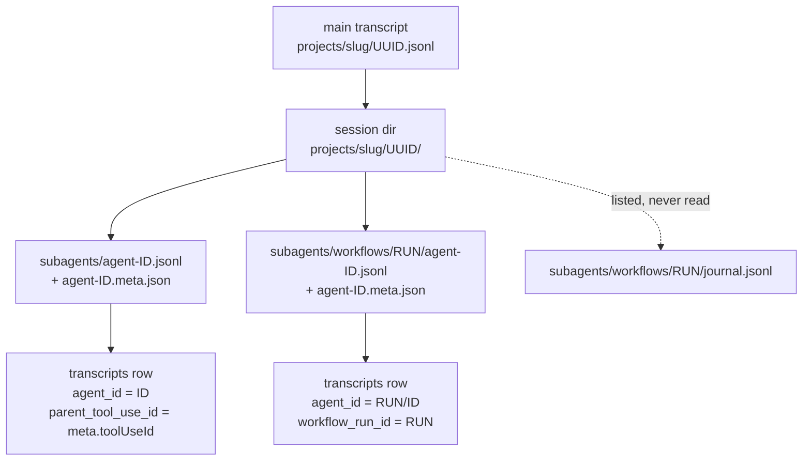
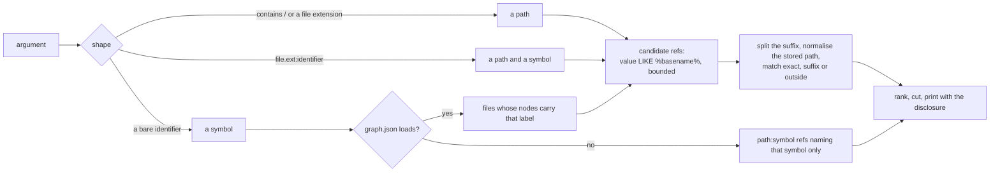
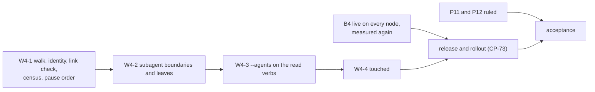

# ccrc history W4: subagent history and `touched` (spec addendum)

**Spec** · 2026-10-29 · Status: Draft, for the operator's approval · Owner: the operator approves; the programme's coordinator drafts · Linear: none · Related: `docs/superpowers/specs/2026-10-05-ccrc-history-lossless-dag-design.md` (rev 3.6: §6.2, §7.4, §8.2, §9.3, §9.15, §10.4, §10.6 item 5, §10.7), `docs/superpowers/programs/ccrc-history.md` (Stage 7, CP-70 to CP-73), `docs/superpowers/plans/2026-10-29-ccrc-history-w3-steering.md` (W3, independent of this)

> [!CAUTION]
> **W2-PASS gate. This is a draft, and it authorises nothing.** It was drafted under CP-70 while the W2 window waits. Drafting and review may go ahead now.
> This addendum authorises none of the following:
> - its own approval or merge;
> - a W4 plan's merge, or a W4 implementation;
> - a store read, a release or a rollout.
>
> Approval and merge wait for CP-50, the operator's W2 gate decision, to read **pass**. A release also waits for CP-51's close acts and for W1-B4 being live on every session-hosting node, measured again at that time. On a fail, this addendum is cancelled with the verdict as its reason.
> - The operator's rulings R-B1 to R-B4 stand as ruled. In particular R-B2: from act 6 to act 28, no release is installed and no wrapper changes.
> - W2 is not shortened or waived here.
> - Nothing here claims that W1's acceptance or its migration integrity is complete. W1-k's miss of 2026-10-01 still waits on the operator's ruling, and W1-b, W1-e and W1-f are still to be re-measured (CP-37).
> - **W4's acceptance is blocked.** The canonical bar stands at 95% (A9), but which population it is measured over, and what a workflow link must prove, are open decisions (P11, P12).

## In short

- **What W4 adds.** The approved spec gives W4 two things:
  - the transcripts of subagents and workflow agents join the lossless store, each linked to its parent;
  - a read-only `ccrc history touched <path|symbol>` verb that names the history nodes whose refs name a file.
- **What this addendum does.** It turns spec §10.4's five bullets into decisions a plan can be built from: the link and how it is resolved, the census and its populations, the scan rules for subagent boundaries, `touched`'s matching, output and ranking, what growth does to the cap, file ownership, a pin table, a failure table and a PR split.
- **Approved and proposed are kept apart.** Section 2 lists what the operator has already approved, with its source. Section 4 lists every open choice, P1 to P12, as a **proposal** with a recommendation. Nothing in a proposal is approved by this draft.
- **What the operator checks first:**
  - P5, subagent capture pausing before main capture does;
  - P6, no automatic backfill of past subagent text;
  - P7, subagent rows opt-in in the read verbs;
  - P8, what `touched` means, how it matches and how it ranks, which is not the compaction card's `touched` tag;
  - P11 and P12, the census population and the workflow link, without which W4 cannot be accepted.

## 1. Context

This section says what W4 builds on: spec §10.4's approved text, and what `main` already holds (`ce0c2c5ca`, read in source, re-checked at `8de56f255`).

| Already on `main` | Where | Footing |
|---|---|---|
| The `transcripts` columns `agent_id`, `parent_tool_use_id`, `workflow_run_id` and `agent_type`, in schema v1, empty on every row today; `UNIQUE (cc_session_uuid, agent_id)` | `store.mjs`, the `transcripts` DDL | Sourced |
| The export carries those columns for a due row | spec §9.15, "A due row is exported whole"; `sweep.mjs`'s replay `transcriptUpsert` | Sourced |
| Discovery reads main transcripts only: `<home>/projects/<slug>/<uuid>.jsonl` | `sweep.mjs` `walkTranscripts`, `discoverTranscripts` | Sourced |
| `node_refs` keeps **one origin per `(node_id, kind, value)`** | `store.mjs`: `PRIMARY KEY (node_id, kind, value)`, `origin IN ('model','tool_use','meta')` | Sourced |
| A leaf's refs are `capRefs([...modelRefs, ...minedRefs])`. The first of each `(kind, value)` wins, so a file both named by the session and touched by a tool is stored as `model`. At most 40 are kept (`REFS_MAX`), and refs past 40 are dropped | `derive.mjs` `leafFields`; `lib.mjs` `capRefs` | Sourced |
| **No writer in `ccd/history` produces origin `meta`** today; only the check constraint allows it | `grep "'meta'" ccd/history/*.mjs` | Measured in source |
| Mined refs come from Edit-shaped and Read `file_path` and `notebook_path` only (the miner gets no regex, so Bash is never mined). They are stored as the tool input spelled them, usually absolute, after redaction | `derive.mjs` `minedRefs` | Sourced |
| A `path` ref may carry a `:N` or `:N-M` line suffix; a `path:symbol` ref is `<file.ext>:<identifier>` | `lib.mjs` `classifyRef` | Sourced |
| A `tool_use` block's id lives only inside the compressed row body. `entries.tool_name` holds only the first named `tool_use`'s name. `entries.source_tool_use_id` is a row's own top-level `sourceToolUseID`, not the id of a block it contains | `store.mjs` `entries`; `lib.mjs` `entryOf` | Sourced |
| Decoding a body to find a `tool_use` by id has precedents | `lib.mjs` `toolUseInputPath`; `sweep.mjs` `pairedFromStore` | Sourced |
| The graph loaders | `compact-card.mjs` `loadGraph` (bounded by `GRAPH_MAX_BYTES`, 96 MiB), `loadLabels`, `fileFacts`, `resolveToken`; `derive.mjs` already imports `compact-card.mjs` | Sourced |
| The read-verb list | `lib.mjs`: "The read verbs (§8.2): derived from the whitelist, never listed twice. `touched` joins in W4." | Sourced |
| The server's reader of the workflow layout, with `RUN_ID_RE = /^wf_[0-9a-f]{8}-[0-9a-f]{3}$/` | `server/src/workflows/model.ts` (measured there on 2.1.203 to 2.1.302) | Sourced |
| Source sizes: 36.7 GB of subagent JSONL against 9.3 GB main and 15.8 GB `tool-results`, deduplicated; 276 of 1,454 metas carry `toolUseId` | spec §15.2, G14 | Measured 2026-10-05, one box |

## 2. Already approved (constraints, not proposals)

These come from the approved spec and the programme. This addendum does not reopen any of them.

| # | Constraint | Source | Status |
|---|---|---|---|
| A1 | Ingest `<uuid>/subagents/agent-*.jsonl`, linked through its `.meta.json` `toolUseId` to the parent `tool_use` | §10.4 | Agreed |
| A2 | Ingest `subagents/workflows/<runId>/agent-*.jsonl`, linked through `runId` | §10.4, G14 | Agreed |
| A3 | `journal.jsonl` is excluded: it is not a transcript | §10.4, G14 | Agreed |
| A4 | Subagent boundaries are found by the scan, since delegated-observation subagents fire no PostCompact or SessionStart(compact). They never parse blocks | §10.4, §7.4 item 2 | Agreed |
| A5 | `touched <path\|symbol>` resolves `node_refs` and tool-mined paths against `graphify-out/graph.json` with `loadGraph`, `loadLabels` and `fileFacts`. It is read-only. graphify ids are a cache key, never a foreign key | §10.4 | Agreed |
| A6 | Store growth about ×2.7, since subagents are 63% of bytes (inferred). The cap and the floor govern | §10.4, §9.3 | Agreed |
| A7 | `touched` accepts `--project` or `--workspace` like every read verb, both together is exit 2, and the whitelist comes from one list | §8.2 | Agreed |
| A8 | **B4-live prerequisite.** W4 does not ship before W1-B4 is live on every session-hosting node, so subagent text reaches the export from its first ingest | §10.6 item 5; CP-72 depends on CP-34 | Agreed |
| A9 | **Acceptance bar.** At least 95% of subagent and workflow transcripts carry a parent link, by census | §10.7 W4 row; CP-73 | Agreed |
| A10 | W4 is gated on W2. W3 and W4 are independent | §10.4 "Wave independence" | Agreed |
| A11 | The addendum is a new product decision, so the operator approves it before any W4 plan merges | CP-70 | Agreed |

On A8: CP-34(b) recorded B4 live on the only session-hosting node on 2026-10-27. That record is not taken as the prerequisite. It is a measurement at W4's dispatch and again before its release, on every session-hosting node named then. It is a release gate, not a test, and section 5 says so.

## 3. Design

This section describes each W4 mechanism. Every choice the spec does not make is marked with its proposal number from section 4.

### 3.1 Discovery and identity

A subagent's file sits under its parent's session directory, so the parent session comes from the path.


*Figure 1. Where a subagent transcript comes from, and the identity its row takes. The dotted edge is a file the walk lists and never reads.*

- **The walk** reads only regular, non-link files inside a session directory that is a real directory.
  - A name must be `agent-<ID>.jsonl`, with `<ID>` in `[A-Za-z0-9_-]` and at most 128 chars, the hook's own shape gate (`_hook_compact_scope`, `CCRC_ID_MAX`).
  - A run directory must match `RUN_ID_RE`.
  - Anything else is refused and counted `agent_file_refused:<reason>`.
- **The meta file** is read bounded (64 KiB, *chosen*), as JSON.
  - `toolUseId` is the only field the spec measured.
  - `agent_type` is filled only from a field the W4 plan measures on the installed version. Otherwise it is NULL, never guessed.
- **Identity (P1):** an Agent-tool subagent's `agent_id` is `<ID>`; a workflow agent's is `<RUN>/<ID>`.
  - Nothing has measured that agent ids are unique across one session's runs, and the row key is per session.
  - A `/` cannot occur in an Agent-tool id, so the two forms never meet.
- **No new table or column.** Every W4 field already exists in schema v1.

### 3.2 The parent link and how it is resolved

A row *names* a link when its link column is set. It *resolves* only when the parent holds the call the link names. The two are counted apart, so a named but unresolved link never counts as linked.

**An Agent-tool link (P4, mechanism)** resolves when the parent's main transcript holds an assistant row with a `tool_use` block whose `id` equals `parent_tool_use_id`. Ids live only inside compressed bodies, so the check is a bounded decode:
1. Let `t0` be the subagent transcript's first timed row. With none, the verdict is `unmeasured`.
2. Take the parent's candidates with `entries_ts` (`transcript_pk, ts_ms`): assistant rows with `tool_name IS NOT NULL` (at least one named `tool_use`) and `ts_ms` in `[t0 − 15 min, t0]` (*chosen*), newest first.
3. Decode at most 64 of them (*chosen*). Each body's `tool_use` blocks are tested by id, the precedent being `toolUseInputPath`, so a block that is not a row's first `tool_use` is still found.
4. The verdict is `linked` on a match, and `unresolved` when every candidate was decoded with no match. It is `unmeasured` when the 64-decode bound stopped the search, or a candidate could not be decoded.

The check runs only in the census, a read-only pass in Node (Python never decodes blobs). Nothing stores its verdict, so W4 needs no schema change. The cost is at most 64 decodes per subagent transcript, about 93,000 at G14's 1,454 metas. The W4 plan measures it on a fixture of that size.
- Unapproved alternative: store the verdict, or add a side table or index of `tool_use` ids, in a schema v3 behind §6.11's snapshot.

**A workflow link (P12, predicate).** A2 says workflows are linked "through `runId`". What that proves is open.

| Option | What it proves | Status |
|---|---|---|
| (a) placement: the run directory matches `RUN_ID_RE` under the session's directory | the file belongs to that session's tree. That is true by construction for every admitted file, so it measures nothing | Proposed, not recommended as the bar |
| (b) run named: the run id appears in the parent's rows, in the result of the call that launched it, found by the same bounded decode over the parent's tool results near `t0` | a real association with a launching call | Recommended, if the W4 plan measures that the installed version's launch result names the run id |
| (c) run summary: `S/workflows/<runId>.json` exists | the run reached a final status for this session | Proposed |

If (b) cannot be measured, workflows are reported under (a), labelled "placed, not call-linked", and are **not counted toward the canonical bar** unless the operator rules them in.

### 3.3 The census (P11)

The census is how A9 is measured. It reports each population apart, so no narrowed share is mistaken for the canonical one.

| Population | Definition |
|---|---|
| discovered `D` | every `*.jsonl` under a session's `subagents/` and `subagents/workflows/<dir>/`, `journal.jsonl` excepted |
| refused `R` | discovered files the walk refused, by reason |
| admitted `Ad` | `D − R`: files with a `transcripts` row |
| named `N` | admitted rows whose link column is set |
| linked `L` | named rows whose link resolves (section 3.2) |
| unresolved `U` | named rows that did not resolve |
| unmeasured `M` | named rows whose check could not finish |
| unlinked | `Ad − N` |

- **Recommended canonical share:** `L / D`. A refused, unmeasured or unresolved file counts as not linked, so a broad refusal can never raise the share.
- Also reported, each labelled "not canonical": `L / Ad`, `L / (Ad − M)`, and every figure split by kind (Agent-tool, workflow).
- **A refusal is never a successful link.** Acceptance is **blocked** until the operator rules P11 and P12.

### 3.4 Subagent boundaries (the scan rules)

A subagent transcript compacts without any hook, so its boundaries come from the rows alone.
- **The same rule as main.** The boundary row, and its summary through `preservedSegment.anchorUuid` (§7.4 item 1, PX1), including the `anchor_is_boundary` case.
- **No hook, no receipt, no steer.** A leaf whose transcript's `agent_id` is not `''`:
  - never looks a receipt up, so its status is `not-requested` and it is never a `steered_leaf`;
  - never writes or consumes a `card/` or `steer/` file;
  - never counts toward the card measure, the W3 breaker or the W2 counters.
- **Its own chain (P2).** Subagent leaves form a chain per transcript. Fan-in never mixes them with the main thread's, and W4 condenses none. The link to the main thread is the row's link, not a DAG edge.
- **When it is read (P3).** Subagent files have no spool hint, so one is read:
  - at a scan tick, inside the CP-39 discovery budget (rotating, resumable);
  - on a non-scan tick, only when its parent's main file was taken by CP-39d's `decideActiveRead`, inside that rule's per-tick cap (`ACTIVE_STAT_MAX`, 256).

### 3.5 `touched <path|symbol>` (P8)

`touched` names the history nodes whose stored refs name a file.
- **What it is not.** It is **not** the compaction card's `touched` tag (`compact-card.mjs` `TAGS`: a Read path or a Bash regex hit). The word is the spec's verb name, and nothing of the card's tag is borrowed.
- **What it cannot see.** The store keeps one origin per ref, keeps the first origin seen, and keeps at most 40 refs per node (section 1). So `touched` sees only what was kept, and it says so on every answer (below). It is not a complete record of which sessions touched a file.


*Figure 2. How `touched` turns its argument into files and then into nodes. Only a bare symbol needs the graph, and even without it the stored `path:symbol` refs still answer.*

**The matching contract (proposed):**
1. **Candidates, bounded.**
   ```
   SELECT node_id, kind, value, origin FROM node_refs
   WHERE kind IN ('path','path:symbol') AND value LIKE ? ESCAPE '\'
   ```
   The pattern is `%<basename>%`, with `%`, `_` and `\` escaped. It is capped at 10,000 candidate rows (*chosen*). A capped answer prints `(candidates capped at 10000)`.
2. **Split the stored value.**
   - A `path` ref drops a trailing `:N` or `:N-M` and keeps it as the line.
   - A `path:symbol` ref splits at its last `:` into a path and a symbol.
3. **Normalise the stored path,** against the node's epoch `cwd_real` and the scope's roots:
   - absolute and under a root → the root-relative remainder;
   - absolute and under no root → kept absolute, marked `outside`;
   - relative → leading `./` removed.
4. **Match against each query file `F`** (root-relative):
   - `exact` when the normalised path equals `F`;
   - `suffix` when it is relative, has no `..`, and `F` ends with `/<it>` on a segment boundary that is unique among the graph's files (`resolveToken`'s rule). With no graph, a bare-basename ref never matches;
   - `outside` refs match only a query that is that same absolute path.
5. **A symbol query** also matches a `path:symbol` ref whose symbol equals it, with or without the graph.

**Output.**
- **Text:** one header line per root, `touched <file> (graph built at <sha> | no graph)`, then one line per node:
  `<node id> <kind> <earliest>..<latest> <family> [<origin as stored>] [<match>] [line <N-M>] [symbol <s>] <first gist sentence, redacted, at most 120 chars>`.
  Subagent nodes carry `agent:<agent_id>` and appear only under `--agents` (P7).
- **The disclosure, always printed last:** `refs keep one origin each (the first seen) and at most 40 per node; a node may have touched this file without listing it.`
- **`--json`:** an array of `{nodeId, kind, earliestMs, latestMs, family, origin, match, line, symbol, gist, agentId, file}`, with the disclosure as a top-level `note`.

**Ranking (restated against what is stored):**
1. `latest_ms`, newest first;
2. `node_id`.

The stored origin is shown, not ranked. It is first-wins, so ranking by it would claim evidence the store does not keep. The default cap is 20 rows (`--limit` up to the CLI cap). A cut always prints `(+k not shown)`.

**Read-only.** Nothing graph-derived is stored, and the graph's `built_at_commit` is reported, never cached.

**Cost (P9).** The prefilter's leading `%` cannot use an index, so it scans `node_refs`. The W4 plan measures the row count and the p95 on a fixture of the measured size, against the target of under 2 s at p95. These remain unapproved options, never authorised here:
- a schema v3 with a reversed-path or basename column and its index;
- an edit or read tag on mined refs;
- a re-derivation backfill.

### 3.6 Cap and growth

This section states what W4's volume does to the cap and the floor, and the two proposals that answer it.

| Figure | Value | Footing |
|---|---|---|
| Subagent source | 36.7 GB of JSONL, against 25.1 GB main and sidecars | Measured (§15.2, 2026-10-05, one box) |
| Store growth after W4 | about ×2.7 | Inferred (§10.4) |
| Time to the 50 GB default cap | about 8 to 12 months for W1, about 4 to 6 after W4 | Inferred (§15.2's table) |
| A one-time backfill of today's subagent text | about 15 to 20 GB compressed, at §9.3's 0.4 to 0.55 ratio | Inferred here from the rows above |

At the cap or below the floor, §9.3 pauses **all** capture. W4 therefore makes subagent text the likeliest cause of a main-session capture pause.
- **P5:** subagent ingest pauses first, at 90% of the cap (*chosen*), counted `capture_paused_agents_at_cap`. A doctor WARN is decided where `breaker-open` is decided today (`lib.mjs`'s doctor items), so no edit to `ccd/ccrc-doctor-checks` is expected; the W4 plan re-measures that. Main capture continues to the cap as today. W1's `capture_paused_*` kill rule names W1's counters, and the W4 plan states whether the new counter joins it.
- **P6:** W4 ingests only subagent files written after its install. Older ones arrive through an operator `import --apply --agents`, whose dry run prints the forecast size first.

The export (§9.15) grows on the home filesystem at the store's rate once subagent text nears its retention, under its own `planCopy` floor, unchanged.

Repo growth: `ccd/ccrc`'s `_usage_history_paragraph` gains `touched` and `--agents`, and that file is on growth-check's list, so that PR runs `GROWTH_CHECK=1` growth-check.

## 4. Decisions

Each proposal is the operator's to rule, or to accept as recommended. A build question inside a PR stays the coordinator's (G7). None is approved by this draft. Each is blocked at its first consumer, named in the last column.

| # | Decision | Options considered | Recommended, and why | Status | First consumer |
|---|---|---|---|---|---|
| P1 | A workflow agent's `agent_id` | `<ID>`; `<RUN>/<ID>` | `<RUN>/<ID>`: the key is per session, and uniqueness across runs is not measured | Proposed | W4-1 |
| P2 | Subagent leaves in the DAG | own chain, no parents; condensed per transcript; children of a main leaf | Own chain, none condensed: subagents rarely compact, and a cross-thread edge has no approved rule | Proposed | W4-2 |
| P3 | When subagent files are read | scan ticks only; every tick; scan plus the active parent's | Scan plus the active parent's, inside CP-39d's cap | Proposed | W4-1 |
| P4 | How an Agent-tool link is resolved | a bounded decode at census; a stored verdict; a schema v3 side table or index | The bounded decode at census (15 min, 64 decodes, *chosen*): no schema change | Proposed | W4-1 |
| P5 | Subagent text against the cap | one cap for all (the spec); subagents pause first at 90%; a separate cap file | Subagents pause first at 90% (*chosen*), so main history, the part W2 evaluated, is never starved by W4 | Proposed (NEW product decision) | W4-1 |
| P6 | Past subagent text | backfill on the first tick; operator import with a forecast | Operator import with a dry-run forecast: up to about 20 GB at once is the operator's call | Proposed (NEW product decision) | W4-1 |
| P7 | Subagent rows in `grep`, `describe`, `expand`, `tree` | included by default; opt-in `--agents` | Opt-in `--agents`, so the default output stays what W2 evaluated | Proposed (NEW product decision) | W4-3 |
| P8 | `touched`'s meaning, matching and ranking | as section 3.5; rank by stored origin; rank by ref count | Section 3.5: any stored ref, the matching contract, recency ranking, the stored origin shown with the disclosure | Proposed (NEW product decision) | W4-4 |
| P9 | `touched`'s cost path | no schema change; a v3 index or column; a backfill | No schema change unless the plan measures a p95 over 2 s; anything else is a new proposal | Proposed | W4-4 |
| P10 | Where the run-id grammar lives | a second copy in `ccd/history` (another process, recorded as legitimately different); one `shared/*.mjs` holder both import | The shared holder with a single-definition pin, if the plan measures that `shared/` ships beside `ccd/` on every session-hosting node; else the recorded copy with a parity pin | Proposed (build question) | W4-1 |
| P11 | The census's canonical denominator | `D`; `Ad`; `Ad − M` | `D`: a refused or unmeasured file never raises the share | Proposed (blocks acceptance) | CP-73 |
| P12 | What a workflow link proves | (a) placement; (b) run named; (c) run summary | (b) if measurable; else report (a) apart, not counted toward the bar unless ruled in | Proposed (blocks acceptance) | W4-1 census, CP-73 |

Unapproved departures from the approved spec, listed for the coordinator to number once approved and never numbered here:
- **P5**: §9.3's "the cap and the floor govern" gains an order;
- **P6**: §10.4's ingest is narrowed to files written after install;
- **P7**: the read verbs' default scope.

## 5. Pin table

New pin ids are `SA` (subagents) and `TC` (`touched`). Each pin ships with a test that goes red when its guard is removed, and a measured mutant that the named fixture kills.

| # | Guard | Red test |
|---|---|---|
| SA1 | journal excluded | a run directory with `journal.jsonl` and one agent file → one row; the journal never opened. CONTROL: a mutant admitting every `*.jsonl` |
| SA2 | Agent-tool link, bounded decode | the `tool_use` is the second block of a parent row whose `tool_name` names the first → `linked`; the id outside the 15-min window → `unresolved`; 65 candidates and a match only in the 65th → `unmeasured`, never `linked` |
| SA3 | workflow identity | two runs, one agent id, one session → rows `RUN_A/ID` and `RUN_B/ID`. CONTROL: a bare `<ID>` mutant collides |
| SA4 | run-id grammar | `wf_bad` → refused, counted `agent_file_refused:run-id`; a matching name → read |
| SA5 | regular files only | a symlink, a FIFO and a directory named `agent-x.jsonl` → none read, each counted, the FIFO never blocks (bounded test) |
| SA6 | meta bounded | a meta over 64 KiB, or not JSON → the row stands with a NULL link, counted `agent_meta_unreadable`; the transcript still ingested |
| SA7 | no receipt on a subagent leaf | a subagent summary quoting a full `<ccrc-leaf>` block, with a planted `steer_receipts` row for the parent → `not-requested`, never `steered_leaf` |
| SA8 | own chain | 8 main and 8 subagent leaves of one session → no parent mixes them; the subagent leaves have none |
| SA9 | no card or steer side effects | a subagent boundary → no `card/` or `steer/` file written or removed; card measure and breaker unchanged |
| SA10 | read cadence | a non-scan tick with an inactive parent → no subagent stat; an active parent → stat'ed inside `ACTIVE_STAT_MAX` |
| SA11 | pause order (P5) | at 90% of a fixture cap → main rows ingested, subagent rows held with cursors unmoved, counted; at 100% → both paused |
| SA12 | no backfill (P6) | a subagent file older than the install record → not ingested by a tick; `import --agents` (dry run) prints its size and writes nothing |
| SA13 | census populations | a fixture with one of each population → every count equals the hand count; a refused file is in `D`, not in `L` |
| SA14 | workflow predicate (P12) | (a), (b) and (c) each over a fixture where only that predicate holds → only that row counts it. CONTROL: a mutant treating placement as `linked` under (b) |
| SA15 | parent not stored | a session directory whose uuid has no main transcript in the store → the subagent row kept, census `unlinked` |
| SA16 | `agent_type` | a meta without the measured field → NULL; with it → its value |
| SA17 | one run-id grammar (P10) | the single-definition scan finds the one holder, or the parity pin holds the copy equal |
| TC1 | path, no graph | no `graph.json` → `touched ccd/x.mjs` answers from refs; `touched someSymbol` answers from `path:symbol` refs only |
| TC2 | symbol with a graph | two files whose nodes carry label `foo` → two groups |
| TC3 | ranking | three nodes of different `latest_ms` → newest first; a tie → `node_id` |
| TC4 | cut shown | 25 matches at limit 20 → 20 rows and `(+5 not shown)` |
| TC5 | read-only | the store's bytes, mtime and `user_version` unchanged; nothing written under `graphify-out/` |
| TC6 | not the card's tag | a node whose only ref for the file is `model`-origin → listed. CONTROL: a mutant admitting only `tool_use` |
| TC7 | graph bounded | a graph over `GRAPH_MAX_BYTES` → symbol queries fall back as TC1; path queries answer |
| TC8 | scope | `--project` and `--workspace` together → exit 2 |
| TC9 | agents hidden (P7) | a subagent node naming the file → hidden without `--agents`, listed with `agent:<id>` with it |
| TC10 | absolute stored ref | `/root/ccd/x.mjs` stored, root `/root` → matches `ccd/x.mjs`, `exact` |
| TC11 | outside root | `/elsewhere/x.mjs` → matches only the query `/elsewhere/x.mjs`, marked `outside` |
| TC12 | line suffix | `ccd/x.mjs:10-20` → matches, prints `line 10-20` |
| TC13 | symbol ref | `ccd/x.mjs:fooBar` → matches the query `ccd/x.mjs` and the query `fooBar` |
| TC14 | suffix uniqueness | a stored `x.mjs` with two graph files named `x.mjs` → no match; a unique one → `suffix` |
| TC15 | disclosure | every answer, empty ones included, ends with the disclosure line; `--json` carries it as `note` |
| TC16 | candidates capped | 10,001 candidate rows → the cap line printed |
| TC17 | one verb list (A7) | the read-verb whitelist, derived from one list, includes `touched`; the `--agents` flag list derives from it too |
| AG1 | `--agents` on the read verbs (P7) | `grep`, `describe`, `expand` and `tree` each hide a subagent row without `--agents` and show it with it; runnable without `touched` |

A8, the B4-live prerequisite, is a **release gate, measured per node, not a test**. The coordinator measures it read-only at dispatch and before release, on the operator's ask.

## 6. Failure table

This section gives, for each input W4 reads, what happens when it cannot decide, and which way that fails.

| Input | When it cannot decide | Direction |
|---|---|---|
| `subagents/` | absent, a link, or not a directory | nothing read; no count (the common case) |
| agent file | a link, not regular, a name outside the grammar | refused and counted; in `D`, never in `L` |
| run directory | outside `RUN_ID_RE`, a link | refused and counted |
| `journal.jsonl` | any | listed, never read (A3) |
| meta | absent, over 64 KiB, unreadable, not JSON, no `toolUseId` | row kept with a NULL link; counted; `unlinked` |
| `toolUseId` | no candidate in the window matches | `unresolved`; re-checked at the next census, never guessed |
| link check | no timed row, a candidate not decodable, the 64-decode bound reached | `unmeasured`, never `linked` |
| parent main transcript | not in the store | row kept under its uuid; `unlinked` |
| agent id | the same id in two runs | two rows under P1; under a rejected P1, refused as a collision and counted |
| subagent boundary | its anchor names no row | `raw_leaf` (DM25), as on main |
| cap or floor | at 90% of the cap | subagent ingest paused (P5); at the cap or the floor, all paused (§9.3) |
| `history-off` | present | nothing read, as for main |
| `graph.json` | absent, over 96 MiB, malformed, no nodes or links | symbol queries use `path:symbol` refs only; path queries answer |
| a stored ref | outside every root; a basename matching two graph files | `outside` (exact absolute query only); no match |
| the prefilter | over 10,000 candidates | the cap line printed; never a silent cut |
| store | unreadable, migrating, recovering | the read verbs' existing exits (§8.8) |

## 7. Files and ownership

This section names every file W4 changes, what it changes, and the ring and context it sits in.

| File | W4 change | Ring and context |
|---|---|---|
| `ccd/history/lib.mjs`, `lib.d.mts` | pure deciders: the file grammar, the identity (P1), the link verdict over decoded blocks, the census buckets (P11), the workflow predicate (P12), the pause order (P5), `touched`'s split, normalisation, match and ranking | pure policy, ccrc history |
| `ccd/history/sweep.mjs` | the walk of `subagents/`, the meta read, the cadence (P3), the pause (P5) | adapter and tick |
| `ccd/history/derive.mjs` | subagent leaves on their own chain, no receipt lookup | adapter |
| `ccd/history/recall.mjs`, `cli.mjs` | `touched`; `--agents`; the census pass | adapter and delivery |
| `ccd/compact-card.mjs` | unchanged, imported for `loadGraph`, `loadLabels`, `resolveToken` | none |
| `ccd/ccrc` | the help paragraph gains `touched` and `--agents` | delivery |
| `ccd/history-skill/SKILL.md` | one line on `touched` | skill text |
| `deploy/measure-history.py` | the census rows Python can count without decoding (`D`, `R`, `Ad`, `N`); `L`, `U` and `M` come from the Node census pass | deploy |
| `shared/*.mjs` (P10, if measured shippable) | the run-id grammar, imported by `server/src/workflows/model.ts` and `ccd/history` | L0 kernel |
| `README.md` | the history section's verb list: `touched` and `--agents` | docs |

No lifecycle row is added, since every file W4 writes is inside the store. No wire, no `coord.db`, no exec surface and no box-token route changes (§13).

**Carried constraints W4 owns.** W3 and W4 are independent, so whichever first edits a file after W2 closes takes that file's carries, and the other's first step checks they are done:
- `ccd/history/lib.mjs`: review 1088 F2's `MARK_CHECK_GLOSS.budget` gloss, its block comment and its runtime pin in `history-lib.test.ts`;
- `ccd/history/sweep.mjs`: review 1065's F4 (`activeFiles` marks a file before its lstat) and F10 (`activeRows` with an empty uuid list), each with its own regression and mutant. The W3 plan's Tasks 1A and 1B spell all three; W4-1 runs them if it lands first;
- `ccd/history/recall.mjs` (W4-3, its first editor in W4): review 1065 F2 and review 1088 F4. The comments that say the global match runs once, or that a grep costs only what its scope holds, are reworded. The match is evaluated once per arm that reads it: 3 scans for recency, 4 with `rk`. These are comments only, with no runtime pin.

**README.** The claim is whole-path. The edit is the history section's verb list only. The claim is measured at the wave's start, and a held README is mailed to its holder and not edited until released or handed over.

## 8. Proposed PR split

This section orders the PRs so that no release ingests subagent text without the pause order, and no pin depends on a PR that comes after it.


*Figure 3. The order. W4-1 carries the pause order, so no release ingests subagent text without it. W4-3 and W4-4 both edit `cli.mjs` and `recall.mjs`, so they run one after the other. Acceptance needs the release and the operator's rulings on P11 and P12.*

| PR | Claims | Pins | Blocked on |
|---|---|---|---|
| W4-1 | `lib.mjs`, `lib.d.mts`, `sweep.mjs`, `cli.mjs` (the census pass), `deploy/measure-history.py`, `shared/*.mjs` and `server/src/workflows/model.ts` (P10 only), and their tests | SA1 to SA6, SA10 to SA17 | P1, P3 to P6, P10, P12 |
| W4-2 | `derive.mjs`, `lib.mjs`, their tests | SA7 to SA9 | P2 |
| W4-3 | `recall.mjs`, `cli.mjs`, `ccd/ccrc`, their tests | AG1, and the `recall.mjs` carry | P7 |
| W4-4 | `recall.mjs`, `cli.mjs`, `lib.mjs`, `ccd/ccrc`, `ccd/history-skill/SKILL.md`, `README.md`, their tests | TC1 to TC17 | P8, P9 |

Each PR is its own run, opened before the previous run closes, with a held-out review, and landed under rule L. A W4 plan (CP-71) is written only after this addendum is approved.

## 9. Testing and proof

This section says how W4 would be shown to work, and what stays unproven until the operator rules.
- Every pin in section 5 is red first, then green, with its mutant measured, on fixture HOMEs only, through `ccrc test --`.
- **Acceptance (A9)** is **blocked** until P11 and P12 are ruled. After the release, the census reports every population of section 3.3 per node and per kind. Only the ruled share is called canonical, against 95%.
- G14's 276 of 1,454 counts metas carrying `toolUseId`, workflow ones included. It is a risk to the bar, which the census's per-kind split names.
- `touched` is accepted when TC1 to TC17 pass and its p95, on a fixture of the measured `node_refs` size, is under 2 s.

## Where things stand

### Agreed

- A1 to A11 (section 2), from the approved spec rev 3.6 and the programme's Stage 7.

### Waiting on you

- Approval of this addendum, after CP-50 reads pass.
- P5, P6, P7 and P8: new product decisions, each with a recommendation.
- P11 and P12: W4's acceptance cannot be called until they are ruled.
- P1 to P4, P9 and P10: their recommendations, which the W4 plan builds on unless you rule otherwise.

### Later

- The W4 plan (CP-71), after approval.
- A stored link verdict, an index or column for `touched`, or an edit/read tag on mined refs: only if a measurement asks for one (P4, P9).
- Condensing subagent leaves, or linking them as children of a main leaf (P2), once real subagent compaction rates are measured.

---

*Drafted for the operator by Claude. Diagrams are Mermaid text. They have not been rendered or checked on any renderer.*
