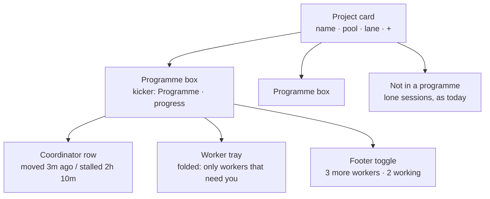
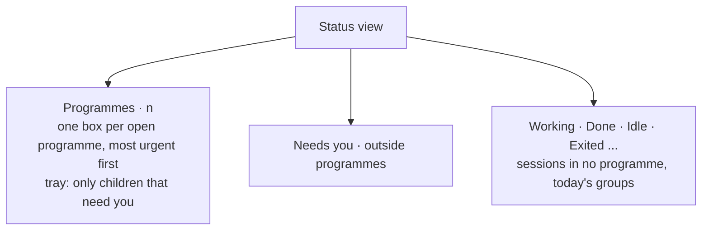

# Programme boxes: the fleet list groups each programme's workers under its coordinator and says whether it is moving

**Spec** · 2026-10-29 · Status: Agreed (prototype v6, the operator, 2026-10-29) · Owner: the desktop-polish coordinator · Linear: none · Related: `docs/superpowers/plans/2026-10-22-desktop-polish.md` (Tasks G1 to G3), `docs/superpowers/specs/2026-10-15-ccrc-two-skins-design.md` §3

## In short

The fleet list draws each coordinator's programme as one box inside its project card. The box has a "Programme" kicker, its progress, the coordinator's row with when the programme last moved, and a tray of its workers. A box opens folded, showing only the workers that need the operator. Instrument's Status view shows the programme boxes first, with only the children that need the operator, and drops every other child row. Each programme carries one identity hue through its box, its kicker, its progress bar and its workers' programme tag. The state colours stay on the outline and the lamps. A programme that has not moved for the stall watch's quiet threshold reads "stalled", in the stall colour. The server adds one fact the app lacks today: when each open run last moved.

The operator approved the clickable prototype v6 (the brainstorm branch's `2026-10-29-programme-box-prototype-v6.html`) and asked for it to be built. This document records what that prototype decided and the calls the coordinator made to build it. The calls are in §6, for the operator to check.

## 1. Context

The operator's words (2026-10-28 and 2026-10-29), which this design serves:

- "The nesting here is very hard to work with visually, it's not sufficiently OBVIOUS ... who's the coordinator and who are the child workspaces." Start them collapsed.
- "On the Status tab ... I don't want to see sub-workspaces at all, just the coordinators, and only those children that need my action specifically."
- "First thing I try to find out is what needs my attention, and are my coordinating workspaces making progress on all projects, or have they stalled (I HATE STALLED PROGRAMMES)."
- The project must sit visibly above the programme. Each programme gets more colour (v6: "looks good, implement").

What exists on main (sourced, `ddfbfddae`):

- **Project cards.** A project card's rows come from `fleetTree` → `nestFleet` (`pwa/src/fleet/fleetTree.ts:121-140`, `nestFleet.ts:131-176`). A session is a coordinator when it is the `claimedBy` of an active run whose `sessionId` is another session on the card. Children are drawn at depth 1 under a `└─` bracket (`ProjectCard.tsx:386-397`).
- **Rollup.** `foldChildren` (`rollup.ts:109-129`) folds a coordinator's two or more children into one "n workers · …" line. While folded it keeps the children that `operatorAsk` (`bucket === 'attention'`, `rollup.ts:64`) and the selected one. The open set is `RollupPrefs.openChildren` in `ccrc.fleet-rollup.v1` (`foldState.ts:64-99`).
- **Status view.** Only Instrument has one: `FleetTable`'s status mode, `StatusTable` (`FleetTable.tsx:172-330`), bucketed by `STATUS_GROUPS` (`statusGroups.ts:52-60`). Every child is a row of its own today, with a `↳ coordinator` crumb. Refined has project cards only (`skins/refined/parts.tsx:46`).
- **Programme words.** `programmeTitle` (`runWords.ts:901-910`) and `programWave` (`:460-465`) exist. A worker's row shows `slug · wave n of m` (`SessionMeta.tsx:236-247`). The coordinator's row has no programme line.
- **Movement.** No per-run or per-programme time of last movement reaches the app. The server's drift reader computes a run's newest act row (`store.ts:4913-4935`, `driftOpenRuns`) for itself only. The stall watch's quiet threshold is `STALL_QUIET_MS` (2 h, `server/src/coord/stall.ts:315`), and the operator's Settings choice can override it through `stallQuietMs`.

## 2. Design

### 2.1 What a box is

A box is the coordinator's open work, seen as one thing. Its members are the coordinator session, every child the card already nests under it (`nestFleet`'s edge), and the open runs the coordinator claims. A coordinator with no open run is an ordinary row, with no box.

- **One box per coordinator session.** A session is drawn once. A coordinator holding open runs of two or more programmes still has one box. Its kicker takes the title, hue and progress of its lead programme: the one with the most open work runs, with a tie going to the newest run. The kicker then says "+ n more", and each worker's `slug · wave` line keeps its own programme's slug and hue. The coordinator's call (builder check, question 1).
- **Workers on another card.** Today `fleetTree` gives each run to its worker's card, and `nestFleet` never brackets a child whose parent is on another card. The box sits on the coordinator's card. A far worker is listed in its tray as the existing abroad line ("billing-w5 · wave 5 in project-b"), never as a second copy of its row. On the worker's own card, such a worker sits under the sub-heading "Workers of programmes elsewhere", above "Not in a programme". Its programme tag is in its programme's hue. The coordinator's call (question 3).

*Figure 1. A project card in project mode. The card's head is unchanged. The programme boxes come first, most urgent first, then the sessions in no programme.*

### 2.2 A box's parts, top to bottom

| Part | What it shows | Source |
|---|---|---|
| Kicker | flow icon, "Programme · <title>" (`programmeTitle`, in its hue), progress | §2.4 |
| Coordinator row | the app's own session row with the session's own label, its meta the coordinator's state and the movement readout (§2.5) | `SessionLine`, existing (D-7337) |
| Tray | the children, each the app's own session row with its `slug · wave` line; a child that needs the operator keeps its ask exactly as today | `nestFleet` rows at depth 1 |
| Footer | the existing children toggle, worded "n more workers · k working" when folded, "hide n workers" when open | `foldChildren`, `summaryParts` |

The box keeps every door the rows have today: opening a session, its ⋯ menu, the ask, and the children toggle. The box adds no new door of its own.

### 2.3 Folding

- A box opens folded. Folded, its tray shows only the children for which `operatorAsk` holds, plus the selected session. That is `foldChildren`'s rule today, unchanged.
- The footer toggles the tray, stored in the same `openChildren` preference, keyed on the coordinator's session id. No new storage key is added.
- A folded project card keeps a box visible while it needs the operator or is stalled, and counts the rest: "n more in this project". This replaces nothing the folded head already says. Its "active … ago" stays.

### 2.4 Progress

- With `waveOf` known on the programme's newest run, the kicker draws a bar of `wave / waveOf`, worded "3/6 waves".
- With `waveOf` null, it says "wave n" and draws no bar.
- With two or more open work runs, the furthest wave counts (`programWave`).
- Review runs never count as waves.

### 2.5 Movement and stall

A programme moves when something happens on its open runs. Two things count:

- a state transition, which is a `run_events` act row by the drift reader's definition: not a stall observation, and not `causedBy = 'operator'`;
- a mail row naming one of its runs whose sender is a session id, from its worker, its reviewer or its coordinator session.

Mail sent under the literal system senders `coordinator` and `operator` does not count. Those senders carry the wave brief, the rejections, close notices, stall checks and digest corrections. So a wave-done that is rejected over and over never reads as movement. An operator's own act moves nothing by itself; the worker's next mail or transition does. The coordinator's call (question 4).

- **The server's one new fact:** each `RunSummary` carries `lastMoveAt`, the `at` of the run's newest such event, or null when it has none. It is an additive, optional field: absence permits.
- **The programme's last move** is the newest `lastMoveAt` across its open runs. Where that is null, it falls back to the newest `dispatchedAt` or `openedAt`.
- **Readout:** "moved 3m ago". From the threshold on, "no move 2h 10m", in the stall colour, followed by the lead run's waiting state when it is `awaiting-review` or `merging`, for example "no move 2h 10m · awaiting review". So the operator sees why it is quiet.
- **Stalled on quiet alone.** There are no exemptions for review, the merge queue or a frozen worker. A programme that has sat quiet for the threshold is what the operator asked to see, whatever it is waiting on, and the readout names the wait. The one exception is the operator's own pause: while `coordinator-paused` stands, the coord frame's existing `pause` says so (D-7373), and the box reads "paused", never "stalled". The coordinator's call (question 2). If the frame cannot carry the pause in G1, G1 records that and the box reads stalled.
- **The threshold** is the stall watch's own `stallQuietMs`: the operator's Settings choice, or `STALL_QUIET_MS`, 2 h. The server sends it on the runs frame as an optional `stallQuietMs`. An older server sends no `stallQuietMs` and no `lastMoveAt`, so its boxes never read stalled; the app holds no copy of the default (D-7376). So the box and the stall watch mean the same thing by quiet.
- **Box state,** one pure decider, in this order:
  - `needs`: a member that is drawn needs the operator, under `operatorAsk` (`bucket === 'attention'`). The coordinator's own row counts. The wider `needsOperator` does not decide this, so a box never shows the attention outline over a tray that hides the reason (question 5);
  - `stalled`: no move within the threshold;
  - `moving`: otherwise.
- **Outline:** `needs` draws the attention outline and `stalled` the stall outline. `moving` keeps the neutral edge.
- **Clock:** the readout ticks on its own leaf, as `LastActive` does, so the card does not re-render each second.

### 2.6 Order

Within a project card, boxes come first, ordered needs, then stalled, then moving. Ties go to the longest-quiet programme first. The sessions in no programme follow, under a quiet sub-heading, "Not in a programme", in today's order. Across cards, the project order does not change. Moving the urgent projects up is not part of this design.

### 2.7 Instrument's Status view

*Figure 2. Instrument's Status view. Children appear only inside their programme's box, and only when they need the operator. Sessions in no programme keep today's status groups.*

- A child session never draws as a row of its own in the Status view. A child that needs the operator is in its box's tray, with its ask.
- **Groups, top to bottom:**
  - **Needs you:** the boxes that need the operator, then the sessions in no programme that need the operator;
  - **Programmes:** the other boxes, stalled first, then moving;
  - **Done, Working, Idle and the folded groups:** the sessions in no programme, as today.
- **Every group counts what it draws:** a box counts one, and a hidden child counts nowhere. So a count never promises rows the group does not show. On a phone each group is a tab, as `phoneTab` does today, with Programmes as a tab of its own after Needs you (question 6).
- The kicker names the project: "Programme · project-a". In this view the project card is not there to say it.
- The bucket bar above project mode does not change. It counts sessions, children included, as today.
- Boxes in this view do not fold. They always show only the children that need the operator.

### 2.8 The programme's hue

- Each programme carries one identity hue from four: cyan, violet, magenta and blue. These are the cool account hues. Amber and green are left out because they share a family with attention and working. The hue is applied as:
  - a 4 px rule down the box's left edge;
  - the kicker's band, in the hue's tint;
  - the flow icon, the progress bar and the programme title, in the hue;
  - the tray's inset rule, at reduced strength (a non-text rule);
  - each worker's `slug` in its `slug · wave` line.
- **The tokens** are an alias family, `--prog-<hue>` and `--prog-<hue>-tint`, defined once beside the `--acct-*` pairs and pointing at them. Every palette gets them for free.
- **Hue text sits only on grounds the gate already measures:** the hue's own tint (the kicker band, the exact gated pair; the coordinator's row stays on the box's own ground, D-7340, because the row's own inks fall below 4.5:1 on some tints), or `surface` (the tray). The tray takes no mixed tint. That differs from v6, where the tray had a faint one. The contrast census adds rows for these uses. A red row is fixed by changing the ground, never the hue values, and G2 never touches the theme generator (question 7).
- **The assignment** is a pure function of the fleet's set of open programme slugs, so it is the same on every card and in every view: an FNV-1a hash of the slug, modulo 4. Two open programmes that land on the same hue take the next free one, in slug order. Past four open programmes, a hue repeats (D-7369, which replaced a per-card assignment).
- **In some palettes two hues look alike** (violet and magenta are identical in nord, gruvbox-dark and one-dark; cyan is near-black in three light palettes). The title in words carries the identity there. Retuning palettes is not part of this design.
- **The hue never glows,** and it is never the only cue. The kicker and the coordinator row always print the programme's title in words.

> [!IMPORTANT]
> This deliberately reuses the account hues for a second meaning. The two-skins spec §3 makes "same hue per lane" identity core. The operator saw the overlap named in the v6 hand-over and approved v6 as shown. §6 records it, and the plan amends §3's row to say: lane hues are the lanes'; a programme box borrows the four cool ones, always beside its title in words, never as a chip and never on a lane's own card.

### 2.9 Both skins

- Project mode, the box inside the project card, is one component used by both skins: `FleetCards` → `ProjectCard`.
- Refined has no Status view, so §2.7 is Instrument only.
- The box takes the skin's own row metrics and type roles.

## 3. Decisions

The operator's approval of prototype v6 rules the shape. The coordinator made the calls marked as such, and they are the operator's to change.

| # | Decision | Options considered | Chosen, and why | Status |
|---|---|---|---|---|
| D1 | A programme is a box in its project card | indent, bracket, box | box (v6), the operator's choice | Agreed |
| D2 | Boxes open folded, showing workers that need you | open, folded | folded (the operator: start collapsed) | Agreed |
| D3 | Status view: boxes, children only when they need you | today's rows, boxes | boxes (the operator's words) | Agreed |
| D4 | One hue per programme, Rich strength | off, stripe, rich | rich (v6 default the operator approved) | Agreed |
| D5 | Hues borrowed from the four cool account hues | new family, borrow | borrow as aliases; one value source, gated already | Judgement |
| D6 | "Moved" means run transitions and run mail | session busy, commits, transitions and mail | transitions and mail: progress, not activity | Judgement |
| D7 | Stall threshold is the stall watch's quiet setting | prototype's 45 m, a new setting, the watch's | the watch's: one meaning of quiet in the product | Judgement |
| D8 | Progress bar only when `waveOf` is known | bar always, bar when known | when known; an unknown total draws no fake bar | Judgement |
| D9 | No new storage key for box folds | new key, reuse `openChildren` | reuse; a box fold is a coordinator's children fold | Judgement |
| D10 | Project order unchanged | urgent projects first, unchanged | unchanged; not asked for, and it moves the operator's map | Judgement |
| D11 | The prototype's colour switch is not built | build it, drop it | drop; it was a prototype control | Judgement |

## 4. What this does not do

- **No pushing:** no new notification or push about stalls. The stall watch keeps its own rungs.
- **No reordering of projects.**
- **No new ask surface:** the tray uses the existing ask.
- **Refined:** no Status view for Refined (its filter rail is the skins plan's S6).
- **No server-side box:** the server sends facts (`lastMoveAt`, `stallQuietMs`) and the app composes the box.
- **No new account or lane colour.**

## 5. How it gets built

Three tasks, in `docs/superpowers/plans/2026-10-22-desktop-polish.md`:

| Task | What | After |
|---|---|---|
| G1 | server: `RunSummary.lastMoveAt` and the runs frame's `stallQuietMs`, additive, and the app's one reader of each, wired into G2's decider | another programme's live claim on `shared/api.ts` and `server/src/server.ts` is released |
| G2 | the box in project cards, both skins: the pure decider (`programmeBox.ts`, its movement an input), the component, the hue tokens, the contrast census rows | none |
| G3 | Instrument's Status view: programmes first, children only in their boxes | G2 |

G2 takes the programme's last move as an input to its decider. Until G1 wires the wire field in, the input is absent: no movement readout, and a box is never "stalled". An app talking to an older server behaves the same way. G1 waits because the file it must change is under another programme's claim today.

## 6. The coordinator's calls, for the operator to check

1. **Colours.** Programmes borrow the four cool lane colours (D5). The two-skins spec §3 is amended to say so.
2. **"Moved".** Movement is a run transition or run mail (D6). A worker busy for three hours without a milestone mail reads "no move 3h". That is the point: it is not making visible progress.
3. **Stalled.** It is the stall watch's quiet threshold, 2 h by default, or your Settings choice (D7). The prototype used 45 m.
4. **Progress.** There is a bar only when the programme declared its wave count (D8). This programme, for one, declares none, so it reads "wave 62".
5. **What isn't built.** The colour switch, and urgent projects first (D10, D11).
6. **One box per coordinator.** A coordinator running two programmes has one box, led by its busiest programme, with "+ n more" in the kicker (§2.1).
7. **Stalled on quiet alone.** There are no exemptions for review or the merge queue. The readout names the wait ("no move 2h · awaiting review"), and your own pause reads "paused" (§2.5).
8. **No tint on the tray.** The worker tray sits on the plain card ground, unlike v6's faint tint, so every coloured word stays on a ground the contrast gate already checks (§2.8).

## Where things stand

**Agreed**
- The box, folded by default, in project cards in both skins. In Instrument's Status view, programmes come first, with children only when they need you. One hue per programme, at the Rich strength (prototype v6).

**Waiting on you**
- Nothing blocks the build. The five calls in §6 are open to change at any time.

**Later**
- A Refined status view (S6), stall pushes, and urgent projects first, if wanted.
