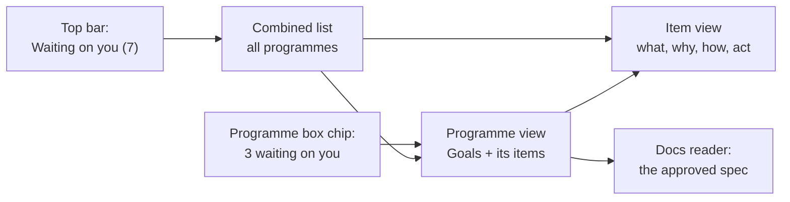
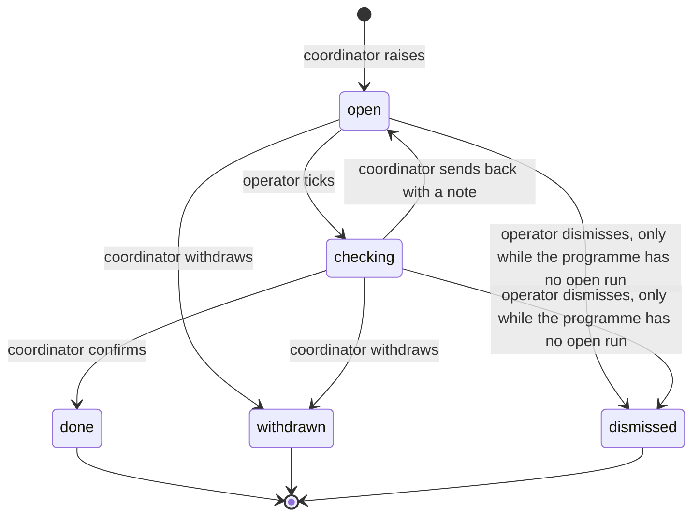
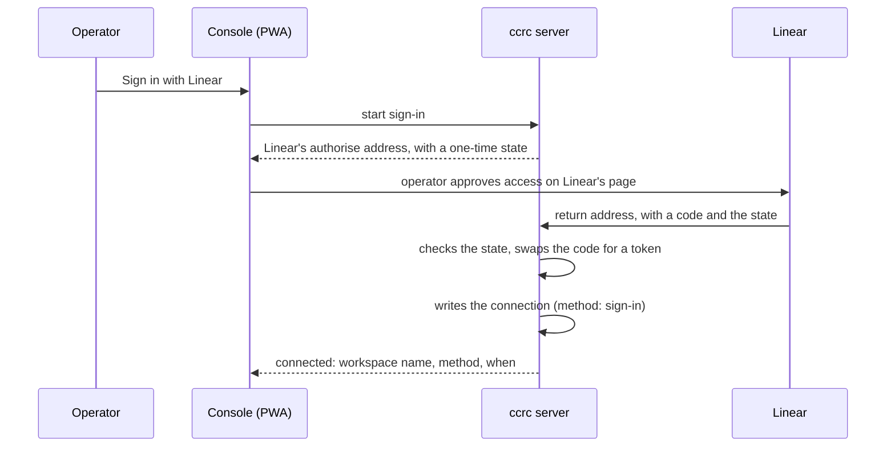
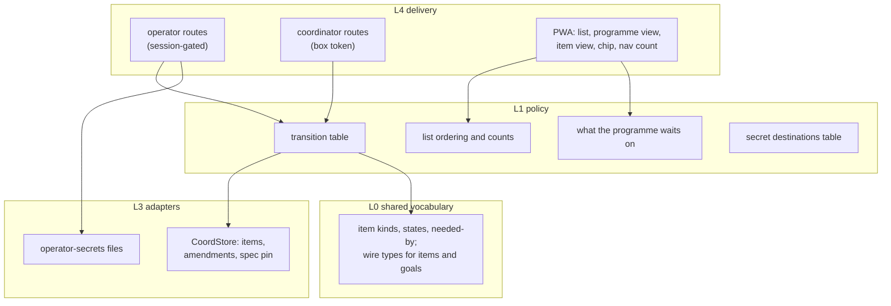

# Programme ledgers: Goals and Waiting on you

**Spec** · 2026-10-31 · Status: Draft · Owner: the operator · Linear: none · Related: `docs/superpowers/specs/2026-10-29-programme-boxes-design.md`, `docs/superpowers/plans/2026-10-22-desktop-polish.md`, prototype `docs/superpowers/specs/2026-10-31-programme-ledgers-prototype.html` (branch `brainstorm/programme-ledgers`)

## In short

Every programme gets two ledgers the operator can open at any time from the console. **Goals** pins the spec the operator approved: its "In short" as approved, a link that opens the spec in the Docs reader, and a dated list of amendments the coordinator records whenever the operator steers. **Waiting on you** is a guided to-do list the coordinator compiles of everything it needs from the operator: decisions, actions and values. Each item says what, how and why, and the list is raised early, not only when work is blocked. The operator does the thing wherever it is done and ticks the item. The console mails the owning coordinator, and the coordinator re-measures the result before closing the item, or sends it back with a note. One combined list covers all programmes, and the questions sessions ask the operator join it. Secrets never pass through a coordinator. Check §3 (the item model), §5 (secrets) and the coordinator's calls in §8.

## 1. Context

This section says why the feature exists and what it builds on.

The operator's two problems, in their words (2026-10-31):

1. On a long-running programme the operator can forget what it is about and why, and it is hard to re-establish that through the agent. They want "an always accessible pin to the approved spec essentially".
2. The operator should never be confused about why a programme has stalled and what is needed from them to resume it. They want "a clear action plan with the step by step how and the why". The list is not only for stalls: "a coordinator working autonomously compiles tasks that need the human operator even before they become actual blockers".

What exists today (sourced from `origin/main` at `0f5e4cdc2`, 2026-10-31):

| Piece | Where | What this design takes from it |
|---|---|---|
| Programme boxes in the fleet list | `pwa/src/fleet/ProgrammeBox.tsx:31`, `programmeBoxes.ts` | The entry point and the programme's hue |
| Programme record | `programs` table, `server/src/coord/schema.ts:68`, `homeProject` at :869 | Gains the spec pin |
| Operator-to-coordinator mail | `correctDigestRow`, `server/src/coord/digest.ts:210`; `queueSystemMail`, `rundefsTx.ts:62` | The tick's notification: system mail from `operator`, deduplicated |
| Run-to-coordinator lookup | `coordinatorOfRun`, `server/src/coord/bindingReads.ts` | Which session owns an item |
| Questions waiting on a person | `OperatorQuestion` (ask, approval, dialog), `server/src/coord/questions.ts:77`; `asks` table, `schema.ts:816` | Joins the combined list, read-only |
| Pasted secret to a protected file | `PUT /api/linear/connection`, `server/src/linear/routes.ts:100`; `writeValueFileAtomic`, `server/src/token/files.ts:73` | The secret path, generalised |
| Egress masker and its fingerprints | `fingerprintRow`, `server/src/accounts/mask.ts:106`; `secret_fingerprints` table | Masks a stored secret if it ever leaks |
| Opening a spec in the app | Docs reader: `docsLocation` with a `path` target, `pwa/src/docs/docsLinks.ts:176`, then `docsPageUrl`, `shared/docs.ts:1226` | The Goals pin's link |

Nothing like either ledger exists: there is no per-programme screen, no operator to-do store, and no programme-to-spec field (a ledger names its spec only in a prose "Spec:" line). Measured by a read-only search of the tree on 2026-10-31, confirmed against `origin/main` for the programme boxes.

The Docs reader's coordinator was consulted (2026-10-31) and its guidance is adopted: open the spec in the Docs reader by deep link, never render it a second time; keep amendments as console data, not document text; treat a spec's own "Waiting on you" box as a snapshot that may seed the list, never as something parsed to drive it; and after the reader moves onto the shared renderer, keep every pin, badge or overlay in the console's own chrome around the document's frame.

## 2. What the operator sees

This section describes the three views. The prototype on branch `brainstorm/programme-ledgers` shows them on example data; the operator called it "pretty great overall" (2026-10-31).

- **A "Waiting on you" entry in the top navigation** with a count. The count is the number of items that need the operator: open, sent back, and session questions. Items being checked do not count.
- **The combined list.** A summary line counts items by state: blocking now, questions from sessions, needed soon, being checked, came back. Below that, items are grouped by programme in the programme's hue, with blocking items first in each group and programmes with a blocking item first. A side rail filters to one programme. A "Recently cleared" trail at the bottom lists items the coordinator confirmed in the last seven days.
- **The programme box chip.** A programme box in the fleet list shows "N waiting on you" when N is above zero. Tapping it opens the programme view.
- **The programme view.** Goals on one side, this programme's share of the list on the other. When nothing is waiting on the operator, that panel says what the programme *is* waiting on, for example "Nothing needs you. Waiting on: review of task G4." So a programme that is stopped with nothing on the list is plainly not stopped on the operator.
- **The item view.** What, why, how as numbered steps, a "needed by" label, the item's history, and the action panel for its kind (§3).


*Figure 1. The ways in. Every path ends at an item or at the spec; the spec always opens in the Docs reader.*

## 3. Waiting on you: the item model

This section defines an item, its kinds, its states, and who may change what.

### 3.1 Kinds

| Kind | The operator… | Their tick carries | The coordinator checks by |
|---|---|---|---|
| Decide | chooses among the options the coordinator listed, or writes their own | the choice and an optional note | recording it in the programme ledger, and amending Goals if it steers |
| Do | does something elsewhere: a setting, a PR review, a command in their own shell | nothing | measuring the result itself (the setting on the server, the PR's state) |
| Give a value | types an ordinary value | the value | recording it and applying it where it belongs |
| Give a secret | pastes a secret into the console | nothing; the value goes to the secret store (§5) | the store's answer: set, when, and the last four characters |
| Question | answers a question or permission prompt a session raised, where it is raised | not ticked here | nothing: it leaves the list when it is answered or withdrawn |

Questions are not stored as items. The list reads them through the one existing model, `OperatorQuestion` (`server/src/coord/questions.ts`): a child's ask, a child's permission prompt, and a dialog showing in a session's pane. A child's ask or prompt joins the list only once it has reached the operator: after its coordinator's window runs out or the coordinator releases it. While a coordinator still holds one, it is the coordinator's to rule on, and showing it would have the operator answer what the coordinator was about to settle. A question sits under the programme of the session's run. A session with no run (a top-level session, or a coordinator's own dialog) groups under "Not in a programme". Each links to the session where it is answered, and answering stays on the existing paths.

### 3.2 What an item carries

Raised by the coordinator: programme, the run it belongs to (if any), kind, title (the what), why, how (an ordered list of steps), options (Decide only), the secret slot (Give a secret only, §5), and a needed-by label. Needed-by is one of **blocking** (work has stopped on it), **soon** (with a short label such as "before wave 6"), or **later** (before the programme can finish). Only the coordinator sets blocking, and it sets it when the work actually stops on the item.

Kept by the server: state, raised-at, ticked-at, closed-at, the operator's answer (never a secret), the coordinator's latest note when it sends an item back, and a history of each transition with its time.

### 3.3 States


*Figure 2. An item's life. The operator moves an item only by ticking it, or by dismissing it while its programme has no open run; every other move is the coordinator's.*

- **One writer per move.** The coordinator raises, confirms, sends back and withdraws. The operator ticks and dismisses. The transitions are one decision table in L1, and every route goes through it.
- **A tick mails the coordinator.** Ticking writes the answer, moves the item to checking and queues system mail from `operator` to the item's coordinator, in one transaction, on the digest-correction pattern (`correctDigestRow`). The mail names the item and carries the answer. Delivery is the ordinary idle-gated mail lane, so checking may last until the coordinator is next free. Nothing waits on it.
- **A silent coordinator is visible, but not pushed.** While an item is checking and its tick's mail is still undelivered, or its coordinator measures dead or registry-absent, the item says so ("ticked; coordinator not responding"). This is a label computed on read, with no push and no new stall-watch arm. The existing `coord-deaf` arm measures a worker's mail to its coordinator, not the operator's, so it does not cover this case.
- **Sent back is open again.** It returns to the operator's count with the coordinator's note shown on the item, so the operator never fixes something twice without being told why.
- **Done items leave the list** and appear in "Recently cleared" for seven days.

```mermaid
sequenceDiagram
  participant C as Coordinator
  participant S as ccrc server
  participant O as Operator
  C->>S: raise item (ccrc-api)
  S-->>O: count rises; push only if blocking
  O->>O: does the thing, wherever it is done
  O->>S: tick (with answer, if any)
  S->>C: system mail from operator
  C->>C: re-measures the result
  alt result holds
    C->>S: confirm, item done
  else result does not hold
    C->>S: send back with a note
    S-->>O: item open again, note shown
  end
```
*Figure 3. One item from raise to close. The coordinator never takes the tick as proof; it measures, as it does a worker's wave-done.*

### 3.4 Items, the pin and the programme's life

- **Keyed on the programme, owned through its runs.** Items, amendments and the spec pin hang off the programme's slug. A coordinator may write them only when it is the `claimedBy` of one of that programme's runs, open or planned.
- **Approval before the next run.** The pin is set, and the spec's open points seeded, when the operator approves a spec. That usually happens before the next work run starts. The coordinator therefore opens the next run as `planned` first (a planned run holds no dispatch slot), which is the same rule that keeps a programme from retiring between waves.
- **No open run.** When a programme has no open or planned run, its items are shown as belonging to an ended programme, and only then may the operator dismiss them. Nothing is changed in the store. If a run opens again under the same slug, the items are live again exactly as they were.

## 4. Goals: the pin to the approved spec

This section covers what Goals shows and where each part comes from.

- **The spec pin.** The programme record gains the approved spec's repo path, set by the coordinator when the operator approves the spec. The link opens it in the Docs reader by deep link in the programme's home project. The reader serves committed content, so the pin opens the spec as merged.
- **"In short" as approved.** At approval the coordinator stores a copy of the spec's "In short" with the approval date. It is a snapshot on purpose: Goals shows what the operator agreed, and the amendments say what changed since. Nothing parses the spec to fill it.
- **Amendments.** When the operator steers (a ruling, a decision item, an answer in chat), the coordinator records an amendment at once, with no second sign-off: the operator's ruling is the approval (operator, 2026-10-31). Each amendment carries its date, one or two sentences of what changed, and the ruling it came from: the programme ledger's entry id and, where it came from a Decide item, that item. Amendments are console data, listed newest first under "Amended since".
- **The spec is not rewritten.** The approved spec stays as approved and amendments sit beneath it (operator, 2026-10-31). A later spec revision the operator approves becomes the new pin, and the amendments before it stay listed under the earlier approval.
- **Where it shows.** Goals is the programme view's first panel. After the Docs reader moves onto the shared renderer, nothing is drawn into the spec's frame; Goals is console chrome beside it.

## 5. Secrets

This section covers the one kind of item whose value must never reach a coordinator, a mail, a ledger or a transcript.

The first release ships pasting secrets into the console (operator, 2026-11-01: "Ship pasting secrets into console, we need this"). Nothing in ccrc reads a stored slot yet. Each later feature that needs a secret reads its own slot through the store's reader on the server box, and a reader on the fleet box needs its own agent-link frame, designed with that feature.

- **Pasting goes straight to the store.** The Give a secret item shows a password field, and saving it asks the operator to confirm it is them (the account gate's step-up, as the Linear key does). The value is sent to its own route, never to the tick route. The server writes it with `writeValueFileAtomic` to a 0600 file in a new operator-secrets directory on the server box. The answer carries only set, the time and the last four characters.
- **Needs sign-in armed.** The step-up refuses while the console's sign-in is not armed, so a box without it shows the item with its field disabled and a line saying why. It never falls back to an unconfirmed save.
- **Slots, not paths.** The coordinator names a slot when it raises the item: a short slug under the programme, validated against a closed shape. It never names a file path, so a session cannot point a secret at a file of its choosing.
- **The coordinator learns only that it is set.** Ticking a secret item sends the coordinator the slot's answer (set, time, last four), never the value.
- **The masker knows it.** Saving a secret also records its fingerprint through the masker's own writer (`fingerprintRow`, `server/src/accounts/mask.ts`), so the egress masker catches the value in any outbound text even though it has no recognisable shape.
- **A secret used outside ccrc is not pasted here.** A secret whose consumer lies outside ccrc, such as a CI service's repository secret, is never taken by the console. The coordinator raises a Do item whose steps the operator runs in their own shell (for example `gh secret set NAME`), and it checks the result by the secret's name and date. That keeps the server's deliberate absence of any `gh` exec grant intact.
- **No session reads the store.** The operator-secrets directory joins the paths sessions are denied, beside `~/.cc-secrets/` and `~/.ccrc/auth-scratch/`, through the same account deny rules.

### 5.1 Two ways to give a credential: paste, or sign in

A credential can come in two ways: the operator pastes it, or the operator signs in on the service's own page (OAuth) and the console receives a token it never showed anyone (operator, 2026-11-01). Which methods a service offers is a row in a closed L1 table. The first release ships one sign-in service, **Linear**, beside the pasted Linear key the console already takes.


*Figure 5. Signing in with Linear. The token goes from Linear to the server and is written straight to the connection; the console only ever sees the answer.*

- **Both methods, one connection.** Settings' Linear section offers "Paste a key" and "Sign in with Linear". Either one writes the same connection under the existing connection lock (`server/src/linear/connection.ts`), now recording its method. Connecting by one method replaces a connection made by the other. The Linear client already tells the two apart, sending an OAuth token with `Bearer` and a pasted key without it (`server/src/linear/client.ts:114`).
- **One-time setup.** Signing in needs a Linear OAuth app registered by the operator, with the console's public address plus the callback path as its return address. Its client id is an ordinary value and its client secret is a secret, so the setup is done on the Linear section's own setup panel, or as items on the list when a coordinator needs Linear and sign-in is not yet set up. Sign-in needs the console's sign-in armed and its public origin set, the same conditions as the step-up. Without them the button is disabled, with a line saying why.
- **The state is single-use and bound.** The start route mints a random state bound to the operator's console session and a short expiry. The callback refuses an unknown, expired, reused or foreign state before it calls Linear, and every refusal is a fixed word. The code, the token and any refresh token never appear in a response, a log line, mail or the feed, and the token's fingerprint is recorded with the masker like any stored secret.
- **Expiry and refresh.** If Linear issues a refresh token with an expiring access token, the server stores both and refreshes before use. If refreshing fails, the connection reads "needs signing in again", and a coordinator that needs Linear raises an item for it. The builder confirms against Linear's current documentation whether its tokens expire and which scopes the console's existing Linear use needs, and the console asks for no more than those.
- **Secret items can offer sign-in.** A "Give a secret" item whose service has a sign-in method shows both choices. The coordinator checks either the same way: the connection's answer (connected, method, when), never the token.

## 6. The coordinator's part

This section covers what coordinators do with the ledgers and how they do it.

- **New `ccrc-api` verbs**, all box-token gated and attribution-checked like the other coordination writes: raise, confirm, send back and withdraw an item; set blocking on or off; set the spec pin and its approved "In short"; record an amendment; read the programme's items. A coordinator may act only on its own programme's items.
- **A new coordinator-skill clause.** The ccrc-coordinator skill gains a twentieth clause: raise an item as soon as you can see the operator will be needed, with what, how and why; set blocking only when work has stopped on it; on a tick, re-measure before confirming and send it back with what you found if it does not hold; record an amendment whenever the operator steers; set the spec pin when the operator approves a spec. The clause is pinned verbatim by `server/test/coordinator-skill.test.ts`, like the other nineteen.
- **Clause 19 is unchanged.** A coordinator still puts its questions to the operator in its closing turn text, never in a dialog. Clause 20 adds that each such question is also raised as an item, so the list is complete even when the operator was not watching that session.
- **Seeding from a spec.** When the operator approves a spec, the coordinator raises an item for each open point in the spec's own "Where things stand: Waiting on you" box. After that the list is the only source of truth for what is waiting.
- **The ledger file keeps its job.** The programme ledger in the repo still records rulings and receipts. Items are not written there, because this repository is public and an item may name something that must not be. A decision's outcome reaches the ledger as a ruling, in the coordinator's words, as today.

## 7. Architecture

This section places the new parts in the rings and contexts of `docs/superpowers/specs/2026-08-10-architecture-ddd-clean-solid.md`.


*Figure 4. Where each part lives. Decisions are made in L1 and acted on in L4; the store and the secret files are the only adapters.*

- **Context.** Both ledgers belong to Coordination. The secret store sits beside the auth and box-token context's file helpers and reuses them; it is not a second credential mechanism, because its values are operator data a programme needs, not ccrc's own credentials.
- **Store.** A new migration adds an items table, an amendments table, and spec-pin columns on `programs`. It is additive only, so an older build opening the file reads it as-is. Items and amendments live in `coord.db`, so `ccrc update` and `ccrc backup` snapshot them.
- **Routes.** The coordinator's writes take the box token and attribution, like `/api/runs*`. The operator's acts take the session gate only, like `/api/digest/correct`: they are tick, dismiss and save secret, with the account gate's step-up on save secret. Each new door is added to the box-token census so the tests that pin the doors keep counting them.
- **Wire.** New fields and frames are additive, with no `FLEET_PROTO` bump. Items reach the PWA by a read route and a live frame alongside the runs frame; the builder decides which.
- **"Waiting on" line.** One L1 decider reads the programme's runs (an active worker, a review in progress, a PR in the merge queue, nothing open) and names what the programme waits on when no item is open.
- **Push.** A new blocking item pushes to the operator through the existing notification path. Session questions already push. Other items only change the count.

## 8. Decisions

The operator's rulings are marked Agreed. The coordinator's own calls are marked Proposed, for the operator to check.

| # | Decision | Options considered | Chosen, and why | Status |
|---|---|---|---|---|
| D1 | What the Goals pin is | Spec link only; spec link plus approved summary and amendments | Link plus "In short" as approved plus dated amendments, so Goals reads as agreed, then amended | Agreed |
| D2 | Who changes Goals | Operator approves new wording; coordinator records on steering | Coordinator records at once when the operator steers; the ruling is the approval | Agreed |
| D3 | How amendments are kept | Rewrite the spec; keep a dated list beneath it | Spec stays as approved; amendments listed beneath, each linked to its ruling | Agreed |
| D4 | What the list is for | Stall report; lookahead | Lookahead: items raised as soon as the coordinator sees them coming | Agreed |
| D5 | How an item closes | Operator acts in the console; item tells, coordinator verifies | Item says what, where and why; operator ticks; coordinator re-measures | Agreed |
| D6 | Scope of the list | Per programme only; plus one combined list | Both: one list, seen per programme and across all | Agreed |
| D7 | Tick notification | New channel; existing mail | Existing coordination mail, asynchronous | Agreed |
| D8 | Ticked items | Vanish at once; stay until verified | Stay, marked checking, until the coordinator confirms | Agreed |
| D9 | Session questions | Separate; on the list | On the list, marked urgent, answered in the session | Agreed |
| D10 | Values the operator pastes | Free text only; text and secrets | Both; secrets go to a protected store, never through a coordinator | Agreed |
| D11 | Where items are stored | Repo ledger file; console database | Console database: the repo is public and items may name private things | Proposed |
| D12 | Secrets in the first release | Ship the store with no reader yet; secrets as Do items only, store later | Ship the store and the paste field now; readers come with the features that need them | Agreed |
| D13 | "Recently cleared" trail | None; seven days | Seven days, so a vanished item is never a mystery | Proposed |
| D14 | Push notifications | Every item; blocking only | Blocking items and session questions only; the rest change the count | Proposed |
| D15 | Items of an ended programme | Delete; mark orphaned in the store; show as ended while no run is open | Shown as ended while no run is open, dismissable then, live again if a run reopens | Proposed |
| D16 | Seeding from a spec | Parse specs continuously; seed once at approval | Seed once at approval; the list is the source of truth afterwards | Proposed |
| D17 | "In short" source | Parse the spec; snapshot at approval | Snapshot at approval, so Goals shows what was agreed | Proposed |
| D21 | Ways to give a credential | Paste only; paste or sign in | Both: paste, or sign in on the service's page; Linear is the first sign-in service | Agreed |
| D22 | Where Linear's OAuth app is set up | Hard-coded app; operator registers one | Operator registers one; its id and secret go in through the Linear section or list items | Proposed |
| D18 | Which session questions join | Asks only; every question model; including held ones | Asks, permission prompts and dialogs, once they have reached the operator | Proposed |
| D19 | A tick nobody picks up | Push the operator; label only | A label computed on read; no push, no new stall arm | Proposed |
| D20 | Clause 19 (questions in closing text) | Replace with items; keep and add items | Keep clause 19; clause 20 adds an item for each such question | Proposed |

## 9. Testing and proof

This section names how each promise will be shown to hold.

- **Transitions.** A table test over every state and actor: each allowed move succeeds, each other move is refused with its own reason, and a test reds when any row of the L1 table is deleted or changed.
- **One transaction.** A tick that fails to queue its mail leaves the item open, with no half-state; measured by forcing the mail insert to fail.
- **Secrets never leave the store.** A test pastes a marked value and then scans the mail table, the feed, the items table, the amendments table, the server's console output and every route's response for it; any hit reds. The slot route refuses a path-shaped slot, and a session's attempt to read the directory is refused by the deny rules.
- **Ownership.** A coordinator's verb on another programme's item is refused.
- **Sign-in.** The callback refuses an unknown, expired, reused and foreign state, each red when its check is deleted; a stubbed Linear proves the token lands in the connection and nowhere else (the same leak scan as the secret test); a connection made by sign-in is replaced by a pasted key and the other way round; and the Linear client sends each with its own header form.
- **"Waiting on" decider.** Pure-function tests over each run-state mix, including "stopped with nothing on the list".
- **Census and skill.** The box-token census counts each new door. The coordinator-skill test pins clause 20 verbatim.
- **Screens.** Browser tests at desktop and phone width for the three views, the chip and the nav count, in each palette the contrast gate already measures.

## Where things stand

### Agreed

- Both ledgers, the item kinds, the tick-and-verify loop, the combined list, session questions on the list, and secrets kept away from coordinators (operator, 2026-10-31, D1 to D10).
- Pasting secrets into the console ships in the first release (operator, 2026-11-01, D12).
- A second way to give a credential, signing in on the service's own page, with Linear first (operator, 2026-11-01, D21).
- The prototype's three views as the shape of the screens ("pretty great overall", operator, 2026-10-31).
- The Docs reader coordinator's guidance on linking, amendments and the spec's own box (2026-10-31).

### Waiting on you

- Check the coordinator's calls D11, D13 to D20 and D22 in §8.
- Approve this spec. The plan and the programme's next run start from it.

### Later

- More secret destinations (for example a CI service's repository secret written by ccrc itself), once a destination can be written without granting the server a general `gh` exec. Trigger: the first programme that needs one more than once.
- An item raised by a worker through its coordinator, rather than by the coordinator alone. Trigger: a worker question the coordinator keeps relaying by hand.
- A programmes section in the Docs reader for the ledger files themselves. Trigger: a request from the Docs reader's own programme; it is a cross-cutting change there, not here.

---

*Written by Claude for the operator. Diagrams are Mermaid text; the Copy Mermaid button on the docserver or the spec viewer copies the source, which pastes into Lucid as editable shapes.*
