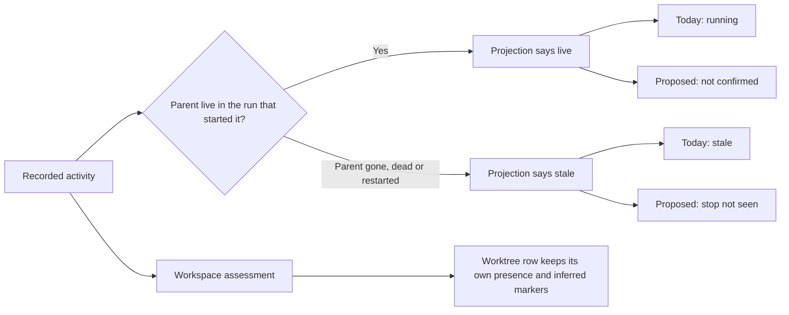
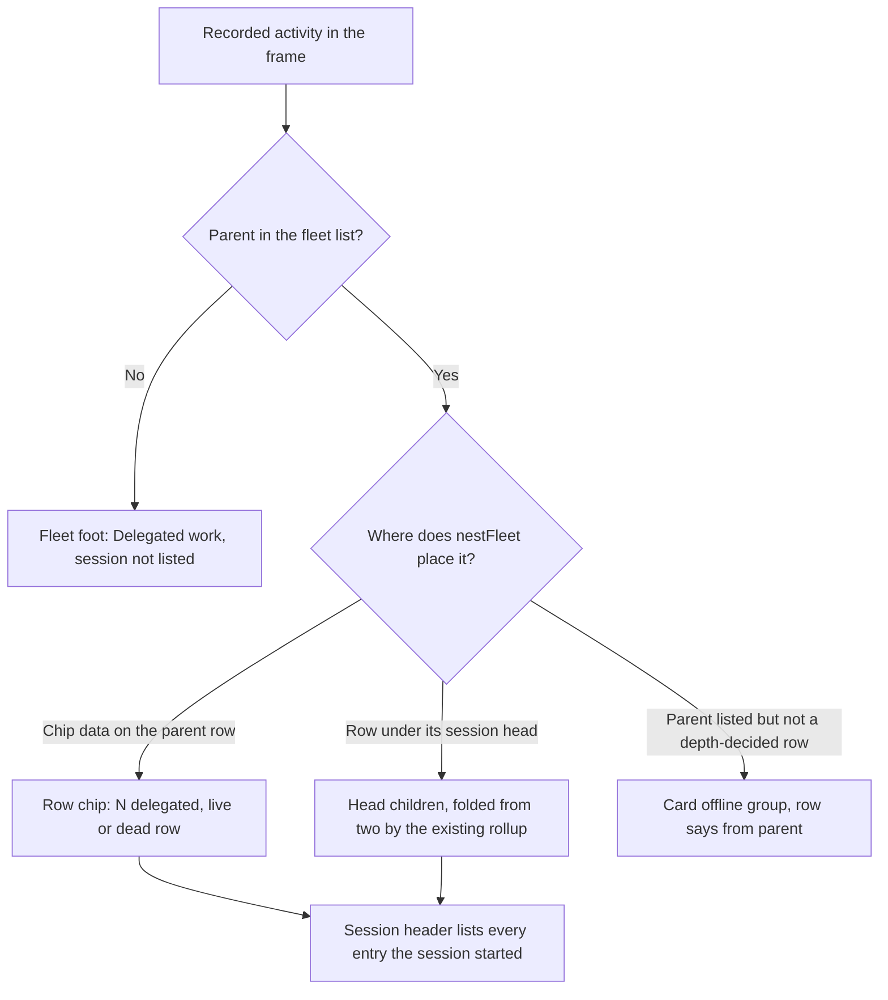

# Delegation visibility: honest words, every entry reachable

**Spec** · 2026-11-02 · Status: Approved by the operator on 2026-11-04, with its plan; staged scope agreed 2026-11-02 · Owner: Delegation broker · Related: `docs/superpowers/specs/2026-10-04-delegation-broker-design.md`

## In short

The fleet console calls a delegated helper "running" whenever its parent session is live in the run that started it. Nothing measures the helper itself. Some recorded entries are also drawn nowhere. If the parent session has left the fleet list, the entry is only a hidden count in the page. If the parent is a dead programme worker, its chip is dropped. The operator agreed on 2026-11-02 that honest visibility may ship before automatic repair. This first release is a change to the PWA only:

1. **Honest words.** No delegation row, chip or title says "running". Each entry shows what the broker actually recorded: `not confirmed`, `stop not seen`, `unmeasured` or `end recorded`.
2. **Every recorded entry is reachable.** A session's chip counts all of its attached entries, on live and dead rows alike. The session header lists every entry the session started. Entries whose session is no longer listed get a visible region at the foot of the fleet list.
3. **One fold.** The fold that already ships (two or more delegation children under a session head) remains the only compaction. No second grouping layer is added.

There is no server, wire, durable-format, timer or storage change. This release does not answer "which helpers did useful work recently". That capability, and automatic repair of entries whose end was never recorded, remain outstanding programme work.

An adversarial review of the first draft against `main` (four Opus lenses, a Sonnet refute pass on each serious finding) found two critical gaps: entries of a parent that left the fleet were drawn nowhere, and the proposed compaction duplicated a fold that already ships. This revision is built around both findings and removes everything the first release no longer needs (section 8).

## 1. The boundary being repaired

The broker's projection already carries useful attribution and workspace evidence. On screen, its `live` word claims more than its implementation proves, and two paths drop entries entirely. These are sourced code facts, not a diagnosis of any particular helper.

*Figure 1. The release changes the claim made to the reader, never the recorded state, the owner or any deletion authority.*

### Source footing

Read at `origin/main` `8eea9aa7bf099e446b7cc7b5db74b595f3e7ed4b`. The delegation files cited here are unchanged since the first draft's pin `02622053c`. These are static source reads, not executed tests or installed-build measurements.

| Source | Sourced fact | Consequence |
|---|---|---|
| `server/src/coord/delegation-projection.ts#livenessOf` | An unended activity whose parent is live in the matching incarnation is `live`, with no check on the helper itself | Never render it as running or recent |
| `server/src/coord/delegation-projection.ts#projectDelegation` | Bash-worktree activities never become rows; an activity with an unreleased lease is shown through its worktree row; ended activities are omitted; a parent absent from the registry is filed `offline-coordinator` | Visible entries are not a helper census |
| `shared/api.ts#DelegationLiveness`, `#DelegationActivityWire` | The docstrings still describe `live` as running and invite reading `<runId>-<index>` in `upstreamId` as membership | Amend both comments so a later reader cannot undo this release |
| `pwa/src/fleet/delegationWords.ts#LIVENESS_WORD`, `#delegatedChip` | `live` is drawn as `running`; the chip counts live entries only, titled "delegated work running" | Replace the words; count every attached entry |
| `pwa/src/fleet/sessionFacts.ts#sessionFacts` | `delegated: dead ? null : delegatedChip(...)` | A dead programme worker's chip-only entries disappear from its row |
| `pwa/src/screens/SessionScreen.tsx`, `delegationWords.ts#liveActivitiesOf` | The header receives every entry the session started, whatever its placement, but shows a live-only chip | The header becomes the full list; the helper name stops saying "live" |
| `pwa/src/fleet/fleetTree.ts#delegationSlices`, `#unplacedActivities`, `FleetCards.tsx` | An activity whose parent is not in the fleet list is put on no card; only the `data-delegation-unplaced` attribute counts it | The commonest gone-parent case is invisible; it needs a visible region |
| `pwa/src/fleet/nestFleet.ts#delegationChildren` | An activity becomes chip data when the server placed it `chip` (its parent was a programme worker when it opened) or its parent sits at depth 1; it falls into the card's offline group when its parent is listed but not a depth-decided row | Chip-only entries need a list surface; offline rows need their parent's name |
| `pwa/src/fleet/rollup.ts#foldChildren` | Under any session head, two or more delegation children (`CHILD_FOLD_MIN = 2`) fold into the summary line `n delegated · n worktrees`, its open state persisted in `RollupPrefs.openChildren` | This is the one compaction owner; no second fold |
| `pwa/src/fleet/FleetCards.tsx`, `pwa/test/older-server-render.test.tsx` (W4-U27) | "Unavailable" is only `data-delegation="unavailable"`; an older server's render is pinned byte for byte | Unavailability stays invisible |
| `pwa/src/skins/instrument/FleetTable.tsx` (status mode) | Status mode builds its tree without the delegation frame and draws no delegation | Out of scope; recorded as Later |

## 2. What this release does and does not deliver

This is a deliberately incomplete first slice. Its limits are stated here and in the release description, not hidden in a note.

| Capability | First-release decision | Status |
|---|---|---|
| Stop parent-derived execution claims | Condition words per liveness, never `running` | Proposed |
| Reach chip-only entries | Chip counts every attached entry on live and dead rows; the session header lists them all | Proposed |
| Reach entries of a parent that left the fleet | A visible region at the foot of the fleet list | Proposed |
| Name the parent of entries off their parent's row | `from <session>` on offline-group and unlisted-region rows | Proposed |
| Keep clutter bounded | The existing rollup fold, unchanged | Proposed |
| Positive recent activity, recent counts, "no recent news" | Not supported: no qualified helper-time source exists | Later |
| Workflow run and worker composition, agent census | Not inferred from names, `upstreamId` spellings or visible rows | Later |
| Automatic end, reopening, execution epochs, durable migration | No writer, authority or format change | Later |
| Adoption, promotion, retention, cleanup | No new mutation or ownership authority | Later |
| Delegation in the instrument skin's status mode | Unchanged (none today); the session header is reachable from it | Later |

No ten-minute activity threshold or two-minute check-freshness threshold ships. A parent heartbeat, hook-event time, frame arrival, `asOf`, metadata mtime or the absence of new events cannot stand in for a qualified activity source.

## 3. Ownership and rings

Nothing moves between owners. The server projection, the frame and every durable file stay exactly as they are. The words and the reader stay in the one L1 words module, placement stays in `nestFleet`/`fleetTree`, and delivery components draw what those decide.

| Responsibility | Owner | Ring |
|---|---|---|
| Delegation vocabulary docstrings (comments only) | `shared/api.ts` | L0 |
| Every visible delegation word, title and the per-liveness qualifier table | `pwa/src/fleet/delegationWords.ts` | L1 |
| Which card, region and row an entry lands in, including the unlisted selection | `pwa/src/fleet/fleetTree.ts`, `pwa/src/fleet/nestFleet.ts` | L1 |
| Card and header facts, and the card-within-header rule | `pwa/src/fleet/sessionFacts.ts` | L1 |
| The fold and its logical totals | `pwa/src/fleet/rollup.ts` (unchanged) | L1 |
| Drawing chips, the header list, group toggles and the unlisted region | `SessionMeta.tsx`, `ProjectCard.tsx`, `FleetCards.tsx`, `SessionScreen.tsx` | L4 |

Constraints the plan must respect:

- **One selection for unlisted entries.** `unplacedActivities` becomes the selection that returns the entries; the visible count and the retained `data-delegation-unplaced` test hook both derive from it. No second filter.
- **The closed scope census.** `server/test/delegation-wave3.integration.test.ts` (§8) confines file-name stems such as `delegat` and the word `delegation` to the wave-4 PWA files, and `server/test/fleet-health.test.ts` mirrors that list. New code goes in those files and new CSS class names avoid the stems. A file that must join the list is added to both tests in the same PR, with the reason recorded.
- **Copy lives once.** Every new string is defined in `delegationWords.ts`, so the literal census sees one spelling. No exported string may contain the stems W4-U10 forbids (`lease`, `adopt`, `retain`, `clean`, `spool`).
- **No new storage owner.** Any new toggle keeps transient React state or an existing fold key; the storage census stays green.

## 4. Honest words

Execution certainty, parent context and workspace presence stay separate. The visible word is short and lowercase, matching the existing row parts; the title adds detail but is never the only carrier, because phones do not show titles.

| Recorded liveness | Visible word on activity and worktree rows | Title (supplementary) |
|---|---|---|
| `live` | `not confirmed` | Execution not confirmed: its session is live in the run that started it, but nothing shows the helper itself is still working |
| `stale` | `stop not seen` | Its session is gone, dead or has restarted since, and the helper's stop was never recorded |
| `unmeasured` | `unmeasured` | Its execution state, or its session's incarnation, could not be measured |
| `ended` (worktree rows) | `end recorded` | The broker recorded its end; the worktree is still listed |

The qualifier table is a `Record` keyed by `DelegationLiveness`, so the existing key-totality pin covers it. An unknown word from a newer server keeps today's re-filing to `unmeasured` and its drawable row.

Further rules:

- **Chips and summaries keep the noun `delegated`.** `N delegated` makes no execution claim. Its title reads "N recorded delegation entries, not a current agent count; execution not confirmed".
- **Worktree presence speaks once.** An ended worktree shows `end recorded`; its existing workspace qualifier alone says whether presence was measured. Inferred and creator-call markers are unchanged.
- **Times are labelled as hook events.** Row titles read `opened <t>, last recorded hook event <t>`, never "last event" or helper activity.
- **No forbidden totals.** Never show `N active`, `N running`, `N recent`, `0 recent`, "no recent news", "couldn't check" or "check deferred".
- **Unavailable stays invisible.** A missing or withdrawn frame keeps the existing `data-delegation="unavailable"` mark and draws nothing, so W4-U27 stays green and a reconnect never flashes a banner.
- **Background counts are separate evidence.** A session's own "in background" and subagent counts come from Claude Code's status, not from the broker. They are unchanged and are not linked to these entries.

## 5. Every recorded entry is reachable

Every activity the frame carries lands on exactly one primary surface, and a session's own entries are also listed in its header. Nothing depends on the entry being `live`.

*Figure 2. Each entry has one primary surface; the header is a second, complete list for its own session.*

| Surface | What it shows | Count population |
|---|---|---|
| Session row chip (card) | One non-interactive chip `N delegated`, on live and dead rows | The session's attached (chip-placed) entries, every liveness |
| Session header | A disclosure button `N delegated`, expanding to a list of rows with source, name and condition word, under the description "Recorded entries, not a current agent count. Execution is not confirmed for any of them." | Every entry the session started, whatever its placement |
| Folded head summary | Unchanged: `n delegated · n worktrees` in the rollup's line | The head's logical delegation rows |
| Card offline group | Unchanged toggle; each row gains `from <session label>` | Entries whose listed parent is not a depth-decided row |
| Fleet foot region (new) | Toggle `Delegated work, session not listed (N)`; rows read `source · name · condition · from <session id>` | Entries whose parent is absent from the fleet list |
| Programme box footer | Unchanged | Logical rows only; chip-attached entries are not in it |

Rules:

- **The dead shortcut goes.** `sessionFacts` computes the chip from all attached entries whether or not the row is dead. A dead worker's entries stay one tap from its row.
- **The card stays a glance.** Nothing expands inside the session row (D-5545); the list lives in the header, beside the existing subagent disclosure and in the same pattern: a real `<button>` with `aria-expanded`, and `aria-controls` only while the list exists. The row's tap-to-open forwarder is untouched, because no expanded content sits in `.sess-body`.
- **Header superset, by count.** The header's `delegated` count is never smaller than the card's, because it counts a superset. `cardWithinHeader` compares that one fact by count rather than by text prefix. The prefix rule would fail whenever a session has both attached and row-placed entries. The plan records this as a deviation.
- **The unlisted region is a list region, not a card.** It renders after the cards in `FleetCards`, closed by default, open state transient. Its members use the same row words. When the count is zero, or the frame is unavailable, it draws nothing. The `data-delegation-unplaced` hook stays and always equals the visible count.
- **Parent names are display only.** `from <session label>` uses the fleet's session label when the parent is listed, and the raw session id otherwise. It is never a join key or an ownership claim.

## 6. Clutter: one fold, logical totals

The existing rollup fold is the only compaction. Under a session head, two or more delegation children already fold into the summary line, with a persisted open state. Expanded, each row now carries its honest condition word. No second grouping layer, threshold, unit word, group key or expansion state is added. A group nested inside the fold would only add a tap.

Counts stay logical rows. The summary line and programme box footers count the rows they hide, so chip-attached entries are not in them. Each attached entry is counted by its session's chip instead.

Entries whose stop was never seen will keep accumulating until automatic repair exists, because this release writes no ends. The fold keeps them out of the way; it does not make them go away. This is the main reason repair stays programme work.

## 7. Compatibility, rollout and cost

The release must be correct against every frame the server can send today, since the server does not change.

| Combination or event | Required result |
|---|---|
| New PWA, current server | The full release |
| Old cached PWA | Old words until the client updates; no data is touched |
| Absent or withdrawn frame | Existing invisible unavailable mark; no chip, header list or unlisted region |
| Reconnect, unchanged frame, clock advance | No new claim of execution, quietness or end |
| Unknown liveness, group or placement word | Today's re-filing; the row stays drawable |
| Parent restarts | Its earlier entries become `stop not seen` and remain listed |
| Parent leaves the fleet | Its entries move to the unlisted region |
| Workspace outlives its activity | Existing worktree row with its presence and inferred markers |

Rollout is the ordinary release path: the PWA ships in the server box's build, and clients pick it up on their next update. No ordering between boxes is involved. Rollback restores the old words and loses no data.

Cost: no new fleet reads, processes, timers, sockets or storage. The unlisted selection is one pass over the frame's activities, which `unplacedActivities` already makes. The header list renders the session's own entries from the frame already in the store.

## 8. Options and decisions

The staged-delivery principle is agreed. The rows below are this design's own choices. Part of the first draft was dropped after the review; those rows record why.

| Choice | Alternatives | Decision and consequence | Status |
|---|---|---|---|
| Release boundary | Wait for automatic repair; ship honest visibility first | Ship visibility first; repair stays outstanding | Agreed |
| Source of truth | Add an activity observer now; use the existing frame | Existing frame only; no recent or quiet claims | Proposed |
| Live word | `running`; `execution not confirmed`; `not confirmed` | `not confirmed` on rows (fits a 360 px column); the full sentence in titles and the header description | Proposed |
| Stale word | `stale`; `parent gone`; `stop not seen` | `stop not seen`, true for every stale cause; stays distinct from `unmeasured` | Proposed |
| Ended worktree word | `ended`; `end recorded; workspace remains` | `end recorded`; presence keeps its own qualifier | Proposed |
| Chip population | Live only; every attached entry | Every attached entry, live and dead rows | Proposed |
| Gone-parent entries | Leave as a hidden count; add a wire `project` field; a fleet foot region | Fleet foot region, no wire change | Proposed |
| Header subset rule | Text prefix; count comparison | Count comparison for `delegated` only (deviation from D-5545's prefix rule) | Proposed |
| Compaction | A second group layer from three; the existing fold | The existing fold only | Proposed |
| Dropped: `parentIncarnation` on the wire | Add it; drop it | Dropped: it existed only to bound the second fold. `stale` already marks entries from an earlier incarnation | Dropped |
| Dropped: a PWA view type with known/unrecognised fields | Retype every consumer; keep today's reader | Dropped with the second fold; unknown words keep today's re-filing | Dropped |
| Dropped: a visible "Delegation unavailable" banner | Show it; keep the invisible mark | Dropped: it would flash on every reconnect and break W4-U27 | Dropped |
| Dropped: duplicate-identity fallback | Positional keys; none | Dropped: it guarded the second fold's counts only | Dropped |
| Instrument status mode | Wire delegation in; leave it | Leave it; the session header covers it | Later |

Approving this design approves a visibility release without positive helper recency. It does not approve abandoning that work, or a redefinition of programme completion.

## 9. Acceptance and evidence required

The implementation plan turns each row into a test that fails before the change and passes after it. The existing pins listed below are today's characterization, and each changes in the commit that changes its behaviour. This document claims no suite, browser or mutant result.

| Proof family | Required cases |
|---|---|
| No running claim | No exported delegation string or rendered delegation row, chip or title contains `running`; `live`, `stale` and `unmeasured` rows differ in visible text; the qualifier table is total over `DELEGATION_LIVENESS` |
| Chip population | Live, stale and unmeasured attached entries all count; a dead row keeps its chip; a row with no attached entries has none |
| Header list | The header lists every entry the session started, attached and row-placed, each exactly once; the disclosure works by keyboard and touch; activating it does not navigate |
| Header superset | `cardWithinHeader` returns nothing for a session with attached entries, row-placed entries and a dead row; it still catches a card fact missing from the header |
| Unlisted region | An activity whose parent is absent from the fleet appears exactly once in the region, found by role and text; a listed but released or archived parent's entry stays in its card's offline group and not in the region; the visible count equals `data-delegation-unplaced`; no region for zero entries or a null frame |
| Parent names | Offline-group and unlisted rows carry `from <label>` (the listed label, else the raw id) |
| Fold unchanged | Rollup summary text, folding from two, persisted open state and footer totals unchanged |
| Older server | W4-U27 stays byte for byte green |
| Census | The closed scope census and its `fleet-health` mirror, the literal and control censuses, and the W4-U10 forbidden-stem scan stay green or are changed deliberately in the same PR |
| Mutants | Restoring `running` reds the word test; restoring the dead shortcut reds the dead-row chip test; dropping the region reds the unlisted test; the prefix rule in place of the count rule reds the superset test |

Pins changed by design: `delegation-words.test.ts` (W4-U8's live-only chip, the chip text and title), `card-header-facts.test.tsx` (W4-U33's live-only count, W4-U34's dead row now keeping its chip; W4-U35 stays), `fleet-screen.test.tsx` (row parts containing `running`; the unplaced hook now has visible text beside it), `fleetTree.test.ts` (`unplacedActivities` returns entries), `project-card.test.tsx` (the R9 chip, if its population changes the count).

Required exact-tip review, selected PR CI, the native merge queue and operator-controlled rollout still apply. Elapsed-time soaks remain waived, not passed.

## 10. Follow-on contracts and programme continuity

This slice absorbs none of the held retention or hook work, and carries no authority over another worker's paths or a refused inspection.

| Outstanding work | What reopens it | Completion evidence |
|---|---|---|
| Positive helper activity and recent/quiet presentation | A separately approved source, identity, clock, freshness, coverage and bounded-transport contract | Supported profiles plus causal and compatibility tests |
| Automatic end repair and reopening | Exact execution-epoch proof, a fence on every terminal writer, durable activation and rollback design | Recovery, replay, compaction, delayed-event and restore proof at the accepted tip |
| Retention and recovery (wave 4 PR3) | Disposition of its inspection refusal and its nonzero test exit | Worker verification, independent review, CI and landing |
| Hook, installer and doctor hygiene (wave 4 PR4) | Its dependency landing, owner availability, fresh claims and a scoped instruction | Production GREEN, mutants, full-tip review and landing |
| Adoption and promotion (wave 5) | A detailed written wave 5 plan, approved against the programme spec | Ordinary claims, caps, review, lifecycle and orphan-lane protection |
| Programme closure | Every accepted deliverable and lifecycle obligation resolved | A truthful ledger; no fabricated fingerprints, soak passes or repair claims |

The operator still needs an evidence-backed answer about recent helper activity. What this release removes is only the need to solve the whole source, epoch and migration problem before the console can stop claiming `running`.

## 11. Words used here

The terms below keep visibility, evidence and authority distinct.

| Term | Meaning |
|---|---|
| Recorded delegation entry | One broker activity record; not a claim about one executing process |
| Attached entry | An entry drawn as chip data on its session's row rather than as a row of its own |
| Unlisted entry | An entry whose parent session is absent from the fleet list, so no card holds it |
| Parent incarnation | The recorded lifetime of the session that started an activity; not a helper attempt or execution epoch |
| Not confirmed | The broker's record is consistent with the helper running, but nothing establishes that it is |
| Stop not seen | The parent moved on (gone, dead or restarted) and the helper's end was never recorded |
| End recorded | The broker holds terminal evidence for the entry |
| Qualified profile | A separately proved source, identity, time and coverage contract that permits a stronger claim |

## Where things stand

### Agreed

- The operator accepted staged visibility delivery on 2026-11-02. Automatic end and reopening can stay explicitly unsupported while useful visibility ships.
- Automatic repair remains programme work. Visibility never implies ownership or permission to delete.
- Elapsed-time soaks are waived, not passed. Existing worker holds and safety refusals are unchanged.
- The operator approved this design together with its implementation plan, `docs/superpowers/plans/2026-11-02-delegation-visibility.md`, on 2026-11-04. That includes the first release's limit: honest words and full reachability now, no positive recent-activity claims yet.

### Waiting on you

- Nothing for this release until its pull request merges. The rollout after that is yours.

### Later

- Scoped implementation by one worker, independent review, CI, the native queue and operator-controlled rollout.
- Qualified recent-activity observation and automatic repair, under their own approved contracts.
- Delegation in the instrument skin's status mode.
