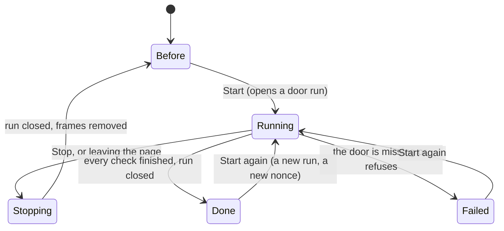
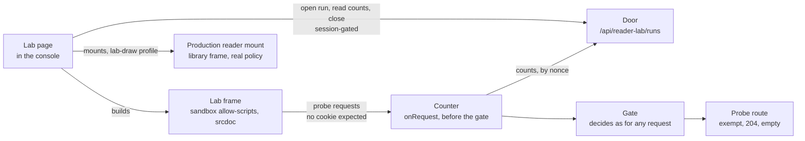
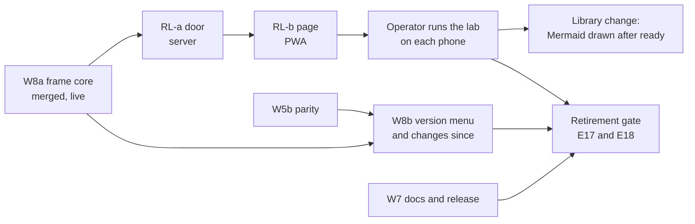

# Reader lab: the Docs reader's phone checks, on one console page — design

**Spec** · 2026-11-03 · Status: Approved (rev 3), 2026-11-04 · Owner: the operator · Linear: none · Related: docs/superpowers/specs/2026-10-12-rich-docs-reader-and-shared-renderer-design.md (the "rich-docs spec"), docs/superpowers/specs/2026-10-01-native-docs-reader-design.md (the "base spec"), docs/superpowers/plans/2026-10-31-native-docs-reader-w8a-reader-frame-core.md, docs/superpowers/plans/2026-11-03-native-docs-reader-reader-lab.md

**Revisions:** amended 2026-11-05, after RL-a (#2283) and RL-b (#2340) merged: each spot the plan's rulings superseded is amended in place and marked "(amended 2026-11-05; …)" with its source: the door's answers as RL-a ships them, the run store's expiry and eviction, the secret-mask census row (D-7967), saturation (D-8008), the benign strays mount and its figures (D-8020), the browser case's own server (D-8021), the import script's hash (D-8022), the dropped Mermaid scan (D-8030), the hidden page (D-8031), the self-navigation evidence (D-8032), the busy frame's timer arm (D-8033), and review 1468's residue (A3, F1). The rev 2 and rev 3 notes below are kept as written. rev 3 (2026-11-04): the operator approved the design with every recommendation (console item 17), so every Open row in section 11 is Ruled and every Proposed row is Agreed. Section 9's amendments are written into the rich-docs spec in place by the same ledger PR. rev 2 (2026-11-03) applies review round 1 (twenty findings upheld, two refuted): a run's life is derived from the lab's own caps (about eighteen minutes at most) and a run keeps its counts once they are complete; a run answers only the session that opened it; the door is called what it is, a permanent surface on every box, inert until a session opens a run, and Q5 now offers a box setting; the gate's expected foreign-origin journal lines are stated; the threat table says what a stolen nonce can and cannot do; the busy frame is a fact that never gates; the Mermaid line counts all six figures together and every figure that did not draw; the CSP check needs M8.B1's control floor and the library's mount; a teardown-signal line; section 8 says what the gap window measures and how it follows the library change; the block regains the device's feature facts and a draw-on-open reading; a quiet top-navigation block holds and says so; section 3.4 lists what the mockup showed and this design does not; section 9 amends the remaining W8 phone-measurement sentences.

## In short

The reader lab is one console page, Settings › Reader lab (`/settings/reader-lab`, also on the command palette), that runs the rich-docs spec's two phone labs on whatever browser opens it: E18 (do the reader frame's walls hold on this engine) and E17 (does the console stay live while a frame is busy or draws Mermaid). The operator opens it, taps Start, taps once inside one frame when asked, waits (about two minutes on a working phone), then selects the result block and sends it on. The page stores nothing, uploads no result and writes no clipboard.

What is decided here, for approval:

- **Its own wave, "RL"**, in two runs: RL-a, a measurement door on the server, present on every box and inert until a signed-in session opens a run; RL-b, the page. It follows W8a and does not wait for W5b or W8b; W8b stays after W5b (section 8).
- **One channel out of every frame: the door.** A lab frame reports only by sending requests to the console's own origin, and the door counts them. No frame gets a port, and the console adds no message listener, so A1 and A2b's "no second channel" rules keep their meaning (section 3).
- **The door** (section 4): a session opens a run, bound to that session, and gets a 128-bit nonce; for at most a life derived from the lab's own caps (about twenty minutes), an exempt probe route counts which requests carrying that nonce arrived and whether each carried the session cookie, by name only. Every request that reaches the probe's handler gets the same empty `204`, whatever the nonce, the run or the name, and no answer on the probe's path depends on whether a run exists (section 4.1); the door reads no body, keeps nothing on disk, and counts nothing when no run is open (amended 2026-11-05; RL-a's door answers, D-8020). The probe's exemption is permanent, on every box (question Q5).
- **Three outcomes per line, never two**: holds, does not hold, not measured for each wall and for the Mermaid line. Every check has a positive signal that it ran (a control and its floor, a canary, a frame's own report, a mount that reached `ready`; amended 2026-11-05, D-8030: the lab sees ready, never a drawn figure), so "nothing arrived" is never read as a pass by itself. Two lines are shaped by what they measure: the busy frame is a fact (shared thread or own thread) that gates nothing, and the teardown signal's miss reads "differs from desktop", never "does not hold" (section 3.2).

Please check: the door's contract in section 4 (it is the one part that needs a security review), the departures from the mockup in section 3.4 and from E17/E18's wording in section 9, and the seven questions under "Waiting on you".

## 1. Context

This section covers the ruling, what exists, and why the lab is a page rather than developer tools on a phone.

| Fact | Source | Footing |
|---|---|---|
| The operator saw the static mockup on 2026-11-03 and ruled "Build it: plan a wave for the lab page". The mockup said it would land in W8b; the operator now wants its own wave, and W8b (the version menu and "changes since") stays after W5b. | the coordinator's brief; mockup on the branch `brainstorm/reader-lab` | Sourced |
| Every wall in the rich-docs spec's §5.1 was measured on desktop Chromium only. E18 re-runs the walls on the operator's phone engine, and passing it is a retirement-gate condition (§9). E17 measures the console's liveness on that engine. | rich-docs spec §5.1, §5.3, §9 | Sourced |
| W8a is live. The operator's phone check of 2026-11-03 opened a six-figure spec in the reader, on Chrome for Android, a Chromium engine. | programme ledger, Decisions 2026-11-03 (late) | Sourced |
| The operator ruled that Mermaid draws on open. It needs a library change (draw after `ready`, accept the Mermaid text after mount); this design does not plan it, and section 8 says what the lab's figures tell it. | programme ledger, same entry | Sourced |
| R19's measurement page (Settings › Measure highlighting, W5h-a) is the precedent: a page under Settings, on the palette, that measures once, stores and sends nothing, writes no clipboard, and shows a result the operator selects. | `pwa/src/screens/HighlightMeasure.tsx`, `pwa/src/lib/routes.ts` (the `measure-highlighting` row), base spec §7.8 R19 | Sourced |
| W8a's real-browser rows (M8.B1-M8.B6) drive the production frame from outside, through Playwright: the 27-channel battery is evaluated in the frame's realm by the test runner, and the listeners are loopback servers. None of that exists on a phone. | `pwa/browser/reader-frame.browser.test.ts`, `pwa/browser/harness.ts` | Sourced |

**Why a page, and why a server door.** On a phone there is no test runner to evaluate code inside a frame and no listener to count what leaves it. The reader frame itself only runs scripts whose hashes the shared library pins, so nothing can be injected into it. The lab therefore builds frames of the reader frame's shape with scripts of its own, and it needs something that can see a request arrive: the console's own server is the only listener a phone can reach without network beyond its own origin.

## 2. The page

This section covers where the page lives, its states, and what the operator does.

- **Route and doors.** A `ROUTES` row `reader-lab`, path `/settings/reader-lab`, title "Reader lab", `top: false`, placed after `measure-highlighting`. The palette derives "Go to Settings › Reader lab" from it, as it does for R19's page. No row is added to the Settings index, as for R19 (question Q7 below asks if one should be).
- **Inside the signed-in console only.** Every request the page makes goes through the PWA's one funnel (`lib/api.ts`), so a 401 raises the login overlay.
- **Its code loads on Start.** The screen is small; the driver, the frame scripts and the library's frame module load through one literal dynamic `import()` when Start is tapped, so the main bundle does not grow by the lab.


*Figure 1. The page's states. Start always opens a fresh door run. Stop, leaving the page and finishing all close the run and remove every lab frame, so nothing the lab started outlives it.*

| State | What the page shows |
|---|---|
| Before | One paragraph (what it checks, keep the screen on, it saves and sends nothing); one sentence that on a server with sign-in on each run leaves one or two "refused a websocket upgrade from a foreign origin" lines in the server's journal, from the lab's own frames, and that they are expected (section 4.4); the device line (engine class, OS class, core count, and whether the browser has a Worker, the iframe `sandbox` attribute and the iframe `csp` attribute); the ten lines, every one "not run", in two groups (E18's eight, E17's two); Start |
| Running | Progress ("4 of 9"), the live line ("longest gap so far 14 ms"), each row's state (waiting, running, then its outcome), the stage where the frames run, Stop. At the popup step the stage shows one button and the line "Tap the button in the box below". |
| Done | Each row with its outcome and a short detail, the result block (section 6) in one `<pre>`, and "Select result", which selects it whole. No copy button: the page writes no clipboard. |
| Failed | The reason in one sentence: no door on this server (update it), the door refused (sign in), or the run was lost before its counts were read (start again). A run lost after that is not a failure: the block keeps the counts and its door line says the final read found the run gone. |

## 3. The checks

This section says what each check does on the phone, what "holds" means, and which spec row it answers.

### 3.1 How a lab frame is built, and how it reports

Every lab frame is the reader frame's shape: `sandbox="allow-scripts"` and no other token, a `srcdoc`, `referrerpolicy="no-referrer"`. Its script is a constant from the page's source; what varies per run (the door's address with the nonce, a channel prefix, the spin time) travels in a JSON data block just before the script, which no policy runs. The wall frame has two such scripts, each with its own data block: the battery, allowed by the frame's nonce, which skips the `import-dynamic` channel alone; and a separate constant script with no nonce, allowed by its fixed SHA-256 hash, which runs that channel. The canary waits for that script's mark (amended 2026-11-05; D-8022). A frame reports only by requesting `/api/reader-lab/probe/<nonce>/<name>` on the console's own origin. The name says what happened (for example `ambient-cookie-held`); no value read in the frame is ever sent.


*Figure 2. Start at the lab page. The page talks to the door with its session; frames reach only the probe route, and the counter records each arrival before the gate decides. The page reads the counts back. The production reader is mounted for the Mermaid timings, the hostile figures and, in a benign mount of its own, the stray-message check (amended 2026-11-05; D-8020).*

### 3.2 The checks, in the result's order

The run's own order is different: the popup check first (it waits for the tap), then the opaque origin, the cookie, the two battery frames, self-navigation, the busy frame, the hostile figures and then the stray messages on a benign mount of their own (amended 2026-11-05; D-8020), the Mermaid pages, and a final read. Every arrival that decides a verdict is read by the hostile step, before the Mermaid pages (section 4.4).

| Check | Spec row | What it does on the phone | Holds when | Not measured when |
|---|---|---|---|---|
| Opaque origin | lab 1-2, M8.B3 | A lab frame tries `parent.document`, reads `self.origin`, and reports held or broke for each. The door also records each report's `Sec-Fetch-Site` class. | Both report held, neither broke, and no report arrived as `same-origin` | A report is missing |
| No ambient state | lab 1-2, M8.B3 | The same frame tries `document.cookie`, `localStorage`, `sessionStorage`, `indexedDB.open` and `caches.open`; it reports held (threw, refused or empty) or broke for each. A store that opened is deleted at once. | All five report held and none broke | A report is missing |
| No cookie on frame requests | lab 1-2, M8.B2 | A lab frame with no frame policy sends `fetch` with `credentials: 'include'`, the same with the Docs marker header, an XHR with credentials, `sendBeacon`, a WebSocket and an image to the door. The control is the console's own request through the funnel. | The control carried the cookie, at least one frame request arrived, none carried the cookie, and the marker request never arrived (its preflight is never answered) | The control carried no cookie (a box with the gate dark has no session), or nothing arrived |
| Frame CSP, 27 channels | M8.B1, E15 | The 27-channel battery in a "wall" frame under the library's own `frameCsp()` plus exactly three lab sources: the battery script's nonce, the fixed SHA-256 hash of the separate script that runs the `import-dynamic` channel, and one exact canary image URL, requested only after that script's mark (amended 2026-11-05; D-8022); the same battery in a "control" frame with no frame policy. Then the production reader mounts two hostile Mermaid figures whose URLs aim at the door, and stays mounted through its observation window (D-8020). | The canary arrived, no wall channel arrived, neither hostile URL arrived, the control frame reached at least 20 of the 26 channels a srcdoc frame can reach (M8.B1's floor; `iframe` is left out, since the shell's `frame-src 'none'` stops it from every lab frame), and the library's hostile mount became ready | The canary is missing, the control is under its floor, or the hostile mount never became ready ("library not measured"). A hostile mount whose Mermaid scan the bridge dropped (the asset rejected, or past its deadline) counts as not ready, even if it reached `ready` (amended 2026-11-05; D-8030). A channel the control never reached is named in the detail as not measured for that channel alone. |
| No popup, no top navigation | E1, M8.B4 | A lab frame shows one button; the operator taps it. Its handler calls `window.open`, reads and writes `top.location`, and clicks a `target=_blank` link, each aimed at a door URL that answers `204` (so even a navigation that got out leaves the console where it is). | `window.open` gave null, the `top.location` read threw, the `top.location` write threw or returned without effect, and the door saw none of the three targets. A write that returned without an error holds with the detail "top navigation blocked without an error" (refinement (u) of the plan; M8.B4 says "throws"): the wall is that the console stayed where it was. | No tap within 30 seconds, or a report is missing |
| Frame cannot navigate itself | E11 | A lab frame sets its own `location` to a door URL, once, sending its "tried" report in the same timer just before. The page counts the frame's `load` events. | The door never saw the navigation (an arrival at its target does not hold, and is read first), and the attempt was seen: the "tried" report arrived, or the page saw a second `load`. The detail names the evidence (`attempt seen: second load`, `attempt seen: tried`, or both). The blocked navigation can cancel its own "tried" image, so its absence alone is no evidence that the frame never tried (amended 2026-11-05; D-8032). | Neither a "tried" report nor a second `load` (`the frame did not try`) |
| Teardown signal | E11, M8.B5 | The same frame's `load` events, counted by the page. | A second `load` fired (`second load fired`): the signal the reader uses to close its port. Without it, a "tried" report makes the line read "differs from desktop" (`no second load`): a miss E18 investigates, never a broken wall, since the wall above held (amended 2026-11-05; D-8032). | Neither a second `load` nor a "tried" report |
| Bridge ignores stray messages | M8.B5 (stray half) | With a benign production reader mounted and ready, on a mount of its own after the hostile mount's window (the hostile figures' CSP fallback can rightly destroy that reader, and a fallback is not a stray effect; amended 2026-11-05, D-8020), a lab frame sends `parent.postMessage` with well-formed `navigate`, `hash`, `copy`, `store.set`, `ready` and `error` ops, an unknown op and an oversize `navigate`. The lab's own mount callbacks count any call. | The frame's "sent" report arrived, no host callback fired, and the console's address and hash did not change | The "sent" report is missing, or the reader never became ready |
| Busy frame | E17, M8.B7 | A lab frame of the reader frame's shape spins for 3 s. The page measures the longest gap between animation frames and how late a 500 ms timer (the reader watchdog's stand-in) fires. | A fact, not a pass: "shared thread" when the longest gap is at least 0.8 of the spin or the timer fired at least half the spin late; "own thread" only when both are below. The detail keeps both numbers and names the shared evidence: gap, timer or both (amended 2026-11-05; D-8033). It steers the Mermaid policy (section 8) and gates nothing: a deliberate 3 s spin on a shared thread can meet no budget. | The frame's start or end report is missing, or the page was hidden when the window started or changed visibility inside it (amended 2026-11-05; D-8031) |
| Heavy Mermaid page | E17, M8.B7 | The production reader mounts, one after another: a page with no figures, a page with one trivial figure, each of six figures alone, and all six together (the heavy page), each drawn on open by the lab's mount profile. The page measures each mount's longest frame gap up to `ready` (section 8 says what that window holds) and its time to `ready`. | Every figure mount, the six together included, reached `ready` with its longest gap within the stall budget (200 ms proposed, Q2). A figure mount over the budget does not hold, whatever its outcome: a mount that fell back or timed out still counts its gap. The detail says "ready", never "drawn": a figure that fails inside the frame after its asset loaded cannot be seen from outside while the library posts `ready`, a carried limit until the library ships a drawn signal (amended 2026-11-05; D-8030). | No figure mount is over the budget, but one fell back, timed out or did not render; the line names it. Under the lab-draw profile, a mount whose Mermaid scan the bridge dropped (the asset rejected, or past its deadline) reads "not measured", never "holds", even if it reached `ready` (D-8030); so does a mount whose window started while the page was hidden or saw a visibility change (D-8031). A dropped or hidden mount is read before the budget, so it can mask another mount's "does not hold": the safe direction, carried untested (amended 2026-11-05; review 1529 F-D). |

The six figures are the shapes of the path-identity spec's six figures (flowcharts of 7 to 14 nodes, two with decision diamonds), relabelled with neutral words and built into the page, so every phone draws the same page.

### 3.3 Why each departure from the desktop rows is safe

| Desktop row (W8a) | On the phone | Why it still measures the wall |
|---|---|---|
| M8.B1 evaluates the battery inside the production frame, with the real library running | The battery runs in a wall frame built by the lab, under `frameCsp()` with three sources added; the real library runs separately, on hostile figures | The reader frame's scripts are hash-locked to the library's, so nothing can run inside it on a phone. The added script nonce allows only the battery's own inline script. The added hash allows only one constant script, which runs the `import-dynamic` channel: a module fetch takes its nonce from the script that starts it, so under the nonce that channel would reach further than under the reader frame's hash-allowed scripts, and none of the other 26 channels inherits the nonce that way (amended 2026-11-05; D-8022). The canary is one exact image URL that no channel requests (a CSP source with a path matches that path only), sent only after that script's mark. An engine that mis-matched paths would show a channel as reached: a false alarm, never a false pass. |
| Two listener origins, A and B | One: the console's own origin | The lab makes no request beyond its own origin. The console's origin is the one target that matters most: it is where the session cookie lives and what `'self'` would mean. |
| The cookie probes run in the production frame, with a bare-frame control | They run in a frame with no frame policy, which is the desktop row's own control; the console's request is the control for the detector | Under the reader's policy no request leaves at all, which would make "no cookie" vacuous. The cookie wall is the opaque origin, which the frame policy does not change. |
| B3's control is a same-origin frame | No same-origin frame anywhere | The page never builds a frame with `allow-same-origin`, so that token stays absent from all of `pwa/src` (a scan pins it). The positive signal is the frame's own report, which is a thrown error, not an absence. |
| B4 tests a non-composed click past the library's click guard | A real tap in a lab frame | Without a user activation a browser's popup blocker would stop `window.open` whatever the sandbox says; the tap removes that confound. |
| B5's port cases (an op before `ready`, a 70 KiB value on the port) | Only stray `parent.postMessage` messages | No lab code can hold the reader's port. The port's parser is the library's, and it behaves the same on every engine; the engine-dependent part is whether a stray window message can reach an effect, which is what the phone measures. |
| The 50 ms heartbeat in the mockup | The longest gap between animation frames | It is R19's measure, moved to one shared function (section 5), and it sees a shared thread the same way: no frame is drawn while the frame spins. |
| Port teardown on a second `load` (E11, M8.B5) | Measured as the frame's `load` count only; no port exists in the lab frame | The mount-level close is the library's, pinned by M8.B5; the lab measures the engine signal it depends on, as its own line, so an engine without it is named rather than passed or failed. |

### 3.4 What the mockup showed that this design does differently

The operator approved the mockup on `brainstorm/reader-lab`. Each item below is in the mockup and not, or not as drawn, in this design.

| In the mockup | In this design | Why |
|---|---|---|
| "Lands in W8b" | Its own wave, RL, in two runs | The operator's ruling of 2026-11-03 |
| A 50 ms interval heartbeat | Animation-frame gaps | Section 3.3: R19's measure, one function |
| The verdict line "mermaid stays on tap" | A `draw on open:` line that reads the busy frame's fact and the Mermaid line into what drawing on open needs on this engine (section 6) | The operator ruled draw on open on 2026-11-03, so the line no longer asks whether to keep the tap; it says what the library change has to do here |
| The device line "Worker: yes · srcdoc sandbox: yes" | Restored in the block's first line as `worker yes · frame sandbox yes · csp attribute yes` | "srcdoc" is spelled only in the frame builder (the plan's scan reads the word in any string elsewhere in `pwa/src`, outside the Docs reader); the lab's own sandboxed srcdoc frames running is the stronger proof, and the check lines carry it. The page's device line shows the same facts before Start |
| csp-27's "(csp attr unsupported)" | The device fact `csp attribute yes` or `no` | It is the engine's fact, not the check's. Where it is `no` (every engine but Chromium), the frame document's meta alone carried the policy, in the wall frame as in the reader frame (rich-docs spec §4.2) |
| "CI also runs the same batteries on Playwright's WebKit and Firefox as proxies" | Not in RL; under Later | Playwright's WebKit and Firefox are desktop builds of those engines, not a phone's, so a green proxy is not E18. They would add two browsers to CI and time to a browser leg CI already balances across two 20-minute shards. A separate CI change can add them if an early warning between phone runs is wanted. |
| A busy-frame verdict | A fact: shared thread or own thread | A deliberate spin on a shared thread can meet no budget, so as a verdict it could never pass (Q2, Q7) |
| "Frame cannot navigate itself: blocked, and the port closes" | Two lines: the wall (the door never saw the navigation) and the teardown signal (a second `load`) | The two can differ on an engine, and folding them would either fail a safe wall or pass a missing signal |

## 4. The door

This section is the security-sensitive part. It states who can use the door, what it can learn and leak, how it is bounded, what it never does, how it is inert by default, the census entries it needs, and the test that proves each property. The door is a permanent production surface: registered on every box, its probe pair exempt from the gate, inert until a signed-in session opens a run (question Q5 asks whether a box setting should switch it instead).

### 4.1 Routes

| Route | Gate | Answer | Notes |
|---|---|---|---|
| `POST /api/reader-lab/runs` | Session-gated; origin-checked when armed (a write). Not in `EXEMPT`. | `200 {ok: true, nonce, ttlMs}`, `no-store` | The server mints the nonce; the client never supplies one. The run is bound to the caller's session by a one-way digest. |
| `GET /api/reader-lab/runs/:nonce` | Session-gated. Not in `EXEMPT`. | `200 {ok: true, run}` or `404 {ok: false, error: 'unknown-run'}`, `no-store` | `run` names every probe of the vocabulary, zeros included. Another session's run answers exactly as an unknown nonce does. |
| `POST /api/reader-lab/runs/:nonce/close` | Session-gated; origin-checked when armed. Not in `EXEMPT`. | `200 {ok: true, closed}` | `closed: false` means no run of this session was open under it. |
| `GET /api/reader-lab/probe/:nonce/:name` | `EXEMPT`, reason 8 (new) | To every request that reaches the handler: `204`, no body, `cache-control: no-store`, nothing else, whatever the nonce, the run or the name (a request that reaches no probe handler: below; amended 2026-11-05, RL-a's door answers) | `exposeHeadRoute: false`, so a HEAD reaches no probe handler and is never counted |
| `POST /api/reader-lab/probe/:nonce/:name` | `EXEMPT`, reason 8; being exempt it skips the origin check, on purpose (its callers send `Origin: null`) | the same `204`, to every request that reaches the handler, an armed box's POST from origin `null` included | Body limit 1 KiB, never read; a refused body (413, 415, 400) still answers the same `204` through the route's error handler |

None consults the box token. No route answers `OPTIONS`, so a preflight to the probe is never approved. The server registers no route under `/docs`, and the probe paths are not page URLs.

**A request that reaches no probe handler** (amended 2026-11-05; RL-a's door answers, review 1468 A3 and F1). The `204` above is the probe handler's answer, and only a request that reaches the handler gets it. No other answer on the probe's path depends on whether a run exists; it depends on the request's method and shape and on the box, as for any path the server does not route:

- A malformed percent-escape: `400` from Fastify before any hook, on every box and by every method.
- An over-long name: `414` before any hook on a POST, and on a GET where no catch-all route matches.
- Anything else (a HEAD, a path of another shape, a method the probe does not take): a `404` from the server's not-found handler where the built bundle's catch-all matches it, which is a GET or a HEAD on a box serving the PWA (`GET /*` is exempt). Where none matches (an API-only box, and any method but GET or HEAD on any box), every `onRequest` hook still runs: a dark box answers `404`; an armed box answers the gate's `401` `no-session` to a caller with no session, except that a write from origin `null` gets the gate's `403` `foreign-origin` first, before the session check.
- A WebSocket upgrade to the probe is counted before the gate decides (section 4.3). On an armed box the gate refuses a frame's upgrade (origin `null`) with a bare `403`; an upgrade that passes the gate is completed, then closed.

### 4.2 The nonce's life

```mermaid
stateDiagram-v2
  [*] --> Open: POST runs, by a session (server mints 16 random bytes; the run keeps a digest of that session)
  Open --> Open: a probe naming it is counted, until 1024 counted
  Open --> Saturated: the 1024th counted request
  Saturated --> Gone: close, expiry or eviction
  Open --> Gone: close by the page of the session that opened it
  Open --> Gone: its life after opening (the lab's caps plus five minutes)
  Open --> Gone: a fifth run opens (the oldest is evicted, whoever opened it)
  Gone --> [*]: a server restart also forgets every run
```


*Figure 3. A run's nonce from minting to forgetting. Only a session can create one, and only that session can read or close it; nothing a probe does can open, extend or close a run. Once gone, a nonce is never accepted again: the server keeps no tombstones and mints a fresh 128-bit value for every run.*

### 4.3 The counter

The probe must be counted when it arrives, including a request the gate then refuses: a sandboxed frame's WebSocket upgrade carries `Origin: null`, which the gate refuses with `403` on an armed box before any handler runs. So the count happens in an `onRequest` hook that the composition root adds immediately before the gate's.

- It acts only when the request's MATCHED route is the probe route (`request.routeOptions.url`, the gate's own rule: never the raw URL).
- It never answers, never awaits I/O, never reads a body and never throws; it returns, and the gate then decides exactly as it does for every other request. The gate stays the one place that answers "is this request allowed".
- For a request naming an open run, it records only classes:

| Recorded | Classes | Never recorded |
|---|---|---|
| Whether the session cookie was present, by its name (`ccrc_session`, non-empty) | present, absent | the cookie's value, any other cookie |
| `Sec-Fetch-Site` | `same-origin`, `same-site`, `cross-site`, `none`, absent, other | the raw header |
| `Origin` | `null`, absent, present | the origin's text |
| A WebSocket upgrade | yes, no | the path beyond the name, the query, the body, the IP address, the user agent |

### 4.4 Bounds, retention and the default

| Property | Value | How it is enforced |
|---|---|---|
| Who can open, read or close | A signed-in session on an armed box, and a run answers only the session that opened it: the run keeps a one-way digest of that session's cookie (a sha256 over a fixed prefix and the value, so it is never the cookie and never the session store's own key), and every other session's read or close gets exactly the answer an unknown nonce gets. On a box with the gate dark there is no session: every caller without a cookie is the one owner, so anyone who reaches the port and holds the nonce can open, read or close a run there, as for every route on such a box; the lab says the cookie check cannot be measured there. | The three run routes are not in `EXEMPT`; the gate's sweeps cover them. The plan's owner tests (store and routes) go red without the digest or the comparison. |
| Who can be counted | Any request that names an open run's nonce. Guessing one is a 2^128 search. | The nonce is minted by `node:crypto`, checked for its 22-character shape before any lookup. |
| Lifetime of a run | About two minutes on a working phone. At most the lab's own caps plus five minutes: the 30 s tap wait, a 2 s settle per step, the 3 s spin, and eleven mounts at their 65 s cap and 10 s draw settle make 876 s (about fifteen minutes); with the five minutes, 1 176 s, about twenty. The eleventh mount is the stray messages' own benign reader, after the hostile one (amended 2026-11-05; D-8020). Closed by the page when it finishes, stops or unmounts. Every arrival that decides a verdict is read by the hostile step, before the Mermaid pages, so a run whose life runs out later keeps its counts: the final read then keeps the last view, and the block says so. | The caps are declared once (`shared/readerLab.ts`), the page waits by them, the door derives the life from their sum, and a test sums them independently. No timer: every open, count and read drops the expired runs first, and a run is gone at its expiry. A close makes no sweep, so an expired run not yet dropped still closes for its own opener (amended 2026-11-05; RL-a's run store). |
| Open runs at once | At most four; a fifth evicts the oldest, whoever opened it. An evicted run's page says the run was lost and to start again, or, if its counts were already complete, keeps them and says the final read found the run gone. | Checked at open. |
| Counted requests per run | At most 1024; past that the run is marked saturated and nothing more is counted. The page keeps a "does not hold" its counts already show, and reports every other count-based line as not measured, so a saturated run never holds (amended 2026-11-05; D-8008) | Checked per count. A lab run sends about 150. |
| Memory | Four runs times about ninety names times a dozen numbers, and one digest each | Fixed by the vocabulary, which is closed. |
| Where it is kept | Process memory only: no disk, no `coord.db`, no journal. The door logs nothing of its own. On an armed box the gate writes its own foreign-origin line (`ccrc-server: refused a websocket upgrade from a foreign origin "null" …`) for each lab frame's WebSocket upgrade: one from the cookie frame, and one from the control battery's frame if its engine sends that channel. One or two such lines per run are expected; the page says so before Start, and the gate's alarm keeps its meaning for every other caller. | No `fs` import in the lab's server files (scan). The armed upgrade test asserts the gate's line fires once for that upgrade, instead of silencing it. |
| Inert by default | With no run open the counter does a string comparison and a map lookup, then returns; a request that reaches the probe's handler gets the same `204` it gets with a run open, and one that reaches no probe handler the same answer it gets with a run open (section 4.1); nothing is recorded, and a probe that names no open run neither creates nor evicts one (amended 2026-11-05; RL-a's door answers) | Measured by a test: probes with no run change nothing, and leave a full store as it was. |
| What a probe can learn | Nothing about a run: every request that reaches the probe's handler gets the same `204` with the same headers for a live nonce, an unknown one, a malformed one, a closed, expired or saturated run and an unknown name, by GET or POST, and for an armed box's POST from origin `null`. A request that reaches no probe handler gets section 4.1's answer, set by its method, its shape and the box, never by whether a run exists (amended 2026-11-05; RL-a's door answers, review 1468 A3) | Measured by a test that compares the answers across those cases, and by a second that sends a HEAD, a path of another shape, a malformed escape and an over-long name, each with no run and with a live run, dark and armed, and compares their status and body (not their headers). No CORS header is ever sent and no preflight is approved, so a frame cannot read even the status. |
| What a reader of the counts learns | Only the classes above, for a run their own session opened | The read is session-gated, and the run is bound to its opener's digest. |

### 4.5 What the door never does

It never sets a cookie, sends a CORS header, approves a preflight, redirects, answers with a body, reads a request body, keeps a session or its cookie (only a one-way digest of it), logs a line of its own (the gate's refusal line for an armed upgrade is the gate's), writes to disk, calls ccd, the agent or git, accepts a nonce from a client, lets a probe open, extend or close a run, lets one session read or close another's run, counts a request whose nonce no session opened, or counts past its cap.

### 4.6 Threats

| Threat | Why it fails |
|---|---|
| A page elsewhere floods the probe path | Without a live nonce nothing is counted, and no run is created or evicted; each request costs a route match and a map lookup, like any 404 (amended 2026-11-05; RL-a's run store). |
| A stolen nonce | A nonce holder can add arrivals. That can force "does not hold", or saturate the run so every count line its counts do not already show broken reads "not measured" (a counted break survives saturation; amended 2026-11-05, D-8008). It can also send the positive signals (the canary, the `*-held` reports, `cookie-ran`, `popup-ran`, `strays-sent`, `busy-start` and `busy-end`), which can turn a "not measured" line into "holds" for a frame that never ran. The one thing it cannot do is erase a real "broke" or a real arrival at a wall's target: the verdicts read those first. So the defence is the nonce's secrecy, not the verdict rules: 128 bits, minted by the server, carried only in the lab's own frames and their probe URLs (sent with no referrer), readable only by the session that opened the run, and gone with the run. |
| The door as a cross-site oracle | No answer depends on whether a run exists. Every request that reaches the probe's handler gets the same `204`, whatever the nonce, the run or the name; a request that reaches no probe handler gets an answer set by its method, its shape and the box (section 4.1) (amended 2026-11-05; review 1468 A3). |
| Compression side channel (BREACH) | The answer has no body. |
| CSRF through the run routes | They are session-gated and origin-checked writes, like every other non-exempt write; a forged open only starts a counter that expires. |
| Another signed-in session reads or closes a run | It gets exactly the unknown-nonce answer: the run is bound to its opener's digest. It can still evict the oldest run by opening a fifth. Only an open evicts: with four runs open it removes the one opened first, whoever opened it, before the new run is added; a probe that names no open run evicts and creates nothing. A run also goes at its expiry, dropped with no timer by the next open, count or read; a close makes no sweep. Eviction costs the evicted page a restart, or, if its counts were already complete, only its final read (section 4.4), nothing more (amended 2026-11-05; RL-a's run store). |
| The counter hook as a bypass | It never answers, so it cannot let a request past the gate. The plan's row RLB-T3-M1 plants an answer in the counter, and the armed-upgrade test (refused `403`, still counted) goes red; its Task 3 Step 9 moves the counter after the gate, and the same test goes red because the upgrade is no longer counted. |
| The exempt POST probe skips the origin check | On purpose: its callers are sandboxed frames that send `Origin: null`, and it changes nothing but a nonce-named counter. The gate's `needsOriginCheck` note says so beside its argument for the other exempt writes, and a test sends an armed box's POST from origin `null` and gets the same `204`. |
| The gate's foreign-origin lines on an armed box | Expected: one or two per run, from the lab's frames' WebSocket upgrades. The gate is unchanged, so its alarm keeps its meaning; the page and this section say which lines are the lab's. |
| A lab frame that escapes its sandbox on some engine | That is the finding the lab exists to report. The lab's own scripts never read or send a value, only held or broke, so even then they carry nothing off the box. |
| The door on every box | It is a permanent surface: registered on every box, its probe pair exempt from the gate. With no run open it counts nothing, and every answer on the probe's path is the one it gets with a run open: the same empty `204` to a request that reaches the probe's handler, and section 4.1's answers to one that reaches none; a run lives at most about twenty minutes; a restart forgets everything (amended 2026-11-05; RL-a's door answers, D-8020). Question Q5 offers a box setting that removes the surface when it is off, with its cost. |

### 4.7 Census entries

| Site | Change |
|---|---|
| `server/src/auth/gate.ts` | Two `EXEMPT` entries, a reason 8 paragraph (which says it is permanent, on every box, and skips the origin check on purpose), one sentence in `needsOriginCheck`'s note after its order-pinned span (the probe is the one exempt write a browser calls cross-origin), "THE EIGHT REASONS", and the route count in its first line (172 to 177; amended 2026-11-05, as RL-a restated it at its merge of main) |
| `server/test/auth-gate.test.ts` | Its route scan reads `readerLab/routes.ts` (ten files); 175 to 180 routes, 172 to 177 HTTP routes, 106 to 109 gated, 66 to 68 exempt-HTTP (amended 2026-11-05: the counts RL-a restated at its merge of main); the exempt key list gains the probe pair; "eight classes" |
| `server/test/secret-mask.test.ts` | Its GET egress census, which reads every `app.get(` under `server/src`, gains two `EXEMPT` rows, each with its reason: `/api/reader-lab/runs/:nonce` (a run's counts by probe name and request class, from the lab's closed vocabulary; no session text) and `/api/reader-lab/probe/:nonce/:name` (an empty `204` with `no-store`; no body). `INLINE`, `MASKED_GET_ROUTES` and the write census are unchanged (amended 2026-11-05; D-7967) |
| `server/test/box-token-census.test.ts` | A reader-lab describe: the five doors in both directions, no box-token call in any lab file, a planted control |
| `server/test/rings/fastify-l4.data.ts` | `server/src/readerLab/routes.ts`, with its reason |
| The architecture spec's `ring-context-map` | `readerLab/**` in C9 Docs, both packages; `screens/ReaderLab.tsx` in C9's PWA cell |
| `README.md`, the auth paragraph | The probe pair among the exceptions, with no number word (the census reads number words there) |
| `CLAUDE.md` | No change: the door is no coordination write, as the docs routes are not |

## 5. What is reused

This section names what the lab takes from earlier waves instead of writing again.

| Reused | From | How |
|---|---|---|
| The 27 channels | W8a's desktop battery | The channel list moves to the shared vocabulary (`shared/readerLab.ts`) and the channels' frame-side code to `pwa/src/readerLab/battery.ts`; the desktop browser test imports both, so the desktop leg and the lab run one battery by construction. |
| The page's shape | R19's page | Route row, palette door, Start/Stop/Select result, one `<pre>`, stores and sends nothing, a scan clause with planted controls. |
| The stall measure | R19's `longestGap` | Moved to `pwa/src/lib/frameGap.ts`; R19's module calls it, unchanged in behaviour. |
| The production mount | W8a's `lazyMountReader` and `mountReader` | Called with a new optional `profile: 'lab-draw'`, which draws Mermaid on open, uses a 60 s watchdog and passes no storage port. The Docs reader passes no profile and is unchanged. |
| The hostile figures | W8a's `HOSTILE` and `hostileLinks` fixtures | Rebuilt with the door's URLs as their targets. |
| The frame policy | The library's `frameCsp()` | Read through `docs/reader/labPolicy.ts`, the one home `./frame` already has (M8.10). |
| The real-browser leg | W8a's `app.ts` and `harness.ts` | A browser test opens the built page in Chrome with a fake door and checks every wall and the teardown signal hold. The case owns one loopback `node:http` server that serves the built page and counts every door request itself, by probe name and class, from the headers it receives; its route for `/api/reader-lab/` only lets requests continue, with no second counter, because Playwright's request routing missed early requests from out-of-process sandboxed frames (amended 2026-11-05; D-8021). Two halves stay with the server's tests: the preflight refusal behind the cookie check's marker (the inherited interception can approve that preflight itself, so the marker is recorded apart and never counted; an `OPTIONS` that reaches the case's server is refused with no CORS header), and the cookie class of a WebSocket upgrade (the case's server answers no upgrade). |

## 6. The result block

This section fixes the text the operator sends. It names no host, origin, nonce, project, path or user agent, so it can be pasted into a public ledger as it is.

```text
reader-lab 1 · Blink 141 · Android · 8 cores · worker yes · frame sandbox yes · csp attribute yes · library 0079625cc30a
E18 walls: 7 of 7 hold; teardown signal holds
  opaque-origin      holds
  no-ambient-state   holds
  no-cookie          holds (5 arrived, 0 with the cookie; the control carried it)
  csp-27             holds (0 of 27 reached; 25 measured; not measured: link-prefetch, iframe; library 0 of 1 attempted)
  no-popup-top-nav   holds
  no-self-navigate   holds (attempt seen: second load)
  bridge-strays      holds (8 sent, 0 effects; observed navigate, hash, copy; store.set and a same-source-only listener not exercised)
  self-nav-teardown  holds (second load fired)
E17 responsive (mermaid budget 200 ms):
  busy-frame         shared thread (longest gap 3012 ms in a 3000 ms spin; watchdog timer 2489 ms late)
  mermaid            does not hold (longest gap 1310 ms, all six together; worst single: figure 4, 420 ms)
    gaps ms          none 60 ready · trivial 140 ready · f1 210 ready · f2 170 ready · f3 230 ready · f4 420 ready · f5 390 ready · f6 180 ready · all 1310 ready
draw on open: needs one figure per task here, and f1, f3, f4, f5 still exceed the budget: draw those on tap or when scrolled into view
door: 151 counted, 0 ignored; session cookie sent
```
*Every number above is an example, of a phone whose frames share the console's thread. Each figure mount's window holds the Mermaid script's compile and that figure's draw (section 8), so `trivial` is about the floor of every figure's gap, and `all` is what drawing the six at once costs today. Amended 2026-11-05: the `no-self-navigate` detail names its evidence (D-8032), each gap names its outcome, `ready` and never "drawn" (D-8030), and the `csp-27` library count and the `bridge-strays` detail are worded as RL-b ships them (review 1524, F8 and F6). The plan's Results (RL-b) hold a measured block from desktop Chrome in the shipped wording.*

- **Grammar.** Line 1 is `reader-lab <format>` then ` · `-separated device facts. Line 2 is E18's summary: the walls that hold out of seven, then any that do not hold or were not measured, then the teardown signal's word. Each check line is two spaces, a fixed key, padding, then that line's word and an optional parenthesised detail. The walls and `mermaid` answer `holds`, `does not hold` or `not measured`; `self-nav-teardown` answers `holds`, `differs from desktop` or `not measured`; `busy-frame` answers `shared thread`, `own thread` or `not measured`. Keys never change meaning.
- **Device facts.** The engine class (Blink, WebKit, Gecko or unknown) with its major version, the OS class (Android, iOS, macOS, Windows, Linux or other), the core count, whether the browser has a Worker, the iframe `sandbox` attribute and the iframe `csp` attribute (Chromium's alone; where it is `no`, the frame document's meta alone carries the frame policy), and the library build (the first twelve hex digits of the enhance asset's sha256). Never the user agent string or a device model.
- **Gaps.** One entry per Mermaid mount in run order, each with its gap and its outcome: `ready` for a mount that reached it (never "drawn", amended 2026-11-05, D-8030); a mount that did not reach `ready` shows its gap and its outcome (`f2 170 fallback`).
- **Reading.** The `draw on open:` line reads the busy frame's fact and the Mermaid line together into what the ruled draw-on-open needs on this engine (section 8): "costs the console nothing here", "fits the budget here, though the frame shares the thread", "needs one figure per task here", naming any single figure still over the budget, or "not measured". It reads "not measured" whenever the busy-frame line or the Mermaid line is not measured, so it says nothing favourable without both measured: a dropped Mermaid scan (D-8030) and a hidden page (D-8031) leave it "not measured" (amended 2026-11-05). It is not a verdict and gates nothing.
- **Door line.** The counts, then whether the console's own request carried the session cookie: `session cookie sent` on an armed box, `no session cookie (sign-in gate off?)` otherwise. The no-cookie line counts toward the retirement gate only on a run that says `session cookie sent` (question Q7). If the final read found the run gone or unreadable, the line says so; every verdict's counts were read before then.
- **Versioning.** The format number is 1. Adding a line, a key or a parenthesised detail keeps it. Changing what a key, a verdict word or a number means, or removing a line, makes it 2, and the coordinator reads each version by its own grammar.
- **Saturation.** If the door marked the run saturated, the door line says so. A line whose counts already show "does not hold" keeps it, since the door stopping does not falsify the counts it took; every other count-based line reads "not measured". A run the door could not read reads every count-based line "not measured". The `bridge-strays` effect the console saw itself is read before either, so it still reads "does not hold". Neither run ever holds a count-based line (amended 2026-11-05; D-8008).

## 7. What the lab never does

- **No network beyond its own origin.** Every URL a lab frame can form is the console's origin plus the probe path; a test builds every frame and checks each URL in it. The only other `http` text in the lab's source is the SVG namespace string, which loads nothing.
- **No clipboard write, no storage.** The page and its modules name no `localStorage`, `sessionStorage`, `indexedDB`, `caches` or `clipboard`, import no storage module, and the production mount gets no storage port under the lab profile. The frame scripts' probes of those names are text that runs only inside opaque frames, and a store that opens there is deleted at once.
- **No upload.** The result stays on the page until the operator selects it.
- **No port, no message listener, no same-origin frame.** The lab adds no `MessageChannel`, no `message` listener and no `allow-same-origin`, anywhere in `pwa/src`.
- **Nothing left behind.** Stop, finishing and leaving the page close the door run and remove every frame and mount.

## 8. Relation to W8b, W8a's residue and Mermaid on open

This section places the lab among the waves.


*Figure 4. The lab's place. RL needs only W8a. W8b keeps its order after W5b. The lab's results feed the Mermaid library change and the retirement gate; the lab stays to re-measure after that change and on new phones.*

- **W8b.** Unchanged in scope and order. Two files overlap in separate hunks: `docs/reader/bridge.ts` (W8b adds the `changes` and `version` ops; RL-b adds the optional profile) and `pwa/browser/reader-frame.browser.test.ts` (RL-b replaces the battery's channel list with the shared one; W8b's residue fixes touch the battery's controls). Recommended order: RL-b before W8b, so W8b's battery fixes build on the shared list. Whichever lands second re-measures.
- **W8a's residue.** It stays W8b's. The lab closes none of it; it inherits one gap honestly: the battery's `iframe` channel cannot reach the door even from the control frame (the shell's `frame-src 'none'` is inherited), so the lab reports it as not measured rather than held, and leaves it out of the control floor (section 3.2).
- **Mermaid on open.** The lab measures with library 1.0.0's own draw-on-open mode, under the lab profile. What its window measures, and so what its figures can say:
  - **The window.** In 1.0.0, `ready` waits for the figures, so a figure mount's window, from its start to `ready`, holds the Mermaid script's compile and that figure's draw. Its longest gap is the longest single task in the window, the compile or the draw, whichever is longer. The `trivial` mount is about the floor that the compile sets for every figure page; a figure's gap well above it is that figure's draw. This reading is valid only while `ready` waits for figures. The bridge still drops the Mermaid scan after an asset rejection or its deadline and can then reach `ready`, as the ordinary reader does; under the lab-draw profile alone it reports the drop, and the lab reads that mount as not ready, its Mermaid line "not measured". A figure that fails inside the frame after its asset loaded stays unseen while the library posts `ready`: a carried limit until the library ships a drawn signal (amended 2026-11-05; D-8030).
  - **If the busy frame has its own thread,** drawing on open costs the console nothing; the library change only has to stop `ready` waiting for figures, so the watchdog stays honest. The block reads "costs the console nothing here".
  - **If it shares the console's thread,** the console pays every draw. The `all` mount shows what drawing the six at once costs today. The change must then draw one figure per task and yield between figures, so the longest stall becomes the largest single figure's, which the single-figure mounts measure now. If a single figure still exceeds the budget on the operator's phone, figures of its size stay on tap or draw when scrolled into view. The block's `draw on open:` line says which of these the figures show.
  - **The compile.** The difference between the `trivial` and `none` mounts is the cost of inlining and compiling the Mermaid script, which every figure page pays at mount whatever the draw mode; that cost belongs to the first-load work, not to the draw mode.
  - **After the library change,** `ready` no longer waits for figures, so a window that ends at `ready` would time none of the draw, and "the same page re-measures it" would be false. The lab therefore has a window mode (`LAB_GAP_WINDOW`): `ready` for 1.0.0, and `ready-and-settle` for the changed library, which runs the window ten seconds (`LAB_DRAW_SETTLE_MS`) past `ready` with the mount still up, so the draw falls inside it. The library change flips the mode in its own change; if it adds a drawn signal of its own, the window ends there instead. A draw slower than ten seconds past `ready` would escape the settle window, which is why a drawn signal is the better end.

## 9. Amendments to the rich-docs spec

This section lists every sentence this design changes. Each edit is written into the rich-docs spec in place, marked "(amended 2026-11-03; reader lab)".

| # | Where | Today | Change |
|---|---|---|---|
| A24 | §7, new row; §4.7 | (none) | The reader lab page and its frames: `pwa/src/readerLab/` builds iframes with `srcdoc`, each `sandbox="allow-scripts"` only; the wall frame's policy is `frameCsp()` plus its battery script's nonce, the fixed SHA-256 hash of its `import-dynamic` script and one exact canary source, built in `docs/reader/labPolicy.ts` (amended 2026-11-05; D-8022). Rows M10.9-M10.16 and M10.18. |
| A25 | §7, new row; base §3.4 and §3.13 | (none) | The door: three session-gated routes and an exempt probe pair, a counter before the gate, gate reason 8; a permanent surface on every box, inert until a session opens a run, each run bound to its opener. Rows M10.1-M10.8 and M10.17. |
| A2b | §7 | "`<iframe` and `srcDoc` only in `MockupFrame.tsx` and `docs/export/buildExport.tsx`" | Add: "and, outside `pwa/src/docs`, in `pwa/src/readerLab/frames.ts` only, where every frame's sandbox is exactly `allow-scripts`". |
| A17 | §7 | The reader's files: `docs/reader/{bridge,policy,assets,images,readerText}.ts` | Add `docs/reader/labPolicy.ts`, the wall frame's policy, under `docs/reader/` because that is `./frame`'s one home (M8.10); and `profile?` on the mount's input, decided by `policy.ts#readerMountPlan`. |
| §4.6 | `reader-mermaid-on-tap` | "W8a's default … through the library's on-request draw mode" | Unchanged for the Docs reader. The reader lab's own mounts draw on open through a lab-only profile with a 60 s watchdog and no storage port (M10.15). |
| §4.6 | `reader-mermaid-on-tap`, its last sentences | "Auto-draw may follow after your phone measurement (E17)." | "Drawing on open (ruled 2026-11-03) follows the reader lab's E17 measurement and the library change that draws after `ready`." |
| §4.6 | Budget | "plus a Mermaid allowance that W8 measures on your phone (E17)" | "plus a Mermaid allowance that the reader lab measures on your phone (E17)" |
| §5.3 E17 | Setup and Pass | Setup "A heavy-Mermaid doc and a busy-loop fixture in the reader frame"; Pass "The console answers, and the watchdog falls back within its budget" | Setup: "A busy-loop frame of the reader frame's shape, and the production reader drawing six figures one by one and together, both run by the reader lab page". Pass: "The reader lab's `mermaid` line holds: every figure mount, the six together included, within the stall budget under the draw mode that ships. Its `busy-frame` line is recorded as a fact (shared thread or own thread, and how late the watchdog's timer fired) and is not a pass condition." |
| §5.3 E18 | Setup | "Re-run lab 1-2, E1, E11 and the M8.B1, M8.B2 and M8.B4 batteries" | "Run by the reader lab page, with the differences in the reader lab design §3.3: one listener (the console's own origin); the battery in a lab frame under `frameCsp()` plus a script nonce, an import-script hash and a canary; the cookie probes in a frame with no frame policy; the popup check after one tap; the port teardown read as the frame's second `load`" (amended 2026-11-05; D-8022). |
| §5.3 E18 | Pass | "The same results as desktop Chromium. A miss blocks retirement (§9)." | "The same results as desktop Chromium, read as the reader lab design §3.2 and §6 say: the seven wall lines and the teardown signal hold; a battery channel the control frame never reached is named, not failed, while the control floor holds; the no-cookie line counts on a run against an armed box. A miss blocks retirement (§9)." |
| §7.2 M8.B1 | Control | "Without the meta, B is reached on at least 20/27" | "Without the meta, B is reached on at least 20/27. On a phone, the reader lab's control frame reaches at least 20 of the 26 channels a srcdoc frame can reach (`iframe` is stopped by the shell's `frame-src 'none'`), or the line reads not measured." |
| §7.2 M8.B7 | Row | "Manual: a heavy-Mermaid doc does not stop the console answering" | "The reader lab's `mermaid` line, on each engine; its `busy-frame` line records the thread fact" |
| §7.2 M8.B8 | Row | "Manual: lab 1-2, E1, E11, M8.B1, M8.B2 and M8.B4 on your phone's engine give the desktop results" | "The reader lab's seven wall lines and its teardown signal read `holds` on each engine" |
| §8 | Waves table, Figure 3 | No RL | Row "RL reader lab: RL-a door, RL-b page; depends on W8a"; edge W8a to RL to the retirement gate |
| §8 | W8a row | "E17 and E18 are your phone steps after it is live" and "M8.B7 and M8.B8 manual, after it is live" | "E17 and E18 are run by the reader lab (RL) after W8a is live" and "M8.B7 and M8.B8 are the reader lab's lines" |
| §9 | Gate table | "The walls hold on your phone's engine, and the console stays live there / W8: E18 and E17" | "… / the reader lab (RL), run by you on an armed box: E18 (the seven walls and the teardown signal) and E17 (the Mermaid line; the busy frame is a fact, not a condition)" |
| Where things stand | Later | "Mermaid auto-draw in the reader, after your phone measurement (E17)." | "Mermaid drawn on open in the reader (ruled 2026-11-03), after the reader lab's E17 measurement and the library change." |
| §5.2 | WebKit row | "auto-draw waits for E17" | "auto-draw waits for E17, which the reader lab measures; the operator ruled draw on open on 2026-11-03, behind a library change" |
| §10 | Decisions | (none) | RD35 the reader lab as its own wave; RD36 the door |

New mutation rows, numbered M10 so they never collide with M8 or M9:

| # | Guard | Test | Mutation that goes red |
|---|---|---|---|
| M10.1 | One vocabulary | The probe names, channels and classes are defined once, in `shared/readerLab.ts`; the server and the PWA import them | A second channel list; a name added on one side |
| M10.2 | Server-minted nonce | 22 base64url characters from 16 random bytes; shape-checked before any lookup; no route takes a nonce from a body | Accept a client nonce; drop the shape check |
| M10.3 | Counter decides nothing | Added before the gate; with the gate armed a frame's upgrade is refused `403`, logged once by the gate, and still counted | Answer from the counter; add it after the gate |
| M10.4 | One answer | Every request that reaches the probe's handler gets the same `204` with no body and `no-store`, for live, unknown, malformed, closed, expired and saturated runs and unknown names, by GET and POST, a refused body and an armed POST from origin `null` included; a request that reaches no probe handler (a HEAD, a path of another shape, a malformed escape, an over-long name) gets the same answer with no run and with a live run, dark and armed; no preflight is approved (amended 2026-11-05; RL-a's door answers) | Answer `200` for a live nonce; drop the error handler; add a CORS header; answer `OPTIONS`; answer a HEAD or an over-long name by whether its run exists |
| M10.5 | Inert without a run | With no run open, probes record nothing | Count by name without a run |
| M10.6 | Bounds | A life derived from the lab's caps (a test sums them), four runs with eviction, 1024 counts then saturated | Drop any of the three checks; set the life below the caps' sum |
| M10.7 | Classes only | The read holds the classes of section 4.3 and no header value; nothing is written to disk | Record the cookie's value; import `fs` |
| M10.8 | Census | The run routes not `EXEMPT`, the probe pair `EXEMPT` with reason 8, no box token in any lab file | `EXEMPT` the open route; add a token check |
| M10.9 | Lab frames | Built only in `readerLab/frames.ts`; sandbox exactly `allow-scripts`; `srcdoc`; `no-referrer`; no `allow-same-origin` anywhere in `pwa/src` | Add a token; build a frame elsewhere |
| M10.10 | Wall policy | `frameCsp()` plus exactly three sources: the battery script's nonce and the `import-dynamic` script's fixed SHA-256 hash in `script-src`, and the canary in `img-src`; nothing else. The battery skips that channel, and the canary waits for the import script's mark (amended 2026-11-05; D-8022) | Add `connect-src`; widen the canary to a host; run the import channel under the nonce |
| M10.11 | Reach | Every URL in every lab frame is the console's origin plus the probe path | A frame script with another host |
| M10.12 | The page only measures | No storage, no clipboard, no `fetch` of its own, `api` read only through `api.readerLab` | Persist or upload the result |
| M10.13 | Three outcomes | "Not measured" never folds into "holds": the canary, the control floor, the library's ready mount, frame reports, a figure mount that reached `ready` with its Mermaid scan not dropped, and the tap each gate their line; a forged arrival cannot hide a real "broke", and saturation keeps a counted one (amended 2026-11-05; D-8030, D-8008); the busy frame is a fact and the teardown signal "differs" rather than fails | Treat a missing report as a hold; drop `all` or a fallen-back mount from the Mermaid line; make the busy frame a verdict |
| M10.14 | Result format | Version 1's keys and words, the device facts, the reading and the door line; no host, nonce or user agent | Print the origin or the user agent |
| M10.15 | Lab profile | Only the lab passes `lab-draw`; it maps to draw on open, the lab watchdog and no storage port; no profile is the reader's | Pass `lab-draw` from the Docs reader; keep the store under the lab |
| M10.16 | One battery | The desktop battery and the lab's import one channel list and one channel source | A second copy of the channels |
| M10.17 | Bound to its opener | A run keeps a one-way digest of the opening session's cookie; any other session's read or close answers as an unknown nonce does | Drop the owner comparison; key the owner on nothing |
| M10.18 | Counts kept | Every verdict's arrivals are read by the hostile step; a final read that finds the run gone keeps the last view and says so | Throw on the final read's `unknown-run` |
| M10.B1 | The page in Chrome | With a fake door, every wall line and the teardown signal hold and the block parses as version 1. The preflight behind the cookie check's marker is harness-limited there (Playwright approves preflights while it intercepts), so the server's test refuses it instead | A frame with `allow-same-origin`, or a wall frame without its policy, reds it |

## 10. Risks

| Risk | Mitigation | Footing |
|---|---|---|
| A new unauthenticated surface on every box, publicly reachable ones included, for good | Section 4: uniform empty answer, no body read, no preflight approved, closed vocabulary, nonce-gated counting, caps, a life derived from the run's caps, runs bound to their opener, memory only; Q5 offers a box setting instead | Judgement; each property has a test |
| A hook before the gate could become a bypass | It never answers; M10.3's test fails if it does; reason 8 says so beside the gate | Judgement |
| A phone that fails a check through measurement noise | Fixed settle waits, and three outcomes: a slow phone reads "not measured", never "holds" | Judgement |
| A slow phone outlives its run | The life covers every cap plus five minutes; and every count that decides a verdict is read before the Mermaid pages, so a run lost after that keeps its counts | Judgement; the caps' sum is pinned by a test |
| The gate's foreign-origin lines read as an attack | One or two per run are expected and said so on the page and in section 4.4; the gate is unchanged | Sourced (the gate's own line) |
| A stolen nonce forges positive signals | Section 4.6: the defence is the nonce's secrecy; the verdicts only keep a real "broke" from being hidden | Judgement |
| A wall that broke lets a lab frame act as the console | The lab's scripts read and send no value; a store that opened is deleted | Judgement |
| A top navigation or popup that gets out | Its target answers `204`, so the console stays; a blank popup may be left open, and the result says so | Judgement (204 behaviour assumed for every engine) |
| The fake door in the browser test drifts from the server | The server's own tests pin its behaviour; both read one vocabulary | Judgement |
| Nine Mermaid mounts on a slow phone take long | Each mount is capped at 65 s (above the 60 s watchdog); Stop works between steps | Judgement |
| The page is hidden during a timed window (the screen goes off, another app comes to the front) | The busy line and every timed mount's gap read "not measured" when the page was hidden as the window started or its visibility changed inside the window, so no favourable reading comes from a hidden page. Stop pressed while the page is hidden takes effect when it returns: a carried limit (amended 2026-11-05; D-8031) | Judgement; the plan's FR1 cases pin both directions |
| An engine that blocks top navigation quietly, or fires no second `load` | The first holds with its detail named (plan refinement (u)); the second reads "differs from desktop" when the frame's "tried" report arrived. With neither a second `load` nor a "tried" report, both self-navigation lines read "not measured", and E18 investigates rather than infers a hold (amended 2026-11-05; D-8032); the coordinator reads both in the block | Judgement |
| Android's popup blocker or data saver changes what the control frame can send | Per-channel "not measured" instead of a false pass | Judgement |
| `lab-draw` leaking into the Docs reader | Only the lab passes it (M10.15) | Judgement |
| Overlap with W8b in two files | Separate hunks; the later one re-measures | Sourced (file lists) |

## 11. Decisions

The operator approved every row on 2026-11-04 (console item 17): the rows that were Open are Ruled, and the coordinator's proposals are Agreed.

| # | Decision | Options considered | Chosen, and why | Status |
|---|---|---|---|---|
| RL1 | Where it lands | Inside W8b; its own wave | Its own wave, after W8a, independent of W5b and W8b | Ruled |
| RL2 | Runs | One run; door then page | Two runs: RL-a (door, reviewed alone, opus) then RL-b (page); round 1 did not move this | Ruled |
| RL3 | How a frame reports | A port; a window listener; the door | The door only: no port and no listener, so A1 and A2b keep their meaning | Agreed |
| RL4 | The CSP check's frame | Inject into the reader frame (impossible); a lab frame under its own policy; a lab frame under `frameCsp()` plus a nonce and a canary | `frameCsp()` plus the battery's nonce, the import script's hash and a canary: the production policy, with a positive signal that both scripts ran; the hash keeps the `import-dynamic` channel under the reader frame's own hash-allowed shape (amended 2026-11-05; D-8022) | Ruled |
| RL5 | Counting upgrades | In the handler (misses every upgrade); before the gate | Before the gate, deciding nothing | Ruled |
| RL6 | The door's bounds and its switch | A fixed life; a life derived from the run's caps; always registered; registered only when a box setting is on | A life derived from the lab's caps (about twenty minutes; amended 2026-11-05, D-8020), four runs, 1024 counts, each run bound to its opener; always registered, inert until a run opens (Q5 sets out both options' costs) | Ruled |
| RL7 | Stall measure | A 50 ms interval; animation-frame gaps | Animation-frame gaps, R19's measure, one function | Agreed |
| RL8 | Mermaid timings | A lab-built Mermaid frame; the production mount | The production mount under a lab profile | Agreed |
| RL9 | Popup check | Script only (popup blocker confound); one tap | One tap, or "not measured" | Ruled |
| RL10 | Stall budget | 100 ms; 200 ms; report only; one budget for both E17 lines | 200 ms (the "good" responsiveness line browsers use for a tap), for the Mermaid line only; the busy frame is a fact with no budget | Ruled |
| RL11 | Gate reading | Any "not measured" fails the gate; per-channel reading | E18: the seven walls and the teardown signal hold. E17: the Mermaid line holds; the busy frame is never a condition. A battery channel the control never sent counts as met only while the control floor holds and the channel is named. The no-cookie row (and the spec's null-origin-write row, the server's own) counts only on an armed box's run; on a dark box they read "not applicable (READER_CSP is the wall)" | Ruled |
| RL12 | Settings index row | Palette only, as R19; an index row | Palette only, as R19 | Ruled |
| RL13 | A quiet top-navigation block | Does not hold (M8.B4's "throws", read literally); holds, named in the detail | Holds with the detail "top navigation blocked without an error", because nothing reached its target (plan refinement (u)) | Agreed |
| RL14 | The Mermaid gap window | Ends at `ready`; runs past `ready`; a mode | A mode: `ready` for library 1.0.0, `ready-and-settle` for the library change, which flips it | Agreed |

## 12. Testing and proof

- **Server (RL-a).** Unit tests of the vocabulary and the caps' sum, the run store (the life, expiry, eviction, cap, the owner, classes, closed vocabulary), route tests through the real server with the gate dark and armed (the uniform answer over live, unknown, malformed, closed, expired and saturated runs and an armed POST from origin `null`; one answer, with no run and with a live run, to a request that reaches no probe handler (amended 2026-11-05; RL-a's door answers); the counter before the gate and the gate's own journal line; the session gating and the owner; a refused body still `204`; no preflight approved), and the census edits of section 4.7. Every guard has a mutation row measured red.
- **PWA (RL-b).** Unit tests of the frame builder (sandbox, `srcdoc`, the wall policy, every URL on the origin), the verdict rules (each line's three outcomes from fixture counts, the control floor, the ready library mount, `all` and the mounts that did not draw, the busy frame's fact, the teardown signal, the quiet block, saturation, a dropped Mermaid scan, a hidden page and the self-navigation evidence; amended 2026-11-05, D-8008, D-8030 to D-8033), the reading and the result format, the run (a run lost late keeps its counts; the gap window), the page's states, and a scan clause with planted controls for section 7. One real-browser test runs the built page in Chrome against a fake door: its own loopback server, which serves the page and counts the door's requests from the headers it receives (amended 2026-11-05; D-8021).
- **On the phone.** The operator runs the page once per phone or browser and sends the block; the coordinator records it in the programme ledger. Those runs are E17 and E18.

## Where things stand

### Agreed

- The operator's ruling of 2026-11-03: build the lab page as its own wave; W8b (the version menu and "changes since") stays after W5b.
- The operator's ruling of 2026-11-03: Mermaid draws on open, behind a library change this design does not plan; the lab measures for it.
- From the base, not a choice: the reader frame runs only the library's hash-pinned scripts, so the lab cannot run code inside it on a phone, and every phone-side check runs in frames of its shape.
- The coordinator's rulings on review round 1 (2026-11-03), applied in rev 2: a run's life derived from its caps, and a run that keeps its counts once complete; the gate unchanged, its foreign-origin lines documented and asserted; each run bound to its opener by a one-way digest; the door called a permanent surface, with Q5 rewritten; the busy frame a fact that never gates; the two-run split kept.

### Waiting on you

- Nothing. The operator approved the design on 2026-11-04 (below).

### Answered by the operator (2026-11-04)

- "Approve with every recommendation" (console item 17). Q1: two runs, the door first. Q2: 200 ms, for the Mermaid line only. Q3: the library's own policy plus the frame's script nonce and one exact canary. Q4: the counter sits before the gate. Q5: (a), the door always registered and inert until a session opens a run. Q6: one tap. Q7: the reading in RL11, and no Settings index row. The questions as asked follow.

- **Q1 (RL2): two runs or one?** Round 1 changed nothing that moves the argument: every door fix (the owner, the life, the gate's text, the new server cases) stays in the server run, and every page fix in the page run. Recommended: two runs, the door first, so its security review stands alone and the page builds on a merged wire.
- **Q2 (RL10): the stall budget.** Round 1 narrowed it: the budget now holds only the Mermaid line, which counts the six figures together and every mount that did not draw; the busy frame became a fact (shared thread or own thread, and how late the watchdog's stand-in timer fired) that gates nothing, since a deliberate 3 s spin on a shared thread can meet no budget. Recommended: 200 ms for the Mermaid line.
- **Q3 (RL4): the CSP check's frame.** Round 1 tightened what "holds" needs: M8.B1's control floor (the control frame reaches at least 20 of the 26 channels a srcdoc frame can reach; `iframe` is left out by design) and the library's hostile mount reaching ready; either missing reads "not measured". Recommended: unchanged, the library's own policy plus the frame's script nonce and one exact canary URL, with the real library checked separately on hostile figures.
- **Q4 (RL5): the counter before the gate.** Round 1 added a disclosure: on an armed box the gate still writes its foreign-origin journal line for each lab frame's WebSocket upgrade, one or two per run; the gate's alarm is unchanged, a test asserts the line, and the page says these lines are expected. Recommended: yes; it decides nothing, and without it every WebSocket probe is unmeasured.
- **Q5 (RL6): is the door always registered, or only when a box setting is on?** Round 1 called the door what it is: a permanent surface on every box, its probe pair under a permanent `EXEMPT` reason 8 on publicly reachable boxes too, inert until a signed-in session opens a run. It also bound each run to the session that opened it, derived a run's life from the lab's own caps (about twenty minutes at most; amended 2026-11-05, D-8020), and made a run keep its counts once complete.
  - (a) Always registered, inert until a run opens. Cost: one exempt route pair on every box, reachable wherever the box is; with no run open a probe counts nothing, and a probe that reaches the handler gets one empty `204` (one that reaches none gets section 4.1's answer, never set by whether a run exists; amended 2026-11-05, RL-a's door answers), so a scanner learns only that the path exists. Nothing to switch before a phone run, and any updated box can be measured.
  - (b) Registered only when a box setting is on (an off-by-default `CCRC_*` value). Cost: a setting to document, ship, and switch on and back off around each phone run; a "door off" state on the page, since its "no door" sentence would also mean "switched off"; the route and exemption censuses become conditional, which they do not express today, with a test for each state. With the setting off the surface is gone.
  - Recommended: (a), still held after these fixes: with no run open the door does nothing, and every property it has while a run is open is pinned by a test that goes red without its guard.
- **Q6 (RL9, RL13): one tap during the run.** Round 1 did not change the tap; it made the popup check's reading of a quiet block explicit: a `top.location` write that returned without an error, while nothing reached its target, holds, and the line says "top navigation blocked without an error"; a missing report reads "not measured". Recommended: yes, one tap; without it a popup blocker would answer for the sandbox.
- **Q7 (RL11, RL12): how the retirement gate reads the lab, and a Settings index row.** Round 1 changed the reading. E18 passes when the seven walls hold and the teardown signal holds ("differs from desktop" there is a miss to investigate, never a broken wall). E17 passes on the Mermaid line, held to the budget under the ruled draw-on-open mode; the busy frame is a fact and never a condition. A battery channel the control frame never sent counts as met only while the control floor holds and the block names it. The no-cookie row, and the spec's null-origin-write row (the server's own check, outside the lab), count only on a run against an armed box, which the block's door line names (`session cookie sent`); on a box with the gate dark they read "not applicable (READER_CSP is the wall)", and the gate is met from an armed box's run. Recommended: that reading, and no index row.

### Later

- The library change that draws Mermaid after `ready`, informed by the lab's `busy-frame` fact, `mermaid` line and `draw on open:` reading; it switches the lab's gap window to `ready-and-settle` (or to a drawn signal of its own), and the lab re-measures it once it ships.
- W8b's battery fixes from W8a's residue, on the shared channel list.
- A lab run on any further phone or browser the operator reads on, whenever one is added.
- Playwright WebKit and Firefox as CI proxies for the batteries, which the mockup showed: not in RL. They are desktop builds, not a phone's engine, so they cannot stand for E18; they would add two browsers to CI and time to the browser leg. A separate CI change can add them for an early warning between phone runs.
- A `FILE_MS` entry for the lab's browser file, if its measured time calls for one: a separate CI change.
- The page stays after the retirement gate, as R19's page does, for library bumps and new engines.

---

*Written by Claude for the operator. Diagrams are Mermaid text.*
