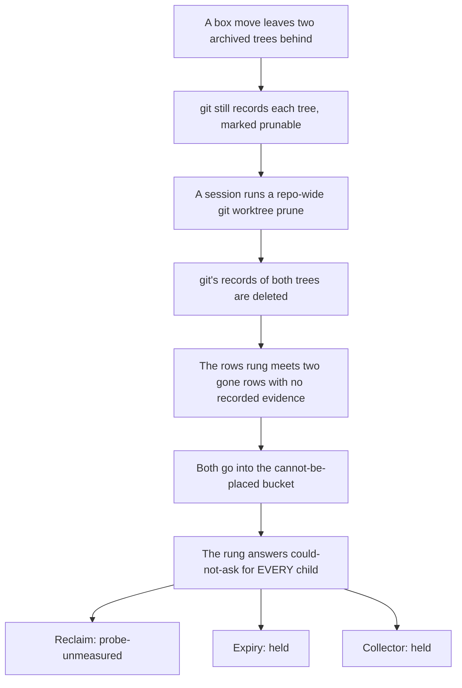
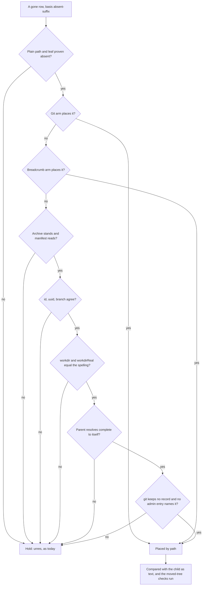
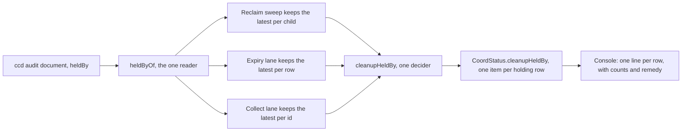
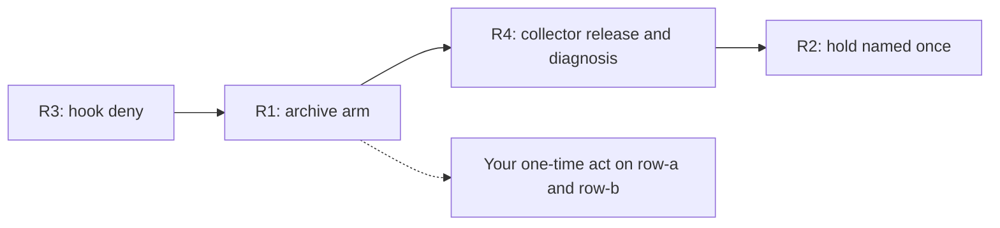

# Cleanup un-wedge: placing archived rows, naming the hold, and guarding the evidence

**Spec** · 2026-11-04 · Status: Draft · Owner: the operator · Linear: none · Related: `docs/superpowers/specs/2026-09-22-child-workspace-reclamation-design.md` (§5.5, §5.9, §5.10), `docs/superpowers/specs/2026-10-12-path-identity-design.md` (§4.5, §4.10), `docs/superpowers/specs/2026-09-24-workspace-lifecycle-design.md` (§5.3), plan `docs/superpowers/plans/2026-11-04-cleanup-unwedge.md`

## In short

Automatic cleanup of finished child workspaces has stopped on the whole fleet box since 2026-10-29. Two archived
top-level rows (here `row-a` and `row-b`) name worktrees that no longer exist. A session then ran a repo-wide
`git worktree prune`, which deleted git's record of those trees. The rows rung of the reclaim ladder can place a
gone row only on recorded evidence, and now no evidence exists, so it answers "could not ask" for every child.
Reclaim, archive expiry and the temp-root collector all share that rung, so all three are held.

This spec builds the four fixes the operator raised on 2026-11-04 (item 36), one task each:
R1 places an archived row with a gone tree from its archive record; R2 names the rows that hold cleanup once in
the console and lists them in ccd's answer; R3 makes the session hook refuse a repo-wide `git worktree prune`;
R4 lets the collector take a temp root whose witness names a device the box no longer has, and explains the
`no-worktree-record` rows a box move left. No re-proof is weakened, and no refusal fails open.

**What you must check:** D3 (old archive records place nothing, so the two live rows still need your one-time
act), D6 (ccd's hold does not narrow for rows with no durable record) and D12 (the collector's box-move release).

## 1. Context

This section says what is stuck and why. The figures are measured on 2026-11-04 from the fleet box's lifecycle
journal and registry by a read-only investigation; nothing was changed.

| Lane | What it does now | Measured |
|---|---|---|
| Child reclaim (close-time, sweep, stale and superseded arms) | every audit answers `probe-unmeasured` | no reclaim since 2026-10-29; about 270 closed runs deferred |
| Archive expiry | held by the same rung | no expiry since 2026-10-28 |
| Temp-root collector | held by the same rung, and about 30 roots refused `witness-mismatch` after a box move | the 30 are re-asked many times a day |
| Orphan-worktree lane | working | it asks a different question |

Every failure since 2026-10-29 carries the same detail: registry rows `row-a`, `row-b` "name a workdir that cannot be
resolved completely". Those are the only two of about 350 rows whose workdir is absent. Both are archived. The trigger
was one repo-wide `git worktree prune` run by a worker session about twenty minutes before the first failure. Until
then, git's `prunable` record of each gone tree placed it (the git-record arm). Five child rows also stand in the
`orphan` state after a box move: their trees exist, but git keeps no record of them, so reclaim refuses them
`no-worktree-record`.

*Figure 1. How two gone rows hold every child on the box. Read top to bottom: the prune removed the only evidence the rung accepted.*

## 2. The mechanism in the code

This section pins the root cause to `main` at `08e3b290a`. `ccd/ccd` is a committed file whose line 2 carries a
generated stamp over its own bytes; it has no separate source fragments, so it is cited directly, and every edit to
it is re-stamped (`ccrc restamp`).

| Where | What it does |
|---|---|
| `ccd/ccd:31232` `_ws_reclaim_workdir_shared` | The rows rung: no other registry row may name, contain or spell through the child's tree. |
| `ccd/ccd:31660-31666` | A row that does not resolve `complete` is placed only when its basis is `absent-suffix` and `_ws_reclaim_recorded` places it; otherwise it joins `unres`. |
| `ccd/ccd:31900-31901`, `31912` | A non-empty `unres` builds the "cannot be resolved completely" sentence, and the rung returns 2. |
| `ccd/ccd:31917` `_ws_reclaim_recorded` | Two arms only: git's record (`_ws_reclaim_recorded_git`, `31954`) and ccd's own breadcrumb and tombstone (`_ws_reclaim_recorded_crumb`, `31998`). |
| `ccd/ccd:31979-31992` | The git arm needs exactly one admin entry naming `<w>/.git`, marked `prunable`. A prune removes it. |
| `ccd/ccd:32023-32027` | The breadcrumb arm needs a reap or reclaim phase past the removal. An archive writes none. |
| `ccd/ccd:10477` `cmd_ws_archive` | "DESTROYS NOTHING": it writes `.archivemanifest`, `.archived` and `.archivedreason`, and kills the pane. |
| `ccd/ccd:10944-10947` `_ws_archive_manifest` | The manifest names `id`, `branch`, `worktreeHead`, `base`, `tip`, `dirty`, `ignoredDigest`, `stashes`, `worktreeBytes`, `pr`, `prHistory`, `transcript`. It names no workdir and no uuid. |
| `ccd/ccd:33082-33083` | The reclaim ladder (rung 9) turns rc 2 into `_ws_reclaim_unmeasured`. |
| `ccd/ccd:34949-34950` | `_ws_reclaim_owned`, the tail's ownership check, asks the same rung. |
| `ccd/ccd:38123` | `_ws_expire_eval` runs the same `_ws_reclaim_ladder`, so expiry is held too. |
| `ccd/ccd:39243` | `_ws_collect_rows_clear`, the collector's rows rule, asks the same rung. |
| `ccd/ccd:14481-14484` | The reclaim audit prints `unmeasured` and journals `failed probe-unmeasured`. |
| `ccd/ccd:16816` | `ws-gc --prune` (an operator verb) runs a repo-wide prune itself. |
| `ccd/ccd:8387`, `8918`, `13563`; `server/src/wsaudit.ts:87` | Advice text tells the reader to run `git worktree prune`. |

The hold itself is correct. The reclamation spec chose it on purpose (§5.5, D-3731, D-3734): a row that cannot be
placed might name the child's tree through a removed link, so ccd cannot prove the child's tree is the child's own.
What is missing is a second durable record for an archived row, a smaller surface for the hold, and a guard on the
evidence the git arm reads.

## 3. R1: an archived row is placed from its archive record

This section adds a third arm to `_ws_reclaim_recorded`. It proves, from ccd's archive record, the same three facts
the git arm proves from git's record: where the tree was, that it was this project's tree, and that it is gone now.

### 3.1 What the archive writes from now on

`_ws_archive_manifest` gains three keys, all additive: `workdir` (the row's `.workdir` as read), `workdirReal` (the
`complete` answer of `_ws_reclaim_resolve` for it at archive time, or `null` when it did not resolve `complete`) and
`uuid` (the row's `.uuid`). The archive already refuses unless the tree stands (`ccd/ccd:10568-10569`) and git records it
as a worktree of the row's project (`_ws_wt_branch`, `_ws_common_dir`). The only two readers of the manifest,
`_ws_gc_manifest_bytes` and the server's `manifestBytes`, read `worktreeBytes` alone, so the new keys change nothing
they answer (`ccd/ccd:10844-10853`).

### 3.2 The arm's conditions

`_ws_reclaim_recorded_archive <id> <workdir>` answers rc 0 only when every condition holds. Each condition that
cannot be read is a failure, never a pass.

| # | Condition | What it proves | Same as |
|---|---|---|---|
| A1 | `$REG/<id>.archived` is a regular file (not a link) holding a whole number | the archive stands: no restore since | new |
| A2 | `$REG/<id>.archivemanifest` is a regular file (not a link) that parses as JSON (python3, its one reader; none means fail) | the record can be read | crumb arm's tombstone read |
| A3 | the manifest's `id` is the row id, its `uuid` is the row's `.uuid`, and its `branch` is the row's `.branch` | it is this row's record, this incarnation | crumb arm's uuid check |
| A4 | the manifest's `workdir` equals `<workdir>` literally, and its `workdirReal` equals it too | the spelling was the physical path git recorded at archive time | git arm's "parent resolves complete to its literal spelling" |
| A5 | the parent of `<workdir>` resolves `complete` to its own literal spelling now | no link on the standing part of the path | git arm, verbatim |
| A6 | git keeps no record of `<workdir>` now (`_ws_reclaim_record` rc 1) and no admin entry names `<workdir>/.git` (`_ws_reclaim_log_of`) | a standing record is the git arm's to judge; an unreadable one is never "none" | crumb arm, verbatim |
| A7 | (already asked by `_ws_reclaim_recorded`) a plain path with no control character, and the leaf proven absent | the tree is gone, not a dangling link | unchanged |

A manifest without `workdir`, `workdirReal` or `uuid` (one written before this change) fails A3 or A4 and places
nothing (D3).

*Figure 2. The archive arm sits after the two existing arms. Every "no" keeps today's hold.*

### 3.3 Why this does not weaken the rung

- **The same facts, from another durable record.** The git arm reads git's record of a tree at the spelling; the
  archive arm reads ccd's record of git's record, taken when the tree stood, plus the proof that the spelling was
  physical then (A4) and has no link now (A5). A record that disagrees in any field holds.
- **Placing is not releasing.** A placed row is compared with the child exactly as a `complete` row is: a row at,
  inside or through the child still refuses `containment-unproven` (`ccd/ccd:33084-33089`).
- **A moved tree still holds.** The arm records no admin directory, but a moved archived tree inside the child keeps a
  `.git` file that names a pruned admin directory. Rung 9 then cannot read its git directory and answers unmeasured
  (`_ws_reclaim_gitdir_own`, `_ws_reclaim_foreign_clean`). The arm also adds the row to `_WS_RECORDED_IDS` when its entry
  field is valid, as both arms do, and it forces the tail's nested scan in `_ws_reclaim_owned` (D5), so a tree moved in
  between the ladder and the tail is caught there too.
- **No liveness input.** The arm reads no process, pane, tmux or unit state, like the other two (the census at
  `server/test/ccd-child-reclaim-recovery.test.ts:486`). The investigation suggested "no running unit"; that is not
  taken (D4), because the rung's rule is that liveness never makes a projection evidence.
- **One helper, every seam.** The arm lives inside `_ws_reclaim_recorded`, so the audit, the verb's locked
  recomputation, the tail, the expiry ladder and the collector all ask it the same way. No caller gains a path.

## 4. R2: the hold is named once

This section makes ccd say which rows hold a child, and makes the console show each such row once. It does not
shrink ccd's hold for rows without a record (D6).

### 4.1 Why ccd's hold stays box-wide for unrecorded rows

The operator asked that one unplaceable row block only itself. For an archived row, R1 does that. For any other row
whose tree is gone with no record, nothing durable on the box says where its session's files were. Its spelling may
have led into any child through a link that is gone now. Scoping the hold by project, by path prefix, or by the
row's entry field would each release a child that row may share. The reclamation spec rejected the last of these
explicitly ("NO FIELD RELEASES A ROW", `ccd/ccd:31506-31510`). So the hold stays, and what changes is how fast the
operator learns of it. A narrower rule needs a new proof and a ruling (Waiting on you).

**Amended 2026-11-05 (#2294, D-8019).** #2294 asked for that narrowing, and it is built on a new proof, on none of
the three scopes rejected above. A gone row stops holding when nothing runs for it and no checkout stands under the
child or a leaf (child-reclamation spec §5.5). With no checkout there no moved tree is, and with nothing running no
tree is in use. A gone row something may run for still holds every child, one beside a checkout holds that child, and
R2 still names both. The operator confirms this on that PR.

### 4.2 ccd names the rows

`_ws_reclaim_workdir_shared` keeps a new global, `_WS_HELD_BY`: one `id<TAB>word` line for each OTHER row in a
not-asked bucket, reset on every call. Ids only, never values, as the rung already prints.

| Bucket today | Word |
|---|---|
| `unres` | `gone-unrecorded` |
| `unplaced` | `not-plain` |
| `unproc` | `under-proc` |
| `unread` | `workdir-unreadable` |
| `unpend` | `entry-pending` |
| `unfield` | `entry-unmeasured` |
| `unrec` | `entry-moved` |

The child's own buckets (`unmine`, `unleaf`, `unwalk`, `unmount`) are not another row's fault and are not listed.
The reclaim audit document, the expiry audit document and the collect audit document each gain `heldBy`: an array of
`{id, word}` when the rung answered rc 2; `[]` when it ran and answered rc 0 (a SHARED, NESTED or THROUGH row still
outranks); `null` when the rung was not reached. The `probe-unmeasured` journal line gains `meas.heldBy`, the ids
comma-joined.

### 4.3 The server names each row once

*Figure 3. One reader and one decider turn many identical failures into one line per holding row.*

- `server/src/coord/cleanupHeldBy.ts` (new, L1, context C4): `heldByOf(doc)` answers `absent` (an older ccd),
  `not-reached` (`null`), `none` (`[]`), `rows` or `malformed`. Five answers, so no overloaded null. `cleanupHeldBy(inputs)` composes one item per
  row id: its word, a sentence with that word's remedy, and how many children, archived rows and temp roots it holds.
- `CoordStatus.cleanupHeldBy?: readonly CleanupHeldByItem[]` in `shared/api.ts` (additive; absence permits).
- The per-child `failing` and `stuck` items, and the expiry lane's `failing` items, of a child held only by listed
  rows fold into the row's line (D8). A child refused for any other reason keeps its own item.
- The console renders the list once, inside the cleanup row (`ChildReclaimBanner`), through the existing
  `AttentionList`. It is a report with no button. The remedy is the operator's act on a top-level row (rule 4).

## 5. R3: the session hook refuses a repo-wide prune

This section adds a deny arm. A repo-wide `git worktree prune` deletes the records the git arm reads, for every tree
of the repository at once. ccd never runs it from the reclaim path (`ccd/ccd:37366-37367`, and the shim test at
`server/test/ccd-child-reclaim-recovery.test.ts:452`), but nothing stops a session.

- **Where.** A new category, `prune`, in `APPROVAL_FORBIDDEN_JQ` (`ccd/session-hook.sh:4908`), answered in all three
  modes: `deny` (a child), `account` (every other session) and `class` (the approval classifier). The classifier's
  `FORBIDDEN_PATTERNS` (`server/src/coord/approvalguard.ts:202`) gains the same row, so no approval can rule one.
  The prefilter on each arm (`ccd/session-hook.sh:5102-5115`) gains `*prune*`.
- **What is refused.** A simple command whose program is `git` (bare, path-qualified, quoted as bash removes quotes),
  with any global options before `worktree` (`-C <dir>`, `-c <k=v>`, `--git-dir=…`, `--work-tree=…`, `--no-pager`),
  then `worktree`, any flags, and `prune`, unless `-n` or `--dry-run` is among its arguments. A dry run deletes
  nothing.
- **What passes** (a must-allow fixture): `git worktree prune -n`, `git worktree prune --dry-run -v`,
  `git worktree list`, `git worktree remove <path>`, `git remote prune origin`, `git fetch --prune`, `npm prune`.
- **The reason** names the scoped act: `git -C <main> worktree remove <path>` removes one stale record. On git 2.53
  it removes the record of a gone tree and leaves every other record (measured 2026-11-04 in a scratch repository);
  the task measures it on the CI git too.
- **The advice text** that names the repo-wide prune moves to the scoped form: `ccd/ccd:8387`, `8918`, `13563` (in R1,
  which already edits `ccd/ccd`) and `server/src/wsaudit.ts:87` (in R3).
- **Residuals, stated.** It is an accident guard like the account arm: `bash -c` with an assembled string, a script
  file, an alias, `eval` and a `$VAR` program run past it. `git gc` (and the automatic gc after many commands) prunes
  records older than `gc.worktreePruneExpire`, three months by default. R1 is what makes the reclaim independent of
  git's records for archived rows; R3 only stops the common accident. The operator's own shell has no hook.

## 6. R4: the collector after a box move, and the rows git forgot

This section covers the two leftovers of the box move.

### 6.1 A witness whose device is gone

The witness records the device, inode and birth time of the temp root ccd made. After a box move, the copied root
stands at the same path with a new identity, so the collector refuses it `witness-mismatch`, a terminal word, and
offers it to the operator (reclamation spec §5.10). No directory on the new box can ever match that witness.

`_ws_collect_eval`'s identity arm (`ccd/ccd:39575-39586`) gains one release, the collector's twin of the rows rung's
box-move release (#1799, `ccd/ccd:31856-31878`). When the leaf's identity differs from the witness, it is collectable
by path only when all of these hold:

| # | Condition |
|---|---|
| M1 | the witness carries a birth time (as today) and a real recorded device (major not 0) |
| M2 | no line of this host's mount table carries that device, asked through the one table seam (`_ws_collect_mountinfo`) and its existing parser; an unreadable or empty table is unmeasured |
| M3 | the leaf is a real directory at `~/.cc-tmp/<id>` (lstat, never followed), owned by this user |
| M4 | the leaf is on the device of the physical `~/.cc-tmp` (`_ws_collect_root_dev`), so it is not a mount |
| M5 | the leaf's birth time is readable and not earlier than the witnessed birth time (a copy is born after its original) |
| M6 | every later rung runs unchanged: quarantine, owner write, `changed-recently`, `in-use`, `containment-unproven`, `paused` |

The token carries `mode=collect-moved` with the witness fields and the leaf's current identity, so the verb's
in-lock recomputation must reach the same release or refuse. Nothing is written: the witness keeps its one writer.
The document and the journal line say `witness: moved-host`. On Darwin no table is asked, so the word stays
`witness-mismatch` there. The collector still moves the root into its quarantine first, as today.

### 6.2 The rows git forgot

Rung 8 refuses a standing tree that git does not record, `no-worktree-record`, and that stays terminal: nothing can
pin what git cannot read. R4 makes the detail say why, read-only, before the refusal (`ccd/ccd:33134-33137`): the
tree has no `.git`; its `.git` names an admin directory that is absent; that admin directory stands but records
another path (a copied or moved tree, which `git -C <main> worktree repair <tree>` re-links, run by the operator); or
the `.git` could not be read. The word does not change, so the vocabulary and the server's classification do not
change. ccd never runs `git worktree repair` itself (D13).

## 7. What is not changed

This section lists what the design leaves alone on purpose.

- **No re-proof is weakened.** Every token is still minted by the audit and re-proved by the verb inside the lock;
  R1 and R4 add arms that the re-proof asks the same way, and every new condition can only refuse.
- **No refusal fails open.** Every unreadable record, manifest, table or field holds or answers unmeasured.
- **No session-callable destructive path.** `ws-reclaim`, `ws-expire`, `ws-collect` and `ws-orphan` stay the server's
  acts behind re-proved tokens. No verb is added. No exec grant is added.
- **No new refusal word.** `no-worktree-record`, `witness-mismatch`, `containment-unproven` and `probe-unmeasured`
  keep their meanings.
- **The rows rung's hold for unrecorded rows** stays box-wide (D6), save the release #2294 built (§4.1).
- **ccd never creates a directory at a gone path, never prunes, never purges a row** (the recovery census).
- **`ws-gc --prune`** still runs a repo-wide prune: it is an operator verb (Later).
- **No pacing change.** The sweeps' backoff and tier stay as they are (Later).

## 8. Decisions

Each decision below is the drafter's call inside the operator's scope of item 36, unless marked Open.

| # | Decision | Options considered | Chosen, and why | Status |
|---|---|---|---|---|
| D1 | Where R1's arm lives | a new caller path; a third arm inside `_ws_reclaim_recorded` | the third arm: every seam asks it, and no caller changes | Proposed |
| D2 | What the archive records | read `.workdir` at check time; record it in the manifest | record `workdir`, `workdirReal`, `uuid`: the check compares two records, never one | Proposed |
| D3 | Archive records written before this change | place by `.workdir` as it reads now; place nothing | place nothing: an old record cannot prove the spelling was physical then | Open |
| D4 | A liveness input in the arm | require no running unit; no liveness input | none: liveness never makes a projection evidence (§5.5) | Proposed |
| D5 | The tail's nested scan for an archive-placed row | as the breadcrumb arm (no scan); force the scan | force it: stricter, and a move between ladder and tail is caught | Proposed |
| D6 | Narrowing ccd's hold for unrecorded rows | by project; by entry field; by time; not at all | not at all: no durable source proves the row is outside a child. Amended by #2294 (§4.1): none of these, a new proof instead | Open, for the operator on #2294 |
| D7 | How ccd names the holding rows | parse the sentence; a structured `heldBy` | `heldBy` ids with a word: the server never parses prose | Proposed |
| D8 | Per-child items of held children | keep all; fold into the row's line | fold: one line per row, children counted, other refusals kept | Proposed |
| D9 | Which sessions the prune deny covers | children only; every session | every session: any session's prune wedges the box | Proposed |
| D10 | A Claude Code deny rule for prune | add one; hook and classifier only | hook and classifier: a prefix rule cannot read global options | Proposed |
| D11 | Advice that names a repo-wide prune | keep; the scoped removal | the scoped `git worktree remove <path>` | Proposed |
| D12 | Box-moved temp roots | a new witness writer; an operator ruling per root; a release by path | the release, mirroring #1799; nothing is written | Open |
| D13 | Rows git forgot | ccd runs `git worktree repair`; diagnose only | diagnose only: the repair stays the operator's act | Proposed |

## 9. Testing and proof

This section says how each fix is proven. Every test runs on fixture HOMEs only (`makeCcdHarness`), never the live
`$HOME`, and a stray `gh` is contained (`ghContainedEnv`). Every new guard ships with a test that goes red when the
guard is deleted, measured before and after (the mutants are in the plan, per task).

- **R1.** A fixture repository with a child and an archived sibling: archive it, remove its tree, prune the fixture's
  records, and the audit answers reclaimable and the verb reclaims. One holding case per condition A1 to A6, an old
  manifest, a restore, a moved tree inside the child (ladder and tail), and missing python3. The recovery census
  (`ccd-child-reclaim-recovery.test.ts`) covers the fifth body. The expiry and collector paths each get one case.
- **R2.** ccd: `heldBy` names each bucket's row with its word; `[]` under an outranking SHARED row; `null` when an
  earlier rung refused; ids only. Server: the reader's four answers, the composer's counts and the fold. PWA: one line
  per row, nothing for an absent field.
- **R3.** A must-deny list and a must-allow fixture, each run on a child and on a top-level session; the classifier
  row; the hook's static copy kept equal to the classifier; the advice texts.
- **R4.** One case per condition M1 to M6 on the fake mount table, the token's mode, the verb's in-lock recomputation,
  Darwin; the four diagnosis shapes; and the refusal word unchanged in each.
- **Repo-wide guards** on each PR: `ownership` (the `ccd/ccd` stamp), `ccd-contexts`, `single-definition`, `dtbd`,
  `deviation-refs` (after `git fetch origin main`), and the growth check armed for `ccd/ccd`, the hook and `watch.ts`.

## 10. Rollout and the one-time act

This section says what happens after the code lands. The fleet box moves first, as always.

*Figure 4. Landing order. Each step on `ccd/ccd` merges main once after the previous one lands, never a rebase.*

The two live rows were archived before R1, so their manifests name no workdir and R1 does not place them (D3). Until
you act, the fleet stays held. Your choices, from the investigation: recreate each tree at its branch tip with
`git worktree add`, which is non-destructive and lets the rows resolve `complete` again; or purge each row once its
session has ended, after dealing with the planned runs one of them still claims. After either, the next sweep
reclaims again, and R2's line shows any row that still holds. The five rows git forgot then show R4's diagnosis.

## Where things stand

### Agreed

- The operator's item 36 (2026-11-04): build the four fixes as a new task set.
- Four tasks, D-7999 (R1), D-8000 (R2), D-8001 (R3), D-8002 (R4), issued for this plan.

### Waiting on you

- D3: should an archive record written before this change place its row by `.workdir` as it reads now? The drafter
  recommends no; then the two live rows need your one-time act (§10).
- D6: ccd's hold for rows with no durable record stays box-wide. A narrower rule (for example, an archived row whose
  archive time precedes the child's birth) would need a new proof and has a box-move hole (a copied tree is born
  again on the new box). The drafter recommends not building any narrowing in this set. #2294 has since built one on
  a different proof (§4.1), and it waits on your confirmation there.
- D12: build the collector's box-move release, or rule once on the roots it would take.
- The one-time act on `row-a` and `row-b` (§10), whichever you choose.

### Later

- `ws-gc --prune` runs a repo-wide prune (`ccd/ccd:16816`); a scoped form, when that verb is next revised.
- `git gc`'s automatic worktree pruning (`gc.worktreePruneExpire`); whether ccd should set it per project, when a
  ruling asks.
- A canary pace: while one set of rows holds every child, ask one child per pass rather than each due child; when
  the load of repeated asks is measured to matter.
- Whether ccd may run `git worktree repair` itself for a copied tree (D13), after the five rows are repaired by hand
  and the shape is measured.

---

*Written by Claude for the operator. Diagrams are Mermaid text; the Copy Mermaid button on the docserver or the spec viewer copies the source, which pastes into Lucid as editable shapes.*
