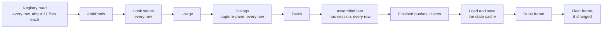
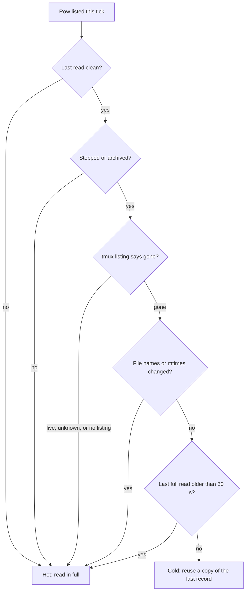
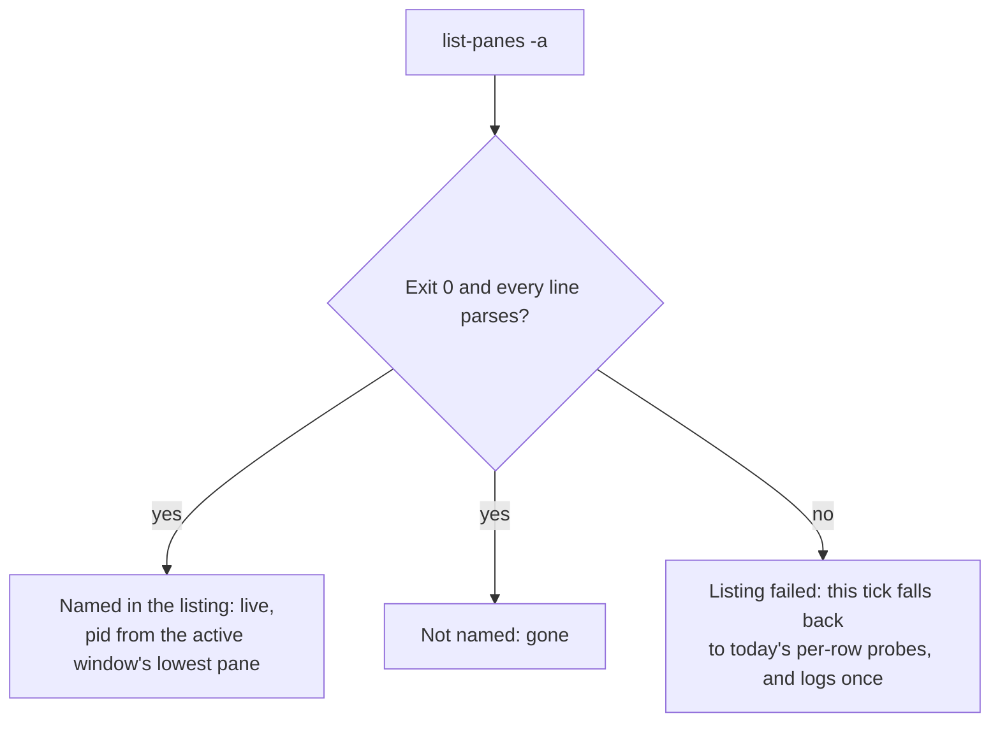
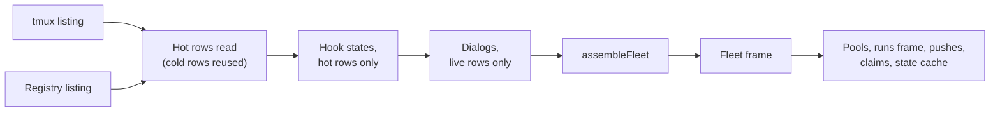
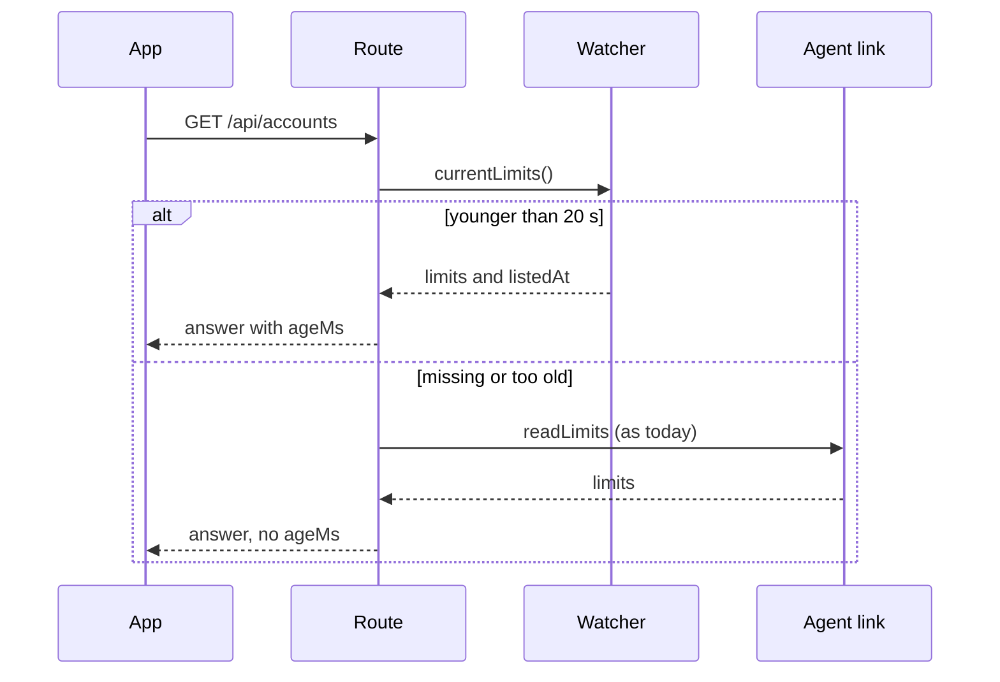
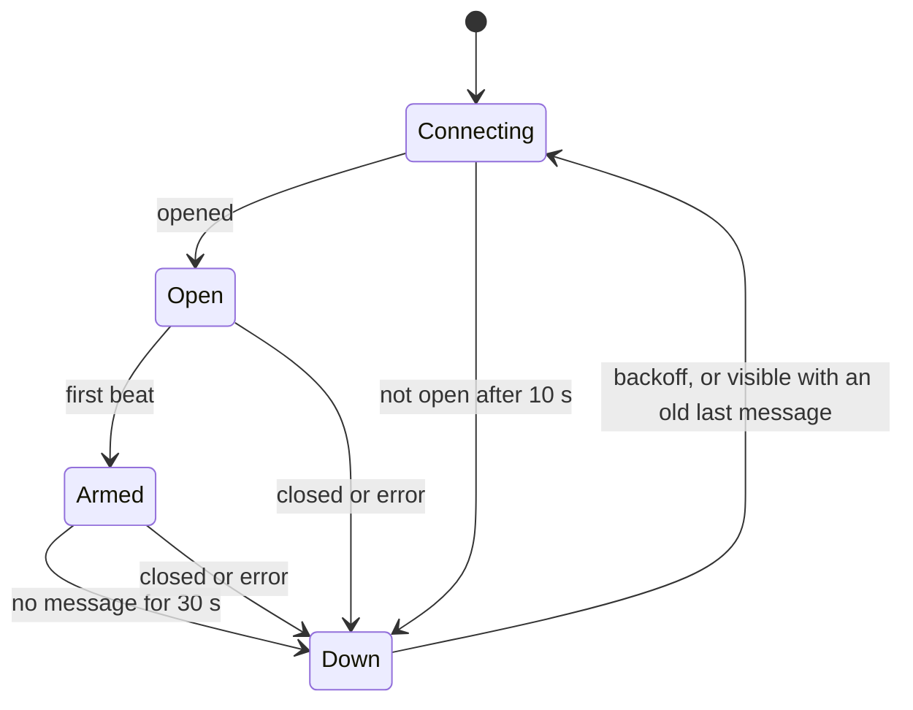
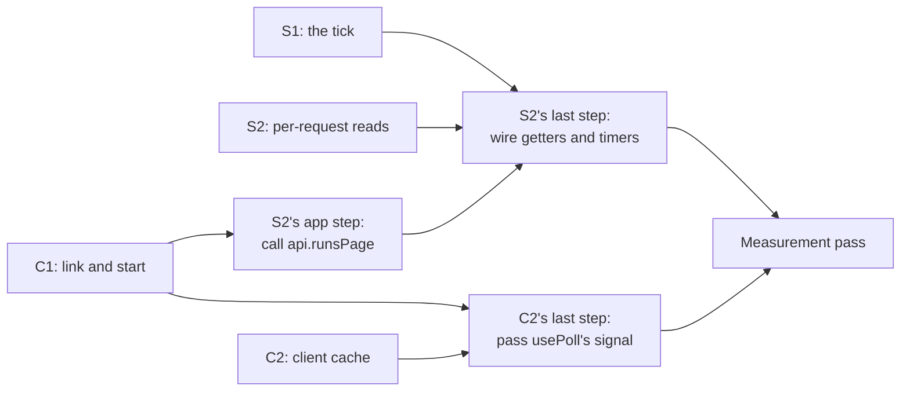

# Console speed

**Spec** · 2026-11-04 · Status: Approved · Owner: the operator · Linear: none · Related: `docs/superpowers/plans/2026-11-04-console-speed.md`, `docs/superpowers/plans/2026-11-01-programme-ledgers.md`

## In short

The console feels stuck because the server does too much work on every 2-second watcher tick, and the app has no way to notice a dead connection or a hung request. This spec fixes both, as the operator ruled on 2026-11-04: fixes first, then a measurement pass, with no day of measuring beforehand. On the server, stopped rows are read rarely, tmux is asked once per tick, the fleet frame goes out as soon as the list is assembled, and the per-request routes serve what the last tick already measured, with an age. In the app, a silent socket is noticed within about 30 seconds, reads have a time limit, screens keep their last view while they reload, and the big screens load only when opened. Four tasks build this in parallel, in disjoint files. Please check the eleven points in §6 where main's code differs from the brief, and the decisions in §3.

## 1. Context

This section says what was found, where, and how sure we are. Three read-only investigations ran on 2026-11-04, one each for the app, the server and the agent link. Code citations are to `origin/main` at `1d5b09e01`. Figures marked "measured" were taken on the fleet box that day. Figures marked "derived" are worked out from code and those measurements.

| What | Figure | Footing |
|---|---|---|
| Registry rows | 356 rows: 64 running, 287 stopped, 5 orphaned | Measured (`ccd ls`) |
| Stopped rows that are dispatched children | 267 of 287 carry a `.child` marker | Measured |
| Reads per tick for the registry | about 7,800 field reads plus one listing of about 12,900 names | Derived from the file counts |
| tmux processes per tick | about 780 (a `has-session` and a `capture-pane` for every row, plus `list-panes` for live rows) | Derived, `fleet.ts:613,634`, `watch.ts:9081` |
| tmux clients at once | up to 129 | Measured (sampled) |
| Agent link traffic | about 1.15 MB/s out, about 2,300 ops/s | Measured bytes, derived op rate |
| Box load | 10 to 13 on 16 cores | Measured |
| Tick length | not measured anywhere; estimated at 4 s or more against a 2 s interval | Judgement; no timer exists |

**Why the dispatched children matter.** Most stopped rows are children whose workspaces were never reclaimed. Another programme owns that failure and is investigating it. This spec does not touch reclamation. It makes stopped rows cheap, which helps whatever that programme finds, and may lower the box load that could itself be making reclamation's measuring step time out (a guess, not measured).

**What the tick does today** (sourced: `watch.ts:2416-2985`):

*Figure 1. Today's tick. Each box waits for the one before it, so the fleet frame leaves only when every step has finished, and a stopped row costs as much as a live one.*

The app side (sourced): `pwa/src/lib/ws.ts` has no watchdog, and its `nudge()` does nothing while a socket object exists; `pwa/src/lib/api.ts:55-68` sets no time limit on any request; `pwa/src/app.tsx:30-42` imports every screen eagerly; and Settings and the Digest start from "Loading" on every visit (`SettingsDataProvider.tsx`, `DigestScreen.tsx:150-170`).

## 2. Design

This section describes each change, grouped by the task that builds it. Each subsection says what changes, what stays the same, and which rule keeps it safe.

### 2.1 The tick (task S1)

**Rows have a temperature.** A row is *cold* when its last full read was clean (no unmeasured or unreadable field), it carries a `.stopped` stamp or an `archived` stamp, and this tick's tmux listing says its session is gone. Every other row is *hot*. A hot row is read every tick, exactly as today. A cold row is re-read only when its listed file names change, when its files' modification times change (where the agent can report them), or when its last full read is older than `COLD_ROW_REREAD_MS` (30 s). Otherwise the tick reuses a copy of the last record.

*Figure 2. How the tick decides whether to read a row. Every doubt (an unclean read, a missing or failed listing, a changed file) makes the row hot, so the cache can only skip work, never hide a change.*

This keeps the absence rules where they live in `registry.ts`. Presence is still decided by this tick's listing (D-6388): a row whose `.uuid` left the listing is gone, and a row whose names changed is re-read. A measured absence is still read as absence, and a twice-observed absence still retires a row (D-113). Neither reconfirm path is reachable from a cached row, because only clean rows are cached. The cache returns a fresh copy each tick, so a caller that changes a record cannot change the cache.

**The cache key.** The key is the sorted list of the row's names in the listing. Where the agent advertises the `readdir-mtimes` capability, the key also carries each file's modification time, so a rewrite in place (a swap rewriting `.uuid`) changes it too. An older agent sends no times, and the key falls back to names alone. That is still safe, because the cache only ever holds cold rows, and a cold row whose session starts again turns hot through the tmux listing on the same tick. With times available, a hot row whose key is unchanged also reuses its record, which is where most of the remaining reads go.

**One tmux listing per tick.** `Tmux.listPanes()` (in `exec.ts`, the only server file that names tmux) runs `tmux list-panes -a -F '#{session_name} #{window_active} #{pane_index} #{pane_pid}'` once per tick. The agent already grants `list-panes` (`agent/src/whitelist.ts:429`), and every token is a literal, so this opens no new door. The listing replaces the per-row `has-session` and `list-panes` inside `assembleFleet`, and `detectDialogs` captures panes only for rows the listing calls live.

*Figure 3. What the listing can answer. A failed listing never reads as "every session gone": the tick asks each row the old way instead, so the answer stays today's answer on the one tick tmux misbehaves.*

The verdict keeps `classifyHasSession`'s polarity (D-308, D-309): only a positive answer means gone. A session missing from a clean listing is gone, which is exactly what `can't find session` meant per row. The pid rule matches today's `panePid`, which takes the first pane of the session's current window.

**The frame leaves first.** The frame's path becomes: the tmux listing and the registry listing (together), the hot rows' reads, the hot rows' hook states (`detectDialogs` reads this tick's hook states, `watch.ts:9062` onward, so that order stays), the dialogs of live rows, then `assembleFleet` and the fleet frame. Pools, usage, tasks, the "Finished" pushes, claims, the runs frame and the state cache all move after the frame, or run beside it. The usage and tasks lanes already run on their own clocks, so `assembleFleet` reads their last values, as the cold-start path already does.

*Figure 4. The new tick. The fleet frame waits only for what it shows, and everything else follows it.*

**The state cache is written only on change.** The watcher keeps the last snapshot it wrote in memory and writes only when the new JSON differs. It loads the file once, at start. The skip rules stay as they are: no write while a row is unmeasured, and no write that shrinks the snapshot unless the missing ids are really gone from the registry (`watch.ts:2930-2965`).

**The watcher publishes what it measured.** New getters, each with the time its tick's listing began: `currentLimits()`, `currentProjectPoolsRead()`, and `currentRowFacts(id)` (the record, the pane verdict and the pane pid). A `row:<id>` bus event fires when a row's record or verdict changes, so a reader can wait for change instead of asking every 2 s.

**Timers that change nothing.** A small recorder keeps the duration of each tick phase, the agent round trip per op (`readFile`, `readdir`, `exec:tmux`, `exec:ccd`; never arguments), the event-loop delay (`perf_hooks.monitorEventLoopDelay`) and any route slower than 500 ms. It logs one summary line a minute through `console.warn('ccrc-server: perf …')`, plus a line for a tick over 2 s or a slow route, at most ten lines a minute. Its block goes on `/api/fleet/health` as an additive `perf` field. It changes no behaviour.

### 2.2 Per-request reads (task S2)

**Requests read the watcher first.** Every route below follows one rule, which `GET /api/projects` already uses for its rows (`fleetRowsUsable`, `lifecycle.ts:164`): use the watcher's last listing when it is younger than `FLEET_ROWS_MAX_AGE_MS` (20 s), and otherwise read as today. A served answer carries `ageMs`, an additive field.

*Figure 5. How a route serves from the last tick. A missing or old measurement falls back to today's read, so a stalled watcher never serves an old answer as new.*

| Read | Today (sourced) | After |
|---|---|---|
| Opening a chat | `resolve()` reads the row, `has-session`, `list-panes`, the live file, then the transcript (`sessionws.ts:618-735`) | Row, verdict and pid from `currentRowFacts(id)` when fresh, else as today |
| Each open chat, every 2 s | the same `resolve()` again (`sessionws.ts:23,849`) | Re-resolve only on `row:<id>`, on the tailer's rotation, or every 30 s as a backstop |
| `GET /api/accounts`, polled every 20 s | `readLimits` across the link (`server.ts:1430`) | `currentLimits()` with `ageMs` |
| `GET /api/projects` | `readProjectPools` with a 10 s budget, then `readLimits` (`server.ts:2832-2872`) | Both from the watcher when fresh |
| `GET /api/fleet` | a whole registry read and assembly (`server.ts:1184-1240`) | `currentFleetListing()` and `currentPools()` with `ageMs` |
| `GET /api/runs?closed=1` | open runs plus the newest 500 closed (`store.ts:3817-3830`) | Optional `limit` and `before`; absent means today's answer |
| `GET /api/updates`, every 60 s | every release ever cut, notes included (`update/routes.ts:627`, `store.ts:9207`) | A window: see below |
| Sender attribution | a whole registry read per box-token write (`coord/attribution.ts:36`) | `readSessionRecord` for the sender's row only |

**Chat streams.** The stream keeps its own change gates and every frame it sends today. Only the source of its facts changes. A swap rewrites the row's `.uuid` and `.wrapper`, which changes its record, so `row:<id>` fires within a tick and the stream re-resolves (the same `data.uuid !== this.uuid` branch as today). A transcript that moves under the same uuid is caught by the tailer's rotation or by the 30 s backstop.

**The run archive.** `limit` (1 to 500) and `before` (a run id) are additive query parameters. A page always holds every active run (as today), the newest `limit` closed runs below `before`, and every closed run the coord frame's `childReclaimAttention` names, because `ChildReclaimBanner` looks a run up by the id that list gives it. The answer gains `nextBefore` when older closed runs remain. The Runs board asks for 50, shows "Show older", and keeps its pages in the fleet store, so a second visit draws at once. The Inbox keeps today's call, because it maps mail to runs by id.

**The release window.** `CoordStore.releases()` stays whole, because the update planner and the release notice need the whole catalogue (`update/converge.ts:297,389`, `update/project.ts:50`, `watch.ts:1812`). Only `GET /api/updates` sends a window, chosen by a pure function: the newest 30, every release newer than the oldest installed tag of any node (the "What's new" sheet lists that span), every tag named by an intent or a node's previous tag, and the newest three Stable releases older than each node's installed one (the rollback list). The answer gains `releasesTotal`.

**Attribution.** One row instead of the whole registry. The six answers stay: `registry-unmeasurable` for an unlistable registry or an unreadable row, `unknown-sender` for no row, `stale-uuid` for a wrong uuid, and `ok`. Two edges change shape and are tested as their own commit: a refused id is answered from one listing, and a row retired mid-read now answers `unknown-sender` instead of `registry-unmeasurable` (D10).

**Heartbeats.** `/ws/fleet` and `/ws/session/:id` send `{type:'beat'}` every 10 s from a per-socket timer, independent of the watcher, so a slow tick never silences it. An older app drops an unknown frame type silently (`shared/api.ts:4133-4135`), so this is additive.

**Wiring the timers.** S2 adds the `perf` field to `FleetHealth`, the `onResponse` hook that times routes, and the one line in `/api/fleet/health` that returns the recorder's block. These files are S2's, so the recorder S1 builds is wired here.

### 2.3 The link and the start (task C1)

**A socket watchdog.** `ReconnectingSocket` notes when each message arrives. It arms its silence watchdog only after the first `beat` frame, so it never fires against a server too old to send one.

*Figure 6. The socket's states. Thirty seconds is three missed beats, and any message counts, so a busy but live link does not flap.*

On becoming visible or online, `nudge()` now also acts while a socket exists: if the last message is older than 30 s, it closes the socket and reconnects at once.

**Read time limits.** `request` in `pwa/src/lib/api.ts` gives every GET a 20 s limit, merged with any caller signal. A POST never gets a default limit, because a write's outcome must not be guessed. A timeout raises a distinct `ApiTimeout` error, so a screen can say "the server is slow" rather than "failed". Reads known to take longer (the worker lists them by reading the server bounds) pass their own limit. `usePoll` aborts its read in flight on unmount and when a newer read supersedes it.

**Big screens load on demand.** `SessionScreen` (with xterm), Settings and its data provider, Accounts, Runs, the Digest and `HighlightMeasure` become `React.lazy` imports under the existing detail-pane boundary. The fleet list, the shell, Mail, Archive and the Waiting routes stay eager. The cascade-layer order is already declared first in `index.html` (D-7891) and pinned by `pwa/test/layer-order.test.ts`, so a lazy chunk that shares entry modules cannot reorder the layers. The service worker precaches every `.js` file (`vite.config.ts:195`), so a lazy screen still opens offline. The Docs screen and the programme screen stay as they are (§5).

### 2.4 The last view kept (task C2)

**One small client cache.** `pwa/src/lib/screenCache.ts` holds the last raw answer per query key, in memory only, at most 64 keys, oldest dropped first. A screen draws the cached answer at once, re-reads, and replaces it when the new answer arrives. The raw answer goes through the hook's own reader each time, so a malformed answer is still caught. It writes no browser storage, so it adds no storage owner.

Settings' six polls (`useUpdatesView`, `useStallWatchView`, `useCollectLaneView`, `useDispatchAbandonView`, `useTestboxView`, `useLinearWorkspaces`, all under `pwa/src/fleet/`), its sign-in status and passkey reads, and the Digest adopt it. The run archive does not: run rows already have one owner, the fleet store (§2.2), and a second copy would be a second writer.

## 3. Decisions

The operator ruled the scope on 2026-11-04. The decisions below are how this spec carries it out. They are the coordinator's calls inside the operator's scope, and they are agreed.

| # | Decision | Options considered | Chosen, and why | Status |
|---|---|---|---|---|
| D1 | Which rows are read rarely | Stopped and archived rows; every dead row; children only | Rows with a `.stopped` or `archived` stamp that tmux calls gone. A crashed row without a stamp stays hot, because its supervisor is about to restart it | Agreed |
| D2 | How often a cold row is re-read | 10 s, 30 s, 60 s | 30 s, plus at once on any change of names or times. The slowest a stopped row's change can show is 30 s | Agreed |
| D3 | The cache key | Names only; names plus mtimes; a new agent op returning the whole registry | Names plus mtimes where the agent offers them, names alone otherwise. A whole-registry op would be a second registry reader on the box | Agreed |
| D4 | A failed tmux listing | Every row unknown; every row gone; fall back to per-row probes | Fall back for that tick. Same answer as today on the bad tick, and no row reads dead because one command failed | Agreed |
| D5 | Where the listing lives | A ccd verb; `exec.ts` | `exec.ts`'s `Tmux`, under the granted `list-panes` prefix. A ccd verb would add a spawn and a new grant for a read the server already makes | Agreed |
| D6 | The frame's path | Emit after everything; emit after assembly | After assembly. Hook states stay before dialogs, because dialogs read them | Agreed |
| D7 | Freshness bound for served reads | A new constant; `FLEET_ROWS_MAX_AGE_MS` | Reuse the 20 s bound `GET /api/projects` uses. One fact, one owner | Agreed |
| D8 | When a chat stream re-resolves | Every 2 s; on change only; on change plus a backstop | On `row:<id>`, on tailer rotation, and every 30 s | Agreed |
| D9 | The release window | Limit `releases()`; limit the wire only | The wire only. The planner and the release notice need the whole catalogue | Agreed |
| D10 | Attribution's retired-row edge | Keep today's `registry-unmeasurable`; answer `unknown-sender` | `unknown-sender`. The row was seen absent twice, which D-113 calls gone | Agreed |
| D11 | The app's silence bound | 20 s; 30 s; 60 s | 30 s with a 10 s beat, armed only after a beat | Agreed |
| D12 | Read time limit | 10 s; 20 s; none | 20 s on GETs only, with an override per call | Agreed |
| D13 | Where kept answers live | Each screen's own state; the fleet store; one cache module | One module for query answers. Run rows stay in the fleet store, their one owner | Agreed |
| D14 | Heartbeats | WebSocket ping; an app frame; the watcher's tick | An app frame from a per-socket timer. A browser cannot see pings, and a tick-driven beat would stop exactly when the tick is slow | Agreed |

## 4. The four tasks

This section shows how the work splits so that four workers can build at once. Each task owns its files outright. Two small hand-offs order the landings.

| Task | Deviation | What | Owns |
|---|---|---|---|
| S1 | D-7987 | The tick, the row cache, the tmux listing, the state cache, the watcher's getters, the timers | `watch.ts`, `registry.ts`, `fleet.ts`, `exec.ts`, `fleetstate.ts`, `bus.ts`, `remote/client.ts`, `remote/io.ts`, `io.ts`, `index.ts`, `deps.ts`, new `perf/*`, `shared/perf.ts`, `shared/agent-protocol.ts`, `agent/src/server.ts` |
| S2 | D-7988 | Per-request reads, heartbeats, the timers' wiring | `sessionws.ts`, `server.ts`, `coord/routes.ts`, `coord/store.ts`, `coord/attribution.ts`, `update/routes.ts`, new `update/releaseWindow.ts`, `shared/api.ts`, PWA `useColdRuns.ts`, `RunsScreen.tsx`, `stores/fleet.ts` |
| C1 | D-7989 | Socket watchdog, read limits, lazy screens | `pwa/src/lib/ws.ts`, `api.ts`, `usePoll.ts`, `app.tsx`, `vite.config.ts` if needed |
| C2 | D-7990 | The client cache | new `pwa/src/lib/screenCache.ts`, the six Settings hooks, `SettingsDataProvider.tsx`, `DigestScreen.tsx` |

*Figure 7. Landing order. All four build at once. S2 finishes after S1 lands, because it reads S1's getters and recorder, and its Runs board calls the one read C1 adds to `api.ts`; C2 finishes after C1 lands, because it passes C1's abort signal. The measurement pass reads the timers once all four are live.*

## 5. Testing and proof

This section says how each change is proved, and what is measured afterwards. Every new guard ships with a test that goes red when the guard is removed, measured before and after and recorded in the PR. Code that moves gets a characterization test, green on `main` first. The plan names each test and its mutants.

- **The tick:** a counting fleet IO (the existing `registryCountingIO.ts`) proves a cold row costs no field reads on a quiet tick, and a full read the tick its session appears in the listing. A fake runner proves one `list-panes -a` per tick and no `has-session`, and a failed listing proves the per-row fallback.
- **The frame:** an ordering test proves the fleet frame is emitted before the state cache is touched and before pools are read.
- **Served reads:** each route has a pair of tests: fresh watcher state answers with `ageMs` and no agent request; stale or missing state answers as today.
- **The app:** fake timers prove the watchdog closes after 30 s of silence once armed, never before the first beat, and that a beat every 10 s keeps it open for ten minutes. The whole browser suite and a `full-ci` run prove the lazy screens and the layers.
- **Measurement pass:** once all four tasks are live, read the `perf` block and the journal for a day: tick length and phases, round trip per op, event-loop delay and slow routes. Anything still slow becomes a new item, measured first.

## 6. Where main differs from the brief

This section lists what the code on main showed that the brief did not expect, and how the split absorbs each point.

1. **No frame arrives every 2 s.** The watcher emits the fleet frame only when its JSON changes (`watch.ts:2975-2978`), and `/ws/fleet` never pings. A silence watchdog alone would flap on a quiet fleet. So S2 adds a beat frame (it owns `server.ts` and `sessionws.ts`), and C1's watchdog arms only after the first beat.
2. **The run archive is already capped.** `CoordStore.runs` keeps the newest 500 closed runs (`store.ts:3817-3830`), so "every run ever" in the app report is not what main does. Paging is still the change.
3. **The timers' exposure is in S2's files.** `/api/fleet/health` and the place for a route hook are in `server.ts`, and `FleetHealth` is in `shared/api.ts`. S1 builds the recorder; S2 wires it.
4. **The watcher keeps no limits.** `assembleFleet` reads limits inside itself (`fleet.ts:590`). S1 adds a `limits` input and `currentLimits()`, and S2 reads it, so S1 lands first.
5. **Run rows are read in more places.** `MailScreen` maps mail to runs by id, and `ChildReclaimBanner` looks runs up by the ids the coord frame names. So a page always includes those runs, and the Inbox keeps the full call. Keeping pages in the fleet store adds `pwa/src/stores/fleet.ts` to S2, and the paged read itself is one new method in `api.ts`, which is C1's, so C1 adds it.
6. **Settings reads go through six hooks and `usePoll`.** C2 owns the six hooks; C1 owns `usePoll` (the abort on unmount). C2 passes the signal as its last step.
7. **tmux is already named outside ccd.** `exec.ts`'s `Tmux` runs `has-session`, `list-panes` and `capture-pane` through the agent's exec grant. The listing goes there, under the granted `list-panes` prefix, so no grant is added.
8. **Modification times need the agent.** `readdir` answers names only. The times arm adds an additive request flag, a capability word and the agent's answer, so `agent/src/server.ts`, `shared/agent-protocol.ts`, `io.ts` and `remote/io.ts` join S1. The fleet box takes it first, as every rollout does.
9. **`releases()` has four other callers** that need the whole catalogue (§2.2), so only the wire is limited.
10. **Dialogs read this tick's hook states**, so the hook-state sweep stays on the frame's path, limited to hot rows.
11. **Attribution's single-row read changes one edge** (D10), tested as its own commit.

## Where things stand

### Agreed

- The scope, the order (fixes first, then measure) and the four timers, ruled by the operator on 2026-11-04.
- Caching on the server (the last tick's answers, with an age; rows re-read only on change; the state cache written only on change) and in the app (a screen's last answer), asked for by the operator on 2026-11-04.
- D1 to D14, the coordinator's calls inside the operator's scope (2026-11-04), D10 included: a sender whose row is seen absent twice is gone, as D-113 already says.

### Waiting on you

- Item 33: when the app reloads after a release. Open, and not in this spec.
- Item 34: drawing a saved list on a cold start. Open, and not in this spec; it needs a ruling on showing a snapshot as not current.

### Later

- **The Docs reader's screens** (`pwa/src/docs`, `screens/DocsScreen.tsx`): a later ask to the native docs reader programme, which owns them. Lazy-load the Docs screen, and adopt `screenCache.ts` for the Docs index and tree.
- **Goals and the programme view**: owned by PL10 and PL11 of `docs/superpowers/plans/2026-11-01-programme-ledgers.md`. They can adopt `screenCache.ts` for Goals.
- **Child reclamation**: owned by another programme. Nothing here changes it; cold rows only make its stopped children cheap.
- **Smaller fleet frames** (live rows by default, or per-row changes): after the measurement pass shows the frame's size.
- **Priority for interactive agent requests**, or a cap on background requests in flight: after the round-trip timers show queueing.
- **coord.db's 5 s busy wait** (`coord/db.ts:181`): after the event-loop timer shows a stall.
- **Paging a chat's backlog** (up to 1 MB today): if session-open timing still shows it.
- **Lane states on `/api/accounts`** for a signed-in viewer: still read per request; served from the watcher if the route timer shows it slow.

---

*Written by Claude for the operator. Diagrams are Mermaid text; the Copy Mermaid button on the docserver or the spec viewer copies the source, which pastes into Lucid as editable shapes.*
