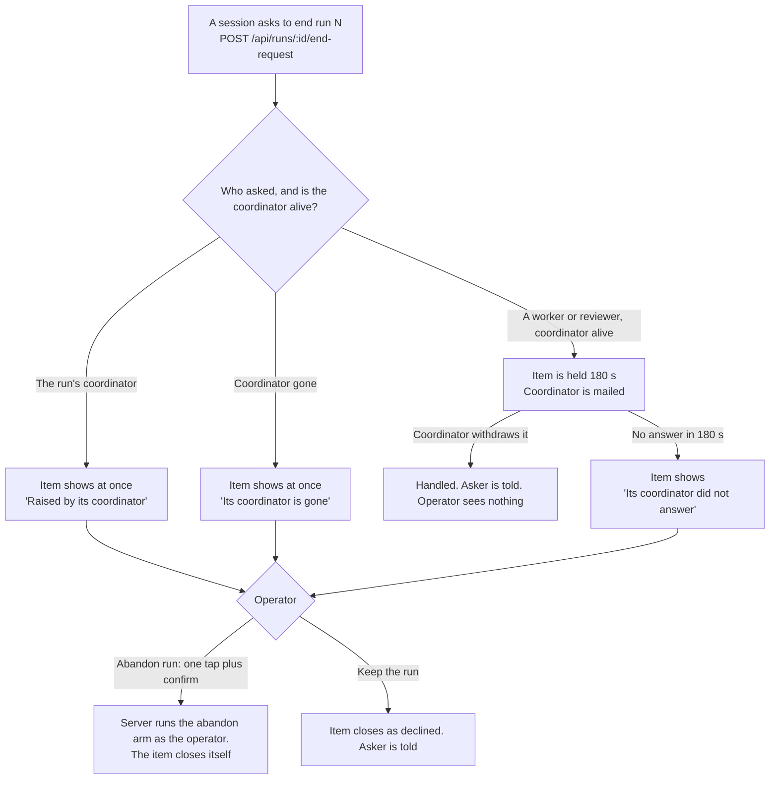

# Runs screen rebuild (design)

**Spec** · 2026-11-04 · Status: rev 5, draft for the operator, with the review of rev 1 applied, the operator's answers to Q1 to Q5 recorded, the operator's sixteen checks of 2026-11-06 applied, and the review of rev 4 and its plan applied · Issue: #1518 · Updates: `2026-10-20-runs-auto-expire-and-programme-view-design.md` (the ruled "Auto-expire + programme view", #1013) and its plan `docs/superpowers/plans/2026-10-21-runs-auto-expire-and-programme-view.md`

This document defines no D-numbers. The plan allocates them. Every D-number cited here is already defined on `origin/main`.

- **Code citations** are to `origin/main` at `08e3b290a`. They name a function, constant or file. What other work has landed since (§6.2, §15) was re-read at `5dd21cdb2` on 2026-11-06.
- **Live figures** come from one read-only snapshot at 21:30 UTC on 2026-11-04, compared with one at 15:12 UTC the same day. **[M]** marks a measured figure, **[I]** an inferred one.
- **Programmes and projects** are counts or "programme A". Run numbers are kept, so a builder can replay the figures.
- **"Ruled spec"** means the 2026-10-20 document. Its rule numbers (R1 to R8), lane rows (E1 to E5) and decisions (G1 to G6) keep their meanings here.
- **"Author's call"** marks a choice the author made. A1 to A34 are listed in §4.2, and the operator accepted them as written on 2026-11-05. A35 to A53 are in §4.5. They fill in what the checks of 2026-11-06 and the review of rev 4 left open, and the operator has not yet seen them. A25, A29 and A4's line for overtaken work were accepted earlier and are changed by A48, A46 and A47, and each says so.
- **"Q1 to Q5"** are the five choices only the operator could settle, listed in §4.3 with their recommendations. The operator answered all five on 2026-11-05, each as recommended. The body is written to those answers and names the question wherever it rests on one.
- **"Check 1" to "check 16"** are the operator's answers of 2026-11-06 to the sixteen questions the first frames raised, listed in §4.4. Where a check and an older line disagreed, the older line has been changed. An accepted call or answer it changed says so.
- **What the review already answered** is in §20.
- **Other work is named by its plan's own ids:** S1, S2, C1 and C2 are tasks of `2026-11-04-console-speed.md`; PL10 and PL11 are tasks of `2026-11-01-programme-ledgers.md`.

## In short

- **The screen was built to watch live work and has become a cleanup list it cannot serve.** Of 52 open runs, 13 are recent and 28 are stuck by structure [M]. In 6.3 hours today, not one of the 39 quiet runs moved. Everything that closed or opened was healthy work.
- **The operator could not find run 410.** The number is on no row, there is no search, `/runs/410` is no route, and an old run that closes never appears in Finished. Abandon gives no sign that it worked.
- **The ruled design stands, updated.** Only its first wave shipped. This document re-measures it and adds what it lacked:
  - a search box, the Cmd-K palette and a working `/runs/<id>` for open and closed runs;
  - a run detail screen, which no run has today;
  - a Stuck band that says why in plain words, with Abandon on the item;
  - bulk abandon of a stuck group, with one confirm;
  - proof of every abandon: a toast and a lasting record, however old the run.
- **Auto-close alone cannot clear the backlog.** Replaying the ruled lane rows closes 18 of the 26 planned runs over 7 days. The other 8 need a person, so the ruled target of zero is unreachable and the operator accepted a replacement (§12, Q3).
- **A live coordinator cannot end its own never-started run.** `closeDecide` refuses `not-dispatched`, and the abandon door is closed to sessions by decision. That is why 25 planned runs with no session pile up under coordinators that are alive. The operator's delegation ruling answers this: a session raises a request and the operator approves with one tap, only if the coordinator did not handle it (§10).
- **The server needs five facts it does not give today.** They are a run's own title, who closed it and why, last activity on the cold read, a read that finds any run, and a stuck verdict with its reason (§11).
- **Order:** the waves in §15 put finding and clearing first and the auto-close lanes last (Q3). The console-speed reads this work waited on have landed (§6.2). What holds the build now is the operator seeing the frames. This work runs in parallel with other work: the operator's request of 2026-11-04 overrides the 2026-10-26 refactor-first ruling for this work only.
- **The operator answered all five questions on 2026-11-05, each as recommended (§4.3):** the Stuck band sits above the programmes, every cut to the ruled programme view is accepted, the replaced targets and the new order are accepted, a request keeps its "Keep the run" control with both amendments, to D15 and D5, and §2's seven jobs and targets stand.
- **The operator ruled on sixteen checks on 2026-11-06 (§4.4), after reading the first frames.** Two change layout rules: the Stuck heads fold at every width (check 11), and job 2's "no scroll" target becomes "at the top, nothing healthy above it, every head within one short scroll" (check 12).

## 1. Intent and why

The operator asked on 2026-10-20 why they must abandon runs that never start, and called the page nonsensical. On 2026-11-04 they tried to abandon run 410 and could not find it. They asked to rebuild the screen, starting from the earlier ruled design.

The screen must do two jobs. It must show what the fleet's programmes are doing, at a glance. It must let one person deal with what has gone wrong, in seconds, at any width, and be sure it worked. Today it does neither.

**What is in the 52 open runs** [M], first match wins:

| Group | Runs | Ids |
|---|---:|---|
| 1. Owner gone | 5 | 65, 66, 83, 417, 848 |
| 2. Start never finished | 2 | 1085 (8.1 days), 1257 (5.3 days) |
| 3. Planned review of work that already closed | 12 | 206, 207, 211, 694, 699, 706, 885, 896, 899, 910, 919, 1026 |
| 4. Planned work overtaken by later waves | 7 | 209, 470, 651, 730, 733, 983, 1022 |
| 5. Planned over 7 days, nothing else open | 2 | 396, 984 |
| **Stuck by structure** | **28** | |
| 6. Queued behind a stuck run | 1 | 865 |
| 7. Awaiting review over a day | 9 | 1147, 1190, 1233, 1236, 1254, 1293, 1296, 1337, 1341 |
| 8. Working over 8 days | 1 | 1009 |
| 9. Recent | 13 | 1409, 1427, 1441, 1442, 1444, 1445, 1448, 1453 to 1457, 1466 |

Groups 1 to 5 are the author's reading of the data today. §7 turns them into one server verdict.

## 2. What a person must do in seconds

Drawn from the measured failures. The list began as the author's reading, and the operator confirmed it on 2026-11-05: Q5 in §4.3.

| # | The job | Target | Today [M] |
|---:|---|---|---|
| 1 | Go to a run by number, open or closed, at any width | Under 5 seconds: type the number, press Enter | Impossible on a phone. Closed runs below the read floor cannot be reached at all |
| 2 | See what is stuck and why, without scrolling past healthy work | The band starts at the top of the board, no healthy work sits above it, and every head is within one short scroll, at every width (check 12) | Worst rows at positions 11, 22, 33, 39, 49, 50 and 51 of 52 |
| 3 | See what a run waits on: a coordinator, a reviewer, the operator, or nothing alive | One line on the row | "Awaiting review" is wrong for 9 of 13 |
| 4 | Confirm it is the right run before a destructive act | The row's own words repeated in the confirm | The row speaks programme and wave, the sheet speaks number and workspace |
| 5 | End one stuck run, and clear many | One tap plus a confirm for one, or for a whole group | 28 rows at two taps each is 56 taps |
| 6 | See that it worked, with a lasting record, however old the run | A toast at once, and a record that never leaves | No toast. 23 of 52 open runs would vanish on abandon |
| 7 | Open any run, including one with no session, and read what it is | One tap on any row | 25 rows are inert and look tappable. No detail screen exists |

## 3. Goals, non-goals and anti-goals

**Goals**
- Every job in §2 meets its target at phone, laptop and wide widths, in both skins, in light and dark.
- A run that is stuck says why in the operator's terms, and says whether anything will close it.
- Every open and closed run has one address, `/runs/<id>`, and one lasting record.
- A stuck group clears in one act, and each close is recorded as the operator's.
- The ruled auto-close lanes land behind shadow, and the operator can see and arm them from the UI.
- A session can ask for a run to end, and the coordinator gets the first chance to handle it.

**Non-goals**
- PWA controls for dispatch, advance, route or settling items. Those stay coordinator lanes.
- A UI for breaking a claim. The operator route exists; nothing here needs it.
- Reopening a closed run. A coordinator can open a new run for the same work with `POST /api/runs`. It gets a new id, and the closed run stays closed (§18).
- A control that nudges a live coordinator. The band in §8.2 shows those runs and links to the coordinator, and no more.
- The #435 root fix, the daily brake, the #119 heartbeat, and the archive door's `programme:'end'`. All stay as they are.
- Any change to S1, S2, C1 or C2 of the console-speed work. This design builds after them, and asks nothing of them.

**Anti-goals: what this must never become**
- A second liveness reader in the PWA. One state word comes from the existing reader or the server's verdict.
- A session-callable abandon. A session raises a request; it never calls the act.
- A run number on a card. The number lives in the detail header and in search results.
- A run state that means "waits on the operator". Needs-you comes from sessions, items and lane refusals.
- A layout fork per skin. A skin is a token axis.
- A second Waiting on you page or a second programme page.
- A word that teaches a coordinator the abandon door.
- A wall of "failed" rows for runs that never started.
- A push storm. Closes and notices stay record-only.

## 4. Rulings and calls

### 4.1 The operator's rulings

These are the operator's, and they bind this design.

- **Start from the ruled design (2026-11-04).** Start from "Auto-expire + programme view" and update it, rather than design afresh: re-measure it, add search and a run detail screen, and move Abandon onto the item.
- **Action on the item (2026-11-04).** An item that asks the operator to do something carries its own control: one tap plus a confirm.
- **Delegation (2026-11-04).** A session may raise a request and the operator approves with one tap, but only if the coordinator did not handle it. The coordinator comes first. The abandon act itself stays unreachable from sessions (D-282, D-688): a session raises a request, it never calls the act.
- **Parallel work (2026-11-04).** This work runs in parallel with other work. For this work only, that overrides the 2026-10-26 ruling that parked improvements until the architecture refactor ends.
- **Answers to Q1 to Q5 (2026-11-05).** The operator answered all five as recommended. §4.3 records each answer and its reasoning.
- **Checks 1 to 16 (2026-11-06).** The operator approved the direction after reading the first frames, and answered sixteen checks. §4.4 records each. Nothing is built until the operator has seen the frames again.
- **G1 to G4 and G6 of the ruled spec (2026-10-21)** stand, except where §13 says a later ruling changes them. G5 (Abandon under Advanced) is overturned by the 2026-11-04 rulings. G6 is changed by the answer to Q1, which puts the Stuck band above the programmes.

### 4.2 Author's calls, accepted by the operator

The operator accepted all of these as written on 2026-11-05. Each began as the author's recommendation. "Instead" names the option not taken. A16 to A34 came out of the review of rev 1 and settle gaps it found.

| # | Call | Why | Instead |
|---:|---|---|---|
| A1 | Extend the shipped `/programmes/<slug>`, not the ruled `/runs/p/<slug>` | Improve what exists. D29 and D26 of the ledgers spec already make it the programme's page, so a second one would split it | Build `/runs/p/<slug>` as ruled, and link the two |
| A2 | A search box on `/runs`, the Cmd-K palette, and a working `/runs/<id>` for open and closed runs. The number shows on the detail screen and in search results, not on cards | Keeps "card = glance, header = superset" and still finds a run by number | Print the number on every row, which reverses D-5589 and D-6170 |
| A3 | Bulk abandon of a selected stuck group with one confirm, plus the ruled auto-expiry | Auto-close reaches 18 of 26; a person clears the rest in a few taps | Auto-close only, which leaves 8 forever, or bulk only, which never ends the inflow |
| A4 | What counts as stuck: the five reasons and their ages in §7. A47 changes one row line | Each fits the live data, and 24 hours clears normal runs (open to close p90 is 12.3 h) | Other ages. The numbers are in one table, so they are cheap to change |
| A5 | One source for the programme chip and `/waiting`: one PWA selector (§8.7) | The two must never disagree, and D29 leaves one page | Per-surface counts, as today |
| A6 | Close as done or superseded: no new close. Abandon stays the one ending, keeps state `failed`, and records why. The screen says "closed by you: overtaken", never "failed" (§9.3) | `done` means a verified finish, which only the coordinator's close proves. "Superseded" is a reason, not a state | A new `superseded` state, which touches every run reader, or an operator `done`, which would be untrue |
| A7 | Server facts: fix title overwriting, the 500-by-id window for lookup, and last activity (§11) | Search and proof of abandon rest on them | Build the screen on today's names, which do not identify a run |
| A8 | Programme names become stable words from the slug unless a coordinator gives one; each run keeps its own title (§11.1) | A frozen title would keep the latest wave's words as the programme's name for good | Freeze today's titles as they stand |
| A9 | A tap on a row opens the run's detail, not its session. The session is one more tap | Ends 25 inert rows, and a run is what the row names. At wide Instrument widths the detail opens beside the list | Keep the tap going to the session where one exists, which keeps two behaviours on one row |
| A10 | The spend line leaves the row for the detail screen | It causes the Abandon jump and fires one read per row (§5) | Keep it and reserve its height, which keeps the 69 reads |
| A11 | No lane row for overtaken work. A person decides | "Overtaken" is an inference: wave numbers are not strictly ordered, and a coordinator may plan out of order | A new auto-close row after a grace |
| A12 | Bulk abandon is a loop over the existing route in the PWA, not a new route | Keeps D-280, D-282 and D-688 exactly as pinned; no new door to guard | A new batch route, which must read a body and gets a second set of pins |
| A13 | A run the bulk act must not touch: one holding a session or workspace goes one at a time | Its abandon may release a hold or reclaim a child, so it deserves its own confirm | Include them, with a warning line |
| A14 | A "Waiting on its coordinator" band below Stuck | 8 runs over a day have every review done and wait on a decision [M]; today they hide behind a wrong word | Show them only on programme cards |
| A15 | The arming of lane rows moves from hand-made markers to a control (§12.3) | "Operator actions live in the UI" came after G4 | Keep G4's markers |
| A16 | A closed run's word comes from `closeWords`, ahead of `RUN_WORD` (§11.3) | `RUN_WORD` says "failed" for an abandoned run, which A6 rules out | Patch "failed" out on each screen |
| A17 | Close words key on who closed the run. The detail only adds the reason, and `closeRun` gains a `detail` (§9.3, §11.2) | Every existing abandon and sweep close has a null detail, so words keyed on detail would read nothing for all of history | Key on detail, and leave history unworded |
| A18 | A third item move, `settle`, and a `ccrc` actor, both through `moveItemInTx`. `raiseItem` takes its actor (§10) | The server must close items itself, and `ItemActor` has no word for that. `moveItemInTx` stays the only writer | Record server closes as the coordinator's, which is untrue |
| A19 | B7 widens the server-written `action` to hold doors. "Abandon anyway" reuses `act` (§10, §12.2) | §12.2's items carry doors that `end-run` cannot | A second item type, with its own control |
| A20 | An end-request item is `neededBy: 'soon'` with no label and sends no push. `how` holds the step words (§10) | Both columns are NOT NULL. `blocking` would push at raise, during the hold | `blocking`, which breaks the no-push-storm anti-goal |
| A21 | The hold is filtered in one place, `itemsFor`. `itemById` stays raw for the coordinator's withdraw (§10) | `waitingViewOf` feeds the read route and the live frame, and `itemsFor` also feeds the per-programme read. The badge and the lists must agree | Filter `/api/waiting` alone, as rev 1 said |
| A22 | A withdraw or a decline of an end request sends the asker a system mail, in the same transaction as the move (§10) | "Asker is told" has no writer: the withdraw route sends no mail today | Tell nobody, and let the asker find out |
| A23 | `act` runs inside the abandon hold: `withAbandon` passes into the ledger routes, and `act` answers as the abandon route does (§10) | §9.1's sheet reads abandon's refusals and `childReclaim` fields, and the arm must run inside `coordMutex` | A new answer shape, which the sheet would have to read twice |
| A24 | A repeat from the same asker is refused for 24 hours after a decline or a withdraw, unless the run's stuck reason has changed (§10) | "One open request per run" stops only a concurrent one, so a declined request could return at once | No limit |
| A25 | B5, B6 and B7 wait for B3, and F28 waits for C2 (§6.2, §15). Changed by A48: B5 and B7 also wait for B4 | B5 moves Resume onto B2's detail and adds to B3's Advanced route, B6's confirm reuses B3's sheet, B7's control sits on Advanced, and F28 uses C2's cache | Rev 1's gates, which understate these |
| A26 | A programme's ending is derived from its work runs, like "open" (§8.2.3, §11.6) | Abandoning the last open run sets `programs.state` to `abandoned`, so clearing a leftover review would mark a completed programme abandoned | Read `programs.state`, and change what a close retires |
| A27 | "Re-opens" means a new run with a new id, and a pin holds what that leaves alone (§3, §18) | `openRun`'s conflict arm leaves `programs.state` alone, and a review must name a run at `awaiting-review` | Make a re-open revive the programme, which changes `soleActiveCoordinator` |
| A28 | `owner-gone` keeps §7's literal rule. A plain stop gets a softer line, and an absent claimant with no history gets no verdict until a lane refusal raises an item (§7) | 417 needs any stop with no successor, but G2 says a plain stop never closes, so the line must not say the run is past saving. Check 4 then dropped "Nothing can finish this" for every run | Narrow the rule to E3s, which loses 417 |
| A29 | One new optional field, `blockedBy` (A46 adds a second, `coordinatorGone`). `waitsOn` gets a full state mapping. The Waiting band's age comes from `lastMoveAt` (§7) | "Waits behind a stuck run" links to a run no field names, and the band's "over a day" has no field | A second age field |
| A30 | `find` reads who closed a run from stored columns, and returns open runs on the first page only (§11.2, §11.4) | The `closedBy` chips filter on it and the budget is 20 ms. A closed-at cursor cannot order open runs | A correlated lookup of the newest `run_events` row, which reads every closed row under a `closedBy` filter |
| A31 | B1's pin "a reused number is exact" means a number that also matches a `reviews` target or a title still resolves to the run with that id, with the other matches under their own headings (§15) | Rev 1's wording was unclear | |
| A32 | "Closed today" is the operator's local day: the PWA sends its own midnight (§8.2, §11.6) | The server computes the count, but the operator's phone has the timezone | The box's day, or a rolling 24 hours |
| A33 | `registry-unmeasurable` stops the bulk loop (§9.2) | It is a fault of the whole box, like 501 and 502 | Treat it as one run's refusal, and try the rest |
| A34 | "Abandon all" acts on the list the sheet showed. Runs that leave the group are skipped by §9.2's rule, and runs that join it are not added (§9.2) | The operator confirmed that list | Re-read the group as the frame changes, which moves rows under a thumb |

### 4.3 The operator's answers

Only the operator could settle these. Each changes a ruled decision, an agreed decision, or what the work is for, so none was an author's call. The operator answered all five on 2026-11-05. Every answer matches the recommendation, so the body stands as written. The reasoning stays here as the record.

**Q1. Does a Stuck band sit above the programmes on `/runs`?**
- **Answer (2026-11-05): yes, the Stuck band sits above the programmes.**
- **Why it was open.** G6 ruled that `/runs` lands on the programme list. §13's reason for the band was the author's measurement, not a ruling. Abandon on the item does not settle where those items live.
- **Recommendation: yes, the band first.** `/runs` still lands on the programme list, with at most five folded head lines above it, and none when nothing is stuck. Bulk abandon works per reason across programmes: 23 runs in 4 group acts. Reached through cards, the same 23 runs sit in 11 programmes, so 11 acts at best [I], and §2's job 2 would fail.
- **What the answer decided.** The default board and B4. Had programmes come first, §8.2 would have swapped its order, stuck runs would have been reached through their cards, §9.2's group control would have moved to the programme page, and §17's 18 taps would have needed measuring again.

**Q2. Does the operator accept cutting parts of the ruled programme view?**
- **Answer (2026-11-05): yes, every cut is accepted.**
- **Why it was open.** These were ruled in the 2026-10-20 design, and rev 1 dropped them in §8 and §13 without listing them as calls.
- **Recommendation: accept each cut.**

| Ruled part | Now | Why |
|---|---|---|
| The wave stepper | A plain list of waves (§8.5) | Numbers reach 91, 3 pairs repeat, and `waveOf` is null on 43 of 52 [M], so it cannot draw honestly |
| The card's wave position | The programme page header only | The same data. "Wave 3 of 5" cannot be a default label |
| The card's last activity | Kept on the card's ordinary line, and replaced by the stuck line when a run is stuck. Always in the header | One context line (D-5545) |
| The card's coordinator | The programme page header | One context line. A gone coordinator still shows, through the lamp and the stuck line |
| Instrument's list column | Beside the open run only in a broad column, so at 1920 and not at 1280, where the column is 860 | One layout rule. A list column at 860 would be a fork by skin |
| Instrument's third region | Dropped. Its three contents stay reachable: closed waves on the programme page, "would close" in the pending-close line and on Advanced, and needs-you reasons on `/waiting` | The ruled review kept it as the programme's activity, and that activity still has a home |

- **What the answer decided.** B5's scope and §8.1's one-layout rule. Keeping the stepper or the card lines would have added them to B5, shown only where `waveOf` is known. Keeping the list column at 1280 or the third region would have meant a second layout rule, or a fork by skin that §16's token-axis rule would have had to give way to.

**Q3. Does the operator accept the replaced targets and the new order?**
- **Answer (2026-11-05): yes, the replaced targets and the new order are both accepted.**
- **Why it was open.** §12.4 replaces the ruled "planned over 7 days: 0", and §13 moves the auto-close lanes to last, behind finding and clearing. Neither was an author's call. A3 and A11 touch the target only in part.
- **Recommendation: accept both.** Zero cannot be reached without closing overtaken work on an inference, and 417 and 848 wait on #119 either way. The lanes reach 18 of 26 and close nothing until shadow, the operator's reading and a delivered E1 warning are done. B2 to B4 give relief with no lane. The cost is that inflow continues until B7, and a person clears it meanwhile.
- **What the answer decided.** Had zero stood, overtaken runs would have needed a lane row, which reverses A11. Had lanes stayed first, B7 would have moved ahead of B2 to B4, and the Advanced route it needs would have moved with it.

**Q4. Should a request have a "Keep the run" control?**
- **Answer (2026-11-05): yes, keep the control, and both amendments, to D15 and D5, are accepted.**
- **Why it was open.** The delegation ruling gives approval only. §10 adds a decline, which moves an item from open to dismissed while the programme is live. That amends agreed ledgers decision D15. `act` also closes an item with no coordinator re-measure, which amends agreed decision D5.
- **Recommendation: keep it, and accept both amendments.** Without a decline the operator has no way to say no: the item stays in Waiting until the coordinator acts, and D15 refuses a dismiss while the programme is live. That is the control an item must carry. On D5, the server's own close is the measure, and the item's main case is a coordinator that is gone, so nothing could re-measure.
- **What the answer decided.** B6's routes, its item moves and the `/waiting` row. With no decline, B6 would have lost `POST /api/items/:id/decline`, the `decline` move and the second control, and A22 and A24 would have applied to a withdraw alone.

**Q5. Does §2's job list stand?**
- **Answer (2026-11-05): yes, all seven jobs and their targets stand.**
- **Why it was open.** Rev 1 asked the operator to confirm it but left it out of §4.2. Its seven jobs and targets feed §17's measures and the shape of the board and search.
- **Recommendation: accept the seven jobs and their targets.** Each comes from a measured failure, and job 1 and job 6 are the two the operator hit on run 410.
- **What the answer decided.** §17's measures, and the board and search. Dropping "no scroll at every width" would have weakened the case in Q1. Dropping "under 5 seconds" would have meant the search box need not be always visible.
- **Changed since (2026-11-06).** Check 12 replaces job 2's "no scroll" target. The frames measured it failing on shorter phones. The other six jobs and targets stand, and so does Q1: not scrolling past healthy work was the real goal.

### 4.4 The operator's checks of 2026-11-06

The first frames raised sixteen questions. The operator answered each, and these are settled.

| # | Check | The ruling | Lands in |
|---:|---|---|---|
| 1 | Run 206's wording | Once a lane row applies, the row says "ccrc would close this in 20 h". The example "Nothing closes this on its own" stays only for rows with no lane row, and before auto-close exists. The spec carries both forms | §8.2.1 |
| 2 | Rows before auto-close exists | All 28 rows say "Nothing closes this on its own" until the first auto-close lands, so the first screen has no "would close" on it | §8.2.1, §15 |
| 3 | A card with both kinds of stuck run | "3 stuck · ccrc would close 1 in 20 h", and when live "3 stuck · ccrc closes 1 in 20 h" | §8.2.2 |
| 4 | "Nothing can finish this" | Dropped in every state: "Coordinator archived 49 days ago · ccrc would close this in 20 h" | §7, §8.2.1 |
| 5 | A closed run names its closer twice | The line carries only what the word lacks: "4 Nov at 15:05" after "closed by you: owner gone", and "Closed by the coordinator, 2 Nov at 11:20" after "done" | §8.3, §8.4 |
| 6 | A session but no workspace | A third marker value: "holds a session" | §8.2.1 |
| 7 | Run 410's ending | Drawn in the short form, "closed by you". The full form is shown on a run closed after reasons are stored, such as 206 | §9.3 |
| 8 | "1 started moving" | In the toast. In the sheet only when refusals keep it open anyway | §9.2 |
| 9 | Tap height on phones | Every link is 44px, including the three Closed today counts | §8.1 |
| 10 | A card that needs you | The status word keeps the motion. The marker alone says "needs you · 1" | §8.2.2 |
| 11 | Programmes three screens down at wide | The Stuck heads fold at every width, and what each viewer opened is still remembered | §8.2.1, §8.2.3 |
| 12 | "No scroll" fails on shorter phones | New target: the band starts at the top, no healthy work sits above it, and all heads are within one short scroll. Closed today moves below the band | §2, §8.2, §17 |
| 13 | The confirm's sentence repeats its title | Drop "Abandon run 206?" from the sentence, and keep the workspace name for runs that have one | §9.1 |
| 14 | Order of the reasons | Fixed: Review, Overtaken, Owner gone, Start never finished, Never started | §8.2.1 |
| 15 | Held-back line on "Start never finished" | Shown: "2 hold a workspace or session: one at a time" | §8.2.1 |
| 16 | No Back on a laptop run page | Add the labelled way-back strip Waiting items use, naming "Search results" or "Runs". Not in the wide right pane | §8.4 |

Eight flaws were listed beside the checks. This revision fixes the ones that are the spec's: the closer named twice (check 5), today's spend words (§8.4), head ages against row ages (§8.2.1), a part-done count that did not add up (§9.2), the bottom bar covering the last fold (§8.2), the words for a single abandon (§9.2), and what "in 20 h" counts down to and what shows at zero (§7). All-dark frames and programmes that disagree between frames are the frames' own, and so are the eight frames listed as missing. None of those changes this document.

### 4.5 Calls made in applying the checks

The checks, the flaws and the review of rev 4 left these open. They are the author's, and the operator sees them with the frames. "Instead" names the option not taken.

| # | Call | Why | Instead |
|---:|---|---|---|
| A35 | "In 20 h" counts to `stuck.closes.at`: the moment the row's own clocks run out, from that row's own anchor. Only E1 and E4, whose ruled conditions name activity, let activity move it. It never counts from the run's age (§7) | R5 says a grace accrues only across unbroken passes, so a 50-day-old run can honestly be 20 h from a close. An anchor that moved on activity for every row would let a row read "in 40 min" after its run had closed | Count from the run's age, which reads "overdue" on every old run, or one anchor for every row |
| A36 | At zero, an armed row says "ccrc closes this soon" and a shadow row says "ccrc would close this now". It never says "in 0", and it never counts up (§7) | R7's budget means zero is not the moment of the close, and shadow never closes at all | Hide the time at zero, which leaves a shadow row silent about why it is listed |
| A37 | On a card, armed runs win over shadow runs, and the time shown is always the soonest among those counted (§8.2.2) | Check 3 left both open. Soonest is the first thing that can happen, and it can only prove early | Latest, or a range, which does not fit one line |
| A38 | "One short scroll" means the last head's bottom edge sits no more than half a visible height below the fold. The visible height stops at the bottom bar (§8.2) | Check 12 needs a measure a test can hold. Half a screen fits a 667px phone by the frames' figures [I] | A fixed pixel figure, which a tall phone passes for nothing |
| A39 | A head's "oldest N days" is the largest age any of its rows can show, from the same `stuck.since`, in whole days rounded down, and in hours under a day. Every reason's row line carries that age (A47) (§8.2.1, §11.2) | The frames had heads 5 days above their rows because they read different dates | Age from `openedAt` on the head, which is what caused the gap |
| A40 | One run in a group: the control says "Abandon 1…" and opens §9.1's sheet for that run, not the list (§9.2) | "Abandon all 1…" reads wrongly, and a list of one with a tick box adds nothing | Keep the group sheet for one run |
| A41 | Every run in a group act ends in exactly one of six results, and the sheet or toast counts them all, so the numbers add up. Closed today follows the server (§9.2) | The frames dropped Stuck by 11 with 9 abandoned, and no count said where the other 2 went | Say only the abandoned count |
| A42 | The strip reads "Back to Search results" when the page was opened from a search, and "Back to Runs" from anywhere else, a cold link included. The origin rides the URL as `?q=`, the way Waiting's `?from=` does (§8.4) | Check 16 names two labels. Browser Back still returns to a programme page or `/waiting`. `navigate` writes null history state, so history state could not carry it, and a query survives a reload or a shared link | A label per door, which adds words for little use |
| A43 | One marker wins in this order: "needs you", "holds a workspace", "holds a session" (§8.2.1) | An item carries at most one marker (D-5545), and a run may fit all three | Show the held marker first, which hides what the operator must do |
| A44 | Only the release sentence needs the workspace name added, as "Its workspace is <name>." The child and "cannot tell" sentences already name it. A branch is called a branch, never a workspace, and a run with a session and neither leaves the name out (§9.1) | `workspaceOf` falls back to the branch and then the run number, and "Its workspace is 83" or "Its workspace is <branch>" is untrue | Keep the fallback |
| A45 | The verdict lives in one in-memory reader, `RunVerdicts`, which the lane row writes and every answer reads through `withVerdicts`. The abandon arm reads it inside the hold (§7, §9.3) | The frame alone cannot serve the record read, the programmes read or the abandon arm. One pass rebuilds it, so it needs no table. A close in the first pass after a restart reads "closed by you" | A table, which writes every pass and adds a migration for a fact a pass can rebuild |
| A46 | One more optional field, `coordinatorGone`, from the same pass. Resume, the sheet's coordinator line and the Who facts read it (§9.1, §9.5, §11.2). This adds to A29 | §9.5 says the server's verdict decides, and no wire field carried it: `waitsOn` says `nobody` for a gone worker too | Keep `coordinatorPresence`, which hides Resume for a claimant with no fleet row (F25) |
| A47 | Overtaken's row line gains its age: "A later wave moved on 28 days ago". `since` is when the first later wave left planned. This changes A4's line, which the operator accepted | The old line had no age, so the head's "oldest 28 days" sat over rows that showed none, against A39 and F5 | Drop the age from that one head, which makes it the only head without one |
| A48 | B5 and B7 start after B4, and the surfaces above the list leave in B4 (§15). This changes A25 | Cards change `stuckWords.ts`, the board's order needs `StuckBand`, and B7's check reads the screen's words. The top-of-board and 667-tall measures cannot pass while the switches sit above the band | Keep B5 and B7 beside B4, and move those pins to B5, which leaves B4's relief unmeasured |
| A49 | The group loop asks where each run stands: `in-group`, `moved` or `closed`. A run gone from the frame has closed. Each call has a 30-second limit, and a call with no answer is a sixth result, "no answer" (§9.2) | The frame drops a closed run at once, so a yes-or-no check called it "left alone", which is false. C1 sets no limit on a POST, so a hung call would leave Stop unable to end the loop, and a timed-out call may still have closed its run | Count a timed-out call as "not reached", which may be untrue |
| A50 | `/runs/<id>` replaces #2394's `/runs?run=<id>`. Chat links build `/runs/<id>`. An old `?run=` address is replaced by it on arrival, so `?run=` and `?q=` never meet, and no arrival has to find a row folded under a head (§6.2) | #2394 documents its query as lasting "until a page for one run exists". One address per run is goal 3 | Keep the query and teach its arrival to open folds |
| A51 | The broad pane is mounted by one column reading in the PWA, from the same 1240 that the CSS rule uses. §8.1 stays one rule, and `/runs/advanced` opens a run beside its list with `?open=<id>` (§8.1, §8.6) | CSS can lay out a pane but not decide to mount it, and the same route must be a page in a narrower column | A width check per screen, which is a second rule |
| A52 | The sheet drops its lane sentence, and the context line alone says when ccrc closes the run (§9.1) | The context line is repeated verbatim and already carries the time, so the sentence said it twice: what check 13 removed. It also leaves B7 no sheet change | Keep G5's sentence, and add a second close time to the sheet |
| A53 | In shadow, a close the lane would refuse sets `closes` null and raises no item. Armed, it also raises §12.2's item (§7) | "Would close this now" is untrue for a run with an open PR, and a shadow lane acts on nothing | Leave the shadow row as it is, which promises a close that never comes |

## 5. Measured defects and their fixes

Today's measured behaviour sits beside each fix. Ids in the first column are stable for the plan.

| # | Today's defect [M unless marked] | Fix | Wave |
|---|---|---|---|
| F1 | The run number is on no row. It sits in the hover title and accessible names, so a phone never shows it | Search and palette match it; the detail header and search results print it | B2 |
| F2 | No search, filter or sort. The palette finds sessions only. `/runs/410` matches no route | §8.3 search, palette entries, `/runs/<id>` | B2 |
| F3 | 52 rows under 17 heads, all unfolded. About ten screens on a phone: Finished at y=8471 at 390, y=5922 at Refined 1280 (15:12 harness; the board is about 6% taller now [I]) | Stuck folded by reason, programmes as cards, quiet programmes folded. Budget in §17 | B4, B5 |
| F4 | Browser find can't see an id, and can match "reviews #410" on a different run | Search labels a "reviews" match as such, below the exact hit | B2 |
| F5 | Stuck looks normal. All 28 planned rows print "— —". No row shows when it was opened; 26 of 28 are over a week old, and the oldest is 49.5 days | The stuck word, the reason and the age on one line | B4 |
| F6 | Names don't identify. Each open overwrites the programme title, so 8 and 11 rows of two programmes read the same. Four programmes changed title in 6.3 hours. 114 duplicate names in the Finished window by title, wave and kind | Each run keeps its own title; programme names stop moving | B1 |
| F7 | On a phone, the only way to read a row's id is to tap Abandon, read the sheet and Cancel | A tap on the row opens the detail. The sheet also links to it | B2 |
| F8 | The row and the sheet speak different words, so neither can be checked against the other | The sheet repeats the row's name and context line verbatim | B3 |
| F9 | Abandon gives no proof. No toast, except when a sibling claims the workspace | Toast with a door to the record | B3 |
| F10 | Finished holds the newest 500 by id, so 23 of 52 open runs would vanish on abandon. Run 410 did. S2 as landed (#2341) pages by id, and page one also carries any run that closed at or after that page's oldest close, so a just-closed old run stays on it [read from code, not run]. Older pages still walk by id, so nothing lists every close in close order | A read ordered by close time, and a record route for any run | B1, B3 |
| F11 | "Awaiting review" is wrong for 9 of 13: their reviews are done and they wait on a coordinator | `waitsOn` from the server; the word becomes "reviewed", and the row says what it waits on (§7) | B1, B2 |
| F12 | 25 of 52 rows are inert but look tappable: nothing in `fleet.css` selects `[data-inert]` | No inert rows. Every row opens the detail | B2 |
| F13 | Abandon sits on all 52 rows, with no danger styling, at 64x44 and 11px | Only on items that ask, in the danger-ghost shape, at a 44px target | B4 |
| F14 | Abandon jumps when spend loads: wrapped on 49 of 49 rows at 390, 45 of 49 at Refined 1280. Spend alone makes the board 38% taller (7074px against 5132px at Refined 1280) | Spend moves to the detail screen; nothing async remains on a row | B2 |
| F15 | Each mounted row fires `GET /api/runs/:id` for spend: 69 reads on the live data | Goes with F14 | B2 |
| F16 | No run has a detail screen. Nothing shows who closed a run or why. `GET /api/runs/:id/items` and `/signals` have no PWA caller | §8.4, on the new record read | B1, B2 |
| F17 | Clearing is slow, and nothing clears the backlog. D-7319 fits none of today's runs: 1085 and 1257 have a bound session | §9.2 bulk abandon, §12 lanes | B4, B7 |
| F18 | The closed read is 612 KB on every mount, against 41.8 KB for open | S2 pages it; the board moves to the slim find read | B3 |
| F19 | Every door into the board lands unfocused: Inbox, session header, hold cell, Collect lane | Each opens `/runs/<id>` or the programme page | B2 |
| F20 | "Runs, N needs you" has no matching mark on any row | The row carries a "needs you" marker from the one selector | B5 |
| F21 | Five surfaces sit above the list. "Waiting on you" names both a band on `/runs` and the `/waiting` page | Bands move (§8.2); review caps join `/waiting` | B4, B6 |
| F22 | `groupRuns` has no production caller, so W0's "awaiting-review is waiting" changed nothing on screen | Delete it and its test; the server's verdict replaces it | B5 |
| F23 | Abandon's 400 and 413 say "a reason this build does not recognise"; the sheet never shows the server's `detail` | The sheet shows `detail` | B3 |
| F24 | `api.abandonRun` drops `childReclaim` and `childReclaimWhy` | It keeps them, and the toast uses them | B3 |
| F25 | The Resume door hides for a claimant with no fleet row, though the server would accept the act. The heir is a hand-typed session id. On an all-terminal programme the door repeats on every row | Resume moves to the detail and programme page, from the server's verdict, with a picker | B5 |
| F26 | A coordinator's only close refuses a run with no session (`not-dispatched`), and it has no other door | §10 end requests; §12 lanes | B6, B7 |
| F27 | Copy says "program"; the rest of the product says "programme" | "Start a programme" and the empty state | B5 |
| F28 | Fold count and scroll are lost on any visit to a session | The board's fold state and scroll survive a return | B2, on C2's cache |

## 6. Constraints

### 6.1 Size the design must fit

| Dimension | Now [M] | Design for |
|---|---:|---|
| Open runs | 52; 25 to 60 over 10 days, median 49 | 60 normal, usable at 150 (about 2.5 times the peak; author's judgement) |
| States | planned 28, awaiting review 13, dispatched 7, working 3, merging 1 | |
| Kinds | 36 work, 16 review | Reviews nest under their wave on the programme page |
| Age, days | p50 9.1, p90 34.7, max 49.5 | Ages to three digits |
| Older than 1 / 3 / 7 / 14 / 30 days | 39 / 37 / 29 / 16 / 7 | |
| Programmes with open runs | 17, largest 11, seven with one run | About 50 at 150 runs |
| Projects, claimants | 8, 13; two claimants hold 23 of the 52 | 9 runs have `project` different from `homeProject`, so grouping by project gives two answers. Do not group by project |
| Open runs holding a workspace | 24 | Run 83 holds a session but names no workspace, so test the session too |
| Programme title | p90 101, max 122 characters; never fit to the median, it moves | Wraps, never ellipsised at 360, 390, 1280 or 1920 |
| Slug, workspace, branch | max 29, 30, 33 characters | Wrap on the detail screen |
| Waves | `waveOf` null on 43 of 52; numbers reach 91; 3 programme-and-wave pairs repeat | "Wave 3 of 5" cannot be a default label. Wave alone does not identify a run |
| Flow, last day | 65 closes (peak 76), 70 opens; open to close p50 0.6 h, p90 12.3 h | A 24-hour line clears normal runs |
| Closed runs ever | about 1,400 [I]; about 900 unreachable today | Search scales to 10,000 |

### 6.2 What it must land beside

First measured against open PRs and running work at 21:30 UTC on 2026-11-04. The state column was re-read on 2026-11-06 at `5dd21cdb2`. Everything this design waited on has merged except #119.

| Work | State | Overlap | What it means here |
|---|---|---|---|
| Console speed S2 | Merged, #2341 | `useColdRuns.ts`, `runWords.ts`, `stores/fleet.ts`, the `GET /api/runs` handler, new `coord/runsPage.ts`, `store.ts`, `RunSummary` | **Was the highest overlap, and no longer holds anything.** B1 builds on what landed. The board is `api.runsPage`'s one PWA caller, and the Inbox and Mail keep the unpaged read. B3 moves Finished to `find`, and B4 retires the paged PWA read with the last surface that used it. `GET /api/runs` with `limit` and `before` stays on the server |
| #2290, console speed C1 | Merged | `RunsScreen` is lazy; a 20-second limit and `ApiTimeout` on every GET | B2 uses `ApiTimeout` for its "could not load" state |
| #2286, PL10 | Merged | `lib/routes.ts`, `places.ts`, `PhoneBar`, `FleetScreen.tsx`, `control-census.test.ts`, all of `pwa/src/ledgers/` | B2's route lands on top of it |
| PL11 | Merged, #2343 | `ProgrammeScreen` is Goals; `/waiting` has its filter | B5 no longer waits on it |
| S1 and C2 | Merged, #2305 and #2318 | S1 changed the watcher tick; C2 added a screen cache | B7 no longer waits on S1. F28 can use C2's cache |
| #2289, #2239 | Merged | `coord/routes.ts` elsewhere | Keep new routes away from `reclaim-pause` |
| #2394, chat names link to their objects | Open | `RunRow.tsx`, `RunsScreen.tsx`, `runWords.ts`, `lib/routes.ts`, `WaitingRoutes.tsx`, `ledgerWords.ts`, `ProgrammeScreen.tsx`, `useColdRuns.ts`, `control-census.test.ts` | New since rev 3. It adds `/runs?run=<id>`, row arrival and "Run N is not among the runs loaded here", documented as lasting until a page for one run exists. B2 is that page, so A50 replaces the query. Whichever lands second rebases |
| Delegation waves | Landing | Optional `RunSummary` fields, readers in `runWords.ts`, run-table migrations | Take the next free migration slot when you land; assume no number. The schema is at `user_version 40` |
| #119, the worker heartbeat | Open | The stall ladder | Holds B9 alone |
| #1610 draft | Stale | Census tests | Stale since 2026-10-27; ignore |

### 6.3 Rules of the road

- This repository is public: cite #1518, and name no tracker ids, hosts, accounts, sessions, or other projects.
- Wire additions are optional, with one PWA reader each, and a skew test in both directions. `FLEET_PROTO` is not bumped.
- About 30 test files name these components, including `runs-screen`, `runs-glance`, `runs-health`, `abandon-sheet`, `resume-sheet`, `run-groups`, `runs-finished-fold`, `control-census`, `markup-census`, `contrast`, `fleet-css` and `danger-buttons`. Plan their edits with each wave.
- Moving a band breaks two pointers: `ArchiveSheet` tells the operator to use "the coordinator pause switch on the Runs screen", and `CollectLaneSection` links to `/runs` for resume. B4 updates both.

## 7. What "stuck" means

Stuck is a server verdict, not a PWA guess. One pure L1 module, `coord/runStuck.ts`, decides it. The lane reads the same predicates, so a stuck reason and a close can never disagree (the ruled spec's rule for drift). The verdict is a read: it closes nothing.

**Why these reasons, not the ruled rows.** The ruled rows answer "may the system close this?". The verdict answers "what would a person want to know?", which is wider. Every lane row maps to a reason, but some reasons have no lane row, and those are the ones a person must clear.

The table is author's call A4. First match wins. Any uncertain reading means no verdict for that pass (rule R2): the run shows as ordinary, and the detail screen still offers Abandon.

| Order | Reason (`stuck.reason`) | Holds when | Heading | Row line, in the operator's words | Live [M] | Reaches it |
|---:|---|---|---|---|---:|---|
| 1 | `owner-gone` | The claimant measures dead on `ClaimantVerdict` (archived, forgotten, removed, or stopped with no successor) for 1 hour; or the run started and its worker reads stopped, not hibernated, with no move for 24 hours. Hibernated is never gone | Owner gone | "Coordinator archived 49 days ago", "Coordinator stopped 8 days ago. Nothing has moved since" or "Worker stopped 8 days ago. Nothing has moved since" | 5 | 65, 66, 83: E3 or E1. 417, 848: no row |
| 2 | `start-never-landed` | Planned; `dispatchStartedAt` set; `dispatchedAt` null; over 1 hour | Start never finished | "Started 8 days ago and never landed" | 2 | 1085: E1r, under R1. 1257: no row |
| 3 | `review-of-closed` | Planned review whose target run is closed; over 1 hour | Review of finished work | "The work it reviews closed 30 days ago" | 12 | E1r |
| 4 | `overtaken` | Planned work; a later wave of the programme has left planned; over 24 hours | Overtaken by later waves | "A later wave moved on 28 days ago" | 7 | No row (A11) |
| 5 | `never-started` | Planned work; over 7 days; nothing else open in the programme | Never started | "Opened 23 days ago and never started" | 2 | E1 |
| | **Total** | | | | **28** | 18 by a lane, 10 by a person |

**How far `owner-gone` reaches (A28).** It is wider than G2. 417 needs any stop with no successor, which E3s would not count, and a person still wants to see it, so the rule stays as written. A plain stop may yet come back, so its line says only that nothing has moved. No row says "Nothing can finish this", in any state (check 4): before auto-close the row repeated itself, and after it the row contradicted itself. An absent claimant with no lifecycle history gets no verdict, as the ruled `unmeasured` rule says. It reaches the operator when a lane refusal raises an item, which is where G2 lists it.

**Why a figure may shift.** Groups 4 and 5 were counted from a read that stops at id 940. The server reads every run, so a few runs may move from 5 to 4 when B1 goes live [I]. The total should not change. B1 replays the verdict on live data and reports it before B4 starts.

**What is not stuck, and what it reads instead:**

| Live state | Runs [M] | Word | Line |
|---|---:|---|---|
| Planned, next wave behind a stuck run | 1 (865) | planned | "Waits behind a stuck run." The line links to that run |
| Planned, recent | 1 (1427) | planned | "Waits for its coordinator to start it." |
| Awaiting review, every review done | 9, of which 8 over a day | reviewed | "Reviews done. Waits on its coordinator." |
| Awaiting review, a review open | 3 | awaiting review | "Waits on a reviewer." |
| Working over 8 days, worker alive | 1 (1009) | working | "No move in 9 days." It reads as stalled on its programme card |

One reader, `runWaitLine`, gives these lines, and B2 lands it. "No move in N days." is for a run at `dispatched` or `working` whose `lastMoveAt` is over a day old, in whole days rounded down. A run in any other case, or from an older server with no `waitsOn`, keeps today's line.

**On the wire.** Two optional fields carry this (§11.2). `waitsOn` answers "who has the next move": `worker`, `reviewer`, `coordinator`, `merge-queue` or `nobody`. It has no `operator` value, by D-6170: "waits on you" comes only from the one needs-you source.

| State | `waitsOn` (A29) |
|---|---|
| `planned` | `coordinator`, or `nobody` when the claimant reads gone |
| `dispatched`, `working` | `worker`, or `nobody` when the worker reads gone |
| `awaiting-review`, a review open | `reviewer` |
| `awaiting-review`, every review done | `coordinator` |
| `merging` | `merge-queue` |
| `closing` | `coordinator` |
| `unknown`, `done`, `failed` | Absent |

One more optional field, `blockedBy?: number | null`, names the stuck run a planned run waits behind, so "Waits behind a stuck run." has a run to link to. The "Waiting on its coordinator" band takes runs at `awaiting-review` whose `waitsOn` is `coordinator` and whose `lastMoveAt` is over a day old. It needs no age field of its own.

**Ages.** `stuck.since` is when the reason began: the coordinator's archive or stop, the worker's stop, the start, the target's close, the first later wave leaving planned, or the opening. A row's age and its head's "oldest" both read it (A39). Under a day both read hours: "closed 5 h ago", "oldest 5 h". One day reads "1 day".

**What "in 20 h" counts down to (A35).** `stuck.closes` is `{at, armed}`, or null when no lane row applies. `at` is the moment the row's own clocks run out. It says nothing about the run's age, so a run 50 days old can honestly read "in 20 h". Each row has its own anchor, and it moves only when the lane's own clock moves, so a stuck reason and a close cannot disagree. "First pass" means the first pass of the unbroken series (R5) on which the row's condition held, leaving out the grace itself.

| Row | Anchor | `at` | Does activity move it? |
|---|---|---|---|
| E1 | The later of the programme's last activity (R4) and the first pass | Anchor plus 72 h. When armed, also no earlier than 24 h after the warning's `deliveredAt` | Yes, the programme's |
| E1r, E2, E3 | The first pass | Anchor plus 1 h | No |
| The crash row | The first pass, which is `dead_claimants.firstDeadAt` | Anchor plus 1 h | No |
| E3s | The first pass | Anchor plus 24 h | No |
| E4 | The latest of the run's last activity (R4), the first pass and, after #119, `workerLastSeen` | Anchor plus 24 h | Yes, the run's |
| E5 | None | The next pass | No |

Three consequences:
- **The times differ.** A review of finished work has a 1-hour grace, so it reaches zero an hour into shadow, while a never-started run counts down from up to 72 h. "In 20 h" in this document is a sample of the form, not a figure every row shares.
- **The clock can go back up.** Activity restarts E1 and E4, and no other row: only their ruled conditions name it. A mail or a dispatch attempt on an E1r run moves nothing, because the lane would still close on time. A gap restarts any row with a grace (R5). The row says so on the next pass.
- **No clock, no time.** `closes` is null when the row cannot say: while the lane holds (R3), for a pass with an uncertain reading (R2), for an armed E1 whose warning has not been delivered, and whenever the lane would refuse the close: an open PR or unpushed commits (R6), an unreadable `.child` marker (R1), or a busy worker under a gone coordinator. The row then reads "Nothing closes this on its own", which is true for as long as it lasts. In shadow no warning is sent, so a shadow E1 row counts the 72 h alone, and a refusal raises no item, because a shadow lane acts on nothing (A53).

**What the row says as it runs down (A36).** The server sends `at`, and the PWA counts down on its own page clock, so nothing arrives late and no frame is needed to tick.

| | Time left | Zero or past |
|---|---|---|
| Armed | ccrc closes this in 20 h | ccrc closes this soon |
| Shadow | ccrc would close this in 20 h | ccrc would close this now |

Time left reads in minutes under an hour ("in 40 min"), in whole hours under 48 ("in 20 h") and in days from there ("in 3 days"), always rounded up, so it never says "in 0". An armed row at zero is waiting on the next pass or R7's budget. If an armed lane refuses the close, `closes` goes null and §12.2's item gives the row its "needs you" marker. A shadow row at zero stays as it is until its group is armed or its condition ends, which is true and is what the operator reads before arming.

**Cadence and where the answer lives (A45).** The verdict needs `ClaimantVerdict`, which reads the journal. So it runs on the registry pass, as a read-only row of `LANE_SCHEDULE`, and adds no statement to the 2-second tick. Its answers go to one in-memory reader, `RunVerdicts`: `stuck`, `waitsOn`, `blockedBy` and `coordinatorGone` per open run. The run-close lane writes `closes` into it from B7. Everything else only reads it:
- `withVerdicts`, beside `withLastMoves`, stamps the fields on every answer that carries a `RunSummary`: the runs frame, its cold start, `GET /api/runs`, `GET /api/runs/:id` and the record read. So a run's header and its row read the same answer.
- `GET /api/programmes` folds it into its aggregate.
- The abandon arm reads the run's reason from it, inside the hold (§9.3).

A verdict can lag by one pass. Before the first pass, the reader is empty: `stuck` is absent, which draws nothing, and an abandon in that window records no reason, so it reads "closed by you". A restart empties it the same way.

## 8. Screens

### 8.1 One layout rule

Today there is one board in both skins, with no responsive layout beyond one rule under 480. That is right in spirit: a skin is a token axis. So the layout follows the width of the board's own column, through one `container-type: inline-size` rule, as Settings already does. Skins change the column's width through their tokens and change nothing else. One thing CSS cannot do is decide whether to mount the right pane, so a column reading in the PWA answers that from the same 1240 (A51).

Measured columns [M, harness]:

| Width | Refined | Instrument |
|---|---:|---:|
| 390 | 358 | 366 |
| 1280 | 912 | 860 |
| 1920 | 1056 | 1420 |

| Column | Name | Layout |
|---|---|---|
| Under 640 | Narrow | One column. Sheets rise from the bottom |
| 640 to 1239 | Medium | One column of items, each on fewer lines with its control at the right end. Programme cards two across from 840 |
| 1240 and up | Broad | List beside the open run, at about 40 and 60 percent |

Phone 360 to 430 is narrow in both skins. Laptop 1280 to 1470 is medium in both. Wide 1900 and up is medium in Refined and broad in Instrument, because `--page-max-wide` caps Refined at 1120. That difference comes from one token, not a fork. The ruled spec's Instrument list column and third region are dropped (Q2): they were a skin fork, and P9's column never shipped.

Judge every screen at 360, 390, 1280, 1470, 1920 × Refined and Instrument × light and dark. Colours come only from skin tokens. Text meets 4.5:1.

**Rules for every item in this document.** An item is a run row, a card or a Waiting row.
- Name, lamp with word, one context line, at most one marker (D-5545).
- Ids in details only.
- Text wraps; nothing is ellipsised at 360, 390, 1280 or 1920.
- Nothing on an item arrives late, so nothing jumps.
- On a phone every link and control has the 44px tap height, `--tap-min`, including the three Closed today counts and the links among a run's facts (check 9). Check 12's budget is measured with these in place.

### 8.2 The board, `/runs`

Top to bottom:

1. **Header.** "Runs", with "Start a programme" in the actions slot.
2. **Search box** (§8.3). Always visible, at every width.
3. **Paused banner.** `CoordBanner`, only while coordination is paused.
4. **Stuck band.** One head per reason with live runs, in the fixed order of §8.2.1, oldest first within a reason. Its place above the programmes is the operator's answer to Q1. Only the header, the search box and the paused banner sit above it, and no healthy work does (check 12).
5. **Closed today line.** "Closed today: 3 by you · 2 by ccrc · 60 by coordinators". Each count opens All runs with that filter. It appears once any close has landed that day. "Today" is the operator's local day (A32). This is the ruled spec's quiet line, now in one place, below the band (check 12).
6. **Waiting on its coordinator band.** One folded row (A14), selected as §7 says.
7. **Programmes.** Cards, needs you first, then by last move.
8. **Quiet programmes** fold: no run opened or closed in 7 days. 6 of 17 now, 8 at 15:12 [M].
9. **Finished** fold (§8.2.3).
10. **Foot.** "Advanced" link, at every width.

**What the top of the board must do (check 12, A38).** The band starts at the top, no healthy work sits above it, and every head is within one short scroll at every width. "One short scroll" means the bottom edge of the last head sits no more than half a visible height below the fold. The visible height stops at the top of PL10's bottom bar. With all five heads showing, the frames put the heads' end at 757px in Refined and 702px in Instrument of 791px visible on an 844px phone, and a 667px phone shows 3 or 4 of the 5, so this target accepts a short scroll on small phones and possibly on an 844px one [I, not measured on a device].

**The bottom bar.** On a phone the board's end padding is the bar's height plus the safe area, so the last fold always scrolls clear of the bar. The frames had the Waiting fold ending at 822px, under the bar, even on an 844px phone.

**Empty and failed states.** No open runs: "No runs open." A read that fails uses C1's `ApiTimeout`: "Could not load runs. Try again." with a Try again control. A list not yet heard says "Loading" and never "no runs". Reconnecting keeps today's line.

#### 8.2.1 The Stuck band

Heading: "Stuck · 28", with one sentence below it: "Nothing is moving these. Each says why, and whether ccrc will close it."

Each reason is one fold head: heading, count, oldest age, and the group control or the held-back line. The ages here are samples.

```
Review of finished work · 12 · oldest 30 days      [Abandon all 12…]
Overtaken by later waves · 7 · oldest 28 days      [Abandon all 7…]
Owner gone · 5 · oldest 49 days                    [Abandon 2…]
                 3 hold a workspace or session: one at a time
Start never finished · 2 · oldest 8 days
                 2 hold a workspace or session: one at a time
Never started · 2 · oldest 23 days                 [Abandon all 2…]
```

- **Order (check 14).** Always the five above, in that order, whatever their sizes. A head with no runs is left out, and the others close up. Heads never swap while the operator clears them, so a nearly empty group can sit above a bigger one. This reading order is not §7's matching order, which only decides which reason a run gets.
- **Fold (check 11).** Folded by default at every width. Open or closed is remembered per viewer. Open heads at wide put the first programme card 2,776px down a list pane 888px tall, about three screens. Folded, it should sit near 742px [I, from the laptop figure].
- **Age (A39).** "Oldest N days" is the largest age in the group, from `stuck.since`, so the head never shows an age none of its rows can show. Every reason's row line carries that age, Overtaken's included (A47). Days are whole and rounded down, and under a day both read hours, on the head and the row alike.
- **The group control.** It counts only what may go in bulk (A13). Live: 12, 7, 2 of 5, 2 of 2, and none of the 2 in "Start never finished", which holds no group control. So 23 of 28 can clear in bulk, across 9 claimants and 11 programmes, and 5 go singly: 83, 417, 848, 1085, 1257 [M]. §9.2 gives its words, including for a single run.
- **The held-back line (check 15).** Any head with a run that cannot go in bulk shows the line, so a head with no control says why. One run reads "1 holds a workspace or session: one at a time".
- **Stuck is not needs-you.** It never counts in a badge (D-6170). A run becomes needs-you only through a lane refusal or an end request.

**A stuck row:**

```
● stuck                                              [Abandon]
Programme A · review of wave 6
The work it reviews closed 30 days ago · ccrc would close this in 20 h
```

That is the row once a lane row applies, in shadow (check 1). Two other forms share its shape:

```
The work it reviews closed 30 days ago · Nothing closes this on its own
Coordinator archived 49 days ago · ccrc closes this in 20 h
```

The first is every row before auto-close exists, and any row with no lane row after it. The second is a row whose lane is armed.

- **Name:** the run's own title when it has one, otherwise programme name, then "wave N of M", "wave N" or "review of wave N" (`programmeWaveTail`). Today's 52 rows mostly take the second form.
- **Lamp and word:** "stuck", on the stalled token. The word comes from one extended reader (§11.3).
- **Context line:** the reason's line, then what happens next, from `stuck.closes` (§7): "ccrc closes this in 20 h", "ccrc would close this in 20 h" while shadow, or "Nothing closes this on its own" when `closes` is null.
- **Before auto-close (check 2).** Until B7 lands no lane row fills `closes`, so all 28 rows read "Nothing closes this on its own" and the first screen has no "would close" on it. This needs no code of its own. When B7 lands, 18 rows change wording and 10 stay.
- **Marker:** at most one, in this order (A43): "needs you", "holds a workspace", or "holds a session" (check 6). The last is for a run that holds a session and names no workspace, such as 83, so every run the held-back line counts shows why.
- **Control:** Abandon at the right end of the first line. It uses the danger-ghost shape and a 44px target, and it is in the same place on every row. Tapping anywhere else opens the detail.

#### 8.2.2 Programme cards

A card is a glance, and needs less than the ruled card held (Q2). "Wave 3 of 5" leaves the card because `waveOf` is null on 43 of 52 [M]. The coordinator, its word and the full counts move to the header.

```
● moving                                            needs you · 1
Programme A
2 working · 1 waiting · 4 done · moved 12 min ago
```

- **Name:** the programme's name. Tapping opens `/programmes/<slug>`.
- **Lamp and word:** paused, stuck (every open run is stuck), stalled or moving (check 10). The word keeps the motion and the marker says "needs you", so a card gives two facts, not one fact twice. `boxState` puts needs first, so the pure state step moves out of `programmeBoxes.ts` for cards to call without it. The step needs no coordinator row: a programme with a gone coordinator has no box, and those are the ones the card must show.
- **Context line:** when a run is stuck, the count, then what happens next. Every stuck run closes: "3 stuck · ccrc closes them in 20 h". None does: "3 stuck · nothing closes them on its own". Some do: "3 stuck · ccrc closes 1 in 20 h" (check 3). One stuck run reads "it": "1 stuck · ccrc closes it in 20 h", "1 stuck · nothing closes it on its own". Shadow reads "would close" in each form, and zero reads as §7 says: "ccrc would close 1 now", "ccrc closes 1 soon". When armed and shadow runs mix, the armed ones are counted and the shadow ones are not. The time is always the soonest among those counted (A37). Otherwise the wave counts and last move. The counts are the ruled spec's waves: working, waiting, queued, done. Reviews nest under their wave and are never counted apart.
- **Marker:** "needs you · N" from the one selector, which links to `/waiting` filtered to the programme (D29).
- **Stuck runs stay in the card's counts.** The Stuck band is a second view of them, not a move.

#### 8.2.3 Finished

As G6 ruled: a programme with no open run sits in a collapsed "Finished" fold for 7 days after its last close, its ending in words: "complete · 5 waves done", "ended · 3 never started (closed by ccrc)", "ended · closed by you". The ending comes from its work runs, so clearing a leftover review of finished work still reads "complete · 5 waves done" (A26).

Proof of a close needs a run-level list, which programme endings are not. The fold therefore ends with "All runs, newest close first", which opens the list on Advanced. Until B5 replaces it, the board's Finished list keeps its shape but reads from `GET /api/runs/find` in close-time order, so a just-abandoned old run appears at the top (B3).

**Per width, the board:**

| Width | Refined | Instrument |
|---|---|---|
| Phone 360 to 430 | Narrow. Search under the header. Stuck heads stack, each group control on its own line below the head. Rows: first line lamp and Abandon, then name and line, wrapping. One card a row. Back goes to the fleet, as today. PL10's bottom bar stays | The same, on Instrument's tokens. PL10's bar replaces today's lone "Runs" line as the door |
| Laptop 1280 to 1470 | Medium, column about 912. Heads and rows run on one line where the text fits, with the control at the right. Two cards across. A row opens the detail as a page. The fleet column stays beside it | Medium, column about 860. The same layout, on Instrument's tokens and radii. Two cards across. A row opens the detail as a page |
| Wide 1900+ | Medium, column 1056. As laptop, two cards across | Broad, column 1420. List at the left, Stuck heads folded as at every width (check 11), cards one across. With no run open, the right pane says "Select a run to see it here." A row opens in the right pane and the URL becomes `/runs/<id>` |

### 8.3 Finding a run

**The box.** One input, with the label "Find a run" and the placeholder "Number, name, branch or workspace". Cmd-K stays the palette; `/` focuses the box on `/runs`.

**What it matches**, in result order:
1. **An exact number.** "410", "#410" and "run 410" all mean run 410.
2. **Open runs** by run title, programme name, slug, workspace, branch or project.
3. **Closed runs** by the same, newest close first.
4. **Runs that review the number**, under their own heading "Reviews of run 410". This fixes the misleading browser-find hit (F4).

**How it behaves.**
- Open runs filter at once from the frame. Closed runs arrive from `GET /api/runs/find`, 200 ms after typing stops.
- A query shows results in place of the board. Clearing it restores the board, with its folds and scroll.
- `?q=` holds the query, so Back and a reload keep it. A whole number and Enter goes straight to `/runs/<id>`.
- Each result is a run row with its number in front: "Run 410 · Programme A · wave 2", then state word and context line. A closed result's word says who closed it, and its line carries only what the word lacks (§8.4).
- No Abandon on results. A search result is not an item that asks.
- No match: "No run matches 'xyz'." For a number: "There is no run 9999." The read failing: "Could not search closed runs. Showing open runs only."

**The palette.** Typing a number offers "Open run 410", which goes to `/runs/410`. Open runs join the palette's entries, found by the same terms, ranked after sessions. Any other text offers "Find runs matching 'xyz'", which opens `/runs?q=xyz`. The palette reads no server: a number is checked by the page it opens.

**Per width:**

| Width | Refined | Instrument |
|---|---|---|
| Phone 360 to 430 | Full-width box, sticky under the header. Results in the page. The keyboard's Go key acts as Enter | The same |
| Laptop 1280 to 1470 | Box at the top of the column | The same |
| Wide 1900+ | Box at the top of the column | Box at the top of the list pane. Results stay in the list, and a result opens in the right pane |

### 8.4 Run detail, `/runs/<id>`

New route: `/^\/runs\/(\d+)\/?$/`, with `accepts` refusing anything that is not a canonical positive integer. It works for any run, open or closed, however old. It reads `GET /api/runs/:id/record` and, beside it, `GET /api/runs/:id` for spend, so a slow spend read delays one line and nothing else.

**Header: a superset of the row, every row element verbatim.**
- "Run 410" with the kind: work or review.
- The name.
- Lamp and word.
- The context line.
- The marker.

**The way back (check 16, A42).** A strip above the header, the one Waiting items use, with `backLabel`'s words: "Back to Search results" when the page was opened from a search, keeping the query, and "Back to Runs" from anywhere else, a cold link included. A search result links to `/runs/<id>?q=<query>`, so the origin rides the URL and a reload or a shared link keeps it (A42). It shows at every width where the run is a page. It is not drawn in the wide right pane, where the list is the way back.

**Actions, under the header.**

| Control | Shown when |
|---|---|
| Abandon | The run is open |
| Open the session | A session exists, or existed and can be opened |
| Open the coordinator | The claimant has a session |
| Resume | `coordinatorGone` is set (§9.5) |
| Lift cap | The run's review cap is waiting |

Abandon lands in B3 with its sheet, Resume in B5 with its picker, and the others with the page in B2. An open run with no verdict still shows Abandon: that is the guard for a wrong or uncertain verdict (§7, §18).

A closed run shows no Abandon, and leads with the close. Its word is `closeWords` (§9.3), and the line beneath carries only what the word lacks (check 5):

| The word | The line |
|---|---|
| Names who closed it: "closed by you: overtaken", "closed by ccrc: never started", "closed by you" | The date alone: "4 Nov at 15:05" |
| Does not: "done", "failed" | Who and when: "Closed by the coordinator, 2 Nov at 11:20" |
| `RUN_WORD[state]`, no `closedBy` | The date alone |

The same rule gives a closed search result its line.

**Facts, in this order, each with a plain label.** A fact that is absent is left out, except "Last move", which says "None recorded".

| Group | Facts |
|---|---|
| Where it belongs | Programme (link) and its Spec link when pinned; wave; project, with crossing note; reviews run N, or reviewed by run N (links) |
| Who | Coordinator, with its one word, or "gone"; worker, with its one word |
| When | Opened; dispatched; last move; closed |
| Work | Workspace; branch; pull requests; items done, from `/items`; suite and checks, from `/signals`; unread mail; spend, in today's words: "≈ $X.XX · out N", from `runSpendLine` |
| Trail | Every recorded event, newest first: time, in words, by whom |

**The trail** is the one place that says how a run got here. Stall observations fold into one line per run of them: "6 stall checks, 2 to 4 Nov". `causedBy` reads as "you", "ccrc", "the coordinator" or, for a session id, "a session". The detail is shown as stored, through the existing redaction profile. When `olderEvents` is above zero the trail ends "N older events not shown."

**A number with no run:** "There is no run 9999." with a link back to the board. **A failed read:** "Could not load this run. Try again."

**Per width:**

| Width | Refined | Instrument |
|---|---|---|
| Phone 360 to 430 | A page. The strip and Back return to where the operator came from, with folds and scroll kept. Header, actions wrapping, facts as label over value, trail last. Long branch names wrap | The same, on Instrument's tokens |
| Laptop 1280 to 1470 | A page in the column, with the strip. Facts in two columns, label beside value | The same, column about 860 |
| Wide 1900+ | A page, column 1056, with the strip. Facts in two columns | The right pane of the list, as the fleet list stays beside a session. Facts in two columns. No strip, and Back is not drawn. The open run's row is marked as current. With `?q=`, the list shows the results |

### 8.5 The programme page, `/programmes/<slug>` (A1)

PL11 makes this the Goals page: Goals, what the programme waits on, Stored secrets, and a "N waiting on you" link. This design adds a **Runs** section. It adds no second programme page.

- **The header is a superset of the card:** every card element verbatim, plus the current wave (`programmeCurrentWave`, as ruled), all four wave counts, the coordinator and its word with a link, and the pending-close line per reason.
- **Open waves.** One entry per wave, newest first, using the same run row. A review nests under its wave. A stuck row carries its Abandon.
- **Closed waves.** A fold, newest close first, from `GET /api/runs/find?program=<slug>`, each with §9.3's word and §8.4's line: "done", with the line "Closed by the coordinator, 2 Nov at 11:20"; "closed by ccrc: never started" or "closed by you: overtaken", with the date alone.
- **The ruled wave stepper is dropped (Q2).** Numbers reach 91, three pairs repeat and `waveOf` is usually null [M], so a stepper cannot draw honestly. The list above says the same.
- **Resume** sits on this page's head when the coordinator reads dead, once, not on each row (F25).
- **Doors in:** every programme card; the Fleet box title (D26, already planned); a run's detail; `inboxTarget`'s run kinds, which now open `/runs/<id>`; the session header's link.

**Per width:**

| Width | Refined | Instrument |
|---|---|---|
| Phone 360 to 430 | One column: header, Goals, Waiting link, Runs, Stored secrets | The same |
| Laptop 1280 to 1470 | PL11's two columns, where they fit: Goals in one, Runs in the other | The same layout, on Instrument's tokens |
| Wide 1900+ | Two columns | Two columns in column 1420. A run opened from here goes to `/runs/<id>`, list and all |

### 8.6 Advanced, `/runs/advanced`

Reached from the foot of the board, at every width. It is the ruled ledger, kept but smaller, because search and the detail screen now do most of its job.

1. **Switches.** Coordination pause (the toggle lives here, and the board's banner shows only while paused, which the ruled spec left with no way to switch it on), `CapsControl`, `ChildReclaimBanner`.
2. **What ccrc closes on its own.** One row per lane group: state (off, shadow, on), the would-close list with reasons, closes and refusals in the last 7 days, and the control that arms it (§12.3).
3. **All runs.** Every run from `GET /api/runs/find`, in close-time order with open runs first, 50 at a time with "Show older". Filter chips: Open, Closed by you, Closed by ccrc, Closed by coordinators. The chip choice is in the URL. This list lands first, in B3. An open hit reads its word and line from the live frame, by id, because `RunHit` carries no verdict. The switches join it in B4 and the lane rows in B7.

**Per width:**

| Width | Refined | Instrument |
|---|---|---|
| Phone 360 to 430 | One column; chips wrap | The same |
| Laptop 1280 to 1470 | One column; lane rows on one line | The same |
| Wide 1900+ | One column, page cap | Broad layout: the All runs list with the open run beside it. The URL gains `?open=<id>` (A51) |

### 8.7 Waiting on you, and one needs-you source (A5)

**One source.** A new pure selector, `pwa/src/ledgers/needsYou.ts`, takes the items, sessions and runs and returns one list of entries: `{programme, runId, kind: 'item' | 'question' | 'review-cap'}`. These all read it, and none counts for itself:
- the `/waiting` page and its nav badge;
- the programme card's chip and the Fleet box chip;
- the row's "needs you" marker and the Runs badge.

Rule D-6170 stays: no run state appears in it. A child's held ask does not count until it is handed over, as `operatorAsk` already says. An end request still in its hold does not count either, because the server leaves it out of every list at one filter (§10).

**Review caps join.** A run whose review cap is waiting shows as a `/waiting` row with its Lift cap control on the row. `ReviewCapBand` is retired from `/runs`, which ends the two surfaces called "Waiting on you".

**An item with an action** (§10) shows its control on the `/waiting` row and in the item view: one tap plus a confirm.

**Per width.** The `/waiting` layout is unchanged. The new control sits at the right end of a row from 640 up and on its own line below that, as §8.1 says, in both skins.

## 9. Every action, with its words

### 9.1 Abandon one run

Where: a stuck row, a run's detail screen, and an item that asks. Nowhere else.

| Part | Words |
|---|---|
| Control | Abandon |
| Sheet title | Abandon run 206? |
| Sheet lines | The row's name, verbatim. The row's context line, verbatim. A "See this run" link to the detail |
| Consequence | `abandonConsequence`'s sentence, without its opening "Abandon run 206?" (check 13). The words are below |
| When a worker is alive | "Its worker is still running." When `waitsOn` is `worker` |
| The coordinator | "Its coordinator is told." Left out when `coordinatorGone` is set |
| Confirm | Abandon run 206 (danger) |
| Cancel | Keep it |
| Success toast | "Run 206 abandoned." Action: "Open record", to `/runs/206` |
| Success, sibling holds the workspace | Today's toast: "Run 206 abandoned — <workspace> is still claimed by another open run." With the same action |
| Success, child workspace | "Run 206 abandoned. Its workspace is being reclaimed." When `childReclaim` says so |

**No lane sentence (A52).** The sheet repeats the row's context line, which already says when ccrc closes the run. A second sentence would give the time twice, the repeat check 13 removed. So when B7 fills `closes`, the sheet changes through the line alone.

**The consequence sentences (check 13, A44).** The title already says "Abandon run 206?", so the sentence no longer repeats it. It keeps the workspace's name, because this is the one place the plain sheet names it and the sheet exists to confirm the right run.

| Case | Words |
|---|---|
| No session | It holds no workspace of its own, so it has none to release or reclaim. |
| A session, not a child | Its workspace is <name>. A release destroys nothing: the worktree survives, the record stays. |
| A child workspace | Today's sentence from "<name> is a child workspace" on |
| Cannot tell | Today's sentence from "This board cannot tell" on |

`<name>` is the recorded workspace, and only that. It never falls back to the run number, and a branch is never called a workspace:

| Recorded | Release | Child | Cannot tell |
|---|---|---|---|
| A workspace | Its workspace is ws-a. A release destroys nothing… | ws-a is a child workspace, so… | This board cannot tell whether ws-a is a child workspace… |
| A branch alone | Its branch is b-a. A release destroys nothing… | The workspace on b-a is a child workspace, so… | This board cannot tell whether the workspace on b-a is a child workspace… |
| Neither, such as 83 | A release destroys nothing… | Its workspace is a child workspace, so… | This board cannot tell whether its workspace is a child workspace… |

This changes wording that `abandon-sheet.test.tsx` pins, and B3 moves those pins.

Refusals stay in the sheet, which stays open:

| Refusal | Words |
|---|---|
| 409 `bad-transition` | "This run already closed." With an "Open record" link |
| 404 | Today's `UNKNOWN_RUN_TEXT` |
| 501 | Today's `COORD_UNSUPPORTED_TEXT` |
| 502 `fleetFailed` | "The release failed." Then the server's text |
| `registry-unmeasurable` | Today's sentence |
| 400 `hold-invalid`, 413 `hold-oversize` | The server's `detail`, in full (F23) |
| Anything else | Today's catch-all |

**Proof, however old the run.** Three things, all of them true before any row moves:
1. The toast.
2. The record: `/runs/206` reads the close from the server, with who, when and why. It never leaves.
3. The list: the run heads All runs and the Finished list, which order by close time. From B5, the Closed today line counts it too.

The board also drops the row at once from the live frame, as today.

### 9.2 Abandon a stuck group

Where: a Stuck head. Only runs that hold no session and no workspace go in (A13).

| Part | Words |
|---|---|
| Control | "Abandon all 12…", or "Abandon 2…" when some are held back |
| Control, one run | "Abandon 1…", held back or not. It opens §9.1's sheet for that run, not the list (A40) |
| Held-back line | "3 hold a workspace or session: one at a time", or "1 holds a workspace or session: one at a time" |
| Sheet title | Abandon 12 runs? |
| Sheet lines | The reason's heading and one sentence: "These are reviews of work that already closed." Then "None holds a workspace. Each is recorded as closed by you. Their coordinators are told." |
| The list | Every run, ticked: its number, name and context line. Untick to keep one. The title and confirm count follow |
| Unticked down to one | Title: Abandon 1 run? Lines: "It holds no workspace. It is recorded as closed by you. Its coordinator is told." Confirm: Abandon 1 run. Cancel: Keep it. Toast: "1 run abandoned." |
| Confirm | Abandon 12 runs (danger) |
| Cancel | Keep them |
| While running | "Abandoning 5 of 12…" with a Stop control, which stops after the run in flight |
| Success toast | "12 runs abandoned." Action: "See them", to All runs filtered to closed by you |
| Nothing refused, some not abandoned | Still a toast, which adds each result that happened: "11 runs abandoned. 1 started moving and was left alone. See them" (check 8). "2 had already closed." joins it the same way |
| Part done | Only a refusal, a call with no answer or a stop keeps the sheet: "9 abandoned, 2 had already closed, 1 not:", then each run that was not abandoned, with its sentence. "Not" counts refused, no answer and not reached. A run left alone is said here too, as the sheet is open anyway: "1 started moving and was left alone." Done closes it |
| The sentence for a refused run | The refusal's words from §9.1 |
| The sentence for no answer | "No answer. It may have closed." With an "Open record" link |
| The sentence for not reached | "Not reached." |

**How it works (A12).** The PWA calls the existing `POST /api/runs/:id/abandon` once per run, one at a time. Before each call it re-reads the live frame and asks where the run stands (A49). A run gone from the frame has closed, because the frame holds every open run and drops a closed one at once, so it counts as already closed. A run still there under another reason, or none, or now holding a session or workspace, has moved, so it is left alone. A 409 means "already closed", so it counts as that and continues. A 501, a 502 or `registry-unmeasurable` stops the loop, because the fault is the whole box's (A33). Closing the tab midway is safe: each run is its own recorded act, and the group simply holds fewer.

**A call with no answer (A49).** C1 sets no time limit on a POST unless the caller passes one, so the loop passes `ABANDON_CALL_MS`, 30 seconds, on each call. A bulk run holds no session or workspace, so its abandon has no fleet act to wait on. A timeout or a network failure stops the loop. The server may still have closed that run, so it counts as no answer, never as not reached, and it is not retried. Stop therefore ends the loop within one limit.

**The counts add up (A41).** Every run the operator confirmed ends in exactly one of six results: abandoned, already closed, left alone, refused, no answer, or not reached, which is what a Stop or a stopping fault leaves. The sentences above report all but zero counts. So the board's fall in Stuck matches them, except that a run with no answer may or may not fall, which its sentence says. A run that had already closed left Stuck by someone else's act. Closed today counts each close under whoever made it, from the server: it re-reads when the loop ends, and never adds locally.

**No limiter stands in the way.** `POST /api/runs/:id/abandon` has none. Only `GET /api/runs/:id` has one, at 600 a minute, and the detail screen calls it once.

**The list holds still (A34).** "Abandon all" acts on the list the sheet showed. A run that leaves the group is skipped by the rule above. A run that joins the group after the sheet opens is not added, because the operator did not confirm it.

**Taps.** Clearing today's 28: four group acts of two taps, and five single acts of two taps: 18 taps, against 56 [M]. The lanes then keep the inflow down.

### 9.3 Close as done or superseded (A6)

There is no new control. The simplest honest answer is one ending, with its reason recorded:

- **`done` stays the coordinator's.** It means the server re-measured a finished branch through `verifyDone`. An operator cannot truthfully assert that from a phone, and it would corrupt the 300-a-week record of real finishes.
- **"Superseded" is a reason, not a state.** Every run reader, every lane and `programs.state` know two endings. A third touches all of them to say something a sentence can say.
- **What changes is the words.** The screen says who closed it and why, from `closedBy` and `closeDetail`, and draws "failed" only for a run a coordinator or a worker failed:

| Closed by | Detail | Reads |
|---|---|---|
| operator | `abandon:<reason>` | closed by you: overtaken / never started / owner gone / review of finished work / start never finished |
| operator | `abandon:requested:<item>` | closed by you, at its request |
| operator | anything else, or null | closed by you |
| sweep | `expired:<row>` | closed by ccrc: <reason in the same words> |
| sweep | anything else, or null | closed by ccrc |
| coordinator | state `failed` | failed |
| coordinator | state `done` | done |
| absent | any | `RUN_WORD[state]` |

**The words key on who closed it (A17).** The detail only adds the reason, because history has none: `closeRun` and `advanceInner`'s callers pass no detail today, so every existing abandon and sweep close has a null detail and reads "closed by you" or "closed by ccrc". The `run_events` schema comment also allows a session id as `causedBy`. A value outside the three words gives no `closedBy`, and the run reads as today.

**Old closes read short (check 7).** A run closed before B1 stores no reason, so run 410 can read "closed by you" at most, and even that is unread until B1's first step says who closed it (§19). The frames show the full form only on a run closed after reasons are stored, such as 206.

**The route still reads no body** (D-280). The server takes the reason from `RunVerdicts` at the act, inside the hold, and writes `abandon:<reason>` (§7, A45). The caller says nothing, and the server records what it measured. With no verdict there is no reason, and the run reads "closed by you".

### 9.4 The other controls

| Control | Where | Words | Notes |
|---|---|---|---|
| Open a run | Any row | Tap on the row | Goes to `/runs/<id>` |
| Open the session | Detail | Open the session | Today's `sessionPath` |
| Open the coordinator | Detail, Waiting band rows | Open the coordinator | |
| Lift cap | `/waiting` row, detail | Lift cap | `LiftCapSheet`, unchanged |
| Start a programme | Board header | Start a programme | `StartProgramSheet`; "program" becomes "programme" |
| Pause coordination | Advanced; the banner while paused | Today's words | `ArchiveSheet`'s sentence becomes "the coordinator pause switch under Advanced on the Runs screen" |
| Turn a lane on | Advanced | Turn on | §12.3 |
| Spec | Programme page, run detail | Spec | D26's link |
| Try again | Any failed read | Try again | |

### 9.5 Resume

The word stays, because the sheet also revives and mails. It moves off the row to the detail screen and the programme page head.

- **Shown when** `coordinatorGone` is set, including for a claimant with no fleet row, which today hides the door (F25). The server's verdict decides, not `coordinatorPresence`, which only answers for an older server that sends no such field.
- **Step 3 gets a picker:** live coordinators of the programme's project, by name, in place of the typed id. "Enter a session id" stays below it as a fallback.
- **The lead sentence, always first:** "Only if this work should go on. A dead programme is abandoned, not handed over." This holds the rule "Abandon, never Reclaim". An owner-gone stuck row carries Abandon and never Resume.

## 10. Delegation: end requests

**The gap.** Of the 28 planned runs, 25 have no session, and `closeDecide` refuses to close them (`not-dispatched`, whenever `sessionId` is null). The abandon door is closed to sessions on purpose. So a live coordinator that knows a planned run is dead has no way to say so, and worker and reviewer sessions none either. Today's escape is to forget it.

**The operator's ruling.** A session may raise a request and the operator approves with one tap, but only if the coordinator did not handle it. The coordinator comes first. The act stays unreachable from sessions.

**The flow.**



**The request.**
- **Route:** `POST /api/runs/:id/end-request`, box token, body `{why}`, 1 to `ITEM_TEXT_MAX` characters. The caller proves who it is by the attribution the item routes use.
- **Who may ask:** the run's claimant, its worker, or the worker of a review run of it. Anyone else is refused `not-yours`. The run's attributed claimant decides, never project equality (D-5530).
- **One open request per run.** A second is refused `already-asked`, naming the item.
- **No quick repeat (A24).** After a decline or a withdraw, the same asker is refused `recently-asked` for 24 hours, unless the run's stuck reason has changed. The item keeps the reason it was raised under in its `action`.
- **A closed run** is refused `run-closed`.

**The item.** The route writes an `operator_items` row of kind `do`, with two new nullable columns: `action` and `heldUntil`. `action` is `{verb:'end-run', runId, stuckReason}`. **Only the server writes it.** `parseRaise` is unchanged, so a coordinator cannot attach an action to an ordinary item.

- **`neededBy` and `how` (A20).** Both columns are NOT NULL. `neededBy` is `soon` with no label, so nothing pushes, at raise or later. `how` holds the step words: "Read why it asked." and "Abandon the run, or keep it."
- **Who raised it (A18).** `raisedBy` holds the asker. `raiseItem` takes its actor, so the `raise` event says `coordinator` for a coordinator's own request and `ccrc` for one the server wrote on a worker's behalf.
- **The hold (A21).** `itemsFor` leaves out an item whose `heldUntil` is in the future. That is the one filter, so the read route, the live frame, the per-programme read, the badge and the lists all agree. `itemById` stays raw, so the coordinator's withdraw still reaches the item, by the id its mail names. The view rebuilds on every fleet emit, so an item appears within one emit of its hold ending, with no timer of its own.
- **The window.** The hold is `ASK_GRACE_MS`, 180,000 ms in `askwindow.ts`: the existing coordinator-first window, with late-answer-wins as already ruled. A late withdraw wins until the operator has acted.

**"The coordinator did not handle it"** has a precise meaning here. The coordinator can handle a request three ways: withdraw the item (`POST /api/items/:id/withdraw`, the door it already has), start the run, or close it, when it has a session. The withdraw route checks ownership of the item's programme, not who raised it (`ownedItem`, `move`), so a coordinator can withdraw an item the server wrote for a worker, and withdraw leaves both `open` and `checking`. When a planned run starts, or any run closes, the server closes the item through `settle` and its note says what happened: "Handled by its coordinator.", or who closed the run. A coordinator raising the request itself is saying it cannot handle it, so its item shows at once.

**Telling the asker (A22).** The withdraw route sends no mail today. B6 adds a system mail to the asker on both paths, withdraw and decline, for an item that carries an `action`, in the same transaction as the move, as `tickWithMail` does.

**The operator's two controls.** Both on the `/waiting` row and in the item view. The operator kept the second: Q4.

| Part | Words |
|---|---|
| Row name | End run: <the run's row name> |
| Row line | The asker's first line of why, then one of "Raised by its coordinator", "Its coordinator did not answer", "Its coordinator is gone" |
| First control | Abandon run. It opens §9.1's sheet, whose confirm calls `POST /api/items/:id/act` |
| Second control | Keep the run. A small sheet: "Keep run 1009? The asker is told." Confirm: Keep the run. Cancel: Back. Calls `POST /api/items/:id/decline` |
| Success | The toast of §9.1, or "Kept run 1009." |

**The act.** `POST /api/items/:id/act`, session only, no body. It runs inside the `coordMutex` hold: `withAbandon`, which already exists for doors registered outside `routes.ts`, passes into `registerLedgerOperatorRoutes`. It answers as the abandon route does, so §9.1's sheet reads the same refusals and `childReclaim` fields (A23). In order:
1. Read the item. Refuse unless it is open and carries an action that may abandon: `end-run`, or the `abandon-anyway` door.
2. Run `abandon(runId)`, the same arm as the route, with `causedBy: 'operator'` and detail `abandon:requested:<item>`. The arm gains an optional detail for this; the route still passes none from a body.
3. Move the item to `done`. The abandon's fleet act runs before its commit, so this is a second step; if the server dies between them, the rule above closes the item when it next reads the run.
4. If the run was already closed, close the item with the note "The run had already closed." This is success, not a refusal.

**The trap this closes.** `ItemView` refuses a tick when the programme has no open run and offers only Dismiss. Abandoning a programme's last open run from its own item would strand that item. Here the item never needs a tick: the act closes it. `nextItemState` gains three moves, all through `moveItemInTx`, which stays the only writer:

| Move | Actor | From, to | Used by |
|---|---|---|---|
| `act` | operator | open to done | `POST /api/items/:id/act` |
| `decline` | operator | open to dismissed | `POST /api/items/:id/decline` |
| `settle` | ccrc | open or checking to done | The server, when a run starts or closes, and when the lane re-measures (A18) |

None takes `programme-live`. `ItemActor` gains `ccrc`. `act` amends agreed ledgers decision D5 and `decline` amends D15, and the operator accepted both: Q4.

**The pins, in both directions.**
- `/api/items/:id/act` and `/decline` are absent from `ccrc-api`'s table, like the abandon door (`ccrc-api-closed.test.ts`).
- They refuse the box token (`coord-pause-route.test.ts`'s shape).
- `POST /api/runs/:id/abandon` stays ungated, unread-body and unnamed in every skill corpus. `coordinator-skill.test.ts`'s sibling-door pin stays and gains the two new routes.
- `end-request` appears in `ccrc-api` and in the skills, worded as asking: "If a run can never finish and you cannot close it, ask the operator to end it." The words `abandon` and `/abandon` do not appear beside it.

**Other typed actions.** B6 adds `end-run`. B7 widens the column for §12.2's items: `{verb:'close-refused', runId, doors}`, where a door is one of `open-pr`, `hand-to-coordinator`, `abandon-anyway`, `open-worker` or `open-coordinator` (A19). Every door but one only opens a page or a sheet that already exists. `abandon-anyway` opens §9.1's sheet and reuses `act`. `decline` applies to `end-run` alone. The ruling covers every new item that asks the operator to act, so a later item type must arrive with its control.

## 11. Server additions

All additive. Each carries the defect it fixes. Migrations take the next free slot.

### 11.1 Names (F6, A8)

**Today:** `ON CONFLICT(slug) DO UPDATE SET title = excluded.title` in `openRun` and the reconstruct path, so each open rewrites the programme's title, and every past row joins the current one.

- **`runs.title`**, a new nullable column, written at open from the `title` the coordinator already sends. A run's name stops changing.
- **`programs.title` stops being overwritten.** Both conflict arms stop touching it.
- **The programme's name.** `POST /api/runs` gains an optional `programmeTitle`, used only when the programme row is new, and the coordinator skill sends it. Absent, the name is the slug as words: `programme-a` reads "Programme a".
- **The migration.** For each programme, copy today's `programs.title` to the `title` of its newest run, because that open wrote it. Then set `programs.title` to the slug as words. Nothing is lost, and earlier runs keep a null title and read by programme and wave.
- **Wire:** `RunSummary.runTitle?: string | null`. `programTitle` keeps its meaning.

### 11.2 `RunSummary` additions

| Field | Meaning | Fixes | One reader |
|---|---|---|---|
| `runTitle?` | §11.1 | F6 | `runRowName` |
| `closedBy?: 'coordinator' \| 'operator' \| 'sweep' \| null` | Who closed it, from `runs.closedBy`. Any other stored value gives no `closedBy` | F16 | `closeWords` |
| `closeDetail?: string \| null` | Why, from `runs.closeDetail`, redacted | F16 | `closeWords` |
| `waitsOn?` | §7 | F11 | `runWaitLine`, `runStateWord` |
| `blockedBy?: number \| null` | §7, A29 | F5 | `runWaitLine` |
| `coordinatorGone?: true` | The claimant measures dead on `ClaimantVerdict`, whether or not it has a fleet row (A46). Absent when alive or uncertain | F25 | `coordinatorGoneOf` |
| `stuck?: {reason, since, closes} \| null` | §7. `since` is when the reason began (A39). `closes` is `{at, armed}`, or null when no lane row applies or the row has no clock (A35). B1 always sends null, and B7 fills it | F5 | `runStateWord`, `stuckLine` |
| `lastMoveAt?` | Already on the frame (D-7334). The cold read now calls `withLastMoves` too, so no second field is added; the ruled `lastActAt` is dropped | F16 | `runLastMove`, today's reader |

`stuck`, `waitsOn`, `blockedBy` and `coordinatorGone` all read through `RunVerdicts` (§7).

The ruled rule R4's wider activity (dispatch attempts, busy turns) stays inside the lane. The screen shows `lastMoveAt` alone, so it never shows two different "last moved" times.

**Stored at close (A30).** `runs.closedBy` and `runs.closeDetail` are two new nullable columns. `advanceInner` writes them in the statement that writes `closedAt`, so they cannot differ from the terminal `run_events` row it writes beside them. The migration fills them from that row. `closeRun` gains an optional `detail`, which it passes to its final advance.

### 11.3 One state word

`runStateWord(run)` in `runWords.ts` becomes the only reader. A closed run's word comes from `closeWords` first, so an abandoned run never reads "failed" (A16). Otherwise it returns `RUN_WORD[state]`, except: "stuck" when `stuck` is set, and "reviewed" when the run is awaiting review and `waitsOn` is `coordinator`. It has no input from the PWA's own liveness. An older server sends none of these fields and so reads exactly as today.

### 11.4 `GET /api/runs/find`

The lookup and the close-order list in one slim read. It leaves `GET /api/runs` and S2's pages alone. Session only, with a limit of 120 a minute.

- **Query:** `q`, `scope` (`open`, `closed` or `all`, default `all`), `closedBy`, `closedSince`, `program`, `limit` (1 to 100, default 30), and the cursor `beforeAt` with `beforeId`.
- **Answer:** `{ok, exact: RunHit | null, runs: RunHit[], reviewsOf: RunHit[], next: {beforeAt, beforeId} | null}`.
- **`RunHit`:** id, program, programTitle, runTitle, wave, waveOf, kind, reviews, state, project, workspace, branch, openedAt, closedAt, closedBy, closeDetail.
- **Order:** closed runs by `closedAt` descending, then id. This is the fix for F10: a close of an old run lands at the top.
- **Open runs come on the first page only (A30).** With no cursor, `scope=all` returns every matching open run, newest id first and outside `limit`, then the first closed runs. The cursor walks closed runs alone, so it has one order. `scope=open` has no `next`. §6.1 bounds the open list at 150.
- **One statement for each part.** A page of closed runs is one statement, and the first page of `scope=all` is two. No per-row hydrate, no item tally, no spend. `closedBy` and `closeDetail` come from the stored columns, so no page joins `run_events`. Case-insensitive `LIKE` with escaped wildcards, over title, slugs, workspace, branch and project. A partial index on `closedAt` for terminal runs.
- **Budget:** under 20 ms at 10,000 rows, pinned with seeded rows.

The 500-by-id cap in `CoordStore.runs()` stays for the callers that use it. The recon's "lookup needs a new read" was wrong for a known number: `GET /api/runs/:id` already reads any id. This read is for search and order, which it cannot do.

### 11.5 `GET /api/runs/:id/record`

Dual gate, like its siblings. One read, no spend, no agent link, so it is fast even with the link down.

- **Answer:** `{ok, run: RunSummary, events: RunRecordEvent[], reviewedBy: RunHit[], olderEvents}`.
- **`run`** carries the same fields a row does, `stuck`, `waitsOn`, `blockedBy` and `coordinatorGone` included, through `withVerdicts` (§7), so the header can repeat the row verbatim.
- **`RunRecordEvent`:** `{at, from, to, by: 'coordinator' | 'operator' | 'sweep' | 'session', detail, folded?: {count, untilAt}}`. `detail` goes through the existing redaction profile.
- **Stall observations** fold into one row per unbroken span, which carries `folded`, and the newest 200 rows are sent, with `olderEvents` counting the rest.
- `run_events` has no retention, `runs.closedAt` exists (`schema.ts`), and `server/src` has no DELETE on `run_events` or `runs`. So the record is lasting without new storage.

`GET /api/runs/:id` keeps its spend join and its budget, and the detail screen calls it once.

### 11.6 `GET /api/programmes`

The ruled `GET /api/programs`, spelled as the ledger routes are. A cold read, session only. One aggregate statement gives the run facts. `stuck` and `pendingClose` are not in SQL: they fold in from `RunVerdicts` (§7), and before the first pass both are absent.

- **Per programme:** `{slug, title, currentWave, waveOf, claimedBy, waves: {working, waiting, queued, done, failed}, stuck, lastMoveAt, ending, pendingClose}`. `stuck` is a count, and `pendingClose` is one `{reason, count, soonestAt, armed}` per reason with a clock.
- **At the top:** `closedToday: {operator, sweep, coordinator}`, counted from `since`, the operator's local midnight as the PWA computes it, and clamped to the last 48 hours (A32). The counts link to All runs with the same value as `closedSince`.
- It derives "open" from runs, never from `programs.state`. OA-R4 (stale programme rows) is unmeasured, and this avoids depending on it.
- **`ending` comes from runs too (A26).** It reads the work runs and ignores reviews. Abandoning a programme's last open run sets `programs.state` to `abandoned` (`closeRun`'s retirement check), so reading that column would mark a completed programme abandoned when a leftover review is cleared.
- The ruled `spread` field is dropped: `programmeSpread` is not on main, and nothing here needs it.
- The PWA reads it through one `usePrograms` hook, and folds the live runs frame into it.

### 11.7 Telling the coordinator

The ruled `untold` rows land in B3, not B7, because bulk abandon closes runs under live coordinators. The close transaction writes one row per run. A drain sends one system mail per claimant per pass, with `runId` null. It never asks a wake and it is record-only. A gone claimant's rows wait for an heir. All of this is the ruled spec's §3.1 "Telling the coordinator" unchanged; only the wave moves.

### 11.8 Routes added, in one list

| Route | Gate | Wave |
|---|---|---|
| `GET /api/runs/find` | session | B1 |
| `GET /api/runs/:id/record` | dual | B1 |
| `GET /api/programmes` | session | B5 |
| `POST /api/runs/:id/end-request` | box token, attribution | B6 |
| `POST /api/items/:id/act` | session; never box token | B6 |
| `POST /api/items/:id/decline` | session; never box token | B6 |
| `GET/POST /api/coord/run-close` | session | B7 |

`POST /api/runs/:id/abandon` changes in one way only: the arm writes `abandon:<reason>` from what `RunVerdicts` holds for the run. Its gate, its unread body and its answers stay.

## 12. Auto-close: the ruled lanes, re-measured

The ruled spec's §3.1 stands: the one run-close lane, rows E1 to E5, rules R1 to R8, the warning before E1, what a close records, the never list, telling the coordinator. The changes are below. A plan may reuse the ruled plan's W1, W2 and W5 tasks with these amendments.

### 12.1 What the replay says

Over today's 28 planned runs, approximately. Activity here comes from run stamps only, so mail, busy turns and refused dispatches are missing, and every count is an upper bound. No warning has been delivered, so E1 would need that first.

| Row | Would close | Runs |
|---|---:|---|
| E1r, review of a closed run | 13 | The 12 of group 3, and 1085 |
| E1, never started | 5 | 65, 66, 83, 396, 984 |
| Skipped: programme has a run past planned | 7 | 209, 470, 651, 733, 865, 983, 1022 |
| Skipped: recent programme activity | 2 | 730 (3 h), 1427 (11 h) |
| Skipped: review of an open run | 1 | 1257 |

- 18 of the 26 planned runs over 7 days close. The ruled target of zero is unreachable.
- 417 fits no row: its claimant and worker were stopped in a 13-second burst on 2026-10-27, and the journal's `verb` is null, so E3s won't count it. E4 would fit, but it waits on #119.
- 848 fits no row: E4 covers only dispatched and working.
- 1085 fits E1r but has a live session and a dispatch stamp, so R1's hold handling applies. Show it in the shadow list and check it before arming.
- 1085 and 1257 fit neither E2 nor D-7319: both need no bound session.
- The marker `dead-coordinator-lane-live` is absent on the box, so that lane is shadow.

### 12.2 Decisions

- **No new lane row.** 417, 848, 1257 and the 7 overtaken runs stay for a person, through the Stuck band (A3, A11). Each says "Nothing closes this on its own", so the gap is visible and not silent.
- **The rows land in the ruled order** (E1 and E1r, then E3, E3s and E5, then E2 and E4), after S1.
- **`lastDispatchAttemptAt`** stays as ruled. R4 otherwise stands; only the screen's reading of "last move" differs (§11.2).
- **The lane schedule.** `LANE_SCHEDULE` has landed, so the lane uses a row of it and adds no clock.
- **A close an armed lane refuses** becomes an item, through §10's writer, raised by ccrc. It shows at once, and B7's wider `action` carries the ruled doors on its row (A19): for an open PR, "Open the PR"; for unpushed commits under a gone coordinator, "Hand to a coordinator" (`ResumeSheet` at step 3) and "Abandon anyway", with the line "The branch stays on disk."; for a busy worker, "Open the worker". An undelivered E1 warning raises one too, with "Open the coordinator". The lane closes the item through `settle` when it re-measures and the reason has gone.
- **OA-R0 to R4** were read today where they can be. OA-R0 and OA-R4 need `run_events` and `programs.state` read on the controller. B1's first step reads them.

### 12.3 Arming (A15)

G4 ruled shadow for 3 days, then the operator creating a marker after reading the "would close" list. The shadow and the reading stand. The hand-made marker does not fit "Operator actions live in the UI", which came later.

Each lane group gets a three-state control on Advanced: off, shadow, on. Its default is shadow. Storage follows the D-7319 switch: a settings row behind `GET/POST /api/coord/run-close`, session only. `SWITCHES` carries the rows. A marker remains only as an emergency override.

"Turn on" opens a sheet listing what would close now, with the reasons. Title: "Let ccrc close these on its own?" Confirm: Turn on. Cancel: Keep it in shadow. The crash row's marker gets the same control, which ends a hand-only arming that this work would otherwise leave behind.

### 12.4 Targets, replaced

The operator accepted this table on 2026-11-05: Q3.

| Ruled target | Status | Replaced by |
|---|---|---|
| Planned over 7 days: 0 after W2 | Unreachable as ruled | Planned over 7 days with no stuck reason on screen: 0. Stuck with nothing closing it: shown, and counted |
| Open runs with no live worker or coordinator: 0 beyond a grace | 417 and 848 out of reach until #119 | The same, with those two named as known limits |
| Run numbers on the default page: 0 | Met, and part of why run 410 could not be found | Stays 0 on cards. Search and detail print the number |

## 13. What changes from the ruled design, and why

| Ruled | Now | Why |
|---|---|---|
| Abandon under Advanced (G5) | On the item that asks, and on the detail screen | The operator's 2026-11-04 ruling |
| "Close anyway" door | "Abandon anyway", the same act | One act, one word |
| Run ledger at `/runs/ledger`, with lookup by id | Search and `/runs/<id>` do the lookup. Advanced keeps All runs | The ledger never shipped, and that was the direct cause of run 410 |
| `/runs/p/<slug>` | `/programmes/<slug>` | A1; D26 and D29 |
| Card with wave position, counts, chip, close line, last activity, coordinator | Name, lamp and word, one line, one marker | D-5545. `waveOf` is null on 43 of 52. Answered: Q2 |
| Wave stepper | A plain list of waves | Numbers reach 91, pairs repeat. Answered: Q2 |
| Instrument list and third region | One layout rule on column width | Skin is a token axis. P9's column never shipped. Answered: Q2 |
| `lastActAt` on the wire | `lastMoveAt` on the cold read | It exists (D-7334); one field, one meaning |
| `GET /api/programs` with `spread` | `GET /api/programmes`, no `spread` | Route spelling; FM10's field is not on main |
| `/runs` shows programmes alone | A Stuck band above them | 28 of 52 are stuck; the job is to clear them. The measurement is the author's, and the operator accepted the band. Answered: Q1 |
| Refused closes on `refusedClose?` | Items with an action | One needs-you source; action on the item |
| `groupRuns` kept and corrected | Deleted | No caller; the server's verdict replaces it |
| Group markers to arm | A control under Advanced | "Operator actions live in the UI" |
| Target "planned over 7 days: 0" | §12.4 | The replay. Answered: Q3 |
| Coordination banner only while paused, with no other toggle | Toggle under Advanced | A gap in the ruled spec |
| `untold` in W1 | In B3 | Bulk abandon closes runs under live coordinators |
| W0 to W5, lanes first | B1 to B9, finding first | The operator's pain is finding and clearing. W0 has shipped. Answered: Q3 |
| An item closes after the coordinator re-measures (ledgers D5) | `act` closes the item itself | The server's own close is the measure. Answered: Q4 |
| An operator dismisses only when no run is open (ledgers D15) | `decline` dismisses while the programme is live | Otherwise the operator cannot say no. Answered: Q4 |
| Refactor first (2026-10-26) | Parallel | The operator's request of 2026-11-04, for this work only |

Unchanged: G1 (72 hours, warning at 48), G2, G3, G4's shadow, G6's 7-day Finished, rules R1 to R8, the rows, the never list, the daily brake, coordinator-first notices, the record-only pushes.

## 14. Words: a short glossary

| Word | Means | Never |
|---|---|---|
| Stuck | Nothing is moving this, for a stated reason | "Failed", "dead" |
| Abandon | The operator's one ending | "Delete", "Reclaim", "Close" on a control |
| Closed by you / ccrc / the coordinator | Who ended it | "Sweep", "operator" on screen |
| Reviewed | Awaiting review, reviews done | "Awaiting review" for that case |
| Owner gone | The coordinator or the worker is gone | "Coordinator gone" as a call to Resume |
| Programme | Spelled so everywhere | "Program" |
| Needs you | From the one selector | Any run state |

## 15. The waves of work

Each wave is its own PR, or a short series. Each lands its characterisation pins first and rolls back by revert or by a switch. The plan allocates D-numbers and may split waves further.

**Before anything:** the operator answered §4.3 and accepted §4.2 on 2026-11-05, and ruled on the checks on 2026-11-06. The operator sees the frames before anything is built. That is the one gate on B1 to B8 today: #2290 and S2 have both landed (§6.2), so the wait this document first set for them is over. The plan is `docs/superpowers/plans/2026-11-06-runs-screen-rebuild.md`.

| Wave | What | Gate | Key pins |
|---|---|---|---|
| **B1. Server facts** | §11.1, §11.2, §11.3, §11.4, §11.5. The stuck reader as a read-only lane row. First step: read `run_events` for OA-R0 and who closed 410, replay §7 on live data and report it | The frames seen; next migration slot | Skew tests both ways; the title no longer moves on open; the migration keeps the old title on the newest run; `find` orders by close time; a closed run below any read floor comes back; a number that also matches a `reviews` target or a title still resolves to the run with that id, with the other matches under their own headings (A31); the stored close columns equal the terminal `run_events` row; an unknown `causedBy` gives no `closedBy`; a closed run's word comes from `closeWords`; hibernated is never `owner-gone`; an absent claimant with no history gets no verdict; an uncertain reading gives no verdict; `stuck.closes` is null until B7 |
| **B2. Find and open** | Route, §8.1's layout rule and the broad pane, §8.3, §8.4, palette, doors (F19), row tap, what a run waits on (§7), the board's empty and failed states, no inert rows, spend off the row, fold and scroll kept, A50 | B1 | `/runs/410` opens a closed run; every row opens; no row fires a read; card facts within header facts; no number on a card; phone reaches a run by number; the way-back strip names where the page was opened from and is absent in the wide right pane; the page's controls and trail; each §7 line on its row; `instrument.css` and `refined.css` gain no run rules |
| **B3. Abandon with proof** | §9.1, Abandon on the run page, the `/runs/advanced` route with its All runs list, the board's Finished list in close order, `closeWords`, `untold` and the notice, F23, F24 | B2 | Toast on every success; an old run heads the list after abandon; the sheet repeats the row verbatim; D-280's negative pin stays; a refusal keeps the sheet open; no consequence sentence opens with the title; none prints a run number as a workspace |
| **B4. Stuck band** | The top of the board (the switches go to Advanced, the review cap band goes below the band), §8.2.1, §9.2, the Waiting on its coordinator band | B3 | Bulk leaves out a held run; a run that moved is skipped; a run that joins after the sheet opens is not added; 501, 502 and `registry-unmeasurable` stop the loop; Abandon only on items that ask; stuck never counts in a badge; a re-open is a new id and leaves `programs.state` alone; heads keep their fixed order while clearing; heads fold at every width; every head within one short scroll at 667 tall; a held-back head shows its line; the six results add up to the list; every phone link is 44px |
| **B5. Programmes** | §8.2.2, §8.2.3, §8.5, §8.7's selector, the Closed today line, `GET /api/programmes`, F25, F27, delete `groupRuns` | B1, B4 | Every badge reads the selector; a programme with a gone coordinator has a card; a leftover review's abandon leaves a finished programme "complete"; the first card near 742px at Instrument 1920; every width, skin and theme |
| **B6. Action on the item and end requests** | §10, review caps on `/waiting` | B3, B5 | All of §10's pins; a held item stays off every list and badge, and its coordinator can still withdraw it; a coordinator's withdraw wins; the asker is mailed on withdraw and decline; a repeat is refused until the period ends or the reason changes; `act` runs inside the hold and answers as abandon does; abandoning a last open run closes its own item; `parseRaise` still refuses `action` |
| **B7. Never-started runs close themselves** | The ruled W1, as amended by §12; the control on Advanced | B4. B6 for §12.2's items | The ruled W1 pins; E1r's check on a live session; arming from the UI; `closes.at` from each row's own anchor, never the age; activity moves E1's `at` and never E1r's; a shadow refusal reads `closes` null and raises no item; both zero forms |
| **B8. Coordinator gone** | The ruled W2, as amended | B7 | The ruled W2 pins |
| **B9. Worker gone** | The ruled W5, as amended | #119 | The ruled W5 pins; 417 and 848 reach a row |

```
the frames seen ─▶ B1 ─▶ B2 ─▶ B3 ─▶ B4
                                     B4 ─▶ B5 ─▶ B6
                                     B4 ─▶ B7 ─▶ B8     (§12.2's items need B6)
#119 ─────────────────────────────▶ B9
```

B2 to B4 are the operator's relief, and they need nothing from the lanes. B5 and B7 start after B4 and can run beside each other (A48). B5 changes `stuckWords.ts` and places `StuckBand`, and B7's last check reads the screen's words, so neither can run beside B4 as rev 4 said.

## 16. Binding rules, and how this holds them

| Rule | Source | How it is held | Pin |
|---|---|---|---|
| Action on the item | Operator, 2026-11-04 | Stuck rows, stuck heads, `/waiting` rows: one tap plus a confirm | `control-census`; B6 pins |
| Card = glance, header = superset | D-5545 | §8.1's item rules; detail and programme headers repeat every card element | `card-header-facts`, extended to runs and programmes |
| Every width | Operator | A per-width table for each screen in §8 | Width harness at 360, 390, 1280, 1470, 1920 |
| Two skins, a token axis | Operator | One layout rule on column width; `instrument.css` and `refined.css` gain no `.run` rules | A census of those files, in B2; skins × widths × themes |
| Operator actions live in the UI | Operator | Every act here has a control. Lane arming moves off markers (§12.3) | `control-census` |
| One state word | Spec rule | `runStateWord`, from the existing reader and server fields. The PWA adds no liveness reader | A new single-definition pin |
| Improve what exists first | Operator | §5 sets each measured defect beside its fix; the ruled design is updated, not replaced | Review |
| Abandon, never Reclaim, for dead programmes | Operator | An owner-gone row carries Abandon only; Resume leads with the warning; the wording avoids "coordinator gone" as a call to act | Row and sheet tests |
| No run state waits on the operator | D-6170 | `waitsOn` has no operator value; stuck is not needs-you | A type pin and a selector test |
| Abandon ungated and unreachable from sessions | D-282, D-688 | Route unchanged; `act` and `decline` share the closure; sessions get `end-request` alone | `coord-pause-route`, `ccrc-api-closed`, `coordinator-skill` |
| "The phone can abandon, never archive" | D-280 | The route still reads no body; the reason comes from the server; no sheet gains an archive control | `abandon-sheet` negative pin |
| Coordinator-first | D-5530 | The hold and withdraw of §10; the run's attributed claimant, never project equality; notices go to the coordinator first | B6 pins |
| Repo hygiene | Repo | This document cites #1518, defines no D-number, uses neutral names. Wire additions are optional with one reader each | `deviation-refs`, `topology-clean` |

## 17. Measures of success

Measured before B1 and after each wave, with the same scripts. Page budgets are author's estimates, to be checked with the harness in B5.

| Measure | Today [M] | Target |
|---|---:|---|
| Time to a run by number, phone | Impossible | Under 5 seconds |
| Closed runs reachable | 500 of about 1,400 | All |
| Stuck reason on a head within one short scroll, 667 tall and up | 0 of 28 | 28 of 28 |
| First programme card, Instrument 1920 | 2,776px down, in the frames with heads open | Near 742px [I] |
| Taps to clear today's stuck set | 56 | 18 |
| Abandons with proof | 0 | All, by toast and record |
| Open runs that would vanish on abandon | 23 of 52 | 0 |
| Inert rows | 25 | 0 |
| Reads fired on opening the board, for spend | 69 | 0 |
| Finished starts at, phone 390 | y=8471 | Under y=2000 |
| Finished starts at, Refined 1280 | y=5922 | Under y=1400 |
| Rows where a word misleads | 9 "awaiting review" | 0 |
| Manual Abandons a week | Floor of 3 failed; true count unread | Counted; falls after B7 |
| Lane closes by row, refusals by reason | 0 | Counted on Advanced |
| Live coordinators told of a close | 0 | All |
| Pushes caused by closes or notices | Not measured | 0 |

## 18. Risks

| Risk | Guard | Rollback |
|---|---|---|
| Bulk abandon removes a wave a coordinator still means to run | Runs are stuck by a stated reason; each can be unticked; the coordinator is told; one `POST /api/runs` opens a new run for the work, with a new id. That leaves `programs.state` alone, so a programme closed as abandoned stays non-active for `soleActiveCoordinator`. A closed run's review cannot come back at all, because a review must name a run at `awaiting-review`. B4 pins both (A27) | Remove the group control |
| "Overtaken" is wrong, because waves are not strictly ordered | It is only a label; no lane acts on it (A11). B1's replay shows it before B4 | Drop the reason |
| Abandon on a held run loses work | Bulk leaves those out; the single sheet says what happens; a child's work is pinned in the attic, as today | |
| The stuck verdict lags or reads wrong | Uncertain means no verdict; the detail screen always offers Abandon | Hide the band |
| A session reaches the act | `act` refuses the box token and is unnamed; pins in both directions. Reaching it inside the single-user trust model is recorded, as for the abandon door | Revert B6 |
| Request spam | One open request a run; no repeat for 24 hours after a decline or a withdraw, unless the stuck reason changed; asker limited to the run's own sessions; held 180 s for the coordinator | Refuse the route |
| The title migration renames every programme at once | Names become shorter and stable; the old title stays on the newest run | Restore from the run titles |
| A row change collides with #2394 | Whichever lands second rebases, and B2 keeps what it adds to a row | |
| A short phone still scrolls to reach the last head | Accepted by check 12. Heads stay first, and the measure in §8.2 is pinned at 667 tall | |
| Row tap to detail adds a tap to reach a session | Named as A9; Instrument wide opens it beside the list | Revert the row target |
| UI regression at one width or skin | The full matrix in each PWA wave | Revert the PWA PR |

## 19. Not checked

- `coord.db` directly: manual Abandons, `run_events`, programme state, sweep closes, and who closed run 410. Run 410 closed `failed` at 15:05:11Z; abandon writes `failed`, but today's reads don't show who did it. B1's first step reads these.
- The server's deployed version, and the D-7319 switch position. The fleet box's agent was 4 commits behind `origin/main`.
- A live call to `GET /api/runs/:id` for a run below the floor. Read from code only.
- `.child` markers, so E5 was not replayed.
- Whether S1 and C2 touch B7's or B2's exact hunks. Only their file lists and goals were read.
- The width harness was not rerun for the 21:30 snapshot. Run row code and its CSS are unchanged, so the per-row figures stand.
- Column widths at 1470 were not measured. §8.1's thresholds assume they fall between the 1280 and 1920 figures.
- The page budgets in §17 and the `find` budget are estimates.
- The figures for checks 11 and 12 come from the frames, not the built screen and not a device. The 742px and the half-screen measure are inferred. B4 re-measures the half-screen figure and B5, once cards exist, the 742px.
- S2's page-one behaviour in F10 was read from code. It was not run.

## 20. What the review asked, and the answers

The review of rev 1 asked these and found the design holds. Code answers were read at `08e3b290a`. Gaps it found are A16 to A34, and what only the operator could settle is Q1 to Q5, answered in §4.3.

| Asked | Answer |
|---|---|
| Are the operator's rulings stated as theirs? | Yes. §4.1 carries all four: start from the ruled design, action on the item, delegation, and parallel work. Parallel work overrides the 2026-10-26 refactor-first ruling for this work only |
| Are the author's calls marked for the operator to check? | Yes. A1 to A7 cover the programme screen, finding a run, clearing many with the stuck definition, one needs-you source, close as done or superseded, and server facts. A8 onward add more. All are recommendations, and §15 makes the operator's check a gate before the plan |
| What counts as stuck? | §7 gives the five reasons, their order, ages and live counts, and how a figure may shift. B1 replays the verdict on live data before B4 starts |
| Do the figures reconcile? | Yes. 28 stuck is 5+2+12+7+2. Bulk reach is 23 of 28, with 5 going singly. Taps are 8+10=18. The lane replay is 13+5=18 of 26, leaving 8. 18 by a lane plus 10 by a person makes 28. The 26 are the 28 planned runs less the two under 7 days |
| Close as done or superseded? | §9.3 and A6: no new close. Abandon stays the one ending, keeps state `failed`, and records why. D-280 holds, because the server takes the reason from the verdict and the route reads no body |
| How does Abandon give proof, however old the run? | §9.1 gives the toast, `/runs/<id>` and the close-order lists. §11.4 and §11.5 supply the reads. `runs.closedAt` exists and `server/src` has no DELETE on `run_events` or `runs`, so the record lasts without new storage |
| Can a coordinator withdraw an item the server wrote for a worker's request? | Yes. The withdraw route checks ownership of the item's programme, not who raised it (`ownedItem`, `move`), and withdraw leaves `open` and `checking` |
| Where does the 180 s hold come from? | `ASK_GRACE_MS` is 180,000 in `askwindow.ts`, the existing coordinator-first window, with late-answer-wins as already ruled. §10 says what "did not handle it" means: withdraw, start or close |
| Why can't a live coordinator end a never-started run? | `closeDecide` refuses `not-dispatched` when `sessionId` is null, which is the gap §10 fills |
| Will a bulk loop over the abandon route hit a limit? | No. `POST /api/runs/:id/abandon` has no limiter. Only `GET /api/runs/:id` has one, at 600 a minute, and the detail screen calls it once. A12 and §9.2 define the loop, skip, stop and part-done behaviour |
| How is the act kept away from sessions? | §10 pins it in both directions and §16 names the tests. `coord-pause-route`, `ccrc-api-closed` and `coordinator-skill` all exist. `withAbandon` already exists for doors registered outside `routes.ts` |
| What must this land after? | §6.2 and §15 name the gates: S2 before B1; #2290 and PL10 before B2; PL11 before B5; S1 before B7; #119 before B9. A25 adds B3 before B5, B6 and B7, and C2 before F28. #2290 and #2286 were open as stated. All of these but #119 have landed since: §6.2. The migration takes the next free slot, and the plan allocates D-numbers |
| Layout and widths? | §8.1 gives one column-width rule, and every screen has a per-width, per-skin table. Words, refusals and empty states are in §8 and §9 |
| Do the cited names exist? | Every code symbol checked is on `main`, except `ApiTimeout`, which arrives with #2290, and `programmeCurrentWave`, the ruled spec's new function, still to build. Each of the nine cited D-numbers has a definition line in a plan on `main`. `deviation-refs` is the guard |
