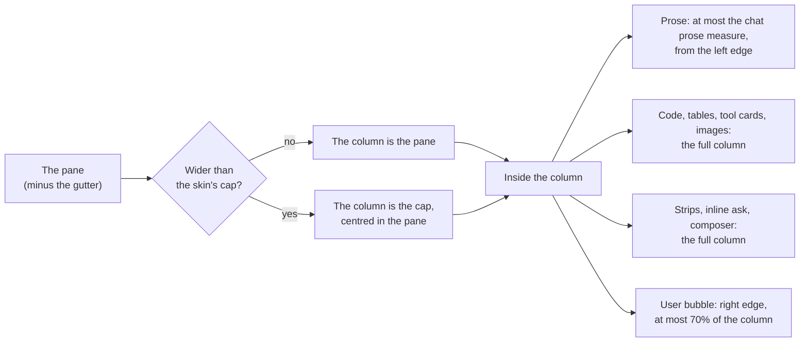
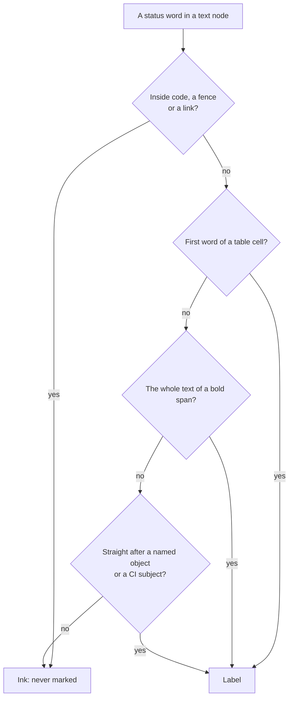
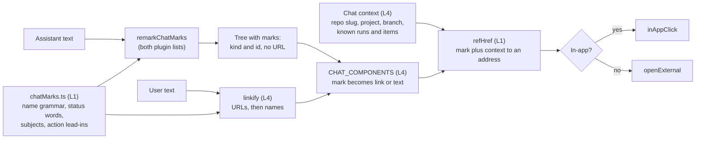

# Chat reading at a desk: width, colour and links

**Spec** · 2026-11-06 · Status: Draft · Owner: the desktop-polish coordinator · Linear: none · Related: `docs/superpowers/specs/2026-10-31-programme-ledgers-design.md` (D27, D28), `docs/superpowers/plans/2026-10-22-desktop-polish.md` (T4a, D-7234), mockup `docs/superpowers/specs/2026-11-06-chat-reading-mockup.html`

## In short

The operator asked for three things in the session chat at a desk: use the pane's width, use colour in the assistant's prose, and link the names the chat uses to their objects. This spec proposes all three for the chat only; phones and the Docs reader do not change.
**Width:** the chat column grows with the pane, up to a cap per skin. Prose keeps a readable measure. Code, tables, tool cards, the strips and the composer take the full column.
**Colour:** prose gains hue in four places only: bold lead-ins, status words in a label position, links to named objects, and the markers of an action list. Every colour is an existing palette token, and every pair measured at 4.80:1 or better in all twelve palettes.
**Links:** one pure recogniser module marks `#n`, `run N`, `item N`, repository document paths and commit SHAs. The renderer resolves each mark to a console page, the Docs reader or GitHub, and the existing `linkify` uses the same module for user text.
**Please check:** the four calls in §6 marked as waiting on you, and the mockup.

## 1. Context

This section quotes the request and lists what already exists, so the design extends existing owners instead of adding new ones.

The operator, 2026-11-06, verbatim:

> "Can we utilise the space of the chat area betterr in desktop mode rather than being squished into the middle only. Also, I Keep asking and asking and asking, can we add use of colours into this chat to make it easier to read and act on? It's always white text, why aren't we sing colour at all? Surely there is a good way to use colour without it being too much yet staying helpful. Also link through to objetcs we name (runs, spec items, etc.) so that the user has an easy time understanding everything."

Their screenshot showed a coordinator's turn at a desk. The prose, strips and composer sat in a centred column with wide empty margins. The text was all one ink: lead-ins such as "Why I can't do it.", "What to do (either one):" and "What happens next." were only bold, and a mail id, a PR number and a run were plain text.

What exists on `main` (sourced):

| Piece | Where | What it does today |
|---|---|---|
| The reading column | `pwa/src/session/chat.css`, "THE READING COLUMN" | From 900 px, `.chat-item`, `.chat-strips`, `.ask-inline` and `.composer` sit in `max-width: min(var(--measure-chat), 100%)`, centred. |
| `--measure-chat` | `ui/src/styles/tokens.css`, `skins.css` | Refined: 780 px, 820 px from 1600. Instrument: 860 px. A role token in `SKIN_TOKENS`. |
| The prose measure | `ui/src/components/prose.css` | `.msg-assist > :is(p, ul, ol, blockquote, h1–h4, hr, .callout)` capped at `--measure-prose` (72ch). Code, tables and images are not capped. The Docs reader (`.doc-body`) reads the same token. |
| Prose colour | `prose.css` | Body, lists and `strong` in `--ink-primary`. Markers in `--ink-tertiary`. Links in `--accent`. Callouts already use hue on their rule and label. |
| T4a | #1732, D-6387, D-7234 | Coloured tool wells, failed calls and the dark inline-code chip. Under D-7234 the chip applies to assistant messages only. |
| Bare URLs in user text | `MessageBubble.tsx`, `linkify` | Splits on `https?://…` and opens each URL in a new tab. |
| Item-text links | `pwa/src/ledgers/ledgerLinks.ts`, `linkRuns`, `docHref` | An allow-list for Waiting on you items (D27, D28). It has its own recorded reason for not using chat's renderer (`pl10-linkruns-not-chat-markdown`). `docHref` builds the Docs reader address of a repository document. |
| Chat's Markdown | `pwa/src/lib/markdown.tsx` (`CHAT_REMARK_PLUGINS`), `markdownParse.ts` (`REMARK_PLUGINS`, the worker) | Two plugin lists, one for the synchronous path and one for the worker, both `[remarkGfm, remarkAlerts]`. `CHAT_COMPONENTS.a` opens every link in a new tab. |
| Routes | `pwa/src/lib/routes.ts` | `/s/:id`, `/runs` (no per-run path), `/mail` (no per-mail path), `/waiting/:n`, `/docs/…`, `/programmes/:slug`. |

## 2. Width at a desk

This section covers how the chat uses the pane from 900 px up. Below 900 px nothing changes.

### 2.1 The recommendation: a wide column, with prose kept to a measure

The column that holds the transcript, the inline ask, the strips and the composer grows with the pane up to a cap set by the skin. Inside it, prose (paragraphs, lists, headings, quotes, callouts) keeps a readable measure and starts at the column's left edge. Code blocks, tables, tool cards and images take the full column, as do the strips and the composer. The user's bubble stays right-aligned, so it now sits at the column's right edge, as in most chat apps.

*Figure 1. How the desk layout is decided. The skin sets the cap and the prose measure; everything except prose takes the column.*

| Value | Refined (today, then proposed) | Instrument (today, then proposed) |
|---|---|---|
| `--measure-chat`, the column | 780 px (820 px from 1600) → **1200 px** | 860 px → **100%**: the log takes the pane |
| Chat prose measure (new length role `--measure-chat-prose`) | 72ch (shared `--measure-prose`) → **76ch** at 15 px, about 680 px | 72ch → **88ch** at 14 px, about 740 px |
| Code, tables, tool cards | Capped by the 780 to 820 px column | The full column |
| Phones (below 900 px) | Unchanged | Unchanged |

Notes for the planner:
- `--measure-chat` already exists, so only its values change. `--measure-chat-prose` is a new length role in `SKIN_TOKENS`; it is a length, not a colour, so the rule that a skin owns no colour still holds. The chat reads it in `chat.css`, scoped to `.chat-item .msg-assist`. `--measure-prose` and the Docs reader do not change.
- The column keeps `min(var(--measure-chat), 100%)`, so with the inspector rail open it still yields to the pane.
- The inline ask keeps its rule of being 2 × `--sp-4` narrower than the column, so it lines up with the cards.
- Footing: the px figures for ch are judgement (Geist's "0" at about 0.6 em). Plan step 1 measures them in the browser at 1280, 1600 and 2560 px.

### 2.2 The alternative: widen the centred column

Keep today's centred column and raise `--measure-chat` to about 1040 px (Refined) and 1120 px (Instrument). Prose stays at 72ch, centred inside the column. This is a one-token change with no layout work. It also keeps "the middle only" shape the operator objected to, and on a 2560 px pane it still leaves more than half the pane empty. It is the fallback if the operator prefers centred reading.

| | Recommended (§2.1) | Alternative (§2.2) |
|---|---|---|
| Uses a 1600 px pane | Column 1200 px (Refined) or the whole pane (Instrument) | Column 1040 to 1120 px |
| Prose line length | 76ch / 88ch | 72ch |
| Code and tables | Full column | Full column, a narrower one |
| Change size | Two values, one new length role, a left-aligned prose rule | Two values |

## 3. Colour in the assistant's prose

This section sets where hue may appear in prose, which tokens it uses, and how a status word is recognised without colouring ordinary uses of the word. The body text stays one ink: hue marks structure and state, never emphasis for its own sake.

### 3.1 Four places, and nowhere else

| # | Place | Example | Colour |
|---|---|---|---|
| C1 | **Action lead-in**: a paragraph or list item opening with bold text from the action list ("What to do", "To do", "Your call", "Decision needed", "What I need from you", "Action") | **What to do (either one):** | `--status-attention-text`, the amber used for "waiting on you" |
| C2 | **Other lead-in**: any other paragraph or list item opening with bold text that ends in `.` or `:` | **Why I can't do it.** **What happens next.** | `--acct-blue`, the hue of the NOTE callout |
| C3 | **Status label**: a status word in a label position (§3.3) | #652 failed · CI green · #651 merged | Text on tint, as a small label (table below) |
| C4 | **Named object**: a recognised name (§4) | run 1527 · item 34 · #651 | `--accent` with the existing link underline |

Also, the list markers of a list that directly follows an action lead-in take `--status-attention-text`, so the operator's steps stand out. All other markers stay `--ink-tertiary`. A lead-in that is not followed by a list changes no marker.

Status label colours. Every pair is one the callouts already use, so the contrast gate measures it today:

| Status words (case-insensitive) | Text | Ground | Lowest ratio in the 12 palettes |
|---|---|---|---|
| passed, green, accepted, approved, done | `--status-busy-text` | `--accent-tint` | 4.84:1 |
| merged, landed | `--pr-merged` (= `--acct-violet`) | `--acct-violet-tint` | 4.80:1 |
| blocked, waiting, held, pending, stalled | `--status-attention-text` | `--status-attention-tint` | 4.80:1 |
| failed, red, refused, rejected, broken | `--status-dead-text` | `--status-dead-tint-solid` | 4.81:1 |

Text on the page ground (`--bg-page`), lowest across the 12 palettes: `--accent` 4.92, `--status-attention-text` 5.45, `--acct-blue` 5.36.

> [!NOTE]
> Measured 2026-11-06 with a script that resolves every `[data-theme]` block of `ui/src/styles/tokens.css` on `main` (4c677d328) and applies WCAG 2.1 luminance. This is not the repository's gate. The plan must add the new rules where `design/contrast-check.mjs` reads them, with `--bg-page` as their ground, and the gate's verdict replaces these figures.

Both skins draw the same colours, because a skin owns no colour (`skins.css`). These rules apply to chat only, scoped as T4a's chip is (`.msg-assist:not(.doc-body):not(.compaction-body)`), so the Docs reader and an opened recap keep today's look.

### 3.2 Why a lead-in, and not a colour per sentence

The coordinator's turns already follow a shape: a lead-in, then the content. Colouring the lead-in gives the eye an anchor at the start of each block. Amber means the same here as everywhere else in the console: it is on you. Blue marks the other blocks without competing with it. A turn with no lead-ins, status words or names looks exactly as it does today.

### 3.3 How a status word is recognised

A word from the status list is coloured only in a label position. Anywhere else it stays ink, so "the value passed to the parser" and "a red herring" are never labelled.

*Figure 2. The three label positions. A word reaches a label only through one of them.*

- **S1, a table cell.** The cell's text starts with the word. This matches the docs renderer's rule for status cells, which the operator already reads in specs.
- **S2, a bold span.** The span is the word alone, for example `**blocked**`.
- **S3, after a subject.** The word follows a recognised name (§4), or one of the subjects `CI`, `checks`, `tests`, `suite`, `build`, `review`, with at most one of `is`, `was`, `now` between them: "#651 merged", "CI green", "run 1527 is blocked".

The word list and the subject list live in the same L1 module as the name grammar (§4.2), each written once.

## 4. Links from names to their objects

This section defines which names become links, where each one points, and how recognising (pure, L1) is split from resolving and acting (L4).

### 4.1 The recogniser table

| Kind | Grammar (on a text node, never in code) | Target | Route today | In this release |
|---|---|---|---|---|
| PR or issue | `#n`, 1 to 6 digits, GitHub's own autolink shape, not inside a word | `https://github.com/<slug>/issues/<n>` (GitHub redirects a PR there to `/pull/<n>`). `<slug>` is the session project's measured repo (`repoLabel`, `ProjectRow.repo`). | External | Yes |
| Run | `run N`, `review N` (a review is a run), case-insensitive | `/runs?run=<n>`: a new query on the existing `runs` route. The board scrolls to the row, marks it, and says when the run is not among those loaded. Same precedent as `/accounts?lane=` (T2c, D-6329). | Query on existing | Yes |
| Item | `item N` | `/waiting/<n>`, the one Waiting on you page's item | Exists | Yes |
| Repository document | A path under `docs/superpowers/specs/`, `docs/superpowers/plans/`, `docs/product-design/` or `docs/conventions/` ending in `.md` | The Docs reader, through `docHref` (D28: a document link goes to the Docs reader only), in the session's project at the branch its worktree holds, as `sessionDocsHref` chooses it | Exists | Yes |
| Commit | 7 to 40 lowercase hex characters with at least one digit and one letter, standing alone or after `@` | `https://github.com/<slug>/commit/<sha>` | External | Yes |
| Deviation | `D-N` | Its entry in the plan that defines it, in the Docs reader | Needs a session-gated `D-N` → plan path lookup (the ledger read is box-token only) and an in-page anchor | Later |
| Mail | `mail N` | The message in the Inbox | Needs `/mail?mail=<id>`, and the id must say whether it is a mail row or a delivery (two sequences) | Later |
| Session | A session id | `/s/<id>` (`sessionPath`) | Exists, but no grammar tells an id from a hyphenated word; recognising one needs the known ids inside the parse, which runs in a worker | Later |
| Run detail | `run N` | A page for one run | Needs `/runs/<n>` | Later; `?run=` covers it until then |

Avoiding mislinks of ordinary numbers:
- **Only after a keyword.** A bare number never links; `run`, `review`, `item` or `#` must come first.
- **Small ids must be known.** A `run N` or `item N` whose number has fewer than three digits links only when the console already holds that run or item (the runs frame, the Waiting on you store). This keeps "run 2 times" and "item 3 of the list" as text.
- **A repository is required.** `#n` and a commit link only when the session's project has a measured repo (`state: 'named'`). Otherwise they stay text, never a link to a guess.
- **Never inside code.** A fenced block, an inline code span, an existing link and an image are never touched.
- **A name the renderer cannot resolve renders as plain text**, never as link-coloured text that goes nowhere.

### 4.2 One module decides, the renderer acts

*Figure 3. Recognising is context-free and runs wherever the Markdown parses, including the worker. Resolving needs the session's context and happens at render time.*

- **`pwa/src/lib/chatMarks.ts` (L1, new).** It holds the one recogniser table: the name grammar, the status words, the subjects and the action lead-ins, each written once. It exports `markRuns(text)`, which splits plain text into text runs and marks, and `refHref(mark, ctx)`, which returns an address or `null`.
- **`remarkChatMarks` (L1, new).** It walks mdast text nodes, skipping `inlineCode`, `code`, `link`, `linkReference` and `html`. It replaces each mark with a node carrying `data-mark-kind` and `data-mark-id` (and a class on lead-in paragraphs and status labels). It writes no URL. It joins `CHAT_REMARK_PLUGINS` and the worker's chat-profile list, never the docs profile.
- **Resolving happens at render time.** The worker caches its parse by text, so a parse cannot see the session's repo or the known ids. The mark carries kind and id only. `CHAT_COMPONENTS` resolves it through `refHref` with a chat context that `SessionScreen` provides, and draws a link or plain text.
- **`CHAT_COMPONENTS.a` stops sending every link to a new tab.** An in-app address (one starting with `/`) navigates through `inAppClick`. An external one keeps `openExternal`.
- **`linkify` stays the one owner for user text.** It keeps its URL split, and runs `markRuns` over the text between URLs, so `#651` in the operator's own message links too. No second linkifier is added.
- **`docHref` moves to `pwa/src/docs/docsLinks.ts`, the Docs context's link owner.** The move is unchanged, with a characterization test first. The ledgers and the chat both import it from there.
- **`linkRuns` (ledgers) is not merged into this.** Item text is plain text from a coordinator, checked against the server's refusal rules (D27, D28). That is a security allow-list, the "legitimately different" reason already recorded as `pl10-linkruns-not-chat-markdown`. Letting item text use the same named-object grammar is listed under Later.

## 5. Testing and proof

This section lists the checks a plan must include.

- **Recogniser table tests (L1, pure).** Every grammar row has positive and negative cases: `#1` inside `C#1`, `run 2 times`, `item 3 of`, hex-only words (`deadbeef`), a SHA inside a longer hex string, a path with `..`, a status word in each of the three positions and outside them. Each case is a mutation-table row that goes red when its guard is removed.
- **Plugin tests.** No mark inside inline code, a fence, a link or an image. The sync path and the worker path draw the same output (the M4.P10 parity the goldens hold).
- **Goldens.** `markdown-golden.test.tsx` pins chat output byte for byte. Add goldens for marked messages; an existing golden that changes is a reviewed change, listed in the PR.
- **Contrast gate.** The new rules are measured on `--bg-page` in every palette, and the gate passes.
- **Browser checks** at 1280, 1600 and 2560 px in both skins: the column width, the prose measure in px, no horizontal scroll, and the inline ask lined up with the cards. Phones at 390 px are unchanged, pinned by a before/after screenshot comparison.
- **Navigation.** Following `run 1527` lands on the board with the row marked. Following `item 34` opens the item. A document path opens the Docs reader. `#n` opens a new tab with no opener.

## 6. Decisions

Each decision is marked as the coordinator's call (proposed, to be confirmed) or as waiting on the operator.

| # | Decision | Options considered | Chosen, and why | Status |
|---|---|---|---|---|
| R1 | Desk layout | Wide column with prose at a measure; widen the centred column | Wide column, prose measured and left-aligned: it uses the pane and keeps lines readable | Waiting |
| R2 | Column caps | Per skin; one value | Refined 1200 px, Instrument the pane (a log skin); prose 76ch and 88ch | Proposed |
| R3 | Prose measure token | Change `--measure-prose`; new chat role | New role `--measure-chat-prose`, so the Docs reader keeps 72ch | Proposed |
| R4 | Where hue goes | Everywhere useful; four places only | Lead-ins, status labels, names, action-list markers; body ink unchanged | Proposed |
| R5 | Informational lead-ins | NOTE blue; bold ink only | NOTE blue, so every block has an anchor; ink only is the quieter option | Waiting |
| R6 | Status recognition | Any occurrence; label positions only | Three label positions (§3.3), so ordinary uses of a word stay ink | Proposed |
| R7 | Status colours | New tokens; the callouts' pairs | The callouts' pairs, already gated in every palette | Proposed |
| R8 | Where recognising lives | In the renderer; one L1 module | `chatMarks.ts` plus one remark plugin, with resolving at render time | Proposed |
| R9 | User-text links | Second linkifier; extend `linkify` | Extend `linkify`, the existing owner | Proposed |
| R10 | Run target | New `/runs/<n>`; query on `/runs` | `/runs?run=<n>` now; a run page later | Proposed |
| R11 | Small ids | Always link; digits floor; floor or known | Three or more digits, or an id the console already holds | Proposed |
| R12 | Document links' ref | Default view; the session's branch | The session's branch, as `sessionDocsHref` does, so a spec written on that branch opens | Waiting |
| R13 | Names in inline code | Never; when the whole span is one name | Never in this release; a whole-span name (a path, a SHA) is the open question below | Waiting |
| R14 | D-N, mail, session ids | Now; later | Later: each needs a new read or route (§4.1) | Proposed |

## Where things stand

### Agreed

- The three asks and their scope (chat only, desk only for width, phones and Docs reader unchanged): the operator, 2026-11-06.
- Every colour is an existing palette token, and the chat's rules are scoped away from the Docs reader, as under D-7234.

### Waiting on you

- **R1:** the wide column with measured prose (recommended), or the wider centred column. See the mockup.
- **R5:** informational lead-ins in the NOTE blue, or bold ink with only the action lead-ins in amber.
- **R12:** whether a document path in a session opens at that session's branch (recommended) or at the default branch.
- **R13:** whether an inline code span whose whole text is one name (a document path, a commit) becomes a link. Models usually put paths in code spans, so with "never" most document paths stay unlinked.

### Later

- `D-N` links to their plan entry. Trigger: a session-gated `D-N` → plan path read and an anchor target in the Docs reader.
- Mail id links. Trigger: an Inbox deep link (`/mail?mail=`) and a ruling on which id the chat names.
- Session id links. Trigger: the known session ids reaching the parse, or an id grammar that cannot match an ordinary word.
- A page for one run (`/runs/<n>`), replacing `?run=`.
- Waiting on you item text using the same named-object grammar, through `chatMarks.ts`, inside `linkRuns`'s allow-list.

---

*Written by Claude for the desktop-polish coordinator. Diagrams are Mermaid text; the Copy Mermaid button copies the source.*
