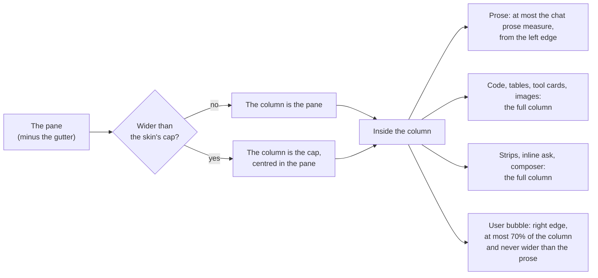
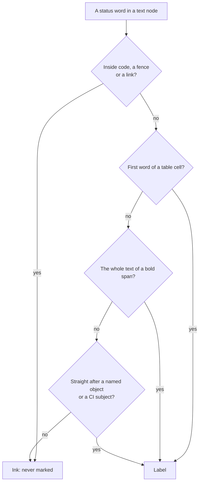
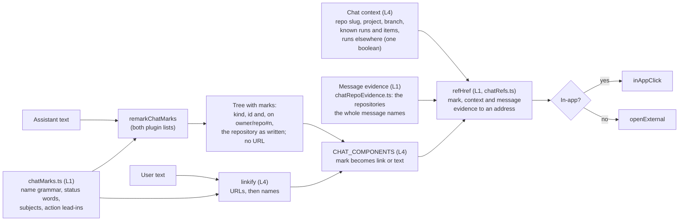

# Chat reading at a desk: width, colour and links

**Spec** · 2026-11-06 · Status: Approved 2026-11-06 · Owner: the desktop-polish coordinator · Linear: none · Related: `docs/superpowers/specs/2026-10-31-programme-ledgers-design.md` (D27, D28), `docs/superpowers/plans/2026-10-22-desktop-polish.md` (T4a, D-7234), mockup `docs/superpowers/specs/2026-11-06-chat-reading-mockup.html`, plan `docs/superpowers/plans/2026-11-06-chat-reading.md`

## In short

The operator asked for three things in the session chat at a desk: use the pane's width, use colour in the assistant's prose, and link the names the chat uses to their objects. This spec sets all three for the chat only; the width changes at a desk only, and the Docs reader does not change.
**Width:** the chat column grows with the pane, up to a cap per skin. Prose keeps a readable measure. Code, tables, tool cards, the strips and the composer take the full column.
**Colour:** prose gains hue in four places only: bold lead-ins, status words in a label position, links to named objects, and the markers of an action list. Every colour is an existing palette token, and every pair measured at 4.80:1 or better in all twelve palettes.
**Links:** one pure recogniser module marks `#n`, `run N`, `item N`, repository document paths and commit SHAs. The renderer resolves each mark to a console page, the Docs reader or GitHub, and the existing `linkify` uses the same module for user text.
**Decided:** the operator approved the recommendations on 2026-11-06 ("Chat design - as recommended"), so every call in §6 is agreed: the wide column, blue informational lead-ins, document links at the session's branch, and a whole-span name in inline code links.

## 1. Context

This section quotes the request and lists what already exists, so the design extends existing owners instead of adding new ones.

The operator, 2026-11-06, verbatim:

> "Can we utilise the space of the chat area betterr in desktop mode rather than being squished into the middle only. Also, I Keep asking and asking and asking, can we add use of colours into this chat to make it easier to read and act on? It's always white text, why aren't we sing colour at all? Surely there is a good way to use colour without it being too much yet staying helpful. Also link through to objetcs we name (runs, spec items, etc.) so that the user has an easy time understanding everything."

Their screenshot showed a coordinator's turn at a desk. The prose, strips and composer sat in a centred column with wide empty margins. The text was all one ink: lead-ins such as "Why I can't do it.", "What to do (either one):" and "What happens next." were only bold, and a mail id, a PR number and a run were plain text.

What exists on `main` (sourced):

| Piece | Where | What it does today |
|---|---|---|
| The reading column | `pwa/src/session/chat.css`, "THE READING COLUMN" | From 900 px, `.chat-item`, `.chat-strips`, `.ask-inline` and `.composer` sit in `max-width: min(var(--measure-chat), 100%)`, centred. |
| `--measure-chat` | `ui/src/styles/tokens.css`, `skins.css` | Refined: 780 px, 820 px from 1600. Instrument: 860 px. A role token in `SKIN_TOKENS`. |
| The prose measure | `ui/src/components/prose.css` | `.msg-assist > :is(p, ul, ol, blockquote, h1–h4, hr, .callout)` capped at `--measure-prose` (72ch). Code, tables and images are not capped. The Docs reader (`.doc-body`) reads the same token. |
| Prose colour | `prose.css` | Body, lists and `strong` in `--ink-primary`. Markers in `--ink-tertiary`. Links in `--accent`. Callouts already use hue on their rule and label. |
| T4a | #1732, D-6387, D-7234 | Coloured tool wells, failed calls and the dark inline-code chip. Under D-7234 the chip applies to assistant messages only. |
| Bare URLs in user text | `MessageBubble.tsx`, `linkify` | Splits on `https?://…` and opens each URL in a new tab. |
| Item-text links | `pwa/src/ledgers/ledgerLinks.ts`, `linkRuns`, `docHref` | An allow-list for Waiting on you items (D27, D28). It has its own recorded reason for not using chat's renderer (`pl10-linkruns-not-chat-markdown`). `docHref` builds the Docs reader address of a repository document. |
| Chat's Markdown | `pwa/src/lib/markdown.tsx` (`CHAT_REMARK_PLUGINS`), `markdownParse.ts` (`REMARK_PLUGINS`, the worker) | Two plugin lists, one for the synchronous path and one for the worker, both `[remarkGfm, remarkAlerts]`. `CHAT_COMPONENTS.a` opens every link in a new tab. |
| Routes | `pwa/src/lib/routes.ts` | `/s/:id`, `/runs` (no per-run path), `/mail` (no per-mail path), `/waiting/:n`, `/docs/…`, `/programmes/:slug`. |

## 2. Width at a desk

This section covers how the chat uses the pane from 900 px up. Below 900 px nothing changes.

### 2.1 The chosen layout: a wide column, with prose kept to a measure

The column that holds the transcript, the inline ask, the strips and the composer grows with the pane up to a cap set by the skin. Inside it, prose (paragraphs, lists, headings, quotes, callouts) keeps a readable measure and starts at the column's left edge. Code blocks, tables, tool cards and images take the full column, as do the strips and the composer. The user's bubble stays right-aligned, so it now sits at the column's right edge, as in most chat apps.

*Figure 1. How the desk layout is decided. The skin sets the cap and the prose measure; everything except prose takes the column.*

| Value | Refined (today, then proposed) | Instrument (today, then proposed) |
|---|---|---|
| `--measure-chat`, the column | 780 px (820 px from 1600) → **1200 px** | 860 px → **100%**: the log takes the pane |
| Chat prose measure (new length role `--measure-chat-prose`) | 72ch (shared `--measure-prose`) → **90ch**, about 895 px (first agreed as 76ch; R2 amended, item 57) | 72ch → **100ch**, about 995 px (first agreed as 88ch; R2 amended, item 57) |
| User bubble and its attachments | 85% of the row → **`min(70%, prose)`**: at most 70% of the column, never wider than the prose measure; the attachments take the same cap | The same |
| Code, tables, tool cards | Capped by the 780 to 820 px column | The full column |
| Phones (below 900 px) | Unchanged | Unchanged |

Notes for the planner:
- `--measure-chat` already exists, so only its values change. `--measure-chat-prose` is a new length role in `SKIN_TOKENS`; it is a length, not a colour, so the rule that a skin owns no colour still holds. The chat reads it in `chat.css`, scoped to `.chat-item .msg-assist`. `--measure-prose` and the Docs reader do not change.
- The column keeps `min(var(--measure-chat), 100%)`, so with the inspector rail open it still yields to the pane.
- The inline ask keeps its rule of being 2 × `--sp-4` narrower than the column, so it lines up with the cards.
- Footing: the px figures for ch are judgement (Geist's "0" at about 0.6 em). The plan's width task measures them in the browser at 1280, 1600 and 2560 px.

> [!NOTE]
> **R2 amended (item 57, 2026-11-06).** The operator chose wider prose after Task W measured the first values: "Wider: Refined about 895 px (90 characters), Instrument about 995 px (100)". The prose measure is 90ch in Refined and 100ch in Instrument, and the user's bubble is capped at `min(70%, prose)`, which its attachments share (Task W fix round 1). The table above shows the amended values; the first ones, 76ch and 88ch, stay named in it. This note and R2 record the change (desktop-polish Task C14, D-8110).

### 2.2 The alternative: widen the centred column

Keep today's centred column and raise `--measure-chat` to about 1040 px (Refined) and 1120 px (Instrument). Prose stays at 72ch, centred inside the column. This is a one-token change with no layout work. It also keeps "the middle only" shape the operator objected to, and on a 2560 px pane it still leaves more than half the pane empty. Not chosen (R1, 2026-11-06).

| | Recommended (§2.1) | Alternative (§2.2) |
|---|---|---|
| Uses a 1600 px pane | Column 1200 px (Refined) or the whole pane (Instrument) | Column 1040 to 1120 px |
| Prose line length | 76ch / 88ch | 72ch |
| Code and tables | Full column | Full column, a narrower one |
| Change size | Two values, one new length role, a left-aligned prose rule | Two values |

## 3. Colour in the assistant's prose

This section sets where hue may appear in prose, which tokens it uses, and how a status word is recognised without colouring ordinary uses of the word. The body text stays one ink: hue marks structure and state, never emphasis for its own sake.

### 3.1 Four places, and nowhere else

| # | Place | Example | Colour |
|---|---|---|---|
| C1 | **Action lead-in**: a paragraph or list item opening with bold text from the action list ("What to do", "To do", "Your call", "Decision needed", "What I need from you", "Action") | **What to do (either one):** | `--status-attention-text`, the amber used for "waiting on you" |
| C2 | **Other lead-in**: any other paragraph or list item opening with bold text that ends in `.` or `:` | **Why I can't do it.** **What happens next.** | `--acct-blue`, the hue of the NOTE callout |
| C3 | **Status label**: a status word in a label position (§3.3) | #652 failed · CI green · #651 merged | Text on tint, as a small label (table below) |
| C4 | **Named object**: a recognised name (§4) | run 1527 · item 34 · #651 | `--accent` with the existing link underline |

Also, the list markers of a list that directly follows an action lead-in take `--status-attention-text`, so the operator's steps stand out. All other markers stay `--ink-tertiary`. A lead-in that is not followed by a list changes no marker.

Status label colours. Every pair is one the callouts already use, so the contrast gate measures it today:

| Status words (case-insensitive) | Text | Ground | Lowest ratio in the 12 palettes |
|---|---|---|---|
| passed, green, accepted, approved, done | `--status-busy-text` | `--accent-tint` | 4.84:1 |
| merged, landed | `--pr-merged` (= `--acct-violet`) | `--acct-violet-tint` | 4.80:1 |
| blocked, waiting, held, pending, stalled | `--status-attention-text` | `--status-attention-tint` | 4.80:1 |
| failed, red, refused, rejected, broken | `--status-dead-text` | `--status-dead-tint-solid` | 4.81:1 |

Text on the page ground (`--bg-page`), lowest across the 12 palettes: `--accent` 4.92, `--status-attention-text` 5.45, `--acct-blue` 5.36.

> [!NOTE]
> Measured 2026-11-06 with a script that resolves every `[data-theme]` block of `ui/src/styles/tokens.css` on `main` (4c677d328) and applies WCAG 2.1 luminance. This is not the repository's gate. The plan must add the new rules where `design/contrast-check.mjs` reads them, with `--bg-page` as their ground, and the gate's verdict replaces these figures.

Both skins draw the same colours, because a skin owns no colour (`skins.css`). These rules apply to chat only, scoped as T4a's chip is (`.msg-assist:not(.doc-body):not(.compaction-body)`), so the Docs reader and an opened recap keep today's look.

### 3.2 Why a lead-in, and not a colour per sentence

The coordinator's turns already follow a shape: a lead-in, then the content. Colouring the lead-in gives the eye an anchor at the start of each block. Amber means the same here as everywhere else in the console: it is on you. Blue marks the other blocks without competing with it. A turn with no lead-ins, status words or names looks exactly as it does today.

### 3.3 How a status word is recognised

A word from the status list is coloured only in a label position. Anywhere else it stays ink, so "the value passed to the parser" and "a red herring" are never labelled.

*Figure 2. The three label positions. A word reaches a label only through one of them.*

- **S1, a table cell.** The cell's text starts with the word. This matches the docs renderer's rule for status cells, which the operator already reads in specs.
- **S2, a bold span.** The span is the word alone, for example `**blocked**`.
- **S3, after a subject.** The word follows a recognised name (§4), or one of the subjects `CI`, `checks`, `tests`, `suite`, `build`, `review`, with at most one of `is`, `was`, `now` between them: "#651 merged", "CI green", "run 1527 is blocked".

The word list and the subject list live in the same L1 module as the name grammar (§4.2), each written once.

## 4. Links from names to their objects

This section defines which names become links, where each one points, and how recognising (pure, L1) is split from resolving and acting (L4).

### 4.1 The recogniser table

| Kind | Grammar (on a text node, never in code) | Target | Route today | In this release |
|---|---|---|---|---|
| PR or issue | `#n`, 1 to 6 digits, GitHub's own autolink shape, not inside a word; or `owner/repo#n` (R15), not after a path or a host; a qualified name whose repository ends in a listed file extension, has a segment that is all digits or one character, or has both segments upper case only is a name the chat cannot tell, so it stays text | `https://github.com/<slug>/issues/<n>` (GitHub redirects a PR there to `/pull/<n>`). `<slug>` is the repository the name means (R15): the one `owner/repo#n` says; else the one its message names for that number; else the session project's measured repo (`repoLabel`, `ProjectRow.repo`) when the message names no other repository and the session claims no open run elsewhere; else no link. | External | Yes |
| Run | `run N`, `review N` (a review is a run), case-insensitive | `/runs?run=<n>`: a new query on the existing `runs` route. The board scrolls to the row, marks it, and says when the run is not among those loaded. Same precedent as `/accounts?lane=` (T2c, D-6329). | Query on existing | Yes |
| Item | `item N` | `/waiting/<n>`, the one Waiting on you page's item | Exists | Yes |
| Repository document | A path under `docs/superpowers/specs/`, `docs/superpowers/plans/`, `docs/product-design/` or `docs/conventions/` ending in `.md` | The Docs reader, through `docHref` (D28: a document link goes to the Docs reader only), in the session's project at the branch its worktree holds, as `sessionDocsHref` chooses it | Exists | Yes |
| Commit | 7 to 40 lowercase hex characters with at least one digit and one letter, standing alone or after `@` | `https://github.com/<slug>/commit/<sha>`, `<slug>` chosen as for a PR (R15), from the commit addresses its message names | External | Yes |
| Deviation | `D-N` | Its entry in the plan that defines it, in the Docs reader | Needs a session-gated `D-N` → plan path lookup (the ledger read is box-token only) and an in-page anchor | Later |
| Mail | `mail N` | The message in the Inbox | Needs `/mail?mail=<id>`, and the id must say whether it is a mail row or a delivery (two sequences) | Later |
| Session | A session id | `/s/<id>` (`sessionPath`) | Exists, but no grammar tells an id from a hyphenated word; recognising one needs the known ids inside the parse, which runs in a worker | Later |
| Run detail | `run N` | A page for one run | Needs `/runs/<n>` | Later; `?run=` covers it until then |

Avoiding mislinks of ordinary numbers:
- **Only after a keyword.** A bare number never links; `run`, `review`, `item` or `#` must come first.
- **Small ids must be known.** A `run N` or `item N` whose number has fewer than three digits links only when the console already holds that run or item (the runs frame, the Waiting on you store). This keeps "run 2 times" and "item 3 of the list" as text.
- **A repository the code can tell is required (R15).** `#n` and a commit link only to the repository a qualified name says, the one repository its message names for it, or, when nothing points elsewhere, the session project's measured repo (`state: 'named'`). Otherwise they stay text, never a link to a guess.
- **Never inside code, with one exception.** A fenced block, an existing link and an image are never touched. An inline code span is touched only when its whole text is one recognised name (R13), such as a document path or a commit SHA written in backticks; the span then links as that name and keeps its code look. Any other inline code span stays as it is.
- **A name the renderer cannot resolve renders as plain text**, never as link-coloured text that goes nowhere.

### 4.2 One module decides, the renderer acts

*Figure 3. Recognising is context-free and runs wherever the Markdown parses, including the worker. Resolving needs the session's context and the message's evidence, and happens at render time.*

- **`pwa/src/lib/chatMarks.ts` (L1, new).** It holds the one recogniser table: the name grammar, the status words, the subjects and the action lead-ins, each written once. It exports `markRuns(text)`, which splits plain text into text runs and marks, and the one name boundary. `refHref(mark, ctx, message)`, which returns an address or `null`, lives in `pwa/src/lib/chatRefs.ts` (L1), because it asks the Docs and ledger modules that the parse worker may not load; its third argument is `messageRepos` of the whole message, from `pwa/src/lib/chatRepoEvidence.ts` (L1, R15).
- **`remarkChatMarks` (L1, new).** It walks mdast text nodes, skipping `inlineCode`, `code`, `link`, `linkReference` and `html` (a whole-span name in inline code is resolved at render time, R13). It replaces each mark with a node carrying `data-mark-kind` and `data-mark-id`, and `data-mark-repo` on a qualified PR name (R15) (and a class on lead-in paragraphs and status labels). It writes no URL. It joins `CHAT_REMARK_PLUGINS` and the worker's chat-profile list, never the docs profile.
- **Resolving happens at render time.** The worker caches its parse by text, so a parse cannot see the session's repo or the known ids. The mark carries its kind and id, and a qualified name (`owner/repo#n`) also the repository as written (`data-mark-repo`), all read from the name's own text; it never carries a URL. `CHAT_COMPONENTS` resolves it through `refHref` with a chat context that `SessionScreen` provides and the message's evidence that `ChatMarkdown` provides, and draws a link or plain text.
- **`CHAT_COMPONENTS.a` stops sending every link to a new tab.** An in-app address (one starting with `/`) navigates through `inAppClick`. An external one keeps `openExternal`.
- **`linkify` stays the one owner for user text.** It keeps its URL split, and runs `markRuns` over the text between URLs, so `#651` in the operator's own message links too. No second linkifier is added.
- **`docHref` moves to `pwa/src/docs/docsLinks.ts`, the Docs context's link owner.** The move is unchanged, with a characterization test first. The ledgers and the chat both import it from there.
- **`linkRuns` (ledgers) is not merged into this.** Item text is plain text from a coordinator, checked against the server's refusal rules (D27, D28). That is a security allow-list, the "legitimately different" reason already recorded as `pl10-linkruns-not-chat-markdown`. Letting item text use the same named-object grammar is listed under Later.

## 5. Testing and proof

This section lists the checks a plan must include.

- **Recogniser table tests (L1, pure).** Every grammar row has positive and negative cases: `#1` inside `C#1`, `run 2 times`, `item 3 of`, hex-only words (`deadbeef`), a SHA inside a longer hex string, a path with `..`, a status word in each of the three positions and outside them. Each case is a mutation-table row that goes red when its guard is removed.
- **Plugin tests.** No mark inside inline code, a fence, a link or an image. The sync path and the worker path draw the same output (the M4.P10 parity the goldens hold).
- **Goldens.** `markdown-golden.test.tsx` pins chat output byte for byte. Add goldens for marked messages; an existing golden that changes is a reviewed change, listed in the PR.
- **Contrast gate.** The new rules are measured on `--bg-page` in every palette, and the gate passes.
- **Browser checks** at 1280, 1600 and 2560 px in both skins: the column width, the prose measure in px, no horizontal scroll, and the inline ask lined up with the cards. Phones at 390 px are unchanged, pinned by a before/after screenshot comparison.
- **Navigation.** Following `run 1527` lands on the board with the row marked. Following `item 34` opens the item. A document path opens the Docs reader. `#n` opens a new tab with no opener.

## 6. Decisions

The operator approved the recommendations on 2026-11-06 in the words "Chat design - as recommended". That settled the four calls that waited on them (R1, R5, R12, R13) to the recommended answers and confirmed the coordinator's calls, so every row is agreed.

| # | Decision | Options considered | Chosen, and why | Status |
|---|---|---|---|---|
| R1 | Desk layout | Wide column with prose at a measure; widen the centred column | Wide column, prose measured and left-aligned: it uses the pane and keeps lines readable. The operator, 2026-11-06 | Agreed |
| R2 | Column caps | Per skin; one value | Refined 1200 px, Instrument the pane (a log skin); prose 90ch and 100ch, and the user's bubble at most `min(70%, prose)` (amended by item 57, 2026-11-06; first agreed as 76ch and 88ch) | Agreed |
| R3 | Prose measure token | Change `--measure-prose`; new chat role | New role `--measure-chat-prose`, so the Docs reader keeps 72ch | Agreed |
| R4 | Where hue goes | Everywhere useful; four places only | Lead-ins, status labels, names, action-list markers; body ink unchanged | Agreed |
| R5 | Informational lead-ins | NOTE blue; bold ink only | NOTE blue for informational lead-ins, amber for action lead-ins, so every block has an anchor. The operator, 2026-11-06 | Agreed |
| R6 | Status recognition | Any occurrence; label positions only | Three label positions (§3.3), so ordinary uses of a word stay ink | Agreed |
| R7 | Status colours | New tokens; the callouts' pairs | The callouts' pairs, already gated in every palette | Agreed |
| R8 | Where recognising lives | In the renderer; one L1 module | `chatMarks.ts` plus one remark plugin, with resolving at render time | Agreed |
| R9 | User-text links | Second linkifier; extend `linkify` | Extend `linkify`, the existing owner | Agreed |
| R10 | Run target | New `/runs/<n>`; query on `/runs` | `/runs?run=<n>` now; a run page later | Agreed |
| R11 | Small ids | Always link; digits floor; floor or known | Three or more digits, or an id the console already holds | Agreed |
| R12 | Document links' ref | Default view; the session's branch | The session's branch, as `sessionDocsHref` does, so a spec written on that branch opens. The operator, 2026-11-06 | Agreed |
| R13 | Names in inline code | Never; when the whole span is one name | When the whole span is one recognised name it links and keeps its code look; any other span never. The operator, 2026-11-06 | Agreed |
| R14 | D-N, mail, session ids | Now; later | Later: each needs a new read or route (§4.1) | Agreed |
| R15 | Which repository a PR or commit opens | Always the session's home repository; the repository the message means, or text | The repository the message means, or text; where the code cannot tell, text. First that applies wins: `owner/repo#n` opens that repository when the chat can tell it; a bare name opens the one repository its own message names for it and is text where the message names two, or one it cannot tell; otherwise it opens the home repository only when the message names no other repository and the session claims no open run whose repository is not the home one, and an unnamed or unknown repository counts as not home; else text. The message is the whole text of one chat event, code spans, link targets and fenced code included; an address in one event is no evidence for a name in the next. **What names a repository:** a page, pull, issue or commit address on `github.com` in any case (the SSH form too), unless its first path segment is one of GitHub's own pages (`orgs`, `user-attachments`, `settings` and the like, which name no repository, so a bare name beside one follows the other rules, even on a pull or commit path, where it may open the home repository instead of a page that does not exist); the API, raw and archive hosts; a `gh` command's last `--repo`, `--repo=` or `-R` flag (one command ends at a backtick, a line break, `;`, `&`, `|`, the next `gh` word, a comma or full stop followed by a space, an unquoted word starting with `#`, which is a shell comment, or the first bare word past its positionals, and nothing after its end is read as its own; every flag written without `=` takes the next word as its value, except the flags `gh` itself has as booleans in that command's group (`--squash`, `--web`, `--paginate` and the like: one set for `gh api` and one for `gh pr` and `gh issue`, taken from `gh`'s own help; every flag of another group takes a value), and the word after a flag that takes a value is that value, never a flag of its own; a quote left open at its line's end voids its command only when it begins inside the command's own words, and the reading goes on after that quote, so a prose apostrophe after a command touches nothing it read; a flag inside a quoted argument is no flag; a word that is exactly a quoted flag is that flag; a flag reaches only its own command's number; a `pr` or `issue` command that loses its repository flag, because a value, a run of short flags, a glued spelling, a missing value or a quote left open in its words hides it, or whose own number is written `#n` in a message with a repository flag, gives its number to a repository the chat cannot tell); **the net:** in a message that holds a `gh` word, every `-R`, `--repo` or `--repo=` flag, a run of short flags ending in `R` (`-sR`) and a glued `-Ro/r` or `-R=o/r` included, names its repository wherever it stands, in a command or not, after a flag the reading lost, in a quoted body or after a `#` word, and one whose value the chat cannot read names an unknown repository, so a lost flag gives text, never home, and another program's flag in such a message (`cp -R src/lib`) makes its bare names text; a `gh api` path `repos/o/r`, with or without its leading slash; `GH_REPO=o/r`; and `owner/repo#n`. **What a repository the chat cannot tell is:** an address whose owner or name the console's GitHub grammar refuses; an address whose host comes directly after a letter, digit or `_` (`修复见github.com/…`); a qualified name whose repository ends in a listed file extension, has a segment that is all digits or one character, or has both segments upper case only (so `vercel/next.js#123` is text, and so is a bare `#123` beside it); and a `gh` flag value holding a full stop followed by an upper-case letter (`-R o/r.Then`, `-R o/Lib.Json`), which is never cut to a shorter name. **Not read**, so a bare name beside them is decided as if they were absent: `gh repo clone o/r`, prose such as `#12 in o/r` or `In o/r, #12`, and other hosts such as `gitlab.com`. **Emphasis:** under `_` or `__` a qualified name touching the delimiter is no name, as in the raw text, and under `*` it is one. **Escapes:** a qualified name with an escape or an entity inside it (`o/r\#12`, `o/r&#35;12`) is no name, as in the raw text, while one on a middle line of a list item, a quote, an alert or a table cell is one. **The residual:** a qualified name follows GitHub's own `owner/repo#n` notation without checking that the repository exists, so a prose pair that is not refused, such as `client/server#1` or `and/or#3`, still links, and may open a page that does not exist or a real but unrelated one. **Task C22 (D-8196, review 1769):** a repository flag's value as the net reads it ends where the next repository flag starts, so a run of flags is read once (`-R=-R=o/r` names an unknown repository and `o/r`). A glued short flag value (`-XPATCH`, `-Hx:y`, `-iXGET`) is one word and takes no next word, as `gh` reads a run of short flags: the booleans of the command's group, then the first letter that takes a value, which takes the rest of the word. The net also names the repository of every `repos/o/r` path word in a message that holds a `gh` word, with or without its leading slash, where a word starts, so a lost `gh api` path gives text or its repository, never home. A repository the net finds in no word a command read is a candidate for every number the message gives a repository, so that number is text unless the repository is the number's own. A `gh` word is `gh` in any case, or `gh.exe`, with no letter or digit in any script directly before or after it; punctuation, quotes, backticks, brackets, an apostrophe and the text's start or end are boundaries, so `gh-pages` and `gh's` hold one and `修复见gh` does not. `GH_REPO: o/r`, the YAML `env:` spelling, names its repository as `GH_REPO=o/r` does. **Task C23 (D-8279, review 1778):** a `gh` command that ends with no number of its own claims none of its repository flags, read or lost, so each is a candidate for every number the message gives a repository (`gh pr merge -s 12 -R o/r`, where `-s` takes `12` as its value, gives text beside a second source for #12). A line continuation, a backslash at a line's end, is whitespace inside a `gh` command, so a flag on its first line is the command's own. An unquoted `gh` word where a flag's value is expected still ends the command, and that command gives its number to a repository the chat cannot tell. A repository the net finds in no word a command read is a candidate for every commit the message gives a repository too, as for a number. A repository flag's value that runs into the next flag is cut there and names a repository the chat cannot tell, never home. Desktop polish Task C21 (D-8172), 2026-11-10, after the operator's report of a link to the wrong repository; amended by reviews 1758 and 1760, by reviews 1762, 1766 and 1768 in Task C20 (D-8187), by review 1769 in Task C22 (D-8196), and by review 1778 in Task C23 (D-8279) | Agreed |

## Where things stand

### Agreed

- The three asks and their scope (chat only, desk only for width, the Docs reader unchanged): the operator, 2026-11-06.
- Every colour is an existing palette token, and the chat's rules are scoped away from the Docs reader, as under D-7234.
- **R1:** a wide column, with prose held to a readable measure (§2.1). The operator, 2026-11-06: "Chat design - as recommended".
- **R5:** informational lead-ins in the NOTE blue, action lead-ins in amber (§3.1). The operator, 2026-11-06, in the same words.
- **R12:** a document path in a session opens at that session's branch (§4.1). The operator, 2026-11-06, in the same words.
- **R13:** an inline code span whose whole text is one recognised name becomes a link (§4.1). The operator, 2026-11-06, in the same words.
- The coordinator's calls R2 to R4, R6 to R11 and R14, as §6 states them, confirmed by the same approval.
- **R15:** a PR or commit opens the repository the message means, or stays text (§4.1). The coordinator's ruling for desktop polish Task C21 (D-8172), 2026-11-10, after the operator's report of a link to the wrong repository, amended by its review.

### Waiting on you

- Nothing. The plan, `docs/superpowers/plans/2026-11-06-chat-reading.md`, is next.

### Later

- `D-N` links to their plan entry. Trigger: a session-gated `D-N` → plan path read and an anchor target in the Docs reader.
- Mail id links. Trigger: an Inbox deep link (`/mail?mail=`) and a ruling on which id the chat names.
- Session id links. Trigger: the known session ids reaching the parse, or an id grammar that cannot match an ordinary word.
- A page for one run (`/runs/<n>`), replacing `?run=`.
- Waiting on you item text using the same named-object grammar, through `chatMarks.ts`, inside `linkRuns`'s allow-list.

---

*Written by Claude for the desktop-polish coordinator. Diagrams are Mermaid text; the Copy Mermaid button copies the source.*
