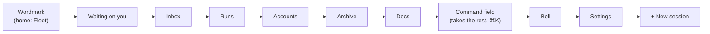
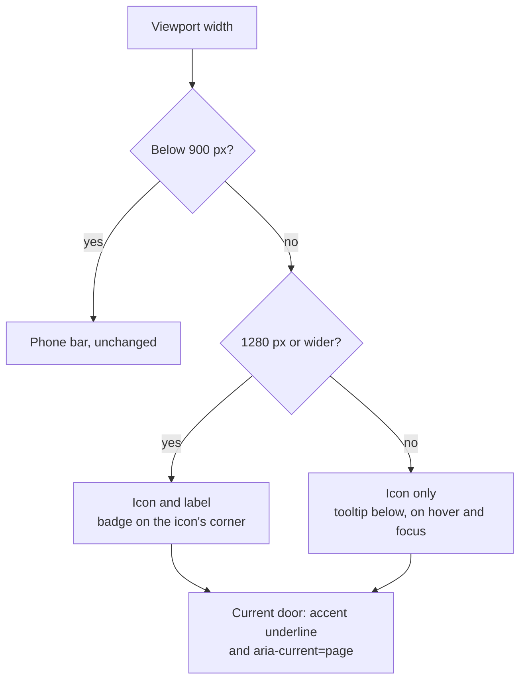
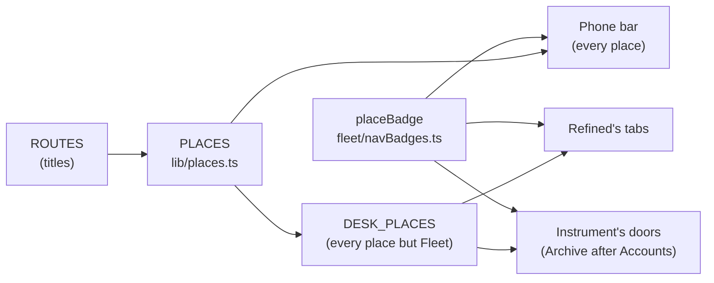
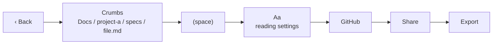
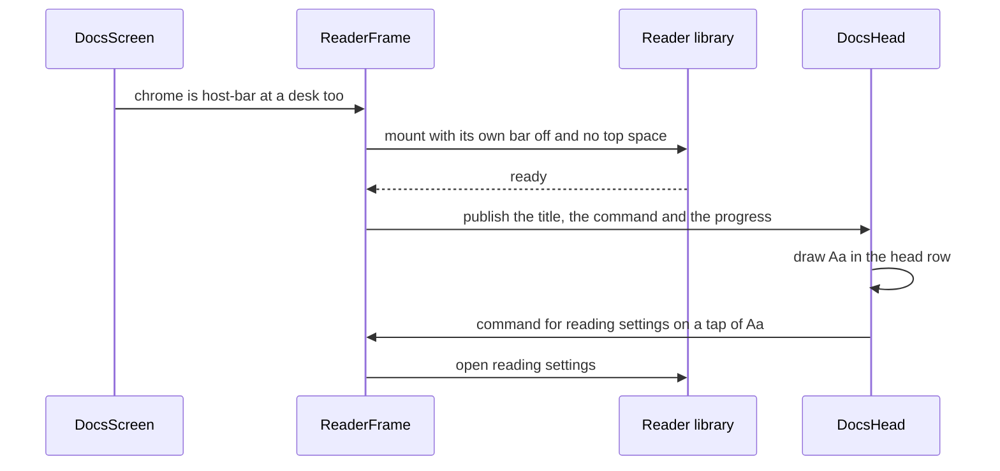
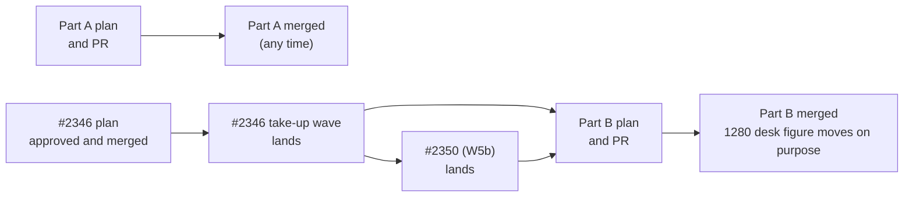

# Desk navigation in the top bar, and a shorter Docs head

**Spec** · 2026-11-06 · Status: Approved by the operator, 2026-11-07 · Owner: the desktop-polish coordinator · Linear: none · Related: `docs/superpowers/plans/2026-10-22-desktop-polish.md`, `docs/superpowers/specs/2026-11-06-chat-reading-design.md`, mockup `docs/superpowers/specs/2026-11-06-desk-nav-mockup.html`, #2346, #2350

## In short

The operator asked for two things at a desk: move Instrument's left rail into the top bar, in the space the breadcrumb holds today, so the main pane gets wider; and make the Docs reader's head much shorter, because three rows of chrome push the document down.
**Part A, the desk top bar (Instrument, 900 px and wider):** the rail column goes. The top bar carries the one `<nav aria-label="Primary">`: the wordmark (now the way home, named for the Fleet page), the six doors, the command field, the bell, Settings and New session. The breadcrumb and `breadcrumb.ts` are removed. The main pane gains 52 px at every desk width. Refined and phones do not change.
**Part B, the desk Docs head (both skins, 600 px and wider):** one row holds back, the crumbs, the reader's Aa control and the three actions; the truth line becomes one dense line under it. The document's title moves from y = 382 to about y = 200 at 1280 × 800.
**Sequencing:** Part A overlaps no open work and can go first. Part B lands after #2346 merges and its take-up wave lands, and it moves that wave's 1280 desk figure on purpose.
**What you need to check:** the three questions under "Waiting on you": Part A as drawn, Part B's target and its dense truth line, and who builds Part B and when. The mockup draws both parts before and after.

## 1. Context

This section quotes the request and lists what exists on `main`, so the design moves existing owners instead of adding new ones.

The operator, 2026-11-06, verbatim:

> "I'd suggest that in the desktop view we take the left panel navigation and move it to the top where we have a lot of empty unused space as per the screenshot. Also, after >CCRC we don't need the breadcrumb trail as it's duplicated in other places, instead use the space for the menu navigation. This will provide more width for the main viewer window, which is much needed. Also in desktop mode, the docviewer header section takes up way too much space. It's good on mobile, but way too big on desktop, we should optimise it."

Their screenshot showed Instrument at a desk. The top bar's line held the wordmark, the one word "Fleet" and, far to the right, the command field and `+`; between them was empty space. The rail of icon doors ran down the left edge.

What exists on `main` (sourced, read at 93ff59528):

| Piece | Where | What it does today |
|---|---|---|
| Instrument's rail | `pwa/src/skins/instrument/Rail.tsx` (`RAIL_ITEMS`) | 52 px column. Doors: `DESK_PLACES` with Archive inserted after Accounts, so Waiting on you, Inbox, Runs, Accounts, Archive, Docs; a reserved, unrendered Activity row (F4, W4); at the foot the bell and Settings. Each door's name is the route title plus its count ("Inbox, 1 waiting for you"); a tooltip shows the name on hover and on keyboard focus; the badge is a pill on the icon's corner (`placeBadge`, `pwa/src/fleet/navBadges.ts`); the current door has `aria-current="page"` and a 2 px accent bar. |
| The frame | `pwa/src/skins/frame.tsx` | Draws the skin's `Bar` in `<header>` and its `Rail` part in `<nav aria-label="Primary">`, both at a desk only. |
| Instrument's top bar | `pwa/src/skins/instrument/TopBar.tsx` | Wordmark, the breadcrumb (an `<ol aria-label="Breadcrumb">`), the command field (a door that opens the palette, ⌘K), `+` (New session). Under the line, the lanes row (`AccountsStrip`). |
| The breadcrumb | `pwa/src/fleet/breadcrumb.ts` | Its only reader is `TopBar.tsx`. Its unit tests are a `describe` in `pwa/test/header.test.tsx`. |
| Overflow, 900 to about 1100 px | `pwa/src/skins/instrument/instrument.css` | The crumbs truncate first, then the command field's words shrink away and ⌘K stays. |
| The grid | `instrument.css` | Rail / list column / main pane: 52 / 340 / rest; 52 / 420 / rest from 1600. |
| Refined's bar | `pwa/src/skins/refined/AppBar.tsx` | No rail. Wordmark, text tabs over `DESK_PLACES` in its own `<nav aria-label="Primary">`, then bell, ⌘K search, Settings, + New session. No breadcrumb, no Archive door. |
| Keys | `pwa/src/command/commands.ts` (`CHORDS`) | g f, g i, g r, g a, g s. Archive and Docs have none. |
| The phone bar | `pwa/src/skins/PhoneBar.tsx` | Mounts below 900 px only and reads `PLACES`. |
| The Docs head | `pwa/src/docs/DocsHead.tsx` | At 600 px and wider: three rows (back and crumbs; the truth line; the actions GitHub, Share, Export), each with a 44 px floor (`docs.css`, "TAP FLOOR"). Below 600 px a leaf gets the compact one-row head (`DOCS_COMPACT_QUERY`). |

Measured on fixture data (the coordinator's recon, 2026-11-06, Chromium):
- At 1600 px the breadcrumb's box is 1142 px wide and holds the one word "Fleet".
- The notification bell is 28 px tall at the desk, under the 44 px tap floor.
- At Instrument 1280 × 800 the document title of a Docs leaf first shows at y = 382 (Refined 378). On a 390 × 844 phone it shows at y = 125. The console header above the Docs head is 113 px (Instrument, bar plus lanes row) or 109 px (Refined). Inside the frame, the reader library adds 101 px at a desk (its Aa bar and padding) against 77 px on a phone.

## 2. Part A: the desk top bar (Instrument)

This section moves the rail into the top bar and removes the breadcrumb. It applies to Instrument at 900 px and wider. Below 900 px nothing changes.

### 2.1 The bar, left to right

The bar's order is its DOM order, so it is also the focus order: the doors come before the command field.

*Figure 1. Instrument's top bar after Part A, in DOM and focus order. The six doors sit where the breadcrumb was; the lanes row stays under the line.*

| Element | Today | After Part A |
|---|---|---|
| Wordmark | A plain mark, not a control | A door to `/`, the Fleet page (`go-fleet`). It is current on `/` and draws the accent underline there. Its name starts with what it shows: "ccrc, Fleet". |
| Breadcrumb | "Fleet", "Settings › Updates", "Fleet › project-a › sess-a" | Removed, with `breadcrumb.ts` and its tests |
| Six doors | In the rail | In the bar, in today's order (§2.2) |
| Command field | Fixed basis 280 px, shrinks after the crumbs | Takes the width the doors leave; below about 1100 px its words shrink away and ⌘K stays, as today |
| Bell | Rail foot, 28 px tall | Bar, right of the command field, at the 44 px tap floor |
| Settings | Rail foot | Bar, after the bell |
| `+` New session | Right end of the bar | Unchanged |
| Lanes row | Under the line | Unchanged (Later lists its height) |

### 2.2 The doors at each width

At 1280 px and wider each door shows its icon and its label. From 900 to 1279 px it shows the icon only, and the rail's tooltip moves below the icon, still shown on hover and on keyboard focus. Below 900 px the phone bar takes over, unchanged.

*Figure 2. Which form a door takes. Both desk forms share the badge, the underline and the accessible name.*

- **Accessible name.** The label starts the name: "Inbox, 1 waiting for you", as today. With the label shown, the visible words are the first words of the name, so the label-in-name rule (`pwa/test/labelInName.ts`, D-7897) holds.
- **Badge.** It stays a pill on the icon's top-right corner, in both forms, and takes no clicks.
- **Current door.** A 2 px accent underline under the door replaces the side bar; `aria-current="page"` stays. Instrument's list-column tabs already draw their chosen tab this way.
- **Keys.** Unchanged: g f, g i, g r, g a, g s.
- **Fit.** By a sum of the parts, the bar needs about 670 px at 900 (icon doors) and about 1000 px at 1280 (labels), against about 870 and 1250 px of room. This is judgement; the plan measures it in the browser at 900, 930 and 1280 px with every badge at "99+".

### 2.3 What the main pane gains

The rail's 52 px goes to the main pane at every desk width. The list column does not change.

| Width | Today: rail / list / main | After Part A: list / main | Main pane gains |
|---|---|---|---|
| 900 | 52 / 340 / 508 | 340 / 560 | +52 px (+10%) |
| 1280 | 52 / 340 / 888 | 340 / 940 | +52 px (+6%) |
| 1600 | 52 / 420 / 1128 | 420 / 1180 | +52 px (+5%) |
| 1920 | 52 / 420 / 1448 | 420 / 1500 | +52 px (+4%) |

Footing: today's figures are measured (instrument.css's tracks, read in the browser by the coordinator's recon); the after figures are the same tracks without the first one. An inspector column (S12, not yet placed in Instrument) would take its 320 px from the main pane as it does today.

### 2.4 Nothing loses its "where am I"

The breadcrumb repeated what the page already says. The one place it did not was `/`, where the desk has no fleet door; the wordmark door closes that gap.

| Where you are | What says so after Part A |
|---|---|
| `/` (the Fleet page) | The wordmark door, current and underlined; the list column; "Select a session" in the main pane |
| Waiting on you, Inbox, Runs, Accounts, Archive, Docs | The current door, and the page's own heading (`PageScaffold`, or Waiting's own heading) |
| Settings and its sections | The Settings door, current; the page's heading |
| A session | The session header's project › session line (`SessionHeader.tsx`) |
| A Docs page | The Docs door, current; the Docs head's crumbs (`DocsHead.tsx`) |

### 2.5 One door list, two bars

The two desk bars stay separate components, because they draw different things: Refined has text tabs and no Archive door, Instrument has icon doors with Archive. What must not drift is the list of places, so both keep reading it from one owner.

*Figure 3. Where the bars' doors come from. Instrument's one extra door, Archive, is added at one named point, as `RAIL_ITEMS` does today.*

- `RAIL_ITEMS` moves into the top bar's module under a name that says what it is now (for example `DESK_DOORS`), still derived from `DESK_PLACES` with Archive inserted after Accounts. The reserved Activity row moves with it.
- Instrument's parts set `Rail: null`, as Refined's do, and its `TopBar` draws the `<nav aria-label="Primary">` around the doors, as Refined's `AppBar` does. So the page still has exactly one primary navigation landmark.
- No skin then draws a `Rail` part. The `Rail` slot in `SkinSet` (`pwa/src/skins/types.ts`) and the frame's rail branch are removed with it, so no dead slot remains.

## 3. Part B: the desk Docs head

This section shortens the Docs reader's head at 600 px and wider, in both skins. Below 600 px the compact head is #2346's, and this spec does not touch it.

### 3.1 Today's stack and the target

At a desk, four blocks sit between the console header and the document's title. Part B folds three of them into the head's one row and trims the fourth.

| Block (Instrument, 1280 × 800) | Today | After Part B |
|---|---|---|
| Console header: bar and lanes row | 113 px | 113 px, unchanged (Later) |
| Docs head row 1: back and crumbs | 44 px | One row of 44 px: back, the crumbs, Aa, GitHub, Share, Export |
| Docs head row 2: the truth line | 44 px | One dense line of about 28 px (fine pointer) |
| Docs head row 3: the actions | 44 px | 0: moved into the row |
| Gaps between and around the head's rows | about 36 px | about 12 px |
| The reader frame's own bar and top space | 101 px | about 3 px: the bar joins the head row (§3.4) |
| **The document title's y** | **382** (Refined 378) | **about 200** (Refined about 196) |

Footing: the totals for today are measured; the split of today's 168 px of head among rows and gaps is derived from them; every after figure is a target (judgement), and the plan's browser figure is the measure. The mockup draws both stacks with the title's y marked.

### 3.2 The one row

*Figure 4. The desk head's one row, in DOM order. The crumbs give way first; the actions keep their words while there is room.*

- **Crumbs give way first.** Their middle crumbs truncate before anything else shrinks, as Instrument's breadcrumb does today. The last crumb, the page itself, keeps its full name in its `title`.
- **The actions become compact buttons** with their words: "GitHub", "Share", "Export". When the row is too narrow for the words even with the crumbs truncated, each action drops to its icon and keeps its name.
- **Heights.** The row stays 44 px. Under a fine pointer the buttons inside it may be smaller, through a density role as `--row-h` does today (`skins.css`); under a coarse pointer each keeps the 44 px floor.
- **What does not move.** The back door's target (up one level), the crumbs' links, and what each action does.

### 3.3 The truth line

The truth line says which ref and commit the page shows, whether it is the default branch, its size, and how fresh the read is. The operator reads it, so it stays in view.

| | Dense line (recommended) | "Page details" disclosure |
|---|---|---|
| Height at a desk | About 28 px under a fine pointer; the 44 px floor under a coarse one | 0 until opened; the disclosure's control sits in the row |
| Freshness chip and commit | Always in view | One click away |
| Copy commit | A small copy button beside the commit | Inside the panel |
| Change size | Density rules on existing elements | A new panel, its state, its focus handling |

Recommended: the dense line. The freshness chip and the commit are what a reader checks before trusting a page, and 28 px is a small price for keeping them in view. Below 600 px the compact head's details panel (#2346's ground) is the disclosure form already.

### 3.4 The reader's bar joins the head row

The reader library draws its own Aa bar inside the frame at a desk today. Its host-bar mode, which #2346 adopts for phones, turns that bar off, trims the frame's top space and hands its tools to the host. Part B uses the same mode at a desk, so Aa sits in the head row.

*Figure 5. The host bar at a desk. It is #2346's mechanism (`ReaderBarContext`, `readerChromeFor`); Part B only widens the condition from phones to every width.*

- Part B changes `readerChromeFor`'s answer at 600 px and wider from the frame's own bar to the host bar. It adds no second mechanism.
- Which tools the desk row carries (Aa only, or also quick jump and contents as the phone's one bar does) is read from the library's host-bar tool list when the plan is written. The mockup draws Aa only, as the frame's bar shows at a desk today.
- A frame that falls back, or a document the frame cannot draw, publishes nothing, and the head draws no Aa, as on a phone.

## 4. Sequencing with the open Docs work

This section orders Part A, Part B and the two open Docs plans, so no wave edits the same lines as another.

*Figure 6. Part A has no overlap and can go first. Part B starts from the take-up wave's head and host bar, and after W5b's edits to the truth line.*

| Work | Files it edits | Overlap with this spec |
|---|---|---|
| #2346, the library 1.1 take-up plan (awaiting approval) | `DocsHead.tsx`, `docs.css`, `ReaderFrame.tsx`, a new `readerBar.ts`; the phone head only | Part B edits the same files. Its plan says desktop and tablet keep today's header and holds the 1280 desk figure within 1 px of its BASE, which Part B then moves on purpose. |
| #2350, W5b (depends on #2346) | `TruthLine` and `rowBadge` in `DocsHead.tsx` | Part B restyles the truth line, so it rebases on W5b. |
| Part A | `TopBar.tsx`, `Rail.tsx`, `instrument.css`, `parts.tsx`, `frame.tsx`, `types.ts`, `breadcrumb.ts` and their tests | None with either |

Recommended: this programme builds Part B after the take-up wave lands, so the take-up wave keeps its approved scope. The alternative, folding Part B into the take-up wave, avoids one more pass over `DocsHead.tsx` but widens a wave whose plan is already reviewed and approved.

## 5. Testing and proof

This section lists the checks the plans must include.

**Part A**
- `pwa/test/instrument-shell.test.tsx`: its rail `describe` becomes the bar's doors; its top bar `describe` loses the breadcrumb and gains the doors' order, names, badges and current door; "one instance per width" holds one of each door at 900, 1280 and 1920 px; the badge cases and the single `+` case carry over.
- Characterization first: the doors' names, counts and current-door rule are pinned against the rail on `main` before the move, and the move commit changes only where the test finds them.
- One primary landmark: exactly one `nav[aria-label="Primary"]` at every desk width, in both skins.
- Label in name: each door's visible label, at 1280 px, starts its name; the wordmark door's visible "ccrc" starts its name.
- Browser: `instrument-rail` and `instrument-desk` rewritten for the bar; `lanes-row`, `refined-bar`, `phone-bar` and `refined-phone` green and unchanged. The bar measured at 900, 930 and 1280 px with every badge at "99+": no wrap, no overflow, no horizontal scroll. The whole browser suite, since a new door in a bar can push another bar's layout.
- Tap floor: the bell at 44 px at a desk.
- The main pane's width measured at 900, 1280, 1600 and 1920 px against §2.3.

**Part B**
- `docs-headers`, `docs-compact-head` and `reader-frame` browser files: the desk head is one row plus the truth line; the title's y at 1280 × 800 at or under the target in both skins, recorded beside #2346's BASE figure as an intended change; the compact head below 600 px unchanged to the pixel.
- Fine and coarse pointers: the truth line 28 px under a fine pointer, 44 px floors under a coarse one; `tap-targets.test.tsx` updated for the density role, not by an exemption.
- The host bar at a desk: Aa opens reading settings; a fallback frame draws no Aa.

## 6. Decisions

The coordinator recommends each row; the operator rules on A1, B1 and B3 (the "Waiting on you" questions). The rest are the coordinator's calls and are confirmed by the same approval unless the operator says otherwise.

| # | Decision | Options considered | Chosen, and why | Status |
|---|---|---|---|---|
| A1 | Instrument's desk navigation | Keep the rail; move the doors into the top bar | Move them into the bar, where the breadcrumb's empty space is; the main pane gains 52 px | Proposed |
| A2 | Door form by width | Labels always; icons always; labels from 1280 | Icon and label from 1280 px, icon only from 900 to 1279 with the tooltip below | Proposed |
| A3 | The breadcrumb | Keep it shortened; remove it | Remove it and `breadcrumb.ts`: every page already says where it is (§2.4) | Proposed |
| A4 | Home on a desk | A Fleet door; the wordmark | The wordmark, named "ccrc, Fleet": no seventh door, and it closes the one gap the crumb filled | Proposed |
| A5 | Current door | Side bar; underline; filled ground | A 2 px accent underline, as Instrument's list tabs do, with `aria-current="page"` | Proposed |
| A6 | Focus order | Command field first; doors first | Doors first, then the command field, then bell, Settings, New session | Proposed |
| A7 | Bell size | Leave at 28 px; raise | Raise to the 44 px floor while it moves | Proposed |
| A8 | One bar for both skins | Merge; keep two bars on one list | Two bars, one list (`DESK_PLACES`), Archive added at one point | Proposed |
| A9 | The `Rail` part slot | Keep it empty; remove it | Remove it with the frame's rail branch: no skin draws one | Proposed |
| A10 | The lanes row | Change now; leave | Leave it; its height is listed under Later | Proposed |
| B1 | The desk Docs head | Keep three rows; one row plus a dense line | One row, plus a dense truth line; title at about y = 200 from 382 at 1280 × 800 | Proposed |
| B2 | Truth line form | Dense line; "Page details" disclosure | Dense line: the freshness chip and commit stay in view (§3.3) | Proposed |
| B3 | Who builds Part B, and when | Fold into #2346's take-up wave; this programme after it | This programme, after the take-up wave lands, so that wave keeps its approved scope | Proposed |
| B4 | The reader's Aa at a desk | Frame's own bar; the host bar | The host bar, #2346's mechanism with its condition widened; no second mechanism | Proposed |
| B5 | Layout by pointer | One row only under a fine pointer; one row at 600 px and wider, density by pointer | One row at every pointer from 600 px; only the 28 px density is fine-pointer | Proposed |

## Where things stand

### Agreed

- The scope: Part A is Instrument at 900 px and wider; Part B is the Docs head at 600 px and wider in both skins. Refined's bar and every phone layout stay as they are. (The operator's request, 2026-11-06; the scope is the coordinator's reading of it.)
- Part A goes first; Part B waits for #2346's take-up wave.
- **Part A as drawn** (item 62; A1, A2): icon and label from 1280 px, icons only from 900 to 1279 px. The operator, 2026-11-07, as recommended.
- **Part B's target and the dense truth line** (item 63; B1, B2): one row plus a thin details line, the title at about y = 200 at 1280 × 800. The operator, 2026-11-07, as recommended.
- **Who builds Part B, and when** (item 64; B3): this programme builds Part B, after #2346's take-up wave lands. The operator, 2026-11-07, as recommended.

### Waiting on you

Nothing. The three questions are answered under Agreed (items 62, 63 and 64).

### Later

- The lanes row is the other part of the console header's height (about 64 of its 113 px). A desk form that folds it to one line is a separate question; trigger: the operator asks, or Part B's figure falls short.
- A seventh desk door for Fleet, if the wordmark door proves hard to find; trigger: the operator's use after Part A ships.
- Refined adopting icon doors or an Archive door; trigger: a request for it. Both bars read the same list, so either change is a row in one bar.

---

*Written by Claude for the desktop-polish coordinator. Diagrams are Mermaid text; the Copy Mermaid button copies the source.*
