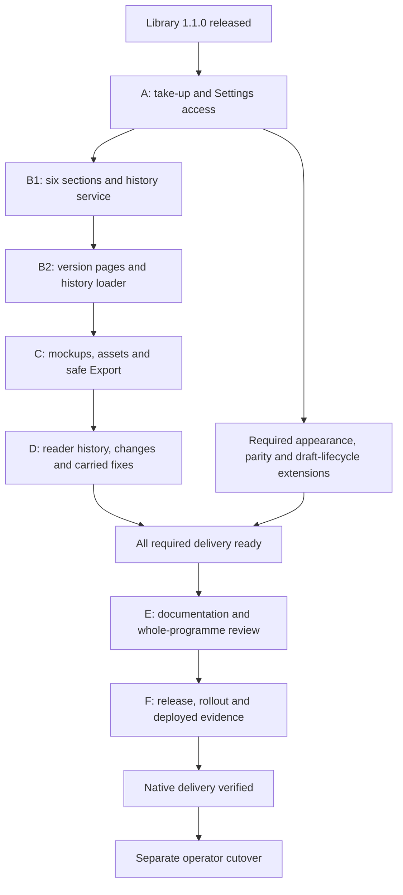
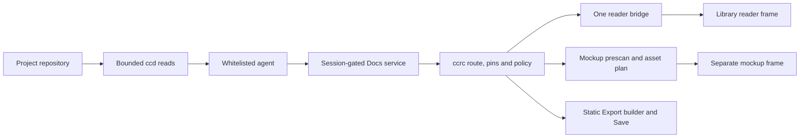

# Native Docs reader — finish the programme

## In short

Finish the existing Native Docs reader programme, rather than opening another programme or treating the library release as delivery. The existing A–F delivery line needs additional required appearance, parity and draft-lifecycle extension plans before final acceptance; it is not the complete scope without them. The original implementation sequence is: adopt the released library and make the diagnostic pages discoverable; deliver the two approved parity runs; implement mockups, assets and safe mockup Export; finish reader history and changes; reconcile the carried fixes; then document, independently review, release, roll out and measure the result.

**Completion means the released behaviour is verified on the installed build, not merely that a package, plan or PR exists.** Retirement of the old standalone server remains a separate operator-controlled cutover. Until that cutover is proved, both preview surfaces remain available.

**Status, 2026-11-07:** completion design and execution plan written for delivery under the operator's autonomy mandate. This is documentation, not a claim that the remaining code has shipped. Existing product approvals are preserved. The decomposition, new internal interfaces and conservative implementation limits below are coordinator calls, not newly attributed operator decisions.

## 1. The delivery line

The dependency line keeps each merge usable and puts the final documentation and release wave last.

*Figure 1. Delivery dependencies, not permission for overlapping workers. C/D remain serial; required appearance and parity/draft extensions need scoped plans after A and must converge before final E/F acceptance.*

| Wave | Existing identity | Deliverable | Entry gate |
|---|---|---|---|
| A | Run 1532, library 1.1 take-up | Exact 1.1.0 pin, approved one-bar phone reader, conservative draw, two Settings diagnostic links | Amended #2346 on main, its exact-tip checks and plan review accepted |
| B1 | W5b-1 | Six sections, skew handling, bounded per-doc history service, grant and doctor | A merged, amended #2350 on main |
| B2 | W5b-2 | `at` version pages, version-preserving body links, truthful Share and history loader | B1 merged |
| C | W6 | Sandboxed HTML mockups, one bounded asset planner, source/download and static mockup Export | B2 merged |
| D | W8b and reader/lab residue | Version menu, changes since, preferences/marks validation, reader and lab fixes | B2 and C merged, W5h-b already merged |
| Required extensions | Scoped follow-on leaf plans | Host appearance continuity; #1418 full parity plus #1420 draft-review lifecycle | Plan after A; reviewed implementation/evidence before final E/F acceptance |
| E | W7 | Final source/documentation parity, carried-item closure, whole-programme review | C/D and required extensions merged and verified |
| F | W7 release and evidence | Exact released build, installed inventory, browser/device evidence and closure receipt | E accepted, required checks and trusted full-suite green |
| Cutover | Existing retirement gate plus #1418/#1420 | Native preview convention, old proxy/forwarder/server retired safely | F verified, full parity plus draft lifecycle and side-by-side evidence, then operator explicitly acts |

One work run and one independent review run per delivery PR; the coordinator opens the successor before closing the predecessor. C may use two PRs, C1 safety/planner and C2 viewer/Export, at the task boundary in the execution plan. That split does not create a new programme. No overlapping Docs workers are dispatched.

## 2. What is already decided and what is actually measured

The source of truth is an explicit approval for product choices, shipped source for implementation facts, and fresh run/release measurements for state. Historical ledger entries remain audit records, not current instructions when superseded here.

| Fact or decision | Status | Consequence |
|---|---|---|
| `@synapsium-labs/docserver` 1.1.0, signed `v1.1.0` at `50cef012aa671974473d19c2acd77f900e9d03af` | Measured: published | No new signing or npm approval task |
| Release run `42245203228`, attempt 2, including post-verify | Measured: success | Attempt 1's reset-to-top failure was not bypassed; its cause remains unproven |
| Consumer on remote main `ebd95592b307912beda71a14662b21acf179b612` | Measured: still 1.0.0 | A is implementation work, not already complete |
| Take-up item 48 | Approved: every recommendation, Q1–Q3 | Every supplied E17 block must hold for after-ready; frame Aa only; title details contain actions |
| W5b item 50 | Approved: Q1 a, Q2 a, Q3 two runs | Keep `ref` beside `at`; body links retain version; B1 then B2 |
| Phone item 53 | Measured: two blocks received | Preserve both original blocks in the take-up plan |
| Phone block 1 | Measured: all-six gap 217 ms against 200 ms | Does not hold |
| Phone block 2 | Measured: all-six gap 192 ms against 200 ms | Holds, but does not erase block 1 |
| Combined take-up selection | Approved rule applied: `does-not-hold`, two blocks | Production stays on request |
| E18 | Measured: seven of seven walls hold within each block's stated coverage | Preserve limitations: iframe probe not measured, library half reports 0 of 1 attempted, no store.set or same-source-only listener exercise |
| Diagnostic door's session cookie | Expected | Not evidence that a frame received cookies |
| Run 1532 | Measured: planned, no worker | Do not describe planning as dispatched implementation |

The phone blocks name library build `0079625cc30a`, derived from the enhancement asset, not a Git commit. The 1.1.0 asset build is `6bcf14892e48`. Neither old block measures the new build or after-ready scheduling. The `auto` instrument is retained unchanged for comparability; it is **not a proved upper bound or equivalent measurement of after-ready**. A future switch must name its build, mode and measurement window and apply the existing all-blocks rule without discarding a failure. No new draw switch is required to finish this delivery: on-request is the accepted safe outcome.

## 3. Boundaries that do not move

**Required scope correction, 2026-11-10:** the operator's recorded 2026-10-25 ruling (#1418) keeps outside non-repo folders, variants, large files, PDFs and configured tracker links; #1420 adds private draft-review sharing with a lifecycle. R-b's dropped parity rows and R-e/RD21's mandatory Git conversion were reopened. Their detailed spec amendments, threat model, scoped implementation plans and side-by-side acceptance remain work, not completed by this envelope. Existing committed Share/Export do not supply the draft store. General hosted publishing is distinct. Do not relax current caps or expose live working trees to unauthenticated readers in place of a reviewed extension design.

**Required appearance continuity, 2026-11-10:** use the same canonical ccrc skin/theme choices and host-selected native visual language. These are requirements, not an approved appearance design. A remains exact 1.1.0 adoption; separately design/review the checked API, catalogue-sharing and compatibility mechanism before implementing the shared-renderer/consumer work. Live-following and hosted Aa ownership are coordinator defaults; reading-local settings remain separate. Both this work and full parity/draft lifecycle gate final E/F acceptance.

The console owns authenticated transport, provenance, path/ref decisions and privileged actions. The public library owns rendering, layout and its checked host protocol.

*Figure 2. Reader and mockup frames have different contracts. The reader uses the library's one checked channel; mockups have no parent message channel. Neither owns authenticated fetches or navigation.*

| Boundary | Required invariant |
|---|---|
| Library | Exact pin, integrity, npm signature and provenance checks; no vendored replacement or new import site of `./host` |
| Reader | `sandbox="allow-scripts"`, opaque origin, no ambient state, no parent window-message parser; all commands through `pwa/src/docs/reader/bridge.ts` |
| Shell | CSP meta remains exactly `frame-src 'none'`; no allow-same-origin, popup or top-navigation relaxation |
| State | Existing `ccrc:reader:v1:` prefix; per device, no migration of the old origin's state |
| Workers | Parse/render and highlighting remain separate; no main-thread highlight fallback |
| Transport | Existing bounded lane, auth, caps, pin/ref grammar and measured failures; additive wire changes only |
| Policy | Pure decisions in L1; delivery acts, adapters preserve distinctions; no overloaded null |
| Execution | Fixture HOMEs, closed exec surface, sequential bounded mutations, no new disk-heavy exercise |
| Review | Worker checks do not replace the separate exact-tip review run or merge queue |

The adopted bridge exposes the released `DocFrame.command`, not a second protocol. `HostAdapters.changes` returns `{ranges, removedAfter?} | null`; that null means changes unavailable. `openVersion` receives `{sha?, only?}`. The callback shape is copied at the adapter seam and type-tested against the installed release.

**Parity inventory reconciliation:** #1418's no-feature-loss promise is not limited to its five named examples. The required follow-on spec must inventory the standalone reader's capabilities against the native reader, including print and figure-overlay Back-to-close, and amend the rich-docs parity table before E closes. Those rows are not automatically waived by their older Later/Dropped labels. Old-origin state currently starts fresh under the rich-docs state contract; reconcile that recorded choice with the later no-feature-loss promise explicitly, without authorising migration here. Any genuine conflict requiring a product waiver goes to the operator before E/F acceptance. Keep the current sandbox/CSP and state boundaries until a reviewed design or explicit ruling resolves the seam; do not add allow-modals or claim a missing capability delivered.

**Recorded draft decision:** #1420's 2026-10-25 operator comment fixes a frozen snapshot at share time, with 'newer draft available' and re-share after later edits; no live reads through the link. Do not re-ask that choice. Capability-link versus signed-in access, reviewer comments, revocation storage/retention and hidden referenced assets still need the scoped threat model/design; the no-session acceptance criterion must be reconciled with the access model, not silently discarded. Raise only genuinely unresolved product choices when their design needs them. Comments, if adopted, never count as merge approval.

## 4. A and B: consume the release and finish parity

These use the detailed existing plans rather than replacing thousands of already reviewed task decisions.

### 4.1 Take-up and access

A executes the amended `2026-11-05-native-docs-reader-library-1-1-take-up.md`. It includes two diagnostic links after the five ordinary Settings sections: Reader lab at `/settings/reader-lab` and Measure highlighting at `/settings/measure-highlighting`. They are not new `SETTINGS_SECTIONS`, carry purpose text rather than fabricated status, use existing command doors, and preserve modified-click browser navigation.

The phone reader uses one host bar, Quick jump and Contents plus Outline for plans, frame Aa only, and details/actions behind the title. At 412 × 915 the title is at most 61 CSS px and the console portion no taller than 48 CSS px; tap targets keep the 44 px floor. Tablet/desktop baseline deltas stay within 1 px. Ready, fallback, plain Export and rotation keep reachable tools and truthful provenance.

Mermaid paths remain distinct: after-ready supplies a loader without pre-mount await; on-request retains the existing load/scan-drop path; the lab's `auto` path retains its window and drop report. The selected production arm is on-request. Tests exercise all three paths without claiming all three are the production selection.

### 4.2 W5b's two runs

B1 executes Tasks 1–13; B2 executes Tasks 14–22 of `2026-11-05-native-docs-reader-w5b-parity.md`. Four-section older fleets remain readable, unsupported capabilities perform zero execs, history stays bounded and redacted, and full 40/64 lowercase-hex `at` is the sole version page key. `ref` stays in the URL. Back to latest removes `at` and retains `ref`. Body links stay at the version; listing crumbs lead to latest as the approved plan specifies.

**The first rollout carrying B1 is server-first, even if its release tag also contains B2, C, D or E.** A later tag does not remove the skew hazard. Once both boxes run B1 or later, ordinary rollout ordering resumes.

## 5. C: mockups, assets and safe Export

W6 implements the base spec's §5.6–5.8 against the current reader/worker architecture. It does not reuse the reader's message channel or execute author HTML at the console origin.

| Area | Required outcome |
|---|---|
| Prescan | One linear raw scan before the sole `DOMParser` constructor; depth limit 256; measured formatting/tag limits; hostile reconstruction shapes refused before parsing |
| Render gate | HTML class cap 2 MiB; above 1 MiB requires a tap; refused input remains Source + Download, never Render anyway |
| Asset plan | At most 64 assets and 5 MiB reserved total before fetching; same-pin listing sizes or conservative class-cap reservations for historical assets, deterministic DOM/discovery order, concurrency 2, CSS recursion at most 3 |
| Pins | Commit C reads assets at C; admitted draft assets get draft pins, deleted/withheld/typechange never fall back silently; mutable latest/draft pin movement permits one relist/replan, then changing/failure with manual retry. An unavailable historical commit fails directly without relisting, as W5b specifies |
| Verdicts | Inline, kept, external, refused, missing, unsupported, skipped and failed stay distinguishable |
| Reader images | Consume the same pin/planner decisions and preserve the reader's stricter seed/image limits; a failed 401 is visible/retryable after sign-in, not permanently omitted |
| Script census | Bounded linear HTTPS-import-origin census of script text, no fetch/rewrite and no offer based on a truncated host |
| Frame | Static `sandbox=""`; scripted exactly `allow-scripts`; no src/name/allow/allowfullscreen and no MessageChannel or window-message listener |
| Policy | CSP meta first; click guard second; author document afterward; CSP attribute equals meta; second load tears down and notices, no automatic remount |
| Consent | Script and exact-origin choices reset each view; explicit confirm; no current host at any port, IP, localhost, wildcard or malformed origin |
| Viewer | Existing leaf truth, badges, Run/Stop, Load external, Fullscreen/New tab through a console shell, Source and original-byte Download |
| Source | One CodeBlock and one-block highlight store, plain first, never synchronous fallback highlighting |
| Export | Static planned-document snapshot; no scripts, author frames, active URLs, external-consent state, drawn output or script output retained |
| Save | Existing provenance wrapper and octet-stream Save; CSP-first inner frame with empty sandbox; download is not an active HTML blob at the app origin |

**Historical-size rule (coordinator call).** W5b supplies tip listings, not historical sizes. For a historical asset at C different from the listing commit, reserve its full existing class cap before any fetch; use a listed size only when tied to the exact admitted committed pin or draft fingerprint. Include CSS discoveries in the same 5 MiB reservation budget, never recycle unused reservations, and count duplicate pins once. The plan distinguishes `listed` from `class-cap`; actual returned bytes are counted separately and an overflow is failed, never inlined. Later assets may be conservatively skipped even when their actual sizes would fit: show that limitation instead of claiming they are too large. No historical metadata service is added. C1 explicitly amends the base spec's listed-size sentence and defines the issued departure before dispatch. The historical eligibility/listing limitation approved in W5b remains.

Baseline mockup CSP is `default-src 'none'; script-src 'unsafe-inline' data:; style-src 'unsafe-inline' data:; img-src data: blob:; font-src data:; media-src data: blob:; base-uri 'none'; form-action 'none'`. Confirmed HTTPS origins append only to script/style/img/font directives, never connect/default/worker/frame.

Export clones the already parsed inert document, rather than introducing another parser. It strips active elements and attributes, unwraps noscript, strips templates and SMIL href animation, neutralises CSS under the documented scanner limitations, and lists removed links and assets. Draft confirmation precedes the synchronous Save turn. Measure the escaped result against `DOCS_EXPORT_MAX_BYTES`; use placeholders in deterministic order. Refused input exports source text.

Bounded browser measurements choose formatting/tag limits such that the worst admitted deep and formatting parses each complete within 1000 ms. Depth stays 256. The implementer lowers safe limits rather than relaxing the gate. No repository-copy or disk-scale benchmark is authorised. Phone shared-thread evidence can select `mockup-scripts-confirm`; export/activation evidence can select the already specified `mockup-export-flat` or `export-share-file` contingencies. Failure to draw a CDN diagram never authorises widening CSP.

## 6. D: reader history and carried fixes

W8b completes the library's host adapters using B2's existing history and version support. It adds no git-diff verb, server diff endpoint, second renderer or message listener.

| Feature | Contract |
|---|---|
| Version seed | At most 100 commits, full hashes, subject cut to 200 code units, ISO date at most 64 characters, parents capped at 16; library frame validator remains authoritative |
| Version callback | `sha` opens `at`; absent sha returns to latest; retain ref; `only` is a full baseline hash in visit `history.state`, never a URL key. Admit history entry or parent hashes so the oldest day's parent remains usable |
| Changes | Read current and selected baseline through two committed `docs-show` pins; pure bounded client line diff keyed to rendered `data-line`; draft/unavailable/error returns unavailable |
| Diff bounds | Each input within existing Docs bytes plus a coordinator-chosen 20,000-line limit; combined 2,000,000 work-unit budget (line comparisons plus frontier advances/trace cells); at most 512 output ranges/removals; overflow means unavailable, never partial marks |
| State | Existing reader prefix, per-doc/device marks and last visit; no old-origin migration; unavailable local storage leaves reading usable |
| Lifecycle | Body replacement, fallback, abort and destroy cannot apply stale diff/history/navigation results to another document |
| Fragment | Post-mount fallback preserves the pending fragment; same-page filename links scroll to the intended anchor without needless refetch |
| Image | Overlong/refused seeds fall back predictably; image planner and auth retry improvements belong to C, not another silent exception |

Diff limits are conservative coordinator calls to bound synchronous work, not pre-existing product rulings. The algorithm is line-prefix/suffix trimming followed by budgeted Myers over the remaining lines, with explicit work accounting and no quadratic matrix. The execution plan fixes its types, results and mutation tests. No unbounded fallback algorithm runs on overflow.

The same wave fixes the known weak evidence controls: actual-library hidden-character copy, effective hash browser target, meta-only policy enforcement, stray-message negative controls and condition-based rather than fixed-delay observations. It closes the pure-policy runtime-import residue without widening the ring exception. Accepted highlighting-colour divergence is retained, not quietly called fixed.

## 7. Every carry has a destination

The execution plan's carry receipt is finite: one row for each group below, source anchor, measured current state, task, test/evidence and disposition. Historical completed work is not reopened just because an older paragraph says Later.

| Carry group | Owner and destination | Required disposition |
|---|---|---|
| W8a fragment, same-page link, seed fallback | D Task 13 | Reproduce, red/green fix or cite exact shipped guard and test |
| W8a copy/hash/meta-only/stray controls | D Task 13 | Browser evidence and independent mutation controls |
| W8a pure import, scan/comment/error-name/worker timeout residue | D Task 13 | Exact-source inspection and test-backed repair; no blanket scan allowance |
| Reader image 401 and planner residue | C Tasks 6–8 | Shared plan and visible retry after sign-in |
| RL-b scroll-before-append, busy-frame 0.8 guard | D Task 13 | Effective tests, two measured mutation rows, limitations preserved |
| RL-a comments/scanner/plan errata/minor tests | D Task 13 | Source-backed corrections and declared non-behavioural items |
| Header mutation counts, D-7958 wording, fallback-only retry, finding wording | D Task 13 and E Task 15 | Source-backed status, no fabricated prior red counts |
| Compression actual-config emptyOutDir and runner Node pin | E Task 15 | Current build-config guard and node-floor evidence |
| Compression both-order negotiator next-touch case | E Task 15 | Run both orderings if touched; otherwise retained accepted next-touch with named owner |
| Export direct assertions/rawquote/results and W5h-b text | E Task 15 | Verify later closure before marking closed; do not resurrect automatically |
| W3 generation map, key redaction, JSON parse, lowerAscii/prose | E Task 15 | Current-source test and disposition; bounded read/cache invariants retained |
| W2 two widening arms, four evasion spellings, docstrings/results | E Task 15 | Pin each allowance independently, not a global scanner exemption |
| W4 review 412 and nesting/parse/alias/hook/count/r10/r11/census residue | E Task 15 | Compare later fixes and accepted arms, test any surviving defect |
| Share cancelled-sheet notice | E Task 15 | Verify cancellation result/copy and test; no error on user cancellation |
| SEC-3 helper termination, SEC-4 stamps, post-fetch stamp, branch:null, partial clone and stripped-byte count | E Task 15, privately triaged first | Verify current code and historical rulings before public detail; confirmed reachable security defects block release |
| U5 security report and baseline headers | Coordinator, E/F | Privately verify owner/status; no premature public vulnerability detail and no unverified clean claim |
| Library C114 | Existing library programme | Missing mutation coverage and evidence corrections belong to first 1.1.x maintenance work; 1.1.0 CSS measured correct, no proved consumer defect or invented release dependency |
| Highlighting requests/colour divergences | Existing library owner; E receipt | Retain accepted divergence or cite actual fix; do not promise a new library implementation |
| Per-job highlight latency | Operator-deferred | Retain owner/next-touch trigger, not a new release blocker |
| Required appearance continuity | Required follow-on plan; E/F | Full host catalogue/skin inheritance and native visual language; no mode-only approximation or unreviewed protocol widening |
| #1418 full parity and #1420 draft lifecycle | Required follow-on spec/leaf plans; E/F and retirement | Outside non-repo folders, variants, large files, PDFs, configured tracker links and private draft-review lifecycle; actual side-by-side installed evidence |
| Print, figure-overlay Back-to-close and old-origin state | Required parity inventory/spec reconciliation; E/F | Older Later/Dropped rows are not waivers; preserve current sandbox/state boundaries until reviewed resolution, with operator ruling for a genuine product conflict |
| Other hosted publishing, bundle Export, fullscreen Share and XML colouring restoration | Existing explicit Later/Dropped decisions, excluding #1418/#1420 | Not delivered; the private draft-review store is required, not covered by general hosting deferral |

An unknown current state is not closure. E cannot finish with an unclassified row. A row is either fixed and tested, already fixed with exact evidence, explicitly accepted/deferred by an existing ruling with owner/trigger, or blocked and escalated. A coordinator cannot invent a product waiver to turn a confirmed defect green.

## 8. Review, release and evidence

The programme keeps its existing independent review and protected landing line. Autonomy removes redundant approval requests, not the gates.

Each delivery PR has test-first changes, measured guard mutations, complete changed-file privacy scans, exact-tip PR checks and an independent review run. The held-out panel is three Opus/high lenses: correctness, spec/boundaries, reproduction/evidence. Each critical/important finding gets three Sonnet/high refuters and majority adjudication; each minor gets one refuter and is advisory unless an existing gate makes it blocking. An empty/dead lens is unverified. Worker internal reviews are additional, never a substitute.

The final release requires a trusted full-suite on its exact released commit, including browser execution rather than a skipped check. PR selection and sampled check pages do not prove that. Read the complete check set and the newest run per suite. Queue landing binds the verified head, uses no admin/update-branch/force/rebase path, and is complete only when GitHub reports MERGED.

F records the release tag/commit/provenance, both measured installed versions and health, capability/doctor results, service-worker build, and a released-build acceptance matrix: six sections; ref/draft/auth behaviour; version/only/back-latest; changes and unavailable cases; settings/read marks/last visit; one-bar phone; Mermaid on request; Source/Download/Share/Export; static/scripted mockups and external confirmation. iOS browser/installed, Android file sharing and a desktop Firefox export case are named evidence rows, never inferred from Chromium CI. Old phone blocks remain historical evidence only. F also executes the plan Task 17 extension matrix on the final approved installed release set: both skins/all twelve palettes/system, outside non-repo roots, every kept variant, above-2-MiB files/ceiling cases, inline/download PDFs, configured tracker links, frozen draft snapshots/re-share and each lifecycle/access case. The complete standalone/native capability inventory includes print, figure-overlay Back-to-close and the explicitly resolved old-origin-state disposition; it is not limited to the five #1418 examples. Each row needs action/result/coverage/verdict and side-by-side evidence. Missing, failed, unresolved or mandatory-unmeasured rows block acceptance, not merely cutover.

The operator controls rollout and any reserved promotion/device action. The coordinator prepares exact actions, uses console items for genuine operator-only work, and continues every unblocked task. It never edits deployment infrastructure, moves project roots, signs tags, changes repository protection or impersonates a device check. Rollback uses the existing update mechanism and never restores raw standalone HTML at an authenticated app origin.

## 9. Handover and separate retirement

The programme has two explicit end states so neither code completion nor infrastructure cutover is misreported.

| End state | Evidence required |
|---|---|
| Native delivery verified | A–F plus required appearance/parity/draft extensions accepted and merged, #1418/#1420 child and side-by-side evidence complete, release/inventory and device/browser matrix measured, no unclassified or blocking carry, final ledger/handover committed |
| Standalone retired | Above plus operator cutover receipt below; old listener closed, native links verified by document content, history retained |

Retirement first requires full parity plus drafts and a side-by-side check finding nothing missing (#1418/#1420); unfinished children, unresolved capability/state dispositions or missing Task 17 installed comparison evidence block it. Order then remains: check the old denylist condition; perform only independently justified safe root moves while affected sessions are idle, preserving existing Git history and without forcing outside folders into Git; remove the old `/docs` proxy mapping on every PWA origin **first**; verify native content/ref/draft/auth rather than status 200; update the operator's preview convention while keeping durable GitHub links; stop the forwarder; stop the old docserver while retaining its directory/history; prove the old listener is closed. The coordinator does not perform those acts. No global instruction or dormant-server configuration edit is part of a feature PR.

The final report says either “native delivery verified; standalone retirement still awaiting the operator's cutover” or “native delivery verified and standalone retired”, with evidence. It never says the entire programme is complete while a mandatory retirement promise is still open.

## 10. Sources and execution

This design is an additive completion envelope. The original base spec §5.6–5.8 remains the mockup/export safety contract, with the historical-size reservation amendment in §5 made explicit by C1; the rich-docs spec supplies G1/G4/G5/G6/G7 and the retirement gate; the amended take-up and W5b plans retain their detailed task decisions. This design supersedes historical sequencing that put W7 before W8 and any claim that an `auto` block proves after-ready scheduling.

- Base: `2026-10-01-native-docs-reader-design.md`.
- Rich reader: `2026-10-12-rich-docs-reader-and-shared-renderer-design.md`.
- Lab: `2026-11-03-reader-lab-design.md`.
- A: `2026-11-05-native-docs-reader-library-1-1-take-up.md`, PR #2346.
- B: `2026-11-05-native-docs-reader-w5b-parity.md`, PR #2350.
- Execution: `../plans/2026-11-07-native-docs-reader-completion.md`.
- Durable programme state: `../programs/native-docs-reader.md` and the server's run records.

## Where things stand

### Agreed

- Complete the remaining delivery in this programme, in autonomy mode.
- Preserve the actual approvals and both phone blocks. On-request is the selected production draw.
- Reuse and amend the existing plans; do not ask for library signing, publication or answered choices again.
- Keep the security, review, queue and operator-only boundaries intact.

### Waiting on you

- The frozen-snapshot/re-share choice is already recorded, not a new question. Required follow-on designs still owe access-model/comment/security decisions and any genuine parity/state conflict; only operator-owned choices are raised as concrete console items when needed. Reserved rollout, device and retirement actions wait for their exact build and entry evidence. None of these unresolved extension choices expands or blocks disjoint A adoption work.

### Later

- Only the explicit accepted/deferred rows in §7, excluding required appearance continuity and #1418/#1420 parity/draft lifecycle. Standalone retirement is separately gated, not dropped. Any new request or defect outside this finite scope needs a recorded disposition rather than silent expansion.
