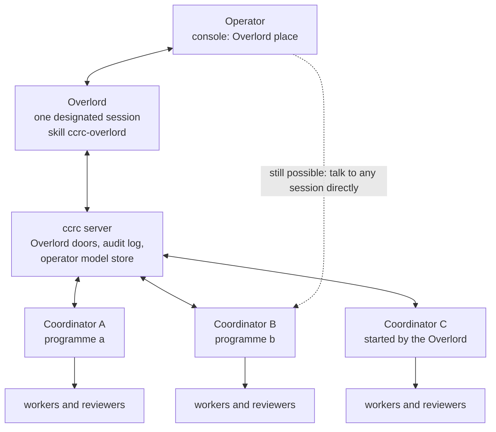
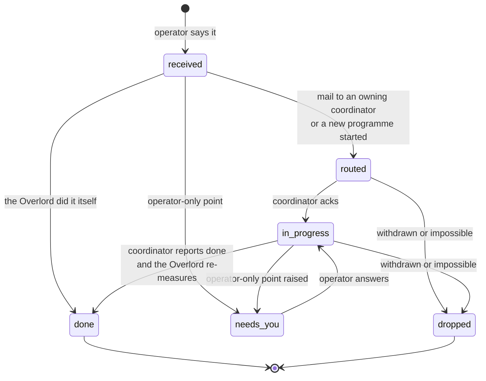
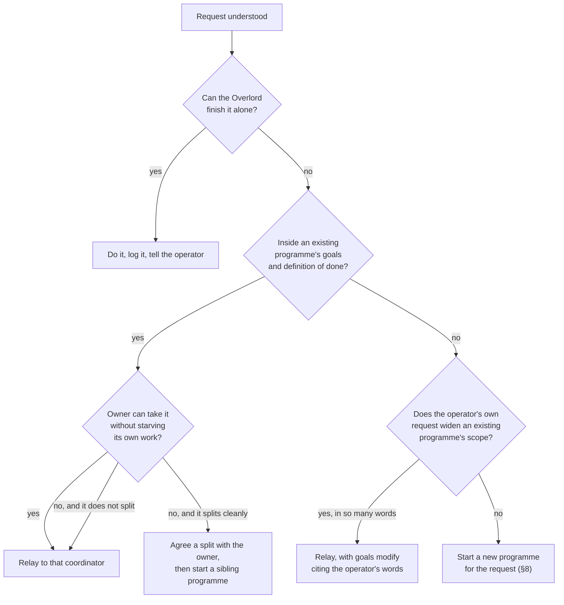
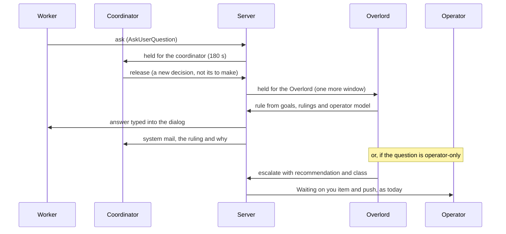
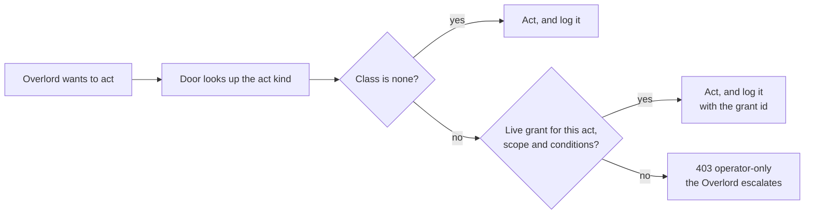
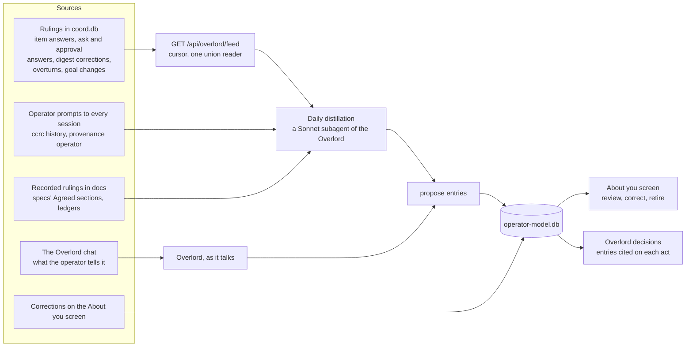
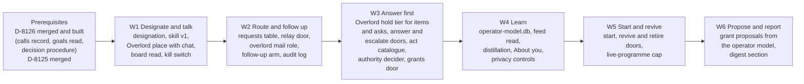

# The Overlord: one coordinator above every coordinator, that the operator talks to

**Spec** · 2026-11-09 · Status: Draft, rev 1 (a builder's check applied), for the operator's review · Programme: Overlord (slug `overlord`) · Owner:
the Overlord programme's coordinator · Issue: #2491 · Related: `docs/superpowers/specs/2026-11-09-coordinator-autonomy-default-design.md` (D-8126, PR #2487,
not yet merged), D-8125 (PR #2490, a coordinator lifts its own review cap),
`docs/superpowers/specs/2026-10-17-coordinator-first-routing-design.md` and its round 2,
`docs/superpowers/specs/2026-10-31-programme-ledgers-design.md` (Goals and Waiting on you),
`docs/superpowers/specs/2026-10-20-fleet-operations-maintenance-mode-and-programme--design.md` §4 (programme-aware
placement, #749), `docs/superpowers/specs/2026-11-04-runs-screen-rebuild-design.md` (D-8115), `ccd/coordinator-skill/`

This document defines no D-numbers. The programme's plan allocates them when its run opens. Rulings are numbered R1 to
R6 (the operator's) and the author's calls C1 to C35, so the operator can approve or overturn each one by number.

## In short

The Overlord is one long-lived fleet session that sits above every ccrc coordinator. The operator talks to it, and
mostly only to it. It routes each request to the coordinator that owns it, or starts a new coordinator and programme
when none fits. It follows the work up and reports back. It answers the coordinators' operator-bound questions itself,
from the programme's goals and from a private, operator-reviewed database of how the operator works. It raises only
what is truly the operator's.

**What is decided.** The operator ruled the ticket's six open questions on 2026-11-09 (R1 to R6, §2). This spec turns
each ruling into a design:
- **Authority.** Authority starts as D-8126's operator-only list, unchanged. It is relaxed one named act at a time
  through operator grants that the server enforces (§7).
- **Knowledge.** Knowledge of the operator is a private store on the server box. It is fed from rulings, from the
  operator's own prompts and from the Overlord chat. The operator reviews and corrects it on an "About you" screen
  (§9).
- **Questions.** Questions reach the Overlord before they reach the operator: one more tier on top of coordinator-first
  routing (§6).
- **Surface.** The surface is a new Overlord place in the console (§4).
- **Spawning.** The Overlord spawns coordinators through the operator's own doors, with six named extras (§8).
- **Audit.** Every act lands in one audit log. Each row is marked reversible, compensable or irreversible, and that
  mark comes from the act's kind and never from the Overlord's own say-so (§10).

**What changes.** The changes are:
- one new skill, `ccrc-overlord`;
- one designation row;
- three new coordination tables and one new private store;
- one new hold tier in the question lanes;
- Overlord doors beside the operator's doors;
- one console place;
- one new clause in the coordinator skill.

Everything extends an existing owner; §11 names each one.

**What you must check.** Check the author's calls (§13) and the questions in "Where things stand". This work builds on
D-8126, which is not merged yet: its calls record, its goals read and its decision procedure are prerequisites (§14).

## 1. Context

This section says why the Overlord exists and what it stands on.

### 1.1 The request

The operator's request (issue #2491, 2026-11-09), in short:
- One master coordinator above every coordinator. The operator talks to it, and it carries the operator's messages,
  ideas and wishes to the right coordinators.
- It **relays and routes**: it works out which programme a request belongs to, passes it on in that coordinator's terms,
  follows it up and reports back.
- It **spawns coordinators** when the existing ones are all busy or none fits.
- It **learns the operator**: habits, likes, how they work and how they decide.
- It **acts as the operator inside ccrc**, so most requests need no operator action at all.

Why: today the operator has to find the right coordinator, repeat the context, and answer the same kinds of question
many times. D-8126 measured the cost: over 14 days, coordinator waits on the operator came to more than 1,100 hours,
and about 72% of the long waits were questions the goals already answered. D-8126 makes each coordinator answer more of
its own questions. The Overlord answers most of the rest, and it turns many conversations into one.

### 1.2 What exists today (sourced from the tree at `f3559408e`)

| Piece | What it does today | Where |
|---|---|---|
| Coordinator role | A session is a programme's coordinator because it is `claimedBy` on a non-terminal run. No coordinator table exists. Nested coordinators are refused: `claimant-is-a-worker` | `CoordStore.programmeCoordinator`, `coord/openRun.ts` |
| Coordinator-first routing | A child's question or permission prompt is held for its run's claimant (180 s for asks, 60 s or 180 s for approvals). After that it is released to the operator, and a late answer still wins for asks. Escalation is single-hop | `coord/heldFor.ts`, `coord/questions.ts`, `askwindow.ts` |
| Waiting on you | The coordinator raises items with `items raise` (kinds `decide`, `do`, `value`, `secret`). Only the operator may `tick` or `dismiss`. A tick mails the coordinator in the same transaction | `coord/ledgersRoutes.ts`, `shared/ledgers.ts` |
| Goals | `goals pin`, `goals modify` and `goals merged` write the pin. The read, `GET /api/programmes/:slug/goals`, is session-gated. D-8126 §8.1 opens it to the box token and adds `doneWhen` | `ledgersStore.ts#goalsFor` |
| Operator's correction | `POST /api/digest/correct` queues system mail to a coordinator and marks the row corrected. D-8126 §6 extends it to big calls | `coord/digest.ts` |
| Mail | `POST /api/mail` takes the box token and attribution. Mail is idle-gated, and peer mail is capped at 3 outstanding per pair and 12 per hour. System senders (`operator`, `coordinator`) have no HTTP ingress, and `operator` is never a recipient | `coord/routes.ts`, `coord/rundefsTx.ts` |
| Spawning a coordinator | The operator's Start programme sheet composes `POST /api/sessions`, then `POST /api/sessions/:id/kickoff`. The new session opens its own run. Both routes are cookie-gated | `fleet/StartProgramSheet.tsx`, `coord/kickoff.ts` |
| Fleet reads | Box-token reads cover runs, peers, lifecycle, claims, asks, feed, mail, ledger and landing. `GET /api/fleet`, `/api/programmes`, `/api/waiting` and `/api/coord/caps` are cookie-only | `auth/gate.ts` |
| Operator history | `ccrc history` holds every session's text verbatim, tagged by provenance (`operator` for typed operator text), on the fleet box. Its read verbs are open to sessions, redacted on output | `ccd/history/lib.mjs` |
| An operator profile | None exists anywhere | measured by search, 2026-11-09 |

**Identity, measured.** All fleet sessions run as one UNIX user. Attribution (`id` plus a fresh `.uuid`) proves
freshness, not identity: the code says so, and so do D-8125 and D-8126 (their "Later" entries). The only strong operator
credential is the console's sign-in cookie. The Overlord's authority therefore rests on attribution, like a
coordinator's. §7.4 says what that allows and what it blocks.

## 2. The operator's rulings (2026-11-09), and what each one becomes

The rulings are settled; this spec only turns them into design.

| # | Ruling | What it becomes in this design |
|---|---|---|
| R1 | **Authority.** Start by inheriting D-8126's operator-only list unchanged: irreversible or outward-facing acts, spend beyond plan, goal and scope changes, credentials and access. Design it so the list can be relaxed step by step | An act catalogue that maps each act the Overlord could take to an O-class. The grants table starts empty, and the server refuses an operator-only act with no live grant. A grant names one act, a scope and conditions, and is revocable (§7) |
| R2 | **Knowledge of the operator.** A database distilled from everything about the operator: prompts, decisions, rulings, Waiting on you answers. Say how it is fed, reviewed, corrected and kept private | A private store on the server box with five feeds, a daily distillation, an "About you" review screen, stated-versus-inferred entries, and seven privacy rules (§9) |
| R3 | **Questions from coordinators.** The Overlord answers coordinators' operator-bound questions itself and raises only what is truly the operator's. No coordinator is ever stalled; every question is answered; work moves at speed | An Overlord tier in the question lanes. Items and released asks go to the Overlord first. Whatever falls in an O-class goes to the operator with the Overlord's recommendation. A lapse or a dead Overlord falls through to the operator at once, so the Overlord can never become the stall (§6) |
| R4 | **Surface.** Inside ccrc first and foremost. Mobile push, Telegram and Discord come later and are out of scope | A new Overlord place in the console: its chat, its open requests and its log. The existing web push stays exactly as it is. No new channel (§4) |
| R5 | **Spawning.** Think of it as the operator. It uses ccrc's own tooling the way the operator does, possibly with some extras. Spell out which extras, and why each one is needed | It uses the operator's doors through Overlord doors that log every act. Six extras (E1 to E6) are named with their reasons, and a list of what it explicitly does not get (§8) |
| R6 | **Audit.** A log of everything it relayed, decided and started. Not every item can be reversed, so the log marks which items can be overturned and which cannot | One table, `overlord_acts`, written in the same transaction as the act. Reversibility is derived from the act's kind. Overturns go through the one correction door (§10) |

## 3. What the Overlord is

The Overlord is an ordinary fleet session with a skill, a designation and a place in the console. Its durable state
lives on the server, not in its context window.

*Figure 1. The operator talks to the Overlord. The Overlord reaches coordinators only through the server's doors, so
every act it takes is checked and logged. The dotted edge shows that nothing stops the operator from talking to a
coordinator directly.*

- **C1. A session, not a server process.** The Overlord is a Claude Code session running the new `ccrc-overlord` skill.
  - What this reuses: the console's chat, `ccrc history`, compaction, account swaps, the hibernate lane and the mail
    lane, all as they are.
  - Rejected: an agent loop inside the server. It would be a second runtime with none of the fleet's tooling, and the
    server would start making judgements, which breaks "decide in L1, act in L4".
- **C2. One at a time, designated by the operator.** A single row, `overlord_designation`, holds the session id, when it
  was designated and the console device that did it. It binds the **session id**, not a `.uuid`: Claude Code rotates a
  session's uuid on every `/clear` and compaction (`_sync_uuid`), and a binding to the uuid would end the Overlord's
  powers at its first compaction. Each call proves freshness the usual way, by the registry's current uuid (C27).
  - Its one writer is a session-gated operator door: `POST /api/overlord/designate`, and `DELETE` to stand down.
  - Designating a new session ends the old one's powers in the same transaction.
  - "Start the Overlord" in the console composes the existing session-create door, then designates the new session.
    The operator picks the project. The default suggestion is a dedicated `overlord` project made by the add-project
    door, because the Overlord's own repository is nearly empty: its state is on the server.
- **C3. It spans the whole fleet.** It reads and routes across every project the server measures, not only its own.
  Mail and the Overlord doors already cross projects (the D-5530 cross-project ruling).
- **C4. It claims no runs.** The Overlord is not any programme's coordinator. That avoids `claimant-is-a-worker` and
  the one-level bracket rule, and it keeps one coordinator per programme (clause 8). It reaches coordinators through its
  own doors and mail.
  - **It is never hibernated.** A session with no runs, claims or mail is what the hibernate lane (`coord/hibernate.ts`)
    puts to sleep, and a sleeping Overlord would release every hold (C23). The lane's eligibility reads the designation
    and skips the designated session: one predicate, one extra rung. The idle-sleep lane gets the same rung. As a second
    line, a hold taken for the Overlord wakes it through the mail lane's wake budget, as mail wakes any hibernated
    recipient today.
- **C5. Its durable state is on the server.** That state is the requests (§5), the audit log (§10), the operator model
  (§9) and the designation.
  - A compaction, a restart or a swap loses nothing.
  - On start, and after any compaction, the skill reads `GET /api/overlord/board` (§5.2) and its open requests before
    doing anything else.
  - The roster card re-injects one line saying it is the Overlord, the way D-8126 §9.2 re-injects clause 21.
- **C6. Model.** It runs Opus at high effort, per the fleet's standing model policy: Opus orchestrates, and a
  credits-billed model is never chosen by a session (O2). Long reading goes to subagents that name their model:
  Sonnet for reading and distilling, Haiku for listing. Its own context stays free for routing and judgement.
- **C7. It obeys every brake the operator has.**
  - Under `coordinator-paused` it starts nothing and dispatches nothing, though it still answers and relays.
  - Under `mail-disabled` it sends nothing.
  - A new kill switch, `overlord-disabled`, is a Settings row and a file. While it is set, every Overlord door refuses
    and routing reverts to today's.
  - The Overlord never sets or clears any of these.

## 4. Where the operator talks to it

R4 puts the surface inside the console. The console gains one place.

- **C8. An Overlord place, first in the navigation** (`PLACES` in `pwa/src/lib/places.ts`), on the phone bar and the
  desk bar. The Fleet screen stays the console's home (Q1 asks whether the operator would rather the Overlord *be* the
  home). The place has three parts:
  - **Chat.** The Overlord session's own conversation, drawn by the existing chat column (`ChatList`, `Composer`) on its
    session id. Typing to the Overlord is typing to that session, exactly as today.
  - **Requests.** The open requests (§5), each with its state, its target programmes, its last news and its age. A
    request that waits on the operator is marked and sorted first.
  - **Log.** The audit log (§10): the newest acts first, filterable by kind, by programme and by reversibility, each row
    with its Overturn control where one exists.
- **Waiting on you stays where it is.** It now shows only what the Overlord escalated, or what fell through to the
  operator (§6.4). Each escalated item carries the Overlord's recommendation and its reason for raising it ("O3: this
  changes the definition of done").
- **No new notification channel.** Escalated items push exactly as items push today, through `notify` and the existing
  web push. Telegram, Discord and a mobile app are out of scope (R4).
- **The Overlord answers in the operator's style.** It leads with the outcome and keeps it short. What it learns about
  how the operator likes to be told things is ordinary operator-model content (§9).

## 5. Requests: routing and follow-up

A request is one thing the operator asked the Overlord for. It is tracked from the moment it is understood until the
operator has been told it is done, or that it was dropped.

### 5.1 The request record

- **C9. One table, `overlord_requests`, written only through Overlord doors.** Its columns:
  - `id`;
  - `said` (the operator's words, redacted and capped);
  - `summary` (the Overlord's one line);
  - `state`;
  - `targets` (programme slugs and session ids);
  - `openedAt`;
  - `lastNewsAt`;
  - `followUpAt`;
  - `closedAt`;
  - `closeNote`.
- **States:** `received → routed → in-progress → done`. The side states are:
  - `needs-you`: it waits on an operator-only point, raised as an item;
  - `dropped`: the operator withdrew it, or the Overlord could not do it and said why.
- **Transitions:** one decider in L1, `nextRequestState`, in the style of `nextItemState`.

*Figure 2. A request's life. "Done" needs the Overlord's own re-measurement, the same discipline a coordinator applies
to a wave-done claim. A request the Overlord can finish alone (a question about the fleet, a setting it may change)
goes straight to done.*

### 5.2 The board: what the Overlord reads to route

- **C10. One read, `GET /api/overlord/board`,** gated by the box token plus the designated Overlord's attribution. It
  answers, per programme:
  - slug, title and home project;
  - coordinator id and its live word (`idle`, `busy`, `shell`, `dead`);
  - goals "In short" and `doneWhen` (D-8126 §8.1);
  - open runs by state, with active runs counted as the cap counts them;
  - time of last movement (the runs rebuild's reader);
  - open items and stalls;
  - the Overlord requests it carries.

  It also answers the fleet's caps and their use, and the projects list. Every part comes from an existing reader
  (`programmesRead`, `goalsFor`, `capsUsage`, the fleet read model). The board composes them and decides nothing.

### 5.3 How a request is routed

The routing is the Overlord's judgement, written as a procedure in the skill (`references/routing.md`). The server
supplies the board and enforces the doors.

*Figure 3. How a request finds its owner. A programme whose goals cover the work keeps it, even when it is busy:
two coordinators on one goal would conflict. A new programme is the answer when nothing covers the work, because the
operator's own request authorises starting it.*

- **C11. A busy owner keeps its work.** "All busy" (R5) starts a new coordinator only when the work splits cleanly from
  the owner's, and only after the owner agrees by mail. Otherwise the request queues with the owner, and the Overlord
  tells the operator the expected wait.
- **C12. The operator's request is the operator's ruling.** Starting a new programme and widening a programme's scope
  are both O3 in D-8126. When the operator *asks* for the work, that request is the O3 decision: the Overlord carries it
  out and cites it. The Overlord never starts a programme, or widens one, that the operator did not ask for. That stays
  O3 until a grant says otherwise (§7).
- **C13. A relay carries the operator's words verbatim.** It is system mail `fromId:'overlord'` (a new system sender
  beside `operator` and `coordinator`), sent through an Overlord door, so peer-mail quotas do not apply. Its body has
  two fenced parts:
  - **The operator said.** The verbatim quote. A coordinator treats this part as an operator steer, exactly as it treats
    an item answer today.
  - **The Overlord adds.** Context, the programme mapping and a recommendation. This part is a call, not a ruling: the
    coordinator weighs it, may push back by mail, and never cites it as an operator ruling (D-8126 A7).

### 5.4 Follow-up

- **C14. Coordinators report to the Overlord.** A relayed request names its request id. The coordinator replies
  `toId:'overlord'`, a new role address that resolves to the designated session. It sends an ack, then the progress that
  matters, then done. The coordinator skill gains clause 22 for this (§11.4).
- **C15. The server nudges, the Overlord acts.** Each request carries `followUpAt`, which the Overlord sets when it
  routes. A new arm of the stall watch mails the Overlord `follow-up: request <n>` when `followUpAt` passes with no news
  from the target. The Overlord then reads the target programme's state and acts once: a mail, a revival (E5), or a
  note to the operator. A follow-up is never a poll loop (clause 7's rule, applied to the Overlord).
- **C16. Reporting back.** The Overlord tells the operator when a request is done, dropped or needs them, in its chat
  and on the Requests list. Other progress is shown on the list and never pushed. How much detail the operator wants is
  learned (§9).

## 6. Questions: the Overlord answers first

R3: no coordinator is ever stalled, every question is answered, and work moves at speed. This section adds one tier on
top of coordinator-first routing.

### 6.1 What reaches the Overlord first

| Channel | Today | With the Overlord (C17) |
|---|---|---|
| Waiting on you items raised by a coordinator (clause 20) | Straight to the operator's list; a blocking item pushes | Held for the Overlord first. It answers, escalates or lets it lapse (§6.3). `secret` items never hold: a secret is O4 and never reaches a session |
| A child's ask the coordinator released, or one that lapsed | Pushed to the operator | Held for the Overlord for one more window, then to the operator. A late answer still wins |
| A root session's own ask (a coordinator's AskUserQuestion dialog) | Pushed to the operator | Held for the Overlord. D-8126 proposes forbidding these dialogs on a pinned programme (its R7, awaiting the operator), so they should be rare |
| A coordinator's question-ending turn | Waits for the operator to type | Clause 20 already says to raise it as an item, so it takes the item row above |
| A child's permission prompt (approvals) | Coordinator first, then the operator | **Unchanged in this programme.** A 60 s main-thread window leaves no room for a second hop, and widening an allow beyond `ordinary` would change the signer and the hook's verifier. Later (see "Later") |
| A `forbidden`-class prompt | Straight to the operator | Unchanged: forbidden acts are O1 by definition |
| A review-cap ask | Operator's ask, pushed | Gone for coordinators once D-8125 lands. Where D-8125 refuses `coord-lift-off`, the operator switched coordinator lifts off, so it stays the operator's |

**How the holds are kept** (C31). These are two mechanisms, because today there are two kinds of row, and each one
extends its own owner:
- **Asks.** The hold decision lives in `coord/questions.ts`, which mints a row `held` for the claimant `heldFor` (in
  `coord/heldFor.ts`) names, or `released` with a reason. `heldFor` answers only for a child today, and a coordinator's
  own ask comes back `not-a-child`. It gains an Overlord tier: a root session's ask, or a row a coordinator released or
  let lapse, is held for the designated Overlord. The tier is one new answer of the same decider, `held-for-overlord`,
  read by the same mint and release code, and the `asks` row's `parentId` names the Overlord. This is not a second hold
  mechanism.
- **Items.** Items have no hold at all (`ITEM_TRANSITIONS`, `shared/ledgers.ts`), so this part *is* new. It is
  recorded as such, because no existing owner covers it. `operator_items` gains one nullable column, `overlordUntil`.
  - Raising an item sets the column when the Overlord is live and the item is not `secret`.
  - `GET /api/waiting` leaves out an open item whose `overlordUntil` is in the future, through one predicate,
    `itemReachesOperator`, which the push for a blocking item reads too.
  - The Overlord's answer moves the item through the existing decider, and its escalation clears the column.
  - No item state is added: an item held for the Overlord is `open`, and simply not yet the operator's to see.

### 6.2 The flow

*Figure 4. One more hop. A question the coordinator cannot settle goes to the Overlord before the operator. The
Overlord either rules or escalates with a recommendation. The operator sees only what the Overlord escalates, or what
lapses.*

### 6.3 How the Overlord decides

- **C18. The same procedure as D-8126 §5, with one more source.** The order is:
  1. Is it O1 to O6 (§7)? If so, escalate, unless a live grant covers the exact act.
  2. Read the programme's goals, `doneWhen`, ledger and recorded rulings.
  3. Read the operator model: entries scoped to this programme, then its project, then the fleet.
  4. Decide, record and continue.

  Doubt resolves towards the operator only for O1 to O6, never for "is this big or routine?".
- **C19. An Overlord answer is a call, not a ruling, unless a grant stands behind it.** It is recorded as an `answer`
  act (§10), and the coordinator receives it as system mail from `overlord`. The coordinator acts on it and records it.
  The operator can overturn it.
  - **Without a grant**, a coordinator never cites it as an operator ruling on an O-class matter (D-8126 A7).
  - **With a grant**, the grant *is* the operator's standing ruling for that act and scope. The answer mail names it
    (`grant 7`), and the coordinator cites the grant, not the Overlord, wherever D-8126 needs an operator ruling: a
    change to `doneWhen` or scope, or a spec approval. Without this, the O3 grants in §7.1 would have nothing they could
    change.
  - The Overlord signs as itself: it never writes as the operator, and nothing it sends is attributed `operator`.
- **C20. Escalation carries the work.** An escalated item reaches the operator with:
  - the Overlord's recommendation and why it beats each alternative (clause 20's D24 rule);
  - the O-class that makes it the operator's;
  - the operator-model entries it weighed, as links.

  The operator's answer then mails the coordinator as a tick does today. The Overlord also sees the answer and learns
  from it (§9.1).
- **C21. Items carry an O-class.** `items raise` gains an optional `operatorClass` (`O1` to `O6`). A coordinator sets it
  when D-8126's procedure classed the question operator-only.
  - The Overlord door refuses to answer an item whose class has no live grant (`operator-only`), so a mistaken Overlord
    cannot tick it.
  - The Overlord may raise an item's class, but never lower one. A wrong lowering would be a silent widening of its own
    authority.

### 6.4 Never the stall

- **C22. Windows, then fall-through.**
  - Items hold for the Overlord for at most 20 minutes (`OVERLORD_ITEM_HOLD_MS`).
  - Asks hold for one more `ASK_GRACE_MS` (180 s).
  - Then the row reaches the operator exactly as it does today, marked "the Overlord has not looked". A late Overlord
    answer to an ask still wins, as D-5289 rules for coordinators.
- **C23. A missing Overlord releases at once.** No hold is taken when the Overlord is not designated, not live
  (archived, stopped, measured dead, or hibernated and not woken within one wake-budget slot), or switched off. The row is minted `released` with the
  reason `overlord-not-live`, the predicate the dead-coordinator sweep uses. A dead Overlord also raises one operator
  push with a **Restart the Overlord** control (a re-kickoff of the same session id, `references/resume.md`'s path).
- **C24. A busy Overlord is a fault to fix, not a reason to wait.** The skill keeps the Overlord's turns short. Reading
  goes to background subagents, and the mail gate delivers on `shell`. The measure M3 (§12) watches hold lapses. If
  lapses run above 10% a week, the plan adds an Overlord-only delivery mode, not a longer window.

### 6.5 What it answers on day one

Once D-8126 is in force, a coordinator raises an item only for O1 to O6. The grants table starts empty (R1), and the
Overlord never lowers a class. So most items the Overlord sees on day one are the operator's, and the Overlord
escalates them. That is still worth having, for four reasons:
- **It catches over-asking.** Items a coordinator raised without needing to, by the C21 class test, are answered and
  sent back with the goal that answers them. Lapsed child asks and coordinators' own dialogs are answered the same way.
- **It does the operator's homework.** An escalation carries the recommendation, the class and the evidence (C20), so
  the operator's answer is one tap.
- **It ends stalls.** Revival, follow-up and routing (§5, E5) need no grant at all.
- **The grants door ships with the answering wave (W3, §14).** The operator can make the first relaxations as soon as
  the shadow week shows how the Overlord would have answered.

M1 (§12) is measured against that reality. It counts what reaches the operator *as a question they must think about*,
so an item that arrives with a recommendation the operator accepts unchanged counts as half.

## 7. Authority: the operator-only list, and how it relaxes

R1: start with D-8126's list, unchanged, and build it so it can be relaxed step by step.

### 7.1 The act catalogue

- **C25. Every act the Overlord can take is a row in one L0 table, `OVERLORD_ACT_KINDS` (`shared/overlord.ts`).** Each
  row gives:
  - the act's id;
  - its O-class, or `none`;
  - its reversibility (§10.1);
  - the server door that performs it;
  - whether a grant may ever cover it.

  The server and the console both read this table, and the single-definition guard pins it.

| Act kind | What it does | Class | Reversibility | Grantable |
|---|---|---|---|---|
| `relay` | Mail a coordinator the operator's request | none | compensable | not needed |
| `answer-item` | Answer a Waiting on you item | none, or the item's class | reversible | yes, per class, never for O2 or O4 |
| `answer-ask` | Answer a released or root ask | none | reversible | not needed |
| `escalate` | Send an item or ask on to the operator | none | reversible | not needed |
| `start-programme` | Start a coordinator for an operator request | none when requested; O3 otherwise | compensable | yes (unrequested starts) |
| `revive-coordinator` | Re-kick a dead coordinator, or reclaim its runs for a successor | none | compensable | not needed |
| `retire-coordinator` | Archive a finished coordinator it started | none | compensable | not needed |
| `approve-spec` | Tick an O3 "approve the spec" item | O3 | reversible until the plan dispatches | yes |
| `approve-dod` | Tick an O3 definition-of-done item | O3 | reversible | yes |
| `widen-scope` | Change a programme's scope beyond the operator's words | O3 | reversible | yes |
| `message-people` | Comment where people other than the operator take part | O1 or none, as D-8126 §15 Q3 is answered | irreversible | yes, after §7.4 |
| `publish` | Make something public, cut a release, promote to stable | O1 | irreversible | yes, after §7.4 |
| `deploy` | Roll the fleet | O1 | compensable | yes, after §7.4 |
| `spend` | Credits, paid services, new accounts | O2 | irreversible | no |
| `secret-or-access` | Secrets, sign-ins, repository settings, people's access | O4 | irreversible | no |

*The table is the first cut. The plan's wave 1 completes it from D-8126 §3 and the SAFETY list. An act missing from it
cannot be performed by any Overlord door.*

### 7.2 Grants: how the list relaxes

- **C26. A grant is one row in `overlord_grants`:**
  - `id`;
  - `act` (one act kind);
  - `scope` (`fleet`, `project:
` or `programme:<slug>`);
  - `conditions` (a small closed vocabulary: `reversible-only`, `max-per-day:<n>`, `only-when-recommended-by-coordinator`);
  - `grantedAt`;
  - `expiresAt` (optional);
  - `revokedAt`;
  - `note`.

  Its only writer is a session-gated operator door with a step-up, as the secret door has today:
  `POST /api/overlord/grants`, and `DELETE` to revoke. A revocation takes effect on the next door call.
- **The server enforces it.** Every Overlord door runs one L1 decider, `overlordMayAct(act, target, grants, now)`.
  - It answers `allow`, `allow-by-grant:<id>` or `operator-only`.
  - An `operator-only` answer is a 403 with the class named, and the door writes no act row.
  - The grant id, when one was used, is written on the act row (§10), so the operator can see what each grant was used
    for.
- **The Overlord may propose a grant, never take one.** When the operator model shows a steady pattern ("approved 12 of
  12 wave plans unchanged"), the Overlord raises a `decide` item proposing a narrow grant, with the evidence attached.
  Relaxing the list is always the operator's tap. Both the ruling and O4 say so.
- **What relaxing looks like** (an example, not a plan). First `approve-dod` for programmes the operator started. Then
  `start-programme` for follow-up work inside a project. Much later, `publish` for dev-channel prereleases. Each step is
  one grant the operator can revoke.

*Figure 5. Every Overlord door asks one decider. The grants table starts empty, so on day one the Overlord holds
exactly the authority D-8126 gives a coordinator, plus the extras of §8, and nothing on the operator-only list.*

### 7.3 What never relaxes

- The SAFETY list in `CLAUDE.md`. The Overlord is a session, so every verb forbidden to sessions is forbidden to it.
  A grant cannot name one, because no act kind maps to one.
- O2 (spend) and O4 (secrets, access, credentials): `Grantable` is "no". The operator ruled spend and credentials as
  theirs. A grant door that could hand them out would turn a brake into a setting.
- The operator's brakes (C7): pause, mail-disabled and the Overlord's own kill switch.

### 7.4 Identity, and why irreversible grants wait

- **C27. Version 1 rests on attribution, like a coordinator.** An Overlord door checks the box token, then that the
  caller's `id` is the one `overlord_designation` names and its `.uuid` is that session's current one (today's attribution). No new secret is minted: all sessions share one UNIX user, so
  a second token on the same disk would buy nothing over attribution. That is the reason D-282 gives for the ungated
  doors. Attribution stops accidents, such as a coordinator calling an Overlord verb, because the client fills in the
  caller's own pane id. It does not stop a hostile session that forges its id.
- **So irreversible acts cannot be granted yet.** The grant door refuses a grant whose act is `irreversible` or `deploy`
  with `identity-too-weak`. That refusal lifts only when a server-signed session identity exists, the item already in
  D-8125's and D-8126's "Later". The first time the operator asks for an irreversible grant, that request is the trigger
  to build it.
- **The blast radius of a forged Overlord in version 1** is what a forged coordinator can do today, plus the reversible
  and compensable acts in §7.1. Every one of those is logged and overturnable.

## 8. Spawning, and the extras

R5: the Overlord acts as the operator would, through ccrc's own tooling, with named extras. An extra is any power a
coordinator does not have today.

### 8.1 The extras

| # | Extra | Why it is needed | How (an Overlord door unless said otherwise) |
|---|---|---|---|
| E1 | **Read the whole board**: every programme's goals, runs, items, stalls and live words, plus the fleet's caps | Routing (§5.3) and follow-up need the cross-programme picture. Today `/api/programmes`, `/api/waiting`, `/api/fleet` and `/api/coord/caps` are cookie-only, and a coordinator sees only its own | `GET /api/overlord/board` (§5.2), composed from the existing readers |
| E2 | **Answer operator-bound questions in the operator's stead**, within §7 | R3. Today only the operator may tick an item, and only a run's claimant may answer an ask | `POST /api/overlord/items/:id/answer` runs the tick decider with actor `overlord`. `POST /api/overlord/questions/:id/rule` and `/escalate` admit the Overlord for rows held for it |
| E3 | **Mail any coordinator as the operator's relay**, as system mail `fromId:'overlord'`, and be addressable as `toId:'overlord'` | Relaying is the core job. Peer quotas (3 outstanding, 12 an hour) would throttle a fleet-wide relay, and a coordinator must be able to tell the operator's words from a peer's | `POST /api/overlord/relay` writes the mail and the act row in one transaction |
| E4 | **Start a coordinator**: create a session in any project and queue its kickoff | R5's spawning. The operator's doors (`POST /api/sessions`, `POST /api/projects/:project/workspaces`, `POST /api/sessions/:id/kickoff`) are cookie-gated | `POST /api/overlord/programmes` composes the same server functions behind the authority decider, the caps and the pool rules, and returns the new session id. Details in §8.2 (C32, C33) |
| E5 | **Revive a dead or stalled coordinator**: re-kick it, or reclaim its runs for a successor it starts | "No coordinator is ever stalled." Today the reclaim and re-kickoff doors are the operator's | `POST /api/overlord/coordinators/:id/revive` uses the reclaim door's own re-measurement (it refuses unless the claimant measures dead) and `ProgramKickoffResume` |
| E6 | **Retire a coordinator it started**, once its programme's runs are all closed and it has been idle 24 h | Without this, Overlord-started sessions pile up | `POST /api/overlord/coordinators/:id/retire` uses the archive door's `{programme:'end'}` path. Only for sessions whose `start-programme` act row names it; others get a suggestion item |

**What it does not get** (each stays the operator's, by R1 and the SAFETY rules):
- Settings switches;
- pause and unpause;
- caps;
- the update control plane;
- token rotation;
- claim breaks;
- accounts, secrets and sign-ins;
- every `ccd` verb on the SAFETY list;
- merges by any route other than clause 15's (the Overlord lands nothing itself: coordinators land their own PRs);
- repository settings;
- any act in §7.1 whose class has no live grant.

### 8.2 Limits on what it starts

- **C28. Caps.** Every start counts against the fleet's existing limits: the dispatch cap, the memory-headroom
  admission, the pools and ccd's placement.
  - On top of those, a new Setting `overlordLiveProgrammes` caps how many live programmes the Overlord itself started
    (default 3, range 0 to 12; 0 means it may never start one).
  - Over the cap, the start door refuses `overlord-cap`. The Overlord then queues the request with a reason and tells the
    operator.
  - Starting never spends beyond plan (O2): no credits-billed model, and no new account.
- **C32. Which account.** `POST /api/sessions` needs a `wrapper`, and today the Start programme sheet works it out in
  the browser (`startProgramPlacement`). That policy moves to one L1 home that both the sheet and the Overlord's start
  door read (consolidation: one decider, two callers). The door takes no wrapper from the Overlord.
  - It picks the account the same way the sheet would: the project's pool, then the least-loaded lane the server
    forecasts, at parity with `ccd`'s own walk (`projectHome`).
  - It only ever chooses among the accounts already on the roster, under their plans. That is not spend (O2) and not
    access (O4).
  - `ccd` still places, and still refuses what its pool rule refuses. When programme-aware placement (#749) lands, its
    `--programme` marker comes for free.
- **C33. A named workspace, not a main checkout.** A session id is `<wrapper>-<project>`, so a second coordinator in a
  project whose main checkout already coordinates something would collide with it. The start door therefore always
  creates a **named workspace** (`POST /api/projects/:project/workspaces`'s server function, named after the programme
  slug) and never starts a main checkout.
- **C34. The kickoff says who sent it.** `coord/kickoff.ts` sends the kickoff as system mail `fromId:'operator'` from a
  fixed template (`programKickoffVerdict`). The start door would then tell the new coordinator that the operator wrote
  to it, which breaks C19 and A2. So the kickoff gains a third template, `overlordKickoff`, sent `fromId:'overlord'`.
  It carries the slug, the title and the request id, plus the operator's words verbatim in a fenced block. The words
  are cut whole to fit the mail cap (8 KiB), and the full text stays readable on the request row. The re-kickoff for a
  revived coordinator (E5) uses the existing `ProgramKickoffResume`, also sent as `overlord`.
- **A new programme's first hours.** The start door queues a kickoff that names the operator's request (verbatim), its
  request id and its slug. The new coordinator brainstorms with the Overlord as its source: the Overlord answers what
  the operator model and the request answer. It raises the operator-only rest, which by D-8126 always includes "approve
  the spec" (O3), as items with recommendations. This is exactly how this programme's own brainstorm was run.

## 9. Knowledge of the operator

R2: a database distilled from everything about the operator. This section covers what it holds, how it is fed, how
the operator reviews and corrects it, and how it stays private.

### 9.1 What it holds

- **C29. A private store, `operator-model.db`, on the server box.** It is a separate SQLite file beside `coord.db`, not
  tables inside it. Wiping, exporting and backing it up are then the operator's alone, and a `coord.db` snapshot shared
  for debugging never carries it. The tables:
  - **`entries`**, with these columns:
    - `id`;
    - `kind`: `preference`, `ruling`, `habit`, `dislike`, `fact` or `style`;
    - `scope`: `fleet`, `project:
` or `programme:<slug>`;
    - `statement` (at most 500 characters, plain words);
    - `basis`: `stated` (the operator said it, or ruled it) or `inferred`;
    - `confidence`;
    - `share`: `ccrc` or `overlord-only`, see §9.4;
    - `status`: `active`, `retired` or `superseded`;
    - `sources` (references, see below);
    - `createdAt`, `updatedAt`;
    - `lastUsedAt`, `useCount`.
  - **`entry_events`**: every change, with its actor (`overlord` or `operator`) and a note. This is the entries' journal.
  - **`cursors`**: one per feed, so each source is read once.
  - The store has its own `user_version` migrations and refuses to start rather than open empty, the `coord.db` rule.
- **Sources are references, not copies.** A source is an id such as `item:412`, `ask:9021`, `correction:77`,
  `act:1503`, `chat:<message id>` or `history:<node id>`. Each carries at most a 280-character quote. The store never
  becomes a second copy of the transcripts.
- **How it is used.** `GET /api/overlord/model?scope=&q=` returns the ranked entries: stated before inferred, the
  narrower scope before the wider, the recent before the old. Ranking uses FTS5 on `statement`. The Overlord cites the
  entry ids it weighed on every act row.

### 9.2 How it is fed

*Figure 6. Five feeds, one store. Rulings come through one server-side union reader. The operator's prompts to other
sessions come through `ccrc history`'s read verbs on the fleet box. The chat and the operator's own corrections feed
it directly.*

- **Rulings** (S1) come through `GET /api/overlord/feed?after=<cursor>`. This is one union reader over the existing
  durable tables: `asks` and `approvals` rows the operator answered, `operator_items` with their answers and
  `operator_item_events`, digest corrections, act overturns (§10), `programme_modifications` and `run_events` caused by
  the operator. It adds no writer. Settings switches keep no history today, so changes to them are not a source until
  they do (Later).
- **The chat** (S2): when the operator states a preference, a rule or a correction, the Overlord records it at once as a
  `stated` entry. "Remember …" and "forget …" are plain requests to it.
- **Prompts to every session** (S3). R2 says "everything", but the history store's own ruling says "across projects:
  never" (`2026-10-05-ccrc-history-lossless-dag-design.md`). `decideScope` in `ccd/history/lib.mjs` refuses a
  cross-project read as `cross-project`. The two rulings conflict, so **this feed waits on the operator (Q2)**. The
  recommended arm keeps the history ruling intact for every session:
  - A new read-only agent op on the fleet box, `history-operator-prompts`, returns only rows of provenance `operator`
    since a cursor, redacted by the history store's own output belt. It returns no model, tool or harness text.
  - It is reached only through the server's `GET /api/overlord/feed`, for the Overlord alone. No session gains a
    cross-project history read, the Overlord included: the Overlord reads the operator's words, never another
    project's work.
  - Every entry it yields is `overlord-only` (§9.4), and the operator can switch any project off as a source.
  - Until Q2 is answered, S3 is off, and the store is fed from S1, S2, S4 and S5.
- **Recorded rulings in documents** (S4): the specs' "Agreed" sections and the programme ledgers, where the operator's
  rulings are quoted with dates.
- **Distillation runs daily**, as a background Sonnet subagent of the Overlord. It runs under the Overlord's own
  attribution, so no other session can write the store.
  - It reads each feed from its cursor and proposes entries.
  - It checks each new entry against the existing and retired entries, so a retired entry is not proposed again.
  - It writes everything as `inferred` except rulings and the operator's own words, which are `stated`.

### 9.3 How the operator reviews and corrects it

- **An "About you" screen** in the Overlord place lists the entries, grouped by kind and scope. Each entry shows its
  statement, its basis, its sources (tap to open the item, the digest row or the chat message), when it was last used,
  and what it was used for: a link to the act rows that cited it.
  - **Confirm** makes an inferred entry `stated`.
  - **Edit** rewrites it in the operator's words and makes it `stated`.
  - **Retire** removes it from use, with an optional reason. It stays visible under "Retired", so the distillation
    does not propose it again.
  - **Scope** narrows or widens where it applies.
- **"Learned this week (n)"** heads the screen: inferred entries the operator has not looked at. It never pushes. The
  digest gains one weekly line with the count.
- **An overturn teaches.** When the operator overturns an act (§10.3), the Overlord marks the entries that act cited.
  If an entry was wrong, it proposes a correction, which the operator confirms on the screen.
- **C30. Inferred entries guide; they never authorise.** The Overlord may lean on an inferred entry for a routine call
  or a big call. It never cites an entry, stated or inferred, as the authority for an operator-only act: only a grant
  is that (§7). This is D-8126's A7, carried over to the model.

### 9.4 How it stays private

1. **Where it lives.** On the server box. In the two-box topology, fleet sessions have no filesystem path to it at all.
   On a single box, its path joins `ACCOUNT_SECRET_PATHS`, the deny list every session is spawned with (an accident
   guard, as for the operator secrets; note that the history store is *not* on that list, and history reads stay open to sessions).
2. **Who can read it.** Only the server reads the file. Three callers may ask the server: the designated Overlord (box
   token plus its attribution), the Overlord's own subagents (same attribution), and the operator's signed-in console.
   Every other caller gets 403.
3. **No secrets.** Every statement and quote passes the egress mask (`accounts/mask.ts`) on the way in. A statement the
   mask changes is refused, not stored masked, because a secret has no place in a preference.
4. **It never leaves ccrc.** Entries marked `overlord-only` are never quoted outside the Overlord's chat with the
   operator. Entries derived from S3 (other projects' prompts) are `overlord-only` by default. The skill forbids quoting
   any entry into a pull request, an issue, a commit, a tracker or a document. That rule is the skill's (C35): before
   any text leaves for a public place, the Overlord runs the fleet's existing local private-name scan, which reads the
   operator's own list on the fleet box. The server does not run the scan, because the scan's unpublished names live
   only in that local list, and copying it onto the server box would be a second copy of a private list.
5. **What reaches the model provider.** The Overlord reads entries into its context, as it reads everything else. That
   is the same exposure every session's transcript already has, and no wider.
6. **The operator's controls.** These sit in Settings, under Overlord:
   - pause learning (a switch);
   - exclude a project or a feed;
   - export everything as JSON;
   - wipe everything, behind a step-up;
   - an optional retention limit: inferred entries unused for N days are retired.
7. **Backups.** `ccrc backup` and `ccrc update` copy the file at mode 0600 beside `coord.db`. Restore follows the same
   rules. Test fixtures use neutral stand-ins only, as the public repository requires.

## 10. The audit log

R6: a log of everything the Overlord relayed, decided and started, marked by whether it can be overturned.

### 10.1 One table, written with the act

- **`overlord_acts`** has these columns:
  - `id`;
  - `at`;
  - `kind` (an act kind from §7.1);
  - `class`: `routine` or `big`, D-8126 §5.4's line, for `answer` acts;
  - `requestId`;
  - `targets` (programme, session, item, ask or run ids);
  - `summary`;
  - `why` (citing goals, rulings or entry ids);
  - `authority`: `own`, `operator-request:<id>` or `grant:<id>`;
  - `reversibility`;
  - `overturnable`;
  - `seenAt` (the operator's Seen tap, as D-8126 §6 has for calls);
  - `overturnedAt`, `overturnNote`;
  - `outcome`.
- **One writer.** Each Overlord door writes its act row in the same transaction as the act. An act that went through an
  Overlord door cannot be missing from the log, and a refused act leaves no row. Text passes `redactCommand` and is cut
  whole, as review-cap reasons are.
- **Reversibility is the server's, not the Overlord's.** It is read from the act kind's row in `OVERLORD_ACT_KINDS`.
  The words:
  - **reversible**: overturning it restores the before-state. An answer can be corrected before work depends on it; an
    escalation can be withdrawn.
  - **compensable**: it cannot be unmade, but another act undoes its effect. A relayed mail can be corrected but not
    unsent. A started coordinator can be retired, though the window it spent is gone.
  - **irreversible**: nothing undoes it, such as publishing or spending. No such act is possible until §7.4's
    condition holds. The column exists from day one so the log's meaning never changes.
- **Overlord answers are not also written as coordinator calls.** D-8126's `coordinator_calls` holds a coordinator's
  own calls. `overlord_acts` holds the Overlord's. These are two facts with two writers, and the readers that list
  "calls made for you" (Waiting on you, the digest, the run page) read both through one new reader, `callsFor`. It replaces D-8126's own read of `coordinator_calls` in each of those
  places, so the union is decided once.

### 10.2 What the operator sees

- **The Log tab** (§4) lists every act. Filters cover kind, programme, reversibility and "used a grant".
- **Waiting on you** shows the Overlord's `big`-class answers in D-8126's "Calls made for you" group, under each
  programme. Routine answers are not surfaced (D-8126 R4). They stay in the Log, unasked.
- **The digest** gains an Overlord section: requests opened and closed, programmes started and retired, big answers,
  grants used, overturns. It shows counts for routine answers. This differs from D-8126's "no routine count" for
  coordinators, because here the count is how the operator sees whether the Overlord is pulling its weight.

### 10.3 Overturning

- **One door.** `POST /api/digest/correct` gains an `overlord-act` row kind, beside D-8126's `call` kind. It marks the
  row overturned, then queues system mail to whoever must act on it:
  - for an answer, to the coordinator that received it, saying what to undo;
  - for a relay, to the same coordinator, with a correction;
  - for a start, the programme ends at once. The door's confirm sheet lists the programme's open runs. Confirm ends
    them through the archive door's `{programme:'end'}` path (the abandon door's own decision), and the Overlord is
    mailed the operator's note. E6's 24-hour idle rule is for the Overlord's own housekeeping, not for an overturn.

  Each overturn is also a ruling the Overlord learns from (§9.3).
- **Irreversible rows show no Overturn control.** They show "Cannot be undone, done at …" with the grant that allowed
  it.

## 11. What the server, the console and the skills gain

This section lists the build surface by bounded context, so each piece has one owner.

### 11.1 Contexts and rings

| Piece | Context | Ring | Extends |
|---|---|---|---|
| `shared/overlord.ts`: act kinds, reversibility words, request states, grant conditions | C5 Coordination | L0 | new vocabulary, pinned by single-definition |
| `overlordMayAct`, `nextRequestState`, the hold decision's Overlord tier, `itemReachesOperator` | C5, C6 | L1 | `heldFor` gains the `held-for-overlord` answer, read by `coord/questions.ts`'s mint and release. Items get `overlordUntil`, which is new: items had no hold (§6.1, C31) |
| `overlord_designation`, `overlord_requests`, `overlord_acts`, `overlord_grants` | C5 | L3 (`CoordStore`, synchronous) | `coord.db` migrations, next free slots after D-8125 and D-8126 |
| `operator-model.db` and its store | new context, **Operator Model** | L3 | its own file and migrations. Its reason to be a context of its own is privacy: one store, one reader, one deny path |
| Hibernate and idle-sleep eligibility skip the designated Overlord | C4 Workspace Lifecycle | L1 | one rung in each lane's eligibility, reading the designation |
| `overlordKickoff` template, `overlord` sender | C5 | L0 and L1 | `coord/kickoff.ts` beside the two existing templates |
| Start placement policy moved out of the PWA | C1 Fleet Registry & Accounts | L1 | `startProgramPlacement` gets one shared home for the sheet and the start door |
| Overlord doors (`/api/overlord/*`) | C5 | L4 | registered from a new `coord/overlordRoutes.ts`, a lane source of its own for the box-token census, `auth/gate.ts`'s `EXEMPT` table and the rings allowlist |
| `toId:'overlord'` role and the `overlord` system sender | C5 | L0 and L3 | `SYSTEM_MAIL_SENDER_MAP`, `MAIL_ROLE_IDS` |
| Follow-up arm, `overlord-not-live` release reason | C5, C6 | L1 and L4 | `sweepStalls`, the release reasons in `questions.ts` |
| Overlord place, Requests, Log, About you | C5 (and the new context for About you) | PWA L4, `*Words.ts` L1 | `PLACES`, the chat column, the ledgers screens |
| Settings: designate, kill switch, cap, grants, learning controls | K (settings) | PWA L4 | the Settings screen's sections |

### 11.2 Box-token surface

Every new `/api/overlord/*` route takes the box token, then attribution, then the designation check. They sit in
`auth/gate.ts`'s `EXEMPT` table with one reason each, like the claim lanes. The grant, designation and learning-control
routes are session-gated operator doors with a step-up, and they join the census's session-only set. The census tests
(`box-token-census.test.ts`, `coord-pause-route.test.ts`) and this repository's `CLAUDE.md` box-token paragraph are
updated in the same PR as each route.

### 11.3 The `ccrc-overlord` skill

The skill follows the coordinator skill's shape: a contract of numbered clauses, pinned verbatim by a test, and
references for the procedures (`routing.md`, `answering.md`, `starting.md`, `operator-model.md`). Its core clauses:
1. Talk to the operator in their style. Lead with the outcome and keep it short.
2. Route by §5.3.
3. Answer by §6.3.
4. Never act on an O-class without a grant.
5. Relay the operator's words verbatim and mark your own additions as yours.
6. Keep turns short and read through background subagents.
7. Never poll; mail and follow-up nudges wake you.
8. Record every stated preference at once.
9. Never quote the operator model outside the chat with the operator.
10. Obey every brake.
11. The SAFETY rules bind you as any session.

### 11.4 The coordinator skill

It gains clause 22: "An Overlord may stand above you."
- Your operator-bound items reach it first, so raise them exactly as clause 20 says, with `operatorClass` set when
  D-8126 classes them operator-only.
- Mail from `overlord` has two parts. The quoted operator words are the operator's steer. The rest is a call you may
  question.
- Reply to a relayed request `toId:'overlord'`: an ack, then the progress that matters, then done.
- An Overlord answer is a call: act on it, record it, and never cite it as an operator ruling. When the answer names
  a grant, cite the grant: it is the operator's standing ruling for that act.

Clause 22 is pinned verbatim by `coordinator-skill.test.ts`, like the other twenty-one.

## 12. Measures of success

Success means fewer operator touches, faster answers, and no new stall.

| # | Measure | Target after four weeks | Read from |
|---|---|---|---|
| M1 | Questions the operator must think about, per programme-day: items and asks reaching the operator, where one that arrives with a recommendation the operator accepts unchanged counts half (§6.5) | half of the D-8126 baseline | `operator_items`, `asks`, `overlord_acts` |
| M2 | Time from an operator-bound question to an answer, median and 90th percentile | median under 10 min, 90th under 1 h, outside O-classes | the same |
| M3 | Overlord hold lapses (questions that fell through unread) | under 10% a week (C24) | the hold rows |
| M4 | Overturn rate of Overlord acts | watched, not targeted. A rise means the model or the procedure is wrong | `overlord_acts.overturnedAt` |
| M5 | Requests: time to first coordinator ack, and the share closed `done` | ack under 1 h | `overlord_requests` |
| M6 | Programmes with no movement for longer than the stall threshold | none that the Overlord did not report | the stall watch |
| M7 | Inferred entries the operator retired or corrected, per week | watched. A high rate means the distillation over-reaches | `entry_events` |

## 13. Decisions (the author's calls)

The rulings are in §2. These are the calls the author made to build them. Each one waits on the operator's approval of
this spec and can be overturned by number.

| # | Call | Options considered | Chosen, and why | Status |
|---|---|---|---|---|
| C1 | What the Overlord is | a server agent loop, a session | A session: it reuses the chat, history, compaction and swaps, and the server stays free of judgement | Proposed |
| C2 | How many, and who names it | many, self-declared, one designated | One, designated by the operator's door and bound to the session id, so a compaction keeps it; a new designation ends the old one's powers | Proposed |
| C3 | Scope | one project, the fleet | The fleet: the operator talks only to it | Proposed |
| C4 | Does it claim runs | yes, no | No: one coordinator per programme, and no nested-coordinator rule is bent | Proposed |
| C5 | Where its state lives | its context, the server | The server: it survives compaction and replacement | Proposed |
| C6 | Model | Opus, Fable | Opus at high effort, per the fleet's model policy; Fable only when the operator names it | Proposed |
| C7 | Brakes | its own, the operator's | All of the operator's, plus a kill switch of its own | Proposed |
| C8 | Surface | the Fleet home, a new place, a floating panel | A new place, first in the navigation (Q1 asks about making it the home) | Proposed |
| C9 | Request tracking | in its context, a table | A table: requests outlive compaction and the operator can see them | Proposed |
| C10 | The board | many reads, one composed read | One read composed from the existing readers, deciding nothing | Proposed |
| C11 | A busy owner | take the work away, keep it with the owner | Keep it, unless it splits cleanly and the owner agrees | Proposed |
| C12 | Starting or widening without being asked | allow, refuse | Refuse: it stays O3 until a grant | Proposed |
| C13 | Relay form | peer mail, system mail | System mail `overlord`, with the operator's words fenced apart from the Overlord's | Proposed |
| C14 | Reports to the Overlord | a new verb, mail | Mail to a new `overlord` role address | Proposed |
| C15 | Follow-up | polling, a stall-watch arm | A stall-watch arm that mails the Overlord when `followUpAt` passes | Proposed |
| C16 | What it reports to the operator | everything, the endings | Done, dropped and needs-you; the rest is on the list | Proposed |
| C17 | What holds for the Overlord | everything, items and asks | Items and asks. Approvals stay as today for now | Proposed |
| C18 | Its decision procedure | new, D-8126's | D-8126's, plus the operator model as a source | Proposed |
| C19 | What its answer is | a ruling, a call | A call, signed as the Overlord, overturnable. With a grant behind it, the grant is the operator's standing ruling | Proposed |
| C20 | Escalation | forward as is, with a recommendation | With a recommendation, the O-class and the entries weighed | Proposed |
| C21 | Item class | the Overlord judges, the item carries it | The item carries `operatorClass`; the Overlord may raise it, never lower it | Proposed |
| C22 | Hold windows | none, long, short | 20 min for items and 180 s for asks, then fall through | Proposed |
| C23 | A missing Overlord | queue for it, release at once | Release at once, and push the operator a restart control | Proposed |
| C24 | A busy Overlord | longer windows, shorter turns | Shorter turns, measured; a delivery mode only if M3 says so | Proposed |
| C25 | How authority is described | prose in the skill, a table | One L0 act table that the server enforces | Proposed |
| C26 | How the list relaxes | a mode, a trust level, per-act grants | Per-act grants with scope and conditions, operator-written, revocable | Proposed |
| C27 | Identity | a new token, attribution | Attribution, with irreversible grants refused until a signed identity exists | Proposed |
| C28 | Spawn limits | none, a cap | The fleet's limits plus a cap of 3 live Overlord-started programmes, adjustable in Settings | Proposed |
| C29 | Where the operator model lives | `coord.db`, its own file, the fleet box | Its own file on the server box, out of the sessions' reach | Proposed |
| C30 | What an entry may justify | anything, guidance only | Guidance only: it never authorises an operator-only act | Proposed |
| C31 | How holds are kept | a new hold service, extend each owner | Asks: a new `heldFor` answer. Items: one new column, `overlordUntil`, because items had no hold | Proposed |
| C32 | Who picks a started coordinator's account | the Overlord, the browser, one shared policy | One shared L1 placement policy, read by the sheet and the start door; roster accounts only | Proposed |
| C33 | Where a started coordinator lives | a main checkout, a named workspace | Always a named workspace, so ids never collide | Proposed |
| C34 | Who the kickoff is from | operator, overlord | `overlord`, with a new template that quotes the operator's words verbatim | Proposed |
| C35 | Where the private-name check runs | the server, the skill | The skill, with the fleet's local scan: the private list stays in one place | Proposed |

## 14. Build order

This section gives the build order the plan should follow. Each wave ships something the operator can use, and each
depends only on the waves before it.

*Figure 7. Six waves after two prerequisites. W3 is where the operator's load drops, and its grants door lets the
operator make the first relaxations right after the shadow week. W4 makes the answers the operator's own. W6 lets the
Overlord propose relaxations from what it has learned. Nothing in any wave is irreversible.*

- Each wave's PR carries characterization tests for every lane it touches, red-first tests for every new guard (the
  mutation-table discipline), and census updates in the same PR.
- **Switching on.** W3's hold tier ships dark behind `overlord-holds-live` and runs in shadow for one week. In shadow
  it records what it would have held, and the Overlord answers in the Log without acting. The week ends with an operator
  item that shows the shadow answers next to the operator's real answers. The operator switches it on.

## 15. Non-goals and anti-goals

**Non-goals.**
- No new notification channel: no Telegram, Discord or mobile app (R4).
- No change to approvals routing (C17), and no widening of what a coordinator may allow.
- No change to the coordinator's own decision procedure beyond clause 22: D-8126 owns it.
- No trained or fine-tuned model. The operator model is text the Overlord reads, never weights.
- No replacement for Waiting on you, the digest or the Runs screen. Each shows less noise, and the Overlord place joins
  them.

**Anti-goals** (the Overlord must never do these, whatever an entry, a grant or a request says):
- **A1. Never act on the SAFETY list,** and never work round a hook deny.
- **A2. Never speak as the operator.** Everything it sends is attributed `overlord`, and it never fakes the operator's
  words: a relay quotes the operator verbatim or not at all.
- **A3. Never take an operator-only act without a live grant,** and never lower an item's class.
- **A4. Never spend.**
- **A5. Never hide an act.** Every act goes through a door that logs it. It does not reach a coordinator, or the fleet,
  by any side path.
- **A6. Never let the operator model leave ccrc.**
- **A7. Never become the stall.** A hold it cannot serve falls through to the operator.

## 16. Risks

| Risk | What would happen | Mitigation |
|---|---|---|
| The Overlord answers wrongly with confidence | Coordinators build the wrong thing | Calls are overturnable and cheap to overturn (D-8126 prefers reversible options). M4 watches overturns. W3 ships in shadow first |
| The Overlord becomes the bottleneck | Questions wait on it instead of the operator | Short holds, fall-through, M3, and short turns (C22 to C24) |
| The operator model drifts or overfits | Answers reflect a stale or wrong picture | Stated outranks inferred. Learned-this-week review, overturns that correct, retention, M7 |
| Private content leaks into a public repo | A public, unerasable revision (GitHub keeps edits) | Section 9.4 rules 4 and 7, the private-name scan on every outbound text, and `overlord-only` by default for other-project prompts |
| A forged Overlord | A session acts with Overlord powers | Same exposure as a forged coordinator today, plus logged, overturnable acts. Irreversible grants are refused until §7.4's identity exists |
| Context load on one session | The Overlord loses the thread across many programmes | The board and the requests table are its memory. Reading goes to subagents. Compaction loses nothing (C5) |
| Too many coordinators | Window spend and box load rise | The live-programme cap (C28) and the fleet's own admission |

## Where things stand

### Agreed

- R1 to R6, the operator's rulings of 2026-11-09 on the six open questions of #2491 (§2).

### Waiting on you

- **Q1. Where the Overlord lives in the console.** It is now a new place, first in the navigation, with the Fleet
  screen staying the home (C8). Or should the Overlord *be* the home: the first screen the console opens, with the
  fleet one tap away? The answer changes the navigation work in W1 and what a phone shows on launch.
- **Q2. May the Overlord read your prompts in other projects?** "Everything about the operator" (R2) includes them,
  but the history store's ruling is "across projects: never". The recommended arm (§9.2, S3) adds one narrow read for
  the Overlord alone: your own typed prompts, redacted, from every project, never the sessions' replies or tool output,
  every entry kept `overlord-only`, and any project switchable off. No session gains a cross-project read. The other
  arms are ccrc projects only, or no prompts at all (rulings and the Overlord chat only). The answer sets the size of
  W4 and its privacy review.
- **Approve this spec** with calls C1 to C35, or name the calls to change.
- **The prerequisites.** D-8126 (PR #2487) and its four open questions, and D-8125 (PR #2490). This programme's wave 1
  starts when both have merged.

### Later

- **Approvals through the Overlord.** Holding children's permission prompts for the Overlord, and letting a grant widen
  allows beyond `ordinary`. Trigger: M1 shows prompts as a large share of what still reaches the operator after W3.
- **A server-signed session identity.** The condition for granting irreversible acts (§7.4). Trigger: the operator's
  first request for an irreversible grant.
- **Other channels.** Mobile push beyond the web push, Telegram and Discord (R4). Trigger: the operator asks.
- **Settings history as a feed.** Switch changes have no history today. Trigger: the operator model needs them.
- **An Overlord-only mail delivery mode.** Trigger: M3 above 10% for two weeks (C24).
- **Programme-aware placement for the coordinators it starts.** This comes free when #749 lands.

---

*Written by Claude for the operator. Diagrams are Mermaid text. The Copy Mermaid button on the docserver copies the
source, which pastes into Lucid as editable shapes.*
