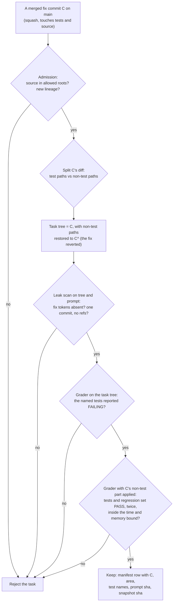
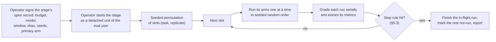
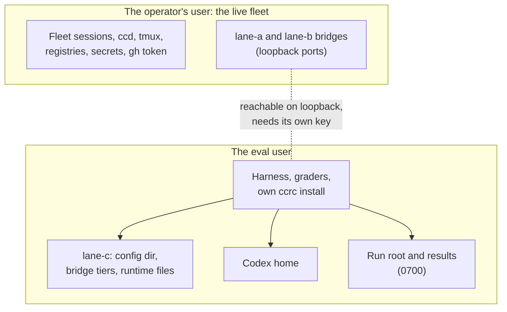

# GPT-lane parity eval

**Spec** · 2026-11-13 · Status: Draft, revised after review · Owner: the Codex bridge programme · Linear: none · Related:
`docs/superpowers/plans/2026-11-13-codex-bridge-gpt-lane-parity.md` (Task 6 is this eval; Task 1 adds the stats
file's `parity` section; Task 4, the per-request record, is deferred), `docs/superpowers/specs/2026-10-15-codex-bridge-design.md`,
`deploy/history-replay.mjs` (the headless-eval precedent this borrows from, and where this design departs from it, §3.4)

## In short

- This is the design of a harness that answers one question: does a GPT lane (Claude Code through ccrc's Codex bridge)
  solve coding tasks as well as the native Codex CLI does on the same model, at a similar cost? A later plan builds it.
  Nothing here runs a model.
- The eval is **paired**: each task is run by every arm in one time slot, three slots per task, one run at a time on
  the eval account. The pass-rate difference is bounded by a class-stratified, task-clustered interval whose method is
  chosen in advance by a simulation check (§1.3, R8). Parity needs that bound to be at least −5 points, plus bounds on
  tokens, wall time and cache ratio. Tool errors are reported, not gated (§1.2).
- The three verdicts use one margin and cannot overlap (§1.4). **The bar is underpowered at 75 pairs**: it can certify
  parity only if the arms disagree on fewer than about 7% of pairs, so "inconclusive" is the likely result. The pilot
  now estimates that disagreement rate, and the Stage 1 sign-off shows the predicted chance of each verdict (§5.2).
- **Every arm and every grader runs as a dedicated UNIX user** that owns only the eval lane, its own ccrc install and
  the run root (§3.4, O7). Until that user exists, only tasks whose source lies in `server/src` or `agent/src` are
  admitted, and no live stage may start.
- The dry run of task mining is in §8: 22 fix commits examined, 10 accepted, 12 rejected. That run predates this
  revision and does not meet it: its prompts are paraphrases, not the D5 template, and 7 of the 10 change files
  outside `server/src` and `agent/src`. Every commit it names is now public here, so none may enter the verdict set.
- Please check: the verdict rule (§1.4), the isolation design and the eval user (§3.4, O7), the dedicated account (D3),
  the stage plan and window (§5), and "Waiting on you".

## 1. The question and the parity bar

This section states what the eval decides, and the statistics that decide it.

### 1.1 The question

On a fixed task set and the same model id, does a GPT lane reach native Codex's task success, and at what cost in
tokens and time? Comparing the lane with native Codex (B vs A) measures the **whole client**: Claude Code's agent loop,
prompt, tools and retry behaviour plus the bridge, against Codex's. The prompt and tools differ by design (D-6420), so
that comparison cannot isolate the wire. The lane-only contrasts (B vs B′, and each marker arm against the arm before
it) share one client and so isolate the bridge's request changes. Both readings are reported, labelled as such.

**The primary arm.** Each stage names, in its open record, the one arm whose comparison with A answers "is the GPT lane
at parity": **B in Stage 1** (the lane as it runs today) and **C-final in Stage 3**. Every other arm against A is
secondary: it is reported with its bounds, and never printed as the stage's verdict.

### 1.2 The bar

The bar starts from the parity study's bar, as the plan's Task 6 carries it. Each criterion is tested for the primary
arm X against native Codex A on the verdict set. P5 departs from the study, which asked for a tool-error rate "no
higher" (D11).

| # | Criterion | Statistic | Certified when | Shown worse when | Status |
|---|---|---|---|---|---|
| P1 | Task success | Δ = p(X) − p(A), the mean over tasks of the per-task pass-rate difference | One-sided 95% lower bound of Δ ≥ −5 points | One-sided 95% upper bound of Δ < −5 points | Proposed |
| P2 | Tokens | G_tok, a paired geometric-mean ratio (below) | One-sided 95% upper bound ≤ 1.20 | Lower bound of G_tok, or of any class's ratio, above 1.20 | Proposed |
| P3 | Wall time | G_wall, the same statistic on wall time | One-sided 95% upper bound ≤ 1.20 | As P2 | Proposed |
| P4 | Cache ratio | Pooled Σ cached / Σ input, X minus A | One-sided 95% lower bound ≥ −10 points | One-sided 95% upper bound < −10 points | Proposed |
| P5 | Tool errors | Runs with a schema-rejected call, per arm (§4.2) | Reported, not gated | Reported, not gated | Proposed |

**The paired ratio for P2 and P3.** For each task t, take m_X(t) and m_A(t), the medians over that task's non-void runs
of each arm, failed runs included, and form ℓ(t) = log(m_X(t) / m_A(t)). Average ℓ within each class, then average the
four class means with **fixed weights of ¼ each**, and exponentiate. That is G. Each class's own ratio, exp of its
class mean, is reported beside it. The statistic is paired and scale-free, so the short classes cannot fill the median
and hide the long class. Fixed class weights stop the ten bug fixes from drowning the five long tasks, and the
per-class "shown worse" rule catches a lane that is clearly worse on one class only.

Total tokens per run are input (cached included) plus output. Uncached input, output and reasoning tokens are reported
beside it (§4). Being cheaper or faster than native always passes.

**Why P5 is not gated.** The tool sets differ by design: Claude Code's many fine-grained JSON tools against Codex's
`exec` and `apply_patch`. A per-call rate then mostly measures the tool design, and so does a per-run rate, since more
calls give more chances to err. The figures are reported per arm and per class, with the classification of §4.2.

### 1.3 Pairing, the tests and the intervals

- **Slots.** A slot is one task t and one replicate r ∈ {1, 2, 3}. In a slot, every arm of the stage runs task t once,
  one after another, in a seeded random order. The harness records each run's start time and the gap to the start of
  its pair, and the report gives those gaps per class. At one run at a time (§3.3), a pair's members start apart by
  the earlier run's length: minutes for a question, up to two hours for a long task. Slots run in a seeded random order
  across the window, so time drift is spread evenly over the arms in expectation, though not cancelled within a pair.
- **Void runs.** Only faults that hit every arm alike, and are measured as such, void a run: a harness crash (the
  harness, not the client, failed), or a usage-limit 429 for the shared eval account (§5.3). Everything else is part of
  the client under test and is graded: a bridge 5xx, a marker's 400 fallback that failed, a backend 5xx a client gave up
  on, a run that hits its time bound, gives up or answers wrongly. Each of those is a fail.
- **Re-running a void.** A slot holding a void run is re-run **whole**, every arm, in a later slot. A slot void twice is
  dropped from every arm and reported. Void rates are reported per arm and per cause, and a significant difference
  between arms is a stop rule (§5.3).
- **Off-protocol runs.** A run, in any arm, whose served model differs from its arm's model or whose measured effort
  differs from its arm's effort is **off-protocol**. The primary analysis keeps it, since it is what that client was
  served. A sensitivity analysis drops every slot that holds an off-protocol run, and both are reported. Runs whose
  effort or served model is unmeasured are counted per arm (§4.2, §5.3).
- **The per-task difference.** For task t, d(t) is the mean pass of X over its replicates minus that of A. It does not
  depend on how replicate r of one arm is matched with replicate r of the other. Δ̂ is the class-weighted mean of d(t),
  with each class weighted by its share of the 25 tasks (10/5/5/5), so Δ̂ is the plain mean over tasks.
- **The interval for Δ, chosen in advance.** The candidates, in this order, are: (1) a class-stratified cluster
  bootstrap percentile bound, which resamples tasks with replacement within each class at its fixed count and keeps
  every run of each drawn task in every arm, B = 10,000, with the seed in the open record; (2) the same resampling with
  BCa; (3) a stratified cluster-robust t bound on d(t), with 24 degrees of freedom. The dry run's R8 runs each candidate
  on the simulation grid below, and the **first that holds a one-sided size of 5% or less across the whole grid** is the
  method. It is fixed in the open record before Stage 1, from synthetic data only. If none holds, no stage may certify
  parity until the design is revised.
- **The degenerate case.** When fewer than 3 of the 25 tasks have d(t) ≠ 0, the variance estimate means little: with 0
  discordant tasks every resample gives 0, although 25 tasks cannot support a bound near 0. The harness then prints
  Inconclusive, with the reason "too few discordant tasks to bound Δ", whatever the bound says.
- **The R8 simulation grid.** 25 tasks in the 10/5/5/5 class mix, 3 replicates. Each task's pass probability per arm is
  drawn from a beta-binomial with intra-task correlation ρ ∈ {0, 0.3, 0.6}. The discordance rate ψ is set to {0.05, 0.1,
  0.2}, and the true Δ to −5 points for the size check. 10,000 datasets per cell. The grid also runs at ρ near 1 with 0
  to 2 discordant tasks, to check the degenerate-case rule.
- **The descriptive test.** A task-level sign-flip permutation test on d(t), stratified by class, gives a p-value for
  "X is worse than A". It is reported and enters no verdict rule. Plain exact McNemar on the 75 pairs is reported too,
  labelled descriptive: it assumes independent pairs, which the three replicates of a task are not. R8 measures the
  permutation test's size at ρ > 0.
- **P2 to P4** use the same chosen resampling: G on the per-task log ratios, and P4 on pooled Σ cached / Σ input.
- **Pre-registration.** Before a stage's first live run, the operator's open record fixes the harness sha, the analysis
  script's sha, the interval method, the task manifest's sha, the seeds, the arms, the primary arm, the model and the
  margin. A change after that point is an amendment, stamped on every output.

### 1.4 Power, the minimum detectable effect and the verdict

With n paired runs and a discordance rate ψ = (b + c) / n, Var(Δ̂) ≈ (ψ − Δ²) / n. The table uses ψ / n, which is exact
at Δ = 0 and overstates the variance slightly otherwise. Clustering by task inflates it by the design effect
DE = 1 + (m − 1)ρ, where m = 3 runs per task and ρ is the intra-task correlation **of the paired differences**, not of
the binary outcomes. So SE = √(ψ · DE / n). With z₀.₉₅ = 1.645 and z₀.₈₀ = 0.842 (sum 2.487):

| ψ | ρ | SE at n = 75 | Gap flagged as worse than 0, 80% power, one-sided 5% = 2.487 · SE | True Δ called Not at parity, 80% power = −5 − 2.487 · SE | Lower bound at Δ̂ = 0 = −1.645 · SE |
|---|---|---|---|---|---|
| 0.10 | 0 | √(0.10 / 75) = 0.0365 | 9.1 points | −14.1 points | −6.0 points |
| 0.20 | 0 | √(0.20 / 75) = 0.0516 | 12.8 points | −17.8 points | −8.5 points |
| 0.10 | 0.3 (DE 1.6) | √(0.16 / 75) = 0.0462 | 11.5 points | −16.5 points | −7.6 points |
| 0.20 | 0.3 (DE 1.6) | √(0.32 / 75) = 0.0653 | 16.2 points | −21.2 points | −10.7 points |

These are normal approximations. A t bound with 24 degrees of freedom (t₀.₉₅ = 1.711) widens each by about 4%, and R8's
grid, not this table, is what the chosen method is held to. Three conclusions follow.

- **Detection.** At n = 75 a lane about 9 to 16 points worse is flagged as worse than A (the descriptive note in the
  verdict table). It is called **Not at parity** only when it is worse than the margin by that much again: about 14 to
  21 points worse in all.
- **Certification.** Even when the arms do equally well, the lower bound clears −5 points only if
  1.645 · √(ψ · DE / 75) ≤ 0.05, that is ψ · DE ≤ 75 · (0.05 / 1.645)² = 0.069. In practice that means at most about 5
  discordant pairs of 75. Within-task noise alone can exceed that: at per-task pass probabilities near 0.5, ψ is near
  0.5. The pilot estimates ψ and ρ (§5.2).
- **The n parity would need.** Certifying the −5 point margin with 80% power when the true Δ is 0 needs
  n = 6.18 · ψ · DE / 0.05² = 2,473 · ψ · DE pairs. With DE included that is 247 or 495 pairs at ρ = 0 (ψ = 0.1 or 0.2),
  and 396 or 791 pairs at ρ = 0.3, that is about 130 to 265 tasks at three runs each.

The verdict has three values, and the harness prints one, with the native pass rate and the ceiling and floor counts
always beside it:

| Verdict | Rule, checked in this order |
|---|---|
| Not at parity | P1's upper bound is below −5 points, or any of P2 to P4 is shown worse (§1.2) |
| Inconclusive | Not the row above, and any of these: native's pass rate on the verdict set is outside [0.2, 0.8]; more than 15 of the 25 tasks are at ceiling or floor (every run of both arms passed, or every run failed); fewer than 3 tasks are discordant; P1's lower bound is below −5 points; or any of P2 to P4 is not certified |
| Parity | Not the rows above: P1's lower bound is at least −5 points, P2 to P4 are certified, and the task set discriminates |

The first and last rows cannot both hold on one dataset: a lower bound at least −5 and an upper bound below −5 cannot
coexist, and a certified criterion cannot also be shown worse. The order makes the rule total. Beside any verdict the
harness adds a descriptive note when Δ's one-sided 95% upper bound is below 0 ("worse than native, within the margin")
or above it. R8 holds a case for that note: a planted Δ of −2 points at ψ = 0.05 and large n, which must print Parity
with the note, never Not at parity.

**The discrimination condition.** Certification is easiest when ψ → 0, which also happens when the tasks do not
discriminate: everything passes in both arms, or everything fails. Contamination pushes tasks toward the ceiling
(§2.4). So a task set where native is outside [0.2, 0.8], or where most tasks sit at ceiling or floor, cannot give
Parity. Ceiling and floor tasks stay in the analysis, since dropping them after the fact would be selection, and their
count is printed.

A wider margin changes certification. At −10 points the limit becomes ψ · DE ≤ 75 · (0.10 / 1.645)² = 0.277. That
margin is the operator's choice (§9, O6).

**Why 3 runs per task.** Neither client exposes a seed or temperature for these reasoning models, so a task's outcome
is a draw from a pass probability, not a fixed 0 or 1. One run per task would make every pair a coin-flip against
that noise. Replicates average the within-task noise, but past a few they buy little, because between-task variance
dominates and only new tasks reduce it: SE falls with √(25 · m) only while ρ is small. Three is the smallest odd number
that gives a per-task majority and a visible within-task spread, and it keeps the cost linear (§5). If more power is
needed, add tasks, not replicates.

## 2. The task set

This section covers what the tasks are, how each is built and graded with no human in the loop, and how leakage is
kept out.

### 2.1 Classes

Every task is pinned to a **task snapshot**: a fresh, history-free git repository built from a named commit of this
repository (§2.3). It is graded by a script that needs no model.

| Class | Verdict tasks | Dev tasks | Source | Grader |
|---|---|---|---|---|
| Bug fix | 10 | 2 | A merged fix in this repository's history, with its non-test part reverted (§2.2) | The fix's own tests pass, and the regression set stays green |
| Multi-file feature | 5 | 1 | A merged feature PR that changed 3 or more non-test files, reverted the same way. The prompt follows the D5 template | The PR's tests pass, and the regression set stays green |
| Long horizon | 5 | 1 | One snapshot with 4 to 6 reverted fixes from different areas, in one prompt (below) | Each sub-fix's tests pass. The score is all or nothing, with the part-score reported |
| Read-only question | 5 | 1 | Questions about the snapshot whose answer a script computes, such as a constant's value and the file that defines it, or which function a route calls | The final message parses as the required JSON and equals the key, and the worktree is unchanged |

**The measured pool.** The dry run (§8) found 23 fix commits in the last 30 days whose server lockfile equalled
`main`'s, examined 22 and accepted 10, of which 2 meet the source rule that holds until the eval user exists (§2.2).
That is short of the 12 bug fixes the split needs. The identical-lockfile filter is lifted, since §2.3 installs per
snapshot, and the manifest builder re-mines a longer history. The feature, long and question pools have not been
measured. The builder prints the pool size per class before the split is drawn. A class whose pool cannot fill its row
is reduced, and the reduction is recorded in the open record with the power it costs.

**Long tasks.** A long task is built on one recent tree T. Its sub-fixes are merged fixes before T that touch disjoint
non-test files in different areas, whose tests still exist at T, and whose non-test diff reverse-applies cleanly to T.
Each needs 4 to 6 such fixes, that is 24 to 36 more fixes for the class, on top of the bug-fix pool. Sub-fixes are
never also bug-fix tasks.

**Compaction regime.** The long-horizon threshold must be above both clients' compaction points. The lane compacts at
its 400k window less 33,000 (about 367k, as the README measured on Claude Code 2.1.308). Native Codex compacts at 90%
of its resolved window: 244.8k for a 272k model, but 450k if it resolves 500000 from the remote catalogue, which the
live catalogue the lane reads promises for gpt-6.1-sol (the upstream bundled models file has 272k for it). The pilot
records native's resolved window from the rollout's turn context, and long tasks are built so that the reading they
need passes the higher of the two points. A run is "in regime" when it compacted at least once. A long-task run out of
regime is still graded, and is flagged.

All code tasks use `server/` or `agent/` tests. They are hermetic vitest suites with no browser, and they avoid the
known load-flaky files that the repository's CLAUDE.md lists.

### 2.2 Building a bug-fix task from history

*Figure 1. How a bug-fix task is built and admitted. Every check here runs in the dry run with no model call. A task
that fails any check is rejected, not repaired.*

- **Selection.** Candidates are commits on `main` whose subject starts `fix` and whose diff changes at least one test
  file and one non-test source file. Prefer the newest fixes (§2.4).
- **Allowed roots.** Until the eval user exists (O7), a task's non-test files must all lie in `server/src` or
  `agent/src`, so that no task invites an agent to run the snapshot's `ccd`, `ccrc`, doctor checks or installer. Once
  the eval user exists and R12 has passed, `ccd/`, `install.sh`, `shared/` and `deploy/` are allowed too, since such a
  script then runs against the eval user's own home only.
- **One task per lineage.** A task's area is the set of non-test files it changes. Two candidates are one lineage when
  their areas overlap, or when one's prompt or tests depend on the other's change (a shared D-number chain, or a later
  fix whose tree contains the earlier one's). The builder admits at most one task per lineage, the newest. The area and
  the lineage key are in the manifest row, and R3 checks them.
- **The prompt follows D5, generated, never written by hand.** It names the failing test file or files and the test
  names, and says to make them pass without editing any test file. It holds no paraphrase of the commit message, no
  D-number or PR number, no judgement of the task, and no description of the fix's mechanism. The leak scan (§2.4) runs
  over the prompt text too.
- **The task tree** is C, with every non-test path restored to its state at C^. The fix's tests stay **visible**.
- **Grading.** The grader first restores every test file from C, so a run that edited a test gains nothing. It then
  runs the fix's tests and the **regression set**. The regression set is the tests that `.github/ci/select-tests.mjs`'s
  dependency map selects for the fix's non-test paths, minus the known load-flaky files, and it must be green at C.
  Pass means all of them pass. A run is graded on its final worktree, never on its claims.
- **Bounds.** A task whose grader plus regression set takes more than 300 seconds at C, or hits a memory cap, is
  rejected. R1 needs the named tests reported **failing**: a run killed at a cap is not a failure of those tests.
- **Features** are built the same way, and their prompt is generated by the same template from the PR's tests. A
  feature whose tests do not state the behaviour without the plan's prose is rejected rather than given hand-written
  text.

### 2.3 Pinned snapshots

- A task snapshot is a new repository (`git init`) holding one commit of the task tree, with no remote, no other refs
  and no objects from this repository. A worktree of this repository would carry the fix in its object store, so it is
  never used.
- `CLAUDE.md`, `AGENTS.md` and any other agent-instruction file are removed from the snapshot. Each client then works
  from its own prompt alone, with no project brief that only one of them would read.
- Dependencies are installed once per snapshot (`npm ci` in the package the task needs), into a read-only cache that
  each run's worktree links to. Runs need no network for tests. The cache's size per snapshot is measured in the dry run
  and counts against the disk floor (§6).
- The manifest row records the source commit C, the area and lineage key, the snapshot's commit sha, the package, the
  test names, the prompt's sha and the regression set. **Only the manifest's sha and the dev set's rows are committed.**
  The verdict rows, prompts included, stay in the eval user's 0700 results root until the eval ends, since this
  repository is public and the lane arm has network.

### 2.4 Contamination and leakage

| Risk | Why it matters | Control | Status |
|---|---|---|---|
| The model saw the fix | This repository is public, so a fix merged before a model's training cutoff may be memorised | Prefer fixes merged after the newest arm model was first listed in the catalogue. Report each task's merge date. Memory lifts both arms, but it pushes tasks toward the ceiling, which the discrimination condition (§1.4) catches | Proposed |
| The fix is in the task repo | An agent could read it from git objects, a plan or a ledger entry | One-commit snapshot. A scan for distinctive tokens the fix added (identifiers, strings, its D-number) refuses the task on any hit | Proposed |
| The prompt leaks the fix | A hand-written prompt can name the mechanism or the commit's words | D5's generated template. The scan also runs over the prompt: D-numbers, PR numbers, n-grams of the commit subject and identifiers the fix added. Any hit refuses the task | Proposed |
| The agent fetches the fix | The fix is one `git fetch` or web search away | Web tools are off in both arms. Native's shell has network off in its sandbox. The lane's shell has network, so any run whose commands name the public repo's host or a fetch is flagged | Proposed |
| Tuning on the verdict set | Bridge work tuned to these tasks would inflate C | The verdict rows stay out of the repo (§2.3). Only the dev set is used for the pilot, Stage 2 and debugging. Stage reports give bridge workers aggregates, never per-task rows | Proposed |
| Tasks named in public | A commit named in this doc is known to everyone who works on the bridge | No commit named in §8 or anywhere in this repo may enter the verdict set. Such a commit may serve in the dev set | Proposed |

**The sandbox asymmetry.** Native Codex runs its commands in its own sandbox: writes limited to the worktree, network
off. The lane arm has no write sandbox and no network-off: Claude Code runs commands with the eval user's rights and the
box's network. That weakens the "one `git fetch` away" control for the lane arm only, and the flag rule above is its
only cover. It also means the native arm cannot run a task's test that needs a write outside the worktree; the dry run
checks each task's grader inside native's sandbox (R13).

**The held-out split.** The 25 verdict tasks are run in a stage window and count toward the verdict. The 5 dev tasks
(2 bug fixes, 1 feature, 1 long, 1 question) serve the pilot, Stage 2 and any debugging, and never count. The builder
draws the split from a seed only after every class's pool is admitted in full (at least 12 bug fixes, 6 features,
6 long tasks and 6 questions), and before anyone reads the prompts.

## 3. The arms

This section defines the arms, how they are scheduled and how each run is isolated.

### 3.1 Arms

Every comparison uses one model id on both sides. The proposed primary model is `gpt-6.1-sol` (O5). Its catalogue
default effort is low, and the lane's class effort is max, which is the largest effort gap in today's lane classes. It
has `default_service_tier` null, so native Codex does not default it to the Fast tier as it does for `gpt-6-sol` and
`gpt-6-luna`.

| Arm | Client | Effort | Bridge markers | Status |
|---|---|---|---|---|
| A | Native Codex CLI, a pinned release no older than the model's `minimal_client_version`, catalogue defaults, `codex exec --json` | Not set, so the catalogue default (low for gpt-6.1-sol) | n/a | Proposed |
| B | Claude Code through the eval lane, as a lane session runs today. Primary in Stage 1 | The lane's class effort for the model (max for gpt-6.1-sol), passed explicitly | none | Proposed |
| B′ | As B. Secondary | The catalogue's `default_reasoning_level`, from Task 2's catalogue field | none | Proposed |
| C1 | As B′ | As B′ | `bridge-reasoning-all-turns` | Proposed |
| C2 | As B′ | As B′ | C1 plus `bridge-verbosity` | Proposed |
| C3 | As B′ | As B′ | C2 plus `bridge-turn-state` | Proposed |

The C arms build on B′, so that each marker is measured at native's effort (D6). C-final, the primary arm of Stage 3,
is fixed before Stage 2 (§5.2). The client version, the ccrc build, the catalogue etag, lane-c's `lane.json` hash and
its tier process ids are recorded per run. A change of any of them mid-stage stops the stage (§5.3).

**Native Codex's flags.** These spellings are re-read at the pinned tag, and the dry run's argv test pins them:
`codex exec --json -m <model> -C <worktree> --output-last-message <file> -`, with the prompt on stdin. The config is
written by the harness from a template whose hash is checked before each run. It sets no `model_reasoning_effort`, the
standard service tier, web search off, the approval policy `never`, and `workspace-write` with network off. That sandbox
must work on this kernel, where unprivileged user namespaces are refused; R13 checks it.

**The lane's flags.** The entry point is the eval user's account wrapper for lane-c, `~/.local/bin/<lane-c id>` in the
eval user's home, which `ccrc wrappers` writes. It exports lane-c's `CLAUDE_CONFIG_DIR` and `CCRC_UPSTREAM` and execs
the lane launcher (`ccd/ccrc-codex`), which reverse-maps that config directory through the eval user's
`~/.ccrc/accounts.sh`, runs `ccrc codex start <lane-c id>` (the idempotent ensure of the lane's tiers), reads the port
from `lane.json`, and sets the base URL and the gateway key. The flags passed through are
`-p --output-format stream-json --verbose --model <model> --effort <level> --session-id <uuid> --no-session-persistence --strict-mcp-config --permission-mode bypassPermissions --disallowedTools WebFetch,WebSearch`,
plus `--settings` with `disableAllHooks: true` and a `permissions.deny` list generated from `ACCOUNT_DENY_RULES`
(`shared/api.ts`), never a hand-kept copy. lane-c's own `settings.json` loads as it does for a lane session, so the
eight `MODEL_ENV_KEYS` and the lane's window reach every request, subagents and background requests included. R6 pins
that from the first request's model ids.

### 3.2 Why a headless `claude -p` and not a lane session

Each lane run is one headless `claude -p` through the eval lane's wrapper, never a ccd session. The reasons:

- A ccd session lives in the fleet's machinery: registry, placement, swaps and rescue, mail delivery, hooks and tmux.
  The harness must not touch any of these, and a swap could move a run to another account mid-task.
- Headless gives an exit status, a hard wall-clock bound and a machine-readable stream. That stream carries the same
  per-message usage a transcript records.
- It matches the native arm, which is headless too (`codex exec`).
- It follows the history replay eval (`deploy/history-replay.mjs`) in running its arms headless. It does not follow
  that driver's safety: the replay limits its arms to `--tools Bash,Agent` with `--allowedTools 'ccrc history:*'`,
  and this eval's agents need every tool. The eval user (§3.4) is what replaces that limit.

Print mode differs from an interactive session only in its interface. The agent loop, the tools and auto-compaction are
the same (judgement). The pilot checks that a long task compacts in print mode.

### 3.3 Schedule

*Figure 2. One stage. All arms of a comparison run inside the same signed window, slot by slot, one run at a time on
the eval account. A stop leaves the remaining slots not-run, and the operator's resume command continues from there
once the stop clears and the window allows it.*

- **Concurrency is one run at a time, across all arms (K = 1).** Both arms draw on one ChatGPT account, so equal
  concurrency is the only way to give them equal self-imposed load on its rate limits. It also makes every lane run
  serial, which the stats-delta join needs without Task 4 (§4.2), and it keeps heavy test runs off the live fleet box
  one at a time. Each run record holds the number of runs in flight on the account (1 unless a stop rule failed) and
  the gap to its pair's start.
- **Grading is serial too,** after each run, under the same caps for every arm (§6), so grading load is the same for
  every arm.
- **Markers** are read by the bridge at each call (as `bridge-instructions` is). No writer of a marker is in the tree,
  and the harness never writes one either. C arms therefore run in **blocks**. Before each block the harness stops,
  prints the marker set the operator places by hand, and resumes only after it has measured the lane directory and
  found exactly that set.
- **The window** is sized from the pilot, not fixed (§5.2). A stage that has not finished at the window's end reports
  its remaining slots as not-run. The operator rules on them, and the harness never stretches the window itself.
- **Starting and resuming** are the operator's acts (D8): the stage runs as a detached service unit of the eval user
  (for example one started with `systemd-run --user`), outside any terminal pane, so it survives the operator's shell.
  The same command, with the stage's record, resumes it.

### 3.4 Isolation

*Figure 3. The isolation boundary is the UNIX user. Nothing of the live fleet's is readable by the eval user. The
dotted edge is the residual: loopback services of the live fleet are reachable from any local user, and each answers
only to its own credential.*

- **A dedicated UNIX user runs everything** (O7): the harness, every agent of every arm and every grader. It owns only
  its home, which holds its own ccrc install with lane-c alone in its roster, lane-c's config directory and bridge
  tiers, the Codex home, the run root and the results root. Creating that user, installing ccrc for it and adding
  lane-c to its roster are the operator's acts. The live operator's home, `~/.cc-secrets`, the live lanes' runtime
  files, the `gh` token, the live `ccd` and `ccrc`, and the live tmux server and user units then sit behind the uid
  boundary, not behind a convention. R12 measures that boundary before any live stage. Until it passes, no live stage
  may start, and the allowed-roots rule of §2.2 holds.
- **Why not a sandbox.** A namespace sandbox is not available: on the fleet box `unshare -rn true` fails, since
  unprivileged user namespaces are restricted (measured by the review, 2026-11-13). The user boundary is what remains.
- **What the eval user can still reach.** Its own lane's gateway key, which the launcher exports into Claude Code's
  environment, so every agent's shell inherits it; its own Codex credential in the Codex home, readable by a lane
  agent, which has network; and loopback ports of the live fleet's services, each of which needs a credential the eval
  user cannot read. The first two put the eval's own account at risk, not the fleet's, which is one reason D3 asks for
  a dedicated account. The command flag rule (§2.4) also flags any run whose commands name a credential path.
- **A fresh worktree per run.** Each run gets its own worktree of the task snapshot, in the run root, outside every git
  tree and every served docs root. It is removed after grading. The run, its worktree and its client process never
  share state with another run.
- **The dedicated eval lane** (lane-c, D3) is used only by the eval, so its markers, its stats and its quota belong to
  the eval. lane-a and lane-b, and their live sessions, are never used. The drained-lane fallback is withdrawn: an
  existing lane belongs to the live user, so it cannot sit inside the eval user's boundary.
- **Codex's home.** Native Codex runs with `CODEX_HOME` set to the eval user's Codex home. A fresh home per run would
  need its credential copied, which the harness never does. So the home is shared, its config is hash-checked before
  every run, and each run's rollout files are found by thread id.
- **Claude Code's home** is lane-c's own config directory, since the launcher refuses a config directory the roster
  does not map (`unmapped`): a lane's identity is its config directory. Runs use `--no-session-persistence`. The eval
  user's config directory holds no user instruction file, and the snapshot holds none (§2.3). The pilot verifies from
  the first request's input size that no instruction file loaded.
- **The child environment** is built fresh, the equivalent of `env -i`. For a lane run: `HOME` (the eval user's),
  `LANG`, `TMPDIR` (inside the run root), and an explicit `PATH`: the poisoned shims first, then the directories of
  `node` and `jq` (the launcher refuses without them), the eval user's `~/.local/bin`, and the system directories. The
  wrapper sets `CLAUDE_CONFIG_DIR` and `CCRC_UPSTREAM` itself. For a native run: `HOME`, `LANG`, `TMPDIR`, `PATH` and
  `CODEX_HOME`. The shims for `gh`, `ccd`, `ccrc` and `tmux` cover **bare names only**: an absolute path runs past them.
  They are a speed bump, and the uid boundary is the isolation.
- **Where the harness may run.** Its live modes refuse inside a tmux pane or a Claude Code session (`TMUX_PANE` or
  `CLAUDECODE` set). Its dry-run mode is exempt, since it makes no model call and needs no credential: a session may
  run it.

## 4. Metrics and their sources

This section names where each figure comes from in each arm and how it is tied to one run.

### 4.1 The run record

The harness writes one record per run: run id, stage, arm, task, replicate, slot, start and end (UTC, from the
harness's clock), the gap to its pair's start, the runs in flight on the account, exit status, grade, void reason,
off-protocol flags, client versions, ccrc build, catalogue etag, `lane.json` hash, tier process ids, the lane session id
(the `--session-id` it minted) and the Codex thread id (from `exec --json`'s `thread.started`).

- **Join, lane.** Bridge rows belong to a run when their session id is the run's, and their time is inside
  [start − 5 s, end + 60 s]. Subagent requests carry the parent's session id (the bridge passes Claude Code's session header through, and only
  `prompt_cache_key` adds the agent id, `ccd/codexbridge/inbound.py#cache_key`), so they join too.
- **Join, native.** The run's rollout file is named by its thread id. Spawned agents' rollouts are found by
  `x-codex-parent-thread-id` lineage, which is recorded in their session metadata.

### 4.2 Sources per metric

| Metric | Native Codex (A) | Lane (B, B′, C) | Without Task 4 |
|---|---|---|---|
| Pass | Grader | Grader | Available |
| Wall time | The harness's spawn-to-exit time | Same | Available |
| Requests | Count of per-response `token_count` events in the rollout | Task 4 rows, or the stats delta's `responses`. The stream's assistant messages, deduplicated by message id, are the client-side floor | Serial runs only |
| Input, cached and output tokens | Rollout `token_count` per response, and `exec --json` `turn.completed` usage as a cross-check | The stream's per-message usage, deduplicated by message id. Cached is cache read, and input is the sum of the three input fields (which the bridge makes equal to the upstream's `input_tokens`). The `result` event's totals are a cross-check | Available |
| Reasoning tokens | Rollout `reasoning_output_tokens` | Task 1 `parity.reasoningTokens`, from a per-run delta or Task 4 rows | Serial runs only |
| Effort actually sent | Rollout turn context. A run whose effort is not its arm's is off-protocol (§1.3) | Task 1 `parity.effort` delta, or Task 4 rows. The same off-protocol rule | Serial runs only |
| Served model | Rollout turn context. A reroute is off-protocol | Task 1 `parity.served` delta, or Task 4 rows. The same rule | Serial runs only |
| Resolved context window | Rollout turn context | lane-c's settings and the catalogue row | Available |
| Tool calls and rejections | Function-call outputs the client rejected before running them (invalid arguments, unknown tool) | `tool_result` blocks with `is_error` whose text is an input-validation error or an unknown-tool error only (spellings pinned on captured fixtures in R7). A Bash result whose text carries a non-zero exit code line is a command failure, counted apart. Every other `is_error` (a missing file, an edit whose old text is absent) is an execution failure, counted apart | Available |
| Compactions | Rollout compaction items | Stream `compact_boundary` events | Available |
| Reasoning removals | Not in the rollout. Codex records them only as telemetry, so they are unmeasured unless the pinned version can export metrics to a local file | Task 1 `parity.inputTransformations` delta, or Task 4 rows | Serial runs only |
| Store replay hits | n/a | Task 1 `parity.replay` delta, or Task 4 rows | Serial runs only |
| Time to first output | Rollout line timestamps (approximate) | Task 1 `firstOutputMs` histogram (bucketed), or Task 4 rows | Bucketed only |
| Account usage | Rollout rate-limit snapshots | The stats file's `usageHeaders` (the `x-codex-*` used-percent values) | Available |

The plan re-reads every native field name at the pinned Codex tag, since this table cites them from that version's
schema as recalled, not as read. The dry run's parser tests pin them on fixtures. P5's figures are reported per run
(runs with at least one rejected call, and rejections per run) and per call, per arm and class.

**What Task 4 changes.** Without it, the only per-run bridge figures are deltas of the stats file's `parity` section
between snapshots taken before and after a lane run. The bridge writes that file only at the end of a request, at most
once every 10 seconds (`FLUSH_S` in `ccd/codexbridge/stats.py`), and it has no timer (`server.py`'s request handler
calls `flush()` in its `finally`). On an idle lane, a run's last responses therefore stay in memory until the next
run's first request, and would land in the next run's delta. So:

- Task 1 adds an idle flush: the stats file is written once the bridge has been idle for `FLUSH_S` after a response
  (D10).
- The harness takes a run's "after" snapshot only once the file's write time is later than the run's last response
  and `FLUSH_S` has passed since.
- The check is two-sided: the delta's `responses` must lie within [the stream's assistant-message count, that count
  plus a background allowance the pilot measures, for requests Claude Code makes outside the stream].
- A delta failing any check leaves the bridge figures of **that run and the run after it** unmeasured. Both are still
  graded.

With Task 4, the session-id join is exact, and per-request time to first output, effort, served model and removals are
all measured. Effort, served model and removals are what the C arms are about, so Stages 2 and 3 wait for Task 4 (D7).

## 5. Cost and quota

This section estimates the spend, splits the eval into stages that are signed off one at a time, and bounds each stage.

### 5.1 Estimate per arm (judgement, anchored on live figures, to be replaced by the pilot's measurement)

| Class | Tasks × runs | Requests per run | Mean context per request | Input tokens per run | Output tokens per run | Wall time per run |
|---|---|---|---|---|---|---|
| Bug fix | 10 × 3 | 30 | 50k | 1.5M | 20k | 10 min |
| Feature | 5 × 3 | 60 | 100k | 6M | 40k | 25 min |
| Long | 5 × 3 | 150 | 200k | 30M | 100k | 60 min |
| Question | 5 × 3 | 12 | 40k | 0.5M | 5k | 3 min |
| **One arm, verdict set** | 75 runs | 4,230 in all | | 592.5M in all, mostly cached | 2.8M in all | 27 h of run time |

Here is the arithmetic. Requests are 900 + 900 + 2,250 + 180 = 4,230. Input is 45M + 90M + 450M + 7.5M = 592.5M. Wall
time is 300 + 375 + 900 + 45 = 1,620 min. The long class is about 76% of the input.

**Anchors.** Each existing lane's stats show about 30,000 upstream responses since 2026-10-27, about 1,800 a day
(reported by the review, 2026-11-13; the plan re-measures it, with `promptTokensMax` and `usageHeaders`). Stage 1's
12,700 requests over its 81 hours of serial run time are about 3,800 a day, about twice one live lane's rate, so
5-hour pauses are likely and the window must allow for them. The bug-fix wall time allows an agent a few test runs:
the admitted tasks' tests took 1 to 101 seconds at the fix (§8), and the 300-second grader bound (§2.2) excludes the
heavier ones.

### 5.2 Stages

| Stage | Arms and tasks | Runs | Requests | Input tokens | Status |
|---|---|---|---|---|---|
| Pilot | A, B and B′ three times each, and C3 once, on the 5 dev tasks. Never counted | 50 | about 2,820 | about 395M | Proposed |
| 1: parity today | A, B (primary) and B′ on the verdict set | 225 | about 12,700 | about 1.78B | Proposed |
| 2: markers (exploratory) | C1, C2 and C3 on the dev set's bug-fix and question tasks, three times each | 27 | about 650 | about 32M | Proposed |
| 3: parity after fixes | C-final (primary) and a fresh A on the verdict set | 150 | about 8,460 | about 1.19B | Proposed |

Here is the arithmetic. One pass of the dev set is 60 + 60 + 150 + 12 = 282 requests and 3 + 6 + 30 + 0.5 = 39.5M
input. The pilot is ten passes. Stage 2 is nine passes over 2 bug fixes and 1 question, 72 requests and 3.5M input
each.

- **The pilot estimates ψ and ρ.** With three replicates of A, B and B′ on the dev tasks, it reports the estimated
  discordance rate and intra-task correlation with their uncertainty. Five tasks give a wide range, and the report says
  so. The Stage 1 sign-off then shows the predicted probability of each verdict at the chosen n and margin, simulated
  from those estimates across their range, so the operator chooses O6 with that footing.
- **The pilot also measures** each run's 5-hour and weekly percent, its wall time, the stats-delta background
  allowance, native's resolved window, whether a long task compacts in print mode, and that lane-c's bridge still
  answers after the native sign-in (O2).
- **C-final is fixed before Stage 2,** never from verdict tasks: it is C3 (all three markers), less any marker whose
  400 fallback fired on the dev set in the pilot. Stage 2 is exploratory, on the dev set only, for the wire metrics
  (removals, verbosity, output tokens). It is reported and changes nothing about C-final.
- **The window** of each stage is computed from the pilot: the measured run time per class times the stage's runs, plus
  serial grading, plus 10% for void re-runs, plus the 5-hour pauses the pilot's measured percent per run predicts. At
  one run at a time, Stage 1's run time alone is about 81 hours (three arms of 27), so the window is days, not hours.
  The operator signs the computed window in the open record.

### 5.3 Bounds, stop rules and sign-off

The ChatGPT plan limits usage by percent of a 5-hour and a weekly window, not by tokens. So the budget is expressed in
the eval account's weekly percent, which the pilot converts from measured per-run use. Native and lane runs draw on the
same account, so both sources below read the same limits.

- **Usage sources.** The latest reading of the two: the used-percent values in lane-c's stats `usageHeaders`, and the
  rate-limit snapshot in the newest native rollout. A `~/.cc-limits` row is not a source, since no such row is shown to
  exist for a Codex lane.
- **Budget.** Each stage's open record names a ceiling in weekly percent and a hard cap of 1.25 × the pilot-derived
  estimate of requests and of input tokens. The pilot has its own absolute cap: 1.25 × its estimate (about 3,525
  requests and 494M input tokens) and a weekly-percent ceiling the operator names. The operator writes and signs the
  record. The harness only prints a draft, and refuses `unsigned` without the signed record.
- **Stop rules.** No new run starts when any of these holds:
  - the account's weekly use reaches the ceiling;
  - its 5-hour use reaches 90% (the stage pauses until the reset, if the window allows);
  - a cap is reached;
  - the window ends;
  - a client, ccrc build or catalogue row moves, lane-c's `lane.json` changes, or a lane-c tier restarted;
  - void runs pass 10% of the stage's runs, or the void rates of the arms differ (a two-sided Fisher exact p below
    0.05 once each arm has 20 or more runs);
  - unmeasured effort or served model passes 10% of lane runs in a stage whose arms differ in effort (any nonzero count
    is flagged on the report);
  - the box's available memory falls below its floor, or its load average passes its bound (both set in the open
    record from the pilot's readings);
  - free disk on the run root falls below its floor.
- **Overshoot.** The run in flight finishes within its own time bound: 30 minutes for a question or bug fix, 60 for a
  feature, 120 for a long task. At one run at a time, the worst-case overshoot is one run at those bounds.
- **Sign-off.** No live act happens before the operator signs off: not the pilot, and no stage. Each stage is signed
  separately, after the operator has seen the previous stage's report.

## 6. Safety

This section lists the rules the harness enforces, beyond the isolation in §3.4.

- **Credentials.** Native Codex needs a ChatGPT sign-in. It is the eval account's, the same account lane-c's bridge
  holds, so both arms draw on one plan, one tier and one routing. The operator signs in by hand, as the eval user
  (`codex login`, with `CODEX_HOME` set to the eval user's Codex home), and never a session. Whether a second sign-in
  disturbs the bridge's credential is unmeasured, so the pilot checks that lane-c's bridge still answers after it. The
  harness checks only that the credential file exists, and never opens it, the lane's runtime files or any token file.
  It puts no secret in an argument or an environment variable of its own. **The launcher does:** it exports lane-c's
  gateway key into Claude Code's environment, so every lane agent's shell inherits it, and a raw stream can capture it
  if an agent prints its environment.
- **No secrets in results.** Results hold grades, counts, timings and the clients' event streams. A scan for token
  shapes and for the bridge's refused header values runs over **the whole raw results root**, not only over exports,
  after every run. A hit marks that run's raw files as holding a secret, and any export that would include them is
  refused. Raw streams are deleted once the stage report is accepted; the aggregates stay. Values of
  `x-codex-turn-state` are never recorded (the bridge already refuses them). After the eval the operator may rotate
  lane-c's gateway key.
- **Results stay outside the public repo.** The `--out` directory is refused inside any git tree, and is created 0700
  with files 0600, in the eval user's home. Only aggregate tables, after the private-name scan, may be quoted in a doc
  or PR. They name lanes as lane-a, lane-b and lane-c and the box as "the fleet box".
- **Hands off the live fleet.** The harness runs as the eval user, so it cannot read or write `~/.cc-sessions`, tmux or
  `claude-session@*` units of the live user. It runs no `ccd` or `ccrc` verb of the live fleet's. It does run the eval
  user's own ccrc: the launcher runs `ccrc codex start` for lane-c at every launch, and the grader uses that install's
  `ccrc test --` for its test runs.
- **Test load.** The operator's standing rule routes heavy test runs on the fleet box through `ccrc test`, which
  applies a test slice's memory cap. The grader runs every test through the eval user's own `ccrc test --`, where R12
  shows that works for that user. Where it does not, the grader applies the same bounds itself, and every agent run has
  them too: `timeout -k`, `ulimit -u`, and a memory cap through `systemd-run --user -p MemoryMax=…`, or the task is
  refused. With one run at a time and serial grading, at most one such run loads the box.
- **Disk.** Dependencies come from one read-only cache per snapshot. Worktrees are removed one at a time after grading.
  A free-space floor is a stop rule.

## 7. The dry run

The dry run needs no model, no sign-in, and, except for R13, no Codex install. It proves that the tasks, the graders,
the parsers and the statistics are right before any quota is spent. A session may run it (§3.4).

| # | Check | Passes when |
|---|---|---|
| R1 | Every bug-fix, feature and long task: the grader on the task tree | The named tests are reported failing. Not "no tests", not a collection error unless the fix added the file, and not a kill at a time or memory cap |
| R2 | The same tasks with C's non-test part applied | The named tests and the regression set pass, twice in a row, inside 300 seconds and the memory cap. A task that flakes is rejected |
| R3 | Leak scan, prompt template, lineage and snapshot shape | One commit, no remote, no other refs. No hit on the fix's distinctive tokens in the tree or the prompt. The prompt matches the D5 template. No two tasks share a lineage. The source rule of §2.2 holds |
| R4 | Read-only questions | The key script reproduces each stored answer on the snapshot. The grader accepts the key, refuses three perturbed answers, and fails a worktree with a stray change |
| R5 | Test-file restore | A planted edit to a test file is undone before grading, and the grade is unchanged |
| R6 | Arm argv, environment, settings and config | The pure builders give the pinned argv per arm, the environment holds only the listed variables, the deny list equals `ACCOUNT_DENY_RULES`, lane-c's settings carry the eight model keys, and the Codex config template's hash matches |
| R7 | Parsers on synthetic and captured fixtures | Codex `exec --json` events and rollout lines, Claude Code stream-json (with a repeated message id, a subagent, a compaction, an input-validation error, an unknown tool, a Bash non-zero exit and an execution failure), and a synthetic stats `parity` section all give the expected metrics and classes |
| R8 | Statistics on synthetic paired results | The grid of §1.3. The interval method is chosen by size. Identical arms give Δ̂ = 0. A planted −10 point gap at ψ = 0.2 is not called Parity. A planted −2 point gap at ψ = 0.05 and large n gives Parity with the "worse, within the margin" note. A long-class-only 2x token ratio gives Not at parity through P2's class rule. 0 discordant tasks give Inconclusive. The permutation test holds its size at ρ > 0 |
| R9 | The scheduler | With a fixed seed, every slot holds each arm once, each arm runs first in about a third of slots, a void slot is re-run whole, and no two runs overlap |
| R10 | The stop rules and the budget | Synthetic usage, void, memory and tier traces stop the stage at the right run, and a resume continues from there |
| R11 | Refusals | The harness refuses `--out` inside a git tree, refuses a live mode inside a pane or session, refuses without a signed record, and refuses a marker set that does not match its block |
| R12 | The eval user's boundary (once O7 is done) | As the eval user: the live user's home, secrets and runtime files are unreadable, the live tmux server and user units are unreachable, `gh` has no credential, the live lanes' bridges refuse a request without their key, and `ccrc test --` runs under its memory cap |
| R13 | Native's sandbox (once O1 is done, no model call) | The pinned version's sandbox runs a command with network refused and a write outside the worktree refused on this kernel, and each task's grader passes at C inside it |

## 8. Dry-run result

> [!WARNING]
> **Partial run of task mining only, made before this revision. It does not meet R3 or D5, and nothing in it may be
> signed off.** Source: the mining output of 2026-11-13 (examined, accepted and rejected rows, kept outside the repo;
> its sha-256 begins `7437375f9050`). Its prompts are paraphrases of each commit message, not the D5 template. 7 of its
> 10 accepted tasks change files outside `server/src` and `agent/src`. No regression set was computed. And every commit
> named below is now public in this doc, so none of them may enter the verdict set (§2.4).

**Counts.** The pool was 23 fix commits from the last 30 days whose server lockfile equalled `main`'s (older fix
commits all differed). 22 were examined: 10 accepted, 12 rejected. Of the 12, 2 were run and 10 were rejected by
inspection without a run. (The output's own note says 11 by inspection; its rows show 10.) One further passing
candidate was dropped as surplus beyond ten.

| Main rejection reason | Count |
|---|---|
| Fails at the fix commit itself on this box (macOS-flavoured rows) | 1 |
| Passes and fails as needed, but 40+ byte-exact sentence cases; weak, and surplus beyond ten | 1 |
| No behaviour symptom: a ring declaration, shellcheck pins, a refactor | 3 |
| Test-only commits, no source change | 2 |
| Outside the server suite or this platform: pwa browser tests, a macOS-only build step | 2 |
| Mostly `ccd` bash with shared-fixture or census plumbing | 2 |
| Tests in a known load-sensitive flake family | 1 |

**The accepted tasks.** Subjects are shortened: their trailing D-number and PR references are dropped. Cases are those
reported failing at the revert. Seconds are the test run at the fix and at the revert, each including about 5 to 10
seconds of `ccrc test` wrapper and vitest start-up.

| Sha | Subject | Test file | Cases failing at revert | Seconds, fix / revert | Under this revision |
|---|---|---|---|---|---|
| ff2ff75ad | fix(mail): close a declined lifecycle park once its recipient is back, so unreadMail stops counting it | `server/test/mail-revive.test.ts` | 7 | 77.8 / 82.3 | Eligible for the dev set once its prompt is regenerated |
| a8d97e015 | fix(registry): a sleep marker that gives no time reads asleep at the stop stamp | `registry`, `mail-sweep`, `session-reading-truth-table` and `fleet` tests | 6 | 627.3 / 456.8 | Rejected: over the 300 s bound, a memory-cap kill at revert, and source in shared/ |
| 4a692a492 | fix(install): the tag binding speaks the updater's words; the name rows can see a write | `server/test/install-sh.test.ts` | 1 | 9.7 / 12.2 | Refused until R12: the installer. Wording only, installer lineage |
| 49532b4e9 | fix(doctor): a session to come gets ccd's ~/.local/bin | `ccrc-doctor-session-path` and `ccd-session-path` tests | 4 | 15.2 / 20.2 | Refused until R12: source in ccd/. One lineage with 375381f72 |
| 48ea5e2f6 | fix(graph-sweep): the store checkout borrows the source's objects, shallow source or not | `server/test/graph-repo-sweep.test.ts` | 3 | 284.0 / 213.1 | Refused until R12: source in ccd/. Near the 300 s bound |
| d1ff13f9e | fix(statusline): publish the weekly figure when the payload has no 5h window | `server/test/statusline-script.test.ts` | 9 | 14.4 / 7.7 | Refused until R12: source in ccd/ |
| 0d3128e1c | fix(orphan-lane): a pending census retry ignores pressure, and pressure reads the disk alarm | `orphan-tree-lane` and `orphan-tree-beat` tests | 8 | 1.8 / 1.0 | Eligible for the dev set once its prompt is regenerated |
| f8e0b10b6 | fix(install): the update follow-ups, slice 1: release arm, test helpers, text | `server/test/install-sh.test.ts` | 8 | 11.1 / 12.7 | Refused until R12: the installer. Installer lineage |
| 375381f72 | fix(ccd): every session starts with ~/.local/bin on its PATH | `server/test/ccd-session-path.test.ts` | 9 | 6.6 / 6.7 | Refused until R12: source in ccd/. One lineage with 49532b4e9 |
| 0e9d19521 | fix(update): a release base with a query or a fragment is refused, and the redactor withholds both | `ccd-update-sync`, `ccrc-update-phases`, `install-sh`, `log-line-redact-corpus` and `ccrc-settings-verb` tests | 20 | 101.1 / 96.5 | Refused until R12: source in ccd/ and the installer. Installer lineage |

**What the dry run did not check.**

- **No model call was made**, so nothing here says how either client does on any task.
- **The native arm was not run at all,** because no Codex CLI is installed on the fleet box (O1). R13 has not run.
- Each pass at the fix was one run, not R2's two, and no regression set was computed or run.
- No task snapshot was built: R3's snapshot shape and leak scan did not run, and no prompt was generated by the D5
  template.
- No feature, long-horizon or question task was mined, so R4 did not run and those pools are unmeasured.
- The harness does not exist yet, so R5 to R12 did not run.

| # | Result | Evidence |
|---|---|---|
| R1 | Partly: 10 bug-fix candidates fail at the revert, one of them by a memory-cap kill | The mining output above |
| R2 | Partly: one pass at the fix, no regression set | The mining output above |
| R3 to R13 | Pending | Not run |

## 9. Decisions

The rows marked Open are the operator's. The rows marked Proposed are the author's, and stand unless the operator
rules otherwise.

| # | Decision | Options considered | Chosen, and why | Status |
|---|---|---|---|---|
| O1 | Install the Codex CLI on the fleet box | Install it, or run the native arm elsewhere | A pinned release, verified by checksum, in the eval user's own bin directory, not on the fleet sessions' PATH. Installing software is the operator's act | Open |
| O2 | The ChatGPT sign-in for native Codex | The eval account, or another account | The eval account, so both arms share one plan and one routing. The operator signs in as the eval user, never a session. The pilot checks that lane-c's bridge still answers after it | Open |
| O3 | Budget per stage | A weekly-percent ceiling, or a token cap | Both: a ceiling in weekly percent, and a cap of 1.25 × the pilot estimate, with an absolute cap on the pilot itself (§5.3) | Open |
| O4 | Sign-off | The whole eval at once, or each stage | Each stage, after the previous stage's report | Open |
| O5 | Models | gpt-6.1-sol alone, or a second model such as gpt-6.1-terra or gpt-6-astra | gpt-6.1-sol first. It has the largest effort gap and no Fast-tier default. A second model doubles the cost | Open |
| O6 | The P1 margin | −5 points with "inconclusive" likely, −10 points, or more tasks | Decide at the Stage 1 sign-off, from the pilot's ψ and ρ and the predicted verdict odds. A certified −5 needs about 250 to 790 pairs (§1.4) | Open |
| O7 | A dedicated UNIX user for the eval | A dedicated user, or the live user with conventions | A dedicated user that owns only lane-c, its ccrc install, the Codex home and the run root. Creating it, installing ccrc for it and rostering lane-c are the operator's acts. No live stage starts before R12 passes | Open |
| D3 | Where lane runs go | A dedicated lane-c on its own ChatGPT account and plan, or a drained existing lane | lane-c on its own account, so markers, stats deltas and quota are the eval's alone, and a leaked eval credential costs only the eval. Adding it is a roster act and a paid plan, both the operator's. The plan tier and its cost go in the operator's open record, not in this public doc. The drained-lane fallback is withdrawn (§3.4) | Open |
| D5 | Bug-fix and feature prompt | A visible failing test, or a hand-written symptom | The visible test, by a generated template, with the leak scan over the prompt. The dry run's paraphrased prompts do not meet it and are regenerated | Proposed |
| D6 | The base for C arms | B (lane effort) or B′ (native effort) | B′, so a marker's effect is measured at native's effort | Proposed |
| D7 | Task 4 before Stages 2 and 3 | Wait for it, or use serial stats deltas | Wait. Effort, served model and removals per run are what the C arms test | Proposed |
| D8 | Who starts a stage | The operator, or the bridge's coordinator after sign-off | The operator, as a detached unit of the eval user, outside any pane. The live modes refuse inside a session | Proposed |
| D9 | The pilot and Stage 1 before Task 4 | Run them on serial stats deltas, or wait for Task 4 as the plan's order says | Run them on serial stats deltas at one run at a time, with the idle flush (D10) and the two-sided check. This departs from the plan's order (Task 6 after Task 4), so it is the operator's | Open |
| D10 | The stats file's idle flush | A timer in Task 1, or a harness that waits for the next request | Task 1 writes the stats file once the bridge is idle for `FLUSH_S` after a response, so a run's figures never land in the next run's delta | Proposed |
| D11 | Tool errors in the bar | Gate "no higher", as the study asked, or report only | Report only. The tool sets differ by design (D-6420), so the rate measures the tool design. This amends the study's bar | Open |

## 10. Out of scope

- **Prompt and tool parity** (D-6420). The lane keeps Claude Code's prompt and tools, and the eval measures the result.
  It never substitutes Codex's prompt, `exec` tool or freeform `apply_patch`.
- **Arms for the deferred fixes.** These are a 272k lane window, tool-output truncation, the Lite tool shape, folding
  text beside tool results, remote compaction and the WebSocket transport. Each is a later arm, once its marker
  exists, and the window remains the operator's call.
- **A standing benchmark.** This eval runs once per decision. Keeping it as a recurring check is a later question.

## Where things stand

### Agreed

- The operator's directive of 2026-11-13: GPT lanes should perform as well as native Codex.
- The plan's order: Task 6 waits for Tasks 4 and 5, and its live run waits for the operator's sign-off. D9 asks to
  depart from it for the pilot and Stage 1.
- Prompt and tool parity stays out of scope (D-6420).

### Waiting on you

- O7 and D3: the dedicated eval user, and lane-c on its own account and plan. No live stage can start without them.
- D9: whether the pilot and Stage 1 may run before Task 4, on serial stats deltas.
- D11: whether tool errors leave the gated bar.
- O1 to O6: the Codex install, the sign-in account, the budget, sign-off per stage, the models, and the P1 margin,
  which is best decided at the Stage 1 sign-off from the pilot's figures.

### Later

- The plan that builds the harness, re-mining the task pools under §2.2, and then the dry run that completes §8.
- Task 1's idle flush (D10), and Task 4's per-request record, which Stages 2 and 3 wait for (D7).
- Arms for the deferred fixes (§10), each once its marker exists.

---

*Written by Claude for the Codex bridge programme. Diagrams are Mermaid text; the Copy Mermaid button on the docserver
or the spec viewer copies the source, which pastes into Lucid as editable shapes.*
