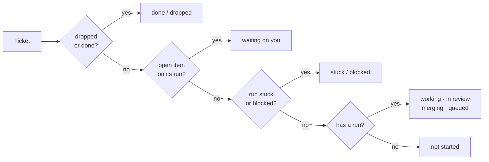
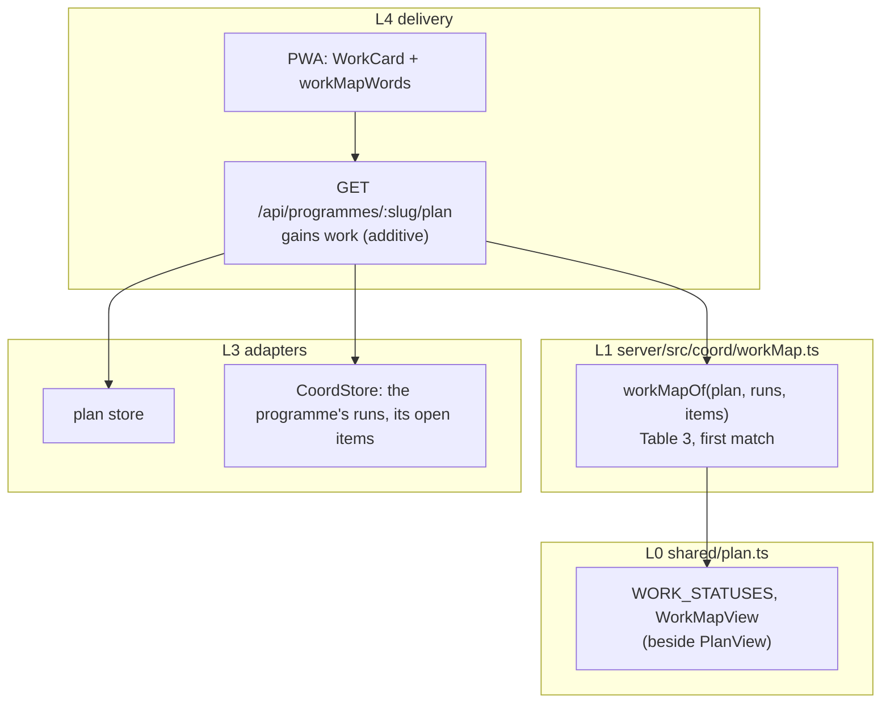

# The programme's work map: what is done and what remains, on its page

**Spec** · 2026-11-16 · Status: Draft, for the operator · Owner: the operator · Linear: none · Related:
`docs/superpowers/specs/2026-10-31-programme-ledgers-design.md` (Goals, Waiting on you),
`docs/superpowers/specs/2026-11-10-linear-hierarchy-design.md` (the stored plan: epics, checkpoints, tickets),
`docs/superpowers/plans/2026-11-16-programme-work-map.md` (the build), desktop polish Task C37 (D-8669)

## In short

The programme page shows Goals, Waiting on you and the open runs, but not the programme's work as a list. It never says
what the programme set out to do, how much is done and what remains. This design adds a **Work** card below Goals. It
starts with one summary line, such as "14 of 22 done", and a bar. Below that, the work is grouped by phase in plan
order. Each task has one line from the plan and a status the server derives from facts it already holds. Finished phases
and finished tasks fold away but are still counted. The source is the plan ccrc already stores for a programme (epics
and tickets, built by the Linear hierarchy's wave 2), so there is one owner and no typed status. Two small additions keep the count honest:
a work run must name the task it does once its phase lists tasks, and a coordinator can record a task done with its
pull request (§4.1). A programme with no stored plan, which today is 14 of the 16 programmes that have runs, gets an honest fallback: its work runs so far,
with a note that what remains is not known. Check §2 (where the plan lives, measured), §4 (statuses) and the three
questions in "Waiting on you".

## 1. Context

This section says what the operator asked for and what the page shows today.

The operator, 2026-11-16, with a screenshot of one programme's page: "can we improve this screen to have the actual
tasks/waves/phases with their descriptions and statuses visible there too, maybe below the summary description? I want
to see at a glance on that page what work remains outstanding in the programme, what work is already done, at a high
level."

What the page draws today (`pwa/src/ledgers/ProgrammeScreen.tsx`, sourced):

- **The head:** the programme's name, its current wave, the wave counts (working, waiting, queued, done, failed) and
  its coordinator (`ProgrammeHeadFacts`, `ProgrammeRuns.tsx`).
- **Goals:** the pinned spec's "In short", its date, a link to the spec, and "Changed since approval"
  (`GoalsPanel.tsx`; ledgers spec §4).
- **Waiting on you:** a count that links to the filtered Waiting on you page, or what the programme waits on (ledgers
  spec D29).
- **Runs:** the open runs as raw rows ("working build: ccd arms A · wave 100 … 0/5 settled 10 commits"), and "Closed
  waves · 50" folded (`ProgrammeRunsSection`).

Runs and waves are the machine's bookkeeping. A wave number says when something ran, not what it was for, and a run's
"0/5 settled" counts the coordinator's work items, which read `0/N` until a verified advance by design
(`RunSummary.items`, D-5914). Nothing on the page lists the work the programme set out to do.

## 2. Where a programme's plan of work lives (measured)

This section measures where the work list could come from, on five programmes of different shapes, and picks a
source. Every figure here was measured on 2026-11-16, on `origin/main` `0c573d7f3` for files and on the live server
for runs and plans.

### 2.1 The candidate sources

| Source | What it holds | Status in it | Server reads it today |
|---|---|---|---|
| The stored plan (`plan_epics`, `plan_checkpoints`, `plan_tickets`; `GET /api/programmes/:slug/plan`) | Epics in order, each with a one-line summary, its waves, checkpoints and tickets; each ticket a key, title and kind | Ticket `open`, `started`, `done`, `dropped`, moved by the server as its run advances (`onRunAdvancedInTx`, `planStore.ts`) | Yes |
| Runs (`runs`, the runs frame, `GET /api/runs/find`) | One row per wave run, with its title (since migration 43), state, stuck verdict and who it waits on | Measured run states | Yes |
| Plan files' task headings (`### Task …`) | A task's id and a one-line description | None in the heading | No |
| Plan files' checkboxes (`- [ ]`) | Steps inside a task | Ticked by hand, if at all | No |
| The programme ledger's Waves table (`docs/superpowers/programs/<slug>.md`) | One row per wave or piece: scope, PRs, state | Typed by hand | No |
| The spec's phases | The design's stages | None | No |

*Table 1. The sources of a programme's work list, and where each status comes from.*

### 2.2 How well each covers real programmes

| Programme | Shape | Stored plan | Plan files | Ledger Waves table | Runs |
|---|---|---|---|---|---|
| desktop-polish | One plan, 73 task headings (`### Task T0` to `### Task C35`), 132 waves, open-ended: tasks are added as the operator finds them | None (`planned: false`) | Headings name each task in one line. 4 of 274 checkboxes ticked, though most tasks have merged | None: the ledger is a log of rulings (R112 to R125), with no Waves table | Recent work runs are titled by task ("Desktop polish: Task C35, …"), so a run maps to a task by its id |
| overlord | 63 plan files in two folders. W1's index lists 29 pieces in 67 pull requests. 5 open runs | None | 318 task headings. 0 of 1,513 checkboxes ticked | 28 rows. W1 reads "not planned yet" while its pieces are being built: stale | Runs are titled by piece and letter ("build: ccd arms A"), matched to a piece only by its words |
| terminal-drawer-fit (small) | 4 waves, then a successor; one planned run | None, though 6 done-when entries are stored | One plan per wave | 4 rows. Rows 1 and 2 read "awaiting approval" for a month after both merged (D-5013) | 1 run, `planned` |
| box-token-lifecycle (finished) | 2 waves built as 4 runs, 2 waves left for later | None | Two plans | 6 rows, accurate, "later" for the last two | Too old for the server's closed-runs read |
| Two programmes in other projects | 6 epics with 26 tickets, and 1 epic | **Declared** | Not read | Not read | Their runs attach to tickets: a ticket made for a run reads `started` |

*Table 2. Five measured programmes and how each source covers them. 2 of the 16 programmes with runs on the live server
have a stored plan; 14 have none.*

Across all 862 plan files on `main`, 1,724 of 23,366 checkboxes are ticked (7%), in 70 files. A checkbox is a step for
the builder, and nobody ticks it after a merge.

### 2.3 The source, decided

**The stored plan is the source of the work list** (D1). It is the only one of the six that is structured, held by the
server, scoped to one programme, and whose status the server moves from run facts rather than from typing. It is also
already the Coordination context's model of "the programme's plan of work", ruled by the operator on 2026-11-10 (Linear
hierarchy design §4), so the work map adds no second model.

The others are rejected as sources, each for a measured reason:

- **Checkboxes** are not ticked (Table 2), so they cannot say what is done.
- **Ledger Waves tables** are typed by hand and go stale (terminal-drawer-fit for a month, the Overlord's W1 row now).
  The brief rules out a typed status.
- **Task headings** describe work well. But the server reads no repository file per programme, a programme's plan may
  sit in another repository, and the heading grammar differs by programme. Parsing them would build a second plan
  model beside the stored one.
- **Runs alone** cover only work that has started. They cannot say what remains.

**What this costs.** Today 14 of the 16 programmes with runs have no stored plan, desktop-polish and the Overlord among
them. A programme created since the plan model landed must declare one before its first run (`plan-missing`, hierarchy
§4.3), so coverage grows with every new programme. For the rest, two things follow: a fallback view (§5), and a
question to the operator about adding plans to live programmes (Waiting on you, Q1). A programme that declares its plan
late records the tasks it has already finished with their pull requests (§4.1), and its runs from before the plan stay
visible in a folded group of their own (§5.1).

## 3. What the operator sees

This section describes the Work card at each width. The mockups use neutral sample data.

*Figure 1. Desktop at 1440 wide. The Work card sits below Goals in the left column. Waiting on you moves to the top of
the right column, above Runs. Phases 1 and 2 are finished and folded to one line each. Phase 3 shows its outstanding
tasks, with its three done tasks folded.*

*Figure 2. Phone at 390 wide. One column in this order: Goals, Work, Waiting on you, Runs. Each task row stacks its
status, its line and its run link.*

The card, top to bottom:

1. **The summary.** "14 of 22 done" in large type, then the outstanding counts: "3 in progress · 1 waiting · 4 not
   started". A bar beneath it is split by status in the same colours. Dropped tasks are not counted in the total.
2. **Where it comes from.** "From the programme's plan · 4 phases · read 1 min ago". This line says the source, so a
   fallback view (§5) is never mistaken for a plan.
3. **Phases in plan order.** Each phase has one line: its number and title, "3 of 6 done", "2 of 3 checkpoints met",
   and *Open in Linear* when it is bound to Linear. Under the line is its one-line summary from the plan. A finished
   phase (every task done or dropped) folds to its line, with the date it finished. Tapping the line opens it.
4. **Tasks in plan order within a phase**, outstanding tasks first, and finished tasks folded into one "3 done" line at
   the end of the phase. Each row has its status word, its title from the plan, and its facts: the run link and how
   long ago it moved, or the item link and when it is needed.

**Placement (D5).** Work goes directly below Goals, as the operator asked. On desktop, Waiting on you moves from under
Goals to the top of the right column, above Runs. This keeps the Work card next to the summary, and stops a long work
list from pushing Waiting on you out of view. On a phone the order is Goals, Work, Waiting on you, Runs. The head
already carries the "waiting on you" marker, so a long list never hides that something waits on the operator.

**Words.** The card says *phase* and *task*, the operator's words, for the stored plan's *epic* and *ticket*. The plan
model and Linear keep their own names. This is Q3 in "Waiting on you".

## 4. Status: one word per task, derived, never typed

This section defines each status and the fact it comes from. One decider computes every status, first match wins.

| # | When | Status | Group | Footing |
|---|---|---|---|---|
| 1 | The ticket is `dropped` | dropped (folded, counted apart, never in the total) | dropped | Measured: the plan |
| 2 | The ticket is `done` | done | done | Measured: its run reached `done`, which the coordinator does after the merge. Or recorded: the coordinator marked it done with its pull request or run (§4.1) |
| 3 | An open operator item names the ticket's run (`ItemView.runId`), or names an `operator-act` checkpoint the ticket proves | waiting on you | waiting | Measured: the items |
| 4 | The ticket's run carries a stuck verdict (`RunSummary.stuck`) | stuck | waiting | Measured: the server's stuck reader |
| 5 | The run is `planned` and waits behind another run (`blockedBy`) | blocked | waiting | Measured: the run |
| 6 | The run is `dispatched`, `working` or `unknown` | working | in progress | Measured: the run state |
| 7 | The run is `awaiting-review` | in review | in progress | Measured |
| 8 | The run is `merging` or `closing` | merging | in progress | Measured |
| 9 | The run is `planned` and not blocked | queued | in progress | Measured |
| 10 | The ticket is `open` with no run | not started | not started | Measured: the plan |

*Table 3. The status decider, first match wins. Every row reads a stored fact, so nothing is inferred and nothing is
typed.*

- **What is inferred.** One thing only, and only in the fallback (§5): which wave a run without a plan belongs to is
  read from the run row, and its description from its title. Neither is ever shown as a plan.
- **A failed run.** When a run ends `failed`, the server returns its ticket to `open` with no run
  (`onRunAdvancedInTx`), so the task reads "not started" again. Its row adds "last run failed" with a link to that run,
  read from the run that last held the ticket. This is my call: the task is genuinely not under way, and the link
  keeps the history one tap away.
- **Phase counts.** "N of M done" counts the tasks that are not dropped. "Checkpoints met" counts `met` out of the
  checkpoints that are not dropped.
- **The summary's order of counts** follows the groups: done first in the headline, then in progress, waiting, not
  started.
- **Review runs** never make rows. A review shows on its work run's row as "in review" (row 7).

*Figure 3. The status decider in flow order. A task reaches exactly one status.*

### 4.1 Keeping "N of M" honest: two additions to the plan model

The builder check found two gaps in today's plan model (`server/src/coord/planStore.ts`, sourced). Either one would
make "N of M done" wrong, so the build closes both, in the plan store that already owns ticket state.

- **A work run names its task (D10).** Today `runs open` with no `ticket` mints a ticket of its own, keyed
  `run-<id>` (`attachTicketInTx`). The declared task it was doing stays `open` with no run. That piece of work then
  counts twice: once done, and once "not started" forever. From this build, a work run that opens into a phase which
  still has an open declared ticket must name one: `runs open` refuses it `ticket-required` otherwise. The recovery is
  to name a ticket, or to add one with `plan ticket-add` and name it. A phase that declares no tickets, or has none left
  open, still takes a run with no ticket and mints one as today. On the card those rows are tasks like any other: the
  work happened, so it counts.
- **A coordinator records a finished task (D11).** Nothing can set a declared ticket `done` today except its own run
  reaching `done` (`onRunAdvancedInTx`). A programme that declares its plan partway through would show every task it
  finished before the plan as "not started". A new verb, `plan ticket-done <slug> <ticket>`, marks an `open` ticket done
  with its evidence: a merged pull request number or a run id. It is the coordinator's, under the same owner check as
  the other plan verbs, and it is the "coordinator closes it" row the hierarchy design's ticket table already lists
  (its §4.1). The card draws such a task as done, the same as any other done task.

## 5. A programme with no stored plan

This section covers the 14 programmes with no stored plan today, and any older programme that never declares one.

*Figure 4. The fallback. The card says first that no plan is declared and that what remains is not known. Then it
lists the programme's work runs: outstanding first, done and failed folded.*

- **The note comes first**: "No plan declared, so what remains is not known. Below is the work run so far." The card
  never shows "N of M done", because M is unknown.
- **One row per work run**, newest first within each group: in progress and waiting first, done and failed folded. The
  status uses rows 3 to 9 of Table 3, read off the run. A run that ended `done` reads done, and `failed` reads failed.
- **The description** is the run's title. A run with no title, or one whose title only repeats the programme's name
  (measured: some programmes title every run that way), reads "Wave N".
- **The summary** counts runs: "38 work runs done · 2 in progress · 1 failed". The source line says "From this
  programme's runs · waves 1 to 41".
- **Bound.** The read covers every work run of the programme, not the closed-runs read's 50. A long programme still
  shows one folded "Done" line, so the card stays short.

### 5.1 Runs from before the plan

A programme that declares its plan late has work runs with no ticket, opened before the plan existed. On a planned
programme's card they form one folded group after the phases: "Before the plan · 61 work runs", with the same rows as
the fallback when opened (D12). They are not counted in "N of M", because no task in the plan stands for them. A
coordinator that wants them counted declares those tasks and records them done (§4.1).

## 6. How it relates to the Runs card

This section decides between merging, replacing and keeping both (D6).

**Keep both.** The Work card answers *what*: the plan's tasks and how far each has got. The Runs card answers *how the
machine is doing*: claimants, stuck rows with their Abandon, Resume on the head, reviews nested under their wave, and
the closed waves. The two are different questions, and the Runs card's acts (Abandon, Resume, the stuck band) should
stay in one place.

- **Merging** would put each act on a task row and mix review rounds, fix rounds and dispatch failures into the work
  list. The list would stop being readable at a glance.
- **Replacing** would lose the acts, and would leave a programme with no plan with nothing but the fallback.

**They link.** A task row's run link opens the run's record (`runPath`). The Runs card is unchanged, apart from moving
below Waiting on you in the right column (D5).

## 7. Architecture

This section places the parts in the rings and contexts of `docs/superpowers/specs/2026-08-10-architecture-ddd-clean-solid.md`.
Everything belongs to Coordination (C5), the context that owns runs, items and the plan.

*Figure 5. One decider in L1, served on the existing plan read. Delivery reads the stores and hands their facts to the
decider; the console only draws the words.*

- **One owner (D2).** `workMapOf` in `server/src/coord/workMap.ts` is the only place a task's status is decided. It is
  pure: it takes the stored plan, the programme's runs and its open items, and returns the view. The route gathers the
  facts and calls it, and decides nothing itself.
- **The vocabulary** goes in `shared/plan.ts` beside `PlanView`: `WORK_STATUSES` (the ten words in Table 3's status
  column, and `failed`, which only the fallback uses, §5), `WORK_GROUPS` (done, in progress, waiting, not started,
  dropped, failed), and `WorkMapView`. Both lists are spelled
  once and pinned in `server/test/single-definition/plan.test.ts`.
- **The wire (D4).** `GET /api/programmes/:slug/plan`'s answer gains an optional `work: WorkMapView` beside `plan`.
  It is additive, with no `FLEET_PROTO` bump. An older server omits it, and the console then draws no Work card at
  all rather than an empty one. The read already takes a session or the box token, so a coordinator's `plan show`
  gets the same view.
- **The plan store's two additions (§4.1).** `ticket-required` joins `PLAN_REFUSALS` (`shared/plan.ts`), with its
  status in `REFUSAL_STATUS` and its sentence in the console's refusal words, and `planGate` (`openRun.ts`) decides it.
  `plan ticket-done` is a new route under `/api/programmes/:slug/plan/tickets`, on the box token with the owner check
  like its siblings, with a row in `ccd/ccrc-api` and a writer in `planStore.ts`, the one owner of ticket state.
- **No second plan model.** Nothing reads plan files or ledger tables. Statuses come only from the plan, the runs and
  the items, each through its existing store.
- **Freshness (D7).** The console reads the plan on arrival. It reads it again when one of this programme's runs
  changes state or stuck verdict in the runs frame, or when one of its items changes in the waiting frame. Plan edits
  (`plan put`) have no frame, so the source line says when the read was made. This is my call: it adds no new socket
  frame, and plan edits are rare next to run moves.
- **The words** are in a new PWA L1 module, `pwa/src/ledgers/workMapWords.ts`: the status words, the summary line and
  the fold labels. The card, `pwa/src/ledgers/WorkCard.tsx`, is L4 and decides nothing.
- **The hierarchy's Plan section (D8).** The Linear hierarchy plan's Task 5.2 planned a "Plan section" on this same
  page: epics with their state, checkpoints met, open tickets and *Open in Linear*. The Work card is that section, with
  statuses and the fallback added. Building both would put two views of one plan on one page, so this design takes
  5.2's place. The done-when list with each entry proved or not, which 5.2 also listed, belongs with Goals and stays
  hierarchy work. Its epic page (Task 5.3) is unchanged, and a phase line can link to it once it exists.

## 8. Decisions

These are the design's decisions. D1 to D12 are mine, on the brief's rulings. Q1 to Q3 are the operator's.

| # | Decision | Options considered | Chosen, and why | Status |
|---|---|---|---|---|
| D1 | The source of the work list | Stored plan; plan files' headings; checkboxes; ledger Waves tables; runs | The stored plan: structured, server-held, one owner, statuses moved by run facts (§2) | Proposed |
| D2 | Where status is decided | In the console; in the route; one L1 decider | One pure decider, `workMapOf`, in Coordination | Proposed |
| D3 | Status words | Free text; the run's own state word; a fixed table | Ten words in five groups, first match (Table 3) | Proposed |
| D4 | The wire | A new route; a new frame; a field on the plan read | `work` on `GET /api/programmes/:slug/plan`, additive | Proposed |
| D5 | Placement | Work below Waiting on you; Work below Goals | Below Goals, as asked; Waiting on you moves to the right column on desktop | Proposed |
| D6 | The Runs card | Merge; replace; keep both | Keep both and link them (§6) | Proposed |
| D7 | Refresh | A new frame; a timer; re-read on run and item changes | Re-read on this programme's run and item changes, with the read's time shown | Proposed |
| D8 | The hierarchy's Task 5.2 | Build both; build 5.2 and skip this; this replaces 5.2 | This replaces 5.2; done-when stays with the hierarchy | Proposed |
| D9 | A programme with no plan | Show nothing; parse plan files; the runs so far | The runs so far, under a note that what remains is not known (§5) | Proposed |
| D10 | A run that names no task | Allow and double count; match it to a task by its words; require a task | Require one while its phase has an open declared task (`ticket-required`) | Proposed |
| D11 | Work done before the plan | Leave it "not started"; declare only what remains; record it done | A coordinator's `plan ticket-done`, with a pull request or run as evidence | Proposed |
| D12 | Runs from before the plan | Hide them; count them; fold them apart | One folded "Before the plan" group, not counted in N of M | Proposed |
| Q1 | Plans for live programmes | Add now; at the next wave boundary; never | Recommended: each live programme's coordinator declares its plan at its next wave boundary | Waiting |
| Q2 | Order inside the card | Plan order with done folded; outstanding first across phases | Recommended: plan order, outstanding first within a phase, done folded | Waiting |
| Q3 | Words on the card | Phase and task; epic and ticket | Recommended: phase and task | Waiting |

*Table 4. Decisions. "Proposed" is mine, for the operator to check while reading.*

## 9. Testing and proof

This section says how the build proves the design. The plan carries the steps.

- **The decider.** `server/test/work-map.test.ts` has one case per row of Table 3, and a case per precedence that
  matters: an item beats a stuck verdict, stuck beats working, dropped is never counted. It joins `MUTANT_SETS`
  (`server/test/sim/mutation-floors.test.ts`) with a floor measured at merge, so a deleted row reds the suite.
- **The plan store's additions.** `ticket-required` reds when a run opens with no ticket into a phase with an open
  declared one, and passes for a phase with none open. `plan ticket-done` refuses a caller that is not the programme's
  coordinator, a ticket that is not `open`, and a body with no evidence.
- **The fallback.** Cases for a programme with no plan: no M in the summary, titles that repeat the programme's name
  read "Wave N", failed runs fold.
- **The wire.** The plan route's test asserts `work` is present beside `plan`, and that the console's reader draws no
  card when `work` is absent (an older server).
- **The card.** jsdom tests for the summary, the folds, the source line and every status word. A browser test of the
  programme page at 360, 390, 1280, 1470 and 1920 wide, in both skins and both themes: no sideways scroll, no
  clipped title, and the order of cards at each width.
- **On the live console.** After the build, the page of a programme with a stored plan, and of one without, are each
  checked against `plan show` and the runs list.

## Where things stand

### Agreed

- The brief's rulings (2026-11-16): the Work card goes below the Goals summary, on phone and desktop. Status is derived,
  never typed. One owner in Coordination, decided in L1, served on the existing programme read, additive on the wire.
- The measurement in §2, and the source it picks (D1), are on the record for the operator to check.

### Waiting on you

- **Q1. Should live programmes declare their plans now?** Recommended: yes. Each programme with open runs, desktop-polish
  and the Overlord among them, declares its plan with `plan put` at its next wave boundary. It records the tasks it has
  already finished with their pull requests (§4.1), so "N of M" covers the whole programme. Until then, its Work card
  shows the fallback (§5). Declaring a plan has two effects to weigh: each later run must open into a wave a phase lists
  (`wave-epic-mismatch`) and name its task (`ticket-required`), so an open-ended programme like desktop-polish revises
  its plan as it adds tasks; and once the hierarchy's sync ships (its wave 3), the plan is mirrored into Linear.
  Finished programmes are not back-filled.
- **Q2. In what order does the card list the work?** Recommended: phases in plan order, with outstanding tasks first in
  each phase and done tasks folded at its end, and finished phases folded to one line. The alternative lists every
  outstanding task first, across all phases, which loses the phases' order.
- **Q3. What does the card call the levels?** Recommended: "phase" and "task", the operator's own words. The plan model
  and Linear keep "epic" and "ticket". The alternative uses "epic" and "ticket" everywhere.

### Later

- The done-when list with each entry proved or not, beside Goals: the Linear hierarchy's console wave.
- A phase line linking to its epic page, once the hierarchy's Task 5.3 builds that page.
- A frame for plan edits, if a stale read is ever seen to matter. Today the source line shows when the read was made.

---

*Written by Claude for the operator. Diagrams are Mermaid text; the mockups are rendered from
`2026-11-16-programme-work-map/mockup.html`, with neutral sample data.*
