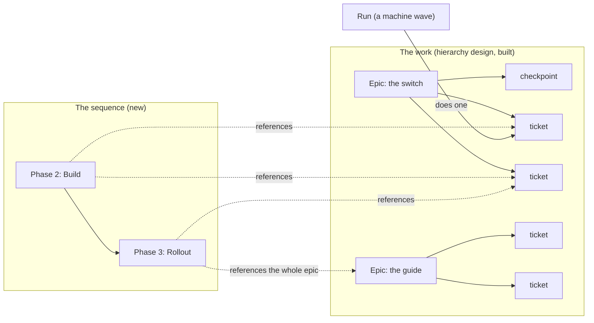
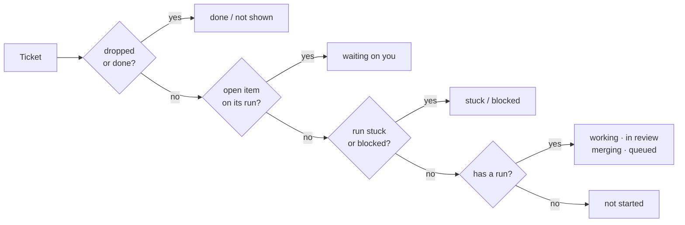
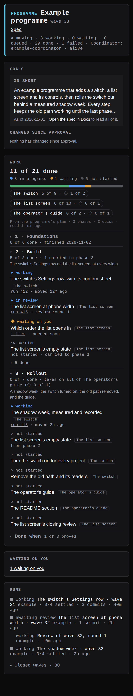
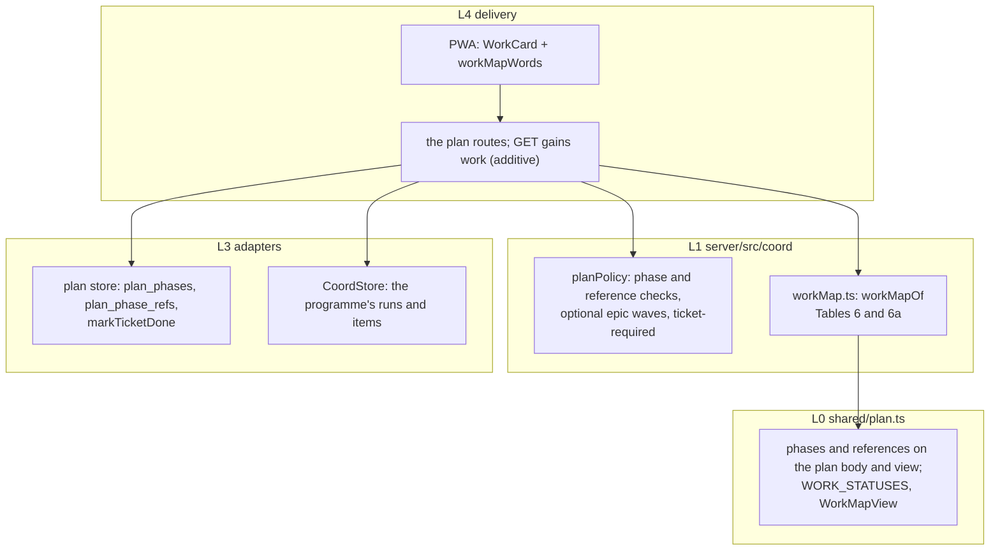

# The programme's work map: what is done and what remains, on its page

**Spec** · 2026-11-16 · Status: Draft, for the operator · Owner: the operator · Linear: none · Related:
`docs/superpowers/specs/2026-11-10-linear-hierarchy-design.md` (the plan model this builds on: programme, epic,
checkpoint, ticket), `docs/superpowers/plans/2026-11-10-linear-hierarchy.md` (its Task 5.2, which this supersedes),
`docs/superpowers/specs/2026-10-31-programme-ledgers-design.md` (Goals, Waiting on you),
`docs/superpowers/plans/2026-11-16-programme-work-map.md` (the build), desktop polish Task C37 (D-8669)

## In short

The programme page shows Goals, Waiting on you and the open runs. It never lists the programme's work, so it cannot say
what is done and what remains. This design adds a **Work** card below Goals, built on the plan model the Linear
hierarchy design already defines and wave 2 already built: programme, epic, checkpoint and ticket. To that it adds one
thing the operator asked for, a separate **sequence** axis. **Phases** are listed in order, and each **references** the
epics and tickets it takes on, without owning or copying them. A ticket may appear in several phases, for example when
it slips to the next one. A ticket's status comes from the ticket alone, never from a phase. A phase's progress is read
from what it references. The card leads with the phases. Each ticket in a phase has one line, a status and a tag naming
its epic. A strip under the headline ("11 of 21 done") gives each epic's count and its checkpoints. The card is the
hierarchy plan's Task 5.2, its Plan section, extended. Check §2 (measured), §3 (the model), §5 (the card), §8 (what this
changes in the hierarchy design) and the four questions in "Waiting on you".

## 1. Context

This section says what the operator asked for, what they have ruled since, and what the page shows today.

The operator, 2026-11-16, with a screenshot of one programme's page: "can we improve this screen to have the actual
tasks/waves/phases with their descriptions and statuses visible there too, maybe below the summary description? I want
to see at a glance on that page what work remains outstanding in the programme, what work is already done, at a high
level."

Four rulings followed on the first draft, the same day:

| # | The operator's words | What it settles |
|---|---|---|
| O1 | "the thing is that a wave/phase can have many tickets/epics in it potentially, so these are separate concepts I believe" | The sequence (phases, waves) and the work (epics, tickets) are two axes, not one |
| O2 | "I guess we can allow references to epics / tickets that are part of a wave/phase" | A phase references the epics and tickets it takes on. It neither owns nor copies them |
| O3 | A ticket in more than one phase: "a good idea" | One ticket may be referenced by several phases |
| O4 | "I guess if we properly implement linear it should have the initiatives, projects, etc." | The Linear hierarchy design is the authority for the work model; this design adds the sequence beside it |

*Table 1. The operator's rulings on the first draft. The first draft mapped a phase to an epic; departure
`phase-is-not-epic` records the change.*

What the page draws today (`pwa/src/ledgers/ProgrammeScreen.tsx`, sourced): the head (name, current wave, wave counts,
coordinator), Goals (the pinned "In short", a link to the spec, changes since approval), Waiting on you (a count, or what
the programme waits on), and Runs (the open runs as raw rows, closed waves folded). A run's "0/5 settled" counts the
coordinator's work items, which read `0/N` until a verified advance by design (D-5914).

## 2. Where a programme's plan of work lives (measured)

This section measures the sources, the state of the hierarchy's build, and how work and sequence relate today. Files were
measured on `origin/main`, and runs and plans on the live server, on 2026-11-16.

### 2.1 The candidate sources

| Source | What it holds | Status in it | Server reads it today |
|---|---|---|---|
| The stored plan (`plan_epics`, `plan_checkpoints`, `plan_tickets`; `GET /api/programmes/:slug/plan`) | Epics in order, each with a summary, its waves, checkpoints and tickets | Ticket `open`, `started`, `done`, `dropped`, moved by the server as its run advances (`onRunAdvancedInTx`) | Yes |
| Runs | One row per dispatch: title, state, stuck verdict, who it waits on | Measured run states | Yes |
| Plan files' task headings | A task's id and a one-line description | None | No |
| Plan files' checkboxes | Steps inside a task | Ticked by hand, if at all | No |
| The programme ledger's Waves table | One row per wave or piece | Typed by hand | No |
| The spec's phases | The design's stages | None | No |

*Table 2. The sources, and where each status comes from.*

| Programme | Shape | Stored plan | Plan files | Ledger Waves table | Runs |
|---|---|---|---|---|---|
| desktop-polish | One plan, 73 task headings in tracks, 132 waves, open-ended | None | 4 of 274 checkboxes ticked, though most tasks merged | None: the ledger logs rulings | Titled by task ("Desktop polish: Task C35, …") |
| overlord | Stages W0, W1a, W1 to W6; W1 is 29 pieces in 67 pull requests, over 63 plan files | None | 0 of 1,513 ticked | 28 rows; W1 reads "not planned yet" while it is being built | Titled by stage or piece ("plan: W1 inbox and reads") |
| terminal-drawer-fit (small) | 4 waves, then a successor | None | One plan per wave | 4 rows, once a month stale (D-5013) | 1 run, `planned` |
| box-token-lifecycle (finished) | 2 spec waves built as 4 runs; 2 for later | None | Two plans | 6 rows, accurate | Too old for the closed-runs read |
| Two programmes in other projects | 6 epics with 26 tickets, and 1 epic | **Declared** | Not read | Not read | Each run attaches to one ticket |

*Table 3. Five programmes. 2 of the 16 programmes with runs have a stored plan; 14 have none. Across all 862 plan files,
1,724 of 23,366 checkboxes are ticked (7%).*

**The source, decided (D1).** The stored plan is the only source that is structured, held by the server, scoped to one
programme, and whose status the server moves from run facts. Checkboxes are not ticked, ledger tables are typed and go
stale, headings would need a second plan model parsed from repositories, and runs alone cannot say what remains.

### 2.2 How far the hierarchy design is built

| Hierarchy wave | What it builds | On `main` |
|---|---|---|
| 1 | The proxy additions | Yes (#2612), with FX2's capture (#2746) |
| 2 | The plan model: epics, checkpoints, tickets, the `plan` verbs | Yes (#2661) |
| 3 | The sync to Linear | No |
| 4 | Drift and the inbound path | No |
| 5 | The console, Task 5.2 (the Plan section) among it | No |
| 6 | The skills | No |
| 7 | The migration | No |

*Table 4. The hierarchy's build, measured on `main`. No run is open on it. The coordinator is asking the operator who
picks up waves 3 to 7; this design does not plan them.*

The Work card needs only wave 2. Its "Open in Linear" links appear once the sync exists (wave 3), because they read the
bindings the sync writes. Until then a plan object has no URL and the card draws no link.

### 2.3 How the work and the sequence relate today

| Question | Answer | Footing |
|---|---|---|
| Does a ticket name a phase or wave? | No. A ticket has an epic and an optional checkpoint. It reaches a wave only through the run that holds it (`runs.ticketId`, `runs.wave`) | Measured: schema 59, `shared/plan.ts` |
| Does a run name its tickets? | One at most (`runs.ticketId`). A run with none mints one (`attachTicketInTx`) | Measured: `planStore.ts` |
| What is a wave in the machine? | A run's number, not a stage. Across six programmes no wave holds two work runs (overlord 105 waves, desktop-polish 21, and four more programmes): each parallel worker gets a wave of its own | Measured: the live runs |
| What is a phase, as the operator means it? | A stage spanning many machine waves. The Overlord's W1 runs over machine waves 76 to 105 and more, its pieces' plan and build runs interleaved | Measured: run titles and waves |
| Where is a phase stored? | Nowhere: in run titles, plan folder names and ledger rows | Measured |
| Epic to wave | Each epic lists one contiguous range of waves, and no wave sits in two epics (`waves-not-contiguous`, `wave-overlap`). A run's wave picks its epic (`epicForWave`) | Measured: `planPolicy.ts` |
| Can two epics run in parallel? | Not in practice: parallel pieces get consecutive waves, so an epic per piece would need interleaved ranges, which the plan refuses | Inferred from the two rules above |
| What the stored plans did | The 6-epic plan made each epic a stage, "W0 …" to "W5 …", one wave each. The hierarchy design's own definition of an epic is "one plan-sized stage of a programme" (its §3) | Measured: `plan show`; sourced |

*Table 5. Work and sequence today. The plan has no sequence of its own, so epics stand in for stages.*

## 3. The model: the work, and the sequence that references it

This section adds the sequence to the hierarchy's plan model. Nothing in the work model is renamed or copied.

*Figure 1. The sequence references the work. Phase 2 references two tickets of one epic; one of them also sits in
phase 3, where it slipped. Phase 3 references the whole of a second epic. A run still does one ticket.*

- **The work** is the hierarchy design's, unchanged: programme, epic, checkpoint, ticket (its §3 and §4), mirrored to
  Linear as initiative, project, milestone and issue. An epic is a plan-sized body of work. It may be a stage, as both
  stored plans use it (a phase then references that one epic whole), or a feature that runs across phases.
- **A phase** is new. A programme has an ordered list of phases, each with a key, a title and a one-line summary.
- **A phase references** the epics and tickets it takes on (O2). A reference names either a whole epic or one ticket,
  and a phase may hold both kinds. The phase owns nothing: dropping a phase drops its references, never a ticket.
- **A ticket in several phases** is allowed (O3). Slipping a ticket to the next phase is one more reference, written by
  the coordinator. The earlier reference stays, so the card can say where the ticket came from.
- **A whole-epic reference** means every ticket of that epic that is not dropped, including tickets added to the epic
  later (D15, my call). This is what "takes on the guide" means in plain words, and it needs no re-reference when a
  coordinator adds a ticket. A coordinator who wants one ticket of that epic in another phase adds a ticket reference
  there too.
- **Status lives on the ticket.** A ticket's status is the one Table 6 derives (§4), whichever phase it is read under.
  A phase's progress is computed from the statuses of what it references. A phase stores no state at all.
- **Waves stay the machine's.** A wave is a run's number (§2.3). The card never uses it as a stage.
- **Epics free of wave ranges (D13).** An epic's `waves` becomes optional. A run that names a ticket takes its epic from
  the ticket, and its wave is checked against the epic's range only when the epic lists one. So feature-sized epics can
  run in parallel inside a phase. An epic that lists waves keeps today's rules, so both stored plans stay valid.

### 3.1 A phase's progress, and a ticket that slipped

A phase's referenced set is the union of its ticket references and the not-dropped tickets of its whole-epic references,
each ticket once. The phase is read over that set:

| A referenced ticket that is | Reads in this phase | Counts in this phase as |
|---|---|---|
| Done | Its status | Done |
| Not done, and referenced by a later phase too | "carried to phase 3", with its status | Carried: not outstanding here, and not done |
| Not done, and in no later phase | Its status | Outstanding |
| Dropped | Not shown | Not counted |

*Table 6a. How a phase reads its tickets. "Later" is later in the phases' order.*

- **A phase is done** when every ticket it references is done or carried. Its line then reads, for example, "7 of 8 done
  · 1 carried to phase 3". It folds like any finished phase.
- **The headline counts each ticket once (D16).** "11 of 21 done" counts the programme's distinct tickets that are not
  dropped, whatever phases reference them. The epic strip counts each epic's own tickets once in the same way.
- **In the later phase,** the slipped ticket shows with "from phase 2" beside its status, so the slip reads both ways.
- **A ticket no phase references** sits in a last group, "Not in a phase", so nothing in the plan is left off the card.

## 4. Status: one word per ticket, derived, never typed

This section defines each status and the fact it comes from. One decider computes every status, first match wins.

| # | When | Status | Group | Footing |
|---|---|---|---|---|
| 1 | The ticket is `dropped` | dropped (not shown, never counted) | dropped | Measured: the plan |
| 2 | The ticket is `done` | done | done | Measured: its run reached `done`, which the coordinator does after the merge. Or recorded: the coordinator marked it done with its pull request or run (§4.1) |
| 3 | An open operator item names the ticket's run (`ItemView.runId`), or names an `operator-act` checkpoint of the ticket | waiting on you | waiting | Measured: the items |
| 4 | The ticket's run carries a stuck verdict (`RunSummary.stuck`) | stuck | waiting | Measured |
| 5 | The run is `planned` and waits behind another run (`blockedBy`) | blocked | waiting | Measured |
| 6 | The run is `dispatched`, `working` or `unknown` | working | in progress | Measured |
| 7 | The run is `awaiting-review` | in review | in progress | Measured |
| 8 | The run is `merging` or `closing` | merging | in progress | Measured |
| 9 | The run is `planned` and not blocked | queued | in progress | Measured |
| 10 | The ticket is `open` with no run | not started | not started | Measured: the plan |

*Table 6. The status decider, first match wins. Every row reads a stored fact.*

- **A failed run** returns its ticket to `open` with no run (`onRunAdvancedInTx`), so the ticket reads "not started"
  again, and its row adds "last run failed" with a link to that run (my call).
- **Review runs** never make rows. A review shows on its work run's row as "in review".

*Figure 2. The status decider in flow order. A ticket reaches exactly one status.*

### 4.1 Keeping "N of M" honest: two additions to the plan model

The builder check on the first draft found two gaps in today's plan model (`planStore.ts`). Either would make the counts
wrong, so the build closes both, in the store that already owns ticket state.

- **A work run names its ticket (D10).** Today `runs open` with no `ticket` mints a ticket of its own (`run-<id>`), and
  the declared ticket it was doing stays `open` forever, counted twice. From this build a work run that opens into an
  epic which still has an open declared ticket must name one: `runs open` refuses it `ticket-required` otherwise. The
  recovery is to name one, or to add one with `plan ticket-add` and name it. An epic with no open declared ticket still
  takes a run with no ticket, as today.
- **A coordinator records a finished ticket (D11).** Only a ticket's own run can make it `done` today, so a programme
  that declares its plan late would show its finished work as "not started". A new verb, `plan ticket-done <slug>
  <ticket>`, marks an `open` ticket done with a merged pull request number or a run id as evidence, under the plan
  verbs' owner check. It is the "coordinator closes it" row the hierarchy design's ticket table already lists (its §4.1).

## 5. What the operator sees

This section describes the Work card at each width. The mockups use neutral sample data.

*Figure 3. Desktop at 1440 wide. The Work card sits below Goals; Waiting on you moves to the top of the right column,
above Runs. Phase 1 is finished and folded. Phase 2 shows its outstanding tickets from two epics, one of them carried
to phase 3. Phase 3 takes on the whole of one epic and two tickets of another. The strip shows each epic's count and
its checkpoints.*

*Figure 4. Phone at 390 wide. One column: Goals, Work, Waiting on you, Runs.*

The card, top to bottom:

1. **The headline.** "11 of 21 done", then the outstanding counts ("3 in progress · 1 waiting · 6 not started") and a
   bar split by status. Each ticket counts once (§3.1).
2. **The epic strip.** One chip per epic in plan order: its title, "5 of 9" and its checkpoints met ("◇ 1 of 2"). A tap
   filters the phases to that epic's tickets and opens a row of its checkpoints under the strip, each with its state,
   its kind, and when met its date and evidence (a pull request, an item, or a document in the Docs reader). A second
   tap clears it (my call: one list on the card, not a second view).
3. **Where it comes from.** "From the programme's plan · 3 phases · 3 epics · read 1 min ago".
4. **Phases in order.** Each phase has one line: number, title, "5 of 8 done", and "1 carried to phase 3" when it has
   one, with its summary below. A phase that references a whole epic says so ("takes on all of The operator's guide")
   and shows that epic's checkpoint count. A finished phase folds to its line, with the date it finished.
5. **Tickets in a phase**, outstanding first in plan order, carried ones next, then the done ones folded into one
   "5 done" line. Each row has its status word, its title, its epic as a tag, and its facts (the run link and how long
   ago it moved, the item link and when it is needed, "carried to phase 3" or "from phase 2").
6. **Done when.** A folded last line, "Done when · 1 of 3 proved", which opens the programme's definition of done, each
   entry marked proved or not, as the hierarchy's Task 5.2 specified.
7. **Open in Linear**, on each epic chip's checkpoint row and once for the initiative, only where the plan object is
   bound (after the hierarchy's sync, §2.2).

**Placement (D5).** Work goes directly below Goals, as asked. On desktop, Waiting on you moves to the top of the right
column, above Runs, so a long list never pushes it out of view. On a phone the order is Goals, Work, Waiting on you,
Runs.

**Which axis leads** is Q2. The recommendation is the sequence: the operator's question is what is done and what
remains, and phases in order answer it top to bottom. The strip already answers "how far is each epic".

### 5.1 A plan with no phases, and a programme with no plan

*Figure 5. The fallback for a programme with no stored plan.*

- **A plan with no phases** (both stored plans today): the card groups tickets by epic, the work axis, and says "No
  phases declared: grouped by epic". Each epic's checkpoints show on its line. The headline and statuses are the same.
- **A programme with no plan** (14 of 16 today): "No plan declared, so what remains is not known. Below is the work run
  so far." One row per work run, outstanding first, done and failed folded, titled by the run, or "Wave N" when the
  title is missing or only repeats the programme's name. The headline counts runs, never "N of M".
- **Runs from before the plan.** Work runs with no ticket form one folded group, "Before the plan · 61 work runs", not
  counted in "N of M" (D12).
- **Bound.** The read covers every work run of the programme, not the closed-runs read's 50.

## 6. How it relates to the Runs card

**Keep both (D6).** The Work card answers *what*: the plan's tickets and how far each has got. The Runs card answers *how
the machine is doing*: claimants, stuck rows with their Abandon, Resume on the head, reviews nested, closed waves. Merging
would put each act on a ticket row and mix review and fix rounds into the work list; replacing would lose the acts and
leave a programme with no plan only the fallback. A ticket row's run link opens the run's record (`runPath`).

## 7. Architecture

This section places the parts in the rings and contexts of `docs/superpowers/specs/2026-08-10-architecture-ddd-clean-solid.md`.
Everything belongs to Coordination (C5), which owns runs, items and the plan.

*Figure 6. The plan store gains the sequence and one writer; one decider makes the view; the existing plan read serves
it. The console only draws the words.*

- **Where the sequence lives (D14).** One new migration adds `plan_phases` (`program`, `key`, `ordinal`, `title`,
  `summary`, `droppedWhy`; unique `program`, `key`) and `plan_phase_refs` (`phaseId`, `kind` `epic` or `ticket`,
  `refId`; unique on all three). New tables only, so an older build reads the file as-is. Both are written by the plan
  store alone, through the existing plan routes: `plan put` carries `phases`, each with its `refs` (epic and ticket
  keys), diffed by key like epics, a vanished phase needing `droppedWhy`. A new verb, `plan phase-ref`, adds or removes
  one reference, so a slip is one call. A reference to an unknown or dropped epic or ticket is refused `unknown-ref`. At
  most 24 phases, like epics.
- **Optional epic waves (D13).** `waves` on an epic becomes optional (`planPolicy.ts`); contiguity and overlap are
  checked among epics that list waves. `planGate` (`openRun.ts`) takes a named ticket's epic from the ticket.
- **The two writers of §4.1.** `ticket-required` joins `PLAN_REFUSALS`, decided in `planGate`. `plan ticket-done` is a
  new route under `/api/programmes/:slug/plan/tickets`, on the box token with the owner check, with a row in
  `ccd/ccrc-api` and a writer in `planStore.ts`, the one owner of ticket state.
- **One decider (D2).** `workMapOf` in `server/src/coord/workMap.ts` is the only place a ticket's status, a phase's
  progress and a carry are decided. It is pure: it takes the stored plan (phases and references included), the
  programme's runs and its open items.
- **The wire (D4).** `PlanView` gains `phases` (each with its references); the plan read's answer gains an optional
  `work: WorkMapView` beside `plan`. Additive, no `FLEET_PROTO` bump; an older server omits both, and the console then
  draws no Work card.
- **No second plan model.** Nothing reads plan files or ledger tables, and the work levels are the hierarchy's.
- **Freshness (D7).** The console reads the plan on arrival, and again when one of this programme's runs changes state or
  stuck verdict, or one of its items changes, in the frames it already has. The source line says when it last read.
- **The words** are in `pwa/src/ledgers/workMapWords.ts` (L1); the card, `pwa/src/ledgers/WorkCard.tsx`, is L4.

## 8. What this changes in the Linear hierarchy design and plan

This section says what the Work card keeps from the hierarchy's Task 5.2, what it changes, and what else in that
design moves.

| Task 5.2 specified | The Work card |
|---|---|
| A Plan section on the programme page, reading `GET /api/programmes/:slug/plan` | **Kept**: the same read, with `work` added |
| Each epic with its state, "3 of 5 met" and its open tickets | **Changed**: each epic is a chip in the strip with its ticket count and checkpoints met; its tickets appear inside the phases, tagged |
| The done-when list, each entry marked proved or not | **Kept**: the card's folded "Done when" line |
| *Open in Linear* for each epic and the initiative; a note when initiatives are off | **Kept**, drawn only once the sync binds the object (its wave 3) |
| "No plan declared yet" | **Changed**: the runs fallback (§5.1) |
| Phone: epic cards; laptop: epics as rows; wide: two columns | **Changed**: phases lead at every width (§5) |
| Not in 5.2 | **Added**: phases, ticket statuses, carries, the epic filter |

*Table 7. Task 5.2 against the Work card. The card supersedes 5.2's design (D8); 5.2's file `PlanSection.tsx` is not
built.*

Elsewhere in the hierarchy design and plan:

- **§3's description of an epic** reads "one plan-sized stage of a programme". With the sequence separate (O1), an epic is
  a plan-sized body of work, which a programme may still plan as a stage. The mapping to Linear (epic to project) is
  unchanged.
- **§4.1 and §4.3** gain phases and their references (D14), optional epic waves (D13), `ticket-required` (D10) and
  `plan ticket-done` (D11).
- **Overlaps with its unbuilt tasks.** Its Task 4.1 also adds a migration and writes `planStore.ts`, and its Task 6.1
  writes `ccd/coordinator-skill/references/plan.md`, which WM5 here also writes. Whichever lands second takes the next
  migration slot and builds on the other's store. Nothing here depends on its waves 3 to 7.
- **Phases in Linear** are Q4.

## 9. Decisions

These are the design's decisions. D1 to D16 are mine, on the brief's rulings and the operator's rulings O1 to O4. Q1 to
Q4 are the operator's.

| # | Decision | Options considered | Chosen, and why | Status |
|---|---|---|---|---|
| D1 | The source of the work list | Stored plan; headings; checkboxes; ledger tables; runs | The stored plan (§2) | Proposed |
| D2 | Where status is decided | In the console; in the route; one L1 decider | One pure decider, `workMapOf` | Proposed |
| D3 | Status words | Free text; the run's state word; a fixed table | Ten words in five groups, first match (Table 6) | Proposed |
| D4 | The wire | A new route; a new frame; fields on the plan read | `phases` on `PlanView`, `work` beside it, additive | Proposed |
| D5 | Placement | Work below Waiting on you; Work below Goals | Below Goals; Waiting on you to the right column on desktop | Proposed |
| D6 | The Runs card | Merge; replace; keep both | Keep both and link them | Proposed |
| D7 | Refresh | A new frame; a timer; re-read on changes | Re-read on this programme's run and item changes | Proposed |
| D8 | The hierarchy's Task 5.2 | Build both; build 5.2 alone; supersede | The card supersedes 5.2 (Table 7) | Proposed |
| D9 | A programme with no plan | Nothing; parse plan files; runs so far | The runs so far, under a note | Proposed |
| D10 | A run that names no ticket | Allow; match by words; require one | Require one while its epic has an open declared ticket | Proposed |
| D11 | Work done before the plan | Not started; declare only what remains; record it | `plan ticket-done` with a pull request or run | Proposed |
| D12 | Runs from before the plan | Hide; count; fold apart | One folded group, not counted | Proposed |
| D13 | Epics tied to wave ranges | Keep; drop for all; optional | Optional, so feature epics run in parallel | Proposed |
| D14 | Where the sequence lives | A field on the ticket; a copy of tickets; references | Phases and a reference table, one writer, the plan store | Proposed |
| D15 | A whole-epic reference | The tickets at the time; every ticket now and later | Every ticket of the epic that is not dropped, now and later | Proposed |
| D16 | A ticket in two phases | Count it in each; count it once | Once in the headline and strip; carried in the earlier phase | Proposed |
| Q1 | Plans for live programmes | Next wave boundary; now; never | Recommended: at each one's next wave boundary | Waiting |
| Q2 | The axis that leads the card | Phases; epics; a switch | Recommended: phases, with epic tags and the strip | Waiting |
| Q3 | The word for a stage | Phase; wave | Recommended: phase | Waiting |
| Q4 | Phases in Linear | Nothing; a label; a milestone; a cycle | Recommended: a label on each issue, once the sync exists | Waiting |

*Table 8. Decisions. "Proposed" is mine, for the operator to check while reading.*

## 10. Testing and proof

- **The sequence.** `plan put` stores phases and their references; `plan phase-ref` adds and removes one; a reference to
  an unknown or dropped epic or ticket is refused; dropping a phase leaves its tickets alone.
- **Optional epic waves.** A run naming a ticket of an epic with no waves opens; two such epics run in parallel; an epic
  that lists waves keeps every refusal it has today.
- **The two writers.** `ticket-required` reds when a run with no ticket opens into an epic with an open declared one.
  `plan ticket-done` refuses a caller that is not the coordinator, a ticket not `open`, and a body with no evidence.
- **The decider.** `server/test/work-map.test.ts`: one case per row of Tables 6 and 6a; a whole-epic reference picks up a
  ticket added later and leaves out a dropped one; a ticket in two phases counts once in the headline and reads carried
  in the earlier phase; a phase whose only open ticket is carried is done; a ticket in no phase sits in "Not in a phase".
  It joins `MUTANT_SETS` with a floor measured at merge.
- **The card.** jsdom tests for the headline, the strip, its filter and checkpoints, carries, folds and every status
  word; a browser test of the programme page at 360, 390, 1280, 1470 and 1920 wide, in both skins and both themes.

## Where things stand

### Agreed

- The brief's rulings (2026-11-16): the Work card below the Goals summary, on phone and desktop; status derived, never
  typed; one owner in Coordination, decided in L1, served on the existing programme read, additive on the wire.
- The operator's rulings O1 to O4 (2026-11-16): the sequence and the work are separate axes; a phase references the
  epics and tickets it takes on; a ticket may sit in several phases; the hierarchy design is the work model.

### Waiting on you

- **Q1. Should live programmes declare their plans now?** Recommended: yes, each programme with open runs (desktop-polish
  and the Overlord among them) at its next wave boundary: its epics and tickets, its phases with their references, and
  the tickets it has already finished recorded with their pull requests (§4.1). Until then its card shows the fallback.
  Two effects: each later run names its ticket, so an open-ended programme adds tickets as it goes; and once the
  hierarchy's sync ships, the epics and tickets are mirrored into Linear.
- **Q2. Which axis leads the card?** Recommended: phases in order, each ticket tagged with its epic, and a strip of epic
  counts and checkpoints under the headline. The alternatives: epics leading with each ticket's phases as tags, which
  answers "how far is each epic" but not "what is under way now"; or a switch between the two.
- **Q3. What does the card call a stage?** Recommended: "phase". "Wave" already names the machine's run number, which the
  page's head shows ("wave 105") and which is one dispatch, not a stage (§2.3).
- **Q4. What does a phase become in Linear?** Recommended: a label on each issue the phase references ("Phase: Build"),
  written by the hierarchy's sync once it exists. A label is the only Linear object an issue can carry several of, so it
  fits a ticket in two phases (O3). The other options: **nothing**, phases stay in ccrc (no other spec changes); a
  **project milestone**, which Linear scopes to one project and the hierarchy already uses for checkpoints, so a phase
  across epics would split into one milestone per project and an issue could sit in only one (changes the hierarchy
  spec's §3 mapping and §5); a **cycle**, which the hierarchy spec lists as a non-goal and Linear scopes to one team,
  time-boxed, one per issue (changes its §2 and §3). A label changes the hierarchy spec's §5.3 (moves), §6 (what ccrc
  writes and owns) and §7.2 (drift on the label).

### Later

- Building the hierarchy's waves 3 to 7, which the coordinator has put to the operator; phases in Linear follow Q4.
- A frame for plan edits, if a stale read is ever seen to matter.

---

*Written by Claude for the operator. Diagrams are Mermaid text; the mockups are rendered from
`2026-11-16-programme-work-map/mockup.html`, with neutral sample data.*
