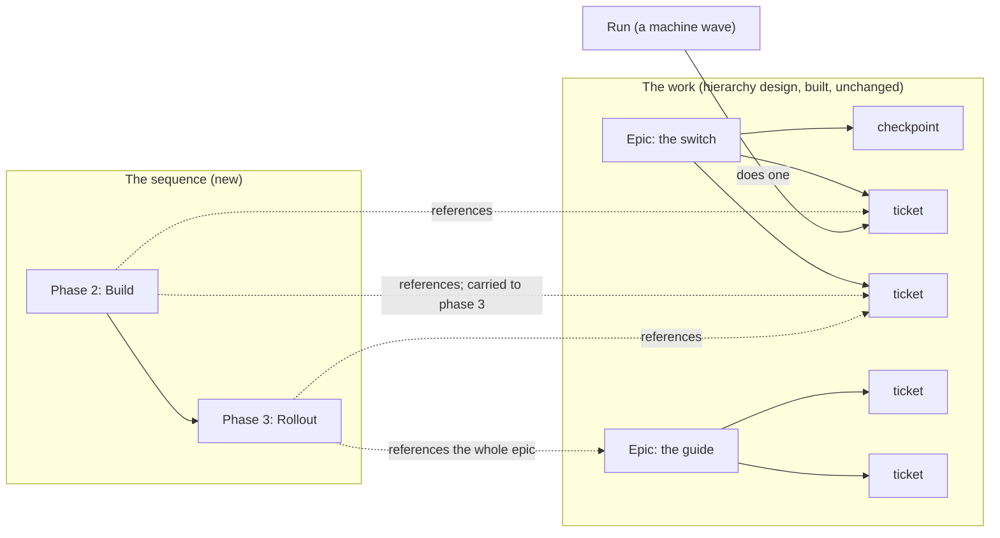
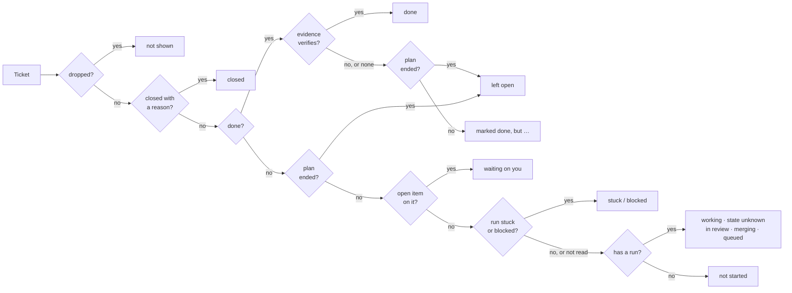
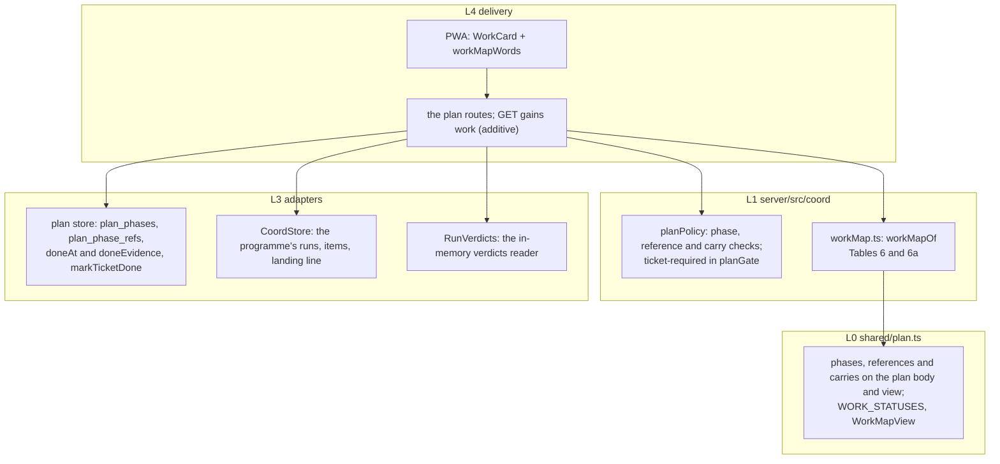

# The programme's work map: what is done and what remains, on its page

**Spec** · 2026-11-16 · Status: Approved by the operator (item 363), amended for review 2268 in WM0 and for reviews 2375 and 2382 in its fix rounds (2026-11-17) ·
Owner: the operator · Linear: none · Related:
`docs/superpowers/specs/2026-11-10-linear-hierarchy-design.md` (the plan model this builds on: programme, epic,
checkpoint, ticket), `docs/superpowers/plans/2026-11-10-linear-hierarchy.md` (its Task 5.2, which this supersedes),
`docs/superpowers/specs/2026-10-31-programme-ledgers-design.md` (Goals, Waiting on you),
`docs/superpowers/plans/2026-11-16-programme-work-map.md` (the build), desktop polish Task C37 (D-8669)

## In short

The programme page shows Goals, Waiting on you and the open runs. It never lists the programme's work, so it cannot say
what is done and what remains. This design adds a **Work** card below Goals, built on the plan model that the Linear
hierarchy design defines and its wave 2 built: programme, epic, checkpoint and ticket, unchanged. Beside it, the design
adds the separate **sequence** axis the operator asked for. **Phases** are listed in order, and each **references** the
epics and tickets it takes on, without owning or copying them. A ticket may sit in several phases. When a ticket slips,
the coordinator records the slip as a **carry** from one phase to the next. A ticket's status comes from the ticket
alone, and **done is derived from evidence the server checks**, never typed. A phase's progress is read from what it
references. The view carries both axes; the card leads with the phases, as the operator ruled: each ticket in a phase
has one line, a status and a tag naming its epic. A strip under the headline ("11 of 21
done") gives each epic's count and its checkpoints. The card is the hierarchy plan's Task 5.2, its Plan section,
extended. Check §2 (measured), §3 (the model), §4 (status and done), §5 (the card) and §8 (what this touches in the
hierarchy design). The operator has ruled all five of the design's questions (R129 to R133).

## 1. Context

This section says what the operator asked for, what they have ruled since, and what the page shows today.

The operator, 2026-11-16, with a screenshot of one programme's page: "can we improve this screen to have the actual
tasks/waves/phases with their descriptions and statuses visible there too, maybe below the summary description? I want
to see at a glance on that page what work remains outstanding in the programme, what work is already done, at a high
level."

Four rulings followed on the first draft, the same day:

| # | The operator's words | What it settles |
|---|---|---|
| O1 | "the thing is that a wave/phase can have many tickets/epics in it potentially, so these are separate concepts I believe" | The sequence (phases, waves) and the work (epics, tickets) are two axes, not one |
| O2 | "I guess we can allow references to epics / tickets that are part of a wave/phase" | A phase references the epics and tickets it takes on. It neither owns nor copies them |
| O3 | A ticket in more than one phase: "a good idea" | One ticket may be referenced by several phases |
| O4 | "I guess if we properly implement linear it should have the initiatives, projects, etc." | The Linear hierarchy design is the authority for the work model; this design adds the sequence beside it |

*Table 1. The operator's rulings on the first draft. The first draft mapped a phase to an epic; departure
`phase-is-not-epic` records the change.*

The coordinator's rulings on the design review (review 2252), the same day: done is derived from facts the server
holds, never typed; a carry is a recorded act, never inferred from two phases naming one ticket; the view carries both
axes, so which one leads is a choice in the card alone; and a change to the hierarchy's approved work model is the
operator's, so this design avoids each one it can and asks about the one it cannot (Q5).

The operator then answered the design's five questions, each with its recommendation:

| # | Item | Question | The operator's answer |
|---|---|---|---|
| R129 | 355 | Q3: the word for a stage | "Phase for a stage; wave stays the machine's run number" |
| R130 | 354 | Q2: which axis leads the card | "Phases lead, in order; each ticket tagged with its epic; a strip of each epic's count and checkpoints under the headline" |
| R131 | 356 | Q4: what a phase becomes in Linear | "A label on each issue a phase references, written by the sync" |
| R132 | 353 | Q1: plans for live programmes | "Yes: each live programme's coordinator declares its plan at its next wave boundary" |
| R133 | 359 | Q5: may an epic list no wave range | Yes: an epic may list no waves. WM6 builds it |

*Table 1b. The operator's answers to the design's questions, with the operator item each was asked in. The operator then
approved the spec (item 363: "start the build at WM0").*

The coordinator's rulings on review 2268 (2026-11-17): the hierarchy's "the coordinator closes it with a reason" is kept,
not narrowed. A ticket closed that way is a separate outcome that reads "closed" with its reason and counts apart from
done and outstanding, as dropped does. Only verified evidence makes done (§4.1, D11).

What the page draws today (`pwa/src/ledgers/ProgrammeScreen.tsx`, sourced): the head (name, current wave, wave counts,
coordinator), Goals (the pinned "In short", a link to the spec, changes since approval), Waiting on you (a count, or what
the programme waits on), and Runs (the open runs as raw rows, closed waves folded). A run's "0/5 settled" counts the
coordinator's work items, which read `0/N` until a verified advance by design (D-5914).

## 2. Where a programme's plan of work lives (measured)

This section measures the sources, the state of the hierarchy's build, and how work and sequence relate today. Files were
measured on `origin/main`, and runs and plans on the live server, on 2026-11-16.

### 2.1 The candidate sources

| Source | What it holds | Status in it | Server reads it today |
|---|---|---|---|
| The stored plan (`plan_epics`, `plan_checkpoints`, `plan_tickets`; `GET /api/programmes/:slug/plan`) | Epics in order, each with a summary, its waves, checkpoints and tickets | Ticket `open`, `started`, `done`, `dropped`, moved by the server as its run advances (`onRunAdvancedInTx`) | Yes |
| Runs | One row per dispatch: title, state, stuck verdict, who it waits on | Measured run states | Yes |
| Plan files' task headings | A task's id and a one-line description | None | No |
| Plan files' checkboxes | Steps inside a task | Ticked by hand, if at all | No |
| The programme ledger's Waves table | One row per wave or piece | Typed by hand | No |
| The spec's phases | The design's stages | None | No |

*Table 2. The sources, and where each status comes from.*

| Programme | Shape | Stored plan | Plan files | Ledger Waves table | Runs |
|---|---|---|---|---|---|
| desktop-polish | One plan, 73 task headings in tracks, 132 waves, open-ended | None | 4 of 274 checkboxes ticked, though most tasks merged | 40 rows for waves 1 to 42, stale against wave 132 | Titled by task ("Desktop polish: Task C35, …") |
| overlord | Stages W0, W1a, W1 to W6; W1 is 29 pieces in 67 pull requests, with 48 plan files in its W1 folder (49 with the index plan beside it) | None | 0 of 1,513 ticked | 28 rows; W1 reads "not planned yet" while it is being built | Titled by stage or piece ("plan: W1 inbox and reads") |
| terminal-drawer-fit (small) | 4 waves, then a successor | None | One plan per wave | 4 rows, once a month stale (D-5013) | 1 run, `planned` |
| box-token-lifecycle (finished) | 2 spec waves built as 4 runs; 2 for later | None | Four plans | 6 rows, stale: row 2a still reads PLANNED, rows 2c and 3a are missing | Too old for the closed-runs read |
| Two programmes in other projects | 6 epics with 26 tickets, and 1 epic | **Declared** | Not read | Not read | Each run attaches to one ticket |

*Table 3. Five programmes. 2 of the 16 programmes with runs have a stored plan; 14 have none. Across all 862 plan files,
1,724 of 23,366 checkboxes are ticked (7%). Three cells were corrected by the design review.*

**The source, decided (D1).** The stored plan is the only source that is structured, held by the server, scoped to one
programme, and whose status the server moves from run facts. Checkboxes are not ticked, ledger tables are typed and go
stale, headings would need a second plan model parsed from repositories, and runs alone cannot say what remains.

### 2.2 How far the hierarchy design is built

| Hierarchy wave | What it builds | On `main` |
|---|---|---|
| 1 | The proxy additions | Yes (#2612), with FX2's capture (#2746) |
| 2 | The plan model: epics, checkpoints, tickets, the `plan` verbs | Yes (#2661) |
| 3 | The sync to Linear | No: in flight (run 2243), with a claim on `planStore.ts` |
| 4 | Drift and the inbound path | No |
| 5 | The console, Task 5.2 (the Plan section) among it | No |
| 6 | The skills | No |
| 7 | The migration | No |

*Table 4. The hierarchy's build, measured on `main`. The operator set up its waves 3 to 7 separately, outside this
programme; wave 3 is in flight. This design plans none of them.*

The Work card needs only wave 2. Its "Open in Linear" links appear once the sync (wave 3) binds the plan objects,
because they read the bindings the sync writes. Until then a plan object has no URL and the card draws no link.

### 2.3 How the work and the sequence relate today

| Question | Answer | Footing |
|---|---|---|
| Does a ticket name a phase or wave? | No. A ticket has an epic and an optional checkpoint. It reaches a wave only through the run that holds it (`runs.ticketId`, `runs.wave`) | Measured: schema 59, `shared/plan.ts` |
| Does a run name its tickets? | One at most (`runs.ticketId`). A run with none mints one (`attachTicketInTx`) | Measured: `planStore.ts` |
| What is a wave in the machine? | A run's number, not a stage. Across six programmes no wave holds two work runs (overlord 105 waves, desktop-polish 21, and four more programmes): each parallel worker gets a wave of its own | Measured: the live runs |
| What is a phase, as the operator means it? | A stage spanning many machine waves. The Overlord's W1 runs over machine waves 76 to 105 and more, its pieces' plan and build runs interleaved | Measured: run titles and waves |
| Where is a phase stored? | Nowhere: in run titles, plan folder names and ledger rows | Measured |
| Epic to wave | Each epic lists one contiguous range of waves, and no wave sits in two epics (`waves-not-contiguous`, `wave-overlap`). A run's wave picks its epic (`epicForWave`), and a named ticket of another epic is refused (`wave-epic-mismatch`) | Measured: `planPolicy.ts`, `openRun.ts` |
| Can two epics run in parallel? | Not in practice: parallel pieces get consecutive waves, so an epic per piece would need interleaved ranges, which the plan refuses | Inferred from the two rules above |
| What the stored plans did | The 6-epic plan made each epic a stage, "W0 …" to "W5 …", one wave each. The hierarchy design's own definition of an epic is "one plan-sized stage of a programme" (its §3) | Measured: `plan show`; sourced |

*Table 5. Work and sequence today. The plan has no sequence of its own, so epics stand in for stages.*

## 3. The model: the work, and the sequence that references it

This section adds the sequence beside the hierarchy's plan model. Nothing in the work model is renamed, copied or
changed.

*Figure 1. The sequence references the work. Phase 2 references two tickets of one epic; the coordinator carried one of
them to phase 3. Phase 3 references the whole of a second epic. A run still does one ticket.*

- **The work** is the hierarchy design's, unchanged: programme, epic, checkpoint, ticket (its §3 and §4), mirrored to
  Linear as initiative, project, milestone and issue. Epics keep their wave ranges and every rule on them. Whether an
  epic may run without a wave range, so that feature-sized epics run side by side, was the operator's question Q5,
  answered yes (R133); WM6 builds it.
- **A phase** is new. A programme has an ordered list of phases, each with a key, a title and a one-line summary.
- **A phase references** the epics and tickets it takes on (O2). A reference names either a whole epic or one ticket,
  and a phase may hold both kinds. The phase owns nothing: dropping a phase keeps its references stored and changes no
  ticket.
- **A ticket in several phases** is allowed (O3). It is part of each phase's work until a carry takes it out of one.
- **A carry is a recorded act (D17).** When a ticket slips, the coordinator records it with `plan phase-ref` and
  `op: 'carry'`, from phase A to a later phase B. Only a recorded carry reads "carried to phase B" in A and "from phase
  A" in B. Two phases that name one ticket without a carry, for example through two whole-epic references, both keep it
  as their work.
- **A recorded carry is never undone or corrupted without a refusal (F12 of review 2268).** `plan phase-ref` refuses
  `bad-carry` the `remove` of either end of a recorded carry: in A, the ticket reference marked carried to B, and in B,
  the ticket reference the carry wrote. A `plan put` whose phase order would put a carry's target at or before its
  source is refused `bad-carry` too. A carry is written in one transaction, and both verbs refuse `plan-closed` once the
  plan has ended. The one way a carry stops counting is dropping its target phase, which needs a reason (`droppedWhy`)
  and is itself recorded: the ticket is again A's own work (§3.1).
- **A whole-epic reference** means every ticket of that epic that is not dropped, including tickets added to the epic
  later (D15). This is what "takes on the guide" means in plain words, and it needs no re-reference when a coordinator
  adds a ticket. A carry works on a ticket that a phase holds through a whole-epic reference, too. When the epic is
  dropped, only its open tickets drop with it (`dropEpicInto`); its done tickets stay done, so the reference still holds
  them and the phase keeps them as done work. A reference to an epic left with no ticket that is not dropped reads as
  nothing (D18).
- **Status lives on the ticket.** A ticket's status is the one Table 6 derives (§4), whichever phase it is read under.
  A phase's progress is computed from the statuses of what it references. A phase stores no state at all.
- **Waves stay the machine's.** A wave is a run's number (§2.3). The card never uses it as a stage.

### 3.1 A phase's progress, and a ticket that slipped

A phase's referenced set is the union of its ticket references and the not-dropped tickets of its whole-epic references,
each ticket once. Each ticket in that set reads by the first row that matches:

| A referenced ticket that is | Reads in this phase | Counts in this phase as |
|---|---|---|
| Dropped | Not shown | Not counted |
| Closed with a reason (the hierarchy's "the coordinator closes it with a reason", §4) | "closed", with its reason | Closed: counted apart, neither done nor outstanding |
| Carried out of this phase (a recorded carry to a phase that is not dropped) | "carried to phase N", with its status now | Carried: not this phase's work, whatever happens to it later |
| Done, and its evidence verifies (Table 6 row 3) | Its status | This phase's work, done |
| Left open when the plan ended (Table 6 row 5, a ticket marked done whose evidence does not verify included) | "left open when the plan closed" | Left open: counted apart, neither done nor outstanding |
| Anything else | Its status | This phase's work, outstanding |

*Table 6a. How a phase reads its tickets, first match wins. A carried ticket stays carried in the phase it left even
after it is done in a later phase. "Done" is the verified status (F9 of review 2268): in a live plan, a ticket marked
done whose evidence does not verify (Table 6 row 4, group held) is outstanding work, so its phase does not finish. No
verb re-records evidence in this build, so such a ticket stays held until its evidence verifies again. In an ended plan
the decider reads Table 6's row 5 before row 4, so the same ticket reads left open, and an ended plan shows no
outstanding work (the coordinator's ruling on review 2382 L3-F1).*

- **"N of M done" counts the phase's own work:** its referenced tickets, less the dropped, the closed, the carried out
  and the left open. Each of those is counted apart: "5 of 8 done · 1 carried to phase 3".
- **A phase is finished** when its own work holds at least one ticket, or it records at least one carry out, and all
  of its own work is done (F14 of review 2268). A phase with neither is **empty** and never finished, so a phase whose
  every reference reads as nothing is not finished on the spot. In an ended plan, a phase with a ticket left open reads
  "left open" and is not finished. Its finish time is the latest of its own tickets' done times and its carries' times,
  so it is derived, never typed. When any of those times is not known, the phase reads "finished, date unknown". A
  finished phase folds to its line.
- **A ticket carried twice** (phase 1 to 2, then 2 to 3) reads "carried to phase 2" in phase 1, "from phase 1 · carried
  to phase 3" in phase 2, and "from phase 2" in phase 3. A ticket may be carried into one phase from two (each its
  own work there through a whole-epic reference), so "from" names every phase whose recorded carry names this one, in
  phase order. A carry whose source phase is dropped since still stands (the target's reference cannot be removed), and
  its "from" names that phase with no number, the reading `PhaseView.number` gives a dropped phase (the coordinator's
  ruling on review 2375 F10). A carry into a phase that is later dropped no longer counts: the ticket is again the earlier phase's
  own work.
- **The headline counts each ticket once (D16).** "11 of 21 done" counts the programme's distinct tickets that are
  neither dropped nor closed (nor left open in an ended plan), whatever phases reference them; closed and left-open
  tickets are counted apart. The epic strip counts each epic's own tickets once in the same way. A dropped
  epic that still holds a done ticket keeps its chip, marked dropped, with its done tickets counted, so the strip's
  counts add up to the headline's (F3 of review 2268).
- **A ticket no phase references** sits in a last group, "Not in a phase", so nothing in the plan is left off the card.

## 4. Status: one word per ticket, derived, never typed

This section defines each status and the fact it comes from. One decider computes every status, first match wins.

| # | When | Status | Group | Footing |
|---|---|---|---|---|
| 1 | The ticket is `dropped` | dropped (not shown, never counted) | dropped | Measured: the plan |
| 2 | The coordinator closed the ticket with a reason (the hierarchy's approved transition, built by its Task 4.3) | "closed" with its reason | closed | Measured: what that task stores for the close |
| 3 | The ticket is `done` and its evidence verifies on this read | done | done | Measured: the run it names is `done`, or the pull request it names is `landed` on the landing line (§4.1) |
| 4 | The ticket is `done` but its evidence no longer verifies, or none is stored (in a plan that has not ended; an ended plan reads row 5 first) | "marked done, but …" with the reason ("no evidence stored" for the second) | held | Measured: the same reads, failing, or the empty column |
| 5 | The plan has ended (`plan close`) and the ticket is not done by row 3 (one marked done whose evidence does not verify included) | left open when the plan closed | left open | Measured: the plan's end |
| 6 | An open operator item names the ticket's run (`ItemView.runId`), or names an `operator-act` checkpoint of the ticket | waiting on you | waiting on you | Measured: the items |
| 7 | The ticket's run carries a stuck verdict (`RunSummary.stuck`) | stuck | held | Measured: the run verdicts reader |
| 8 | The run is `planned` and waits behind another run (`blockedBy`) | blocked | held | Measured: the run verdicts reader |
| 9 | The run is `dispatched` or `working` | working | in progress | Measured |
| 10 | The run is `unknown` | state unknown | in progress | Measured: the server could not read the run's state |
| 11 | The run is `awaiting-review` | in review | in progress | Measured |
| 12 | The run is `merging` or `closing` | merging | in progress | Measured |
| 13 | The run is `planned` and not blocked | queued | in progress | Measured |
| 14 | The ticket is `open` with no run | not started | not started | Measured: the plan |

*Table 6. The status decider, first match wins. Every row reads a stored or measured fact. With `failed`, which only
the no-plan fallback uses (§5.1), these are the fifteen statuses of D3, in nine groups. Rows 2, 4's second case and 5
were added for review 2268 (F10, F1, F4). For a plan that has ended, row 5 is read before row 4, so a ticket marked done
whose evidence does not verify reads left open there; a live plan keeps this order (the coordinator's ruling on review
2382 L3-F1).*

- **The groups** say who acts: "waiting on you" is only the operator's (row 6), and "held" is the machine's or the
  coordinator's (rows 4, 7 and 8). So "waiting" on the Work card always means the operator; the page head's run count
  is the runs' own word, not the card's (F25 of review 2268).
- **Closed and left open count apart.** Like dropped, they are in no "N of M" and no outstanding count. Each has its
  own count on the headline's line ("· 2 closed"), so nothing the plan declared disappears.
- **Rows 7 and 8 need the run verdicts reader**, which the server fills in memory on its first pass. Before that pass,
  or after a restart, the reader is empty: rows 7 and 8 are skipped, and the source line says "stuck and blocked not
  read yet". The decider takes the verdict as three cases, never folding "not read" into "not stuck".
- **A failed run** returns its ticket to `open` with no run (`onRunAdvancedInTx`), so the ticket reads "not started"
  again, and its row adds "last run failed" with a link to that run.
- **Review runs** never make rows. A review shows on its work run's row as "in review".
- **A run's own ticket and a declared ticket's evidence.** A piece of evidence closes at most one ticket (§4.1), so
  when a run that minted its own ticket (`run-<id>`) is the evidence of a declared ticket, it is the evidence of exactly
  that one: the run's ticket folds into it and is not counted twice.

*Figure 2. The status decider in flow order. A ticket reaches exactly one status. A ticket marked done whose evidence
does not verify reads left open in an ended plan, and "marked done, but …" in a live one (review 2382 L3-F1).*

### 4.1 Done is derived from evidence, and a run names its ticket

The builder check on the first draft found two gaps that would make "N of M" wrong. The design review added a third:
"done" must be a fact the server holds, not a word a coordinator types. Each is closed in the store that already owns
ticket state, without changing the hierarchy's work model.

- **Done carries its evidence and its time (D11).** Today a ticket reaches `done` only when its run closes `done`, and
  nothing records when or on what evidence. This build adds two nullable columns to `plan_tickets`, `doneAt` and
  `doneEvidence` (`{ runId }` or `{ pr }`), written only by the plan store. The done arm of `onRunAdvancedInTx` writes
  `{ runId }` and the time. A new verb, `plan ticket-done <slug>`, does the same for a ticket finished another way, held
  to evidence. It is a new transition beside the hierarchy's, not a narrowing of it: the hierarchy's approved "the
  coordinator closes it with a reason" (its §4.1 table, built by its Task 4.3's `take … close: { why }`) is kept as it
  is, and such a ticket reads "closed" with its reason, counted apart from done and outstanding (Table 6 row 2; the
  coordinator's ruling on review 2268's F10). Only verified evidence makes "done".
- **The evidence is verified when it is recorded, and again on every read.** `{ runId }` verifies when that run is a
  work run of this programme, its state is `done`, and its own ticket is that ticket itself, an auto ticket (`run-<id>`)
  or none, so a run that did one declared ticket is never the evidence of another, while the run that finished a ticket
  is its evidence (the done arm and the back-fill store exactly that; review 2375 F2). `{ pr }` verifies when the landing line holds that
  pull request for the ticket's own project in state `landed` ("merged into its base"); the ticket's project, not the
  programme's home, because a re-projected ticket's pull request lands in its own project (F19 of review 2268). The
  server holds no other merge fact for a bare pull request number, so in a project with no landing line the verb
  refuses `{ pr }` and the coordinator names the run that carried it. A piece of evidence closes at most one ticket:
  evidence already stored on another ticket of the programme does not verify (F2 of review 2268), except on the run's
  own auto ticket, which folds into the declared ticket it is evidence of, so the fold is reachable (review 2375 F2). The verb refuses
  `evidence-unverified` when the evidence does not hold, and reuses `plan ticket-move`'s words for the same conditions
  (F21): `plan-runs-open` for a ticket a run holds, and `plan-bad-body` for a ticket that is not `open`. On a read,
  evidence that no longer holds makes the ticket read "marked done, but …" with the reason (Table 6, row 4) in a live
  plan, and left open in an ended one, which reads row 5 first (review 2382 L3-F1).
- **A ticket done before this build** gets its evidence from WM1's migration (F1 of review 2268). Measured on `main`:
  the only writer of `done` is the done arm of `onRunAdvancedInTx`, which leaves the ticket's `runId` set, so every done
  ticket names a done run of its own programme. The migration back-fills `doneEvidence` `{ runId }` from it and `doneAt`
  from that run's `closedAt` (null when the run has none, which reads "finished, date unknown" on its phase). A done
  ticket that still has no stored evidence reads "marked done, but no evidence stored" (Table 6, row 4) in a live plan,
  and left open in an ended one (row 5, read first there), never an unchecked done.
- **A work run names its ticket, in a plan that declares phases (D10).** Today `runs open` with no `ticket` mints a
  ticket of its own (`run-<id>`), and the declared ticket the run was doing stays `open`, counted twice. In a plan that
  declares at least one phase, a work run that opens into an epic with an open declared ticket that no run holds must
  name a ticket: `runs open` refuses it `ticket-required` otherwise. The recovery is to name one, or to add one with
  `plan ticket-add` and name it. A plan with no phases keeps today's path exactly, so no programme planned under the
  hierarchy design alone sees a new refusal. The hierarchy's own coming coordinator clause already says "every run opens
  with its ticket" (its plan's Task 6.1, clause 21), so the refusal follows its intent.

## 5. What the operator sees

This section describes the Work card at each width, leading with the phases (R130). The mockups use neutral sample
data.

*Figure 3. Desktop at 1440 wide. The Work card sits below Goals; Waiting on you moves to the top of the right column,
above Runs. Phase 1 is finished and folded. Phase 2 shows its outstanding tickets from two epics, and one ticket the
coordinator carried to phase 3. Phase 3 takes on the whole of one epic and tickets of another. The strip shows each
epic's count and its checkpoints.*

*Figure 4. Phone at 390 wide. One column: Goals, Work, Waiting on you, Runs.*

The mockups' sample Runs card interleaves two epics' waves, which only WM6 admits (Q5, answered yes in R133); until WM6
lands, a programme's epics keep contiguous wave ranges (F11 of review 2268).

The card, top to bottom:

1. **The headline.** "11 of 21 done", then the outstanding counts by group ("3 in progress · 1 waiting on you · 6 not
   started", and "held" when any is) and a bar split the same way. Each ticket counts once (§3.1).
2. **The epic strip.** One chip per epic in plan order: its title, "5 of 9" and its checkpoints met ("◇ 1 of 2"). A tap
   filters the phases to that epic's tickets and opens a row of its checkpoints under the strip, each with its state,
   its kind, and when met its date and evidence (a pull request, an item, or a document in the Docs reader). A second
   tap clears it (my call: one list on the card, not a second view). Once the hierarchy's epic page exists (its Task
   5.3), the row links to it.
3. **Where it comes from.** "From the programme's plan · 3 phases · 3 epics · read 1 min ago".
4. **Phases in order.** Each phase has one line: number, title, "5 of 8 done", and "1 carried to phase 3" when it has
   one, with its summary below. A phase that references a whole epic says so ("takes on all of The operator's guide")
   and shows that epic's checkpoint count. A finished phase folds to its line, with the date it finished.
5. **Tickets in a phase**, outstanding first in plan order, carried ones next, then the done ones folded into one
   "5 done" line. Each row has its status word, its title, its epic as a tag, and its facts (the run link and how long
   ago it moved, the item link and when it is needed, "carried to phase 3" or "from phase 2").
6. **Done when.** A folded last line, "Done when · 1 of 3 proved", which opens the programme's definition of done, each
   entry marked proved or not, as the hierarchy's Task 5.2 specified.
7. **Open in Linear**, on each epic chip's checkpoint row and once for each initiative, only where the plan object is
   bound (after the hierarchy's sync, §2.2). A plan whose epics sit in two Linear workspaces has an initiative in each
   (`PlanView.initiatives`, one per workspace), and the card draws a link or a note for each, never one for all (F7 of
   review 2268). With initiatives off for a project, the card says why there is no initiative link there, as Task 5.2
   specified.

**Placement (D5).** Work goes directly below Goals, as asked. On desktop, Waiting on you moves to the top of the right
column, above Runs, so a long list never pushes it out of view. On a phone the order is Goals, Work, Waiting on you,
Runs.

**Phases lead (R130).** The view carries both axes (§7), so only the card would change if that ruling did. Phases in
order answer the operator's question, what is done and what remains, top to bottom; the strip answers "how far is each
epic".

### 5.1 The plan's states, and a programme with no plan

*Figure 5. The fallback for a programme with no stored plan.*

Four cases are kept apart, each with its own words, so that none reads as another:

- **No plan declared** (no `plan put` ever, 14 of 16 programmes today): "No plan declared, so what remains is not known.
  Below is the work run so far." One row per work run, outstanding first, done and failed folded, titled by the run, or
  "Wave N" when the title is missing or only repeats the programme's name. The headline counts runs, never "N of M".
- **Declared, with no tickets to count** (a plan with no epics, only checkpoints, or every ticket dropped): "The plan
  is declared but lists no work yet." The strip shows any epics and checkpoints. Never the runs fallback.
- **Ended** (`plan close`): the headline says "Plan closed as done on 2026-11-20", or "Plan abandoned on 2026-11-20:
  <why>". A ticket not done reads "left open when the plan closed", one marked done whose evidence does not verify
  included, in its own group, `left-open`, in no outstanding count and no "N of M" (Table 6 row 5, read before row 4
  in an ended plan), so an ended plan shows no outstanding work. A phase with such a ticket reads "left open" and is not finished.
- **Not readable** (one of the reads behind `work` fails): the plan read still answers, and its `work` carries the
  failure's word, so the card says "The work could not be read: <reason>". When the plan read itself fails, the route
  refuses as any read does and answers no `plan` and no `work`. Either way the programme page (WM4), not the card,
  keeps the view it last drew and says the read failed (F15 of review 2268). An absent `work` means only an older
  server, and draws no card.

Two more rules apply to every planned programme:

- **A plan with no phases** (both stored plans today): the card groups tickets by epic, the work axis, and says "No
  phases declared: grouped by epic". Each epic's checkpoints show on its line. The headline and statuses are the same.
- **Runs from before the plan.** Work runs with no ticket form one folded group, "Before the plan · 61 work runs", not
  counted in "N of M" (D12).

**Bound.** The read covers every work run of the programme, not the closed-runs read's 50.

## 6. How it relates to the Runs card

**Keep both (D6).** The Work card answers *what*: the plan's tickets and how far each has got. The Runs card answers *how
the machine is doing*: claimants, stuck rows with their Abandon, Resume on the head, reviews nested, closed waves. Merging
would put each act on a ticket row and mix review and fix rounds into the work list; replacing would lose the acts and
leave a programme with no plan only the fallback. A ticket row's run link opens the run's record (`runPath`).

## 7. Architecture

This section places the parts in the rings and contexts of `docs/superpowers/specs/2026-08-10-architecture-ddd-clean-solid.md`.
Everything belongs to Coordination (C5), which owns runs, items and the plan.

*Figure 6. The plan store gains the sequence and the done facts; one decider makes the view; the existing plan read
serves it. The console only draws the words.*

- **Where the sequence lives (D14).** One new migration adds `plan_phases` (`program`, `key`, `ordinal`, `title`,
  `summary`, `droppedWhy`; unique `program`, `key`) and `plan_phase_refs` (`phaseId`, `kind` `epic` or `ticket`,
  `refId`, `carriedTo` a phase id or null, `carriedAt`; unique on `phaseId`, `kind`, `refId`). New tables only, so an
  older build reads the file as-is. Both are written by the plan store alone.
- **How a put treats them (D18).** `plan put` may carry `phases`, each with its `refs` (epic and ticket keys), diffed by
  key like epics: a phase that disappears needs `droppedWhy`. An absent `phases` key leaves the stored phases as they
  are. A put's references are added to what is stored, never replace it, so a put written before a carry can never undo
  the carry. A new reference to an unknown or dropped epic or ticket is refused `unknown-ref` wherever it stands in the
  put, on a dropped phase and on a phase the same put drops included, while other content on such a phase (its
  title, summary and position, and its valid new references) is ignored, as `diffPlan` ignores it on a dropped epic
  (the coordinator's ruling on review 2375 F9); a reference such a phase already holds is never judged again there. A reference already stored to an object dropped since is kept and reads as nothing (a whole-epic reference to a dropped epic still holds
  its done tickets, §3). A put whose phase order puts a recorded carry's target at or before its source is refused
  `bad-carry` (F12). At most 24 phases, like epics.
- **One verb for a reference (D17).** `plan phase-ref` adds one reference, removes one, or carries a ticket from phase A
  to a later phase B. A carry writes, in A, a ticket reference marked carried to B (even when A holds the ticket through
  a whole-epic reference), and in B a ticket reference, both in one transaction. It is refused `bad-carry` when the
  ticket is not A's work, B is not later than A, either phase is dropped, or the ticket is done. `add` and `remove` name
  a phase that is not dropped; an unknown or dropped phase, an unknown object, or an `add` of a reference to a dropped
  object is refused `unknown-ref`, and so is a `remove` of a reference the phase does not hold. A `remove` of a stored
  reference to an object dropped since is allowed, the one way a stale reference ever leaves a phase (review 2375
  F14). **Which removes are refused (F12):** the
  `remove` of a ticket reference that is either end of a recorded carry, the source's reference marked carried (to a
  phase that is not dropped) or the reference in the carry's target, is refused `bad-carry`; every other remove is
  allowed. A carry whose source phase is dropped since stands: its target's reference still cannot be removed, and
  only dropping the target voids it (the coordinator's ruling on review 2375 F10). The verb refuses `plan-closed` once
  the plan has ended, as `plan put` does.
- **A phase's number is derived once (F6).** A phase's number is its 1-based place among the phases that are not
  dropped, in order. One pure function in `planPolicy.ts` (L1) derives it, and both the plan read's `PhaseView.number`
  (WM0) and the work map's phase and carry numbers (WM2) take it from there, so the console never counts positions.
- **The done facts (D11).** WM1's migration adds `plan_tickets.doneAt` and `plan_tickets.doneEvidence`, nullable. The
  plan store writes them (`onRunAdvancedInTx`'s done arm and `markTicketDone`), and nothing else does.
- **The new refusals.** `ticket-required` is a `RunRefuseCode` (`RUN_REFUSE_CODE_MAP` in `shared/api.ts`,
  `OpenRunConflict` and `RUN_REFUSAL_STATUS` in `shared/refusal.ts`, `OpenRunConflictCode` in `openRun.ts`), beside
  `ticket-unavailable`, decided in `planGate` after `wave-epic-mismatch`. `unknown-ref`, `bad-carry` (WM0) and
  `evidence-unverified` (WM1) join `PLAN_REFUSALS`; `plan ticket-done` reuses `plan-runs-open` and `plan-bad-body` for
  a held or not-open ticket, as `plan ticket-move` does, so no `ticket-not-open` is added (F21). Each has its status
  (`REFUSAL_STATUS` or `RUN_REFUSAL_STATUS`). Only the coordinator's client sends these verbs, and the only plan words
  with a console sentence today are `linear-text-public` and `item-act-mismatch` (measured in
  `pwa/src/lib/refusalWords.ts`; review 2375 F11), so the build adds
  none, and WM0 corrects `PLAN_REFUSALS`' doc comment, which says every word has one (F20).
- **The two new routes** (`POST /api/programmes/:slug/plan/phases/refs` and `…/plan/tickets/done`) take the caller's
  identity from the query through the plan routes' shared door, like every plan verb, never from the body. Each has a
  row in `ccd/ccrc-api` behind a capability word the server advertises (`plan-phases-v1`, `plan-ticket-done-v1`, each a
  `ServerCap` in `SERVER_CAP_MAP`, `shared/api.ts`), so a newer client facing an older server stops with "server too
  old" before it sends (F5).
- **One decider (D2).** `workMapOf` in `server/src/coord/workMap.ts` is the only place a ticket's status, a phase's
  progress, a carry's reading and a finish time are decided. It is pure: it takes the stored plan (phases, references
  and done facts included), the plan's end, the programme's work runs, the run verdicts (or "not read"), the open
  items, and each recorded evidence's verdict, read by the route.
- **The view carries both axes (D20).** `WorkMapView` lists each ticket once, with its epic and its phases (and carries,
  each with the phase's number), then a phase grouping and an epic grouping that refer to tickets by key. The card leads
  with the phases (R130).
- **The wire (D4).** `PlanView` gains an optional `phases` (its reader is `ccrc-api plan show`, the coordinator's, and
  later the hierarchy's sync, R131); the plan read's answer gains an optional `work` beside `plan` (its reader is the
  Work card), which is either a `WorkMapView` or a failure's word (D19). Additive, no `FLEET_PROTO` bump; an older
  server omits both (F6).
- **No second plan model.** Nothing reads plan files or ledger tables, and the work levels are the hierarchy's.
- **Freshness (D7).** The console reads the plan on arrival, and again when one of this programme's runs changes state or
  stuck verdict, or one of its items changes, in the frames it already has. The source line says when it last read.
- **The words** are in `pwa/src/ledgers/workMapWords.ts` (L1); the card, `pwa/src/ledgers/WorkCard.tsx`, is L4.

## 8. What this touches in the Linear hierarchy design and plan

This section says what the Work card keeps from the hierarchy's Task 5.2, what it changes, and where else the two
designs meet.

| Task 5.2 specified | The Work card |
|---|---|
| A Plan section on the programme page, reading `GET /api/programmes/:slug/plan` | **Kept**: the same read, with `work` added |
| Each epic with its state, "3 of 5 met" and its open tickets | **Changed**: each epic is a chip in the strip with its ticket count and checkpoints met; its tickets appear inside the phases, tagged |
| The done-when list, each entry marked proved or not | **Kept**: the card's folded "Done when" line |
| *Open in Linear* for each epic and the initiative; a note when initiatives are off | **Kept**: `WorkMapView` carries each epic's link and each workspace's initiative link and state (`initiatives`, one per workspace, as `PlanView` carries them); links draw only once the sync binds the object (its wave 3) |
| "No plan declared yet" | **Changed**: the runs fallback, and three more states kept apart (§5.1) |
| Phone: epic cards; laptop: epics as rows; wide: two columns | **Changed**: phases lead at every width (§5, R130) |
| Not in 5.2 | **Added**: phases, ticket statuses, carries, the epic filter |

*Table 7. Task 5.2 against the Work card. The card supersedes 5.2's design (D8); 5.2's file `PlanSection.tsx` is not
built. Its Task 5.3, the epic page, is unchanged and still built there: the strip's checkpoint row is a summary that
links to that page once it exists.*

Where else the two meet:

- **The work model is unchanged, except as Q5 rules.** Epics, checkpoints and tickets keep their fields, states and
  rules; the one change to its §3 and §4.1 is the operator's yes to Q5 (R133), which WM6 builds. Its §4.1 transition
  "the coordinator closes it with a reason" is kept as it is, not narrowed (the coordinator's ruling on review 2268's
  F10): a ticket closed that way reads "closed" with its reason, counted apart from done and outstanding. The additions
  are a new axis and new facts beside it: phases and their references, and a ticket's done time and evidence (its §4.2
  gains the tables and columns of §7).
- **`plan ticket-done`** is a new transition beside that one: it records a ticket finished another way with evidence
  that verifies, and only that makes "done".
- **`ticket-required`** applies only to a plan that declares phases, so a plan made under the hierarchy design alone
  keeps today's gate; it follows its clause 21 ("every run opens with its ticket").
- **Overlaps with its unbuilt work.** Its waves change the plan files this build changes (`planStore.ts`,
  `planRoutes.ts`, `planPolicy.ts`, `schema.ts`, `shared/plan.ts`, `shared/refusal.ts`, `ccd/ccrc-api` and their tests),
  so each task here re-reads the live claims list (`ccrc-api claims list`) for every file it touches and waits for a
  holder's release or works under its co-edit grant (F13 of review 2268). For example, on 2026-11-17 its wave 4 holds
  claims 4728, 4732 and 4737 on most of WM0's server files, and WM0 builds under its co-edit grant. Its Task 4.1 also
  adds a migration and changes `planStore.ts`; its Task 4.3 changes `planRoutes.ts`, `planPolicy.ts` and
  `ccd/ccrc-api`. Whichever lands second takes the next migration slot and builds on the other's store. Neither writes
  the other's tables, so the plan model keeps one writer.
- **Its Task 6.1, in both directions (F8 of review 2268).** That task writes `ccd/coordinator-skill/references/plan.md`
  and clause 21, and its test pins that the file names only verbs whose routes exist. The other direction binds this
  build: `coordinator-skill.test.ts` pins every plan-added run refusal, with its recovery, in both `plan.md` and
  `api.md`, and Task 6.1's test will pin every plan verb and coordinator-facing plan refusal in `plan.md`. So WM5 adds
  `plan phase-ref` and `plan ticket-done`, the words `unknown-ref`, `bad-carry` and `evidence-unverified` with their
  recoveries to `plan.md`, and `ticket-required` with its recovery to both `plan.md` and `api.md`, raising that pin's
  count of plan-added run refusals from five to six.
- **Its §10.1** has each live programme's coordinator declare its plan as the migration's first half. R132 brings that
  act forward. `plan ticket-done` refuses a ticket that is not `open`, so it never acts on a
  ticket the migration has already closed, and the migration closes nothing a coordinator closed first.
- **Its Task 5.2** gets a pointer to this design under its heading, added by that programme, not here.
- **Phases in Linear (R131)** are a label on each issue a phase references, written by the hierarchy's sync. That is
  the hierarchy programme's work, in its sync waves, and no task here builds it. The phase view carries what the sync
  needs to name the label: each phase's number and title (`PhaseView`, WM0).

## 9. Decisions

These are the design's decisions. D1 to D20 are mine, on the brief's rulings, the operator's rulings O1 to O4 and the
coordinator's rulings on the reviews. Q1 to Q5 are the operator's, all ruled (R129 to R133).

| # | Decision | Options considered | Chosen, and why | Status |
|---|---|---|---|---|
| D1 | The source of the work list | Stored plan; headings; checkboxes; ledger tables; runs | The stored plan (§2) | Proposed |
| D2 | Where status is decided | In the console; in the route; one L1 decider | One pure decider, `workMapOf` | Proposed |
| D3 | Status words | Free text; the run's state word; a fixed table | Fifteen statuses in nine groups (WM2's `WORK_STATUSES` and `WORK_GROUPS`): Table 6's fourteen rows, first match, and `failed` for the no-plan fallback; the groups done, in progress, waiting on you, held, not started, dropped, closed, left open and failed. "Carried" is not a status: a phase's reading of a ticket (Table 6a), worded by the card (F22) | Proposed |
| D4 | The wire | A new route; a new frame; fields on the plan read | `phases` on `PlanView`, `work` beside it, additive | Proposed |
| D5 | Placement | Work below Waiting on you; Work below Goals | Below Goals; Waiting on you to the right column on desktop | Proposed |
| D6 | The Runs card | Merge; replace; keep both | Keep both and link them | Proposed |
| D7 | Refresh | A new frame; a timer; re-read on changes | Re-read on this programme's run and item changes | Proposed |
| D8 | The hierarchy's Task 5.2 | Build both; build 5.2 alone; supersede | The card supersedes 5.2 (Table 7) | Proposed |
| D9 | A programme with no plan | Nothing; parse plan files; runs so far | The runs so far, under a note | Proposed |
| D10 | A run that names no ticket | Allow; match by words; require one | Require one in a plan that declares phases, while its epic has an open declared ticket no run holds | Proposed |
| D11 | How a ticket becomes done | Typed; a run only; evidence, verified and stored | Evidence with its time, verified when recorded and on every read, one ticket per piece of evidence (§4.1). The hierarchy's "the coordinator closes it with a reason" is kept, not narrowed: a separate outcome, "closed", counted apart (review 2268, F10) | Coordinator's ruling |
| D12 | Runs from before the plan | Hide; count; fold apart | One folded group, not counted | Proposed |
| D14 | Where the sequence lives | A field on the ticket; a copy of tickets; references | Phases and a reference table, one writer, the plan store | Proposed |
| D15 | A whole-epic reference | The tickets at the time; every ticket now and later | Every ticket of the epic that is not dropped, now and later | Proposed |
| D16 | A ticket in two phases | Count it in each; count it once | Once in the headline and strip; in each phase until carried | Proposed |
| D17 | A slip | Inferred from two phases naming a ticket; recorded | A recorded carry, `plan phase-ref` with `op: 'carry'` | Coordinator's ruling |
| D18 | A put's references | Replace; add | Add; removal and carries only through `plan phase-ref` | Proposed |
| D19 | The plan's states | Absent work for every gap; four states | No plan, declared empty, ended, not readable, each with its words | Proposed |
| D20 | The view's axes | The leading axis only; both | Both, so Q2 changes the card only | Coordinator's ruling |
| Q1 | Plans for live programmes | Next wave boundary; now; never | At each one's next wave boundary after the build lands | Ruled (R132) |
| Q2 | The axis that leads the card | Phases; epics; a switch | Phases, with epic tags and the strip | Ruled (R130) |
| Q3 | The word for a stage | Phase; wave | Phase | Ruled (R129) |
| Q4 | Phases in Linear | Nothing; a label; a milestone; a cycle | A label on each issue, written by the sync | Ruled (R131) |
| Q5 | An epic without a wave range | Keep every epic on a range; allow an epic with none | Allow it, as a choice per epic (WM6) | Ruled (R133, item 359) |

*Table 8. Decisions. "Proposed" is mine; the operator approved the spec with them (item 363). D13 (optional epic
waves) is no longer mine: it is Q5.*

## 10. Testing and proof

- **The sequence.** `plan put` stores phases and their references; an absent `phases` leaves them; a put adds
  references and never removes one; `plan phase-ref` adds, removes and carries one; a new reference to an unknown or
  dropped object is refused, and one stored before the drop is kept; a new reference to an unknown or dropped object
  is refused on a dropped phase and on a phase the same put drops too (review 2375 F9), where a reference the phase
  already holds is kept and a valid new one is not stored (review 2382 L1-F1, L2-F1); dropping a phase leaves its
  tickets alone; each `bad-carry` case is refused; the `remove` of either end of a recorded carry and a put that
  reorders a carry's target before its source are refused `bad-carry`, and every other remove is allowed, a stored
  reference to an object dropped since included (review 2375 F14); a carry whose source phase is dropped since still
  holds its target's reference (review 2375 F10); both verbs refuse `plan-closed`; a phase's number counts only phases
  not dropped.
- **Done.** A run closing `done` stores its time and `{ runId }`; the migration back-fills a done ticket's evidence from
  its run; `plan ticket-done` stores evidence that verifies (a run whose own ticket is this ticket, an auto ticket or
  none, the auto ticket's own stored evidence included) and refuses evidence that does not, evidence already stored on
  another ticket of the programme except on the run's own auto ticket, a run whose own ticket is another declared one, a ticket not `open`, a held ticket, a `{ pr }` in a
  project with no landing line, and a caller that is not the coordinator.
- **The run gate.** `ticket-required` refuses a run with no ticket into an epic with an open declared ticket, only in a
  plan that declares phases; a plan with no phases opens it as today; a ticket a run holds does not count.
- **The decider.** `server/test/work-map.test.ts`: one case per row of Tables 6 and 6a; the verdicts reader empty skips
  rows 7 and 8 and says so; a whole-epic reference picks up a ticket added later and leaves out a dropped one; two
  whole-epic references to one epic keep its tickets in both phases and count them once; a recorded carry reads both
  ways; a ticket carried and done later stays carried in the earlier phase; a ticket carried twice reads at each step;
  a carry into a dropped phase is void; a phase's finish time is its latest own done or carry time, or unknown; a
  ticket in no phase sits in "Not in a phase"; the four plan states of §5.1; evidence that no longer verifies, or none
  stored, reads "marked done, but …"; a closed ticket reads closed and counts apart; an ended plan's open ticket, and its
  ticket marked done whose evidence does not verify, are in the left-open group and its phase is not finished; an empty phase is never finished; a dropped epic's done tickets
  stay in its whole-epic phase and on its chip; a ticket carried into one phase from two names both; a run's own ticket
  folds into the declared ticket it is evidence of. It joins `MUTANT_SETS` with a floor measured at merge.
- **The card.** jsdom tests for the headline, the strip, its filter and checkpoints, carries, folds, every status word
  and the four plan states; a browser test of the programme page at 360, 390, 1280, 1470 and 1920 wide, in both skins
  and both themes.

## Where things stand

### Agreed

- The brief's rulings (2026-11-16): the Work card below the Goals summary, on phone and desktop; status derived, never
  typed; one owner in Coordination, decided in L1, served on the existing programme read, additive on the wire.
- The operator's rulings O1 to O4 (2026-11-16): the sequence and the work are separate axes; a phase references the
  epics and tickets it takes on; a ticket may sit in several phases; the hierarchy design is the work model.
- The coordinator's rulings on review 2252 (2026-11-16): done is derived from verified, stored evidence; a carry is a
  recorded act; the view carries both axes; a change to the hierarchy's work model is the operator's (Q5).
- The operator's answers (2026-11-16, Table 1b):
  - **R129 (Q3).** A stage is a "phase", and "wave" stays the machine's run number. The server's names are `phase` too.
  - **R130 (Q2).** Phases lead, in order, each ticket tagged with its epic, with a strip of each epic's count and
    checkpoints under the headline.
  - **R131 (Q4).** A phase becomes a label on each Linear issue it references, written by the hierarchy's sync, in that
    programme's sync waves. The phase view carries each phase's number and title for it.
  - **R132 (Q1).** Each live programme's coordinator declares its plan at its next wave boundary. That is the first
    boundary after WM0, WM1, WM3 and WM4 have landed, so no coordinator declares phases before the verbs exist, and no
    run is refused against a plan the console cannot show. The plan's WM5 carries the notice to every live coordinator
    and the back-fill of finished tickets with their evidence (§4.1). Until then a programme's card shows the fallback.
  - **R133 (Q5, item 359).** An epic may list no wave range, as a choice per epic. Today every epic lists a contiguous
    range of waves and a run's wave picks its epic (§2.3), so parallel pieces cannot sit in one feature-sized epic and
    epics end up as stages, which leaves the strip repeating the phases. With this, an epic may list no waves; a run
    into it names one of its tickets, and the ticket gives the epic. A run with no ticket whose wave no epic lists, in a
    plan where any epic lists no waves, is refused `ticket-required`, not `wave-epic-mismatch` (F24 of review 2268,
    aligned to WM6). An epic that lists waves keeps every rule it has, so the stored plans stay valid. This changes the
    hierarchy spec's §4.1 (its "Wave" design call) and §16 call 2, and its plan's clause 21 ("epics plan-sized with
    their waves"). The build holds it as one task of its own, WM6.
- The operator approved the spec (item 363, "start the build at WM0"), and the coordinator's rulings on review 2268
  (2026-11-17): the hierarchy's close with a reason is kept as its own outcome, "closed" (F10), and F1 to F9 and F12 to
  F25 are carried into WM0's first commit as amendments, F11 as one sentence, F26 is moot and F27 one dropped sentence.
- The coordinator's rulings on review 2375 (2026-11-17): a new reference to an unknown or dropped object is refused
  everywhere in a put, a dropped phase and one the same put drops included (F9); a carry from a dropped source stands
  (F10); a stored reference to an object dropped since may be removed (F14).
- The coordinator's rulings on review 2382 (2026-11-17): an ended plan shows no outstanding work, so Table 6 reads row
  5 before row 4 there, decided by the decider and only worded by the card (L3-F1).

### Waiting on you

- Nothing. Every question of the design is ruled.

### Later

- The hierarchy's waves 3 to 7, which the operator set up separately; the phase labels in Linear (R131) are in its
  sync waves.
- A frame for plan edits, if a stale read is ever seen to matter.

---

*Written by Claude for the operator. Diagrams are Mermaid text; the mockups are rendered from
`2026-11-16-programme-work-map/mockup.html`, with neutral sample data.*
