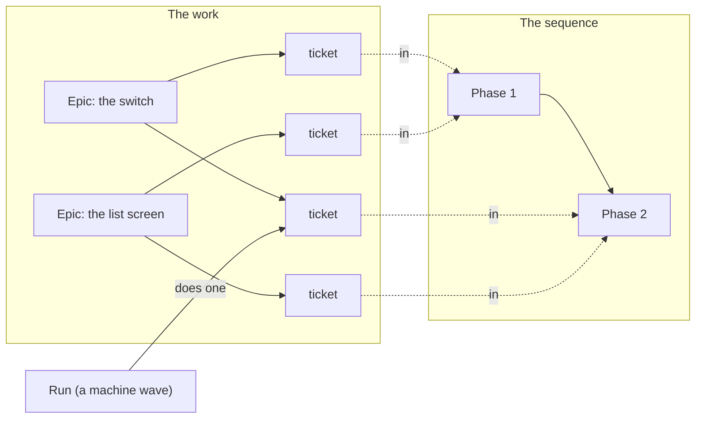
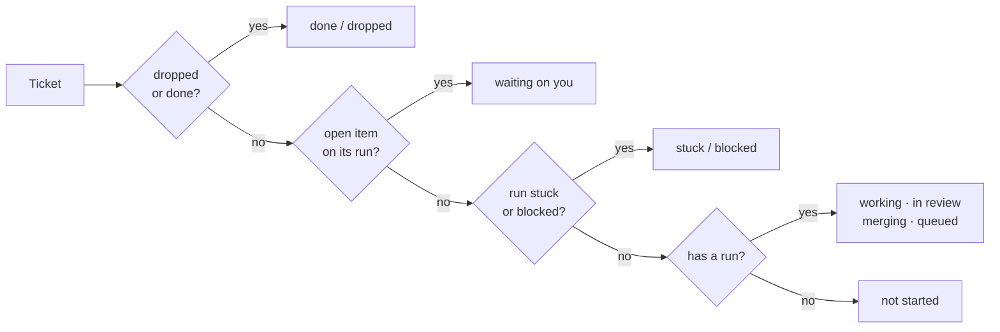
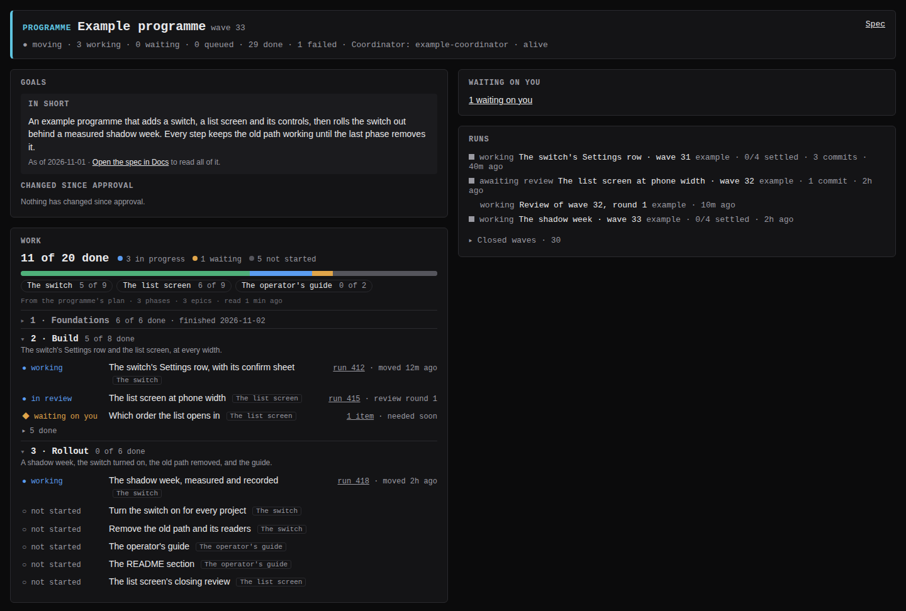
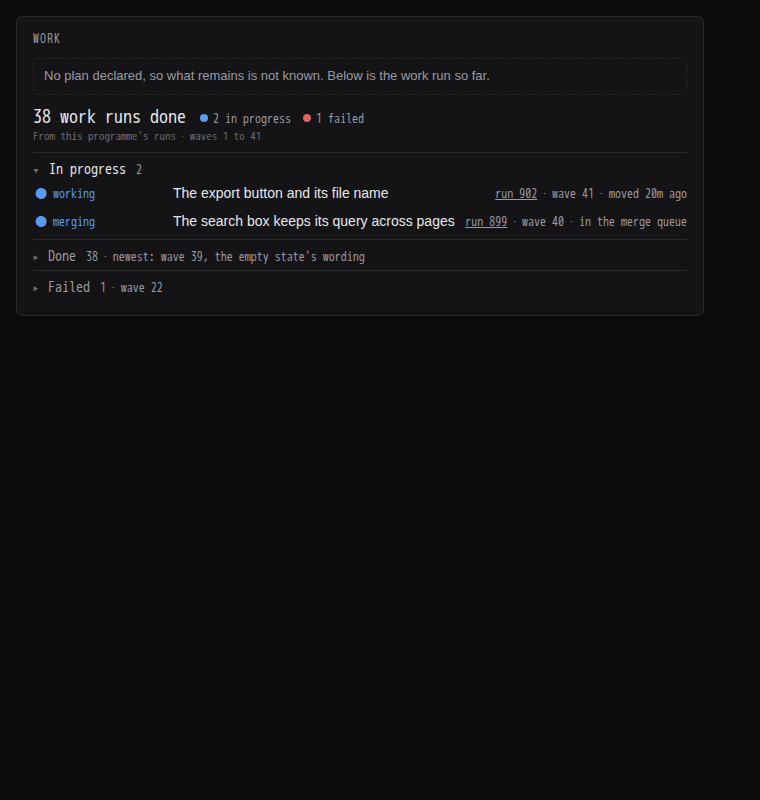
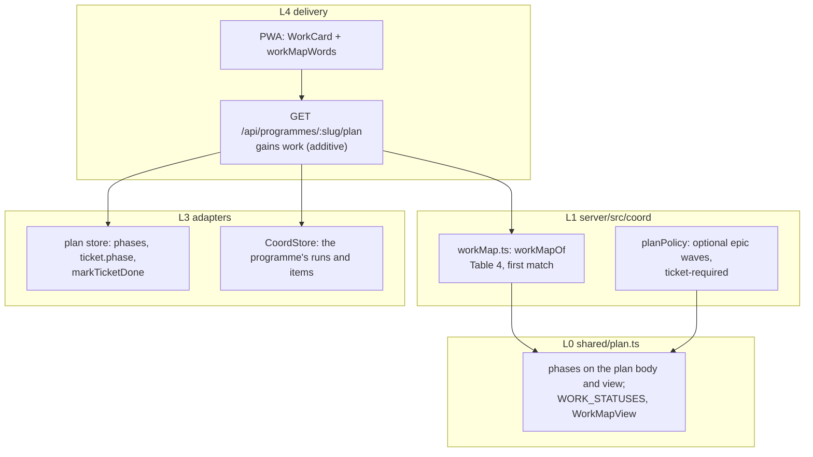

# The programme's work map: what is done and what remains, on its page

**Spec** · 2026-11-16 · Status: Draft, for the operator · Owner: the operator · Linear: none · Related:
`docs/superpowers/specs/2026-10-31-programme-ledgers-design.md` (Goals, Waiting on you),
`docs/superpowers/specs/2026-11-10-linear-hierarchy-design.md` (the stored plan: epics, checkpoints, tickets),
`docs/superpowers/plans/2026-11-16-programme-work-map.md` (the build), desktop polish Task C37 (D-8669)

## In short

The programme page shows Goals, Waiting on you and the open runs. It never lists the programme's work, so it cannot say
how much is done and what remains. This design adds a **Work** card below Goals. A programme's plan has two separate
axes, as the operator ruled: the **work**, in epics and tickets, and the **sequence**, in phases. One phase can hold
tickets from several epics. The card leads with the phases in order. Each ticket inside a phase has one line and a
status, and carries a tag naming its epic. Below the headline count ("11 of 20 done") and the bar, a strip shows each
epic's own count. Every status comes from one decider on the server, reading facts the server already holds, and none is
typed by hand. Today the stored plan has epics and tickets but no phase, and it ties each epic to a run of
consecutive wave numbers. That makes epics stand in for phases (§2.4). The build adds phases to the plan and loosens
that tie. A programme without phases, or without a plan at all, gets an honest fallback. Check §2 (measured), §3 (the
two axes), §5 (the card) and the three questions in "Waiting on you".

## 1. Context

This section says what the operator asked for, what they ruled since, and what the page shows today.

The operator, 2026-11-16, with a screenshot of one programme's page: "can we improve this screen to have the actual
tasks/waves/phases with their descriptions and statuses visible there too, maybe below the summary description? I want
to see at a glance on that page what work remains outstanding in the programme, what work is already done, at a high
level."

The operator's ruling on the first draft's word question, the same day: "the thing is that a wave/phase can have many
tickets/epics in it potentially, so these are separate concepts I believe." The first draft mapped a phase to an epic
and a task to a ticket. This revision keeps the two apart (§3).

What the page draws today (`pwa/src/ledgers/ProgrammeScreen.tsx`, sourced):

- **The head:** the programme's name, its current wave, the wave counts and its coordinator (`ProgrammeHeadFacts`,
  `ProgrammeRuns.tsx`).
- **Goals:** the pinned spec's "In short", its date, a link to the spec, and "Changed since approval" (`GoalsPanel.tsx`).
- **Waiting on you:** a count that links to the filtered Waiting on you page, or what the programme waits on.
- **Runs:** the open runs as raw rows, and "Closed waves · 50" folded (`ProgrammeRunsSection`).

A run's "0/5 settled" counts the coordinator's work items, which read `0/N` until a verified advance by design
(`RunSummary.items`, D-5914). Nothing on the page lists the work the programme set out to do.

## 2. Where a programme's plan of work lives (measured)

This section measures the sources a work list could come from, and how real programmes relate their work to their
sequence. Files were measured on `origin/main` `0c573d7f3`, and runs and plans on the live server, on 2026-11-16.

### 2.1 The candidate sources

| Source | What it holds | Status in it | Server reads it today |
|---|---|---|---|
| The stored plan (`plan_epics`, `plan_checkpoints`, `plan_tickets`; `GET /api/programmes/:slug/plan`) | Epics in order, each with a one-line summary, its waves, checkpoints and tickets | Ticket `open`, `started`, `done`, `dropped`, moved by the server as its run advances (`onRunAdvancedInTx`, `planStore.ts`) | Yes |
| Runs (`runs`, the runs frame) | One row per dispatch, with its title, state, stuck verdict and who it waits on | Measured run states | Yes |
| Plan files' task headings (`### Task …`) | A task's id and a one-line description | None in the heading | No |
| Plan files' checkboxes (`- [ ]`) | Steps inside a task | Ticked by hand, if at all | No |
| The programme ledger's Waves table | One row per wave or piece: scope, PRs, state | Typed by hand | No |
| The spec's phases | The design's stages | None | No |

*Table 1. The sources of a programme's work list, and where each status comes from.*

### 2.2 How well each covers real programmes

| Programme | Shape | Stored plan | Plan files | Ledger Waves table | Runs |
|---|---|---|---|---|---|
| desktop-polish | One plan, 73 task headings in tracks (T, B, S, C, G), 132 waves, open-ended | None | 4 of 274 checkboxes ticked, though most tasks have merged | None: the ledger logs rulings | Recent work runs are titled by task ("Desktop polish: Task C35, …") |
| overlord | Stages W0, W1a, W1 to W6. W1 alone is 29 pieces in 67 pull requests, across 63 plan files | None | 0 of 1,513 checkboxes ticked | 28 rows. W1 reads "not planned yet" while its pieces are being built: stale | Titled by stage or piece ("plan: W1 inbox and reads", "build: ccd arms A") |
| terminal-drawer-fit (small) | 4 waves, then a successor | None | One plan per wave | 4 rows, once a month stale (D-5013) | 1 run, `planned` |
| box-token-lifecycle (finished) | 2 spec waves built as 4 runs, 2 spec waves for later | None | Two plans | 6 rows, accurate | Too old for the server's closed-runs read |
| Two programmes in other projects | 6 epics with 26 tickets, and 1 epic | **Declared** | Not read | Not read | Each run attaches to one ticket |

*Table 2. Five measured programmes and how each source covers them. 2 of the 16 programmes with runs have a stored
plan; 14 have none.*

Across all 862 plan files on `main`, 1,724 of 23,366 checkboxes are ticked (7%), in 70 files.

### 2.3 The source, decided

**The stored plan is the source of the work list** (D1). It is the only source that is structured, held by the server,
scoped to one programme, and whose status the server moves from run facts. It is already the Coordination context's
model of a programme's plan (Linear hierarchy design §4), so the work map adds no second model. The others are rejected
as sources: checkboxes are not ticked, ledger tables are typed and go stale, headings would need a second plan model
parsed from repositories, and runs alone cannot say what remains.

### 2.4 How the work and the sequence relate today (measured)

The operator's ruling separates the work (epics, tickets) from the sequence (phases, waves). This section measures how
the plan model and the programmes relate them now.

| Question | Answer | Footing |
|---|---|---|
| Does a ticket name its phase or wave? | No. A ticket has an epic and an optional checkpoint (`plan_tickets`). It reaches a wave only through the run that holds it (`runs.ticketId`, `runs.wave`) | Measured: schema 59, `shared/plan.ts` |
| Does a run name its tickets? | One ticket at most (`runs.ticketId`). A run with none mints one (`attachTicketInTx`) | Measured: `planStore.ts` |
| What is a "wave" in the machine? | A run's number. It is not a stage: across six programmes, **no wave holds two work runs** (overlord 105 waves, desktop-polish 21, and four more programmes), because coordinators give each parallel worker a wave of its own | Measured: the live runs, 2026-11-16 |
| What is a phase, as the operator means it? | A stage that spans many machine waves. The Overlord's W1 runs over machine waves 76 to 105 and more, with plan and build runs of its 29 pieces interleaved | Measured: overlord's run titles and waves |
| Where is a phase stored? | Nowhere. It lives in run titles ("plan: W1 …"), plan folder names and ledger rows | Measured |
| Epic to wave | Each epic lists one contiguous range of waves, and no wave sits in two epics (`waves-not-contiguous`, `wave-overlap`, `planPolicy.ts`). A run's wave picks its epic (`epicForWave`) | Measured: code |
| Can two epics run in parallel? | Not in practice. Parallel pieces get consecutive waves, so an epic per piece would need interleaved ranges, which the plan refuses. Epics are forced to run one after another, as stages | Inferred from the two rules above |
| What a real plan did | The one 6-epic plan made each epic a stage: epics titled "W0 …" to "W5 …", each holding one wave | Measured: `plan show` |

*Table 3. Work and sequence today. Phase and wave are many-to-many with tickets in the operator's sense, but the
stored plan has no phase, and its wave rule makes epics act as phases.*

So the plan model has to change before the card can show both axes honestly. §3 says how.

## 3. The two axes

This section defines the plan's two axes and the changes to the plan model that carry them.

*Figure 1. Two axes. A ticket belongs to one epic (what it builds) and sits in one phase (when it is done). One phase
holds tickets from several epics. A run does one ticket, as today.*

- **The work** stays as the plan model has it: an epic is a unit of work, such as a feature or an area, with its
  checkpoints and tickets. Linear keeps mirroring it: epic to project, ticket to issue (hierarchy design §3).
- **The sequence** is new: a programme has an ordered list of **phases**. Each has a key, a title and a one-line
  summary. A ticket names the phase it sits in (`phase`, optional). An epic can have tickets in several phases, and a
  phase can hold tickets from several epics. That is the many-to-many the operator described.
- **A phase's state is derived, never stored**: `done` when every ticket in it is done or dropped, `active` when any is
  started, else `planned`. It has no writer, so it cannot drift.
- **Waves stay the machine's.** A wave is a run's number, as measured in §2.4. The card never uses it as a stage.
- **Epics no longer stand for stages (D13).** An epic's `waves` becomes optional. A run that names a ticket takes its
  epic from the ticket, and its wave is not checked against the epic's range when the epic lists none. So epics can
  run in parallel inside one phase. An epic that does list waves keeps today's rules, so the plans already stored stay
  valid. A run with no ticket still needs an epic that lists its wave, and then `ticket-required` applies (§4.1).
- **Linear.** Phases stay in ccrc for now. Linear has no level across projects that matches them, and choosing one (a
  label, or the initiative's own milestones) is the hierarchy programme's call. It is under "Later".

## 4. Status: one word per ticket, derived, never typed

This section defines each status and the fact it comes from. One decider computes every status, first match wins.

| # | When | Status | Group | Footing |
|---|---|---|---|---|
| 1 | The ticket is `dropped` | dropped (folded, counted apart, never in the total) | dropped | Measured: the plan |
| 2 | The ticket is `done` | done | done | Measured: its run reached `done`, which the coordinator does after the merge. Or recorded: the coordinator marked it done with its pull request or run (§4.1) |
| 3 | An open operator item names the ticket's run (`ItemView.runId`), or names an `operator-act` checkpoint the ticket proves | waiting on you | waiting | Measured: the items |
| 4 | The ticket's run carries a stuck verdict (`RunSummary.stuck`) | stuck | waiting | Measured: the server's stuck reader |
| 5 | The run is `planned` and waits behind another run (`blockedBy`) | blocked | waiting | Measured: the run |
| 6 | The run is `dispatched`, `working` or `unknown` | working | in progress | Measured: the run state |
| 7 | The run is `awaiting-review` | in review | in progress | Measured |
| 8 | The run is `merging` or `closing` | merging | in progress | Measured |
| 9 | The run is `planned` and not blocked | queued | in progress | Measured |
| 10 | The ticket is `open` with no run | not started | not started | Measured: the plan |

*Table 4. The status decider, first match wins. Every row reads a stored fact.*

- **A failed run.** When a run ends `failed`, the server returns its ticket to `open` with no run, so the ticket reads
  "not started" again. Its row adds "last run failed" with a link to that run. This is my call: the work is not under
  way, and the link keeps the history one tap away.
- **Counts.** "N of M done" counts the tickets that are not dropped. An epic's count and a phase's count are the same
  rule over their own tickets.
- **Review runs** never make rows. A review shows on its work run's row as "in review" (row 7).

*Figure 2. The status decider in flow order. A ticket reaches exactly one status.*

### 4.1 Keeping "N of M" honest: two more additions to the plan model

The spec's builder check found two gaps in today's plan model (`server/src/coord/planStore.ts`, sourced). Either one
would make "N of M done" wrong, so the build closes both, in the plan store that already owns ticket state.

- **A work run names its ticket (D10).** Today `runs open` with no `ticket` mints a ticket of its own, keyed
  `run-<id>` (`attachTicketInTx`). The declared ticket it was doing stays `open` with no run, so that work counts twice:
  once done, and once "not started" forever. From this build, a work run that opens into an epic which still has an
  open declared ticket must name a ticket: `runs open` refuses it `ticket-required` otherwise. The recovery is to name
  one, or to add one with `plan ticket-add` and name it. An epic with no open declared ticket still takes a run with no
  ticket and mints one as today, and that ticket counts like any other, because the work happened.
- **A coordinator records a finished ticket (D11).** Nothing can set a declared ticket `done` today except its own run
  reaching `done`. A programme that declares its plan partway through would show every ticket it finished before the
  plan as "not started". A new verb, `plan ticket-done <slug> <ticket>`, marks an `open` ticket done with its evidence:
  a merged pull request number or a run id. It is the coordinator's, under the plan verbs' owner check, and it is the
  "coordinator closes it" row the hierarchy design's ticket table already lists (its §4.1).

## 5. What the operator sees

This section describes the Work card at each width. The mockups use neutral sample data.

*Figure 3. Desktop at 1440 wide. The Work card sits below Goals in the left column. Waiting on you moves to the top of
the right column, above Runs. Phase 1 is finished and folded to one line. Phase 2 shows its outstanding tickets from two
epics, each tagged, with five done tickets folded. The epic strip under the bar shows each epic's own count.*

*Figure 4. Phone at 390 wide. One column: Goals, Work, Waiting on you, Runs. Each ticket row stacks its status, its line,
its epic tag and its run link.*

The card, top to bottom:

1. **The headline.** "11 of 20 done" in large type, then the outstanding counts: "3 in progress · 1 waiting · 5 not
   started". A bar beneath it is split by status in the same colours. Dropped tickets are not in the total.
2. **The epic strip.** One chip per epic, in plan order: its title and "5 of 9". The work axis at a glance, without a
   second list. Tapping a chip filters the phases below to that epic's tickets; tapping it again clears the filter
   (my call: a filter keeps one list on the card, rather than a second view).
3. **Where it comes from.** "From the programme's plan · 3 phases · 3 epics · read 1 min ago".
4. **Phases in order.** Each phase has one line: its number and title and "5 of 8 done", with its one-line summary
   under it. A finished phase folds to its line, with the date it finished. The current phase and those after it are
   open.
5. **Tickets inside a phase**, outstanding first in plan order, then the done ones folded into one "5 done" line. Each
   row has its status word, its title, its epic as a tag, and its facts: the run link and how long ago it moved, or the
   item link and when it is needed.

**Placement (D5).** Work goes directly below Goals, as the operator asked. On desktop, Waiting on you moves from under
Goals to the top of the right column, above Runs, so a long list never pushes it out of view. On a phone the order is
Goals, Work, Waiting on you, Runs. The head already carries the "waiting on you" marker.

**Which axis leads** is Q2 in "Waiting on you". The recommendation is the sequence: the operator's question is what is
done and what remains, and phases in order answer it top to bottom (done, under way, not started). Leading with epics
answers "how far is each feature", which the strip already shows.

### 5.1 A plan with no phases, and a programme with no plan

*Figure 5. The fallback for a programme with no stored plan. The card says first that what remains is not known, then
lists its work runs: outstanding first, done and failed folded.*

- **A plan with epics and no phases** (both stored plans today): the card groups tickets by epic, the only axis the plan
  has, and says "No phases declared: grouped by epic". The headline and the statuses are the same. In a plan with
  phases, a ticket that names none sits in a last group, "No phase", so nothing is left off the card.
- **A programme with no plan** (14 of 16 today): the card says "No plan declared, so what remains is not known. Below is
  the work run so far." It lists one row per work run, outstanding first, done and failed folded, with the run's
  title, or "Wave N" when the title is missing or only repeats the programme's name (measured: some programmes title
  every run that way). The headline counts runs ("38 work runs done · 2 in progress · 1 failed"), never "N of M".
- **Runs from before the plan.** A programme that declares its plan late has work runs with no ticket. On its card they
  form one folded group after the phases, "Before the plan · 61 work runs", not counted in "N of M" (D12).
- **Bound.** The read covers every work run of the programme, not the closed-runs read's 50.

## 6. How it relates to the Runs card

This section decides between merging, replacing and keeping both (D6).

**Keep both.** The Work card answers *what*: the plan's tickets and how far each has got. The Runs card answers *how the
machine is doing*: claimants, stuck rows with their Abandon, Resume on the head, reviews nested under their run, and the
closed waves. Its acts stay in one place.

- **Merging** would put each act on a ticket row and mix review rounds and dispatch failures into the work list.
- **Replacing** would lose the acts, and leave a programme with no plan with nothing but the fallback.

**They link.** A ticket row's run link opens the run's record (`runPath`). The Runs card is unchanged apart from moving
below Waiting on you in the right column (D5).

## 7. Architecture

This section places the parts in the rings and contexts of `docs/superpowers/specs/2026-08-10-architecture-ddd-clean-solid.md`.
Everything belongs to Coordination (C5), which owns runs, items and the plan.

*Figure 6. The plan store gains phases and two writers; one decider in L1 makes the view; the existing plan read serves
it. The console only draws the words.*

- **Phases in the plan model (D14).** A new migration adds `plan_phases` (`program`, `key`, `ordinal`, `title`,
  `summary`, `droppedWhy`; unique `program`, `key`) and a nullable `phase` key on `plan_tickets`. It is additive. `plan
  put`'s body gains `phases` (an ordered list) and `phase` on a ticket; a phase that disappears is dropped with a
  reason, as an epic is. `PlanView` gains `phases` with each one's derived state. `plan ticket-add` and `ticket-move`
  take a `phase`. The bound is 24 phases, like epics.
- **Optional epic waves (D13).** `waves` on an epic becomes optional (`planPolicy.ts`): contiguity and overlap are
  checked among epics that list waves. `planGate` (`openRun.ts`) takes a named ticket's epic from the ticket, and checks
  the wave against it only when the epic lists waves.
- **The two writers of §4.1.** `ticket-required` joins `PLAN_REFUSALS`, decided in `planGate`. `plan ticket-done` is a
  new route under `/api/programmes/:slug/plan/tickets`, on the box token with the owner check, with a row in
  `ccd/ccrc-api` and a writer in `planStore.ts`, the one owner of ticket state.
- **One decider (D2).** `workMapOf` in `server/src/coord/workMap.ts` is the only place a status is decided. It is pure:
  it takes the stored plan, the programme's runs and its open items, and returns the view, grouped by phase (or by
  epic, or by run, §5.1), with each ticket's epic named.
- **The wire (D4).** `GET /api/programmes/:slug/plan`'s answer gains an optional `work: WorkMapView` beside `plan`. It is
  additive, with no `FLEET_PROTO` bump. An older server omits it, and the console then draws no Work card.
- **No second plan model.** Nothing reads plan files or ledger tables.
- **Freshness (D7).** The console reads the plan on arrival, and again when one of this programme's runs changes state
  or stuck verdict, or one of its items changes, in the frames it already has. The source line says when it last read.
- **The words** are in `pwa/src/ledgers/workMapWords.ts` (L1). The card, `pwa/src/ledgers/WorkCard.tsx`, is L4 and
  decides nothing.
- **The hierarchy's Plan section (D8).** The Linear hierarchy plan's Task 5.2 planned a "Plan section" on this page.
  The Work card is that section, so this design takes 5.2's place. The done-when list (each entry proved or not) stays
  hierarchy work. D13 and D14 change that design's §4.1 and §4.3, and its coordinator records them there.

## 8. Decisions

These are the design's decisions. D1 to D14 are mine, on the brief's rulings and the operator's ruling on phases. Q1 to
Q3 are the operator's.

| # | Decision | Options considered | Chosen, and why | Status |
|---|---|---|---|---|
| D1 | The source of the work list | Stored plan; plan files' headings; checkboxes; ledger Waves tables; runs | The stored plan: structured, server-held, one owner (§2) | Proposed |
| D2 | Where status is decided | In the console; in the route; one L1 decider | One pure decider, `workMapOf`, in Coordination | Proposed |
| D3 | Status words | Free text; the run's own state word; a fixed table | Ten words in five groups, first match (Table 4) | Proposed |
| D4 | The wire | A new route; a new frame; a field on the plan read | `work` on `GET /api/programmes/:slug/plan`, additive | Proposed |
| D5 | Placement | Work below Waiting on you; Work below Goals | Below Goals, as asked; Waiting on you to the right column on desktop | Proposed |
| D6 | The Runs card | Merge; replace; keep both | Keep both and link them (§6) | Proposed |
| D7 | Refresh | A new frame; a timer; re-read on run and item changes | Re-read on this programme's run and item changes, with the read's time shown | Proposed |
| D8 | The hierarchy's Task 5.2 | Build both; build 5.2 alone; this replaces 5.2 | This replaces 5.2; done-when stays with the hierarchy | Proposed |
| D9 | A programme with no plan | Show nothing; parse plan files; the runs so far | The runs so far, under a note that what remains is not known | Proposed |
| D10 | A run that names no ticket | Allow and double count; match by words; require a ticket | Require one while its epic has an open declared ticket | Proposed |
| D11 | Work done before the plan | Leave it not started; declare only what remains; record it done | A coordinator's `plan ticket-done`, with a pull request or run | Proposed |
| D12 | Runs from before the plan | Hide them; count them; fold them apart | One folded "Before the plan" group, not counted | Proposed |
| D13 | Epics tied to wave ranges | Keep; drop for all; make optional | Optional: a ticket gives a run its epic, so epics can run in parallel | Proposed |
| D14 | Where a phase lives | Reuse epics; a label on tickets; a level of its own | A level of its own: ordered phases, each ticket naming one | Proposed |
| Q1 | Plans for live programmes | At the next wave boundary; now; never | Recommended: at each one's next wave boundary, phases included | Waiting |
| Q2 | The axis that leads the card | Phases leading; epics leading; a switch | Recommended: phases leading, epic tags and an epic strip | Waiting |
| Q3 | The word for a stage | Phase; wave | Recommended: phase, since wave already names the machine's run number | Waiting |

*Table 5. Decisions. "Proposed" is mine, for the operator to check while reading.*

## 9. Testing and proof

This section says how the build proves the design. The plan carries the steps.

- **Phases.** `plan put` stores phases and each ticket's phase; a dropped phase needs a reason; a ticket naming an
  unknown phase is refused; a phase's state is derived from its tickets in each of its three cases.
- **Optional epic waves.** A run naming a ticket of an epic with no waves opens; two epics with no waves run in
  parallel; an epic that lists waves keeps today's refusals, every one of which still has its case.
- **The two writers.** `ticket-required` reds when a run opens with no ticket into an epic with an open declared one.
  `plan ticket-done` refuses a caller that is not the coordinator, a ticket that is not `open`, and a body with no
  evidence.
- **The decider.** `server/test/work-map.test.ts`, one case per row of Table 4 and per grouping of §5.1, plus the
  precedences that matter (an item beats a stuck verdict, stuck beats working, dropped is never counted). It joins
  `MUTANT_SETS` with a floor measured at merge.
- **The wire.** The plan route's test asserts `work` beside `plan`; the console draws no card when `work` is absent.
- **The card.** jsdom tests for the headline, the strip and its filter, the folds, the source line and every status
  word. A browser test of the programme page at 360, 390, 1280, 1470 and 1920 wide, in both skins and both themes.

## Where things stand

### Agreed

- The brief's rulings (2026-11-16): the Work card goes below the Goals summary, on phone and desktop; status is derived,
  never typed; one owner in Coordination, decided in L1, served on the existing programme read, additive on the wire.
- The operator's ruling (2026-11-16): a phase or wave and an epic or ticket are separate concepts, and one phase can hold
  many tickets from several epics.

### Waiting on you

- **Q1. Should live programmes declare their plans now?** Recommended: yes, each programme with open runs (desktop-polish
  and the Overlord among them) at its next wave boundary, with its phases and epics. It records the tickets it has
  already finished with their pull requests (§4.1), so "N of M" covers the whole programme. Until then its card shows the
  fallback (§5.1). Two effects to weigh: each later run names its ticket, so an open-ended programme adds tickets as it
  goes; and once the hierarchy's sync ships, the epics and tickets are mirrored into Linear.
- **Q2. Which axis leads the card?** Recommended: phases, in order, with each ticket's epic as a tag and a strip of epic
  counts under the headline. The alternatives: epics leading with each ticket's phase as a tag, which answers "how far
  is each feature" but not "what is under way now"; or a switch between the two, which adds a control for an answer the
  strip already gives.
- **Q3. What does the card call a stage?** Recommended: "phase". "Wave" already names the machine's run number, which the
  page's head shows ("wave 105") and which is one dispatch, not a stage (§2.4). The alternative calls stages waves and
  renames the head's number.

### Later

- Phases in Linear: a label on issues or the initiative's own milestones, the hierarchy programme's call.
- The done-when list with each entry proved or not, beside Goals: the hierarchy's console wave.
- A frame for plan edits, if a stale read is ever seen to matter.

---

*Written by Claude for the operator. Diagrams are Mermaid text; the mockups are rendered from
`2026-11-16-programme-work-map/mockup.html`, with neutral sample data.*
