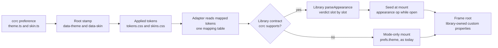
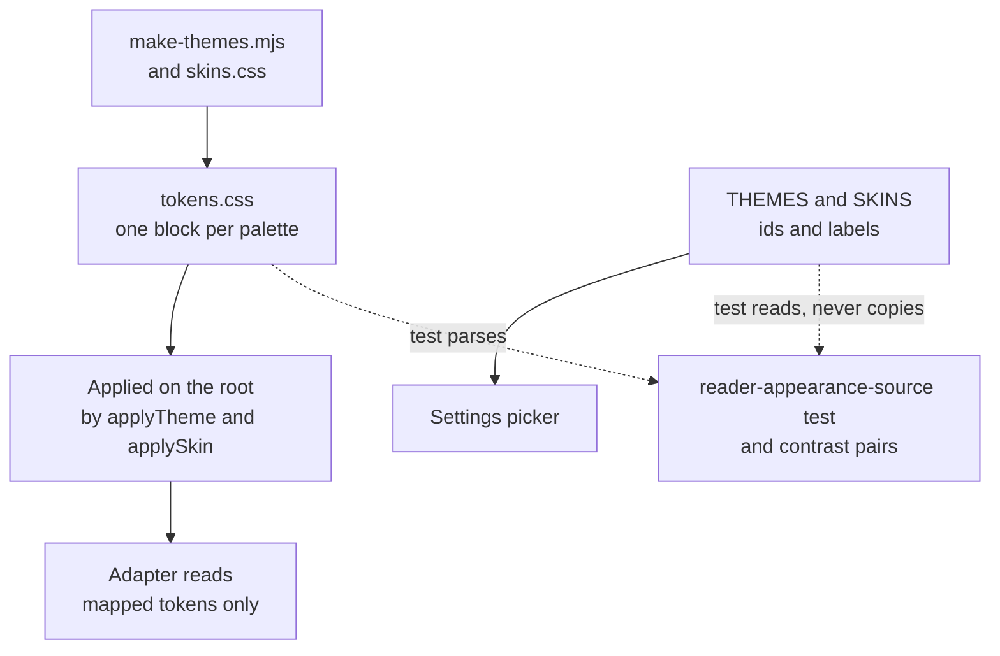
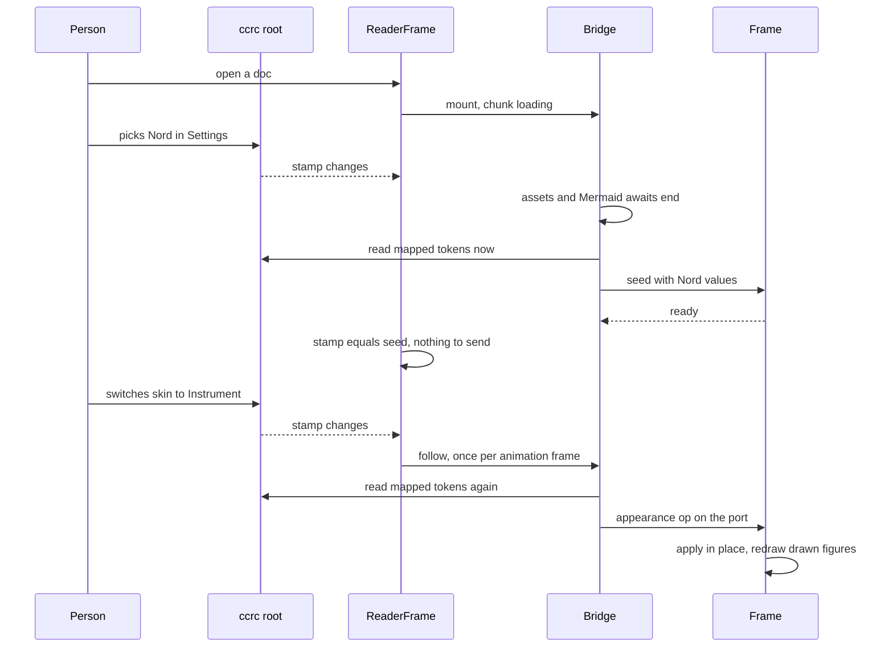

# Native Docs reader: appearance continuity

**Spec** · 2026-11-18 · Status: Draft · Owner: native-docs-reader programme, wave X1 · Linear: none · Related: `docs/superpowers/plans/2026-11-18-native-docs-appearance-continuity.md`, `docs/superpowers/plans/2026-11-07-native-docs-reader-completion.md`, `docs/superpowers/specs/2026-11-07-native-docs-reader-completion-design.md`, `docs/superpowers/specs/2026-10-12-rich-docs-reader-and-shared-renderer-design.md`, `docs/superpowers/programs/native-docs-reader.md`

## In short

The Docs reader frame should look like the rest of ccrc. It opens in the skin and palette the person chose in ccrc, and it follows any change made while it is open. Today it only learns light, dark or auto, because the adapter folds the twelve palettes into those three words and sends no skin (§1).

The design has five parts:
- **What crosses the bridge.** ccrc sends a small set of colour and shape values, a token contract, through the bridge the reader already uses. ccrc never sends a palette catalogue, an id list or a stylesheet (§2).
- **Where the values come from.** ccrc reads them from its own applied design tokens at the moment it needs them, through one mapping table. So the twelve palettes, Follow the system and both skins keep one source: the design system. A scan reds a second copy (§3).
- **Readability in every palette.** Code, tables, focus and eight Mermaid diagram kinds are drawn from the same values, and a test checks their contrast in every palette. Any other Mermaid kind, and a figure its author styled, keeps the library's own drawing and plate (§5, §10).
- **Aa.** Inside ccrc, the frame's Aa stops offering a theme. Width, font and folds stay the reader's own (§6).
- **The library's part.** The shared library takes a backward-compatible minor change. Section 10 is written for the library programme to plan from. Its release and ccrc's re-pin are the operator's.

Nothing in this design widens the sandbox, the CSP, parent-DOM access or the set of message channels. The phone blocks and the tap, one-bar and desktop-fit budgets stand, measured on both skins (§8, §9).

What to check: the token contract (§2), the one-source mechanism and its scan (§3), the budgets (§9), and the acceptance mapping onto Task 17's Appearance row (§11). The one product choice, Aa's line while hosted, is answered (Where things stand).

## 1. Context

This section states the operator's requirement and what ccrc and library 1.1.0 do today. Every claim here was read from shipped source on 2026-11-18, at `main` `6f5421139`.

**The requirement.** It is the programme ledger's "Operator amendment — native visual continuity and legacy decoupling (2026-11-10)" and its Carried constraint "Required native appearance continuity". The reader uses ccrc's skin and theme choices and opens with ccrc's selected appearance. It aligns surfaces, text, accent and semantic colours, typography, borders, focus, controls and density. A colour-mode-only approximation is not enough. Rendering styles and any checked-preference extension belong to the shared library, and ccrc owns its preference and the adapter. Two choices are coordinator defaults: the frame follows host changes while open, and Aa's global appearance follows ccrc while hosted.

**ccrc's appearance today (sourced).**

| What | Where | Shape |
|---|---|---|
| Skin catalogue | `ui/src/styles/skins.ts#SKINS` | `refined`, `instrument`; stored choice `auto` resolves at boot (`resolveSkin`), applied as `data-skin` on the root (`applySkin`) |
| Skin tokens | `ui/src/styles/skins.css`, closed list `skins.ts#SKIN_TOKENS` | Type, density, radius, elevation, meter, motion. Skins never set colour (`skin-identity.test.ts`) |
| Palette catalogue | `ui/src/styles/themes.ts#THEMES` | Twelve rows `{id, label, mode, note}`: 8 dark, 4 light. `SYSTEM` is a stored choice, not a row |
| Palette values | `ui/src/styles/tokens.css`, generated from `ui/design/make-themes.mjs` | One `[data-theme]` block per palette, `:root` for Phosphor. About 45 colour tokens each (`--bg-*`, `--ink-*`, `--edge-*`, `--accent*`, `--status-*`, `--diff-*`, `--syn-*`) |
| Catalogue checks | `pwa/test/theme-catalogue.test.ts`, `skin-catalogue.test.ts` | ids equal CSS blocks both ways; generated block equals the generator's output |
| Contrast gate | `pwa/design/contrast-check.mjs`, `pwa/test/contrast.test.ts` | WCAG 2.1 floors, 4.5:1 for ink on every surface, in every palette |
| Preference | `pwa/src/lib/theme.ts`, `pwa/src/lib/skin.ts` | Per-device storage, one writer each (`setTheme`, `setSkin`), pre-paint script in `pwa/index.html` |
| Typefaces | `tokens.css` `@font-face` | Geist and Geist Mono, self-hosted woff2 (69 KB and 71 KB) |

**The reader today (sourced).** `ReaderFrame.tsx` computes `readerPrefsOf(useThemeChoice(), THEMES)`. It sends `auto` for Follow the system and the palette's `mode` for a named palette. It sends no skin. The bridge (`docs/reader/bridge.ts`) passes `prefs: {theme}` at mount, and the frame's `setPrefs` afterwards. During a lazy start, `ReaderFrame` re-sends the latest mode after the mount resolves (`seededPrefs`). The reader lab mounts with `theme: 'auto'` and profile `lab-draw`.

**Library 1.1.0 (sourced from the installed package).**
- `HostAdapters` has no appearance key beyond `prefs: Partial<FramePrefs>`, where `FRAME_PREF_VALUES = {theme: auto|light|dark, width: standard|wide, font: serif|sans}`.
- `mountDocFrame` throws `TypeError` on any adapter key it does not know (`ownData`), and `RangeError` on a bad pref value.
- The frame's stylesheet scopes every rule under `[data-docreader-root]`, through 54 custom properties, 36 of them colours (`--bg`, `--surface`, `--text`, `--accent`, `--border`, `--th-bg`, `--code-block-bg` and so on). Its header says a host may override any of them, but no API carries them.
- Code highlighting uses hard-coded hex in `.hljs-*` rules, with a second dark block.
- Mermaid draws with `theme: 'base'` and one fixed warm light palette of 15 hex values, on a white plate. Dark mode inverts the plate with a CSS filter.
- The bridge protocol is `v: 1`. A parent op the frame does not know is ignored. The frame's parser of parent ops accepts any plain object with own data properties and no proto keys, and checks each op through `OP_KEYS`. Nested values pass: `changes.result` already carries `ranges`, an array of integer pairs. The flat strings-and-numbers rule is the host's parser of frame-to-parent messages (`dist/host/parse.js`).
- The frame's CSP allows `style-src 'unsafe-inline' data:` and `font-src data:`. Its four fonts, Source Serif 4 and Source Sans 3, travel as `data:` inside its stylesheet: 413 096 base64 characters of the stylesheet's 549 069.

## 2. What crosses the bridge: a token contract

This section fixes the interface between ccrc and the library. ccrc sends values for a closed list of named slots. The library owns the list, the stylesheet that uses it, and the validation.


*Figure 1. Where appearance comes from and how it reaches the frame. The catalogue stays on the left, and only resolved values cross. The library's own validator decides every value: a refused colour drops the colour group, and the frame stays hosted in the library's colours for the mode. A refused skin slot drops only itself. Only a library without a contract version ccrc supports, either none or a newer one, leaves ccrc on today's mode-only mount (§7).*

**The contract (library-owned).**
- `mode` is `light`, `dark` or `auto`: the resolved direction. It sets `color-scheme` and the library's defaults for any slot the host leaves out.
- `colour.<slot>` is one value per colour slot, `#rrggbb` only. Version 1 carries no alpha in a colour slot: no ccrc token mapped to one uses alpha, and a translucent `text` or `bg` would make §5's contrast numbers depend on what is behind it. Alpha appears only inside `popShadow`'s colour. The group is all or nothing: a group missing any slot is refused whole, as `{key: 'colour', why: 'incomplete'}`, like a group holding one bad value. So `mode`'s defaults fill the skin slots a host leaves out, and all the colours when the host sends no colour group, never a gap inside one. An appearance with no colour group is valid. It means "hosted, in the library's own colours for `mode`", and it clears any host colours applied before.
- `skin.<slot>` holds the skin's character, in ten slots, each falling back by itself (§2.3 says which ccrc token feeds each, and why the others are not carried):
  - `radius`, `radiusSmall` and `radiusLarge`: whole px from 0 to 24;
  - `controlRow`: whole px from 28 to 56, the height of rows in the frame's popovers, applied only under `(pointer: fine)`;
  - `popShadow`: the popovers' elevation, one to three shadows, each two to four lengths and one colour, with no `inset`, no other function and no keyword. Both forms ccrc uses fit, measured in every palette: Refined's `0 12px 40px rgba(0, 0, 0, 0.55)` (and `rgba(26, 32, 27, 0.22)` in light palettes), and Instrument's hairline `0 0 0 1px #5F697C` (one `--edge-strong` per palette);
  - the section-label type of the popovers' own headings: `sectionFamily` (`sans` or `mono`), `sectionSize` (whole px from 10 to 16), `sectionWeight` (100 to 900, in hundreds), `sectionTracking` (em from -0.1 to 0.3) and `sectionCase` (`none` or `uppercase`).

  "The popovers" are Aa, the changes menu, the cross-reference card, quick jump, the keys sheet and the contents drawer. Their headings are the frame's own chrome, never document headings.
- `label` is optional text for Aa's hosted line (§6): 1 to 64 UTF-16 code units, so a character outside the Basic Multilingual Plane counts as two. It is refused by Unicode general category, not by a list: if it holds any code point in `\p{Cc}` (controls), `\p{Cf}` (format characters, every bidi mark and isolate, the invisible operators, the soft hyphen, U+FEFF and the tag characters included), `\p{Zl}` (U+2028) or `\p{Zp}` (U+2029), or a lone surrogate (`\p{Cs}`, matched with the `u` flag). An empty label is refused. The frame renders it as text content, never as markup. When it is absent or refused, the frame shows a neutral default that names no host: "Appearance follows the app's settings". ccrc sends "Appearance follows ccrc Settings".
- `fonts` are optional faces for the frame's sans and mono roles, carried as font assets at mount (§2.2).

**The value grammars, exact.** The library's `parseAppearance` matches each value against one pattern, and ccrc sends each token's text exactly as `getPropertyValue` answers it. ccrc normalises nothing: no trim, no case change, no unit change. Three values are not token text, and say so: `mode`, which ccrc derives from the root's `color-scheme` (trimmed, then `light`, `dark` or else `auto`); `sectionFamily`, a role ccrc derives by comparing `--family-section` with its two families (§3); and `label`, ccrc's constant. So both sides build from these patterns, and only from them:
- **Types.** `mode`, `label` and every value in `colour` and `skin` is a JSON string. A number is refused, even `600` for `sectionWeight`, where the string `"600"` is accepted. Unknown keys are refused and named, at the top level and in each group.
- **Spaces.** A value may begin and end with any number of ASCII spaces (U+0020), which the pattern ignores and the verdict drops, because a browser may keep the space after a custom property's colon. Inside a value, tokens are separated by exactly one U+0020, and shadows by a comma and one U+0020. Any other whitespace refuses the value: tab, line feed, carriage return, U+00A0, U+2028, U+2029, U+FEFF, and two spaces in a row.
- **Size.** The validator measures a value by its own walk, never by `JSON.stringify`, which throws on a cycle or a BigInt, both of which survive the port's structured clone. At mount and in `setAppearance` the value is not a structured clone but the host's own object, so the walk reads own data descriptors only (`Object.getOwnPropertyDescriptor`): an accessor is refused by type, never called. It descends only into the top level and the `colour` and `skin` groups. In each of those three, it first counts the own key names, before any type check, and stops at 64: a group with more is refused whole (`{key: <group>, why: 'too-many-keys'}`; the top level as `'*'`, whose verdict is `{mode: 'auto'}`), so `refused` never holds more than 64 entries a group. Then a key whose value is not a string, or a group that is not a plain object, is refused by type. It counts the UTF-16 code units of every key and string it visits, and stops at 8 193. A value whose count passes 8 192 is refused whole: the verdict keeps only a valid `mode`, and `refused` holds one entry, `{key: '*', why: 'too-large'}`. Any throw during the walk, from a Proxy trap or a revoked Proxy, ends it: the verdict is `{mode: 'auto'}` and `refused` holds one entry, `{key: '*', why: 'unreadable'}`. ccrc's own payload budget is half the size cap (§9). So `parseAppearance` never throws for any value.

| Key | Pattern, after the outer spaces | Range |
|---|---|---|
| `mode` | `light` \| `dark` \| `auto` | Anything else reads as `auto` |
| `colour.<slot>` | `#[0-9A-Fa-f]{6}`. Hex is case-insensitive. No alpha form | — |
| `radius`, `radiusSmall`, `radiusLarge` | `(0\|[1-9][0-9]?)px` | 0 to 24 |
| `controlRow` | `[1-9][0-9]px` | 28 to 56 |
| `popShadow` | `SHADOW(, SHADOW){0,2}`. `SHADOW` is `LEN LEN( LEN( LEN)?)? COLOUR`, single spaces between. `LEN` is `0` \| `0px` \| `-?[1-9][0-9]?px`. `COLOUR` is `#[0-9A-Fa-f]{6}` \| `#[0-9A-Fa-f]{8}` \| `rgba(INT, INT, INT, ALPHA)`, lower-case `rgba`, a comma and one space between arguments. `INT` is `0` \| `[1-9][0-9]{0,2}`, and `ALPHA` is `0` \| `1` \| `0\.[0-9]{1,3}` \| `1\.0{1,3}` | x and y offsets -64 to 64, blur 0 to 64, spread -8 to 8, `INT` 0 to 255 |
| `sectionFamily` | `sans` \| `mono` | — |
| `sectionSize` | `1[0-6]px` | 10 to 16 |
| `sectionWeight` | `[1-9]00` | 100 to 900 |
| `sectionTracking` | `-?0(\.[0-9]{1,3})?em` | -0.1 to 0.3 |
| `sectionCase` | `none` \| `uppercase` | — |
| `label` | §6's rule: 1 to 64 UTF-16 code units, refused by category (§2, `label`) | — |

Every pattern is anchored and bounded: the longest value any colour or skin pattern accepts is a three-shadow `popShadow` of 154 characters, not counting outer spaces, which the size cap bounds. No colour or skin pattern admits `;`, `{`, `}`, a `(` other than `rgba(`'s, `url(`, `var(`, a comment opener, a backslash or a quote. The label is free text, rendered as text only (§8).

**Base colours only.** Version 1's colour slots are base colours. The library derives every tint, hover, table head, inline-code and bar background from them with `color-mix` in its own stylesheet, because ccrc's own tints change form from palette to palette: `rgba(...)` in one, `color-mix(...)` in another. A coloured tint holds at most 4% of its colour, mixed over `bg` or `surface`, so every text colour keeps 4.5:1 on every tint, links and faint text included. Inline code never sits on a tint: its ground is the opaque `surface2` (§5, §10). Every semantic slot is a colour the library draws as text, so it maps to ccrc's text variant, never to a fill. The 33 slots:
- surfaces: `bg`, `surface`, `surface2`;
- ink: `text`, `text-muted`, `text-faint`;
- edges: `border`, `rule`;
- accent: `accent`, `accent-ink`, `focus`;
- semantic, drawn as text: `ok`, `wait`, `no`, `info`, `chg`;
- reference text: `term` (glossary terms), `id` (rule and fact ids), `violet` (the IMPORTANT alert title), `path` (code paths);
- code: `code-block-bg`, `code-ink`, and `syn-comment`, `syn-keyword`, `syn-string`, `syn-number`, `syn-function`, `syn-type`, `syn-tag`, `syn-attr`, `syn-punct`, `syn-deleted`, `syn-inserted`, which replace the hard-coded `.hljs-*` hex.

The list's home is the library's `APPEARANCE_SLOTS` export, and ccrc never spells it a second time (§3). Each ccrc token mapped to these slots was measured on 2026-11-18 to resolve to a plain `#rrggbb` in all twelve palettes, through `var()` chains, both default blocks merged. Every pair §5 names was measured against its floor, the Mermaid label and line pairs included (the leaf plan's Results, "Cross pairs").

**Why values and not a catalogue.** The frame needs one appearance at a time. The values for that appearance are all it can use, and they reveal nothing the frame could act on. A catalogue would put a second copy of ccrc's palettes in the library or in every seed (Decision X1-1, §12).

### 2.1 Carriage

- **At mount**, a new adapter key `appearance` carries the contract. The library writes each slot onto the frame root with the CSSOM (`style.setProperty` on a library-owned property name) before first paint. So the first painted frame is already in ccrc's colours.
- **While open**, `DocFrame.setAppearance(a)` posts one new parent op, `appearance`, on the existing port: `{t: 'appearance', v: 1, appearance: a}`, where `a` has exactly the contract's shape, `{mode, colour?: {<slot>: '#…'}, skin?: {<slot>: …}, label?}`. One spelling serves the adapter key, the op and the validator. An op whose value has no `colour` group drops host colours (§7).
- **Nothing flows back.** This contract adds no frame-to-parent op and no `store.set` key. The frame never tells ccrc what it applied.
- **Hosted means an appearance was seeded.** A mount whose adapters carried `appearance` is hosted for its whole life. While hosted, ccrc never calls `setPrefs` with a `theme`, and the frame never writes `theme` to `pref:prefs`. Its `prefs` path writes the whole prefs object, so the library leaves `theme` out of what it stores while hosted.

### 2.2 Fonts

ccrc's typefaces are part of its visual language, and the frame cannot fetch them (`default-src 'none'`). ccrc passes its own Geist and Geist Mono woff2 as two optional font assets, base64 text in `FrameAssets.fonts`, read once from the files the design system already ships.
- **Loading.** The library checks the base64 alphabet, a `wOF2` signature and a cap of 131 072 decoded bytes (128 KiB) per face, which is at most 174 764 characters of base64. ccrc's faces are 69 492 and 71 236 bytes. It then loads each face with the `FontFace` API from the decoded bytes, under a fixed family name. No CSS text is built from host input.
- **Failure.** A face that fails any check, or fails to load, is dropped silently, and that role keeps the library's own face. A bad face never throws, never refuses the mount and never falls back to the plain view (only a malformed `fonts` asset throws, §10). On the ccrc side, the fonts load on their own path, and a failed font load mounts without them, never through `onFallback('assets')`.
- **Size.** The library caps the srcdoc in UTF-16 code units (characters). Its derived cap counts every seed field at its cap (`document.js`, `seed.js`), so it rises by two derived amounts: the two faces' cap, 349 528 characters (2 x 174 764), and the `appearance` field's own cap, the longest seed text a value the validator accepts can serialise to, with the seed's escaping, derived the way `seed.js` derives each field's. So neither fonts nor an appearance push a document into `too-large`.
- **Use.** While hosted, the frame's sans role and its chrome use ccrc's UI face, and code uses ccrc's mono face. The serif reading face stays the library's. Font choice in Aa stays the reader's (§6).

### 2.3 The skin, token by token

The operator asked that controls and density align with the skin, and that the reading layout and the budgets be kept. So a skin token is carried when it touches neither the frame's bar nor the reading geometry. It is rejected, by name, when it would move either, or when the frame has no counterpart. Values were read from `ui/src/styles/tokens.css` and `skins.css` on 2026-11-18. Instrument's values at a width of 900 px or more, and under a fine pointer, follow a slash.

| ccrc token | Refined | Instrument | Verdict | Why |
|---|---|---|---|---|
| `--fs-ui` | 15 px | 15 / 13 px | Rejected | The frame bar's labels. 2 px of type at 900 px and above moves the desktop bar, against the 1 px desktop-fit budget |
| `--fs-prose` | 15 px | 15 / 14 px | Rejected | Prose size is the reading layout (the library's `--rem` and its 18 px serif) |
| `--fs-meta` | 12 px | 11 px | Rejected | The byline and meta lines sit in the document's title block, in the reading layout |
| `--fs-page` | 20 / 24 px | 14 px | Rejected | The document title, in the reading layout |
| `--fs-section` | 15 px | 11 px | Carried | `sectionSize`, popover headings only |
| `--weight-section` | 600 | 500 | Carried | `sectionWeight` |
| `--family-section` | UI face | mono face | Carried | `sectionFamily`: ccrc compares the token with its own `--family-ui` and `--family-mono` and sends the role |
| `--case-section` | none | uppercase | Carried | `sectionCase` |
| `--ls-section` | -0.011em | 0.08em | Carried | `sectionTracking` |
| `--gutter` | 16 / 24 / 32 px | 12 / 14 px | Rejected | The reading layout's gutters (the library's `--pad` and `--gut`) |
| `--row-h` | 52 px | 44 / 32 px | Carried | `controlRow`, popover rows under a fine pointer only. A coarse pointer keeps the 44 px tap floor |
| `--pad-card` | 16 px | 12 px | Rejected | The library's cards (callouts, figures) sit in the reading flow |
| `--gap-section` | 32 px | 20 px | Rejected | Spacing in the reading flow |
| `--page-max` | 760 px | 960 px | Rejected | The reading measure (the library's `--measure`, 44 rem) |
| `--page-max-wide` | 1120 px | none | Rejected | The library's break-out width for tables and figures (`--wide`), in the reading layout |
| `--measure-chat`, `--measure-chat-prose` | 1200 px, 90ch | 100%, 100ch | Rejected | Chat only. No counterpart in the frame |
| `--head-h` | 56 px | 44 / 40 px | Rejected | The frame bar (`--bar-h`, 48 px): the one-bar and desktop-fit budgets |
| `--section-flow` | column-reverse | row | Rejected | ccrc's page Section heads. No counterpart |
| `--r-sm` | 6 px | 3 px | Carried | `radiusSmall`: inline code, keycaps, pills |
| `--r-md` | 10 px | 5 px | Carried | `radius`: controls, code blocks |
| `--r-lg` | 14 px | 8 px | Carried | `radiusLarge`: popovers, callouts and figure cards. Radius is paint only |
| `--r-xl` | 20 px | 12 px | Rejected | Sheet and drawer top corners. The frame has no bottom sheet |
| `--elev-card` | a palette shadow | none | Rejected | No counterpart: the library's in-document cards draw no shadow (measured: figures and tables set `box-shadow: none`) |
| `--elev-pop` | `0 12px 40px` and a palette colour | `0 0 0 1px` and `--edge-strong` | Carried | `popShadow`, on every popover |
| `--meter-h`, `--meter-segments`, `--meter-gap` | 5 px, 1, 0 | 8 px, 10, 2 px | Rejected | The frame draws no meter. Reading progress shows on ccrc's own bar |
| `--dur-fast`, `--dur-base`, `--dur-slow` | 180, 240, 320 ms | 120 ms | Rejected | They time ccrc's sheets, card expands and shared-element moves, which the frame does not have. The frame's own hover and fold fades are 100 to 150 ms |

## 3. One source of truth for the catalogue

This section says how the reader uses ccrc's catalogue without copying it, and what reds a copy. The rule: the catalogue never leaves the design system. The reader reads applied values, not names.

**The mechanism.** The design system already applies the chosen appearance to the document root: `data-theme`, `data-skin`, and the tokens under them. The adapter reads the computed values of the mapped ccrc tokens from that root (`getComputedStyle(document.documentElement)`) at the moment it seeds or updates the frame. That is ccrc reading its own document. The frame is not involved, and no parent-DOM access is given to it.

- The one hand-kept artefact is **the mapping table**, `READER_APPEARANCE_MAP` in a new pure module `pwa/src/docs/reader/appearance.ts`. It is a mapping, not a catalogue: it names no palette and no skin. Version 1 maps:

  | Slots | ccrc tokens |
  |---|---|
  | `bg`, `surface`, `surface2` | `--bg-page`, `--bg-surface`, `--bg-raised` |
  | `text`, `text-muted`, `text-faint` | `--ink-primary`, `--ink-secondary`, `--ink-tertiary` |
  | `border`, `rule` | `--edge-strong`, `--edge-subtle` |
  | `accent`, `accent-ink`, `focus` | `--accent`, `--ink-on-accent`, `--accent` |
  | `ok`, `wait`, `no`, `info` | `--status-done-text`, `--status-attention-text`, `--status-dead-text`, `--ink-secondary` |
  | `chg` ("changed since") | `--acct-magenta`, whatever hue the palette gives it (X1-12) |
  | `term`, `id`, `violet`, `path` | `--acct-cyan`, `--acct-blue`, `--acct-violet`, `--ink-secondary` |
  | `code-block-bg`, `code-ink` | `--bg-well`, `--ink-on-well` |
  | `syn-<name>` (eleven) | `--syn-<name>` |
  | `radius`, `radiusSmall`, `radiusLarge` | `--r-md`, `--r-sm`, `--r-lg` |
  | `controlRow`, `popShadow` | `--row-h`, `--elev-pop` |
  | `sectionSize`, `sectionWeight`, `sectionTracking`, `sectionCase` | `--fs-section`, `--weight-section`, `--ls-section`, `--case-section` |
  | `sectionFamily` | `--family-section`, as a role: `mono` when it equals `--family-mono`, `sans` when it equals `--family-ui`, left out otherwise |
- A new palette, or a third skin, reaches the reader with no reader change: it is applied to the root, and the adapter reads it.
- Follow the system needs no special case. The root carries whichever palette the operating system picked, and the adapter reads that.

**The scan that reds a second copy.** A new test, `pwa/test/reader-appearance-source.test.ts`, has these four parts, and a fifth, §5's contrast gate:
1. **Slot coverage.** The mapping table's slots equal the library's `APPEARANCE_SLOTS`, in both directions.
2. **Every palette resolves.** For every palette `THEMES` lists, and for both skins, each mapped token resolves, through `var()` chains in `tokens.css` and `skins.css`, to a literal the library's validator accepts. A token that resolves to `color-mix(...)` or nothing reds here, not on a phone.
3. **No second list.** The scan covers `pwa/src/docs/`, `pwa/src/readerLab/`, `pwa/src/lib/appearance.ts` and `pwa/src/lib/appearanceStamp.ts`:
   - no file holds two or more palette ids, or two or more skin ids, as string literals or as object keys, quoted or not;
   - no file under `pwa/src/docs/reader/` holds a hex colour literal;
   - only `ReaderFrame.tsx` imports `THEMES`, for the mode-only fallback (§7), and no file imports `SKINS`.
4. **No stylesheet crosses.** Two checks:
   - at run time, over every value `readerAppearanceOf` builds in part 2, no string contains `;`, `{`, `}`, `url(` or `var(`. Every top-level key is `mode`, `label`, `colour` or `skin`, and every key inside `colour` or `skin` is a slot of that group in `APPEARANCE_SLOTS`;
   - in source, `appearance.ts` holds no such literal.

A test helper, `pwa/test/helpers/paletteTokens.ts`, resolves a palette's tokens for parts 2 and 3. The contrast gate's `audit.mjs` cannot, as it stands: it keys the default palette as `DARK`, reads only the first `:root` block, and never reads `skins.css` or `color-scheme`. The helper merges both default blocks, maps `phosphor` to them, applies a skin's `:root[data-skin=…]` block and its `(pointer: fine)` arm, and follows `var()` chains.


*Figure 2. The catalogue's one home and its readers. Solid edges are runtime paths. Dotted edges are test reads. Nothing on the reader side holds a list of palettes or skins.*

## 4. When the frame learns the appearance

This section covers an ordinary open, a lazy open (the reader chunk still loading) and a change while open.

**One signal.** A new hook, `useHostAppearance()` in `pwa/src/lib/appearance.ts` (ring L4), observes the root's `data-theme` and `data-skin` attributes with a `MutationObserver` and returns a stamp, `skin|theme`. The stamp itself is one pure function, `appearanceStamp(root)`, in its own module `pwa/src/lib/appearanceStamp.ts` (ring L1), which the hook and the bridge's read both import. It reads the applied result, not the stored choice. So it moves on every writer's change, including Follow the system flipping with the operating system, which `useThemeChoice()` alone does not see.

**Reading at the last moment.** The bridge reads the appearance synchronously, immediately before the synchronous `mountDocFrame`, after its last asset and Mermaid await. This is the point where D2 samples focus (D-8729), with no await in between. A change during the lazy chunk load or the asset wait is therefore already in the seed. The read happens once per library mount: since #3026, a same-page link's `openAt` builds the adapters again, and it reads again, beside the focus sample.

**After the mount resolves.** The mount reports whether it is hosted, as an explicit fact: hosted means all three of the library's contract is supported, the mount's plan asks for an appearance (it does not for the lab), and ccrc gave the bridge its root. One pure function decides it (review 2676 F6). A hosted mount also reports the stamp its seed was read under. `ReaderFrame` compares that stamp with the current one, as it does today for the mode (`seededPrefs`), and asks the mount to follow once, only if they differ. A change during the hold is already in the seed, so it sends nothing. A mount that is not hosted never reads the root.

**Who reads.** The bridge reads the root, both at mount and when asked to follow. The bridge is the lazily loaded module that carries the library, so `ReaderFrame`, in the main bundle, imports nothing of the library's. It holds only the stamp hook.

**While open.** On a stamp change, `ReaderFrame` asks the mount to follow. The bridge reads the values again and calls the library's `setAppearance`. Calls coalesce to one per animation frame, and the latest wins. The frame applies the values in place: no remount, the same iframe and nonce, and the reading position kept.

**A mode-only mount keeps today's trigger.** On a mode-only mount (§7), `ReaderFrame` keeps its existing effect on the derived mode (`readerPrefsOf`). The stamp alone would miss a change: on a dark device, Follow the system and Phosphor both leave `data-theme` unset, so the stamp does not move while the mode goes from `auto` to `dark`. A hosted mount needs no such trigger, because both choices then apply the same values.


*Figure 3. A lazy open with a change during the chunk load, then a change while open. The seed is read after the last await, so the first change needs no follow-up op. For the second, `ReaderFrame` asks the bridge to follow, and the bridge reads the root again and sends one `appearance` op on the existing port.*

**Mermaid on a change.** Figures already drawn are redrawn in the new colours, nearest first, one per task. Figures not yet drawn are drawn in the new colours when their turn comes. A newer appearance cancels the redraws still queued for an older one, so a burst never stacks redraws. Production stays on request (E17-READING does-not-hold), so few figures are drawn at any moment.

## 5. Readable in every palette

This section covers code, tables, Mermaid, contrast and focus. The rule: everything the reader draws takes its colours from the contract, and the contrast of every pair the reader uses is checked in every palette.

| Element | Today | With the contract |
|---|---|---|
| Body text, links, borders | Library light or dark palette | ccrc's ink, accent and edges. Edges are decorative, as in ccrc: no floor |
| Tables | `--th-bg`, `--surface`, `--surface2`, `--border` | The same slots, from ccrc's raised and well surfaces |
| Code blocks | Library background, hard-coded `.hljs-*` hex | ccrc's well and `--syn-*` tokens. Wells stay dark in every palette, as in ccrc's chat. All text on a well is `code-ink` or a `syn-*`, by ccrc's own class mapping (§10) |
| Mermaid | Fixed warm palette on a white plate, inverted by a filter in dark | For the kinds in `MERMAID_HOSTED_KINDS` (flowchart, sequence, class, state, gantt, pie, ER and gitGraph), colours derived from the slots by the library's `mermaidThemeOf`, which assigns every colour key those kinds read (§10). The figure's ground is `surface` (the plate) and a node's fill is `surface2`. Labels are `text`, with three exceptions, each measured: a label drawn on a series colour or on a line-coloured mark is `bg`, a gantt vertical marker's text is `text-muted`, and a gantt task's label that Mermaid marks clickable is `accent` (its stylesheet reads the key; under the library's `strict` level no click is bound, and none was drawn here). Lines, arrowheads and edges between nodes are `text-muted`, so they meet 3:1 on both grounds. The sequence diagram's filled arrowheads, the full one and the solid half ones, are `text`. Its stick half arrowheads, which Mermaid strokes in a literal black, are painted `text-muted` by the stylesheet (§10). Node borders are `border`, decorative like every edge, with the node told apart by its fill and label. No white plate, no filter and no shadow while hosted. A kind outside the constant, and an author-styled figure, keeps 1.1.0's drawing, plate and filter (§10) |
| Focus | `outline: 2px solid var(--accent)` | The same rule on the `focus` slot, ccrc's accent |
| Reference text | `--term`, `--id`, `--violet`, `--path`, hard-coded per mode | ccrc's lane hues `--acct-cyan`, `--acct-blue`, `--acct-violet`, and `--ink-secondary` for paths, as each palette defines them |
| Semantic colours | `--ok`, `--wait`, `--no`, `--info`, `--chg` | ccrc's text variants `--status-done-text`, `--status-attention-text`, `--status-dead-text`, then `--ink-secondary`, and `--acct-magenta` for "changed since", as each palette defines them. Fills, dots and tints derive from them |
| Meaning | Colour, with some cues | Never colour alone while hosted. "Changed since", status dots, glossary terms, id links and the quick-jump selection each carry a cue that is not colour (§10), because a palette may give two meanings one hue, and `term` no hue at all (X1-12) |

**The contrast gate.** The library exports `APPEARANCE_PAIRS`: each pair of colours its stylesheet puts in front of one another, with a floor. The list is not a sample of pairs someone found. It is a product: every text colour on every ground the stylesheet paints, so a link inside a changed block or faint text on a row tint is in it by construction.
- **The text colours:** `text`, `text-muted`, `text-faint`, `accent`, `accent-hover` and the nine semantic and reference slots (`ok`, `wait`, `no`, `info`, `chg`, `term`, `id`, `violet`, `path`).
- **The grounds, and the text each admits:**

  | Ground | Text colours drawn on it |
  |---|---|
  | `bg`, `surface`, `surface2` | the 14 text colours |
  | every coloured tint: `chg`, `wait`, `no` and `accent` at 4% over `bg`, and `chg` at 4% over `surface` (the summary box's changed items) | the 14 text colours |
  | `code-block-bg`, the well: code blocks and a failed figure's source | `code-ink` and the eleven `syn-*` only |
  | `accent`: a pressed figure tool button, and selected text | `accent-ink` only |

  The table head and the row hover are accent tints over `bg`. Inline code is drawn on `surface2`. Aa and the other popovers are drawn on `bg`. Mermaid's fills are §10's. While hosted, the library's stylesheet paints no other ground under text, and no text colour on a ground that does not admit it; its test 4 checks both.
- **4.5:1:** every pair the table admits, and every Mermaid label of a covered kind on the fill drawn behind it (§10's derivation table names each pair).
- **3:1:** the focus ring (`focus`) on `bg`, `surface`, `surface2` and the tints, the grounds a ring is drawn on (the well and `accent` are not: §10). Mermaid lines of a covered kind (`text-muted`, and the series colours a gantt, pie or gitGraph draws as lines) on `surface` and `surface2`, the figure's grounds while hosted.
- **No floor: edges.** `border` and `rule` are decorative, as ccrc's own gate treats its edges (`pwa/design/contrast-check.mjs` holds that no edge token clears 3:1 in every palette). Measured: `border` on `bg` is 1.54:1 at worst. A frame control is identified by its label, at 4.5:1, and by the focus ring, never by its border alone.

ccrc's test computes the mapped values for every palette through `pwa/test/helpers/paletteTokens.ts` (§3) and checks every pair. A palette that fails reds ccrc's suite before it reaches a reader. The library does not re-gate its own defaults: without an appearance its output stays exactly 1.1.0's (§10 test 4). Measured, 1.1.0's light defaults put `text-faint` on `surface2` at 4.44. That is the library's own matter, carried for its programme, and this contract does not change it. Measured 2026-11-18 under this map, in all twelve palettes, with each tint rounded to 8 bits as a browser paints it: every pair holds. The lowest are `text-faint` on `surface2` at 4.52 (Solarized Dark), `text-faint` on a tint at 4.565 (Catppuccin Latte; 4.58 before the tint is rounded to 8 bits), `accent` on `surface2` at 4.57 and `accent` on a tint at 4.64 (Phosphor Daylight). The focus ring is 4.57:1 at worst, on `surface2`. Why 4%, and why inline code is not a tint: at 6%, `text-faint` on the `no` tint falls to 4.44 and `accent` on the `chg` tint to 4.48. Inline code inside a link inside a changed block would put `accent` on a text tint over a coloured tint. That pair falls below 4.5 at every pair of caps from 3% to 6% (4.44 at 3% and 3%, Phosphor Daylight), so inline code takes an opaque ground the gate already checks.

## 6. Aa while hosted

This section settles what the frame's own Aa menu offers inside ccrc. One Aa stays, in the frame.

- **While hosted with an appearance, Aa has no theme row.** Global appearance has one owner, and a choice in the frame would be overridden at the next change anyway. In the row's place is one static line. Its text is the contract's `label`, which ccrc sends as "Appearance follows ccrc Settings". The library hard-codes nothing of ccrc's: without a label, it shows its neutral default, "Appearance follows the app's settings" (§2).
  - **Accessibility.** The line is plain text in the settings panel, in reading order where the theme row was. It is not a control, not focusable, and has no role beyond a paragraph, so a screen reader reads it with the panel. It is drawn in `text-muted` on `bg`, the Aa menu's ground, a pair in `APPEARANCE_PAIRS` at 4.5:1, so the §5 gate checks it in every palette.
  - **Who decides "hosted".** The host adapter decides, never the frame. The frame shows the line only when its mount carried an `appearance`. With no appearance, Aa keeps its theme row. That covers the reader lab, the library used on its own, and ccrc on the mode-only path (§7).
  - **No shortcut.** Aa has no Settings button in this design. A later wish for one rides the bridge's existing command vocabulary, or comes back as an ask.
- **Width, font and folds stay reader-local.** They are stored under `ccrc:reader:v1:` as today, and seeded back on mount.
- **A stale reader preference never wins.** With an appearance supplied, the frame ignores any stored `theme` in `pref:prefs`, and it never writes one. On the mode-only path (§7), the host keeps passing `theme` on every mount, as today, so the host value still wins (the library's precedence: defaults, then stored, then host).

## 7. Compatibility and fail-safe behaviour

This section says what happens when the two sides do not match, or a value is bad. In every case the reader stays readable and never falls back to the plain view over appearance.

Two terms, each with one meaning in this spec and its plan:
- **A mode-only mount** is a mount on a library without the contract (or with a contract newer than ccrc knows). ccrc sends `prefs.theme`, as today, and no `appearance`.
- **A hosted mount without colours** carries an `appearance` whose colour group the validator dropped. It stays hosted, in the library's colours for its `mode`.

There is no skew inside one mount. The host half and the frame half of a mount come from one package version, and the frame's scripts are pinned by hash (M8.12). Skew can only exist between ccrc's adapter and the library API it was built against, and the exact pin plus TypeScript make that a build error.

| Case | What happens | Why |
|---|---|---|
| Library without the contract (1.1.0) | The adapter finds no supported `APPEARANCE_CONTRACT` and sends today's `prefs.theme`. Aa keeps its theme row | 1.1.0 throws on an unknown adapter key, so the adapter must not send one. With the exact pin this is a build error, so the case is reached through the test seam only: `libraryContract`, answering a number or `'none'` |
| Library contract newer than the adapter knows | Today's `prefs.theme`, until ccrc adopts it | The adapter supports an explicit set of contract versions |
| A mapped colour reads empty or not as a literal, at mount or while open | An appearance with `mode` and no colour group: the frame stays hosted, drops any host colours it had, and shows the library's colours for that mode. `console.warn('ccrc-reader: …')` once | Half a palette could put dark ink on a dark surface, and a stale palette left on screen would be worse. All or nothing per group is safe |
| A skin slot or the label is refused | That slot keeps the library default. Colours still apply | Shape and type cannot hurt contrast |
| The frame receives an `appearance` op with bad values | The frame runs the same `parseAppearance` and applies its verdict, slot by slot, with the colour group all or nothing. Only a value that is not a plain object is ignored whole | One bad-value rule, the validator's, at mount and while open |
| A new ccrc skin or palette | Values flow with no reader change. The §5 gate reds a palette whose mapped pairs miss a floor | The library never sees ids, so an unknown skin cannot exist for it |
| The reader lab | Mounts with no appearance, as today | E17 and E18 readings stay comparable to the recorded phone blocks |

## 8. Boundaries and threat model

This section lists what does not change and what the new data could do. The standing boundaries are not reopened.

**Unchanged:**
- The reader sandbox is exactly `allow-scripts`, and the shell CSP is exactly `frame-src 'none'`.
- The frame's CSP policy is unchanged: the same directives and the same sources, with `style-src` and `font-src` already allowing what the contract needs. Its script hash sources change with the frame scripts, as at every library release (§10 test 9).
- There is no parent-DOM access from the frame, and no new channel, port or window listener.
- Both 2026-11-06 phone blocks stay byte for byte.

**What the new data is.**
- **Origin.** Colour, length and font values computed from ccrc's own stylesheets. A document cannot influence them: documents render inside the frame, never on ccrc's root.
- **Validation.** Both sides validate. The adapter validates with the library's own pure `parseAppearance` before sending. The frame validates again, against §2's exact patterns: closed keys, strings only, single ASCII spaces, bounded digits and a size cap of 8 192 UTF-16 code units; no `;`, braces, `url(` or `var(`. A `popShadow` within its bounds paints at most a 64 px blur and an 8 px spread around a popover, and it reaches no URL.
- **The label.** It is the one free text that crosses. It is 1 to 64 UTF-16 code units, refused if it holds a code point of category `Cc`, `Cf`, `Zl` or `Zp` or a lone surrogate (§2), and set with `textContent`, so markup in it shows as its own characters and never renders. Refusing by category keeps out controls, format characters (bidi marks and isolates among them) and line separators, so a label cannot reorder or break the line. It is not a visibility check: a filler such as U+3164 or U+2800 is a letter or a symbol, not a format character, and passes. Only a trusted host sends a label, so a blank-looking one is that host's own mistake, shown as sent. The label is not trimmed: its spaces count toward the 64.
- **How values are written.** Through the CSSOM, onto library-owned custom property names. No stylesheet text is built from host input. Fonts load through the `FontFace` API from decoded bytes, under fixed family names.
- **Fonts.** These are ccrc's own bundled bytes. They are the first binary bytes in the srcdoc that the library does not pin by hash: its own faces sit in a stylesheet that `frameDocument` checks against its manifest. So the library checks ccrc's faces by alphabet, signature and size, and ccrc pins them with a row: the bytes it passes are exactly the design system's font files. A malformed font would reach the browser's font parser inside an opaque-origin, script-pinned frame, and a face that fails to load is dropped (§2.2).
- **Exfiltration.** The frame learns ccrc's current colours. This contract gives it no way to send them anywhere: `default-src 'none'`, no network, and no frame-to-parent op of its own. Another design may add a frame-to-parent op additively, such as X2's figure images. That design argues its own threat model, and nothing here rules it out.
- **Rate.** A parent op costs the frame a repaint, plus a redraw of any drawn figure. Coalescing to one per animation frame bounds the ops. Cancelling queued redraws on a newer appearance bounds the figure work. The bridge's refusal count applies to frame-to-parent ops only, so a burst of host ops can never close the port.

## 9. Budgets

This section gives the numbers the implementation must keep. Geometry budgets are measured on both skins.

| Budget | Number | Measured by |
|---|---|---|
| Phone title at 412 x 915 | at most 61 px | `docs-compact-head` and `reader-frame` browser rows, both skins |
| Phone console part | at most 48 px | as above |
| Tap floor | 44 px | as above |
| Tablet and desktop fit | at most 1 px from a fresh BASE, per skin | as above |
| One bar on a phone | the frame's own bar off, ccrc's bar only, per skin | as above |
| Appearance payload | at most 4 KiB serialised, about 50 keys | unit row on the adapter's output |
| Ops while open | at most 1 per animation frame, latest wins | unit row with a fake clock |
| Hosted srcdoc growth, in three parts | (1) ccrc's two faces: exactly 187 640 characters of base64, pinned to the files. (2) This contract's own library growth, measured at the library landing that lands it: every `FRAME_MANIFEST` entry, Mermaid's included, at most 32 768 characters over 1.1.0's 4 528 020 (its five entries' characters: guard 3 643, bootstrap 30 153, enhance 198 215, stylesheet 549 069 and Mermaid 3 746 940; 4 530 427 bytes). In the one library wave this contract lands first. Another design's additions in the same release, such as X2's, are measured from this contract's landing against a share of their own, which the coordinator sets at the library-input wave's acceptance (X2 §6 proposes X2's). The release's library growth is the sum of the shares. (3) The appearance seed: at most 4 096. So a hosted mount grows, over the same document at the 1.1.0 pin, by at most 224 504 characters plus the other designs' shares | (1) and (3): unit rows. (2): the library's test 8 at this contract's landing, and Task 1 Step 2a, which reads it and the release. (1) plus (3), at most 191 736 over a BASE taken at the new pin, which already holds every share: `frame-cost` browser row |
| Open to `ready` | hosted median of 9 opens at most 1.10 x the BASE median of 9, desktop Chromium, same runner | `frame-cost` browser row |
| Change while open | frame root shows the new values within 100 ms. Same iframe and nonce. Scroll within 1 px | `reader-appearance` browser row |
| Mermaid redraw | one figure per task, no single gap over E17's 200 ms | `reader-appearance` browser row |
| Contrast | 4.5:1 for every text colour on every ground and tint, code on the well, and the labels of the covered Mermaid kinds. 3:1 for the focus ring on `bg`, `surface`, `surface2` and the tints, and the covered kinds' lines. Edges have no floor. Tints at most 4%. A Mermaid kind outside `MERMAID_HOSTED_KINDS`, or an author-styled figure, keeps 1.1.0's drawing and is not gated here (§10) | unit gate, every palette, both skins; the library's test 5 for the covered kinds |

## 10. The library's part

This section is written for the library programme to plan from. It names the library by role, the shared rendering library, and proposes no new name. Its release, signed tag and ccrc's re-pin are the operator's.

**Version.** A minor release, additive only. The bridge protocol stays `v: 1`, because a frame that does not know the new op ignores it (rich-docs §3.8). A host that never passes the new key gets exactly today's behaviour.

**Interface (exports).**

| Export | Kind | What it is |
|---|---|---|
| `Appearance`, `AppearanceColourSlot`, `AppearanceSkinSlot` (`./frame`) | types | The contract value `{mode, colour?, skin?, label?}` and its slot-name unions, derived from `APPEARANCE_SLOTS` |
| `APPEARANCE_CONTRACT` (`./frame`) | number, `1` | The contract version. Absent in 1.1.0, which is how a host detects support |
| `APPEARANCE_SLOTS` (`./frame`) | readonly record | The closed slot names by group: `colour`, `skin`. The source of truth for both sides' tests |
| `APPEARANCE_PAIRS` (`./frame`) | readonly list | `{fg, bg, floor}` for every pair the stylesheet draws, derived colours included, expressed over the slots |
| `parseAppearance(x)` (`./frame`) | pure function | Never throws for a value. Returns `{appearance, refused}`: `appearance` is always usable, and `refused` lists `{key, why}` for each slot it left out. A refused colour drops the whole colour group. A refused skin slot or label drops itself, unless its whole group is refused (`too-many-keys`) or the value is unreadable (§2, "Size"). A bad `mode` reads as `auto`. The same validator the frame runs on the seed and on every op |
| `MERMAID_HOSTED_KINDS` (`./frame`) | readonly list | The Mermaid diagram kinds drawn in the host's colours while hosted, named by the id the bundled Mermaid's own `parse` answers: `flowchart-v2`, `sequence`, `classDiagram`, `stateDiagram`, `gantt`, `pie`, `er` and `gitGraph`. Every other kind keeps 1.1.0's drawing while hosted ("Mermaid while hosted", below) |
| `mermaidThemeOf(colours)` (`./frame`) | pure function | Mermaid `themeVariables` for the kinds in `MERMAID_HOSTED_KINDS`, derived from the slots. It assigns every colour key the bundled Mermaid's `base` theme reads for any of those kinds, the literal fallbacks included, and every key 1.1.0's `THEME_VARIABLES` sets, so no covered kind draws a base-theme default. Its keys and their sources are the derivation table below. It also sets `fontSize` `14px`, as 1.1.0 does, `pieOpacity` `1`, and `dropShadow` `none`: no ccrc slot carries a figure shadow, and the hosted figure is flat on its plate. Documents still cannot set any theme key |
| `FRAME_ACCEPTS` (`./frame`) | readonly list | The parent-to-frame op names the frame's port parser accepts, built into `frame/bootstrap.js` from this one constant. It is not `PARENT_OPS`, which the frame does not read. 1.1.0 has no such constant: its port parser hard-codes four ops in `src/frame-runtime/inbound.ts`, `prefs`, `changes.result`, `mermaid` and `command` (read in the built `frame/bootstrap.js` too). So this contract's value is that literal plus `appearance`. `hello` is not in it: the list is the port parser's, and the port parser refuses `hello`, which only the bootstrap's window listener takes, before the port exists. Test 9 compares it with the value before this landing and drives the port parser over it |
| `APPEARANCE_LABEL_DEFAULT` (`./frame`) | string | "Appearance follows the app's settings": the line shown with no host label, naming no host |
| `HostAdapters.appearance?` (`./host`) | adapter key | The contract value at mount, taken through `parseAppearance`: a bad slot value never throws. Only a value that is not a plain object throws `TypeError`, like any adapter key |
| `FrameAssets.fonts?` (`./host`) | asset | `{sans?: string, mono?: string}`, base64 woff2. A face that fails §2.2's checks is dropped, never thrown. A `fonts` that is not a plain object, or that has a key other than `sans` and `mono`, or a face that is not a string, throws `TypeError`, as any malformed asset does: that is a host's programming error, which TypeScript already catches |
| `DocFrame.setAppearance(a)` (`./host`) | method | Posts the `appearance` op after `ready`. Queued before `ready`, latest wins. Seeds later remounts. An `a` that is not a plain object throws `TypeError`, as `HostAdapters.appearance` does. Any plain object is taken through `parseAppearance`, so a bad slot value never throws |

The pure exports live in `./frame` because ccrc's import rule keeps `./host` to its one adapter file (`docs-scans.test.ts#LIBRARY_HOMES`), and ccrc's pure mapping module must read them.

**Frame behaviour.**
- An appearance is applied before first paint, from the seed, and in place from the op.
- With an appearance, the frame ignores stored theme, hides Aa's theme row, shows the one line §6 gives (plain text, not focusable), and never writes `theme`. Without one, Aa is exactly 1.1.0's.
- **Code on the well, while hosted.** All text on `code-block-bg` is `code-ink` or a `syn-*`: a code block's own text, a failed figure's source (`pre.fig-src`), and every highlighted span. 1.1.0 draws the first two in `text`, which on a dark well in a light palette is about 1.1:1, so that changes while hosted. The `.hljs-*` classes map onto the slots by ccrc's own chat mapping (`ui/src/components/prose.css`, the `.well .hljs-*` rules), with a row for each class 1.1.0 colours that ccrc does not name. Every class 1.1.0's stylesheet colours is in exactly one row:

  | Slot | `.hljs-*` classes |
  |---|---|
  | `syn-comment` | `comment`, `quote`, `doctag`, `meta`, `meta.prompt_` |
  | `syn-keyword` | `keyword`, `selector-tag`, `section`, `literal`, `template-tag`, `variable.language_` |
  | `syn-string` | `string`, `regexp`, `char`, `char.escape_` |
  | `syn-number` | `number`, `symbol`, `bullet` |
  | `syn-function` | `title`, `title.function_`, `title.function_.invoke__` (ccrc's `.well .hljs-title.function_` rule paints invocations too), `link` (underlined, as in ccrc) |
  | `syn-type` | `type`, `built_in`, `title.class_`, `title.class_.inherited__` |
  | `syn-attr` | `attr`, `attribute`, `property`, `variable`, `template-variable`, `variable.constant_`, `selector-class`, `selector-id` |
  | `syn-punct` | `tag`, `operator`, `subst`, `selector-attr`, `selector-pseudo` |
  | `syn-tag` | `name`, `tag .hljs-name` |
  | `syn-deleted`, `syn-inserted` | `deletion`, `addition`, with no background: 1.1.0's dark `#490202` and `#0f5323` backgrounds are dropped while hosted, as ccrc draws none. The line's leading `-` or `+` names it in text |
  | `code-ink` | `code`, `formula`, `emphasis`, `strong`, and any span no row names |

  1.1.0 also colours some classes in a context, at a higher specificity, with hex of their own. While hosted each takes the slot of its class's row, as ccrc's chat does (which names no context): `.language-json .hljs-attr` and `.language-yaml .hljs-attr` are `syn-attr`; `.language-python .hljs-meta` and `.language-diff .hljs-meta` are `syn-comment`; `.hljs-meta .hljs-keyword` is `syn-keyword` and `.hljs-meta .hljs-string` is `syn-string`. Without an appearance they keep 1.1.0's hex. One more 1.1.0 rule draws text in an edge colour: the review strip's separator dot (`.rs-facts .sep`, `rule`). While hosted it is `text-muted`, a text colour on its ground.

  Without an appearance, every `.hljs-*` rule keeps 1.1.0's hex (test 4).
- **While an appearance is applied**, every colour that is not a slot derives from the slots with `color-mix` in the stylesheet, each by one stated rule. Without an appearance, every derived colour, and every other rule this section changes while hosted, keeps 1.1.0's value, so test 4's first row holds. Every tint is an opaque mix, `color-mix(in srgb, <slot> 4%, <ground>)`:
  - `accent-hover` is `color-mix(in srgb, accent 80%, text)`, a text colour, gated like `accent`;
  - `accent-soft` (row hover, the flash, the index and quick-jump selection) and `th-bg` are `accent` at 4% over `bg`;
  - `wait-soft` and `wait-tint` are `wait` at 4% over `bg`, and `no-tint` is `no` at 4% over `bg`;
  - `chg-tint` is `chg` at 4% over `bg`, and `chg-soft` is `chg` at 4% over `surface`;
  - `chg-bg` is `chg-tint`, except inside the summary box (`.short`) and a waiting callout, where it is `chg` at 4% over `short-bg`. 1.1.0 mixes 7% there; this design lowers it to the same 4%;
  - `short-bg` is `surface`, so the summary box's ground is a gated ground and its changed items are a tint over `surface`;
  - `paper` and `topbar-bg` are `bg`, and `plate` is `surface` under a figure of a covered kind that is not author-styled (§5: no white plate for those while hosted). Every other figure keeps 1.1.0's plate and filter ("Mermaid while hosted", below);
  - `code-inline-bg` is `surface2`, opaque. It is never a tint, because inline code sits inside links and tinted blocks, and a tint over a tint misses 4.5:1 (§5);
  - `code-comment` is `syn-comment`.

  `paper` and `chg-soft` are declared in 1.1.0 but drawn by no frame rule. They derive anyway, so a later rule finds them gated. No tint is mixed over `surface2`: measured, the accent over a tint on `surface2` is 4.23:1 at 6% and still 4.40:1 at 3% (Phosphor Daylight). On raised surfaces and in popovers, coloured text sits on the plain ground or on a tint mixed over `bg`, never on a tint mixed over `surface2`. `chg-x` is a length, not a colour, and stays the library's.
- **The other fixed colours, while hosted.** A figure's tool buttons are opaque `surface` with `text`, and a pressed one is `accent` with `accent-ink` (1.1.0 puts `bg` text on `accent`, and a translucent ground under the others). The full-screen figure overlay is `bg`, its bar text is `text`, its buttons `surface` with `text` and a `border` edge, and its stage is the figure's own plate: `surface` for a covered figure that is not author-styled, and 1.1.0's plate and filter for every other figure, as test 5's author-styled row checks. 1.1.0 fixes these at `#161514`, `#2a2825`, `#4a463f` and `#ece8e0`. Selected text is `accent` with `accent-ink`. 1.1.0 uses a fixed translucent blue there, on which `text-faint` measures 3.61 in Catppuccin Latte.
- **The grounds are closed.** While hosted, every background the stylesheet paints under text is one of §5's grounds, and every text colour is one that ground admits. The library ships a test that walks the corpus's rendered elements and fails on any other pair (test 4).
- **Meaning without colour, while hosted.** A palette may give two meanings one hue: `chg` that of `wait` or `violet`, `ok` that of `info` (Phosphor, Phosphor Daylight) or of `term` (Dracula, Solarized Light, Catppuccin Latte), `id` that of `accent` (Solarized Dark, Solarized Light), and `term` no hue at all (X1-12). So while hosted no meaning, and no state, is shown by colour or a tint alone, with two exceptions. A hover is one: the pointer is on the element. The jump flash is the other: a transient locator on the element a jump has just scrolled to, which 1.1.0 holds for 1 900 ms (`nav.js`'s `FLASH_MS`) at `accent-soft`, and which tells the reader nothing the scroll did not. Read from 1.1.0's frame stylesheet and enhance code, what holds and what this design adds:
  - **"Changed since", in words.** A section's heading mark reads "Changed since you read it" (`marks.js`), and the changes menu names each change. This holds in 1.1.0 and stays.
  - **"Changed since", in shape.** In 1.1.0 a changed block's mark is one 3 px bar in the margin, at the end of a tint that reaches 10 px out, and a changed row's is one inset 3 px bar on its first cell. Attention marks have the same shape: an attention rule's and a waiting callout's 3 px `border-left`, an attention task item's inset 3 px bar, and an attention row's inset 3 px bar, in the wide layout on its first cell and in the stack layout on the card. While hosted, every changed mark is a double bar: two 2 px `chg` bars with a 2 px gap. On a block or list item its outer edge sits where 1.1.0's bar ends, so the tint reaches 3 px less and the mark paints no further into the margin than 1.1.0's. On a row it is inset, 6 px in all. Attention marks keep their single 3 px bar. Painting only: no box moves.
  - **Status dots.** The contents index marks a section's status with a 7 px dot whose word is only in its `title` and `aria-label` (`rail.js`). While hosted, each status draws its own shape: `ok` a disc, `wait` a ring, `no` a square and `info` a short bar. The colour key in Aa and the keys sheet shows each role's word beside its swatch, and the swatch takes the same shape.
  - **A glossary term and an id.** In running text, 1.1.0 draws both `a.term` and `a.xref` with the same 1.5 px dotted underline, so only colour tells them apart. While hosted, a term keeps its dotted underline and an id link's underline is dashed. An ordinary link keeps 1.1.0's solid 1 px underline. 1.1.0 turns both `a.term` and `a.xref` solid on hover and while a card is expanded (`aria-expanded`); while hosted they keep dotted and dashed there, and only their colour changes. So an expanded id link never looks like an ordinary link, which matters where `id` equals `accent`. The expanded state itself is shown by its open card, beside the link, not by colour alone. In the glossary table, the term is the first cell of its row at weight 600, so its place names it.
  - **The quick-jump selection.** 1.1.0 marks the selected row with `accent-soft` alone, which at 4% is 1.05:1 against `bg`. While hosted it also draws an inset 2 px `accent` bar on its left edge, at the focus ring's 3:1 (§5). A hover keeps its tint alone: the pointer is on it.
  - **The Aa menu's checked option.** 1.1.0 marks a checked Width or Font option with `surface2` and `text` alone (`surface2` on `bg` is 1.065:1 in GitHub Light). While hosted, the checked option's label is also weight 600, against 400 unchecked, and draws an inset 2 px `accent` bar on its start edge, at the focus ring's 3:1 on `surface2`.
  - **The summary box's pressed view button.** 1.1.0 marks `aria-pressed="true"` with `surface2` and `text` alone. While hosted, the pressed button is also weight 600 and draws an inset 2 px `accent` bar along its bottom edge.
  - **The table filter's focus.** 1.1.0 removes the filter's outline on focus and recolours its 1 px bottom border. While hosted, the filter takes the frame's focus ring on `:focus-visible`, `2px solid` in `focus`, as every other control does.
- An appearance with no colour group removes every host colour and leaves the hosted state as it was.
- Skin slots style the popovers and their headings, the radii of controls, cards and code, and nothing else. `controlRow` applies under `(pointer: fine)` only. The frame's own bar and the reading layout (measure, prose size, gutters, title block) never take a skin value.
- `popShadow` replaces `--pop-shadow` on every popover, the quick jump, keys and contents drawer shadows included.
- While hosted, the stored prefs object never carries `theme`.
- The frame's derived srcdoc cap rises by the fonts' cap, 349 528 characters, plus the `appearance` field's own cap, both derived (§2.2).
- While hosted, a figure of a covered kind that is not author-styled draws with `mermaidThemeOf`, with no white plate, no invert filter and no shadow. Every other figure draws as 1.1.0 draws it ("Mermaid while hosted", below). Figures already drawn are redrawn on a change, nearest first, one per task.
- The library's four faces stay inline in its stylesheet, exactly as in 1.1.0, so a host that supplies 1.1.0's four assets keeps working. ccrc's faces are additional, optional assets. Splitting the library's faces out would save at most its two sans faces, 76 364 characters (measured), and would change the asset set a 1.1.0-style host supplies, so it is not proposed.

**Mermaid while hosted.** The bundled Mermaid is 12.1.0. It registers 37 diagram kinds and draws each with the `base` theme, whose colour keys (245 of them) fall back to Mermaid's own values, literal colours included, for any key the host leaves out. 1.1.0 sets 15 keys and hid the rest only through its plate and dark filter. So while hosted, the library decides per figure, before it draws:
- **The kind.** The library calls the bundled Mermaid's `parse` on the figure's text, which answers the kind's id (measured on 12.1.0: a flowchart answers `flowchart-v2`, and the other seven answer the ids in `MERMAID_HOSTED_KINDS`). A kind outside the constant, and a `parse` that fails or answers no id, are not covered.
- **Author-styled.** The scan reads the figure's text outside front matter as statements: split at every line break and every `;` (flowchart, ER and sequence diagrams accept `;` between statements), each trimmed of any leading white space, tabs included. A figure of any covered kind is author-styled when a statement starts with `classDef`, `style`, `linkStyle`, `rect`, `box` or `todayMarker`, compared without regard to case (the ER, state and sequence lexers accept any case), followed by white space or the end of the statement. It is also author-styled when its text outside front matter holds an HTML element other than `br`: a `<` or `</` followed by a letter, where the `<` does not follow another `<`. Labels keep HTML: the library's label sanitiser removes only `style` elements and the `style` and `class` attributes, so an author's `<font color>`, a `bgcolor`, or an element the browser paints by default (`mark`, `hr`, `button`, `input`, `select`, `textarea`, `fieldset`, measured) would put a colour into the drawing that no slot sets. The rule keys on any element rather than a list of colouring ones, so it errs toward 1.1.0's drawing: a label with `<b>` draws on 1.1.0's plate. The `<` rule leaves Mermaid's own syntax alone: class and state annotations (`<<interface>>`, `<<fork>>`), arrows (`<|--`, `<-->`, `<<->>`) and text such as `x < y` hold no `<` followed by a letter that is not after another `<` (each measured). The scan applies every head to every covered kind, so it errs toward 1.1.0's drawing: a `box` with no colour, or a gantt line that happens to start with `style`, draws as 1.1.0 draws it, and only a stray author colour could be lost the other way. Measured on 12.1.0 by drawing, eleven forms put an author's own fill, stroke or colour into a covered kind: `classDef`, `style`, `linkStyle` and a `:::` class in a flowchart, `style` and `classDef` in a class diagram, `classDef` in a state diagram, `style` and `classDef` in an ER diagram, and `rect` and a coloured `box` in a sequence diagram (`:::` and `class` only apply a `classDef`, so the scan keys on the definition). A state diagram's `style` statement, read from its lexer and not drawn here, is covered by the same heads. A gantt's `todayMarker` takes style text (`todayMarker stroke:#000000` draws the today line black, 1.16:1 on Phosphor's `surface`, measured), so it is a head. Pie and gitGraph have no statement that sets a colour.
- **A covered kind, not author-styled,** draws with `mermaidThemeOf` and no plate, filter or shadow ("Shadows", below).
- **Everything else** draws exactly as 1.1.0 draws it: `THEME_VARIABLES`, on 1.1.0's plate and filter for the frame's resolved mode (`#ffffff` with no filter in light, `#1f1f1f` with `invert(.88) hue-rotate(180deg)` in dark). The figure's caption, tools and overlay take the host's colours as every other chrome does. So while hosted no figure draws base-theme literals on ccrc's ground: a covered figure that is not author-styled draws only derived colours with no filter, and its tooltip takes the host's colours (test 5's closed-colours row reads every painted colour, every computed `filter` and the `body`-level tooltip), and every other figure draws on 1.1.0's plate and filter, as in 1.1.0. Measured, a node with a fill-only `classDef` on a light fill (`#D4EDDA`), drawn hosted with no plate, puts its label at 1.07 to 1.30:1 in all eight dark palettes. On 1.1.0's dark plate and filter it is 7.95:1, and on the light plate 13.49:1 (pixels sampled from a screenshot of the label box).
- **No label route.** A label colour derived against the author's fill is not taken. Measured over a 52-step grid of the RGB cube, the better of `text` and `bg` against an author fill falls to between 2.77 (Catppuccin Latte) and 4.12 (Phosphor), so no slot-derived label meets 4.5:1 for every fill in any palette.
- **Marks no key reaches.** For the eight kinds, Mermaid draws two marks whose colour no theme key sets, and the stylesheet paints both while hosted, in figures of the covered kinds that are not author-styled:
  - gitGraph's cherry-pick mark, `#ffffff` (`.commit-cherry-pick`, fill and stroke), painted `bg`, which meets 4.5:1 on its commit's series colour;
  - the sequence diagram's stick half arrowheads. Mermaid 12.1.0 builds the `stickTopArrowHead` and `stickBottomArrowHead` markers with a literal `stroke="black"` on their paths (`insertStickTopArrowHead` and `insertStickBottomArrowHead`). Eight message spellings draw them, measured by drawing each: `-\\`, `-//`, `\\-` and `//-`, and their dotted forms `--\\`, `--//`, `\\--` and `//--`. Black on `surface` is 1.16:1 in Phosphor and below 2.1:1 in all eight dark palettes, under the 3:1 line floor. The stylesheet paints those markers' paths (`marker[id$="-stickTopArrowHead"] path` and `marker[id$="-stickBottomArrowHead"] path`) `text-muted`, a line at 6.74:1 on `surface` and 5.54:1 on `surface2` at worst. A stylesheet `stroke` outranks the presentation attribute, and measured, every stick marker then draws `text-muted` in all twelve palettes. The eight solid half-arrow spellings (`-|\`, `-|/`, `/|-`, `\|-` and their dotted forms) draw markers the theme fills with `text`, as it fills the full arrowhead. None of the eight reads the `cScale`, `cScalePeer`, `cScaleInv`, `cScaleLabel`, `fillType` or `surface` keys (measured: none of those 66 keys reaches a covered drawing), so they are left to Mermaid; a kind that reads them joins the constant only with its own rows. d3's axis ticks and a few label wrappers draw in `currentColor`, the container's colour, which 1.1.0's `pre.mermaid` rule already sets to `text-muted`, so they are `text-muted` on `surface` while hosted.
- **Shadows.** The `base` theme's `dropShadow` key defaults to `drop-shadow( 1px 2px 2px rgba(185,185,185,1))`, and Mermaid 12.1.0 applies it as a CSS `filter` to nodes of five covered kinds, whatever `nodeBorder` is. Measured in test 5's fixtures: 24 elements in the flowchart, 13 in the class diagram, 21 in the state diagram, 6 in the ER diagram and 9 in the sequence diagram. Its `#B9B9B9` halo is 5.13 to 9.20:1 against `surface` in the eight dark palettes, so every hosted node would carry a light-grey halo there. It is decorative, so no floor is breached, but it is a base-theme literal, so `mermaidThemeOf` sets `dropShadow` to `none`. Some shadows do not read the key: the sequence diagram's participants carry an SVG `filter` attribute naming the drawing's own `<id>-drop-shadow` filter, an `feDropShadow` of `#FFFFFF` at 0.06 opacity offset 4 px. A plain participant carries it on `rect.actor`, and a typed one (`participant X@{ "type": "…" }`) on another element: `g.actor-man` for `boundary`, a `circle` for `control`, `g.actor` for `entity` and `database`, and a `g` for `collections` and `queue`. While hosted, in figures of the covered kinds that are not author-styled, the stylesheet sets `filter: none` on every element whose `filter` attribute names a drop shadow (`[filter*="drop-shadow"]`), which outranks the attribute. Measured with both, no rendered element of test 5's fixtures, the typed participants included, has a computed `filter` other than `none`, in all twelve palettes.
- **The library's own cues on a figure, and Mermaid's tooltip.** Two more colours are drawn on or over a covered figure, and no theme key reaches either (review 2714 F6):
  - **The definition cues.** On every node or edge label that names a glossary term or an ID, 1.1.0's figure tools (`src/enhance/diagram-tools.ts`) draw a ring, `.dn-ring`, stroked `#0b6b66`, and a dot, `.dn-dot`, filled `#0b6b66` and stroked `#ffffff`. Each colour is set inline with `!important`, so no stylesheet rule can override it. The stylesheet sets `.dnode { outline: none }` and shows the ring on hover, `:focus-visible` and `aria-expanded`, so the ring is a focused node's only focus indicator. `#0b6b66` is 1.36 to 2.85:1 on `surface` and `surface2` in the eight dark palettes (measured), under the 3:1 focus floor; on 1.1.0's white plate it is 6.35. So this contract changes library code: the three colour declarations drop their `!important`, keeping 1.1.0's values inline. While hosted, in figures of the covered kinds that are not author-styled, the stylesheet strokes the ring with `focus` and fills the dot with `accent`, stroked `bg`, each with `!important`, which outranks an inline value without it. The ring is then at worst 5.19:1 on `surface` (GitHub Light) and 4.57:1 on `surface2` (Phosphor Daylight), measured over the twelve palettes, above the 3:1 focus floor. A fallback figure keeps 1.1.0's cue colours on 1.1.0's plate and filter.
  - **Mermaid's tooltip.** For `click A "url" "tip"`, Mermaid 12.1.0's `createTooltip` appends a `div.mermaidTooltip` to `body`, outside the SVG, with inline `background: #ffffde`, `border: 1px solid #333` and an opacity it fades to 0.9. It binds the tooltip whatever the security level, and `click` is not an author-styling head. Its text inherits the frame's `text`, 1.05 to 1.58:1 on `#ffffde` in the eight dark palettes (measured). The library's 1.1.0 stylesheet has no rule for it. While hosted, the stylesheet gives every `.mermaidTooltip` `surface` for its background, `text` for its colour and `border` for its edge, each with `!important` over d3's inline styles, and leaves its opacity to Mermaid, which also hides it. At its 0.9 opacity over any slot colour, its text is at worst 6.30:1 on its ground (Solarized Light), measured over the twelve palettes.
- **The series.** Pie slices and git branches are told apart by colour in Mermaid's own drawing. Their colours are the series: the text colours `accent`, `ok`, `wait`, `no`, `chg`, `term`, `id`, `violet`, `accent-hover`, `text-muted`, `text-faint` and `text`, in that order, each value once (a colour equal to an earlier one is skipped), cycled. Measured, a palette's series has 10 to 12 values. The equal pairs it skips are `ok` and `text-muted` (Phosphor, Phosphor Daylight), `chg` and `violet` (Nord, Gruvbox Dark, One Dark), `ok` and `term` (Dracula, Solarized Light, Catppuccin Latte) and `accent` and `id` (Solarized Dark, Solarized Light). Slices are separated by plate-coloured strokes and named in the legend's words, and branches by their labels. Meaning without colour (below) covers the frame's own marks. A figure's own colour coding is its author's and Mermaid's, as in 1.1.0.

The derivation, every colour key the bundled `base` theme reads for a covered kind (measured: 110 keys; 1.1.0's `THEME_VARIABLES` leaves 99 of them to Mermaid, 14 of those to a literal. Thirteen fall back in the `base` theme's `updateColors`: `altSectionBkgColor` white, `critBkgColor` red, `critBorderColor` #ff8888, `doneTaskBkgColor` and `gridColor` lightgrey, `doneTaskBorderColor` grey, `excludeBkgColor` #eeeeee, `noteTextColor` #333, `taskTextClickableColor` #003163, `todayLineColor` red, `vertLineColor` navy, `pieStrokeColor` and `pieOuterStrokeColor` black. One more, `background` #f4f4f4, is set in its constructor. All 14 are in the table):

| Keys | Slot | Drawn as |
|---|---|---|
| `background`, `tertiaryColor`, `clusterBkg`, `edgeLabelBackground`, `labelBackgroundColor`, `compositeBackground`, `altBackground`, `altSectionBkgColor`, `doneTaskBkgColor`, `rowEven`, `attributeBackgroundColorEven`, `pieStrokeColor` | `surface` | the plate: clusters, edge labels, composite states, alternate gantt rows, a done task, even ER rows, and the gaps between pie slices |
| `primaryColor`, `secondaryColor`, `mainBkg`, `nodeBkg`, `noteBkgColor`, `actorBkg`, `labelBoxBkgColor`, `activationBkgColor`, `stateBkg`, `compositeTitleBackground`, `sectionBkgColor`, `sectionBkgColor2`, `excludeBkgColor`, `taskBkgColor`, `rowOdd`, `attributeBackgroundColorOdd`, `commitLabelBackground`, `tagLabelBackground`, `errorBkgColor` | `surface2` | node fills, notes, actors, loop labels, activations, states, gantt rows, excluded days and plain tasks, odd ER rows, commit and tag labels |
| `activeTaskBkgColor` | `accent` at 4% over `surface` | an active gantt task |
| `critBkgColor` | `no` at 4% over `surface` | a critical gantt task |
| `primaryTextColor`, `secondaryTextColor`, `tertiaryTextColor`, `textColor`, `nodeTextColor`, `titleColor`, `classText`, `noteTextColor`, `actorTextColor`, `signalTextColor`, `labelTextColor`, `loopTextColor`, `stateLabelColor`, `transitionLabelColor`, `taskTextColor`, `taskTextLightColor`, `taskTextDarkColor`, `taskTextOutsideColor`, `pieTitleTextColor`, `pieLegendTextColor`, `commitLabelColor`, `tagLabelColor`, `errorTextColor` | `text` | every label on the plate, a fill or a tint |
| `sequenceNumberColor`, `pieSectionTextColor`, `branchLabelColor`, `gitBranchLabel0` to `gitBranchLabel7` | `bg` | a label drawn on a line-coloured mark (the sequence number's `text-muted` circle) or on a series colour (a slice, a branch label) |
| `lineColor`, `arrowheadColor`, `defaultLinkColor`, `signalColor`, `actorLineColor`, `transitionColor`, `specialStateColor`, `innerEndBackground`, `labelBoxBorderColor`, `activationBorderColor`, `taskBorderColor`, `doneTaskBorderColor`, `vertLineColor` | `text-muted` | lines, arrowheads, markers, lifelines, a loop's frame, an activation's outline, the start and end states, task outlines and a vertical marker with its text |
| `activeTaskBorderColor`, `todayLineColor`, `taskTextClickableColor` | `accent` | an active task's outline and the today line |
| `critBorderColor` | `no` | a critical task's outline |
| `primaryBorderColor`, `secondaryBorderColor`, `tertiaryBorderColor`, `border2`, `nodeBorder`, `clusterBorder`, `compositeBorder`, `noteBorderColor`, `actorBorder`, `pieOuterStrokeColor`, `tagLabelBorder` | `border` | node, cluster, note and actor edges, decorative, with no floor |
| `gridColor` | `rule` | the gantt grid, decorative, with no floor |
| `pie1` to `pie12`, `git0` to `git7`, `gitInv0` to `gitInv7` | the series | slices, legend swatches, commits, branch lines and branch labels |

Measured 2026-11-19 under this derivation, drawn by the bundled Mermaid in Chromium in all twelve palettes, with every text's ground read from the shapes painted behind it: every label meets 4.5:1. The worst per kind are 6.75 for flowchart, class, state and ER (`text` on `surface2`, Catppuccin Mocha), 6.14 for sequence (a number on its marker, Catppuccin Latte), 4.93 for gantt (an axis tick on the plate: `text` under Mermaid's own 0.8 tick opacity, Solarized Light), 4.88 for pie (a slice label, Catppuccin Latte) and 4.92 for gitGraph (a branch label, Phosphor Daylight). Every line meets 3:1 on both grounds: `text-muted` at 6.74 on `surface` (Solarized Light) and 5.54 on `surface2` (Catppuccin Mocha), a series colour at 4.52 (`text-faint` on `surface2`, Solarized Dark), `accent` at 4.57 (Phosphor Daylight) and `no` at 4.77 (Solarized Dark). Two kinds of stroke are not lines and are judged otherwise: the gaps between pie slices, plate-coloured by design, and the marks drawn inside a commit (the highlight's inner square, the reverse cross and the merge ring in `surface2`, and the cherry-pick mark in `bg`), each at 4.57:1 or better on its commit's series colour (`surface2` on `accent`, Phosphor Daylight). A commit's colour is one of the series' first eight values (`git0` to `git7`), so `text-faint`, the eleventh, is never one. The cross pairs are rows of the leaf plan's Results ("Library input (X4)").

**Tests the library ships.**
1. `parseAppearance`:
   - accepts every slot at the edges of its grammar, `popShadow` at three shadows, offsets of ±64, blur 64 and spread ±8 included;
   - leaves out a `popShadow` with `inset`, four shadows, a blur of 65, a spread of 9, `rgba(256, 0, 0, 1)`, `rgba(0, 0, 0, 1.5)` or `rgb(0, 0, 0)`;
   - leaves out, without throwing, an unknown key, a 3-digit hex, `rgb()`, `var(`, `url(`, a `;`, an out-of-range length and an oversize payload, and names each in `refused`;
   - **the forms ccrc sends:** accepts `#2E3440` and `#2e3440` in a colour slot and refuses `#2E3440FF` there, while `popShadow` accepts `0 0 0 1px #2E3440FF`; accepts the strings `"10px"`, `"600"` and `"-0.011em"`, and a value with leading and trailing U+0020; refuses the numbers `10` and `600`;
   - **whitespace and digits:** refuses a `popShadow` with a tab, a line feed, U+00A0, U+2028 or U+FEFF between tokens, or two spaces in a row, an alpha of `0.5555`, and a `sectionTracking` of `0.0800em`;
   - **size:** a value whose walk counts 8 192 UTF-16 code units is judged slot by slot, and one counting 8 193 is refused whole, with `refused` equal to `[{key: '*', why: 'too-large'}]`;
   - **never throws:** a value whose `skin` holds a cycle (`skin.self = skin`), a BigInt in a colour slot, and a `colour` that is an array each return a verdict, with the offending key or group in `refused`;
   - **same-realm values:** a getter in a colour slot is refused without being called (a spy counts no call); a Proxy whose `ownKeys` trap throws, and a revoked Proxy, each give `{mode: 'auto'}` with `refused` equal to `[{key: '*', why: 'unreadable'}]`; a `colour` of 65 keys, none of them strings, is refused whole as `too-many-keys`, and `refused` holds at most 64 entries for that group; a top level of 65 keys gives `{mode: 'auto'}` with `refused` equal to `[{key: '*', why: 'too-many-keys'}]`;
   - **a missing slot:** a `colour` group holding every slot but `rule` is refused whole, `refused` naming `colour` as `incomplete`, and the verdict has no colour group;
   - one refused colour leaves out the whole colour group; one refused skin slot leaves out only itself;
   - a bad `mode` reads as `auto`.
2. Host API:
   - an unknown adapter key still throws;
   - `appearance` is accepted;
   - `setAppearance` before `ready` queues, and after `ready` posts exactly one op;
   - the op's keys are exactly `t`, `v` and `appearance`, and its value's keys are exactly the contract's (`mode`, `colour`, `skin`, `label`).
3. Frame:
   - the seed paints before first frame;
   - an op applies without remount;
   - a malformed op changes nothing;
   - stored theme is ignored with an appearance and honoured without one;
   - Aa has no theme row with an appearance.
4. Conformance:
   - with no appearance, the rendered output and computed styles equal 1.1.0's for the corpus. The one recorded difference is the definition cues' inline style, whose three colour declarations lose `!important` (§10, "The library's own cues on a figure"); their computed styles are equal;
   - an appearance built from fixture values that pass `APPEARANCE_PAIRS` keeps every pair the corpus draws at its floor, on computed values. The library's own defaults are 1.1.0's and are not re-gated (§5);
   - **closed grounds:** with an appearance, every element of the corpus that holds text has a computed background, its own or the nearest painted one behind it, equal to one of §5's grounds, and a computed `color` that ground admits. The walk runs with each popover open in turn (Aa, changes, the cross-reference card, quick jump, keys, contents), the figure overlay open, a figure tool pressed, text selected, and `:hover` and `:focus-visible` forced on every control and table row.
5. Mermaid. The fixtures are one per covered kind, each drawing every feature its kind colours: a flowchart with a cluster, an edge label, the classic node shapes (rectangle, round, stadium, subroutine, cylinder, circle, double circle, diamond, hexagon, parallelogram, asymmetric), a node whose label names a term of the fixture document's glossary, so the figure tools draw its definition cues, and a node with a `click` tooltip (`click A "#x" "tip"`), drawn a second time with `htmlLabels: false` in its front matter, which is not a secure key and draws SVG labels on a half-opaque `rect.background`; a sequence diagram with `autonumber`, an actor, notes, an activation, `loop`, `alt`, `opt`, `par`, `critical` and `break` blocks, created and destroyed participants a participant of each type (`participant`, `actor`, `boundary`, `control`, `entity`, `database`, `collections` and `queue`), and each arrow kind, the sixteen half-arrow spellings among them (`-|\`, `-|/`, `-\\`, `-//`, `/|-`, `\|-`, `//-` and `\\-`, and each with `--` for its dotted form); a class diagram with a namespace, generics, an annotation, every relation and both note forms; a state diagram with a composite state, a concurrency divider, fork, join, choice, a note and the start and end states; a gantt with excluded weekends, done, active, critical, critical-done and critical-active tasks, a milestone, a vertical marker, a label that overflows its bar and the today line; a pie of 13 slices with `showData`; an ER diagram with keys, comments and every cardinality; and a gitGraph of nine branches with a tag, a highlight, a reverse, a merge and a cherry-pick. The palettes are twelve fixture appearances, committed as data: the slot values ccrc's map reads in its twelve palettes (the leaf plan's Results, "Library input (X4)"). Rows:
   - **the constant:** `MERMAID_HOSTED_KINDS` holds the eight ids, and the bundled Mermaid's `parse` answers its kind's id for each fixture;
   - **every key assigned:** with every colour key of the bundled `base` theme set to its own sentinel colour, each fixture drawn: every key whose sentinel appears in the drawing's own stylesheet, or as a computed colour of any drawn element, markers included, is a key `mermaidThemeOf` assigns. The output's keys also include every key of 1.1.0's `THEME_VARIABLES`. A mutation that drops any one key from `mermaidThemeOf` reds this row for every fixture whose kind reads it;
   - **drawn pairs, in every fixture palette:** each fixture drawn hosted, in each of the twelve fixture appearances: every element that holds text meets 4.5:1 between its computed colour and the composite of the shapes painted behind it, read from the drawing (the sequence number on its marker's circle). Every line, a stroke in `text-muted`, `accent`, `no` or a series colour, meets 3:1 on `surface` and on `surface2`. Every mark drawn inside a commit meets 3:1 on its commit's series colour. The gaps between pie slices, which are `surface` by design, and `border` and `rule` edges have no floor;
   - **closed colours:** in those drawings every colour painted on a rendered element (one whose computed `display` is not `none` and `visibility` is not `hidden`, such as the hidden popup a sequence `link` statement adds), the paths of every marker a rendered element uses included, is a value of `mermaidThemeOf`'s output, the container's `text-muted`, `bg` on the cherry-pick mark, `text-muted` on the stick arrowheads, `focus` on a definition ring, or `accent` and `bg` on a definition dot. The row also reads the figure's overlays at `body` level: with each `click` tooltip shown in turn, the tooltip's computed background is `surface`, its colour `text` and its border `border`. Every rendered element's computed `filter` is `none`, so a base-theme shadow reds here too; a filter left in `defs` that no rendered element references is not drawn and is not read. So a base-theme literal, or a key the derivation missed, reds here;
   - **the definition cues and the tooltip, pairs:** in the flowchart fixture, with its defined-term node focused by Tab, the ring's computed `stroke` is `focus` and meets 3:1 on `surface` and on `surface2`, and the dot's `fill` is `accent`. With its `click` node hovered, the tooltip's text meets 4.5:1 against the tooltip's composite ground, sampled from the pixels of a screenshot. A library mutation that restores the cues' inline `!important`, or drops the tooltip rule, reds this row;
   - **the stick arrowheads, a pair:** in the sequence fixture, each path of a used `stickTopArrowHead` or `stickBottomArrowHead` marker has a computed `stroke` of `text-muted`, which meets 3:1 on `surface` and on `surface2`. A library mutation that drops the stylesheet rule reds this row, as the marker draws black;
   - **author-styled (the coordinator's F2 row):** a flowchart whose only style is a fill-only `classDef` on a light fill (`#D4EDDA`) on one node, drawn hosted in each dark fixture appearance, takes 1.1.0's theme, plate and filter: the drawing's computed `filter` and its plate's computed background equal 1.1.0's dark values. Its label against its fill, sampled from the pixels of a screenshot of the label box, meets 4.5:1. Opened full screen, its overlay stage shows the same 1.1.0 drawing on the same plate and filter. Each statement form "Mermaid while hosted" names makes its figure author-styled, and so do these spellings: `STYLE A fill:#D4EDDA`, `A-->B; style A fill:#D4EDDA` on one line, `RECT rgb(212, 237, 218)`, a tab-indented `classDef`, `style` in a state diagram, `todayMarker stroke:#000000` in a gantt, and a label holding `<font color='#ff0000'>`, `<mark>` or `<table bgcolor='#0000ff'>` in a flowchart, a sequence message, a class and a state. A class annotation `<<interface>>` and a state `<<fork>>` alone do not make a figure author-styled. A sequence diagram whose only addition is a `box` with no colour is author-styled too, by the scan's rule. Each covered fixture above, which holds none of these, is not;
   - **outside the constant:** a `journey` fixture drawn hosted keeps 1.1.0's theme, plate and filter;
   - a document's init directive still cannot set `themeVariables`, `themeCSS` or `darkMode`;
   - a newer appearance cancels redraws queued for an older one.
6. The label:
   - a label of 64 UTF-16 code units shows whole, and one of 65 is refused, so the default shows. So is an empty label;
   - **astral characters count twice:** a label of 32 characters from outside the Basic Multilingual Plane (64 units) shows whole, and one of 33 (66 units) is refused;
   - a label holding U+0000, U+001B, U+007F, U+0085, U+202E or U+2066 is refused;
   - **by category, not by list:** a label holding U+061C (Arabic letter mark), U+206A, U+00AD, U+E0041 (a tag character), U+2028, U+2029 or a lone U+D800 is refused;
   - a label of `<b>x</b>` shows those eight characters, and the line holds no element;
   - with no label, the line is `APPEARANCE_LABEL_DEFAULT`, and the string `ccrc` appears nowhere in the library's built assets.
7. Hosted state:
   - an op with no colour group clears host colours;
   - while hosted, a `prefs` change never writes `theme`;
   - a font that fails its checks or `FontFace` load is dropped, and the mount reaches `ready`;
   - a document at the old srcdoc cap still mounts with both faces and the largest appearance the validator accepts.
8. Size, by contract, in landing order. The library keeps two append-only tables as committed source, each checked against the first parent the same way ("the rule", below): a **shares table**, one row per design, naming the design, its total share and its frame share, as the coordinator set them; and a **growth table** of size rows. Each growth row names a design and holds two totals in characters (`chars`), measured when its landing landed:
   - `total`: the sum over every `FRAME_MANIFEST` entry, Mermaid's included, and every layout's assets, so no asset a frame can inline is left out;
   - `frame`: the largest set one frame inlines. A frame inlines exactly one layout's assets, and `default` is one of the layouts: its asset is the default enhance bundle. So `frame` is every entry that is not a layout's asset, plus the largest single layout's assets. With the default layout alone, `frame` equals `total`.

   The growth table's first row is the baseline, measured that way at the first parent of the landing that adds the tables: 1.1.0's when no library landing comes between, `total` and `frame` both 4 528 020 (guard 3 643, bootstrap 30 153, enhance 198 215, stylesheet 549 069, Mermaid 3 746 940). This contract's landing adds both tables. To the growth table it adds the baseline row and its own row, this contract with the totals at this landing. To the shares table it adds this contract's share, 32 768 on both totals, and X2's, the figures the coordinator set at the library-input wave's acceptance (X2 spec §6). The test asserts:
   - **the rule (the coordinator's ruling on ask 608, at X4, completed at its review):** the test judges one landing at a time: a candidate tree against its base, which CI names, never guessed. A run that tests a candidate landing (a pull request's merge ref, or a merge-queue group) judges that commit against its first parent, the main line's tip. The run on the main line after a landing judges the landing commit against its first parent. Commits inside a pull request are never judged one by one, because no run looks at them. A row's measuring commit is the landing that appended it, read from the growth table's own history (`git log -L --first-parent` over the row's lines), and the test prints it beside the row when the clone holds that history. No row types a sha, and no follow-up commit records one. At every run, the test recomputes the newest row from the judged commit's own manifest, every `FRAME_MANIFEST` entry and every layout's assets, Mermaid's included, and requires every row of both tables at the first parent to be byte-equal, in place, at the judged commit (`git show HEAD^1:<table>`); a landing only appends. So, by induction, each growth row equals what was measured at the landing that appended it, and each shares row is what the landing that appended it recorded;
   - **where the design is named:** in one place, a single `Size-Design: <design>` line in the pull request's description, and the landing commit's message carries that description. A landing may be a squash or a merge commit, each judged against its first parent (the coordinator's ruling). The requirement is on the landing commit's message alone: it carries exactly one `Size-Design:` line. Which repository setting achieves that is the library programme's choice, not this spec's; GitHub's own settings are examples only, a squash commit or a merge commit whose default message is the pull request's title and description. **One parse for both runs:** the text holds exactly one line that starts `Size-Design: `, anywhere in it, so trailers or a co-author block after it change nothing. The candidate run reads the pull request's description, which CI hands the test, and runs again whenever the description is edited. The main-line run reads the landing commit's message, and it is authoritative. The candidate run is the gate a landing passes first. A red on the main line marks that landing alone, because the next landing is judged against its own first parent. Where the red means a row names the wrong design, the correcting route below fixes it;
   - **the landing that introduces the tables:** its first parent has neither table, so the byte-equal check does not apply there, and it is the one landing that appends two rows. In their place: its baseline row equals the first parent's own manifest total, every `FRAME_MANIFEST` entry read at `HEAD^1` (1.1.0's: 4 528 020 on both totals, when no library landing comes between); its own row equals the recomputation at `HEAD`; and the growth table holds no other row. Its shares table holds exactly two rows, this contract's and X2's. With no shares table at its first parent, this one landing's growth is judged against the shares rows it adds itself, so its ceiling is held by review and by ccrc's own read of the released tables (X1 plan Task 1 Step 2a), which stops ccrc's wave unless this contract's share is 32 768 on both totals and X2's are the figures in ccrc's brief;
   - **one landing, one design, one row:** a landing that changes no frame asset appends no growth row. Every other landing but the tables' first that changes one carries frame-asset changes from exactly one design and appends exactly one row, attributed to that design. **What the test enforces:** exactly one `Size-Design:` line per landing, so a landing with two lines or none reds; that the line names the design the appended row names (line-to-row agreement); and that the growth is within that design's shares, read from the first parent. **What review checks:** that one landing carries one design's frame-asset changes is the library wave's review check, not a test. Bundled assets carry no design, so the test cannot see whose change an asset is. So the library wave lands this contract as its own landing first, then X2's asset changes as a landing of their own. A landing that is not a design's, such as a Mermaid bump or other library upkeep, carries `Size-Design: rebaseline`; its row counts against no design, and the coordinator approves each one in the library wave's review. `shares`, `rebaseline` and `correction` are reserved words, never a design's name;
   - **correcting a row:** a growth row that names the wrong design is never edited. A landing that changes no frame asset, under `Size-Design: correction`, appends a pair of growth rows that moves the misattributed growth from the wrong design to the right one. The first row names the wrong design, with `total` and `frame` lowered from the first parent's newest row by that growth. The second names the right design, with the totals back at the first parent's newest row. The test checks that the second row equals the recomputation at the judged commit, which, with no asset changed, is the first parent's newest row, and that the right design's growth stays within its shares. Whether the correction is honest is the library wave's review check;
   - **the shares table:** a share row lands only in a landing that changes no frame asset, under `Size-Design: shares`, and before any landing that spends it. A design has at most one share row, and a growth row naming a design that has no share row at the first parent is refused. The genesis landing is the one exception (above). The test reads each design's shares from the first parent's shares table, never from `HEAD`, so no landing can raise the share it is judged against. Whether a share row equals the coordinator's figure is a review check of the library wave, not a test. A later design adds its share row in its own shares-only landing, before its first growth row;
   - **history depth:** CI fetches at least two commits, the judged commit and its first parent. Every check above reads no further back, and a checkout without the first parent fails the test rather than skipping it;
   - **within the share:** each design's growth, the sum over its rows of each row's `total` less the row before it, is at most its total share, read from the first parent's shares table, and the same over `frame` is at most its frame share, read the same way. A design's later shrinking frees room in its own share only;
   - **layouts:** each layout's assets, its enhance bundle and any stylesheet of its own, are at most the default enhance bundle's characters at the same commit. A layout brings its own structure, never more code than the default; a layout that would be larger needs a share of its own, which the coordinator sets.

   So a design's growth is measured from the row before it, a later fix to this contract after X2's row is a landing of its own and a new row counted against this contract's share, a layout's assets count only against the design whose change adds them, and, given the review check that one landing carries one design's changes, no design spends another's share, however much of its own it leaves unused. Which design a row names is checked against its landing's `Size-Design:` line, and the library wave's review checks that the line is honest. The srcdoc cap is derived per layout, from the entries that layout's frame inlines, every seed field at its cap and the faces' cap (§2.2). Test 7's "old srcdoc cap" row runs once per layout: a document at 1.1.0's default cap mounts in every layout with both faces and the largest appearance.
9. Boundaries, pinned at this contract's landing, each judged against that landing's first parent, as test 8 judges:
   - **frame-to-parent ops:** `FRAME_OPS` (`protocol.js`), the list the host's parser enforces, equals its value at the first parent: 1.1.0's, unless another library landing comes between 1.1.0 and this one. The test reads both, so the row compares before and after this contract and nothing else;
   - **parent-to-frame ops:** the set the frame's port parser accepts is the set at the first parent plus `appearance`. The port parser does not read `PARENT_OPS`: its bootstrap keeps its own list, which this contract exports as a constant, `FRAME_ACCEPTS`, so the row can compare it with the first parent's value. At this contract's landing the first parent's value is 1.1.0's literal, `prefs`, `changes.result`, `mermaid` and `command`, so `FRAME_ACCEPTS` is those four and `appearance`. The row then drives the port parser over every name in `PARENT_OPS` and `FRAME_OPS` and one planted name: exactly the names in `FRAME_ACCEPTS` are accepted, so an op added without a list change reds here. `hello`, in `PARENT_OPS`, is refused by the port parser, as in 1.1.0;
   - **the canonical CSP:** `frameCsp()` takes no argument and embeds one hash per inlined script, so its text changes whenever a frame script changes. The row asserts what this contract may not change: `frameCsp()` equals its value at the first parent with each script hash source replaced by this version's. The mask is `csp-rules.js`'s `HASH_SOURCE`, applied to the `script-src` directive's tokens only, so it can never mask `'none'`, `'unsafe-inline'` or any other source. That is the same directives in the same order, the same sources other than hashes, and one hash source per entry of the version's `KNOWN` list, as many as at the parent (four in 1.1.0: guard, bootstrap, enhance, Mermaid). A per-layout frame policy, X2's R19 row, changes this signature to `frameCsp(layout)`, whose hash sources are the scripts that layout's frame inlines. That is X2's change, made in X2's own landing, which re-pins this row per layout: each layout's CSP equals the parent's for the same layout under the same mask, with one hash source per script that layout inlines, and `frameCsp()` with no argument stays the default layout's;
   - **behaviour:** the srcdoc's CSP meta and the iframe's `csp` attribute of a mount with an appearance and both fonts equal those of the same mount, at the same version, without them. And a spy on the port counts the frame-to-parent messages of a mount that gets a seed and then 20 `appearance` ops: the count equals that of the same mount and actions with no appearance.

   **How tests 8 and 9 read the first parent.** Neither builds the parent. Test 8's two tables are data files (JSON), committed source, so `git show HEAD^1:<table>` reads them without a build. At the landing that introduces them, the baseline comes from the parent's committed `src/frame/manifest.generated.ts`, read with `git show HEAD^1:` and parsed for the `chars` of its `FRAME_MANIFEST` literal, a generated file whose shape the build writes. Test 9 keeps the parent's values as committed literals in its own record, append-only like test 8's tables: one entry per landing that changes one of them, each holding `FRAME_OPS`, `FRAME_ACCEPTS` and the masked `frameCsp()` text (masked by `HASH_SOURCE` as the CSP row says). Its first entry is 1.1.0's, copied at this contract's landing; this contract's own entry follows it. At each run the newest entry equals the values computed at the judged commit, and every entry at the first parent is byte-equal (`git show HEAD^1:<record>`). So the rows above compare the newest entry with the one before it. The cost: a landing that changes an op list or the CSP's shape appends one entry by hand in the same landing, and review reads the difference. Because the CSP entry is stored masked, a script change appends nothing. Building `HEAD^1` in a temporary checkout would read the parent directly, at the cost of a second install and build on every run, so it was not chosen.

   **Which of these constrain later additive work, and how:**
   - **Test 4** (with no appearance, the corpus equals 1.1.0's) constrains every later change to the no-appearance output. A later design whose new behaviour a document or host must ask for keeps it green. One that changes what an existing document renders re-baselines the test in its own commit and argues it in its own design.
   - **Test 8** constrains a later design only through its two tables: the design's share row lands first, in a shares-only landing, and each of its asset landings appends its own growth row, which earlier rows never absorb. Its growth on both totals is checked against the shares recorded before that landing.
   - **Test 9** constrains later work only through lists a later design extends in its own landing. Its op lists and its CSP baseline are pinned at this contract's landing. A later design that adds an op, such as X2's figure-image op, adds it to the op lists in its own landing, with its own threat model. A later design that inlines another script adds its hash to `KNOWN` and raises the row's count in its own landing. X2's layout bundles do more: a per-layout policy changes `frameCsp`'s signature, so X2's landing re-pins the CSP row per layout, as the row says. The behaviour rows hold at every version. They forbid only making the CSP or the frame-to-parent traffic depend on an appearance.
10. Meaning without colour, with an appearance whose colours are chosen to collide: `chg`, `wait`, `violet`, `ok`, `info` and `no` all one colour, and `term`, `id`, `accent` and `text` another:
    - a heading mark in the changed state reads "Changed since you read it";
    - **painted geometry, sampled:** in a screenshot, along one row of pixels through the middle of each mark, a changed block, a changed list item and a changed row (wide and stack layouts) paint two runs of the mark's colour, each 2 px, with a 2 px gap. An attention rule, a waiting callout, an attention task item and an attention row (wide and stack) paint one run of 3 px. The changed block's outer run ends at the same x as 1.1.0's bar for the same block. A library mutation that restores 1.1.0's changed mark reds this row;
    - the contents index's four status dots, with every colour removed, have pairwise different computed shapes (`border-radius`, `border-width`, `width` and `height`), and each colour-key swatch has the shape of its role's dot;
    - `a.term` has a computed `text-decoration-style` of `dotted`, `a.xref` of `dashed`, and an ordinary link of `solid`, each with `text-decoration-line` `underline`;
    - a glossary table's term cell is its row's first cell, at a computed `font-weight` of 600;
    - quick jump's selected row has a computed inset `box-shadow` of 2 px in `accent`, and an unselected row has none;
    - with the pointer over each, and with an id card expanded, `a.term` keeps `dotted` and `a.xref` `dashed`;
    - the Aa menu's checked option has a computed `font-weight` of 600 and an inset 2 px `accent` box-shadow, and an unchecked one 400 and none;
    - the summary box's pressed view button has a computed `font-weight` of 600 and an inset bottom box-shadow of 2 px in `accent`, and the unpressed one neither;
    - the table filter, focused from the keyboard, has a computed `outline` of 2 px solid in `focus`, and, blurred, none.
    The jump flash has no row: it is a transient locator, exempt above.

**One release for more than one design.** The library wave that carries this contract may also carry X2's figure-image op, a frame-to-parent op designed separately. The two have independent interfaces and tests. This contract lands first in the wave, as its own landing, and each later design is measured from it: its size against its own shares (test 8), and its ops against lists it extends (test 9). The coordinator sets X2's shares at the library-input wave's acceptance, from the proposal in X2 §6. This section designs only its own.

**Compatibility.** A 1.1.0 host keeps working unchanged against the new version. The new version's frame ignores nothing a 1.1.0 host sends. A host built for the new version that is pinned back to 1.1.0 fails to build, and does not fail at run time.

## 11. Acceptance: Task 17's Appearance row

This section maps the design onto the completion plan's Task 17 "Required extension acceptance matrix" Appearance row, clause by clause. The leaf plan's acceptance rows (AP-1 to AP-8) are these, one to one. Each is run on the final installed release set, as F requires, and as a browser row in the implementing wave.

| Row | Task 17 clause | Installed action | Required observation |
|---|---|---|---|
| AP-1 | Both canonical skins | Open a doc under Refined and under Instrument, open Aa, and read a popover heading | Per skin: every colour slot on the frame root equals the host's mapped value. The frame's chrome, sans and mono faces are ccrc's loaded faces. Popover rows, popover shadow, radii and the popover headings' family, size, weight, tracking and case equal the host's skin values. The frame bar's height and the reading layout (measure, prose size, gutters, title block) equal BASE as computed lengths, unchanged by the skin, on a fixture whose title and byline stay on one line in either face |
| AP-2 | All twelve palettes and Follow the system | Discover the catalogue from `THEMES` and the system choice at run time, then open a doc in each: 12 palettes, plus Follow the system with the device light and dark | 14 appearances x 2 skins = 28 opens. In each, every colour slot on the frame root equals the host's mapped value, and the frame's `color-scheme` equals the host's. The count is printed from the discovered catalogue, never typed |
| AP-3 | Host-selected appearance on ordinary open | Open with the chunk already loaded, with a stale reader theme stored (`{"theme":"dark"}` under a light palette, and the reverse) | The seed carries the appearance, and values at first `ready` equal the host's, not the stored theme's. Painting before first paint is the library's own test (§10). On a device, no light-then-dark flash is seen |
| AP-4 | Lazy open | Hold the reader chunk, change the palette and the skin during the hold, release | The seed carries the latest appearance, and at most one follow-up op is sent |
| AP-5 | Changes while open under the reviewed contract | Under the device in light and in dark: every palette to the next, every palette to Follow the system and back, the device mode flipping both ways while on Follow the system, and the skin switched both ways | Applied in place: same iframe and nonce, scroll within 1 px, values within 100 ms, drawn figures redrawn in the new colours |
| AP-6 | Native chrome, typography, surfaces, focus, accessibility | Read text, links, a table, code and a drawn figure, and tab to a control, in every palette | Every `APPEARANCE_PAIRS` pair meets its floor on computed frame values. The focus ring is visible at 3:1. "Changed since" and a glossary term each show their cue that is not colour (§10), in the palettes where their hue collides or is absent. Aa shows no theme row. Width, font and a fold, changed in Aa, are back after a reopen, and the stored prefs carry no `theme` |
| AP-7 | Retained phone and desktop geometry budgets | The `docs-compact-head` and `reader-frame` geometry rows on both skins | One bar on a phone. Title at most 61 px, console at most 48 px, tap 44 px. Tablet and desktop at most 1 px from BASE |
| AP-8 | No independent catalogue or mode-only substitution | Run the §3 scan, and open with a library that supports the contract | Scan green. The bridge sent `appearance`, not only `prefs.theme`. A deliberate mode-only mount is reported as a failure of this row |

## 12. Decisions

Each decision is a technical call within the operator's requirement, made and argued here. The one product choice, Aa's line while hosted, is recorded in Where things stand.

| # | Decision | Options considered | Chosen, and why | Status |
|---|---|---|---|---|
| X1-1 | Library interface | (a) token contract, values for closed slots; (b) the host passes its catalogue and the frame switches by id; (c) the library ships ccrc's palettes; (d) the host injects a stylesheet | (a). It is the only option with no second copy of the catalogue, and it carries exactly one appearance. (b) and (c) copy the catalogue. (d) is forbidden by the requirement | Proposed |
| X1-2 | Catalogue sharing | (a) read applied tokens from ccrc's root at run time; (b) a TS table generated from `tokens.css` at build time; (c) a hand-kept table | (a). It has zero copies, follows any new palette or skin, and reads exactly what the person sees. (b) is a derived copy that needs its own drift check. (c) is the copy the requirement forbids | Proposed |
| X1-3 | How a change while open travels | (a) a new parent op on the existing port; (b) widen `prefs` with appearance keys; (c) remount | (a). `prefs` carries the reader's own enum preferences, which the frame persists to `pref:prefs`. Appearance is ccrc's, must never be persisted (§6), and has its own validator. One op per meaning keeps both closed key tables simple. (c) loses reading position and costs a full open | Proposed |
| X1-4 | Change signal | (a) observe the root's `data-theme` and `data-skin`; (b) subscribe to the two stores plus the media query | (a). It reads the applied outcome, so Follow the system flips and every writer are covered by one observer | Proposed |
| X1-5 | Bad values | (a) all or nothing per group, hosted with library colours on failure; (b) per slot; (c) fall back to the plain view | (a) for colour, (b) for skin slots and fonts. A partial palette can break contrast, and appearance never justifies losing the rich view | Proposed |
| X1-12 | Semantic colours | (a) ccrc's text variants, with fills and tints derived; (b) ccrc's fill tokens; (c) separate text and fill slots | (a). The library draws these colours as text, and ccrc's fills miss 4.5:1 there: `--diff-add` is 1.69:1 in Phosphor Daylight, `--status-dead` 3.85:1 in Nord. (c) doubles the slots for no visible gain. Accepted with it: these are ccrc's own accent, lane and text colours, so the frame reads as ccrc does, and each slot takes what the palette defines (the coordinator's ruling on review 2657 F2). In some palettes `ok` (`--status-done-text`) is ccrc's secondary ink or near black, and `info` and `path` equal `text-muted`. `chg` (`--acct-magenta`) is magenta in most palettes, but orange beside `wait` in Tokyo Night (#FF9E64 against #E0AF68), and equal to `violet` in Nord, Gruvbox Dark and One Dark. `term` (`--acct-cyan`) is near black and has no hue in GitHub Light, Solarized Light and Catppuccin Latte (#000003, #000001, #000003). Exact equalities, measured: `ok` equals `info` in Phosphor and Phosphor Daylight, and `term` in Dracula, Solarized Light and Catppuccin Latte. So while hosted meaning never rides on colour alone: status dots carry a shape each and the colour key a word each; "changed since" carries its words and a double bar no attention mark has; a glossary term, an id link and an ordinary link carry three underline styles; and the quick-jump selection carries a bar (§10, test 10). No distinctness check is added to the gate: every cue is a shape or a word, so it holds whatever hues a palette chooses | Ruled |
| X1-11 | Tints and composites | (a) base colours only, the library derives tints with `color-mix`; (b) carry ccrc's tint tokens and resolve them through a probe element | (a). ccrc's tints change form between palettes, so (b) needs a colour parser on both sides for no visible gain | Proposed |
| X1-6 | Typography | (a) pass ccrc's two faces as font assets; (b) the library ships Geist; (c) keep library faces | (a). One home for ccrc's typefaces, and the frame cannot fetch them. (b) couples the library to one host. (c) misses typography | Proposed |
| X1-7 | Density and controls | (a) carry every skin token that touches neither the frame bar nor the reading geometry, and reject the rest by name; (b) carry every skin token, the bar included; (c) radius, row height and label case only | (a), token by token in §2.3 (the coordinator's ruling on review 2645 F3): radius, popover rows, popover elevation and the section-label type are carried; type sizes, gutters, measures, the bar height and card padding are rejected because they move the reading layout or a budget; meter, motion, chat measures and sheet corners have no counterpart. (b) breaks the one-bar and desktop-fit budgets. (c) left elevation and label type neither carried nor rejected | Ruled |
| X1-8 | Code wells | (a) ccrc's dark wells in every palette; (b) follow the page in light palettes | (a). That is ccrc's own rule in chat and tool cards, and the contrast gate already holds `--syn-*` on the well | Proposed |
| X1-9 | Mermaid | (a) colours from the slots, redraw on change; (b) keep the neutral plate | (a), for the kinds in `MERMAID_HOSTED_KINDS` (the coordinator's ruling (a) on review 2676 F1). A white plate in a dark palette is the separate-destination look the operator asked to remove. A kind outside the constant, and an author-styled figure, keep 1.1.0's plate and filter, so no kind draws on base-theme literals and a future Mermaid kind is safe (§10) | Ruled |
| X1-10 | The reader lab | (a) no appearance; (b) the host appearance | (a). Its E17 and E18 readings stay comparable with the recorded blocks | Proposed |

**Deviations.** The design departs from three rich-docs statements, defined in the leaf plan's `## Deviations found`:
- **D-8759, the bridge's parent op set.** Rich-docs §4.4's sentence and op table, and M8.6, list exactly `prefs`, `changes.result`, `mermaid` and `command`. This design adds `appearance`, and §4.3's font row grows by ccrc's two faces.
- **D-8760, the hosted theme is not a reader preference.** Rich-docs §3.2's `prefs`, `chrome` row and G7 make theme a reader pref stored under the reader prefix. While hosted, it is ccrc's.
- **D-8761, the frame handle gains `setAppearance`.** Rich-docs §3.2 gives `mountDocFrame`'s return as `{ update(d: RenderInput): void; setPrefs(p: Prefs): void; destroy(): void }`. This design adds `setAppearance(a)` to it.

## 13. Promise delta

This design changes no Promise. It specifies required scope that the programme ledger already records, the operator's appearance requirement of 2026-11-10, and adds no capability or scenario.

```promise-delta
none - design of a recorded required follow-on of the native Docs reader programme; no Promise capability or scenario changes
```

## Where things stand

### Agreed
- The operator's requirement (2026-11-10) and its two coordinator defaults: follow changes while open, and Aa's global appearance follows ccrc while hosted.
- Standing boundaries: `allow-scripts`, `frame-src 'none'`, no parent-DOM access or extra channel, the two phone blocks byte for byte, the existing budgets, and the library exactly 1.1.0 in this wave.

- **Aa's line while hosted (ask 594, answered by the coordinator 2026-11-18, option 0, with the label ruled at review 2645 F6).** Aa shows one static line, with no button. The host sends its text as the contract's validated `label`, and ccrc sends "Appearance follows ccrc Settings". Its accessibility is in §6. Outside ccrc, Aa keeps its theme row, as the host adapter decides. A Settings shortcut is not added: one would ride the bridge's existing command vocabulary, or come back as an ask.

- **Density and controls (review 2645 F3, ruled by the coordinator 2026-11-18).** Popover elevation and the section-label type are carried as skin slots, because they touch neither the frame bar nor the reading geometry. Every ccrc skin token is carried or rejected by name in §2.3.

### Waiting on you
- Nothing. The design's technical choices are recorded in §12. The library's release and ccrc's re-pin wait on you when the library change is ready (Later).

### Later
- The library's release and signed tag, and ccrc's exact re-pin: the operator's.
- Whether the standalone reader also adopts the token contract. Not needed: it is retired by the operator later.
