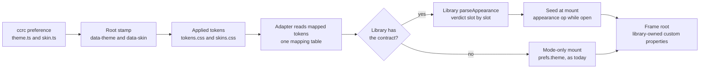
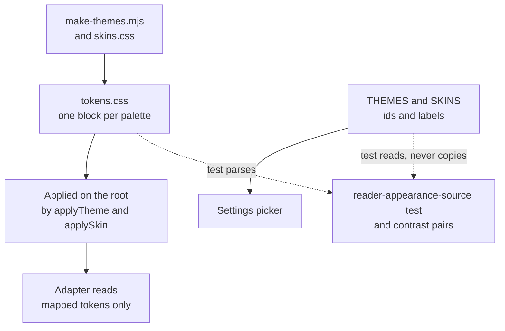
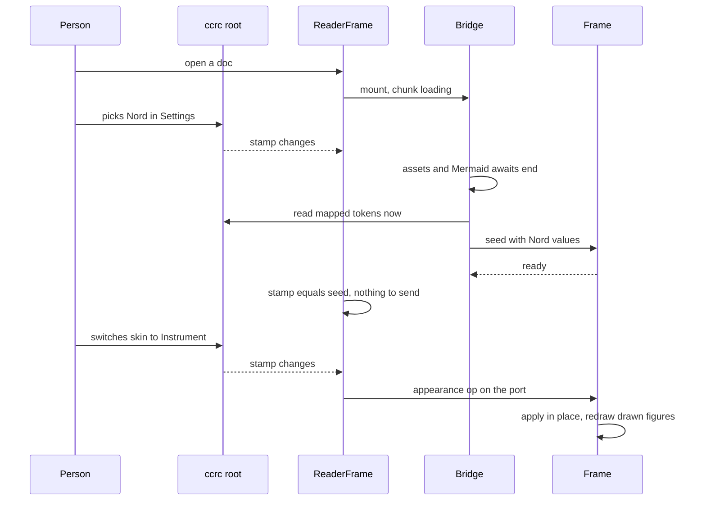

# Native Docs reader: appearance continuity

**Spec** · 2026-11-18 · Status: Draft · Owner: native-docs-reader programme, wave X1 · Linear: none · Related: `docs/superpowers/plans/2026-11-18-native-docs-appearance-continuity.md`, `docs/superpowers/plans/2026-11-07-native-docs-reader-completion.md`, `docs/superpowers/specs/2026-11-07-native-docs-reader-completion-design.md`, `docs/superpowers/specs/2026-10-12-rich-docs-reader-and-shared-renderer-design.md`, `docs/superpowers/programs/native-docs-reader.md`

## In short

The Docs reader frame should look like the rest of ccrc. It opens in the skin and palette the person chose in ccrc, and it follows any change made while it is open. Today it only learns light, dark or auto, because the adapter folds the twelve palettes into those three words and sends no skin (§1).

The design has five parts:
- **What crosses the bridge.** ccrc sends a small set of colour and shape values, a token contract, through the bridge the reader already uses. ccrc never sends a palette catalogue, an id list or a stylesheet (§2).
- **Where the values come from.** ccrc reads them from its own applied design tokens at the moment it needs them, through one mapping table. So the twelve palettes, Follow the system and both skins keep one source: the design system. A scan reds a second copy (§3).
- **Readability in every palette.** Code, tables, Mermaid and focus are drawn from the same values, and a test checks their contrast in every palette (§5).
- **Aa.** Inside ccrc, the frame's Aa stops offering a theme. Width, font and folds stay the reader's own (§6).
- **The library's part.** The shared library takes a backward-compatible minor change. Section 10 is written for the library programme to plan from. Its release and ccrc's re-pin are the operator's.

Nothing in this design widens the sandbox, the CSP, parent-DOM access or the set of message channels. The phone blocks and the tap, one-bar and desktop-fit budgets stand, measured on both skins (§8, §9).

What to check: the token contract (§2), the one-source mechanism and its scan (§3), the budgets (§9), and the acceptance mapping onto Task 17's Appearance row (§11). The one product choice, Aa's line while hosted, is answered (Where things stand).

## 1. Context

This section states the operator's requirement and what ccrc and library 1.1.0 do today. Every claim here was read from shipped source on 2026-11-18, at `main` `6f5421139`.

**The requirement.** It is the programme ledger's "Operator amendment — native visual continuity and legacy decoupling (2026-11-10)" and its Carried constraint "Required native appearance continuity". The reader uses ccrc's skin and theme choices and opens with ccrc's selected appearance. It aligns surfaces, text, accent and semantic colours, typography, borders, focus, controls and density. A colour-mode-only approximation is not enough. Rendering styles and any checked-preference extension belong to the shared library, and ccrc owns its preference and the adapter. Two choices are coordinator defaults: the frame follows host changes while open, and Aa's global appearance follows ccrc while hosted.

**ccrc's appearance today (sourced).**

| What | Where | Shape |
|---|---|---|
| Skin catalogue | `ui/src/styles/skins.ts#SKINS` | `refined`, `instrument`; stored choice `auto` resolves at boot (`resolveSkin`), applied as `data-skin` on the root (`applySkin`) |
| Skin tokens | `ui/src/styles/skins.css`, closed list `skins.ts#SKIN_TOKENS` | Type, density, radius, elevation, meter, motion. Skins never set colour (`skin-identity.test.ts`) |
| Palette catalogue | `ui/src/styles/themes.ts#THEMES` | Twelve rows `{id, label, mode, note}`: 8 dark, 4 light. `SYSTEM` is a stored choice, not a row |
| Palette values | `ui/src/styles/tokens.css`, generated from `ui/design/make-themes.mjs` | One `[data-theme]` block per palette, `:root` for Phosphor. About 45 colour tokens each (`--bg-*`, `--ink-*`, `--edge-*`, `--accent*`, `--status-*`, `--diff-*`, `--syn-*`) |
| Catalogue checks | `pwa/test/theme-catalogue.test.ts`, `skin-catalogue.test.ts` | ids equal CSS blocks both ways; generated block equals the generator's output |
| Contrast gate | `pwa/design/contrast-check.mjs`, `pwa/test/contrast.test.ts` | WCAG 2.1 floors, 4.5:1 for ink on every surface, in every palette |
| Preference | `pwa/src/lib/theme.ts`, `pwa/src/lib/skin.ts` | Per-device storage, one writer each (`setTheme`, `setSkin`), pre-paint script in `pwa/index.html` |
| Typefaces | `tokens.css` `@font-face` | Geist and Geist Mono, self-hosted woff2 (69 KB and 71 KB) |

**The reader today (sourced).** `ReaderFrame.tsx` computes `readerPrefsOf(useThemeChoice(), THEMES)`. It sends `auto` for Follow the system and the palette's `mode` for a named palette. It sends no skin. The bridge (`docs/reader/bridge.ts`) passes `prefs: {theme}` at mount, and the frame's `setPrefs` afterwards. During a lazy start, `ReaderFrame` re-sends the latest mode after the mount resolves (`seededPrefs`). The reader lab mounts with `theme: 'auto'` and profile `lab-draw`.

**Library 1.1.0 (sourced from the installed package).**
- `HostAdapters` has no appearance key beyond `prefs: Partial<FramePrefs>`, where `FRAME_PREF_VALUES = {theme: auto|light|dark, width: standard|wide, font: serif|sans}`.
- `mountDocFrame` throws `TypeError` on any adapter key it does not know (`ownData`), and `RangeError` on a bad pref value.
- The frame's stylesheet scopes every rule under `[data-docreader-root]`, through 54 custom properties, 36 of them colours (`--bg`, `--surface`, `--text`, `--accent`, `--border`, `--th-bg`, `--code-block-bg` and so on). Its header says a host may override any of them, but no API carries them.
- Code highlighting uses hard-coded hex in `.hljs-*` rules, with a second dark block.
- Mermaid draws with `theme: 'base'` and one fixed warm light palette of 15 hex values, on a white plate. Dark mode inverts the plate with a CSS filter.
- The bridge protocol is `v: 1`. A parent op the frame does not know is ignored. The frame's parser of parent ops accepts any plain object with own data properties and no proto keys, and checks each op through `OP_KEYS`. Nested values pass: `changes.result` already carries `ranges`, an array of integer pairs. The flat strings-and-numbers rule is the host's parser of frame-to-parent messages (`dist/host/parse.js`).
- The frame's CSP allows `style-src 'unsafe-inline' data:` and `font-src data:`. Its four fonts, Source Serif 4 and Source Sans 3, travel as `data:` inside its stylesheet: 413 096 base64 characters of the stylesheet's 549 069.

## 2. What crosses the bridge: a token contract

This section fixes the interface between ccrc and the library. ccrc sends values for a closed list of named slots. The library owns the list, the stylesheet that uses it, and the validation.


*Figure 1. Where appearance comes from and how it reaches the frame. The catalogue stays on the left, and only resolved values cross. The library's own validator decides every value: a refused colour drops the colour group, and the frame stays hosted in the library's colours for the mode. A refused skin slot drops only itself. Only a library without the contract leaves ccrc on today's mode-only mount.*

**The contract (library-owned).**
- `mode` is `light`, `dark` or `auto`: the resolved direction. It sets `color-scheme` and the library's defaults for any slot the host leaves out.
- `colour.<slot>` is one value per colour slot, `#rrggbb` or `#rrggbbaa` only. The group is all or nothing. An appearance with no colour group is valid. It means "hosted, in the library's own colours for `mode`", and it clears any host colours applied before.
- `skin.<slot>` holds the skin's character, in ten slots, each falling back by itself (§2.3 says which ccrc token feeds each, and why the others are not carried):
  - `radius`, `radiusSmall` and `radiusLarge`: whole pixels from 0 to 24;
  - `controlRow`: whole pixels from 28 to 56, the height of rows in the frame's popovers, applied only under `(pointer: fine)`;
  - `popShadow`: the popovers' elevation. It holds one to three comma-separated shadows. Each shadow has two to four lengths, then one colour, with no `inset`, no other function and no keyword. A length is `0` or whole px: the x and y offsets from -64 to 64, the blur from 0 to 64, the spread from -8 to 8. The colour is `#rrggbb`, `#rrggbbaa` or `rgba(r, g, b, a)`, with r, g and b whole numbers from 0 to 255 and a from 0 to 1. Both forms ccrc uses fit, measured in every palette: Refined's `0 12px 40px rgba(0, 0, 0, 0.55)` (and `rgba(26, 32, 27, 0.22)` in light palettes), and Instrument's hairline `0 0 0 1px #5F697C` (one `--edge-strong` per palette);
  - the section-label type of the popovers' own headings: `sectionFamily` (`sans` or `mono`), `sectionSize` (whole px from 10 to 16), `sectionWeight` (100 to 900, in hundreds), `sectionTracking` (em from -0.1 to 0.3) and `sectionCase` (`none` or `uppercase`).

  "The popovers" are Aa, the changes menu, the cross-reference card, quick jump, the keys sheet and the contents drawer. Their headings are the frame's own chrome, never document headings.
- `label` is optional text for Aa's hosted line (§6): at most 64 characters, with no control character (U+0000 to U+001F, U+007F to U+009F). The frame renders it as text content, never as markup. When it is absent or refused, the frame shows a neutral default that names no host: "Appearance follows the app's settings". ccrc sends "Appearance follows ccrc Settings".
- `fonts` are optional faces for the frame's sans and mono roles, carried as font assets at mount (§2.2).

**Base colours only.** Version 1's colour slots are base colours. The library derives every tint, hover, table head, inline-code and bar background from them with `color-mix` in its own stylesheet, because ccrc's own tints change form from palette to palette: `rgba(...)` in one, `color-mix(...)` in another. A derived tint holds at most 6% of its colour, so coloured text on its own tint keeps 4.5:1 (§5). Every semantic slot is a colour the library draws as text, so it maps to ccrc's text variant, never to a fill. The 33 slots:
- surfaces: `bg`, `surface`, `surface2`;
- ink: `text`, `text-muted`, `text-faint`;
- edges: `border`, `rule`;
- accent: `accent`, `accent-ink`, `focus`;
- semantic, drawn as text: `ok`, `wait`, `no`, `info`, `chg`;
- reference text: `term` (glossary terms), `id` (rule and fact ids), `violet` (the IMPORTANT alert title), `path` (code paths);
- code: `code-block-bg`, `code-ink`, and `syn-comment`, `syn-keyword`, `syn-string`, `syn-number`, `syn-function`, `syn-type`, `syn-tag`, `syn-attr`, `syn-punct`, `syn-deleted`, `syn-inserted`, which replace the hard-coded `.hljs-*` hex.

The list's home is the library's `APPEARANCE_SLOTS` export, and ccrc never spells it a second time (§3). Each ccrc token mapped to these slots was measured on 2026-11-18 to resolve to a plain `#rrggbb` in all twelve palettes, through `var()` chains, both default blocks merged, and every pair §5 names was measured against its floor (the leaf plan's Results).

**Why values and not a catalogue.** The frame needs one appearance at a time. The values for that appearance are all it can use, and they reveal nothing the frame could act on. A catalogue would put a second copy of ccrc's palettes in the library or in every seed (Decision X1-1, §12).

### 2.1 Carriage

- **At mount**, a new adapter key `appearance` carries the contract. The library writes each slot onto the frame root with the CSSOM (`style.setProperty` on a library-owned property name) before first paint. So the first painted frame is already in ccrc's colours.
- **While open**, `DocFrame.setAppearance(a)` posts one new parent op, `appearance`, on the existing port: `{t: 'appearance', v: 1, appearance: a}`, where `a` has exactly the contract's shape, `{mode, colour?: {<slot>: '#…'}, skin?: {<slot>: …}, label?}`. One spelling serves the adapter key, the op and the validator. An op whose value has no `colour` group drops host colours (§7).
- **Nothing flows back.** This contract adds no frame-to-parent op and no `store.set` key. The frame never tells ccrc what it applied.
- **Hosted means an appearance was seeded.** A mount whose adapters carried `appearance` is hosted for its whole life. While hosted, ccrc never calls `setPrefs` with a `theme`, and the frame never writes `theme` to `pref:prefs`. Its `prefs` path writes the whole prefs object, so the library leaves `theme` out of what it stores while hosted.

### 2.2 Fonts

ccrc's typefaces are part of its visual language, and the frame cannot fetch them (`default-src 'none'`). ccrc passes its own Geist and Geist Mono woff2 as two optional font assets, base64 text in `FrameAssets.fonts`, read once from the files the design system already ships.
- **Loading.** The library checks the base64 alphabet, a `wOF2` signature and a cap of 131 072 decoded bytes (128 KiB) per face, which is at most 174 764 characters of base64. ccrc's faces are 69 492 and 71 236 bytes. It then loads each face with the `FontFace` API from the decoded bytes, under a fixed family name. No CSS text is built from host input.
- **Failure.** A face that fails any check, or fails to load, is dropped silently, and that role keeps the library's own face. A bad font never throws, never refuses the mount and never falls back to the plain view. On the ccrc side, the fonts load on their own path, and a failed font load mounts without them, never through `onFallback('assets')`.
- **Size.** The library's derived srcdoc cap rises by exactly the two faces' cap, so fonts never push a document into `too-large`.
- **Use.** While hosted, the frame's sans role and its chrome use ccrc's UI face, and code uses ccrc's mono face. The serif reading face stays the library's. Font choice in Aa stays the reader's (§6).

### 2.3 The skin, token by token

The operator asked that controls and density align with the skin, and that the reading layout and the budgets be kept. So a skin token is carried when it touches neither the frame's bar nor the reading geometry. It is rejected, by name, when it would move either, or when the frame has no counterpart. Values were read from `ui/src/styles/tokens.css` and `skins.css` on 2026-11-18. Instrument's values at a width of 900 px or more, and under a fine pointer, follow a slash.

| ccrc token | Refined | Instrument | Verdict | Why |
|---|---|---|---|---|
| `--fs-ui` | 15 px | 15 / 13 px | Rejected | The frame bar's labels. 2 px of type at 900 px and above moves the desktop bar, against the 1 px desktop-fit budget |
| `--fs-prose` | 15 px | 15 / 14 px | Rejected | Prose size is the reading layout (the library's `--rem` and its 18 px serif) |
| `--fs-meta` | 12 px | 11 px | Rejected | The byline and meta lines sit in the document's title block, in the reading layout |
| `--fs-page` | 20 / 24 px | 14 px | Rejected | The document title, in the reading layout |
| `--fs-section` | 15 px | 11 px | Carried | `sectionSize`, popover headings only |
| `--weight-section` | 600 | 500 | Carried | `sectionWeight` |
| `--family-section` | UI face | mono face | Carried | `sectionFamily`: ccrc compares the token with its own `--family-ui` and `--family-mono` and sends the role |
| `--case-section` | none | uppercase | Carried | `sectionCase` |
| `--ls-section` | -0.011em | 0.08em | Carried | `sectionTracking` |
| `--gutter` | 16 / 24 / 32 px | 12 / 14 px | Rejected | The reading layout's gutters (the library's `--pad` and `--gut`) |
| `--row-h` | 52 px | 44 / 32 px | Carried | `controlRow`, popover rows under a fine pointer only. A coarse pointer keeps the 44 px tap floor |
| `--pad-card` | 16 px | 12 px | Rejected | The library's cards (callouts, figures) sit in the reading flow |
| `--gap-section` | 32 px | 20 px | Rejected | Spacing in the reading flow |
| `--page-max` | 760 px | 960 px | Rejected | The reading measure (the library's `--measure`, 44 rem) |
| `--page-max-wide` | 1120 px | none | Rejected | The library's break-out width for tables and figures (`--wide`), in the reading layout |
| `--measure-chat`, `--measure-chat-prose` | 1200 px, 90ch | 100%, 100ch | Rejected | Chat only. No counterpart in the frame |
| `--head-h` | 56 px | 44 / 40 px | Rejected | The frame bar (`--bar-h`, 48 px): the one-bar and desktop-fit budgets |
| `--section-flow` | column-reverse | row | Rejected | ccrc's page Section heads. No counterpart |
| `--r-sm` | 6 px | 3 px | Carried | `radiusSmall`: inline code, keycaps, pills |
| `--r-md` | 10 px | 5 px | Carried | `radius`: controls, code blocks |
| `--r-lg` | 14 px | 8 px | Carried | `radiusLarge`: popovers, callouts and figure cards. Radius is paint only |
| `--r-xl` | 20 px | 12 px | Rejected | Sheet and drawer top corners. The frame has no bottom sheet |
| `--elev-card` | a palette shadow | none | Rejected | No counterpart: the library's in-document cards draw no shadow (measured: figures and tables set `box-shadow: none`) |
| `--elev-pop` | `0 12px 40px` and a palette colour | `0 0 0 1px` and `--edge-strong` | Carried | `popShadow`, on every popover |
| `--meter-h`, `--meter-segments`, `--meter-gap` | 5 px, 1, 0 | 8 px, 10, 2 px | Rejected | The frame draws no meter. Reading progress shows on ccrc's own bar |
| `--dur-fast`, `--dur-base`, `--dur-slow` | 180, 240, 320 ms | 120 ms | Rejected | They time ccrc's sheets, card expands and shared-element moves, which the frame does not have. The frame's own hover and fold fades are 100 to 150 ms |

## 3. One source of truth for the catalogue

This section says how the reader uses ccrc's catalogue without copying it, and what reds a copy. The rule: the catalogue never leaves the design system. The reader reads applied values, not names.

**The mechanism.** The design system already applies the chosen appearance to the document root: `data-theme`, `data-skin`, and the tokens under them. The adapter reads the computed values of the mapped ccrc tokens from that root (`getComputedStyle(document.documentElement)`) at the moment it seeds or updates the frame. That is ccrc reading its own document. The frame is not involved, and no parent-DOM access is given to it.

- The one hand-kept artefact is **the mapping table**, `READER_APPEARANCE_MAP` in a new pure module `pwa/src/docs/reader/appearance.ts`. It is a mapping, not a catalogue: it names no palette and no skin. Version 1 maps:

  | Slots | ccrc tokens |
  |---|---|
  | `bg`, `surface`, `surface2` | `--bg-page`, `--bg-surface`, `--bg-raised` |
  | `text`, `text-muted`, `text-faint` | `--ink-primary`, `--ink-secondary`, `--ink-tertiary` |
  | `border`, `rule` | `--edge-strong`, `--edge-subtle` |
  | `accent`, `accent-ink`, `focus` | `--accent`, `--ink-on-accent`, `--accent` |
  | `ok`, `wait`, `no`, `info` | `--status-done-text`, `--status-attention-text`, `--status-dead-text`, `--ink-secondary` |
  | `chg` ("changed since", magenta) | `--acct-magenta` |
  | `term`, `id`, `violet`, `path` | `--acct-cyan`, `--acct-blue`, `--acct-violet`, `--ink-secondary` |
  | `code-block-bg`, `code-ink` | `--bg-well`, `--ink-on-well` |
  | `syn-<name>` (eleven) | `--syn-<name>` |
  | `radius`, `radiusSmall`, `radiusLarge` | `--r-md`, `--r-sm`, `--r-lg` |
  | `controlRow`, `popShadow` | `--row-h`, `--elev-pop` |
  | `sectionSize`, `sectionWeight`, `sectionTracking`, `sectionCase` | `--fs-section`, `--weight-section`, `--ls-section`, `--case-section` |
  | `sectionFamily` | `--family-section`, as a role: `mono` when it equals `--family-mono`, `sans` when it equals `--family-ui`, left out otherwise |
- A new palette, or a third skin, reaches the reader with no reader change: it is applied to the root, and the adapter reads it.
- Follow the system needs no special case. The root carries whichever palette the operating system picked, and the adapter reads that.

**The scan that reds a second copy.** A new test, `pwa/test/reader-appearance-source.test.ts`, has four parts:
1. **Slot coverage.** The mapping table's slots equal the library's `APPEARANCE_SLOTS`, in both directions.
2. **Every palette resolves.** For every palette `THEMES` lists, and for both skins, each mapped token resolves, through `var()` chains in `tokens.css` and `skins.css`, to a literal the library's validator accepts. A token that resolves to `color-mix(...)` or nothing reds here, not on a phone.
3. **No second list.** The scan covers `pwa/src/docs/`, `pwa/src/readerLab/` and `pwa/src/lib/appearance.ts`:
   - no file holds two or more palette ids, or two or more skin ids, as string literals or as object keys, quoted or not;
   - no file under `pwa/src/docs/reader/` holds a hex colour literal;
   - only `ReaderFrame.tsx` imports `THEMES`, for the mode-only fallback (§7), and no file imports `SKINS`.
4. **No stylesheet crosses.** Two checks:
   - at run time, over every value `readerAppearanceOf` builds in part 2, no string contains `;`, `{`, `}`, `url(` or `var(`, and no key falls outside `APPEARANCE_SLOTS`, `mode` and `label`;
   - in source, `appearance.ts` holds no such literal.

A test helper, `pwa/test/helpers/paletteTokens.ts`, resolves a palette's tokens for parts 2 and 3. The contrast gate's `audit.mjs` cannot, as it stands: it keys the default palette as `DARK`, reads only the first `:root` block, and never reads `skins.css` or `color-scheme`. The helper merges both default blocks, maps `phosphor` to them, applies a skin's `:root[data-skin=…]` block and its `(pointer: fine)` arm, and follows `var()` chains.


*Figure 2. The catalogue's one home and its readers. Solid edges are runtime paths. Dotted edges are test reads. Nothing on the reader side holds a list of palettes or skins.*

## 4. When the frame learns the appearance

This section covers an ordinary open, a lazy open (the reader chunk still loading) and a change while open.

**One signal.** A new hook, `useHostAppearance()` in `pwa/src/lib/appearance.ts` (ring L4), observes the root's `data-theme` and `data-skin` attributes with a `MutationObserver` and returns a stamp, `skin|theme`. It reads the applied result, not the stored choice. So it moves on every writer's change, including Follow the system flipping with the operating system, which `useThemeChoice()` alone does not see.

**Reading at the last moment.** The bridge reads the appearance synchronously, immediately before the synchronous `mountDocFrame`, after its last asset and Mermaid await. This is the point where D2 samples focus (D-8729), with no await in between. A change during the lazy chunk load or the asset wait is therefore already in the seed. The read happens once per library mount: since #3026, a same-page link's `openAt` builds the adapters again, and it reads again, beside the focus sample.

**After the mount resolves.** The bridge's synchronous read returns the values and the stamp it read them under, and the mount hands that stamp back. `ReaderFrame` compares it with the current stamp, as it does today for the mode (`seededPrefs`), and sends `setAppearance` once only if they differ. A change during the hold is already in the seed, so it sends nothing.

**While open.** On a stamp change, `ReaderFrame` reads the values again and calls `setAppearance`. Calls coalesce to one per animation frame, and the latest wins. The frame applies the values in place: no remount, the same iframe and nonce, and the reading position kept.

**A mode-only mount keeps today's trigger.** On a mode-only mount (§7), `ReaderFrame` keeps its existing effect on the derived mode (`readerPrefsOf`). The stamp alone would miss a change: on a dark device, Follow the system and Phosphor both leave `data-theme` unset, so the stamp does not move while the mode goes from `auto` to `dark`. A hosted mount needs no such trigger, because both choices then apply the same values.


*Figure 3. A lazy open with a change during the chunk load, then a change while open. The seed is read after the last await, so the first change needs no follow-up op. The second rides the existing port as one `appearance` op.*

**Mermaid on a change.** Figures already drawn are redrawn in the new colours, nearest first, one per task. Figures not yet drawn are drawn in the new colours when their turn comes. A newer appearance cancels the redraws still queued for an older one, so a burst never stacks redraws. Production stays on request (E17-READING does-not-hold), so few figures are drawn at any moment.

## 5. Readable in every palette

This section covers code, tables, Mermaid, contrast and focus. The rule: everything the reader draws takes its colours from the contract, and the contrast of every pair the reader uses is checked in every palette.

| Element | Today | With the contract |
|---|---|---|
| Body text, links, borders | Library light or dark palette | ccrc's ink, accent and edges. Edges are decorative, as in ccrc: no floor |
| Tables | `--th-bg`, `--surface`, `--surface2`, `--border` | The same slots, from ccrc's raised and well surfaces |
| Code blocks | Library background, hard-coded `.hljs-*` hex | ccrc's well and `--syn-*` tokens. Wells stay dark in every palette, as in ccrc's chat |
| Mermaid | Fixed warm palette on a white plate, inverted by a filter in dark | Colours derived from the slots by the library's `mermaidThemeOf` (`surface`, `surface2`, `text`, `border`, `accent`). No plate and no filter while hosted |
| Focus | `outline: 2px solid var(--accent)` | The same rule on the `focus` slot, ccrc's accent |
| Reference text | `--term`, `--id`, `--violet`, `--path`, hard-coded per mode | ccrc's lane hues `--acct-cyan`, `--acct-blue`, `--acct-violet`, and `--ink-secondary` for paths |
| Semantic colours | `--ok`, `--wait`, `--no`, `--info`, `--chg` | ccrc's text variants `--status-done-text`, `--status-attention-text`, `--status-dead-text`, then `--ink-secondary`, and `--acct-magenta` for "changed since". Fills, dots and tints derive from them |

**The contrast gate.** The library exports `APPEARANCE_PAIRS`: each pair of slots its stylesheet puts in front of one another, with a floor.
- **4.5:1:** body text, links, every semantic text colour, table text, code tokens and Mermaid labels. Each is measured on all three grounds (`bg`, `surface`, `surface2`), or on the well for code, and on the derived tints it is drawn on.
- **3:1:** the focus ring against `bg`, and Mermaid lines against the figure ground.
- **No floor: edges.** `border` and `rule` are decorative, as ccrc's own gate treats its edges (`pwa/design/contrast-check.mjs` holds that no edge token clears 3:1 in every palette). Measured: `border` on `bg` is 1.54:1 at worst. A frame control is identified by its label, at 4.5:1, and by the focus ring, never by its border alone.

ccrc's test computes the mapped values for every palette through `pwa/test/helpers/paletteTokens.ts` (§3) and checks every pair. A palette that fails reds ccrc's suite before it reaches a reader. The library checks the same pairs on its own defaults. Measured 2026-11-18 under this map, in all twelve palettes: every 4.5:1 pair holds. The lowest are `text-faint` on `surface2` at 4.52 (Solarized Dark) and `accent` on `surface2` at 4.57 (Phosphor Daylight). The focus ring is 4.92:1 at worst, and coloured text on its own 6% tint over `bg` is 4.56:1 at worst. At an 8% tint that last pair falls to 4.43:1 (Phosphor Daylight), which is why tints hold at most 6%.

## 6. Aa while hosted

This section settles what the frame's own Aa menu offers inside ccrc. One Aa stays, in the frame.

- **While hosted with an appearance, Aa has no theme row.** Global appearance has one owner, and a choice in the frame would be overridden at the next change anyway. In the row's place is one static line. Its text is the contract's `label`, which ccrc sends as "Appearance follows ccrc Settings". The library hard-codes nothing of ccrc's: without a label, it shows its neutral default, "Appearance follows the app's settings" (§2).
  - **Accessibility.** The line is plain text in the settings panel, in reading order where the theme row was. It is not a control, not focusable, and has no role beyond a paragraph, so a screen reader reads it with the panel. It is drawn in `text-muted` on `surface`, a pair in `APPEARANCE_PAIRS` at 4.5:1, so the §5 gate checks it in every palette.
  - **Who decides "hosted".** The host adapter decides, never the frame. The frame shows the line only when its mount carried an `appearance`. With no appearance, Aa keeps its theme row. That covers the reader lab, the library used on its own, and ccrc on the mode-only path (§7).
  - **No shortcut.** Aa has no Settings button in this design. A later wish for one rides the bridge's existing command vocabulary, or comes back as an ask.
- **Width, font and folds stay reader-local.** They are stored under `ccrc:reader:v1:` as today, and seeded back on mount.
- **A stale reader preference never wins.** With an appearance supplied, the frame ignores any stored `theme` in `pref:prefs`, and it never writes one. On the mode-only path (§7), the host keeps passing `theme` on every mount, as today, so the host value still wins (the library's precedence: defaults, then stored, then host).

## 7. Compatibility and fail-safe behaviour

This section says what happens when the two sides do not match, or a value is bad. In every case the reader stays readable and never falls back to the plain view over appearance.

Two terms, each with one meaning in this spec and its plan:
- **A mode-only mount** is a mount on a library without the contract (or with a contract newer than ccrc knows). ccrc sends `prefs.theme`, as today, and no `appearance`.
- **A hosted mount without colours** carries an `appearance` whose colour group the validator dropped. It stays hosted, in the library's colours for its `mode`.

There is no skew inside one mount. The host half and the frame half of a mount come from one package version, and the frame's scripts are pinned by hash (M8.12). Skew can only exist between ccrc's adapter and the library API it was built against, and the exact pin plus TypeScript make that a build error.

| Case | What happens | Why |
|---|---|---|
| Library without the contract (1.1.0) | The adapter finds no supported `APPEARANCE_CONTRACT` and sends today's `prefs.theme`. Aa keeps its theme row | 1.1.0 throws on an unknown adapter key, so the adapter must not send one. With the exact pin this is a build error, so the case is reached through the test seam only: `libraryContract`, answering a number or `'none'` |
| Library contract newer than the adapter knows | Today's `prefs.theme`, until ccrc adopts it | The adapter supports an explicit set of contract versions |
| A mapped colour reads empty or not as a literal, at mount or while open | An appearance with `mode` and no colour group: the frame stays hosted, drops any host colours it had, and shows the library's colours for that mode. `console.warn('ccrc-reader: …')` once | Half a palette could put dark ink on a dark surface, and a stale palette left on screen would be worse. All or nothing per group is safe |
| A skin slot or the label is refused | That slot keeps the library default. Colours still apply | Shape and type cannot hurt contrast |
| The frame receives an `appearance` op with bad values | The frame runs the same `parseAppearance` and applies its verdict, slot by slot, with the colour group all or nothing. Only a value that is not a plain object is ignored whole | One bad-value rule, the validator's, at mount and while open |
| A new ccrc skin or palette | Values flow with no reader change. The §5 gate reds a palette whose mapped pairs miss a floor | The library never sees ids, so an unknown skin cannot exist for it |
| The reader lab | Mounts with no appearance, as today | E17 and E18 readings stay comparable to the recorded phone blocks |

## 8. Boundaries and threat model

This section lists what does not change and what the new data could do. The standing boundaries are not reopened.

**Unchanged:**
- The reader sandbox is exactly `allow-scripts`, and the shell CSP is exactly `frame-src 'none'`.
- The frame's CSP is unchanged: its `style-src` and `font-src` already allow what the contract needs.
- There is no parent-DOM access from the frame, and no new channel, port or window listener.
- Both 2026-11-06 phone blocks stay byte for byte.

**What the new data is.**
- **Origin.** Colour, length and font values computed from ccrc's own stylesheets. A document cannot influence them: documents render inside the frame, never on ccrc's root.
- **Validation.** Both sides validate. The adapter validates with the library's own pure `parseAppearance` before sending. The frame validates again: closed keys; colour slots `#rrggbb` or `#rrggbbaa` only (`popShadow`'s colour may also be a bounded `rgba()`, §2); lengths as whole pixels in range; no `;`, braces, `url(` or `var(`. A `popShadow` within its bounds paints at most a 64 px blur and an 8 px spread around a popover, and it reaches no URL.
- **The label.** It is the one free text that crosses. It is at most 64 characters, refused if it holds a control character, and set with `textContent`, so markup in it shows as its own characters and never renders.
- **How values are written.** Through the CSSOM, onto library-owned custom property names. No stylesheet text is built from host input. Fonts load through the `FontFace` API from decoded bytes, under fixed family names.
- **Fonts.** These are ccrc's own bundled bytes. They are the first binary bytes in the srcdoc that the library does not pin by hash: its own faces sit in a stylesheet that `frameDocument` checks against its manifest. So the library checks ccrc's faces by alphabet, signature and size, and ccrc pins them with a row: the bytes it passes are exactly the design system's font files. A malformed font would reach the browser's font parser inside an opaque-origin, script-pinned frame, and a face that fails to load is dropped (§2.2).
- **Exfiltration.** The frame learns ccrc's current colours. This contract gives it no way to send them anywhere: `default-src 'none'`, no network, and no frame-to-parent op of its own. Another design may add a frame-to-parent op additively, such as X2's figure images. That design argues its own threat model, and nothing here rules it out.
- **Rate.** A parent op costs the frame a repaint, plus a redraw of any drawn figure. Coalescing to one per animation frame bounds the ops. Cancelling queued redraws on a newer appearance bounds the figure work. The bridge's refusal count applies to frame-to-parent ops only, so a burst of host ops can never close the port.

## 9. Budgets

This section gives the numbers the implementation must keep. Geometry budgets are measured on both skins.

| Budget | Number | Measured by |
|---|---|---|
| Phone title at 412 x 915 | at most 61 px | `docs-compact-head` and `reader-frame` browser rows, both skins |
| Phone console part | at most 48 px | as above |
| Tap floor | 44 px | as above |
| Tablet and desktop fit | at most 1 px from a fresh BASE, per skin | as above |
| One bar on a phone | the frame's own bar off, ccrc's bar only, per skin | as above |
| Appearance payload | at most 4 KiB serialised, about 50 keys | unit row on the adapter's output |
| Ops while open | at most 1 per animation frame, latest wins | unit row with a fake clock |
| Hosted srcdoc growth, in three parts | (1) ccrc's two faces: exactly 187 640 characters of base64, pinned to the files. (2) The library's own growth: its frame assets (guard, bootstrap, enhance, stylesheet) at the new release at most 32 768 characters over 1.1.0's 781 099. (3) The appearance seed: at most 4 096. So a hosted mount grows by at most 224 504 characters over the same document at the 1.1.0 pin | (1) and (3): unit rows. (2): Task 1, read from the installed package. The total: `frame-cost` browser row |
| Open to `ready` | hosted median of 9 opens at most 1.10 x the BASE median of 9, desktop Chromium, same runner | `frame-cost` browser row |
| Change while open | frame root shows the new values within 100 ms. Same iframe and nonce. Scroll within 1 px | `reader-appearance` browser row |
| Mermaid redraw | one figure per task, no single gap over E17's 200 ms | `reader-appearance` browser row |
| Contrast | 4.5:1 text, links, semantic text, code, table and figure labels, on every ground and tint they are drawn on. 3:1 focus ring and figure lines. Edges have no floor | unit gate, every palette, both skins |

## 10. The library's part

This section is written for the library programme to plan from. It names the library by role, the shared rendering library, and proposes no new name. Its release, signed tag and ccrc's re-pin are the operator's.

**Version.** A minor release, additive only. The bridge protocol stays `v: 1`, because a frame that does not know the new op ignores it (rich-docs §3.8). A host that never passes the new key gets exactly today's behaviour.

**Interface (exports).**

| Export | Kind | What it is |
|---|---|---|
| `APPEARANCE_CONTRACT` (`./frame`) | number, `1` | The contract version. Absent in 1.1.0, which is how a host detects support |
| `APPEARANCE_SLOTS` (`./frame`) | readonly record | The closed slot names by group: `colour`, `skin`. The source of truth for both sides' tests |
| `APPEARANCE_PAIRS` (`./frame`) | readonly list | `{fg, bg, floor}` for every pair the stylesheet draws, derived colours included, expressed over the slots |
| `parseAppearance(x)` (`./frame`) | pure function | Never throws for a value. Returns `{appearance, refused}`: `appearance` is always usable, and `refused` lists `{key, why}` for each slot it left out. A refused colour drops the whole colour group. A refused skin slot or label drops itself. A bad `mode` reads as `auto`. The same validator the frame runs on the seed and on every op |
| `mermaidThemeOf(colours)` (`./frame`) | pure function | Mermaid `themeVariables` derived from the slots. Documents still cannot set any theme key |
| `APPEARANCE_LABEL_DEFAULT` (`./frame`) | string | "Appearance follows the app's settings": the line shown with no host label, naming no host |
| `HostAdapters.appearance?` (`./host`) | adapter key | The contract value at mount, taken through `parseAppearance`: a bad slot value never throws. Only a value that is not a plain object throws `TypeError`, like any adapter key |
| `FrameAssets.fonts?` (`./host`) | asset | `{sans?: string, mono?: string}`, base64 woff2. Checked as §2.2 says, and dropped rather than thrown on failure |
| `DocFrame.setAppearance(a)` (`./host`) | method | Posts the `appearance` op after `ready`. Queued before `ready`, latest wins. Seeds later remounts |

The pure exports live in `./frame` because ccrc's import rule keeps `./host` to its one adapter file (`docs-scans.test.ts#LIBRARY_HOMES`), and ccrc's pure mapping module must read them.

**Frame behaviour.**
- An appearance is applied before first paint, from the seed, and in place from the op.
- With an appearance, the frame ignores stored theme, hides Aa's theme row, shows the one line §6 gives (plain text, not focusable), and never writes `theme`. Without one, Aa is exactly 1.1.0's.
- `.hljs-*` rules move onto the `syn-*` slots, with today's hex as their defaults, so a host that passes nothing sees no change.
- Every colour that is not a slot derives from the slots with `color-mix` in the stylesheet, and `APPEARANCE_PAIRS` lists each derived pair:
  - `accent-hover` and `accent-soft` derive from `accent`;
  - `wait-soft` and `wait-tint` from `wait`, and `no-tint` from `no`;
  - `chg-tint`, `chg-soft` and `chg-bg` from `chg`;
  - `short-bg`, `paper`, `plate` and `topbar-bg` from the surfaces;
  - `th-bg` from `accent` over `bg`, and `code-inline-bg` from `text` over `bg`;
  - `code-comment` is `syn-comment`.

  Every derived tint holds at most 6% of its colour. `chg-x` is a length, not a colour, and stays the library's.
- An appearance with no colour group removes every host colour and leaves the hosted state as it was.
- Skin slots style the popovers and their headings, the radii of controls, cards and code, and nothing else. `controlRow` applies under `(pointer: fine)` only. The frame's own bar and the reading layout (measure, prose size, gutters, title block) never take a skin value.
- `popShadow` replaces `--pop-shadow` on every popover, the quick jump, keys and contents drawer shadows included.
- While hosted, the stored prefs object never carries `theme`.
- The frame's derived srcdoc cap rises by the fonts' cap.
- While hosted, Mermaid draws with `mermaidThemeOf`, with no white plate and no invert filter, and figures already drawn are redrawn on a change, nearest first, one per task.
- The library's four faces stay inline in its stylesheet, exactly as in 1.1.0, so a host that supplies 1.1.0's four assets keeps working. ccrc's faces are additional, optional assets. Splitting the library's faces out would save at most its two sans faces, 76 364 characters (measured), and would change the asset set a 1.1.0-style host supplies, so it is not proposed.

**Tests the library ships.**
1. `parseAppearance`:
   - accepts every slot at the edges of its grammar, `popShadow` at three shadows, offsets of ±64, blur 64 and spread ±8 included;
   - leaves out a `popShadow` with `inset`, four shadows, a blur of 65, a spread of 9, `rgba(256, 0, 0, 1)`, `rgba(0, 0, 0, 1.5)` or `rgb(0, 0, 0)`;
   - leaves out, without throwing, an unknown key, a 3-digit hex, `rgb()`, `var(`, `url(`, a `;`, an out-of-range length and an oversize payload, and names each in `refused`;
   - one refused colour leaves out the whole colour group; one refused skin slot leaves out only itself;
   - a bad `mode` reads as `auto`.
2. Host API:
   - an unknown adapter key still throws;
   - `appearance` is accepted;
   - `setAppearance` before `ready` queues, and after `ready` posts exactly one op;
   - the op's keys are exactly `t`, `v` and `appearance`, and its value's keys are exactly the contract's (`mode`, `colour`, `skin`, `label`).
3. Frame:
   - the seed paints before first frame;
   - an op applies without remount;
   - a malformed op changes nothing;
   - stored theme is ignored with an appearance and honoured without one;
   - Aa has no theme row with an appearance.
4. Conformance:
   - with no appearance, the rendered output and computed styles equal 1.1.0's for the corpus;
   - the default palette passes `APPEARANCE_PAIRS`.
5. Mermaid:
   - `mermaidThemeOf` output passes the pairs for both default modes;
   - a document's init directive still cannot set `themeVariables`, `themeCSS` or `darkMode`;
   - a newer appearance cancels redraws queued for an older one.
6. The label:
   - a 64-character label shows whole, and a 65-character one is refused, so the default shows;
   - a label holding U+0000, U+001B, U+007F or U+0085 is refused;
   - a label of `<b>x</b>` shows those eight characters, and the line holds no element;
   - with no label, the line is `APPEARANCE_LABEL_DEFAULT`, and no string of any host appears in the library's built assets.
7. Hosted state:
   - an op with no colour group clears host colours;
   - while hosted, a `prefs` change never writes `theme`;
   - a font that fails its checks or `FontFace` load is dropped, and the mount reaches `ready`;
   - a document at the old srcdoc cap still mounts with both faces.
8. Size: the frame assets (guard, bootstrap, enhance, stylesheet) grow by at most 32 768 characters over 1.1.0's 781 099.
9. Boundaries, written so that they pin this contract's own additions and nothing else:
   - `frameCsp()` answers the same with and without an appearance, and this contract adds no CSP source;
   - this contract adds exactly one parent-to-frame op, `appearance`, and no frame-to-parent op.

   Neither row compares the whole op set or the whole CSP with 1.1.0's, so another design's additive op can ship in the same library wave and release, on its own interface and with its own tests.

**One release for more than one design.** The library wave that carries this contract may also carry X2's figure-image op, a frame-to-parent op designed separately. The two have independent interfaces and tests. This section designs only its own.

**Compatibility.** A 1.1.0 host keeps working unchanged against the new version. The new version's frame ignores nothing a 1.1.0 host sends. A host built for the new version that is pinned back to 1.1.0 fails to build, and does not fail at run time.

## 11. Acceptance: Task 17's Appearance row

This section maps the design onto the completion plan's Task 17 "Required extension acceptance matrix" Appearance row, clause by clause. The leaf plan's acceptance rows (AP-1 to AP-8) are these, one to one. Each is run on the final installed release set, as F requires, and as a browser row in the implementing wave.

| Row | Task 17 clause | Installed action | Required observation |
|---|---|---|---|
| AP-1 | Both canonical skins | Open a doc under Refined and under Instrument, open Aa, and read a popover heading | Per skin: every colour slot on the frame root equals the host's mapped value. The frame's chrome, sans and mono faces are ccrc's loaded faces. Popover rows, popover shadow, radii and the popover headings' family, size, weight, tracking and case equal the host's skin values. The frame bar's height and the reading layout (measure, prose size, gutters, title block) equal BASE, unchanged by the skin |
| AP-2 | All twelve palettes and Follow the system | Discover the catalogue from `THEMES` and the system choice at run time, then open a doc in each: 12 palettes, plus Follow the system with the device light and dark | 14 appearances x 2 skins = 28 opens. In each, every colour slot on the frame root equals the host's mapped value, and the frame's `color-scheme` equals the host's. The count is printed from the discovered catalogue, never typed |
| AP-3 | Host-selected appearance on ordinary open | Open with the chunk already loaded, with a stale reader theme stored (`{"theme":"dark"}` under a light palette, and the reverse) | The seed carries the appearance, and values at first `ready` equal the host's, not the stored theme's. Painting before first paint is the library's own test (§10). On a device, no light-then-dark flash is seen |
| AP-4 | Lazy open | Hold the reader chunk, change the palette and the skin during the hold, release | The seed carries the latest appearance, and at most one follow-up op is sent |
| AP-5 | Changes while open under the reviewed contract | Cycle through every palette, flip the system mode, switch skin | Applied in place: same iframe and nonce, scroll within 1 px, values within 100 ms, drawn figures redrawn in the new colours |
| AP-6 | Native chrome, typography, surfaces, focus, accessibility | Read text, links, a table, code and a drawn figure, and tab to a control, in every palette | Every `APPEARANCE_PAIRS` pair meets its floor on computed frame values. The focus ring is visible at 3:1. Aa shows no theme row. Width, font and a fold, changed in Aa, are back after a reopen, and the stored prefs carry no `theme` |
| AP-7 | Retained phone and desktop geometry budgets | The `docs-compact-head` and `reader-frame` geometry rows on both skins | One bar on a phone. Title at most 61 px, console at most 48 px, tap 44 px. Tablet and desktop at most 1 px from BASE |
| AP-8 | No independent catalogue or mode-only substitution | Run the §3 scan, and open with a library that supports the contract | Scan green. The bridge sent `appearance`, not only `prefs.theme`. A deliberate mode-only mount is reported as a failure of this row |

## 12. Decisions

Each decision is a technical call within the operator's requirement, made and argued here. The one product choice, Aa's line while hosted, is recorded in Where things stand.

| # | Decision | Options considered | Chosen, and why | Status |
|---|---|---|---|---|
| X1-1 | Library interface | (a) token contract, values for closed slots; (b) the host passes its catalogue and the frame switches by id; (c) the library ships ccrc's palettes; (d) the host injects a stylesheet | (a). It is the only option with no second copy of the catalogue, and it carries exactly one appearance. (b) and (c) copy the catalogue. (d) is forbidden by the requirement | Proposed |
| X1-2 | Catalogue sharing | (a) read applied tokens from ccrc's root at run time; (b) a TS table generated from `tokens.css` at build time; (c) a hand-kept table | (a). It has zero copies, follows any new palette or skin, and reads exactly what the person sees. (b) is a derived copy that needs its own drift check. (c) is the copy the requirement forbids | Proposed |
| X1-3 | How a change while open travels | (a) a new parent op on the existing port; (b) widen `prefs` with appearance keys; (c) remount | (a). `prefs` carries the reader's own enum preferences, which the frame persists to `pref:prefs`. Appearance is ccrc's, must never be persisted (§6), and has its own validator. One op per meaning keeps both closed key tables simple. (c) loses reading position and costs a full open | Proposed |
| X1-4 | Change signal | (a) observe the root's `data-theme` and `data-skin`; (b) subscribe to the two stores plus the media query | (a). It reads the applied outcome, so Follow the system flips and every writer are covered by one observer | Proposed |
| X1-5 | Bad values | (a) all or nothing per group, hosted with library colours on failure; (b) per slot; (c) fall back to the plain view | (a) for colour, (b) for skin slots and fonts. A partial palette can break contrast, and appearance never justifies losing the rich view | Proposed |
| X1-12 | Semantic colours | (a) ccrc's text variants, with fills and tints derived; (b) ccrc's fill tokens; (c) separate text and fill slots | (a). The library draws these colours as text, and ccrc's fills miss 4.5:1 there: `--diff-add` is 1.69:1 in Phosphor Daylight, `--status-dead` 3.85:1 in Nord. (c) doubles the slots for no visible gain. `chg` keeps its magenta "changed since" meaning through `--acct-magenta`, where `--diff-add` green would change it | Proposed |
| X1-11 | Tints and composites | (a) base colours only, the library derives tints with `color-mix`; (b) carry ccrc's tint tokens and resolve them through a probe element | (a). ccrc's tints change form between palettes, so (b) needs a colour parser on both sides for no visible gain | Proposed |
| X1-6 | Typography | (a) pass ccrc's two faces as font assets; (b) the library ships Geist; (c) keep library faces | (a). One home for ccrc's typefaces, and the frame cannot fetch them. (b) couples the library to one host. (c) misses typography | Proposed |
| X1-7 | Density and controls | (a) carry every skin token that touches neither the frame bar nor the reading geometry, and reject the rest by name; (b) carry every skin token, the bar included; (c) radius, row height and label case only | (a), token by token in §2.3 (the coordinator's ruling on review 2645 F3): radius, popover rows, popover elevation and the section-label type are carried; type sizes, gutters, measures, the bar height and card padding are rejected because they move the reading layout or a budget; meter, motion, chat measures and sheet corners have no counterpart. (b) breaks the one-bar and desktop-fit budgets. (c) left elevation and label type neither carried nor rejected | Ruled |
| X1-8 | Code wells | (a) ccrc's dark wells in every palette; (b) follow the page in light palettes | (a). That is ccrc's own rule in chat and tool cards, and the contrast gate already holds `--syn-*` on the well | Proposed |
| X1-9 | Mermaid | (a) colours from the slots, redraw on change; (b) keep the neutral plate | (a). A white plate in a dark palette is the separate-destination look the operator asked to remove | Proposed |
| X1-10 | The reader lab | (a) no appearance; (b) the host appearance | (a). Its E17 and E18 readings stay comparable with the recorded blocks | Proposed |

**Deviations.** The design departs from three rich-docs statements, defined in the leaf plan's `## Deviations found`:
- **D-8759, the bridge's parent op set.** Rich-docs §4.4's sentence and op table, and M8.6, list exactly `prefs`, `changes.result`, `mermaid` and `command`. This design adds `appearance`, and §4.3's font row grows by ccrc's two faces.
- **D-8760, the hosted theme is not a reader preference.** Rich-docs §3.2's `prefs`, `chrome` row and G7 make theme a reader pref stored under the reader prefix. While hosted, it is ccrc's.
- **D-8761, the frame handle gains `setAppearance`.** Rich-docs §3.2 gives `mountDocFrame`'s return as `{ update(d: RenderInput): void; setPrefs(p: Prefs): void; destroy(): void }`. This design adds `setAppearance(a)` to it.

## 13. Promise delta

This design changes no Promise. It specifies required scope that the programme ledger already records, the operator's appearance requirement of 2026-11-10, and adds no capability or scenario.

```promise-delta
none - design of a recorded required follow-on of the native Docs reader programme; no Promise capability or scenario changes
```

## Where things stand

### Agreed
- The operator's requirement (2026-11-10) and its two coordinator defaults: follow changes while open, and Aa's global appearance follows ccrc while hosted.
- Standing boundaries: `allow-scripts`, `frame-src 'none'`, no parent-DOM access or extra channel, the two phone blocks byte for byte, the existing budgets, and the library exactly 1.1.0 in this wave.

- **Aa's line while hosted (ask 594, answered by the coordinator 2026-11-18, option 0, with the label ruled at review 2645 F6).** Aa shows one static line, with no button. The host sends its text as the contract's validated `label`, and ccrc sends "Appearance follows ccrc Settings". Its accessibility is in §6. Outside ccrc, Aa keeps its theme row, as the host adapter decides. A Settings shortcut is not added: one would ride the bridge's existing command vocabulary, or come back as an ask.

- **Density and controls (review 2645 F3, ruled by the coordinator 2026-11-18).** Popover elevation and the section-label type are carried as skin slots, because they touch neither the frame bar nor the reading geometry. Every ccrc skin token is carried or rejected by name in §2.3.

### Waiting on you
- Nothing. The design's technical choices are recorded in §12. The library's release and ccrc's re-pin wait on you when the library change is ready (Later).

### Later
- The library's release and signed tag, and ccrc's exact re-pin: the operator's.
- Whether the standalone reader also adopts the token contract. Not needed: it is retired by the operator later.
