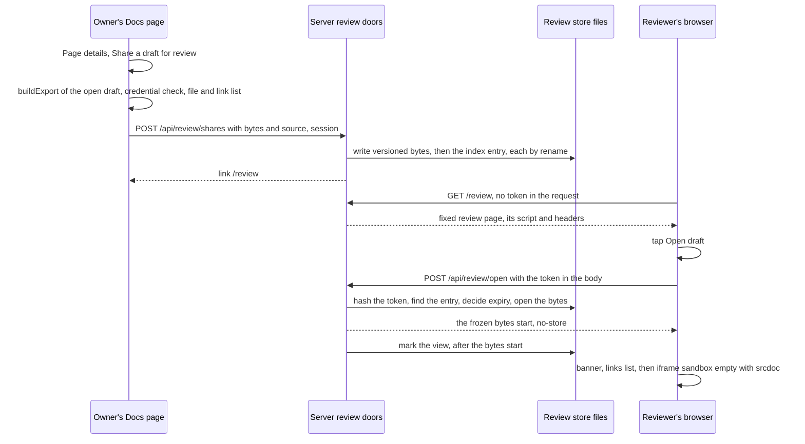
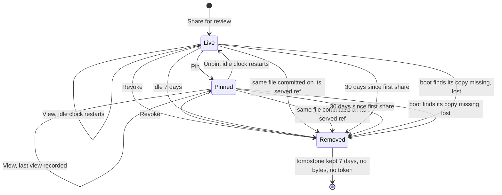

# Native Docs: sharing a draft for review

**Spec** · 2026-11-18 · Status: Draft · Owner: operator · Linear: none · Related: #1420, `docs/superpowers/specs/2026-10-01-native-docs-reader-design.md` (base), `docs/superpowers/specs/2026-10-12-rich-docs-reader-and-shared-renderer-design.md` (rich-docs, row G11), `docs/superpowers/specs/2026-11-07-native-docs-reader-completion-design.md` (completion), `docs/superpowers/plans/2026-11-18-native-docs-draft-review.md` (leaf plan)

## In short

- **What this is.** The design for "Share for review" (#1420). The owner of an uncommitted spec or plan sends a reviewer a private link. The link opens a frozen, read-only copy of the page as the owner saw it, under a "Draft, not committed" banner. Retirement of the standalone reader waits on this feature (the operator's ruling of 2026-10-25: retirement drops no feature).
- **What is already fixed.** The operator ruled on 2026-10-25 (#1420): the copy is a frozen snapshot taken at share time; the owner sees "newer draft available" and can re-share; nothing reads the live draft through the link. This spec does not re-open that ruling.
- **What was decided on 2026-11-18.** The coordinator released both product asks to the operator, and both were answered. Readers need no ccrc session: the link is a capability (the recommended option). Comments are allowed, but only from someone signed in to the console, and they never count as merge approval. Comments ship as their own follow-on wave with their own threat model (§3.6), so the core feature does not depend on them.
- **What this spec decides.** "Share a draft for review" is its own action in Page details; Share itself is unchanged and still sends only the committed permalink. The snapshot is Export's own file (`buildExport`, `ccrc-docs-export/1`), built in the owner's browser and uploaded once. The server keeps it in a new store of its own, outside `coord.db`, never backed up. The link carries its secret in the URL fragment, which browsers never send to a server, a proxy or a link-preview robot, and the secret is posted only when the reader taps "Open draft". A small ccrc page shows the copy in a frame with an empty sandbox. Revoke, expiry, retention and early removal on commit each make the share dead before they answer, and a revoke answers 200 once its first disk act has landed (the bytes unlink may follow the 200, which is safe: the share is already dead, and a restart finishes the removal); only a send already running finishes. A disk that refuses every write delays the deletion, never the 404, with one bound: if ccrc stops, by a crash or a clean close, while its disk still refuses, the share comes back live when ccrc starts again, and the owner is told plainly to revoke again (§4, write failures).
- **What changes for the console.** New routes in a new server module: four session-gated owner doors, two session-gated comment doors (the follow-on wave), and two routes open to a link holder, a fixed page and one read door that never touches the fleet box, plus two fixed 404 routes for the page's other spellings. The auth gate gains a ninth exempt class. Nothing is built in this wave, and nothing is waiting on you.

## 1. Threat model

This section comes first because every later choice answers it. It names who can read a shared draft, how the link can leak, what an attacker outside the console can reach, and what the snapshot may carry. Each row ends in the design rule that answers it, and §7 gives each rule its test.

### 1.1 Assets and parties

| Party | Holds | Trust |
|---|---|---|
| Owner | A signed-in console session; the draft in a worktree on the fleet box | Full |
| Signed-in commenter | A console session (today, the operator; named reviewers arrive with #276) | May read and comment |
| Reviewer | The link, sent by the owner over a channel the owner chose | Reads one snapshot, nothing else |
| Link carrier | A chat app, mail service or gateway, browser history or sync, a clipboard manager | Untrusted; may read or store the link |
| Outside caller | Network reach to the console's public HTTPS origin (Caddy, stage 3b) | Hostile |
| Anyone with a shell on either box | The files themselves | Out of scope: already holds everything |

The asset is the content of an uncommitted document and of the files it embeds. A draft is often unreviewed thinking and may hold a credential typed by mistake. The second asset is the console itself: a new public door must not widen what an outside caller can reach.

### 1.2 Threats and the rule that answers each

| # | Threat | How it happens | Design rule |
|---|---|---|---|
| T1 | Link leaks through a server or proxy log | A path or query token is written to an access log | The secret rides the URL fragment (`/review#<token>`), never sent in a request; the read door takes it in a POST body. ccrc's generated Caddyfile writes no access log (measured: host plus `reverse_proxy`, nothing else) |
| T2 | Link leaks through `Referer` | The reviewer follows a link out of the copy | A `Referer` never carries a fragment. Links inside the copy are inert (§3.5); the page lists them outside the frame with `rel="noreferrer"`, under `Referrer-Policy: no-referrer` |
| T3 | A link-preview robot reads the draft | Pasting the link into a chat app makes the app's server fetch it | A robot that fetches without running script gets `/review`, a fixed page with no data. The token is posted only after a tap on "Open draft", so a robot that runs script but taps nothing never reads the draft and never counts as a view |
| T3a | A gateway or scanner keeps the whole link | A mail gateway that rewrites URLs carries the original URL, fragment included, to its own server; a scanner that taps buttons opens it | Residual, stated: the link is a bearer secret, and anyone it is forwarded to can read the copy until it is revoked or expires. A browser's own history may also hold the full link, fragment included, recorded before the page clears it, and history sync may carry it to other devices. The owner's list shows the last view time, so an unexpected view is visible, and Revoke is one tap |
| T4 | Guessing or enumerating links | An outside caller tries tokens | 256 random bits (32 bytes from `crypto.randomBytes`), base64url, 43 characters. Unknown, malformed, revoked and expired tokens get one identical 404. The store is keyed by the token's SHA-256, so its file names hold no live link |
| T5 | Flooding the read door | Many POSTs | A 256-byte body limit and a grammar check before any file system call keep a miss cheap: one in-memory lookup, no disk. A hit streams the file from an open descriptor, never a whole buffer. At most 2 sends run at once per share and 16 in all; past either, 429 `busy`. A slot is released when the response closes, on finish or on abort, and a send that makes no progress for 30 s (the socket accepts no bytes) is destroyed, so a reader that stalls holds its slot for at most half a minute while a slow but live reader, even below 1.4 Mbit/s for a 10 MiB copy, is never cut off. Only a link holder can reach the per-share limit, and only for that share; the total of 16 is a backstop for memory and descriptors. No shared rate-limit budget, so an outside caller without a link cannot lock real reviewers out. The door never calls the fleet box, so it cannot load the agent link (base Goal 5) |
| T6 | Script in the snapshot runs on the console's origin | A crafted draft holds `<script>`, an event handler or a hostile mockup | The bytes are Export's file: no script survives the builder, and `DOCS_EXPORT_CSP` has no `script-src`. The review page mounts them in `<iframe sandbox="">` (no tokens), so the copy has an opaque origin, runs nothing and cannot reach the console's cookies or `/api`. The read door answers `application/octet-stream` with `Content-Disposition: attachment`, so a navigation to it never renders |
| T7 | A live read of the working tree through the link | The read door asks the fleet box for the draft | Forbidden by the operator's ruling. The read door holds no fleet port and no ccd argv; a scan pins it (§7, M-X3.6) |
| T8 | The snapshot carries more than the owner saw | Hidden assets, other files, secrets | The snapshot is exactly Export's file of the open page: what the page already held, nothing fetched for it. The share sheet lists every inlined file (draft ones marked), every omitted file and every link target before the owner confirms. A credential-shaped string holds the share until the owner confirms it (§3.4) |
| T9 | A revoked or expired link still opens | A cache, a copy, a restored backup, a cached page | Revoke and expiry make the share dead in memory before any disk act, so the next open is a 404 at once, and land the removal's first disk act before a 200 (the index and bytes unlinks may follow it; §4, write failures); if the disk refuses every act, the answer says the removal is not durable yet and the owner must revoke again if ccrc restarts before its disk recovers. The one residual is any stop, by a crash or a clean close, while the disk still refuses every act: the share is live again after the restart (§4, write failures). A send already running when Revoke answers finishes on its open descriptor: the one residual, bounded because that holder has already received the copy (review own-1). `Cache-Control: no-store` on every review response. The service worker never caches or answers the review page (§3.5). The store is never backed up or restored, so no restore brings a link back (§4) |
| T10 | An outside caller creates, manages or comments | The session doors reached without a session | Every owner and comment door is behind the session gate. Create and comment call the account gate first (`server/src/accounts/gate.ts`, `cap: null`), the one chokepoint that refuses `auth-off` while sign-in is dark, as the other doors that act in the operator's name do; review policy never re-decides it. The list never returns a link unless the gate is armed and the caller is signed in |
| T11 | Disk or memory exhaustion | Many or large snapshots, many comments | One live share per file, at most 64 live shares, at most 256 MiB stored, each snapshot at most `DOCS_EXPORT_MAX_BYTES` (10 MiB), at most 100 comments a share of at most 2000 characters each. Create refuses `store-full` and `too-large`. Only a signed-in owner can create |
| T12 | A comment is mistaken for approval, or carries markup | Comments | Comments come only from a signed-in session, are shown as plain text (never Markdown or HTML), make no forge call, and read "Notes from reviewers. Not a pull request review." They count for nothing toward merge |

### 1.3 With the auth gate armed and unarmed

The gate is armed when `CCRC_AUTH=on`; unarmed ("dark"), every route answers `flag-off` and nothing is checked (measured, `server/src/auth/gate.ts#authVerdict`).

| Door | Gate armed | Gate dark |
|---|---|---|
| Create or re-share | Needs a session; the account gate passes it | The account gate's `auth-off`: no new link is made on an open console |
| List the owner's shares | Needs a session; links included | Answers, but with no links: a dark console never hands out a capability |
| Pin, unpin, revoke | Needs a session | Open, like every door on a dark console. Revoke must always work |
| Read or add comments | Needs a session; the account gate passes it | The account gate's `auth-off`: on a dark console a comment would be anonymous |
| Review page `GET /review` | Exempt (class 9) | Open |
| Read door `POST /api/review/open` | Exempt (class 9); the token is the credential | Open; the token is still the credential |

Links made while armed keep working if the gate later goes dark. A dark console already exposes every live document to anyone who reaches it, so a capability-checked snapshot adds nothing to that exposure.

### 1.4 What a snapshot may and may not carry

| May carry | May not carry |
|---|---|
| The open page's rendered body, as Export renders it | Any byte the page did not already hold |
| Images and mockup files the page loaded, inlined as `data:` | A reference that loads anything later (CSP `default-src 'none'`) |
| Provenance: project, branch, base commit, fingerprint prefix, worktree label | ccrc origins, `/docs` or `/api` URLs, session ids, box names (Export's M4.SH1 rule) |
| Link targets, as text and as GitHub permalinks at the base commit | A link that reads a live draft, or a link that works inside the frame |
| A credential-shaped string the owner confirmed | A credential-shaped string the owner did not see |

## 2. What exists today

Measured from shipped source on `main` at `6f5421139` (2026-11-18), by reading the code, four fact-check passes and one adversarial read. Nothing here is from a plan.

| Fact | Where |
|---|---|
| Share makes no request and keeps no state; it sends a GitHub permalink. Its result is the union `ShareTarget`, and a new draft file is refused `new-draft` | `pwa/src/docs/share.ts#shareTargetFor`, `#ShareTarget` |
| Export is client-side. `buildExport` renders one React element to bytes, inlines held images as `data:` URLs, waits at most `DOCS_EXPORT_IMAGE_WAIT_MS` (10 s) and never fetches | `pwa/src/docs/export/buildExport.tsx#buildExport`, `exportInput.ts#exportInputOf` |
| Export's cap is `DOCS_EXPORT_MAX_BYTES` (10 MiB) on the final bytes, defined in the PWA. Its CSP is `DOCS_EXPORT_CSP` with no `script-src`; a mockup sits in `<iframe sandbox="" srcDoc>`; its generator meta is `ccrc-docs-export/1`. Its internal links have no `target`; external ones open `_blank` | `pwa/src/docs/export/policy.ts`, `exportMarkdown.tsx` |
| A draft export carries the "Draft, not committed" banner naming label, branch, base commit and fingerprint; a mockup's inlined and omitted files are listed in the file and on the sheet | `pwa/src/docs/export/provenance.ts#exportProvenance` (the banner), `pwa/src/docs/export/buildExport.tsx#MockupContent` (the inlined and omitted lists) |
| A draft pin is `{kind:'draft', branch, head, section, path, fp}`; `fp` is the SHA-256 of the working-tree bytes; `path` is relative to its section (`DocSectionSlug`) | `shared/docs.ts#DocPin` |
| The docs routes are five, all session-gated, in `docs/routes.ts` under a provenance policy (marker header, same-origin `Sec-Fetch-Site`, no navigations). No route stores bytes; caches are in memory and never hold draft bytes | `server/src/docs/routes.ts`, `hooks.ts#installDocsRequestPolicy`, `cache.ts` |
| A tree listing gives each entry `committed.blob` and `draft.fp`, and the tree names the ref it served | `shared/docs.ts#DocsEntry`, `#DocsTreeOk` |
| The gate's `EXEMPT` table has eight classes, pinned as a list by `auth-gate.test.ts`; the reader-lab probe is class 8, the precedent for a door that reads no session | `server/src/auth/gate.ts#EXEMPT`, `server/src/readerLab/routes.ts` |
| Unknown GETs outside `/api` and `/ws` get the app shell; static files are served under the exempt `GET /*`. The service worker precaches every built `*.html` and its own denylist is `/api/`, `/ws/` and `/licenses/` | `server.ts#buildServer`, `pwa/vite.config.ts`, `pwa/src/lib/sw-denylist.ts#swDenylist` |
| The update snapshot and `ccrc backup` copy `coord.db` and the Overlord's store (in `_upd_backup`'s own body, through `deploy/backup-coord.mjs`), the coordination snapshot's members (`deploy/coordination-snapshot.mjs`), and the built trees and named files (`_upd_backup_set`) into `~/ccrc-backups/<ts>/`; `cmd_backup` only calls `_upd_backup`. `_upd_backup_set` copies whole directories too (the built trees and `~/.ccrc/memory`, a sibling of the proposed store), so the store is safe only because no row names it or a parent of it, which M-X3.7's scan checks; no review store exists to copy today | `ccd/ccrc#_upd_backup`, `#_upd_backup_set`, `#cmd_backup`, `deploy/coordination-snapshot.mjs` |
| `redactCount(profile, text, shapes)` returns `{text, masked}`; the `linear-egress` profile holds only credential shapes and needs its `shapes` argument | `shared/redact.mjs#redactCount`, `shared/api.ts#CREDENTIAL_MASKS` |

The standalone reader serves drafts live from the working tree on every request, has no access control of its own, no snapshot, no expiry, no revocation and no comments. The draft-review store is therefore new, not a port.

## 3. Design

The owner shares from the "Share a draft for review" action in Page details (Share itself is unchanged); the server stores the bytes; a reviewer's browser opens them through a fixed page. Figure 1 is the whole flow, and the subsections take one decision each.


*Figure 1. Sharing and opening a draft. The fleet box takes no part after the share: the reviewer's read touches only the server's own store.*

### 3.1 Where Share for review lives

Share for review is a distinct, clearly labelled action of its own, "Share a draft for review", not a new arm of Share (coordinator's ruling on review finding F14). Share keeps sending only the committed GitHub permalink, so the operator's 2026-10-07 `share-drafts` ruling ("Share always sends the committed permalink"), base M4.SH1 (only GitHub URLs leave Share) and M4.SH3 (a new draft gets no link) stay true unchanged, and so does the ledger's "Share does not publish drafts". `share.ts`, `ShareSheet.tsx` and every Share sentence are untouched; base §4.16's reserved union arm stays unused.

The action is one row in Page details, the panel that already holds a leaf's details and its disabled-action lines on the phone and the desktop. It appears only on a leaf whose page opens a draft (`entryView(...).opens === 'draft'`), a new file included. It is meant as a row inside the panel's body, so no control joins the phone head, the one bar or the desktop head. The two 2026-11-06 phone blocks are measurement records (the reader lab's text outputs, kept in the library take-up plan), not pinned layout, so they cannot be the check (review finding N7). The checked condition is the gates a new control in the Docs head meets: `pwa/test/control-census.test.ts`'s entries keyed by `docs/DocsHead.tsx` and `pwa/test/tap-targets.test.tsx`'s compact-head floor rows, with the tap, one-bar and desktop-fit budgets. The implementing waves (R3.3 and R3.4) add the row's census entry and run both files; if the row cannot be placed without changing an existing entry or floor row, or a budget, they stop and ask rather than editing it.

The action is offered under the same readiness rule as Export (base §4.17 "When it is offered"), because it builds the same file. When Export would be disabled, the action is disabled with Export's sentence.

### 3.2 Building the snapshot: Export's builder, once

The owner's browser calls `exportInputOf` and `buildExport` exactly as Export does, with one new input, `purpose: 'review'`. It changes two things only: the generator meta gains `ccrc:purpose` = `review`, and the banner leads with "Shared for review. Read-only." There is no second builder and no server-side rendering. Why: the bytes are then what the owner saw (base Goal 4), every existing Export guard applies unchanged (the strip, the CSP, the size cap, the draft confirm), and the fleet box is never asked again.

Export's Save is not involved: the bytes go to the server instead of to a file. Base M4.EX16 confines `buildExport` to Export's sheet (imported by `import()` there only, its output reaching only `downloadExport`), and base §5.4, §5.6.9's Wrapper step and M5.16 say the same of its output; the review confirm becomes its second named importer and the upload its second named consumer, each with a planted control, and D-8766 quotes each of those sentences.

### 3.3 Hidden referenced assets

A snapshot holds exactly what Export inlines: every image and mockup file the page already holds, in document order, while the file fits, and placeholders for the rest. Assets hidden on screen but used by a mockup are inlined too, as Export does today. Nothing is fetched after the share, and CSP `default-src 'none'` stops anything in the copy from loading later.

On every share and every re-share (a re-share's new bytes reach everyone who ever held the link), the confirm shows, before the owner confirms: every inlined file by path and size, draft files marked, every omitted file with its reason, and every link target. Today only a mockup export reports its files (`ExportResult.mockup`, an `ExportMockupFacts`), a Markdown export returns `mockup: null`, and no export returns its link targets (`pwa/src/docs/export/buildExport.tsx#ExportResult`). So the builder's success result gains three fields for every body kind, filled from the decisions it already makes: `inlined` (each inlined file's path, size and draft mark), `omitted` (each file left out, with Export's reason word, or `not-inlined` for a mockup file, whose facts carry no reason) and `links` (every link target the built file carries, after Export's own rewriting). The confirm reads them; the saved file and Export's sheet are unchanged (review finding F8).

### 3.4 The credential check

Before upload, the page scans exactly what will leave: the final export text, with every `data:` payload that is not a raster image (an inlined SVG, stylesheet or font) decoded and scanned in its place, recursively, because Export nests them (a mockup stylesheet's @imported sheets, SVGs and fonts are `data:` URLs inside it), to the exporter's own depth bound (`MOCKUP_MAX_CSS_DEPTH`, plus the deepest sheet's own payloads), with a payload still nested past it held as a hit (review finding N4), and every raster payload (PNG, JPEG, GIF, WebP, AVIF, BMP, ICO) decoded and replaced by its decoded bytes read as Latin-1 text, never decoded further, so base64 image bytes are never read as base64 text, a credential a raster carries as text (a PNG `tEXt` chunk, an image comment) is still found, and a credential inside an inlined draft asset is found too. The scan is `redactCount('linear-egress', text, shapes)` with `shapes` built by `credentialMaskSource` (`shared/api.ts`), as the coordination redactor builds them (`server/src/coord/redact.ts`), summing `masked`. Scripts are not scanned because none leaves: Export's builder strips every script element and handler (§1.2 T6), so a credential in a mockup's script never reaches the snapshot. A non-zero `masked` holds the share with "This draft holds {n} strings that look like credentials." and two buttons, "Go back" and "Share anyway". A confirmed share records the count on its index entry and shows it in the owner's list. Why `linear-egress`: it is the one profile built for prose and holds only credential shapes, so a commit sha or a dated path is not a hit.

### 3.5 Access: a capability link in the fragment

The link is `https://<console origin>/review#<token>`. The token alone opens the snapshot, with no ccrc session. This meets the recorded acceptance criterion ("A share link opens a read-only snapshot without a ccrc session") as written, and it is what a reviewer without a console account needs (named reviewer accounts belong to #276). The choice was put to the operator and answered on 2026-11-18.

| Option | Meets no-session criterion | Leak surface | Cost | Verdict |
|---|---|---|---|---|
| A. Token in the path, server renders the bytes | Yes | Logs, `Referer`, link-preview robots read the draft and extend its life | Smallest | Rejected: T1-T3 |
| B. Token in the fragment, posted after a tap (this design) | Yes | The link itself, and gateways that keep whole URLs (T3a) | One fixed page, one exempt door | Ruled |
| C. Signed-in readers only | No: needs a waiver of the criterion | None beyond the session | Reviewers need console accounts, which do not exist (#276) | Rejected |
| D. Option B plus a passcode sent separately | Yes | Lower: two secrets | A second secret to send and type | Rejected: the fragment and the tap remove the passive leaks |

**The review page** (`GET /review`) is a fixed HTML page built with the PWA (its own small entry, no React, no app shell). It is served only by its route, which reads the built file itself and never through the static plugin's `sendFile` (that would run the plugin's filter and its `no-cache` header on it, review finding N6), and sends its policy as a response header: `default-src 'none'; script-src 'self'; connect-src 'self'; style-src 'self' 'unsafe-inline' data:; img-src data:; font-src data:; base-uri 'none'; form-action 'none'; frame-ancestors 'none'`. A srcdoc frame is expected to inherit and intersect its parent's policy (rich-docs A3), so the style, image and font sources are the ones `DOCS_EXPORT_CSP` grants the copy and nothing more. That inheritance is not yet measured: the rich-docs spec records it as lab E14, pending, and records E1 and E11 (a srcdoc frame under `frame-src 'none'`) on desktop Chromium only, other engines unmeasured (E18). So the claim is gated on measurement row M-X3.16 for each engine (review finding F9), in one ordering (coordinator's ruling on review finding N1). R2 ships a fixed measurement page: the review page itself, opened from the reader lab (the device-measurement surface that runs E17 and E18; it gains one anchor, and its own lines are unchanged) at `/review#lab`, which mounts a committed fixture under the page's real header policy and its own mount code, with no share, no read door, no create door and no request. The fixture's two copies are Export's own bytes, `buildExport`'s output for a committed Markdown page and a committed mockup page, so each carries its own `DOCS_EXPORT_CSP` meta and the mockup copy Export's real wrapper, with its nested `<iframe sandbox="" srcDoc>`; a test holds the fixture to the builder's bytes, and the one stated difference is a script canary inserted after the build. The operator records each line on the page against a reference, and a line reads not measured until answered (the reader lab's rule). The browser leg measures desktop Chromium in R2. Once R2 is installed, the coordinator raises the phone's WebKit and desktop Firefox as one device item for the operator, and R3 dispatches only after both legs are recorded. An engine that fails is a stop-and-ask. An engine that cannot be measured (no device available) goes to the operator, who decides whether R3 proceeds with that engine recorded as unmeasured; it is never assumed. DR-11 then re-runs the same page on the installed release as acceptance, not as the first measurement. If an engine does not render the copy under this policy, the design stops and asks; it never widens the page's policy to make it render; `script-src` names `'self'` only, and the empty sandbox stops scripts in the frame whatever the policy says. The built file is kept out of the service worker's precache (so an installed PWA never answers `/review` from a header-less cached copy), the service worker's own denylist gains `/review`, with or without a trailing slash or a query string (`/^\/review(?:\/|\?|$)/`: workbox tests its denylist against the path and the query, and a link tracker may add `?utm_source=`, review finding N5), and the static plugin refuses to serve the built page by any spelling (`pwaStatic.ts#pwaStaticOptions` gains an `allowedPath` filter that refuses it after decoding, normalising and lower-casing the path, so a case-insensitive file system adds no spelling; a unit test pins the filter, because the router and the plugin's own path checks already refuse today's odd spellings and so cannot show it red), so no path, a duplicated slash or a dot-segment included, can reach it through the exempt static wildcard without its headers; a refused path falls through to the app shell, never the page. `GET /review.html` answers 404 as well (review advisory A0). The page stays in `dist-pwa/`, so the release tarball, the fallback deploy and the install checks carry it unchanged. A service worker installed before the page's release still answers `/review` with the shell until it updates; the release order covers that, because no link exists until the owner's create ships one release later.

The page reads `location.hash`, clears it with `history.replaceState`, and shows one button, "Open draft". Only the tap posts the token. On success it draws its own banner ("Draft, not committed. Shared for review on {date}. Read-only."), then "Links in this copy" (every `https:` link target found in the bytes by an inert `DOMParser` parse, each a top-level `<a rel="noreferrer noopener" target="_blank">` showing its full URL), then `<iframe sandbox="" srcdoc>` holding the bytes. Inside the frame every link is inert: `frame-src` falls back to `'none'`, which blocks the frame's own navigations, and the empty sandbox blocks popups. On any failure the page shows one sentence: "This link has expired, was revoked, or never existed." **Reload.** The token lives only in the page's memory for as long as that document is open: never in `sessionStorage`, `localStorage` or a cookie, and the page replaces its history entry's URL with a bare `/review`. The browser may already have recorded the full link, fragment included, in its history before the page's script runs, so history sync and a shared device's history are not closed by the page: that residual is T3a's. So once the hash is cleared, a reload loads a bare `/review` with no token, and the page shows "To open this draft again, use the link you were sent." and makes no request. That is the chosen behaviour (review finding F4): keeping the token across a reload would need it in the address bar or in storage, which would widen T3a's history-sync and shared-device residual (review advisory a0). The cost is that a reviewer reopens from the original message to see a re-share. A srcdoc frame loads under `frame-src 'none'` as the shell's own frames do (rich-docs E1, E11: desktop Chromium measured, M-X3.16 for the rest). The page adds no message channel and reads no frame DOM, and it changes neither the reader frame's sandbox nor the shell's CSP.

> **Note (2026-11-25; draft review, X3, D-9029).** The sentence above, "Inside the frame every link is inert: `frame-src` falls back to `'none'`, which blocks the frame's own navigations", holds for the request and not for the frame. R2's browser leg measured it in Chromium 153 under this page's exact policy:
> - A link with no `target` inside the copy sends no request, and the top page stays `/review`. But the frame itself navigates to the engine's error page, and the copy is gone.
> - `target="_top"` and `target="_blank"` leave the frame and its copy in place.
>
> Export's mockup "Links in this page" list writes a repository permalink with no `target`, so a real copy can carry that link. The page therefore keeps the copy's text in memory. When the frame element reports a load the page did not cause, the page sets the same text again and says one sentence: it points to the links listed outside the frame, or, when the copy has none, says that the link cannot open from this page.
> - The page tells its own draws from a navigation by a count of its own draws whose load has not yet arrived, raised before each draw.
> - It restores at most three times within any ten seconds. A fourth navigation inside that window stops it for good: it leaves the frame and tells the reviewer to open the link they were sent. Taps that never put a fourth navigation within ten seconds of the third-last restore (on average more than about 3.4 seconds apart) are restored every time.
> - A restore draws the copy afresh, so it opens at its top.
> - A restore keeps the token dropped, makes no request, writes no storage or history and reaches no door.
>
> In-page links do not work inside a copy either. A fragment link (`href="#…"`) resolves against the page's own address, so the tap is a navigation to another document, which `frame-src 'none'` refuses: the page restores the copy, and the target does not scroll. So headings, a contents list and footnote references and their back links do nothing there. Export's review copies are therefore to be written with no link that can navigate the frame (bound to draft review wave R3): outside links refused in place in favour of "Links in this copy", and in-page links as inert text with their target shown.
>
> A residual is named, not closed: a tap before any draw's own load (the first draw or a restore) cannot be told from that draw. The navigation's load is taken as the draw's, so the copy could be lost with no stop sentence, and after a restore the restore sentence stays up. A tap before the first load was not reachable in Chromium even near the size cap; a tap before a restore's load is unmeasured, as is every other engine.
>
> The measurement page records the engine's behaviour as its seventh line, `link-self`. The policy above is unchanged.

**The read door** (`POST /api/review/open`, body `{token}`) answers 200 with the bytes and three headers (`x-ccrc-review-shared-at`, `x-ccrc-review-version`, `x-ccrc-review-idle-days`), or one identical 404. It has a plugin of its own, not the docs provenance plugin: its own 256-byte body limit and its own error handler. A body over the limit answers 413 `too-large`, which says only that the body was too long and nothing about any token; every other body, parse and content-type failure answers that same 404, so no failure tells a caller whether a token exists; the only other answer is 429 `busy` (§1.2 T5). The review page sends a fixed marker header of its own, `x-ccrc-review: 1`, and the door checks it before any token lookup: a request without it gets the 404 at once. A cross-site page can only send it after a CORS preflight, which the door never answers, so a cross-site simple request is refused before the store is touched (coordinator's ruling on review finding F1). It sends `Cache-Control: no-store`, `Referrer-Policy: no-referrer`, `X-Content-Type-Options: nosniff`, `Content-Type: application/octet-stream` and `Content-Disposition: attachment`, and no CORS headers. It reads no cookie and no box token. **The answer mask** (D-5995, `server/src/server.ts#answerMasked`) masks credential shapes in every write's JSON answer that `WRITE_ANSWER_EXEMPT` does not exempt, and in the GETs `MASKED_GET_ROUTES` names. Two consequences are designed in (review advisory A2). The store re-draws any token whose link matches a `CREDENTIAL_MASKS` shape, so the mask can never turn an owner's link into `‹secret masked›` (about 1 random token in 8 000 holds an `sk-` run long enough to match). And the read door's 200 passes unmasked only because `application/octet-stream` is a binary type to the egress filter (`server/src/accounts/egress.ts`); a test pins that the copy's bytes come back byte for byte even when they hold a credential shape the owner confirmed.

### 3.6 Comments from signed-in readers (follow-on wave)

The operator adopted comments for signed-in readers only (this wave's ask, released by the coordinator and answered on 2026-11-18). As the coordinator directed for an adopted comment feature, they are a follow-on: the leaf plan's wave R4, after the core waves R1-R3, which neither need nor anticipate them. They carry their own threat model.

| # | Threat | Rule |
|---|---|---|
| C1 | An anonymous note, from a link holder or on a dark console | Both comment doors are session-gated and call the account gate first, which refuses `auth-off` while sign-in is dark |
| C2 | Stored markup runs in the console | A note is plain text everywhere: React text nodes, never the Markdown component or an HTML sink; control characters other than newline are removed |
| C3 | Flooding a share | At most 100 notes a share, at most 2000 characters each; only a session can write |
| C4 | A note read as approval | "Notes from reviewers. Not a pull request review." heads every list; the review module imports no forge or pull-request module (a scan) |
| C5 | The thread door confirms that a token is live | Only to a signed-in session, which can list every share anyway; unknown tokens get the read door's one 404 |

On the review page, after the copy opens, the page asks the thread door. A 200 means the browser holds a console session: the page shows "Notes from reviewers. Not a pull request review.", the existing notes and a text box. A 401 or `auth-off` hides all three, so a reader without a session sees only the copy.

| Rule | Value |
|---|---|
| Who may comment | A signed-in console session only; refused `auth-off` while sign-in is dark |
| Where a comment lives | In the share's index entry: `{at, version, text}`, at most 100 a share, at most 2000 characters each, control characters other than newline removed |
| How it is shown | Plain text only, in the review page and in the owner's Page details and index list, never as Markdown or HTML |
| What it is not | Not a forge review and not merge approval: no forge call, no link to a pull request's review state. #1419 owns forge review |
| Lifetime | Survives a re-share (each note names the version it was left on); deleted with the share; a tombstone keeps only the count |

### 3.7 Lifecycle

Each share has one state at a time. Every way out of `live` makes the share dead in memory before it answers, so the next read is a 404 with no window, and lands its first disk act before a 200; a disk that refuses every write delays the deletion, never the 404, until ccrc stops: a stop while the disk still refuses brings the share back live at the next start (§4, write failures).


*Figure 2. A share's lifecycle. Pin stops only the idle clock, and a re-share keeps it. Revoke, commit and retention end a pinned share too. "Removed" keeps a tombstone so the owner sees why, never the bytes; a removal whose tombstone did not land keeps no row after a restart (§4). An expired share's file can be shared again only as a new share, with a new link (§3.7, Expiry is terminal).*

| Step | Rule | Why |
|---|---|---|
| Share | Snapshot taken at share time; bytes immutable; the index entry records project, section, path, branch, head, the served ref, base commit, `fp`, the committed blob at that ref, and the SHA-256 and size of the bytes | The operator's ruling. The SHA-256 proves "unchanged shared bytes after edits" |
| One link per file | At most one live share per project, section, path and branch | A reviewer keeps one link; the newer-draft notice has one target; the count is bounded |
| Newer draft | When the owner opens a leaf with a live share whose `fp` differs from the page's current `fp`, the page shows "Shared for review on {date}. A newer draft is available." with Re-share | The operator's ruling. Only the owner's own page compares, so no reviewer read touches the fleet |
| Re-share | Runs exactly the first share's path: a fresh build, the same confirm list (§3.3) and the same credential check (§3.4), then replaces the bytes behind the same link, version plus one; the idle clock restarts, the retention clock does not, and a pinned share stays pinned | The reviewer's link keeps working and shows the newer copy when opened again from the original message (a reload keeps no token, §3.5); retention still bounds the share |
| Idle expiry | One `idleSince` time, set by a share, a re-share, an unpin and a view; a pin leaves it, and nothing but the first share sets `firstSharedAt`. Removed 7 days after `idleSince` unless pinned. A view is a 200 from the read door, recorded only after the bytes have started (the reply's headers are sent with the open stream), so a refused open, a 429 or a copy whose bytes cannot be opened is no view; at most once a minute | #1420: "The TTL counts from last view". A robot that taps nothing is not a view (T3) |
| Early removal | Removed when the file's committed blob at the recorded served ref differs from the one recorded at share (a new file counts once committed) | #1420: "removed early when the same file is committed on the branch". GitHub then holds it and Share sends a permalink |
| Pin | Stops the idle clock only | Pin keeps a link alive while a reviewer is away; a commit or retention still ends it |
| Revoke | Marks the share dead in memory before any disk act, so every read is a 404 at once; then writes the tombstone and deletes the index entry and the bytes, and answers 200 once any of those acts has landed (the rest may follow the 200). A disk failure never revives it while ccrc runs; a stop while the disk still refuses every act does, and the owner is told to revoke again (§4, write failures) | "A revoked link returns 404 immediately" |
| Expiry is terminal | Every store mutation re-applies the expiry decision and, for a create, admission, to the entry it re-reads inside the store's queue, and removes a dead entry there. Pin or Unpin on an expired share refuses `expired`. Re-share of a file whose share has expired mints a new share with a new token and version 1, and tells the owner "The old link has expired and stays dead. This is a new link.", whether the expiry was found inside the queue or an earlier sweep left a tombstone for that file | Figure 2 has no edge out of Removed: an old link is never revived (coordinator's ruling on review finding F3) |
| Retention | Every share, pinned or not, is removed 30 days after its first share | #1420: "Snapshots are covered by retention" |
| Tombstone | Removed shares keep a row for 7 days: project, section, path, branch, reason, time, version, comment count. No bytes, no token | "each visible in the UI" |

**How early removal is measured.** A sweep runs at boot and every 10 minutes. It groups live shares by project and recorded served ref, and asks each group's tree once, at exactly that ref, through the existing docs read path (its lanes and caches), handed to the review module as a port the module declares. At most one tree read per ref with a live share per sweep, so at most 64 reads per 10 minutes. A pure decider compares each share's recorded committed blob with the entry's current one. A tree that cannot be read, a ref that no longer resolves, or a missing entry is `unmeasured` and removes nothing; idle expiry and retention still bound the share. The read door never triggers the sweep.

**Expiry is also decided on every read**, before any byte is sent, so a share past its idle or retention time is a 404 even if the sweep has not run.

### 3.8 The owner's controls

All owner controls live in the Docs screen and need a session when the gate is armed.

- **In Page details** of a leaf with a share: "Shared for review", the share date, the version, the last view, "Stops working {date}" (the idle end or the 30-day end, whichever comes first; or "Pinned"; every `{date}` reads like "26 Nov 2026", in the browser's time zone, through one formatter, `reviewDate` in L0 `shared/docsReview.ts`, which the review page's banner uses too), the comment count, and Copy link (`copyText`, the one clipboard writer under `pwa/src/docs`), Pin or Unpin, Revoke. A removed share shows its reason for 7 days: "Revoked", "Expired: no view for 7 days", "Removed: committed on {branch}", "Removed: 30-day limit", "Removed: its copy could not be read". "Removed: its copy could not be read" is `lost`'s sentence, for either of its causes (§4, write failures); a revoked share always reads "Revoked". A revoke whose disk acts have not landed, and a revoke the server answered 503 `not-durable`, show the owner warning, "Revoking. The link already answers nothing, but this is not permanent yet: ccrc keeps retrying, and if ccrc restarts before its disk recovers, revoke again.", until a retry finishes it (§4, write failures).
- **In the Docs index**, a "Shared for review" list of every live and recently removed share, with the same controls and each share's notes. It is the one place to find every link at once.

## 4. The review store

The store is a new storage owner. This section names its one writer, its durability, its backup rule and its purge, as the project rules require.

| Property | Rule |
|---|---|
| Location | `~/.ccrc/review-shares/`, mode 0700, on the server box only. The path is defined once, in the server's config |
| Layout | Per share: `<tokenHash>.v<N>.html` (the bytes of version N, 0600) and `<tokenHash>.json` (the index entry, 0600). Tombstones: `<id>.removed.json`, with no token |
| One writer | The review store adapter. The routes and the sweep reach it only through its interface |
| Commit point | Bytes are written to a temporary name, `fsync`ed and renamed; then the index entry, naming that version, is written the same way and the directory `fsync`ed. The index rename is the commit: a crash before it leaves the old version live. After it, the superseded version's bytes are unlinked and the directory `fsync`ed, so a re-share made to drop a mistaken credential leaves no copy behind on disk; a send of the old version already running finishes on its open descriptor, and the file's data lives until that send closes (review own-1) |
| Concurrency | One in-process queue. Every mutation but a create or re-share names the share's `tokenHash` and the revision it expects (a counter every write bumps, pin and view included); a create or re-share is keyed by its source and decided inside the queue; re-reads the live entry inside the queue, re-applies the expiry decision and, for a create, admission, and only then acts, so a late view, pin or sweep never writes back a revoked, replaced or expired entry, and two concurrent creates cannot pass the 64-share cap together |
| Boot | The store first proves its directory writable (a probe file written, `fsync`ed and unlinked); a directory it cannot write opens as `store-unreadable`, so a revoke that could not reach the disk is never served again after a restart while the disk still refuses (once the disk heals, such a share is live again: the residual, §4 write failures). One directory read then rebuilds the index (at most 64 live entries, so no database). Temporary files older than a minute and bytes files no index entry names are removed. An index entry with a tombstone of the same id is a removal a crash interrupted: boot finishes it, keeping the tombstone's reason. An index entry whose bytes file is missing is removed with the reason `lost` ("Removed: its copy could not be read") |
| The token | Kept in the index entry so the owner can copy the link later; never in a file name, a tombstone, or a list to a dark console |
| Backup | Never. `ccrc backup` and the update snapshot copy neither the directory nor any parent that contains it, and a restore never writes it |
| Lost or unreadable store | Every link answers 404, and create refuses `store-unreadable`. Nothing else in the console depends on it |
| Purge | Revoke, idle expiry, early removal, retention and the read-time expiry decision each remove a share in one order: out of memory first; then the tombstone, holding the reason, written, `fsync`ed, renamed and the directory `fsync`ed, so the reason is durable before the index goes; then the index unlinked and the directory `fsync`ed, so no power loss can bring the token back; then the bytes unlinked and the directory `fsync`ed. Tombstones are deleted after 7 days, but never while the share's index entry or bytes file still exists |
| Write failures | Every store write states its failure answer (coordinator's ruling on review finding N2). A removal is dead first and durable by any one landed act: the tombstone, or either unlink. A failed tombstone write does not stop it: the index is unlinked and the directory `fsync`ed, then the bytes are unlinked, regardless (an unlink needs no free space). A landed tombstone alone is durable too, because boot finishes a removal whose tombstone stands beside its index entry, so a tombstone that landed with both unlinks failed answers `ok`. Either unlink keeps the share dead at boot: a missing index entry leaves only unreferenced bytes, which boot removes, and a missing bytes file is removed `lost`. A removal whose disk acts are not all done stays in the store's pending set, still answering 404 to every read, and every sweep pass retries what remains. If every disk act fails, the removal answers `not-durable`, the share stays revoke-pending in memory and 404s every read, and the owner's list shows it as revoking, with no link and the owner warning (§3.8): the revoke is not permanent yet, and if ccrc restarts before its disk recovers the owner must revoke again. An act has landed when its call and the directory `fsync` after it both succeed. While any removal is pending, it is retried every 10 s, and once more when the server closes. A create or re-share for a source with a pending removal first retries that removal inside the queue and answers `not-durable` until it lands, so one source never has two index entries and a revoked token is never reused. **`lost` has two causes:** boot found an index entry whose bytes file is missing, or a removal by the sweep or the read-time expiry decision (`expired`, `committed` or `retention`) whose tombstone did not land, so its reason could not be kept. A revoke whose tombstone did not land keeps the reason `revoked`: the owner revoked it, and a revoked share never reads as "its copy could not be read". **The residual, stated:** its bound is any stop while the disk still refuses. A removal none of whose acts has landed lives only in memory, so if the server stops, by a crash or by a clean close whose last retry the disk also refused, and the disk heals before it starts again, boot's writability probe passes, the index entry is intact, and the share comes back live: its link opens again and the owner's list shows it live, so the owner can revoke it again, as the warning told them. The 10 s retry bounds the window to the time the disk stays broken. A reason the tombstone did not keep likewise lives in memory only: after a restart the share is gone from the list with no tombstone. A create or re-share that fails before its index rename changes nothing and answers `not-durable`; a view that cannot be written stays in memory, and the copy is still served; a pin that cannot be written changes nothing and answers `not-durable` |
| Rollback to a build without the feature | The files stay on disk, unread: no route serves them. The next build with the feature applies expiry at its first sweep |

**Why not `coord.db`.** `coord.db` refuses to start rather than open empty, because losing it loses authority. This store is the opposite case: losing it must fail closed, and an empty store means every link is revoked, which is safe. A restore of `coord.db` from a backup would also bring back revoked links if they lived there. A separate, never-backed-up directory gives the right failure direction and a revocation no restore can undo. That is the opposite safety direction, one of the recorded "legitimately different" reasons for a second store beside `coord.db`.

## 5. Routes and their gates

Every new route names its gate under the box-token census rules. None consults the box token: they are operator doors and a capability door, not machine lanes. They live in a new server module, `server/src/review/`, so the docs module's own guards (every `/api/docs` route in `docs/routes.ts`, the docs ring list) stay as they are. The read door has a plugin of its own, with its own body limit, error handler and marker header (§3.5). The owner and comment doors sit in a second plugin; create and the two comment doors call the account gate first, while list, pin, unpin and revoke do not, so the list answers dark without links and revoke always works (§1.3). The page routes sit outside both, because the page is a navigation. The tests of every door run against the real `buildServer` registration, never only a harness.

| Route | Gate | Census | Refusals |
|---|---|---|---|
| `POST /api/review/shares` (create or re-share) | Session-gated; the account gate first (`cap: null`), `auth-off` while sign-in is dark; in `FLAG_AWARE` | Hand-kept `REVIEW_DOORS` in `box-token-census.test.ts`; the routes file is read as a lane source of its own | `auth-off`, `too-large`, `store-full`, `store-unreadable`, `not-durable`, `bad-source` |
| `GET /api/review/shares` (the owner's list, optionally by project, section and path) | Session-gated; links only when armed | `REVIEW_DOORS` | `bad-query` |
| `POST /api/review/shares/:id/pin` (body `{pinned}`) | Session-gated | `REVIEW_DOORS` | `unknown-share`; 409 `expired` (the store removed it, §3.7); 409 `stale` (another write changed it first: reload); 503 `not-durable` |
| `POST /api/review/shares/:id/revoke` | Session-gated; never refused while the share or its tombstone exists | `REVIEW_DOORS` | 200 with the removed share, whatever removed it (revoke, or expiry found inside the queue, or an earlier sweep); 503 `not-durable` when no disk act landed, the share revoke-pending and already a 404 to every read; `unknown-share` only when neither the share, a pending removal nor a tombstone exists |
| `POST /api/review/thread` (body `{token}`), wave R4 | Session-gated; the account gate first, `auth-off` dark | `REVIEW_DOORS` | one 404 for every unknown token |
| `POST /api/review/comment` (body `{token, text}`), wave R4 | Session-gated; the account gate first, `auth-off` dark | `REVIEW_DOORS` | `too-long`, `too-many`, 404 |
| `POST /api/review/open` (the read) | `EXEMPT`, new class 9 "draft review by capability"; the token in the body is the credential | `REVIEW_DOORS`; `auth-gate.test.ts` class list and number words; README auth paragraph; a never-read scan like the reader lab's (no cookie, no box token, no fleet port, no ccd argv) | one identical 404 for every failure but an oversize body, which is 413 `too-large`; 429 `busy` past 2 sends a share or 16 in all |
| `GET /review` (the review page) | `EXEMPT`, class 9 | As the read door | none |

`GET /review.html` and `GET /review/` are registered routes that answer 404 and are not exempt, so with the gate armed a caller without a session gets the gate's 401 first; either way a mistyped `/review/#token` never lands under the app shell's policy, a query string on `/review` reaches the page route, and the static plugin refuses the built file by every spelling, so it is never served without the page route's headers.

## 6. Decisions

Technical choices are decided here with their reason. The two product choices were put to the operator as asks and answered on 2026-11-18.

| # | Decision | Options considered | Chosen, and why | Status |
|---|---|---|---|---|
| X3-1 | Access model | Capability link; signed-in only; both; link plus passcode | Capability link, token in the fragment, posted after a tap (§3.5); the operator's answer | Ruled |
| X3-2 | Reviewer comments | None; anonymous comments; signed-in comments | Signed-in comments only, plain text, never merge approval, as a follow-on wave (§3.6); the operator's answer | Ruled |
| X3-3 | Who builds the snapshot | Owner's browser with Export's builder; server renders from ccd reads | The browser, `buildExport` with `purpose: 'review'`: one builder, the bytes the owner saw, no fleet read | Proposed |
| X3-4 | Where the token travels | Path; query; fragment; fragment plus a tap | Fragment, posted in a body after a tap (T1-T3) | Proposed |
| X3-5 | How the copy is shown | Served as a top-level document; empty-sandbox frame in a fixed page | Empty-sandbox frame, links inert inside and listed outside: opaque origin, no script, the mockup Export pattern | Proposed |
| X3-6 | Revocation storage | `coord.db` rows; a new SQLite file; a directory of files | A never-backed-up directory (§4): fails closed, no restore can undo a revoke | Proposed |
| X3-7 | Re-share | New link each time; same link with new bytes | Same link, version plus one: the reviewer keeps one link | Proposed |
| X3-8 | Pin | Stops idle expiry; stops every removal | Idle expiry only: a commit or retention still ends a pinned share | Proposed |
| X3-9 | Limits | Per-share, count, total and comment caps | 10 MiB a share (Export's cap, moved to `shared/`), 64 live shares, 256 MiB in all, 7-day idle, 30-day retention, 7-day tombstones, 100 comments of 2000 characters; constants in L0, a Settings row Later | Proposed |
| X3-10 | Early removal measurement | On the reviewer's read; a sweep; the owner's page only | A sweep at the recorded served ref through the existing tree read, at most one read per ref per 10 minutes; never on a reviewer's read (T7) | Proposed |
| X3-11 | Credential-shaped text | Ignore; refuse; confirm | Confirm, recorded on the share (§3.4) | Proposed |
| X3-12 | Dark console | Allow everything; refuse create only; refuse reads too | Refuse create and comments, hide links in the list, keep existing links and revoke working (§1.3) | Proposed |
| X3-13 | Flooding the read door | A shared rate limit; one global streaming cap; per-share limits | Cheap misses, then true streaming with 2 sends a share and 16 in all, released on close, with a 30 s no-progress timeout: a shared budget, or one global cap, would let one link holder lock every reviewer out (review finding F5) | Proposed |
| X3-14 | Server module | Inside `server/src/docs/`; its own `server/src/review/` | Its own module, consuming the docs tree read through a port it declares: the docs module's guards stay unchanged | Proposed |
| X3-15 | Where the action lives | A new arm of Share; its own action | Its own action in Page details: Share keeps `share-drafts`, M4.SH1 and M4.SH3 true (coordinator's ruling on F14) | Ruled |

**Amendments this feature carries.** Each lands with the wave that ships its behaviour, never here and never all at the end (coordinator's ruling on review finding F13), so no release runs behaviour its specs still forbid. The release order makes a link impossible to hand out before the page that opens it: the leaf plan's R1 ships the read door and the store and can make no link, R2 ships the review page, and R3 ships the owner's create last.

Three departures carry it, each defined in the leaf plan's `## Deviations found` with the exact sentences it changes, and each naming the operator's 2026-10-25 ruling on #1420 and this wave's asks 595 and 603 as the rulings it carries out:

| Number | What it changes | Lands with |
|---|---|---|
| D-8765 | Base Goals 1 and 3, decision `product`, the Non-goal "Share links that ccrc hosts", §4.13's expiring-links bullet and §7.5's README-contents auth bullet: one exempt read door and one owner-made store now exist beside the session-gated reader | R1 |
| D-8766 | The Share and Export confinement sentences the new action and store change: §4.13's one-more-arm sentence, M4.EX16's single-importer clause, and every sentence that confines the builder's output to `downloadExport` (§5.4, §5.6.9's Wrapper step and M5.16's parenthetical, review finding N12). §4.16's no-route sentence and §4.13's "Share and Export spend no page key, route or census entry" stay true, because Share and Export themselves are unchanged (the coordinator confirmed this reading) | R3 |
| D-8767 | Base M5.16's `new DOMParser(`, `<iframe`/`srcDoc` and `default-src 'none'` allowances and M4.EX16's "nowhere in `pwa/src`" clause, rich-docs A2b's (its `default-src 'none'` clause included) and M8.10, for the review page and its measurement fixture, whose copies carry `DOCS_EXPORT_CSP`; the Export-confinement sentences of base §5.4, §5.6.9's Wrapper step and M5.16's parenthetical, because the measurement fixture is the builder's output mounted outside `downloadExport` (R3's D-8766 then adds the upload to the same sentences); and the reader lab design's Before row, for the one anchor to the measurement page | R2 |

Rich-docs §6 rows G11 and "Draft review by link" only gain a pointer to this spec, and stay Kept until Task 17's row passes; they need no number.

## 7. Testing and proof

Every guard ships with a test that goes red when the guard is removed. The leaf plan carries the full mutation table; the rows that carry the threat model are these.

| Row | Guard | Mutation that must go red |
|---|---|---|
| M-X3.1 | Identical 404 for unknown, malformed, revoked and expired tokens, a missing marker header and every parse or content-type failure; 413 for an oversize body | Answer 410 for revoked; a different body for malformed; the docs error shape for a bad body; look the token up before the marker check |
| M-X3.2 | Revoke removes before it answers, and a late view cannot write it back | Answer first, delete after; or let `markViewed` skip the revision check |
| M-X3.3 | Read-time expiry decision | Remove it; a share past its idle time is served |
| M-X3.4 | One idle clock, reset by view, re-share and unpin; Pin stops idle only | Count from creation; skip the reset on re-share; let Pin stop retention |
| M-X3.5 | Early removal compares committed blobs at the recorded served ref | Compare `fp`; read the branch's local ref; remove on `unmeasured` |
| M-X3.6 | The read door holds no fleet port and no ccd argv, reads no cookie and no box token | Import the docs tree reader into the read door's handler |
| M-X3.7 | Store never backed up | Add the directory, or any parent of it, to the backup set |
| M-X3.8 | Create and comment pass the account gate first; list hides links dark | Skip the account gate on either door; drop the dark check in the list |
| M-X3.9 | Caps: 10 MiB, 64 shares, 256 MiB, 100 comments, 2000 characters | Raise or drop any one |
| M-X3.10 | Review page: hash cleared, token posted only on the tap, empty sandbox, CSP as written | Keep the hash; post on load; add `allow-scripts`; add `'unsafe-inline'` to `script-src` |
| M-X3.11 | Response headers: no-store, no-referrer, attachment, octet-stream | Drop any one |
| M-X3.12 | Review page outside the precache and denied by the worker; the static plugin refuses the built page by any spelling; `/review.html` 404 | Precache it; drop the denylist entry; drop the static filter |
| M-X3.13 | One builder: the upload sends `buildExport`'s bytes | Render the body with another function |
| M-X3.14 | Credential check over the final text, before upload | Upload first; scan the source text only |
| M-X3.15 | Comments are plain text and never merge approval | Render a comment as Markdown; call any forge route from the review module |
| M-X3.16 | Per engine (Chromium, Firefox, WebKit), an E14-style measurement on R2's measurement page: under the page's exact header policy, the srcdoc copy draws inline styles and a `data:` image; the mockup copy's nested srcdoc frame draws too, and the `data:` font is measured inside that nested frame, the deepest frame a copy holds; the PNG, the font and the stylesheet the fixture pages inline are committed beside them; a script in either does not run; a link click inside either does not navigate. Chromium by the browser leg in R2; WebKit (a phone) and desktop Firefox as one device item before R3 | A measurement, not a mutation: an engine that fails is a stop-and-ask; an engine that cannot be measured is the operator's decision, recorded as unmeasured, never assumed |

The real-browser leg proves what jsdom cannot: the copy runs no script and cannot read the console's cookie; a 10 MiB copy opens; a link inside the copy does not navigate, and the listed one opens with no `Referer`; an installed PWA does not answer `/review` with its shell or a cached copy. Its harness gains a server mode that carries the exact route headers, and one context with service workers allowed. Task 17's Draft review row is then run on the installed release (leaf plan, Acceptance).

## 8. Promise delta

This design changes no Promise. It designs the required draft-review scope that the native Docs reader programme already records (#1420, the operator's ruling of 2026-10-25), and adds no capability or scenario.

```promise-delta
none - design of recorded required draft-review scope of the native Docs reader programme; no Promise capability or scenario changes
```

## Where things stand

### Agreed

- The snapshot is frozen at share time, the owner sees "newer draft available" and re-shares, and nothing reads the live draft through the link (operator, #1420, 2026-10-25).
- Draft review is required before the standalone reader retires (operator, 2026-10-25: retirement drops no feature).
- The committed Share and Export are not the draft store (ledger, recorded draft decision).
- Readers need no ccrc session: a capability link, meeting the recorded no-session criterion as written (operator, this wave's ask, released by the coordinator and answered 2026-11-18).
- Comments come only from signed-in readers and never count as merge approval (operator, this wave's second ask, answered 2026-11-18; the ledger's rule). They ship as a follow-on wave (coordinator's direction for an adopted comment feature).

### Waiting on you

- Nothing. Both product choices are answered; the technical choices in §6 are the coordinator's to confirm in review.

### Later

- A Settings row for the idle time, retention and caps, once a month of use shows whether 7 and 30 days fit.
- Comments from named reviewers who are not the operator, when #276 brings reviewer identities.
- Sharing a committed document or a whole directory for review: Share's GitHub permalink and Export cover them today.

---

*Written by Claude for the operator. Diagrams are Mermaid text.*
