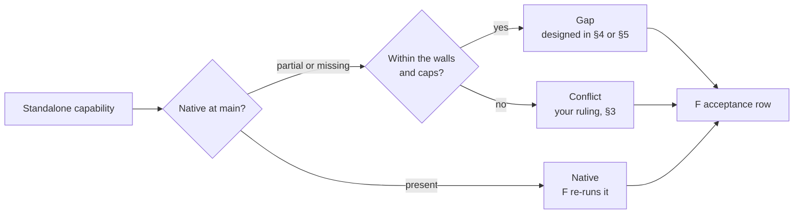
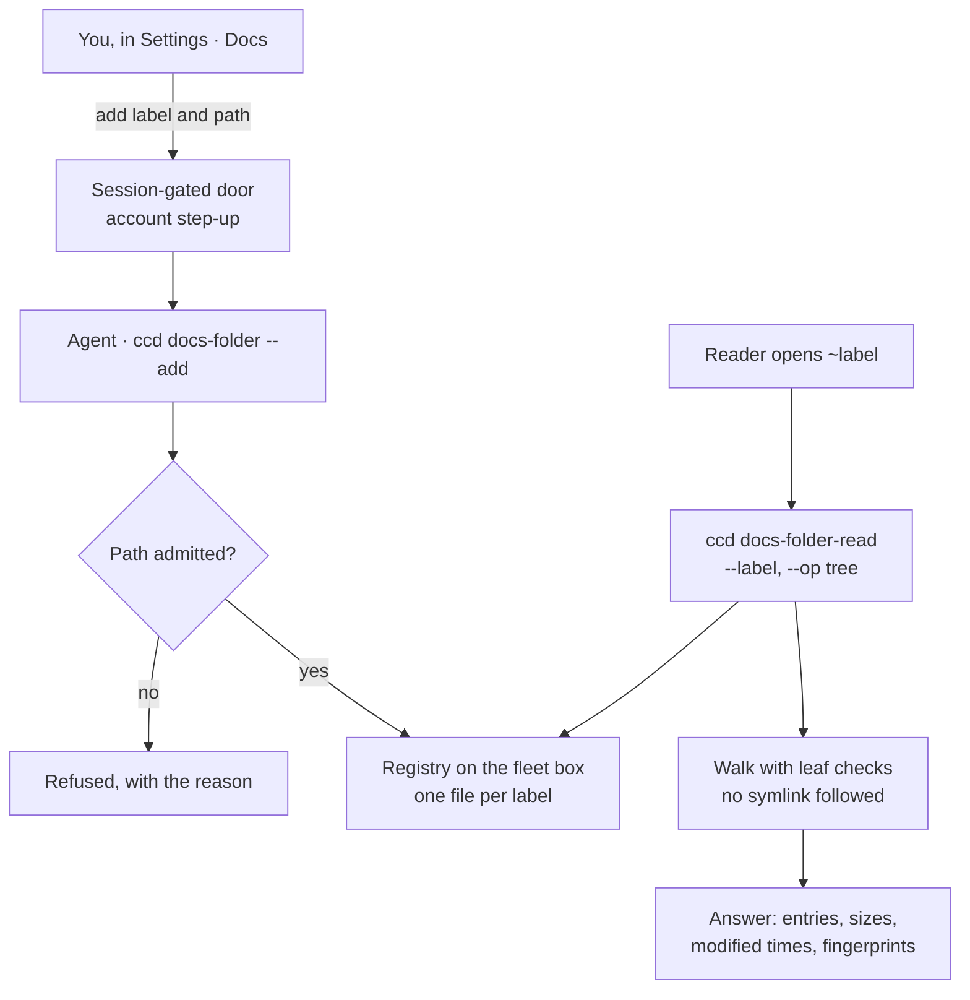
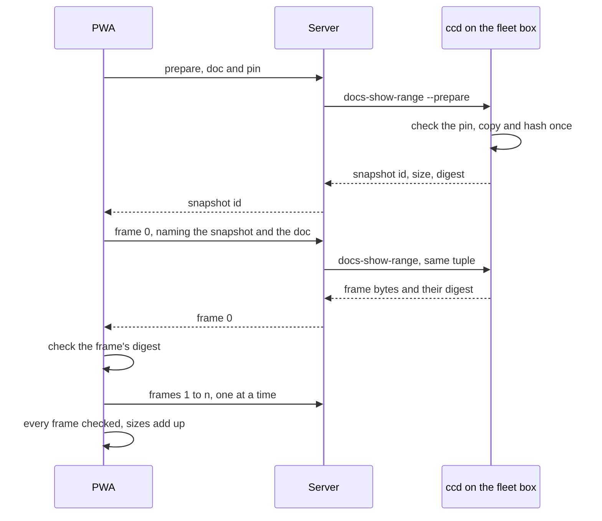
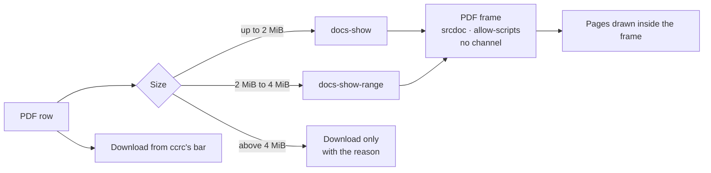
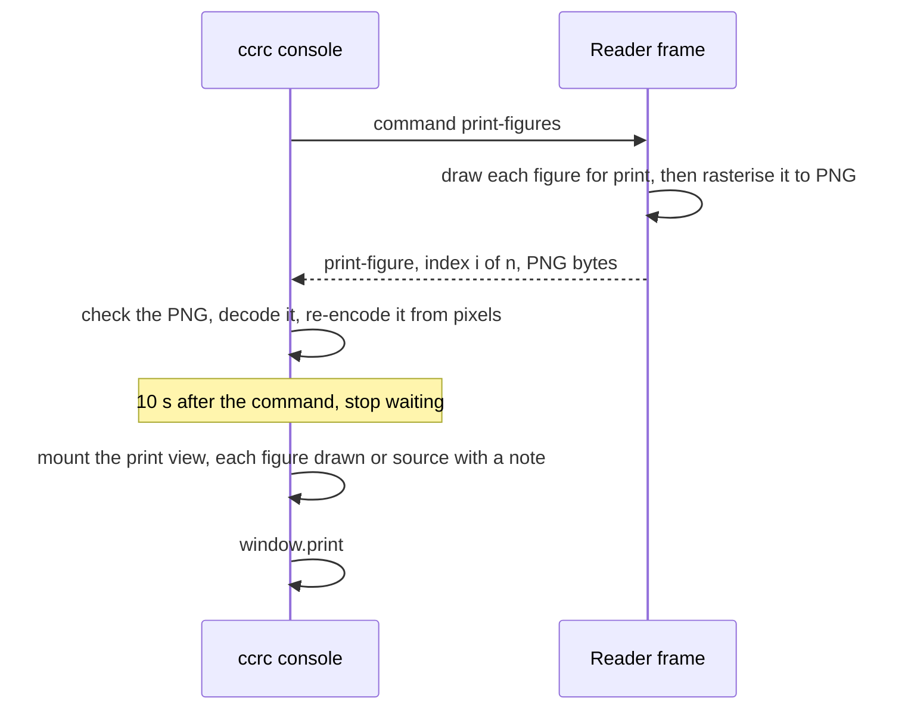
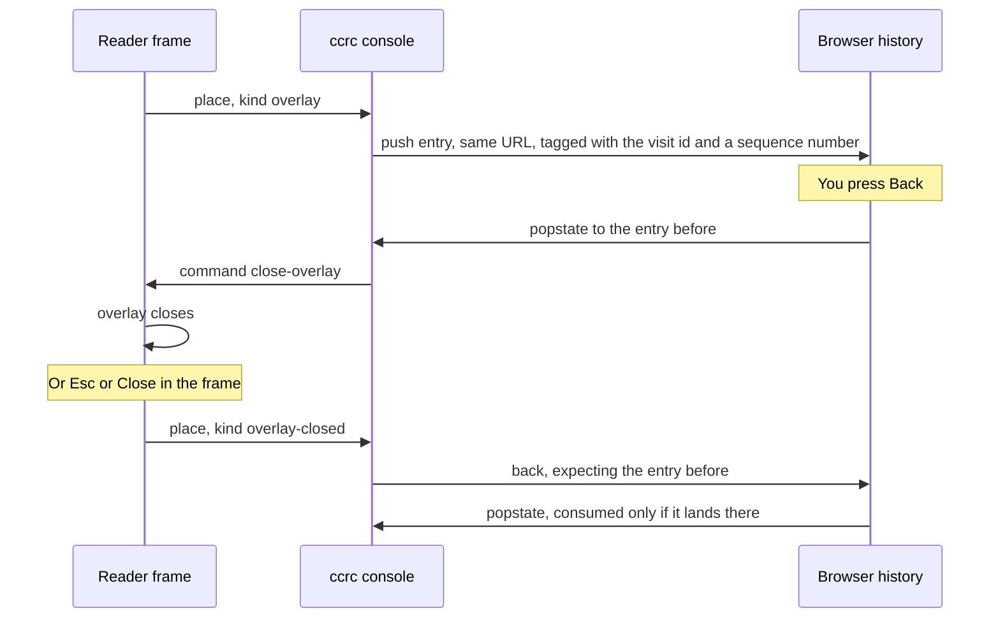
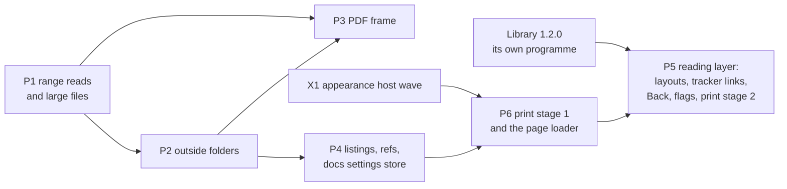

# Native Docs reader: full parity with the standalone reader

**Spec** · 2026-11-18 · Status: Draft, for review (X2, run 2632) · Owner: the operator · Linear: none · Related: docs/superpowers/specs/2026-10-12-rich-docs-reader-and-shared-renderer-design.md, docs/superpowers/specs/2026-11-07-native-docs-reader-completion-design.md, docs/superpowers/specs/2026-10-01-native-docs-reader-design.md, docs/superpowers/plans/2026-11-18-native-docs-parity.md, #1418

## In short

- **What this is.** The side-by-side inventory of everything the standalone reader does, checked against ccrc's native Docs reader at `main` (`6f5421139`), and a design for every gap. You ruled on 2026-10-25 that retiring the standalone reader drops no feature (#1418); this spec turns that ruling into rows that F can execute one by one.
- **What the inventory found.** 55 capability rows, folding 104 finer fact-check rows. 27 are already native (some stricter or richer), 23 are required gaps, 3 conflict with the reader's walls or recorded caps, and 2 belong to the sibling waves (appearance, X1; draft review, X3). Four conflicts, C1 to C4, cover the three conflict rows and parts of six gap rows (§2, §3). The gaps go beyond #1418's five examples: Back that returns from an in-page jump, the rules index, the index's newest docs, the project page's list of docs, readable file titles and HTML pages that load sibling files are on the list too.
- **What is decided here.** Outside folders are read only in their six section directories, with containment checked on the fleet box by file descriptors, and never without a signed-in session (§4.1). Files above 2 MiB are read in bounded 512 KiB frames, never by raising a cap (§4.3). PDFs open in their own isolated frame with a self-hosted viewer (§4.4). Variants, tracker links, Back-to-close, drawn figures in print and the other reading-layer gaps need one library release, designed here and released only by you (§4.2, §4.5 to §4.7, §6). Print works from ccrc's own window, without `allow-modals` (§4.6).
- **What stays fixed.** The reader frame stays `allow-scripts` only, the shell CSP stays `frame-src 'none'`, no frame touches the console's DOM, the library stays at 1.1.0 in this wave, and every current cap stays. Nothing here touches the standalone reader or any live service.
- **What you must check.** Two choices in "Waiting on you": the reading state left on the old origin (C1), and HTML pages that need more than today's walls allow (C3). Each has a recommendation. Nothing in waves P1 to P6 waits on either, but under the completion plan's Task 16 step 1 an unresolved product conflict blocks E and F (completion Tasks 16 and 17), so both need your ruling before the release candidate. The coordinator ruled the other two: figures print drawn, in two stages (C2), and the ceilings are 64 MiB for large files and 4 MiB for inline PDFs (C4).

## 1. Context

This section says what the inventory rests on, and which boundaries no design here may move.

### 1.1 The rulings this spec carries out

| Ruling | What it says | Footing |
|---|---|---|
| Retirement drops no feature (2026-10-25, #1418 and #1420) | Full parity is required, not Later or Dropped. Outside non-repo folders, layout variants, large files, PDFs and configured tracker links are kept. Outside folders need not become Git repositories. | Sourced: programme ledger, Carried constraints |
| Parity inventory reconciliation | The promise is not limited to the five examples. Print, figure-overlay Back-to-close and old-origin state are reconciled explicitly. Older Later or Dropped labels are not waivers. A genuine conflict goes to you. | Sourced: programme ledger, Carried constraints; completion plan Task 16 |
| Caps and walls stay until a reviewed design replaces them | No unsafe cap lift, no unauthenticated live working-tree read, no sandbox or CSP widening, no `allow-modals`. | Sourced: completion plan, Global Constraints |
| Files over 2 MiB | "A bounded larger read, such as the reserved `docs-show-range` verb, becomes required, not Later; the current caps are not relaxed in its place." | Sourced: rich-docs spec §6 parity table (amended 2026-11-11) |

### 1.2 How the inventory was built

- **The standalone reader** was read from its source on this box, behaviour only: its request handler, its page script (the default layout, AB, in 27 numbered parts), its four other layouts, its stylesheet and its theme script. Its configuration was not read. Its location, labels and configured values never appear here.
- **The native reader** was read at `main`: `shared/docs.ts`, `server/src/docs/**`, the docs verbs of `ccd/ccd`, `pwa/src/docs/**`, and the installed library `@synapsium-labs/docserver` 1.1.0 (`dist/`, `README.md`).
- **Measured on the fleet box, 2026-11-18,** over the six section directories of the projects under the projects root, only the figures the ceilings need: the largest file is 52 030 856 bytes (a 3D model); 143 files are above 2 MiB (3D models, PNG images, one Markdown file of 3.4 MiB, one HTML page of 2.6 MiB) and 99 above 4 MiB; no PDF is present. §4.8 adds counts of HTML pages by the wall they need, as the coordinator asked. Roots outside the projects root were not measured, because that would read the standalone reader's configuration.
- Each native status names the source that proves it. "Present" needs a citation; a capability found only by reading, not by running, says so.

### 1.3 Boundaries that do not move

| Boundary | Value | Where it is pinned |
|---|---|---|
| Reader frame sandbox | Exactly `allow-scripts` | rich-docs §4.1 |
| Shell CSP | `frame-src 'none'` | completion plan, Global Constraints |
| Frame and console | No parent-DOM access, no extra message channel, no window `message` listener in `pwa/src` | rich-docs §4.4, §5.1 |
| Library | `@synapsium-labs/docserver` exactly 1.1.0 in this wave. A library change is designed here and released by you. | brief; completion plan Tech Stack |
| Phone | Both 2026-11-06 phone blocks byte for byte; the tap, one-bar and desktop-fit budgets stand | completion plan, Global Constraints |
| Caps | Class caps 2 MiB, ccd ceiling 4 MiB, HTML tap-to-render above 1 MiB, mockup assets 64 and 5 MiB | `shared/docs.ts` (B), `pwa/src/docs/mockup/policy.ts` |
| The standalone reader | Not touched, not reconfigured, not retired by any wave here | ledger, Carried constraints |

## 2. The inventory

This section is the side-by-side table. Each row gives the action, what the standalone reader does, what native `main` does with its proof, and a disposition: **Native** (already native, perhaps stricter or richer), **Gap** (a required gap, designed in §4 or §5), or **Conflict** (needs your ruling, §3). F runs every row on the installed release (Task 17's "Complete parity inventory").

### 2.1 Pages, listings and refs

| # | Action | Standalone result | Native at `main` (proof) | Disposition |
|---|---|---|---|---|
| I1 | Open the docs index | One card per root, each section with its newest five docs and "N more" | Partial: a project chooser with per-section counts (`DocsIndexView.tsx`, `shared/docs.ts#DocsIndexRow`); no doc names | Gap, §5.1 |
| I2 | Open a project | Every section with all its docs (readable titles, date labels, draft badges), served-ref note | Partial: one row per section with its count and draft totals, no doc names (`DocsTreeView.tsx`, the project page) | Gap, §5.1 |
| I3 | Open a section | All file types, humanized titles, date label, draft badge, newest first | Partial: folders-first tree, all types, sizes, class glyphs, filter (`DocsTreeView.tsx#ListingPage`); raw file names, no date label | Gap, §5.2 |
| I4 | Deep paths | Any depth | Native, bounded at 16 levels and 5000 entries, unlisted counted by reason (`DocsTreeOk.unlisted`) | Native |
| I5 | `?ref=<branch>` | Local, then `origin/` | Native, newer of local and origin wins (`ccd` `resolve_bare`) | Native |
| I6 | `?ref=origin/<b>` | Reads the remote-tracking branch | Partial: fails `unresolved-ref` with a one-tap suggestion (`DocsFailureView.tsx`) | Gap, §5.3 |
| I7 | `?ref=<tag>` (a bare tag name) or a short commit | Resolves | Missing: a bare tag name is found and refused `unresolved-ref` with the hint `tag`; short commits refused; full commits open through `at=` (rich-docs G6) | Gap, §5.3 |
| I8 | Fetch on miss | Fetches the branch, 60 s cooldown | Native: `docs-fetch`, auto-refresh on stale, the chip (`useDocsVisit.ts`) | Native |
| I9 | Served-ref note | "Serving <ref>." on project and section pages | Native and richer: requested, served, commit, relation, freshness (`DocsTreeOk.ref`) | Native |
| I10 | Uncommitted draft | Working-tree file of the root's checkout, badged, banner, in the default view | Native in a ref view: drafts from the branch's holder, fingerprint-pinned (`entryView`, `docs-show --fingerprint`). The default view shows committed content only (`entryView` overlays only when `mode` is `ref`), so the same drafts open through `?ref=<the checkout's branch>`; a difference F records | Native |
| I11 | Per-root default branch | Configured per root | Partial: derived from origin HEAD, then main, then master (`DocsTreeOk.ref.via`); no override | Gap, §5.4 |
| I12 | Honest errors | 404 with the `?ref=` hint | Native, different words, richer (`docsText.ts`) | Native |
| I13 | GitHub link | Blob link at the served commit | Native, with the reason when off (`githubBlobUrl`) | Native |
| I14 | Six sections | Six | Native (rich-docs G1) | Native |
| I15 | Per-doc history | 100 commits | Native and redacted (rich-docs G4) | Native |
| I16 | Changes since, only this day, Back to the latest | Server diff | Native, client diff (rich-docs G5, G6; D1) | Native |
| I17 | Hidden files | Working tree skips dot paths | Native lists committed dotfiles as `other`, download only (`contentClass`) | Native |
| I18 | A worktree served as its own root | A configured label per worktree | Native: `?ref=<its branch>` on the parent project, drafts from the holder | Native |
| I19 | Adding a root without restart | Config file re-read | Native for projects (a new project directory is listed at once); outside folders are F1 | Native |
| I20 | Draft review by link | Hand-added folders that never expire | Missing: Share sends only the committed permalink (rich-docs G11) | Owned by X3 (draft review) |

### 2.2 Files and formats

| # | Action | Standalone result | Native at `main` (proof) | Disposition |
|---|---|---|---|---|
| F1 | Outside folder | A non-git root served from its working tree, "not a git repository" | Missing: only the projects root; a non-git project is listed and refused `not-a-git-repo` (`ccd/ccd`, `docsText.ts`) | Gap, §4.1 |
| F2 | Markdown | Rendered in full, any size | Native up to 2 MiB, render gate at 512 KiB (`pwa/src/lib/markdownLimits.ts`) | Native |
| F3 | Markdown above 2 MiB | Rendered | Missing: the `too-large` sentence (`DocsLeaf.tsx`) | Gap, §4.3 |
| F4 | Image above 2 MiB | Shown | Missing: "Image not loaded" and a Download that fails at the same cap | Gap, §4.3 |
| F5 | Any file above 2 MiB, download | Served | Missing: Download uses the capped file route (`objectUrls.ts#downloadDocFile`) | Gap, §4.3 |
| F6 | PDF | Browser's inline viewer, any size | Missing: class `other`, "No preview", Download up to 2 MiB (`DOC_CONTENT_CLASS_BY_EXT`) | Gap, §4.4 |
| F7 | Text and JSON | Raw text | Native: highlighted text leaf with Source and Download | Native |
| F8 | Images up to 2 MiB, SVG | Raw | Native, magic-checked, SVG never runs script (`sniffRaster`, `SvgBody`) | Native |
| F9 | `.ico` | Shown | Class `other`, Download | Gap, §5.5 |
| F10 | HTML page, static | Raw in an opaque origin | Native: mockup frame, stricter (rich-docs G9) | Native |
| F11 | HTML page with its scripts | Runs, with popups, modals and downloads allowed | Partial: Run scripts, `allow-scripts` only; `alert`, `window.open` and download links do nothing (`mockup/policy.ts#MOCKUP_SANDBOX_SCRIPTED`) | Conflict C3, §3 |
| F12 | HTML page loading sibling modules, models, WebAssembly or JSON | Served raw with CORS, any size | Partial: direct siblings inlined as `data:` (64 assets, 5 MiB); relative module imports, `fetch`, workers, `.glb`, `.gltf`, `.wasm`, `.json` do not load (`mockup/load.ts`, `MOCKUP_ASSET_MIME`) | Gap within the walls, §4.8; beyond them Conflict C3 |
| F13 | HTML page above 2 MiB | Runs | Missing: `too-large` | Conflict C3, §3 |

### 2.3 The reading layer (the library inside the frame)

| # | Action | Standalone result | Native at `main` (proof) | Disposition |
|---|---|---|---|---|
| R1 | Rich layout, In short and Where things stand boxes, numbered sections | AB | Native (library 1.1.0) | Native |
| R2 | Quick jump, keys sheet, `j` `k` `w` `i` `n` `p` `m` `o`, Esc | Yes | Native (`dist/enhance/jump.js`, `keysheet.js`, `position.js`, `keys.js`) | Native |
| R3 | Contents rail, phone drawer, scroll-spy, progress, running head, skip link | Yes | Native (`rail.js`, `scroll.js`, `bar.js`); ccrc's bar owns the compact buttons | Native |
| R4 | Index of IDs, ID previews, glossary hover | Yes | Native (`dist/enhance/*`) | Native |
| R5 | Review strip, attention marks | `you` or `operator`; ID qualifiers skipped | Partial: `addressees` default `['you']`, `qualifiers` `[]` (`vocab.js`); ccrc passes no vocabulary | Gap, §5.6 |
| R6 | Rules index and rule paragraphs | Yes | Missing: library flag `rules` off, ccrc never passes it (`options.js`, `seed.js` accepts it) | Gap, §5.6 |
| R7 | In short "Headlines / Full" switch | Yes | Missing: removed from the library (`editorial.js` header) | Gap, §5.6 |
| R8 | Read marks, last visit, folds, outline, reading position | Per doc | Native under `ccrc:reader:v1:` (`dist/host/store.js`, `DOC_FIELDS`) | Native |
| R9 | A comparison kept across reload | Session storage | Missing: no `changes` field (`DOC_FIELDS`) | Gap, §5.6 |
| R10 | Theme, width, serif or sans, lens | Aa menu, per device | Partial: theme seeded from the app's theme at each mount | Owned by X1 (appearance) |
| R11 | Figures: Play, Animate edges, Full screen, Copy Mermaid | Yes | Native (`diagram-tools.js`) | Native |
| R12 | Diagrams draw on open | Yes | Partial: on request while E17's `mermaid` line does not hold (`reader/policy.ts#docsDrawFor`); you ruled draw on open behind that reading (rich-docs §5.2) | Gap, waiting on lab E17; no design here, F evidences it |
| R13 | Figure overlay: Back closes it | `pushState`, `popstate` closes | Missing: no history entry; Back leaves the page (`diagram-tools.js`, README) | Gap, §4.7 |
| R14 | In-page jump: Back returns | `pushState` per jump | Missing: `hash` replaces the entry (`ReaderFrame.tsx` `onHash`, `lib/router.ts`) | Gap, §4.7 |
| R15 | Code copy, table filter, sticky headers, status labels, GitHub alerts, footnotes, front matter | Yes | Native | Native |
| R16 | Links to sibling docs keep `?ref=` and `?variant=` | Rewritten in the page | Native for the pin (ccrc carries it, `routeReaderLink`); variant is §4.2 | Native, variant in §4.2 |
| R17 | External links | Open directly | Native, through the external-link sheet (stricter) | Native |
| R18 | Fonts and Mermaid | Mermaid from a CDN | Native, self-hosted (stricter) | Native |
| R19 | Layout variants `classic`, `A`, `B`, `C` | `?variant=` per URL | Missing: the library ships one layout (§3.3); ccrc passes no layout | Gap, §4.2 |
| R20 | Tracker item link | One item per doc, from the byline fact, the promise-delta `item:` line or a header line, to one hardcoded workspace | Missing: the library needs a host `itemLink`; the frame wire has none | Gap, §4.5 |
| R21 | Print | Ctrl+P prints the whole doc through a print stylesheet; every other leaf is served raw, so the browser prints it | Partial: the frame scrolls inside a viewport-sized box and the host has no print rules, so at most the visible part prints (inferred from source, not run); an image, text, PDF or HTML leaf has no print design | Gap, §4.6 (PR1 to PR15, and the leaf kinds PL1 to PL5); figures Conflict C2 |
| R22 | Reading state on the old origin | Kept on that origin | Starts fresh: different origin and key formats (rich-docs G7, §5.2) | Conflict C1, §3 |

### 2.4 Summary

| Disposition | Count | Rows |
|---|---|---|
| Native | 27 | I4, I5, I8 to I10, I12 to I19, F2, F7, F8, F10, R1 to R4, R8, R11, R15 to R18 |
| Gap | 23 | I1 to I3, I6, I7, I11, F1, F3 to F6, F9, F12 (within the walls), R5 to R7, R9, R12, R13, R14, R19 to R21 |
| Conflict | 3 | F11, F13, R22 |
| Owned elsewhere | 2 | R10 (X1, appearance), I20 (X3, draft review) |

The four conflicts and their rows: C1 is R22; C2 the figures of R21; C3 is F11, F13 and the part of F12 beyond the walls; C4 the ceilings of F3 to F6. So C1 and C3 settle the three conflict rows, and C2, C3 and C4 also settle parts of six gap rows. The finer rows (70 client rows and 34 server rows, from three fact checks) were folded into the rows above, each into one row, and each row carries its own proof here; the fact checks' working reports were not kept, and the leaf plan's Results says how they were made.


*Figure 1. How each row got its disposition. Every row, whatever its disposition, becomes an acceptance row that F runs on the installed release.*

## 3. Conflicts that need your ruling

A conflict is a row that cannot reach full parity without moving a boundary of §1.3, or that turns on a product choice. Each went to the coordinator as one ask (asks 596 to 599, 2026-11-18); two came back ruled and two wait for you. Nothing here is waived by this spec.

| # | Conflict | Options | Status |
|---|---|---|---|
| C1 | Reading state kept on the old origin (marks, last visit, folds, settings) cannot move by itself: it lives in another origin's storage under other keys | (a) Capability parity, data starts fresh. (b) A one-time, opt-in import, as its own follow-on design. | Waiting on you; recommendation (a). §4.9 prices (b). |
| C2 | Print with figures drawn. They are drawn inside the frame, and nothing drawn there reaches the console today | (a) Figures print as their Mermaid source. (b) Also hand each drawn figure to the console as a checked PNG for print. | Ruled (b), staged (coordinator, ask 597): stage 1 prints figures as source; stage 2 adds drawn figures; parity needs stage 2 (§4.6). |
| C3 | HTML pages that need more than today's walls: dialogs, popups and page downloads (each needs a sandbox token the walls forbid), WebAssembly and workers (each needs a mockup CSP change), sibling assets above the 5 MiB budget, and pages above 2 MiB | (a) Keep the walls: run what fits with the in-walls loader of §4.8, Download and Source for the rest, with a sentence saying why. (b) Commission a wider evidence-page surface as its own reviewed security design. | Waiting on you; recommendation (a). §4.8 counts what stays standalone-only and prices (b). |
| C4 | The large-file ceilings | Range reads up to 32, 64 or 128 MiB; PDFs inline up to 4 or 8 MiB | Ruled 64 MiB and 4 MiB as the design default (coordinator, ask 599); you approve it with the spec (§4.3). The 4 MiB PDF figure is confirmed by lab PDF-L2, not yet measured. |

## 4. Designs for the named gaps

Each subsection gives the design, its alternatives with the choice and why, where it runs (ring and context), and its test strategy. Mutation rows are numbered M11.x so they never collide with the rich-docs spec's M8, M9 and M10 rows.

### 4.1 Outside folders

**The idea.** An outside folder is a root with no commit. Native already reads one kind of file with no commit safely: a draft, by fingerprint, after leaf checks for kind, hard links, foreign owners and other devices. An outside folder reuses those leaf checks and the fingerprinted read, and adds what a draft never needed: a directory walker (drafts are listed through `git status`, which a folder does not have) and an admission check for the folder itself. It has no ref, no history and no commit. Its reads require a signed-in session: on a box where sign-in is dark, every folder read refuses `auth-off`, so a live working tree is never read without one.


*Figure 2. Adding a folder and reading it. The fleet box keeps the registry and re-checks the path on every call; the server never sends a path to read.*

**Settings.** A "Docs folders" section lists each folder by label, with its path, and offers Add and Remove. Add takes a label and an absolute path on the fleet box. A label has its own grammar, `DOCS_FOLDER_LABEL_RE` = `^[a-z0-9][a-z0-9-]{0,31}$` in `shared/docs.ts`: no dot, slash, space or control character, so a label can never leave the registry directory, change a URL's shape or break a log line. The server's L1 checks it before composing any verb, and `ccd` checks it again, from a parity copy, before any path join.

**The primary wall: only the six section directories.** Whatever folder is added, `ccd` reads nothing but the six section directories below it (`docs/superpowers/specs` and the other five), leaf-checked. A folder added at a high level exposes only those six paths under it, never its other files.

**Admission, decided by `ccd` (the fleet box) at Add and again at every read, by file descriptors, not by path strings.** `ccd` opens the path from `/` one component at a time with `O_DIRECTORY | O_NOFOLLOW`, so a symlink anywhere in it refuses, holds the folder's directory descriptor, and reads everything below it relative to that descriptor, again with `O_NOFOLLOW` at every step. A component swapped for a symlink between Add and a read therefore refuses at the read. The folder must be a directory owned by the session user. As defence in depth, it must neither contain nor sit inside a protected directory, compared by device and inode of each ancestor and each protected directory, not by path prefix (and the walker compares each directory it opens below the folder with the protected set too, so a mount below the folder that shows a protected directory refuses): the projects root, the worktrees root, the session registry, `~/.cc-secrets`, `~/.cc-limits`, `~/.ccrc`, `~/ccrc-backups`, every wrapper home and Claude config directory, `~/.config`, `~/.ssh`, `~/.gnupg`, `~/.local/share`, the range snapshot cache (§4.3) and the home directory itself, which is refused only as an exact match or when the folder contains it: a folder inside the home directory is the ordinary case. A refusal names its reason; the answer never echoes a path it refused. The server checks only the shape of a path (absolute, no `.` or `..`, bounded length) before it composes the verb: that is a second decider of the same fact, legitimately different because `ccd` re-checks beside the files on another host.

**The registry.** `~/.cc-sessions/docs-folders/<label>`, one file per label holding the path, a dotless registry subdirectory like the pool markers. Its one writer is `ccd docs-folder --add|--remove`, under the registry's lock. Only `ccd` reads it. The server lists it through `ccd docs-folder --list` and answers two reads from it: `GET /api/docs-folders` answers labels only, for the index and every page, and `GET /api/docs-folders/paths` answers labels and paths, called only by Settings' Docs folders section (a single-definition scan: only `pwa/src/lib/api.ts`, the one HTTP adapter, names its URL, and only that section calls the method). Remove also purges the label's range snapshots (§4.3). A folder belongs to the node whose `ccd` holds it, today the one primary node; `~<label>` names a folder on that node, and a future node prefix would come first (`@node/~label`).

**Reading.** One new read verb, `docs-folder-read --label <label> --op tree|show|prepare|range …`, under the new cap token `docs-folders-v1`, with its own agent grant and `REQUIRED_VERB_FLAG` row (`--label`). The existing verbs' argv and grants never change (`REQUIRED_VERB_FLAG` keeps one flag per verb), and a new server never sends a folder read to an older fleet. `ccd` resolves the label from the registry, never from the wire, re-runs admission, and walks the six section directories with the new walker: bounded by the existing listing caps (5000 entries, 16 levels, 1 MiB wire) and the helper's deadline, never following a symlink, listing a symlink, FIFO, socket or device with its mark and never opening it, and refusing a read through a symlinked directory with `symlink-in-path`, as today. Dot components are skipped, as the standalone reader skips them in a working tree. Each entry carries its size, its modified time (`mtimeNs`, as §4.3) and, within the existing 32 MiB draft hash budget, its fingerprint; an entry past that budget, or above the 4 MiB hash ceiling, has none and is pinned at open (§4.3).

**What the page shows.** Folder pages live at `/docs/~<label>/…`: `~` is a character the project grammar never admits, so a folder can never be read as a project. The truth line reads "Not in a repository" with the file's modified time from the same read that produced the bytes. History, Changes since, version pages, GitHub and Share are off, each with its reason ("A folder outside a repository keeps no history"). The index lists folders in their own group, after projects.

**Redaction.** The folder's absolute path never leaves Settings: no tree, file or range answer, error body or log line carries it, and log lines name the label only. Any free text a folder answer carries (an errno detail) goes through the shared redactor. Dot components never list, so `.env` files and key directories inside a folder stay unlisted.

| Decision | Options | Chosen, and why |
|---|---|---|
| How a folder is read | (a) A new walker plus the draft leaf checks and fingerprinted read; (b) a wholly new reader; (c) a snapshot copy into a repository | (a): the leaf checks and the fingerprinted read are the one live working-tree read already reviewed. (c) fakes a history the folder does not have. |
| Where the registry lives | (a) On the fleet box, written by `ccd`; (b) in `coord.db` on the server, sent with each read | (a): containment is decided beside the files, by the one component that names the disk layout. (b) would put a path on the wire, which `ccd` never trusts. |
| How a folder is named in URLs | (a) `/docs/~<label>`; (b) a `folder:` query; (c) folders as projects | (a): a reserved mark keeps the two namespaces apart, as the reserved `@` does for a future node. (c) collides with project names. |
| Reads while sign-in is dark | (a) Refused `auth-off`; (b) answered, like committed docs | (a): a folder is a live working tree, and the walls forbid reading one without a session. |
| What a symlink does | (a) Listed, never followed; (b) followed inside the folder | (a): the native rule for every working tree. The standalone reader's prefix check let a symlink reach another root's sections; that leak is not copied. |

**Test strategy.** ccd fixture HOMEs only: admission refusals one by one (a symlinked component, a path inside the projects root, a parent of the session registry, a protected directory named by a second spelling (the fixture HOME reached through a symlink, so the protected path and the folder's path differ as strings while their device and inode agree; a mount below a folder needs root, so the walker's own comparison is a unit test of the pure comparison with given device and inode pairs), a file, a foreign owner); a component swapped for a symlink between Add and a read refuses at the read, including a directory below the folder such as `docs/superpowers`, which admission from `/` alone never sees; an escaping symlink inside a folder listed and never read; a FIFO and a directory loop met by the walker; a file outside the six section directories never listed; a label outside its grammar refused by `ccd` before any path join; a dot directory never listed; the registry's one writer (a single-definition scan); no absolute path in any answer or log line (a scan of every answer shape). Server: every folder read refuses `auth-off` on a dark box and answers when armed and signed in; Add refuses dark and asks the step-up; a request without the docs marker header gets 403. PWA: the folder truth line, the five actions off with their reasons, `~` routing. Mutation rows M11.1 to M11.6, M11.56, M11.58, M11.65 and M11.72 (leaf plan).

### 4.2 Layout variants

**The idea.** The standalone reader has five layouts: the default (AB), `classic` (the layout before AB), `A` (editorial), `B` (a review workbench with ID chips, a Contents and Index rail and its own keys) and `C` (guided layers: folded sections with reading time, a hero, tables as cards on a phone). Each differs in code, not only style (the smallest pair differs by 694 lines of script). They are ported into the library as layouts, and the host picks one per device or per visit.

| Decision | Options | Chosen, and why |
|---|---|---|
| Where variants live | (a) In the library as layouts, each its own enhance bundle; (b) host CSS over the default; (c) the standalone reader's files inside the frame | (a): the variants differ in code. (c) loads Mermaid from a CDN, reads storage directly and rewrites links itself, all of which the frame forbids. |
| How the frame loads one | (a) Only the chosen layout's bundle is inlined, allowed by its own hash; (b) every layout inlined | (a): the srcdoc holds one layout's code, held to its cap per layout with X1's fonts in it (§6). |
| Persistence | (a) A per-device reading pref, plus `?variant=` for one visit; (b) URL only, as in the standalone; (c) server-side | (a): the standalone reader keeps the choice in the URL only; a per-device pref keeps that link behaviour and adds a lasting choice. |
| The control | (a) A Layout row in ccrc's Page details sheet; (b) in the library's Aa menu | (a): the Aa menu's ownership is X1's, and a layout change remounts the frame, which the host does. |

- **Names.** `default` (AB), `classic`, `editorial` (A), `review` (B), `guided` (C). `?variant=` accepts the standalone reader's names (`AB`, `A`, `B`, `C`, `classic`) and maps them; an unknown name opens the default, as in the standalone reader.
- **State.** Each layout's own state (B's and C's per-doc keys) goes through the bridge's `store.set` under the reader prefix, as per-doc fields named per layout; the 1 MiB budget and eviction are unchanged.
- **Appearance.** Every layout follows ccrc's appearance while hosted, through the appearance slots and pairs as X1's merged contract defines them, and passes the contrast pairs gate (§6). A layout brings its own structure, never its own palette.
- **Phone, laptop, wide.** Every layout must keep ccrc's one-bar, tap and desktop-fit budgets at 412×915, 1280×800 and 1920×1080. A layout that cannot is fixed in the library before it ships; none is shipped as "desktop only".
- **Departure.** Rich-docs §3.3 says the library ships only the default layout. That sentence predates your #1418 ruling (2026-10-25, layout variants kept), which the amended §6 row carries ("every kept variant"); the leaf plan defines the reconciliation as D-8762. §3.3 is superseded by it once wave P5 implements it, and P5 amends §3.3's text then.

**Test strategy.** Library: each layout passes the conformance corpus, the appearance contrast suite in hosted mode and the frame CSP hash check, and its srcdoc with X1's fonts stays under its cap. ccrc: the pref round trip; `?variant=` mapping and its carry on doc links; one browser row per layout per width (one bar, no horizontal scroll, contents reachable). Mutation rows M11.7 to M11.9.

### 4.3 Files above 2 MiB

**The idea.** The base spec's reserved seam: a new verb, `docs-show-range`, under its own cap token `docs-range-v1`, returns a file in frames of at most 512 KiB, each from the same pinned content. The class caps and the 4 MiB ceiling are not touched. The PWA reassembles frames up to the range ceiling.

**The ceilings (C4, the coordinator's design default).** Each is one named constant in `shared/docs.ts`, its single source of truth, with ccd holding a parity copy where ccd enforces it:

| Constant | Value | Governs |
|---|---|---|
| `DOCS_RANGE_FRAME_BYTES` | 524 288 (512 KiB) | The raw bytes in one frame |
| `DOCS_RANGE_MAX_BYTES` | 67 108 864 (64 MiB) | The largest file read by range: download, and the reassembled bytes behind any view |
| `DOCS_PDF_INLINE_MAX_BYTES` | 4 194 304 (4 MiB) | The largest PDF opened in the PDF frame; above it, download only |
| `DOCS_IMAGE_VIEW_MAX_PIXELS` | 67 108 864 (64 megapixels, read from the image header) | The largest image shown on its own page; above it, download only, so a small file that decodes huge is never decoded |
| `DOCS_IMAGE_VIEW_MAX_SIDE` | 16 384 | The widest or tallest image shown on its own page, read from the header; its own limit, so an image of 16 385 by 16 refuses by its side while its pixels are far below the ceiling above |

Opening, viewing the source and downloading differ. Download reaches the range ceiling for every class. A rich view never goes past what the existing budgets allow: Markdown renders in parts of at most 2 MiB, each under today's render gate and parse budgets, and a text file is shown as source in parts of the same size, under the highlight budgets. A part those budgets refuse is shown as plain text with the budget's own sentence, never half-rendered.


*Figure 3. One range read. The prepare snapshots the pinned bytes; every frame comes from that snapshot, is bound to the same doc and carries its own digest; nothing is shown or saved until every frame has arrived and checked.*

- **The pin.** A committed file is pinned by its blob. A draft or folder file with a fingerprint is pinned by it. A draft or folder file without one (above the 4 MiB hash ceiling or past the listing's hash budget) is pinned by its size and its modified time in nanoseconds as the listing measured them (`stat:<size>:<mtimeNs>`), and the open checks the descriptor it opened (`fstat`) against both, refusing `draft-changed` on any difference; its truth line then says "as read at <time>". A stat-pinned file is always read through the range path, whatever its size, because `docs-show` reads a draft only by its fingerprint.
- **Where the time comes from, and where the pin lives.** The listing carries the time as an additive field, `mtimeNs`, a decimal string (nanoseconds do not fit a JSON number exactly), on the docs-tree draft entry (`DocsEntry.draft`) and on every folder tree entry, in that one unit everywhere. ccd takes it from the `fstat` of the opened leaf that `walk_leaf` already makes (`st_mtime_ns`), the same stat the size comes from, which `draft_facts` keeps in its facts instead of dropping it after the size. One reader, `statPin(size, mtimeNs)` in `shared/docs.ts`, which both entry shapes call with their own fields, builds the pin and tolerates absence: an older ccd that sends no `mtimeNs` gives no pin, and the file stays withheld `too-large`, as today. The pin lives in `entryView`'s answer (a new `pin` field), the one derivation every row and leaf header already reads, and the range request carries it as its `pin` parameter. Once the prepare answers, the leaf's page pin, `DocPin`'s draft arm, whose `fp` is a required string, carries the snapshot's `digest` as that `fp`: the sha256 of the bytes the page shows, the quantity `fp` names everywhere else, so every reader of the page pin (the drafts banner among them) works unchanged.
- **The snapshot, a separate first step.** Before any frame, `docs-show-range --prepare` copies the pinned bytes once into a private snapshot, hashing as it copies, and answers only the snapshot's id, size and digest, no file bytes. A copy whose hash differs from a fingerprint refuses, as a draft read does today. The snapshot's id is bound to the whole request (project or folder label, section, path and pin), and every frame names that id and is checked against the same tuple; a folder frame also re-runs admission. So all frames come from one set of bytes, from the doc that was asked for, and each frame carries the sha256 of its own bytes, which the PWA checks. What this proves is that frames are not mixed and not damaged; what the bytes were at open is proved by the pin.
- **The snapshot cache.** A ccd-owned directory, `~/.cc-docs-range/`, outside the session registry and outside every temp root a sweep owns, mode 0700, guarded by one `flock`. Every range call of any kind first removes expired entries under the lock; with no call at all, what stays is at most the bound, until the next call. A prepare reserves its size against the 512 MiB bound before it copies (a bound file in the cache directory may only lower that bound, the smaller of the two being used; it is read with `O_NOFOLLOW | O_NONBLOCK`, as a regular file only, at most 32 bytes of decimal digits, and anything else is ignored for the constant; which is how a fixture HOME tests it without 450 MiB of fixtures; a session that writes one can only make range reads refuse sooner), at most 2 prepares run at once and at most 6 start a minute, entries live one hour and go least recently used first, and `docs-folder --remove` purges its label's entries. A frame whose snapshot is gone answers `snapshot-gone`, and the PWA starts again from prepare, once. The prepare's copy-and-hash time has its own constant, `DOCS_RANGE_PREPARE_BUDGET_MS`, a budget apart from the draft hash budget, set from lab RANGE-L1's measurement of a 64 MiB copy on the fleet box.
- **The lane.** One frame per exec, through the existing read lane, so no frame puts more than 512 KiB of file bytes on the socket; the prepare puts none. The cost is about 100 to 150 ms a frame (base spec §6.7), plus the prepare: a 52 MB file takes 15 to 20 seconds.
- **Departure.** Base spec §6.9 says each frame is "re-verified against the same blob or `fp`". Here each frame is verified against a snapshot taken under that check, which is defined as D-8764 in the leaf plan.
- **Progress, Cancel and memory.** The read shows progress and a Cancel, and runs off the console's main work: each frame is one request, so the console keeps answering between frames. Cancel, leaving the page or opening another doc aborts the read and drops every frame held. The PWA writes each checked frame into one buffer, allocated once from the prepare's size, so while reading it holds at most the file plus one frame being decoded (about 64.5 MiB at the ceiling). Building the `Blob` from that buffer copies it once, so for that moment the peak is about twice the file (about 128 MiB at the ceiling), after which the buffer is dropped (judgement from the data path; F's Large files row measures the peak on a phone). No whole-file copy is made for hashing, because each frame is checked on its own.
- **What each class does above 2 MiB.** Download: always, up to the ceiling. Images: shown on their own page from the reassembled bytes, after the magic check and the pixel check; inside a document, an image past the reader's budget keeps its "not loaded" chip, which now opens that page. Markdown: rendered in parts (below). HTML: C3. PDF: §4.4. Everything else: Download.
- **Markdown in parts.** A line scanner, outside code fences, cuts the text at top-level headings into parts of at most 2 MiB each (a single section above 2 MiB is cut at a blank line, marked "continued"). Each part renders under every current cap and budget, as its own mount. ccrc's bar shows "Part 2 of 3" with Previous and Next. Before part 1 shows, the worker renders every part once, under the parse budget, and records each part's heading ids, so a fragment link into any part opens it; a part the budget refuses keeps its ids unknown, and a link into it opens part 1 with a note. Ids are de-duplicated within each part, so a heading text repeated in another part gets the same id there; a link names the first part that holds it, as the whole document would. The contents list, Print, Export and Changes since (with its 20 000-line cap) each act on the current part, and say so.
- **Over the ceiling.** "This file is 80 MB; Docs reads files up to 64 MB." No partial file is ever saved or shown, and nothing is offered that would read past the ceiling.
- **The overlay cap.** Today a draft above the 4 MiB hash ceiling is withheld `too-large` (`entryView`, `fp: null`). With range reads, a draft or folder file up to the range ceiling opens through its snapshot, whose digest is taken on open; above the ceiling it stays withheld, and the sentence names the ceiling.

| Decision | Options | Chosen, and why |
|---|---|---|
| Transport | (a) `docs-show-range` frames; (b) raise the class caps; (c) a streaming agent protocol | (a): the recorded seam, and the rich-docs row forbids (b). (c) changes the agent protocol, which one frame per request avoids. |
| Re-verification | (a) Snapshot once, frames from the snapshot, each frame's own digest checked by the PWA; (b) re-hash the whole file for every frame; (c) a whole-file digest in the PWA | (a): (b) costs the whole file per frame (128 hashes of 64 MiB for one read), and (c) needs a whole-file copy in the page's memory, doubling the peak. The snapshot is named by its digest, so each frame is still tied to the pinned bytes. |
| Markdown above 2 MiB | (a) Parts, each under today's caps; (b) render whole behind the render gate; (c) text only | (a): (b) relaxes the 2 MiB document cap, which the rich-docs row keeps. (c) loses the layout. |
| Overlay cap | (a) Open through the snapshot up to the ceiling; (b) keep withheld above 4 MiB | (a): (b) loses big drafts and almost every big file in a folder. |

**Test strategy.** Real fixtures one byte below, at and one byte above each boundary: 2 MiB (class cap), 4 MiB (ccd ceiling and hash ceiling), and `DOCS_RANGE_MAX_BYTES` (files of 67 108 863 and 67 108 864 bytes prepare, 67 108 865 refuses); a PDF verdict at 4 194 303, 4 194 304 and 4 194 305 bytes (§4.4); an image of 8191 by 8192 and 8192 by 8192 pixels shown and 8192 by 8193 refused by its pixels; and an image of 16 383 by 16 and 16 384 by 16 shown and 16 385 by 16 refused by its side, so the two limits are told apart; every size read from the header. A mutation row moves each ceiling's constant down by one and reds its at-the-ceiling case. A snapshot from a changed draft refuses; a file above 4 MiB changed between the listing and the open refuses `draft-changed`; a frame whose bytes do not match its digest fails the read; a frame naming another snapshot, or the same snapshot for another path, fails the read; a folder frame after Remove refuses; Cancel and navigation save nothing and drop the frames; the cache never holds more than its bound (under a fixture bound of 8 MiB with a planted 5 MiB reservation, standing in for a first prepare paused between reserve and copy, a 5 MiB prepare refuses `prepare-busy`), refuses a third concurrent prepare and a seventh in a minute, and answers `snapshot-gone` after eviction, which the PWA retries once. Markdown parts: a cut never falls inside a fence; a cross-part link opens the right part. Real files are measured in F (Task 17's Large files row). Mutation rows M11.10 to M11.15, M11.51, M11.53, M11.55, M11.66 and M11.72.

### 4.4 PDFs

**The idea.** A PDF opens in a frame of its own, the PDF frame, with a self-hosted viewer (pdf.js, `pdfjs-dist`, Apache-2.0, an exact pin). It is a separate surface: its sandbox is `allow-scripts`, it is a `srcdoc` frame, so the shell's `frame-src 'none'` still blocks every navigation, and it has no message channel and no parent listener at all, like the static mockup frame. The reader frame is not changed.


*Figure 4. Opening a PDF. The bytes reach the frame inside its srcdoc; the frame sends nothing back. Download is always ccrc's, never the frame's.*

- **Class.** `pdf` joins the content classes: `DOC_CONTENT_CLASS_MAP`, `DOC_CONTENT_CLASS_BY_EXT` and `DOCS_CLASS_CAP` (its show cap stays the 2 MiB class cap; above it, range reads), with a magic check (`%PDF-` at offset 0) under `nosniff`, as rasters have. The bytes travel as JSON, like every other docs file, so `DOCS_ALLOWED_CONTENT_TYPES` is unchanged.
- **The frame's policy.** `default-src 'none'; script-src 'sha256-…' (the viewer and its bootstrap only); style-src 'unsafe-inline'; img-src data: blob:; font-src data:; worker-src blob:; base-uri 'none'; form-action 'none'`, as a meta and as the `csp` attribute, with no `'unsafe-eval'` and no `'wasm-unsafe-eval'`. It shares nothing with the reader's `frameCsp()` or `MOCKUP_CSP`. Order, as the mockup frames: the CSP meta first, the click guard second.
- **Why `worker-src blob:` opens nothing.** The worker is made from a `blob:` URL created inside the frame's opaque origin, so it inherits the frame's policy: `default-src 'none'` leaves it no network, and it can reach neither the console nor any other frame. It only moves parsing off the frame's thread. Lab PDF-L1 measures both the inheritance and whether each engine allows the worker; where one does not, the frame parses on its own thread.
- **What goes in.** The viewer, its worker source, its standard fonts and CMaps, and the PDF bytes, all inline in the srcdoc (the PDF as base64 in a JSON seed, `<` escaped). Nothing is fetched by the frame. The inline ceiling is C4's 4 MiB, a default that lab PDF-L2 must confirm on desktop and phone engines with the viewer, worker, fonts and CMaps in the srcdoc; if it cannot, the ceiling is lowered to what PDF-L2 proves, never raised.
- **Links and navigation.** pdf.js runs with a link service that never navigates, and a click guard stops any other link; the viewer shows a link's target as text on hover or tap, so you can copy it. Opening it would need a channel, which this design does not add. A second `load` of the frame tears it down and shows the failure; it never reloads in a loop.
- **The dependency decision.** `pdfjs-dist` at one exact version, chosen in wave P3 as the newest release at that time, with npm provenance, `npm audit signatures` and an import list, as for the library (rich-docs §3.6, §4.7); its Apache-2.0 notice joins the shipped third-party notices. Its WebAssembly image decoders stay off (no `'wasm-unsafe-eval'`): where pdf.js has a script fallback it is used, and an image it cannot decode without WebAssembly shows as "not shown" with the reason (lab PDF-L3 measures which images that hits). A pdf.js security release is adopted as its own scoped change with the same checks.
- **Phone and desktop.** Pinch and the viewer's zoom inside the frame; one page column on a phone. ccrc's bar keeps Download and Back.

| Decision | Options | Chosen, and why |
|---|---|---|
| Viewer | (a) pdf.js in its own sandboxed frame; (b) the browser's PDF viewer through a URL; (c) render pages to images on the fleet box | (a): (b) needs a frame `src`, which `frame-src 'none'` blocks, and Android Chrome has no inline viewer. (c) parses untrusted PDFs natively on the fleet box. |
| Where pdf.js runs | (a) An opaque-origin frame; (b) a worker of the console | (a): a pdf.js flaw that runs script (one such flaw was fixed in 2024) would, in (b), run with the console's origin and session. |
| Links | (a) Shown, not followed; (b) a navigate-only port | (a): (b) is an extra message channel, which is a stop for this spec. |

**Test strategy.** The frame's sandbox and CSP pinned token by token, `'unsafe-eval'` and `'wasm-unsafe-eval'` absent; the meta-then-guard order; no `MessageChannel`, `postMessage` or listener in the PDF frame's host code (a source scan and the M8.B5 run-time check); a PDF with JavaScript and a `/Launch` action does nothing; a tapped link annotation shows its target and does not navigate; a forced navigation tears the frame down once; the ceiling as a pure verdict at 4 194 303 and 4 194 304 bytes (inline) and 4 194 305 (download only); the magic check. Lab PDF-L1 (the worker in an opaque origin, and that it has no network), PDF-L2 (srcdoc size at the ceiling) and PDF-L3 (images that need WebAssembly) on desktop Chromium, Firefox and the phone engines (E18). Mutation rows M11.16 to M11.19 and M11.54.

### 4.5 Tracker links

**The idea.** You configure rules in Settings: a name, a pattern and a URL template. The library turns a doc's item reference into a link when a rule's pattern matches it, and leaves it as text otherwise. Nothing names a tracker in code; Settings starts empty.

- **Where the item comes from.** The standalone reader's three sources, no more: the byline's item fact, a promise-delta `item:` line, and the legacy item header line. Body text is not scanned.
- **A rule.** A pattern of at most 200 characters, matched in full against the item value (`^(?:pattern)$`, flag `u`), which must not match the empty string. A template that is an absolute `https://` URL with `{0}` (the whole match) and `{1}` to `{9}` (captures), each inserted percent-encoded. A placeholder may appear only after the first `/` of the path, or in the query or fragment: the checker parses the template with every placeholder replaced by a sentinel and refuses it unless the scheme and host are unchanged and every sentinel sits in the path, query or fragment, so no capture (such as `.attacker.example`) can extend the host. At most 20 rules; the first match wins. The checker is a pure function in `shared/` (L0).
- **Where it runs.** In the parse worker as a job of its own, never in the frame and never inside the render job. The library's render step answers the doc's item values (library 1.2, §6). After the render job has answered, the console posts a `tracker-links` job with those values and the rules. Its module is imported statically by the render job's chunk, so it adds no lazy load of its own, and its budget starts when the worker acknowledges the job, after any chunk a respawned worker must load first. The wait for that acknowledgement has its own deadline, `TRACKER_ACK_DEADLINE_MS` = 2000 ms from the moment the console asks the runner for the job, so time queued behind another docs job counts too: past it the console seeds no links and mounts the rendered doc, the job is removed from the queue if it is still there, and a job already posted is a runner timeout (terminate and respawn, as for any overrun), so an acknowledgement that comes later seeds nothing. It matches the values under its own small fixed budget, `TRACKER_MATCH_BUDGET_MS` = 250 ms for all values together, and answers the links (value, href) that the seed then carries. A pattern that backtracks without end (anchoring does not prevent that) overruns only that job: the runner terminates and respawns the worker as for any overrun, the seed carries no links, and the doc mounts as rendered, its items as text, at most 250 ms after the worker acknowledged the job, and never more than `TRACKER_ACK_DEADLINE_MS` plus 250 ms after the job was posted. Item values are at most 100 characters, at most 50 per doc.
- **Who may run a rule.** `resolveItemLink` lives in L0 `shared/docsTracker.ts` beside the checker, and a single-definition scan keeps the tracker job (`pwa/src/lib/trackerLinkJob.ts`) its one importer, so no main thread, the server's included, ever runs a rule against a document's value. The server's checker compiles a pattern and tests it against the empty string only, to refuse one that matches empty. A click is a `navigate`, so the link opens only through the external-link sheet, which names the host.
- **Storage.** The server keeps the rules in a new `coord.db` table, `docs_settings`, whose one writer is `CoordStore`. Rules are per console, not per device, so a phone and a laptop agree. A rule can name the projects it applies to; with none, it applies everywhere. Adding a rule or changing its host is a widening (it decides where links lead): it takes the account gate's step-up and is refused while sign-in is dark. Removing a rule works dark.

| Decision | Options | Chosen, and why |
|---|---|---|
| Matching | (a) Anchored regex on the item value; (b) regex across all body text; (c) prefix lists only | (a): it is what the standalone reader links, and anchoring bounds the work. (b) adds noise and a larger regex surface. |
| Where it is stored | (a) Server table; (b) reader prefs per device; (c) a file in each repository | (a): one answer on every device, and backups carry it. (c) puts private tracker hosts into repositories, some of them public. |
| Who matches | (a) The parse worker, as its own job after the render, links in the seed; (b) inside the render job; (c) the library in the frame, rules in the seed; (d) the host, through a new op | (a): its overrun costs only the links. (b) would turn every doc with an item into the plain view after the full parse budget, because a render job's timeout falls back to the plain view (`markdownRunner.ts`, `ReaderFrame.tsx`). (c) shares the console's thread on the phone (lab E17), so a bad pattern freezes the console. (d) adds an op. |

**Test strategy.** The rule checker: a placeholder right after the host, a template with a variable host, an `http:` template, a pattern matching empty, an over-long pattern, more than 20 rules, each refused. Matching: match, non-match left as text, the 100-character and 50-value bounds, percent-encoding of a capture holding `/` and `?`; a catastrophic pattern (`(a+)+` against 100 `a` and a `b`) ends in the tracker job's 250 ms budget with the doc rendered, its items as text, and the console responsive; a job with no acknowledgement 2000 ms after posting seeds no links and the doc mounts rendered, and a later acknowledgement seeds nothing; `resolveItemLink` is imported only by the tracker job (a scan). No tracker host anywhere in `pwa/src`, `server/src`, `shared` or the library's defaults (a scan). Mutation rows M11.20 to M11.23, M11.50 and M11.71.

### 4.6 Print

**The idea.** Print runs in ccrc's own window, which may call `window.print()` without any sandbox token. When you choose Print in Page details, or press Ctrl+P on a Docs page, ccrc mounts a print view of the same document and its print stylesheet hides the console and the frame. The print view is drawn from the library's own pure render output: the same `render` the parse worker already runs for the reader's seed (`pwa/src/lib/readerRenderJob.ts`), so what prints is the library's blocks, not the plain pipeline's. The plain pipeline that Export uses is not the source, because it prints the library's admitted raw HTML (`<details>`, `<summary>`, `<sup>`, `<sub>`, `<kbd>`, comment anchors) as literal markup and has no front-matter handling (`pwa/src/lib/markdownParse.ts`). The worker parses the render output into an element tree and keeps only what the print allow-list admits (below); the console builds the view from that tree with React, as Export builds its file, so every value enters as a prop or a child and is escaped. No frame content enters the console: the tree comes from the doc's bytes in the worker, never from the frame.

**The tree is parsed ahead.** While the reader frame shows a document, no plain tree exists (the reader body publishes none, and `DocsHead.tsx#exportStateFor` answers `plain-view`), and a parse in the worker cannot finish inside a `beforeprint` handler. So once the reader reports `ready`, the console asks the worker for the print tree in the background (the reader's own render job, asked for its print tree: the same render, then the parse and the allow-list in the same chunk, so there is one render path), under the usual parse budgets, and keeps it for the visit. Print in Page details waits for it, for at most 10 s, then prints. Ctrl+P with no tree ready prints one line, "Docs is preparing this page for print; print again in a moment." Ctrl+P pressed while the frame has focus is lab PRINT-L2: whether each engine prints the console's window or tries the frame, which has no `allow-modals`.

**The print allow-list.** Elements by name, a closed list that a test holds equal to the elements the library's conformance output emits at the pinned version (from wave P5, the conformance output of its print mode with `rules` on, so P5.5 widens the list and the class vocabulary to that output and no further): headings, paragraphs, lists, tables, `pre` and `code`, block quotes, callouts, footnotes, `figure` and `figcaption`, `details` and `summary`, `sup`, `sub`, `kbd`, `em`, `strong`, `del`, `dl`, `dt` and `dd`, `br`, `hr`, `img`, `a`, `span`, `div`, `section`, and a task list's `input`, kept only as a disabled checkbox (`type`, `checked` and `disabled` its only attributes). Attributes by name: `id`, each prefixed `docs-print-`, with every in-doc `#` link rewritten to match, so no id the document chose lands bare in the console's document (no named-global clobbering, no `getElementById` collision); `class` only from the library's class vocabulary at the pinned version, a frozen list that a test holds equal to the classes the library's conformance output emits, every other class dropped, so a document cannot match the console's own styles; `data-line`, `open`, `colspan`, `rowspan`, `align`, `alt` and `title`; `href` only as an in-doc fragment or a doc link `routeReaderLink` admits, printed with its target as text; `src` only for an image the page has already loaded: a render image ref, inlined as Export inlines images, or the leaf's own image (PL1 below), whose URL the leaf view hands to the print tree, never one read from the document. No `style`, no event handler, no `srcset`, and no SVG or MathML namespace (a Mermaid figure prints as its source, or as its stage 2 picture). Anything else is dropped with its subtree's text kept. A `details` element prints open.

**What prints, block by block.** Each block the standalone reader prints, as its print stylesheet and its render code show, is its own row, PR1 to PR15, which F compares side by side; a missing block fails its row.

| # | Block | Standalone print | Native print | Disposition |
|---|---|---|---|---|
| PR1 | Text, headings, lists, tables unclamped, code wrapped, callouts, footnotes, images | Printed | From the render output | Same |
| PR2 | `<details>` and `<summary>` (open), `<sup>`, `<sub>`, `<kbd>`, comment anchors | Printed as elements | From the render output under the allow-list | Same |
| PR3 | Facts panel from the front matter | Printed | Built by the library's enhance step on the frame's DOM, which the console never reads; library 1.2's print mode emits it statically (§6) | Gap until P5 |
| PR4 | Byline and reading time | Printed | Enhance-built, as PR3; library 1.2's print mode | Gap until P5 |
| PR5 | In short and Where things stand boxes | Printed | Enhance-built, as PR3; library 1.2's print mode | Gap until P5 |
| PR6 | Section numbers, and a plan's task chips and step labels | Printed | Enhance-built, as PR3; library 1.2's print mode emits all three (§6, print mode's strip and plan marks) | Gap until P5 |
| PR7 | Status labels in table cells | Printed | Enhance-built, as PR3; library 1.2's print mode | Gap until P5 |
| PR8 | Review strip: what waits on you, the decisions' status counts and a plan's facts | Printed | Enhance-built, as PR3; library 1.2's print mode prints all three: the waiting list, the counts and the plan facts (§6, print mode's strip and plan marks) | Gap until P5 |
| PR9 | Figures | Drawn | Stage 1 their Mermaid source; stage 2 drawn (C2) | Gap until P5 |
| PR10 | Controls, rail and bars | Hidden | Hidden | Same |
| PR11 | Typography | The library's print sheet | Stage 1 ccrc's export stylesheet over the render's class names; library 1.2 ships a print stylesheet scoped under one root class, which the print view loads | Differs until P5 in typography only |
| PR12 | Drafts banner ("Uncommitted draft … Do not link this anywhere durable") | Printed, part of the page body | The console's own banner sits in its chrome, which the print stylesheet hides, so the print view draws the banner at its top from the opened pin, through Export's own decision (`export/provenance.ts#exportProvenance`, its `banner`, set when the leaf opens a draft, which `shared/docs.ts#entryView`'s `opens: 'draft'` decides): a printed draft is never mistaken for a committed doc. A draft opened through its snapshot (§4.3's stat pin) has no listed fingerprint, so its page pin (`DocPin`'s draft arm) takes the snapshot's `digest` as its `fp` once the prepare answers: the sha256 of the bytes on screen, which is what `fp` names, so the banner's sentence needs no new form | Same, from stage 1 |
| PR13 | Eyebrow: the kind labels above the title | Printed | Enhance-built, as PR3; library 1.2's print mode | Gap until P5 |
| PR14 | Rule paragraphs, each with its head and status pills | Printed | Enhance-built when the host turns `rules` on, which ccrc does in §5.6; library 1.2's print mode, under the same flag | Gap until P5 |
| PR15 | Rules index | Printed | Enhance-built, as PR14; library 1.2's print mode, under the same flag | Gap until P5 |

Both force the light palette and unfold every section. So a Markdown doc's print reaches parity when every row PR1 to PR15 matches: PR1, PR2, PR10 and PR12 in stage 1, the rest with stage 2 and the library's print mode, both in wave P5.

**Print by leaf kind.** The standalone reader serves every file raw, so the browser prints whatever leaf it shows. Each leaf kind is its own row, compared the same way, and no wall moves for any of them: an image or text leaf prints from the console's print view, through the same allow-list and React path as a Markdown doc's print; a PDF or an HTML page prints from its downloaded file.

| # | Leaf | Standalone print | Native print | Disposition |
|---|---|---|---|---|
| PL1 | Image: a raster up to 2 MiB, an SVG, or a larger raster through §4.3's image view | The browser prints the image | The print view holds one `img` whose `src` is the URL the leaf already shows (its object URL, or for an SVG the data URL `DocsLeaf.tsx#SvgBody` draws, still an `img`, never inline markup), with the file name as its caption. The console builds that tree and passes it through `printAllow`, as it does a Markdown doc's | Same, from stage 1 |
| PL2 | Text and JSON | The browser prints the raw text | The print view holds one `pre` with the text the leaf has read as its React child, so markup in the file prints as text; wrapped, without the highlighter's colours, whose classes are outside the library's vocabulary | Same, from stage 1 |
| PL3 | Markdown or text read in parts (§4.3) | Prints the whole file | Prints the part on screen, under the line "Part k of n of <name>. Download the file to print all of it." | Difference: the rich view never holds more than one part, under today's render and parse budgets; the whole file prints from its download, as raw text |
| PL4 | PDF | The browser's own viewer prints it | By Download: the downloaded file opens in the browser's own viewer and prints there. For a PDF, Page details offers "Download to print" in place of Print, and Ctrl+P prints the print view's one line, "This PDF prints from its file: download it, then print it from the browser's viewer." | Difference: the PDF frame carries no `allow-modals`, and the walls stay. Not a waiver: printing stays reachable in one more step |
| PL5 | HTML page, static or scripted (§4.8's mockup frame) | The browser prints the page | By Download, as PL4, with the line "This page prints from its file: download it, then open and print it in the browser." | Difference, as PL4: the mockup frame carries no `allow-modals`. Opening the downloaded page runs it as a local file, outside every wall Docs keeps; that is your own act on your own machine, as opening any downloaded file is, and the line says so: "Opening it runs it outside Docs' protections." |

It ships in two stages (C2, ruled by the coordinator). Parity needs stage 2.

**Stage 1, no library change.**

- **What prints.** Everything the render output holds (PR1, PR2), and a draft's banner (PR12). Each figure prints as its Mermaid source in a figure box with its caption (PR9). The enhance-built blocks PR3 to PR8 and PR13 to PR15 wait for library 1.2's print mode.
- **How.** A `beforeprint` listener mounts the view synchronously from the prepared tree and `afterprint` removes it, so the browser's own Print menu works too. The print stylesheet forces the light palette and 11 pt text and keeps figures and table rows from breaking across pages, as the standalone reader's does.
- **What is not changed.** No `allow-modals`, no frame resize, no new op.
- **The threat: document markup in the console.** The render output is made from an untrusted document. The library escapes it and admits only its own raw-HTML allowlist, but the console does not rely on that: the worker parses the output with a pinned HTML parser into a tree, the print allow-list keeps elements and attributes by name, and the console renders the tree through React, so no string from the doc is ever parsed as HTML in the console's DOM, no URL is followed, no style or handler survives, and no id or class the document chose reaches the console's document bare. It is Export's own rule, "built as React, never as strings", inert by construction (`export/buildExport.tsx`, M4.EX2), with the allow-list as the wall a string input needs. The parser is a dependency decision of wave P6, at one exact pin with provenance and an import list.

**Stage 2, drawn figures (library 1.2, §6).** Print in Page details first asks the frame for its figures as pictures, then prints.


*Figure 5. Stage 2 of Print. The frame sends pictures only; the console decodes and re-encodes each one, and a figure that does not arrive in time prints as its source.*

- **On the port.** One command name, `print-figures`, and one frame-to-console op, `print-figure {i, n, png}`, where `png` is base64. They ride the existing port, parser and rate limits. No new channel, no parent-DOM access by the frame, no CSP change.
- **In the frame.** The library draws each figure for print with HTML labels off (a figure drawn with HTML labels cannot be read back from a canvas), rasterises it to a canvas of at most 2048 px a side at the print scale, and sends it as PNG. A figure that cannot be drawn or read back is skipped; the console prints its source.
- **Caps.** At most 64 figures a document (`PRINT_FIGURES_MAX`), at most 1 MiB of PNG each (`PRINT_FIGURE_PNG_MAX_BYTES`, 1 048 576), at most 16 MiB in total (`PRINT_FIGURES_TOTAL_MAX_BYTES`, 16 777 216), each one constant in `pwa/src/lib/readerLimits.ts`, enforced by the parser before any base64 or image decode; a size is the PNG's bytes, computed from the base64 text's length and padding. A message over a cap is refused and counts toward the refusal limit. These caps bound what the console decodes and keeps, not what a hostile frame can make the browser copy: a `postMessage` is structured-cloned before any parser sees it, so a frame can still post one large message, at the cost of its own memory and one clone into the console's, as it can with every op today (rich-docs §4.4's caps bound effects, not that clone). The parser then refuses it by length.
- **In the console.** Each PNG is checked in this order: the PNG signature; at most 1 MiB; its width and height read from its IHDR chunk (`imageHeaderDims`, wave P1's header reader), each at most 2048 px (`PRINT_FIGURE_SIDE_MAX_PX`); only then decoded with `createImageBitmap`, and the decoded width and height checked again against the header's. It is then drawn onto a console canvas and re-encoded, so only pixels reach the print view, through a `blob:` image. Never SVG, HTML or a URL from the frame.
- **The pace.** The frame sends at most 16 figures a second, so 64 figures take about 4 s under `BRIDGE_LIMITS` (a bucket of 40 messages refilled at 20 a second), inside the deadline.
- **The deadline.** Print waits at most 10 s after `print-figures`; whatever has not arrived prints as source with a plain note ("This figure is shown as its source"). The browser's own Print menu (Ctrl+P) cannot wait, so it prints figures already fetched in this visit, and source for the rest.

**The threat: frame-made bytes entering the console.** A hostile document controls what the frame draws, so it controls the PNG bytes. The walls: only PNG, by signature; decoding in the browser's image decoder, which the console already uses for every raster in a doc; the dimension check from the IHDR header before any decode, so a small file declaring a huge image is refused by its header and never decoded, and the decoded size re-checked; re-encoding, so no chunk of the original file reaches the print view; and the bytes only ever become pixels, never markup or a URL. The frame cannot address any other part of the console. What remains: a document can make a figure print a misleading picture, which it can already do by drawing one.

**Cost of stage 2 (bounded).** One command, one op and their parser rows in the library; a print-mode draw per figure, unmeasured until lab PRINT-L1 measures a 30-figure document on the phone. If PRINT-L1 finds the cost out of line, the leaf plan stops and says so with the numbers, and you may waive stage 2.

| Decision | Options | Chosen, and why |
|---|---|---|
| Path | (a) A print view in ccrc's window; (b) `allow-modals` on the frame; (c) grow the frame to its content for print; (d) Export, then print the file | (a): (b) is forbidden. (c) needs a height op and depends on engines splitting an iframe across pages, which is unmeasured. (d) stays as a fallback, two steps. |
| Drawn figures | (a) PNG pictures over the port, re-encoded by the console; (b) SVG markup; (c) none | (a), as ruled: (b) is markup made by the frame, which must never enter the console's DOM. (c) is the partial loss only you can waive. |

**Test strategy.** Under print media the console chrome and frame are not rendered and the print view holds every PR1 and PR2 block of a fixture document; a draft prints the drafts banner (PR12) and a committed doc prints none; an image leaf prints its loaded image and a text leaf holding markup prints it as text, each through `printAllow` (PL1, PL2); a doc in parts prints the part on screen with its line (PL3); a PDF and an HTML page offer Download to print, and Ctrl+P on them prints the one line (PL4, PL5); the print allow-list's element list equals the elements the library's conformance output emits; the print tree's allow-list drops a `style` attribute, an event handler, an `href` to another origin, an `srcset` and an SVG element, and keeps `details` (printed open), `sup`, `sub`, `kbd` and comment anchors as elements; every id comes out prefixed with its in-doc links following, and a class outside the library's vocabulary is dropped; P5 adds a row per PR3 to PR8 and PR13 to PR15 block from the library's print mode; `beforeprint` and `afterprint` mount and unmount; no `allow-modals` anywhere (the existing token scans). Stage 2: each cap one below, at and one above its constant, the one above refused before decode; a non-PNG refused; a PNG under 1 MiB whose header declares 4096 px a side refused without `createImageBitmap` ever being called (a spy); a decoded size that differs from the header refused; the deadline prints source for a missing figure; the print view's figure images are `blob:` URLs of re-encoded bytes, never the frame's. Stage 1: the print tree is parsed only after `ready` and never on the main thread; Ctrl+P before it is ready prints the one-line page. Browser rows print to PDF on desktop Chromium (the harness's `page.pdf()` runs on Chromium only); Firefox and the phones are rows of F's device item, as is lab PRINT-L2. Mutation rows M11.24 to M11.26, M11.46 and M11.59 to M11.62 (stage 1) and M11.42 to M11.45, M11.52 and M11.67 to M11.70 (stage 2), and M11.74 (print mode's strip and plan marks, §6).

### 4.7 Back closes the figure overlay, and Back returns from a jump

**The idea.** The frame keeps no history entries of its own, so the console keeps them for it. When the library opens the figure overlay it reports a place on the port, and when it makes a jump it marks as a place to return to, its existing `hash` report says so; the console pushes one history entry tagged for that doc visit. Back pops it, and the console tells the frame to close the overlay or return to the place.


*Figure 6. Back-to-close. The console holds the entries; the frame only reports places and obeys commands. The same pattern returns from an in-page jump: a `hash` with `push` pushes the entry, and Back sends `command goto` with its `id` and its `from` token, which the frame restores.*

- **On the port.** One new frame-to-console op, `place {kind: 'overlay' | 'overlay-closed'}`, and two command names, `close-overlay`, and `goto {id, from?}` with `id` in the fragment grammar and `from` the anchor token above. A jump needs no new op. The library's navigation layer already computes, for every jump, whether it is a place to return to (`push`) and the place being left (`from`), and hands both to its host interface (`onHash(id, {push, from})`), but the 1.1 bridge drops them before the wire. Library 1.2 carries them additively on the existing `hash` message, `{id, push?, from?}`. `from` is not a fragment id: it is the library's own scroll-anchor token (a JSON `{line, offset, y}` of at most 4096 characters, `TOKEN.from` in its navigation layer), which the host parser checks with the library's own anchor grammar, and which the frame restores itself through its `goToHash(id, from)`. A `hash` without `push` keeps replacing the entry for scroll-spy; a `hash` with `push: true`, or a `place`, pushes one. Carrying the jump on `hash` follows "consolidate, don't duplicate": the frame already reports the jump there, and a second op for the same event would be a parallel mechanism. All of it rides the existing port, under the existing parser and rate limits.
- **The entry.** Each pushed entry carries the doc's current URL unchanged (`history.pushState(state, '', location.href)`: the same path, query and fragment), keeps the current `history.state` (so the `only` base of a version visit survives) and adds `docsPlace: {visit, seq, kind, id?, from?}`, `from` being a jump's anchor token as the frame sent it. `visit` is a fresh random id per doc visit, kept across a remount of the same doc and never taken from the port's nonce, which stays a secret of the port alone and never reaches `history.state`; `seq` counts places within the visit.
- **Where Back is decided.** In one module-level `popstate` dispatcher, `pwa/src/lib/popstate.ts` (L4), which becomes the only `popstate` listener in `pwa/src`. Today each `useLocation()` adds a listener of its own (`lib/router.ts`; some twenty files use it), and `docs/readerHistory.ts#useReaderOnly` and the release gate in `lib/swupdate.ts` add theirs, so a decider placed in any one of them would run once per mounted hook, and the others would route to a stale doc (mount, fetch, frame) before a skip landed. Each of them subscribes through the dispatcher's `onPop(listener)` instead, in the order it subscribes today. On every `popstate` the dispatcher first asks a pure decider (L1, `pwa/src/lib/historyPlaces.ts`), which reads only the popped entry's own state and the tab's place record (the current visit, its place list and the index of the entry last shown, kept in session storage so it survives a reload). On `router` the dispatcher runs every subscriber synchronously, inside that one event. On a pop it consumes (a close, a `goto`, or the expected landing of the console's own `history.back()`) or skips, it runs none, so no screen routes, fetches or mounts a stale doc, and a skip calls `history.back()` or `history.forward()` exactly once for that pop. So the rule holds on every screen, not only while a reader is mounted. A source scan keeps `popstate.ts` the only file in `pwa/src` that adds a `popstate` listener.
- **`navigate` is unchanged.** It still pushes or replaces and then dispatches its synthetic `popstate` inside `flushSync`, all in the caller's task. The dispatcher answers that event synchronously (its entry carries no `docsPlace`, so the decider answers `router`), and every subscriber's state update lands inside the `flushSync`, so the new screen is in the DOM before the view transition's snapshot, as `router.ts`'s contract and `app-pane-reset-timing.test.tsx` require. Nothing in this design defers a navigation.
- **When a visit starts and ends.** The tab's record names the current visit's doc (project or folder label, ref, section and path). A reader that mounts for that same doc continues the visit: a remount for a layout or appearance change, and a reload, whose record survives in session storage. A reader that mounts for any other doc starts a new visit. A visit ends when its reader unmounts because the route moved to another doc or to a screen that is not a doc: the record's visit and places are cleared then, so every place of it is stale from that moment, and a place of the current visit is only ever popped while its reader is mounted. Should one be popped with no reader registered (`setPlaceHost(null)`), the dispatcher treats it as stale.
- **The index.** Every entry the dispatcher shows carries `docsIdx`, a per-tab number that only grows: on each pop or navigation it routes, the dispatcher stamps the entry it lands on when it has no number (`replaceState`, keeping its state), and each place gets the next number when it is pushed. So every entry this tab has shown has a number, a doc reached again by Back keeps the one it was given, and the popped entry's number is always strictly below (Back) or above (Forward) the last one shown; an equal number cannot be popped, and the decider answers `router` for it. A new visit's base entry keeps its number and its state, less any `docsPlace` it carries, which belonged to a visit that has ended (a reload with a lost record, for example).
- **Deciding.** An entry of the current visit with a lower `seq` closes the overlay or returns to the jump's place. An entry with no `docsPlace` is the router's. A stale entry, a place of another visit, is skipped in the direction of travel: `history.back()` when its index is below the last shown, `history.forward()` when above, at most `PLACES_MAX` times in a row, without routing.
- **Leaving a doc.** An in-app navigation away from a visit pushes at once, as today. Nothing unwinds the visit's places first: an unwind by `history.go(-n)` lands a task later, which would move `navigate` out of its synchronous contract. The places stay below the new entry, stale, and the skip rule handles them, as it does after a reload or a navigation outside the app: from doc B, one Back skips A's places, each a pop the dispatcher absorbs, and shows A; Forward from A skips them again and reaches B. When the frame closes the overlay itself, the console calls `history.back()` and records which `seq` it expects to land on; the decider consumes the `popstate` only if it lands there. Nothing counts "ignore the next popstate", so the router's own synthetic `popstate` events are never swallowed.
- **Bounds.** At most 50 places per doc visit, so remounting the same doc shares one budget rather than starting a new one. A remount, a reload included, closes the overlay; its place, when popped, is consumed with nothing to close, and a jump's place still returns to its `from`.
- **User activation.** Chromium skips, on Back, an entry pushed without user activation. The console pushes in answer to a port message, so this works only if the tap in the frame gives the console activation; under the HTML standard's user activation model an activation in a frame also activates its ancestors, but it is unmeasured here (rich-docs E16). E16 per engine is a precondition of wave P5; where it fails, Back leaves the page as today, Esc and Close still work, and F records the row as failed on that engine.
- **Departure.** Rich-docs §4.4 says the `hash` op calls `replaceState`, closes the command list at `jump`, `settings`, `contents` and `outline`, and sends a command only "from a tap on ccrc's own bar". Here a `place` pushes an entry, and `close-overlay` and `goto` are sent on a Back. The leaf plan defines this as D-8763; §4.4 is superseded by it once wave P5 implements it, and P5 amends §4.4's text then.
- **The threat.** A frame can only report places, bounded per doc visit and rate-limited by the existing parser; it never chooses a URL, and the console builds every entry. A hostile frame can at worst fill 50 Back steps with its own places within its visit, each of which closes on Back; once you navigate away they are skipped, so they cost no Back, and a remount does not refill the budget.

| Decision | Options | Chosen, and why |
|---|---|---|
| Who keeps the entries | (a) The console, tagged per doc visit; (b) the frame's own `pushState` | (b) does not work: the frame is `about:srcdoc`, and its history is not the tab's Back. |
| Payload | (a) Kinds, fragment ids and the library's own anchor token; (b) URLs | (a): a fragment id and the library's checked anchor token are all a place needs, and the frame never sends a URL. |
| Where the decision runs | (a) One module-level dispatcher that every `popstate` listener goes through; (b) inside each `useLocation` listener; (c) a dispatcher that only suppresses the others | (a): (b) runs once per mounted hook. (c) keeps several listeners and an order between them to get right. (a) leaves one listener and one order. |
| Leaving a doc that has places | (a) Navigate at once and skip the stale places on Back and Forward; (b) unwind them with `history.go(-n)`, then navigate | (a): (b) moves `navigate` a task later, which its `flushSync` and view-transition timing do not allow, and the skip costs no Back. |

**Test strategy.** Overlay open, Back closes it and the page stays; Esc closes it and exactly one Back is consumed; a jump, Back returns; 51 places push 50 entries, across a remount of the same doc too; stale places after navigating away cost no extra Back (doc A with three places, then doc B: one Back shows A, a second leaves A); leaving a doc by a link navigates at once, and one Back from the next screen shows the doc; with three `useLocation` hooks, `useReaderOnly` and the release gate mounted, a skipped or consumed pop runs none of them and steps history once, and a router pop runs each once, in order; `navigate` updates every mounted hook before it returns; only `lib/popstate.ts` adds a `popstate` listener; a doc reached again by Back keeps its entry's number; from a doc with places, `navigate` to a screen that is not a doc, then one Back shows the doc and none of its places closes or jumps; every routed entry gains a number while keeping its state; a reload on a place continues the visit, and a base entry carrying an ended visit's `docsPlace` loses it; Forward after Back from B reaches B again; after a reload, stale places are skipped in both directions; Back from a screen that is not a doc into stale places costs one Back; the pushed entry's URL is the doc's current URL; an entry with no `docsPlace` goes to the router; the router's synthetic `popstate` during a pending back is not consumed; a pushed entry keeps `only`; the port's nonce never reaches `history.state`; a `place` with a URL or an unknown kind, and a `hash` whose `from` fails the library's anchor grammar or passes 4096 characters, are refused by the parser; Back from a jump sends `goto` with the stored `from`, and the frame lands on the place it left; a `hash` without `push` still replaces; the decider is a pure function with a table of cases. Browser rows on desktop; Android Back and iOS swipe in F's device item. Mutation rows M11.27 to M11.30, M11.49, M11.57, M11.63, M11.64 and M11.73.

### 4.8 HTML pages that load sibling files, within the walls

**The idea.** Evidence pages import sibling modules, use import maps, and fetch a JSON or a 3D model. Within today's walls (`allow-scripts`, no channel, the 64-asset and 5 MiB budget, no CSP change), the mockup loader can supply them: it gathers the page's sibling files, as the asset planner already does, and a small shim injected before the page's scripts answers relative `fetch` and `import` from that set. This ships whatever you answer on C3.

- **Imports.** Relative module specifiers are resolved by the planner from a bounded scan of each module and rewritten to inline modules, bottom up; a cycle or a dynamic specifier the scan cannot read is reported as "not loaded".
- **Import maps.** Today a page with an import map is refused (`mockup/load.ts`). The planner reads the map: an entry naming a sibling is inlined like any module, and an entry naming an `https` origin goes through the existing Load external confirmation for that origin, exactly as a CDN script does today. A map naming anything else is refused as now.
- **`fetch` of a sibling.** Answered from the set as a `Response`; any other URL fails as it does today. A sibling above 2 MiB is read by range (§4.3) and still counts in full against the 5 MiB budget.
- **Not within the walls.** Dialogs, popups and page downloads need sandbox tokens; WebAssembly and workers need `wasm-unsafe-eval` and `worker-src blob:` in the mockup policy; budgets above 5 MiB and pages above 2 MiB need cap changes. All are C3.

**What stays standalone-only under C3's recommendation (measured on this box, 2026-11-18, the 16 HTML pages in the six section directories of every project).** A page can fall under several rows.

| Wall a page needs past | Pages | Under the recommendation |
|---|---|---|
| ES modules (sibling or CDN) | 11 | Run, with the loader and Load external |
| Import maps | 5 | Run, with the loader |
| CDN script or style | 8 | Run after Load external, as today |
| A 3D model reference | 7 | Run when its assets fit the 5 MiB budget |
| A runtime `fetch` or loader | 4 | Run when what it fetches is a planned sibling |
| A single sibling above 2 MiB | 5 | Run when the total fits 5 MiB, through range reads |
| Sibling assets above 5 MiB in total | 3 | Standalone-only: Download and Source |
| Dialogs (`alert`, `confirm`, `prompt`) | 2 | The page runs; a dialog does nothing |
| Popups (`window.open`, `target="_blank"`) | 1 | The page runs; a popup does nothing |
| WebAssembly | 1 | Standalone-only for the part that needs it |
| A page above 2 MiB | 1 | Standalone-only: Download and Source |

**The widening, priced, not designed (C3's alternative).** Its likely shape is a separate isolated origin for such pages: a second registrable domain, with no cookie and no session of its own, serving one page's files by an unguessable, expiring capability URL that the console mints, and the page opened in a new tab rather than a frame. What it opens: arbitrary repository JavaScript running with network access on a real origin (so it could send what it is shown to anyone), popups and downloads from it, and a second public endpoint with its own certificate, routing and auth. What it would take: a design wave with a security review, new infrastructure on the server box (a domain, a certificate, a route), a capability store with expiry, and its own lab rows. This spec proposes no token, CSP or budget change.

**Test strategy.** A page with a two-module graph, an import map, a JSON fetch and a GLB under the budget renders; a page over the budget shows Download and Source with the reason; the shim answers nothing outside the set; an import map naming a `data:` URL is refused; no change to `MOCKUP_SANDBOX_SCRIPTED`, `MOCKUP_CSP` or the click guard. Mutation rows M11.31 to M11.33.

### 4.9 Old-origin state

The rich-docs state contract starts state fresh on ccrc's origin (G7, §5.2). Every kind of reading state the standalone reader keeps exists natively (R8): read marks, last visit, folds, the outline, the reading position and the reading settings. Only the data already written on the old origin stays behind. Whether that is acceptable is C1, waiting on you. Nothing here authorises a migration. Nothing in waves P1 to P6 depends on the answer, but it gates E and F (completion Task 16 step 1).

**The recommendation: a fresh start.** Capability parity holds. The old data is per device and convenience only, and its keys are built from the standalone reader's configured labels, not from projects, so any mapping would need your hand anyway.

**The alternative, priced, not designed: a one-time, opt-in import.**

- **How the old data would be read.** Only on the old origin, by you: the standalone reader serves no page that exports its storage, and nothing here may change it, so the export would be a short read-only script you run yourself in that origin's browser console, on each device whose state you want, producing a JSON file of the known keys.
- **Consent.** You choose the file in ccrc's Settings, see what it holds (how many docs, which kinds of state), and confirm. You also confirm a table from each old label to a project or folder; a label you do not map is dropped.
- **What it would add.** A parser in Settings for the old key formats, the label-to-project table, a bounded write through the reader store's own budget (1 MiB, eviction unchanged), and its tests. Its own design wave, not part of this spec.

## 5. Designs for the smaller gaps

| # | Gap | Design | Where | Tests |
|---|---|---|---|---|
| 5.1 | I1, I2: the index's newest docs, and the project page's docs | I2: the project page lists, under each section's row, every doc of that section from the tree answer it already holds (no new read, so the existing listing caps of 5000 entries and 16 levels bound it), newest first, each with its `docTitle`, date label and draft badge, as the section page shows them. I1: `docs-index --all` adds, per project and section, the newest five names (names sort newest first, as the standalone does). The field is optional and additive: its argv is unchanged, so no cap token, and one reader in the PWA tolerates its absence (an older ccd). At the listing wire cap, names are dropped from the last project backwards, counts are kept, and `newestTruncated: true` says so | `ccd/ccd`, `shared/docs.ts`, `DocsIndexView.tsx`, `DocsTreeView.tsx` | The project page lists each section's docs with title, date label and draft badge; five or fewer per section on the index; an index that would pass 1 MiB drops names, keeps counts and sets the flag; an older answer without the field renders; M11.34, M11.47 |
| 5.2 | I3: readable titles and a date label | One pure `docTitle(name)`: strip a leading `YYYY-MM-DD-`, the extension, turn `-` and `_` into spaces; the date shown as its own label; the raw name stays in the row's details | `docsTree.ts` (L1) | Table of names; M11.35 |
| 5.3 | I6, I7: old ref spellings | `?ref=origin/<b>` reads as `refs/remotes/origin/<b>` (already accepted) unless a local branch of that name exists; `?ref=refs/tags/<t>`, a bare name that matches no local or origin branch but matches a tag, and a 7-to-64-hex commit resolve through `ccd`'s resolver and open as `at=<full commit>` (an annotated tag peeled to its commit). Branches come first: a name that is both a branch and a tag opens the branch, where the standalone reader, following Git's own order, opens the tag; this is recorded as a difference and F checks it | `ccd/ccd`, `shared/docs.ts` (`parseDocsPage`) | Each spelling; a bare tag name opens at its commit; a name that is both opens the branch; an ambiguous short commit refuses; M11.36, M11.48 |
| 5.4 | I11: per-project default branch | A Settings row per project, stored in `docs_settings`; listing links carry `?ref=<branch>` when set | `docs_settings`, Settings, `docsLinks.ts` | Set, unset, a branch that no longer exists falls back with a note; M11.37 |
| 5.5 | F9: `.ico` | `ico` joins the raster table (`DOCS_RASTER_TYPES`, `DOCS_RASTER_EXT`, its MIME in `DOCS_ALLOWED_CONTENT_TYPES` by derivation). Its four-byte magic (`00 00 01 00`) is weak, so the check also reads the icon count (1 to 64) and the first entry's data offset and size, which must lie inside the file | `shared/docs.ts` | Magic match; a file with the magic but a bad count or offset refused as a mismatch; M11.38 |
| 5.6 | R5, R6, R7, R9: reading-layer flags | ccrc passes `features.rules` (for every section) and the vocabulary (`addressees: ['you', 'operator']`, the ID qualifiers), which the 1.1.0 seed already accepts, and two library 1.2 options: the In short switch, and a seeded comparison base. The console keeps the base per doc for the tab in session storage under the reader prefix, recorded when the frame asks for a comparison through the existing `changes` op, so it survives reload, Back and a link back to the doc, as the standalone reader's does | `reader/bridge.ts`, `reader/policy.ts`; library 1.2 | Each flag's presence in the seed; reload and a link back to the doc keep the comparison; M11.39 to M11.41 |
| 5.7 | R12: diagrams on open | No design: you ruled draw on open behind lab E17's `mermaid` reading (rich-docs §5.2); the switch is one constant (`READER_E17_MERMAID`) once E17 holds | E17, then F | F's row; no mutation row here |

## 6. Library side: what the shared renderer library must add (designed, not made)

This section is the parity request to the shared renderer library, the public library ccrc's reader embeds. Library 1.1.0 stays pinned in this wave. The coordinator folds this request and the appearance wave's (X1) into one library wave and one release. Their interfaces are separate (X2's ops and layouts, X1's appearance op), but they share one constraint: every layout takes its colours and fonts from the appearance slots, as the default does. So the library wave carries X1's contract first, and the layouts conform to it. The release and its signed tag are yours.

| Change | Rows | Compatibility |
|---|---|---|
| Layouts `classic`, `editorial`, `review`, `guided` beside `default`, each its own enhance bundle and script hash, none larger than the default bundle at the same commit; the frame policy and the srcdoc cap built for the chosen layout. A per-layout policy changes `frameCsp`'s signature, not only its hash count: today it takes no argument and carries every `KNOWN` hash (X1 spec §10, test 9), and it becomes `frameCsp(layout)`, carrying the hashes of the scripts that layout's frame inlines. X1's test 9 CSP row is re-pinned per layout in X2's own landing | R19 | Additive; a host that names no layout gets `default`, and `frameCsp()` with no argument means `default` |
| Every layout, `default` included, uses the appearance slots and passes the appearance pairs' contrast gate in hosted mode: the appearance slots and pairs as X1's merged contract defines them. The library's conformance and contrast suites run per layout, and each layout's srcdoc is held to its cap per layout, with X1's fonts in it | R19, R10 | A constraint on the layouts above; a layout that fails it does not ship |
| The render step returns the doc's item values (from the byline item fact, a promise-delta `item:` line and the legacy item header), at most 50 of at most 100 characters; the seed accepts resolved item links (value and href) and draws them; the library carries no default tracker | R20 | Additive; no links seeded means items stay text |
| Frame-to-host op `place {kind: 'overlay' \| 'overlay-closed'}`; the existing `hash` op carries `push` and `from` additively (the navigation layer computes them today; the 1.1 bridge drops them); host commands `close-overlay` and `goto {id, from?}`, `from` the library's anchor token | R13, R14 | Additive; the frame sends `place`, and `push` and `from` on `hash`, only when the seed says the host accepts them, so a 1.1 host never counts them as refused |
| Host command `print-figures`; frame-to-host op `print-figure {i, n, png}`: each figure drawn for print with HTML labels off, rasterised at most 2048 px a side, at most 64 figures, 1 MiB each, 16 MiB in all, enforced by the host parser before any decode, and sent at most 16 a second | R21 (stage 2) | Additive; sent only when the seed says the host accepts it |
| An option for the In short "Headlines / Full" switch; a seed field for the comparison base | R7, R9 | Additive |
| A print mode of `render` that emits, statically and inside the render's own allowlist, the blocks its enhance step builds on the frame's DOM: the facts panel, byline and reading time, the eyebrow, In short and Where things stand boxes, section numbers, status labels, the review strip (its waiting list, its decisions' counts and a plan's facts), a plan's task chips and step labels, and, when the host turns `rules` on, rule paragraphs with their heads and status pills and the rules index; and a print stylesheet scoped under one root class | R21 (PR3 to PR8, PR11, PR13 to PR15) | Additive; off unless the host asks |

Every addition rides the existing port, the existing host parser and `BRIDGE_LIMITS` (with the per-op caps above), and the bridge's version stays 1, as when `mermaid`, `command` and `progress` were added. None adds a channel, a window listener, parent-DOM access or a CSP source. ccrc adopts the release with the existing exact-pin, provenance and import-list checks (rich-docs §4.7), in wave P5.

**Size, and X2's share (as set by the coordinator on 2026-11-19, at the library-input wave's acceptance).** X1's library test 8 counts this design (X1 spec §10, as the library-input wave X4 amended it). It keeps one growth row per landing that changes a frame asset (a correction landing appends two, and a shares-only landing appends share rows and no growth row), in landing order, append-only, with two totals (in this release, the baseline row and X1's row, which the landing that introduces the tables appends, and then X2's; a later fix to either is a landing and a row of its own): `total`, every `FRAME_MANIFEST` entry and every layout's assets, Mermaid's included, and `frame`, the largest set one frame inlines. One landing on the library's main line carries one design's frame-asset changes and appends one row: X1's contract lands first, as its own landing, and X2's asset changes then land as one landing of their own, appending X2's one row under its `Size-Design:` line, which its landing commit's message carries. Commits inside X2's pull request are not measured one by one; only the landing is (X1 spec §10, test 8). `default` is one of the layouts, and its asset is the default enhance bundle. A frame inlines exactly one layout's assets:
- **In `total`,** every layout's assets count, because any one may be inlined.
- **In `frame`,** only the largest layout's assets count, beside the entries every frame inlines.
- **A layout's assets are never larger than the default enhance bundle** at the same commit (test 8's layout row), its own stylesheet included if it has one. So a new layout cannot raise the largest frame above the default's, and a layout counts only against the design whose change adds it.
- **The srcdoc cap is derived per layout,** from the entries that layout's frame inlines, every seed field at its cap and X1's faces' cap. ccrc's `frame-cost` row takes its BASE per layout at the new pin (wave P5, Task P5.1).
- **This design's seed fields** (resolved item links, at most 50 of a value of at most 100 characters and its href, and the comparison base) are not frame assets, so test 8 does not count them. Each has its own cap, which the derived srcdoc cap counts as it counts every seed field, and ccrc's per-layout `frame-cost` row measures what they add.

The share was estimated from comparators measured in 1.1.0. These are estimates of X2's code, not measurements of it: X2's landing measures its own row. Every figure in the table is in characters, the unit test 8 counts, except where a cell says bytes.

| Part | Comparator, measured in 1.1.0 | Estimate |
|---|---|---|
| 1.1.0's default enhance bundle | `frame/enhance.js`, 198 215 characters, minified. Its 47 modules, each minified alone with terser, sum to 208 219, so bundling saves a factor of 0.952 | the baseline |
| `place`, `push` and `from` on `hash`, `close-overlay` and `goto` | the modules they extend, minified alone: `nav` 5 997, `overlays` 855 and `commands` 594, 7 446 in all | 7 446 |
| Item links drawn from the seed | `xrefs` 916 and `mentions` 1 063, 1 979 in all | 1 979 |
| `print-figures`: draw each figure for print, rasterise it and send it at pace | `diagram-tools` 18 181, the figure tools and full-screen view | 18 181 |
| The In short "Headlines / Full" option and the comparison-base seed field (R7, R9) | `since` 13 373, the module the comparison base feeds, and `strip` 3 695, a small control of the same kind | 17 068 |
| The default bundle's growth | the four rows above, 44 674, times 0.952 | 42 530 |
| The bootstrap's parser rows for the new ops and seed fields | `dist/frame/protocol.js`, the host's op table and its parsers, 2 329 minified. A proxy: the frame's bootstrap keeps its own op list and parsers inside `frame/bootstrap.js` (X1 spec §10, test 9), which has no module of its own to measure | 2 329 |
| The shared stylesheet's growth: the In short option's switch, item links, the overlay and jump styling `place` and `goto` touch, and the print drawing of figures | the shared stylesheet, `frame/reader.css`, a non-layout entry every frame inlines: 549 069 characters, of which its four fonts' data URIs are 413 208, and it ships unminified (its rules are 135 881 characters with the data URIs emptied, 108 532 minified, a factor of 1.252). The rules 1.1.0 carries for the features X2 extends, minified, counted by class-token selector (a rule counts when one of its selectors holds the class token) with `@keyframes` excluded: the comparison base and changes menu (`chg-`, `cm-`, `ct-`) 8 544 and the review strip (`review-strip`, `rs-`) 3 785, beside `since` and `strip` above; `.xref` 582, beside `xrefs`; the jump flash (`.flash`) 310 and the quick-jump and keys overlays (`.jump`, `.keys`) 5 330, beside `nav` and `overlays`; and the figure overlay (`fig-overlay`, `fo-`) 3 051, beside `diagram-tools`. 21 602 in all, times 1.252 | 27 046 |
| The default layout's frame growth | the three rows above: 42 530, 2 329 and 27 046 | 71 905 |
| Print mode | the enhance modules that build those blocks today: `editorial` 9 162, `strip` 3 695, `status` 2 411, `rules` 3 716 and `plans` 5 008, 23 992 in all | 0 in test 8. Print mode is in `render`, which ccrc's parse worker runs, and its stylesheet loads in ccrc's print view. Neither is a frame asset, so its growth is reported beside test 8 and not counted in it |
| Four layouts (`classic`, `editorial`, `review`, `guided`) | the standalone reader's layout scripts, against its default's 158 456 bytes: `classic` 18 700, editorial 39 502, guided 55 490 and review 61 577 (0.12 to 0.39 of the default); its layout stylesheets, against its default's 83 988: 9 875, 37 538, 26 491 and 28 134. A library layout also carries the shared modules, so each is bounded by test 8's layout row, not by these ratios | each bounded by the default enhance bundle at X2's landing: 198 215, plus X1's growth (its share, 32 768), plus X2's bundle growth (42 530; the bootstrap and the stylesheet are not in the bundle), which is 273 513. Four: 1 094 052. This bound is an assumption, not a measurement (below) |

X2's shares, as set by the coordinator on 2026-11-19:
- **Total share: 1 166 336 characters.** It covers 71 905 plus 1 094 052, which is 1 165 957, rounded up to a multiple of 1 024 characters.
- **Frame share: 72 704 characters.** It covers the default layout's frame growth, 71 905, rounded up to a multiple of 1 024 characters, because no layout's assets may exceed the default bundle.
- **The layout bound is an assumption, not a measurement.** It assumes each of X2's four layouts fits within the default enhance bundle at X2's landing. Test 8's layout row enforces that at the landing, but nothing measured in 1.1.0 shows it: the standalone reader's layout ratios (0.12 to 0.39 of its default) do not carry over, because a library layout also carries the shared modules.
- **The shares are a ceiling, which test 8 enforces on the growth attributed to X2.** The landing that introduces test 8's tables records X2's shares, as the coordinator set them, in its shares table, before any X2 landing, and test 8 reads a design's shares from the shares table at each landing's first parent, never from the landing itself (X1 spec §10, test 8). So X2's own landing cannot raise them. Which design a landing's growth belongs to, and every `rebaseline` row and correction, are the library wave's review checks. If X2's real code exceeds either share, the library wave stops and asks the coordinator, with its measured rows. It never raises its own share.

So the largest hosted frame grows over 1.1.0 by at most 224 504 (X1's three parts) plus 72 704, which is 297 208 characters, plus this design's seed fields at their caps. A layout that cannot keep test 8's layout row, or a measured row above either share, stops that library change, and it goes to the coordinator with its numbers.

**Print mode's strip and plan marks (X2 review F10, designed here for the library wave).** Print mode emits these blocks in `render`, statically, inside the render's own allowlist and the library's class vocabulary. It computes them from the inputs the enhance step reads on screen: editorial's waiting items, the decision tables, and the plan's tasks and steps. So print and screen agree, and the conformance corpus pins both.
- **The waiting list.** `section.review-strip` prints after the byline, where the screen puts it. Its `div.rs-wait` holds `p.rs-label`, "Waiting on you · N", and an `ol` with one `li` per waiting item. Each `li` holds the item's whole text with white space as one space. It is not clipped to the screen's `WAIT_CLIP`, because paper cannot open a clip, and it is not a link, because print has no chrome anchors (the item's own box prints in "Where things stand" below). The screen's coloured dot is not printed: the label's words carry it.
- **The decisions' counts.** `p.rs-facts` prints the decisions fact, "N <group>", and one `span.cnt` per status word, each printed as its number and its word, so the count reads on a monochrome page.
- **A plan's facts.** The same `p.rs-facts` prints "T tasks · S steps", and "N yours" when steps name the reader, with the screen's own words and rule. Its `span.sep` separators print in the print stylesheet's muted text colour, never an edge colour.
- **Task chips and step labels.** Each task heading prints its `span.task-id` badge, "Task 3", with the step count and owner the screen's badge shows. Each step prints its `span.step-no` badge, "Step 2", with its `span.who` owner. Print mode emits neither the owner's brackets nor the colon, which the screen keeps in hidden chrome spans, because the print allow-list keeps no `hidden` attribute. Outline mode never applies in print, so every task prints whole.
- **Library tests.** The conformance corpus gains a print-mode fixture: a plan with three tasks of two, three and four steps, an owner line naming the reader, two steps whose owner names the reader and the rest with other owners or none, a "Waiting" box of three items, one longer than `WAIT_CLIP`, and a decisions table with three status words. Its print-mode output is pinned, and each block above is one assertion, on elements and classes as well as text.

What ccrc's P5.5 then does:
- `printAllow`'s element list and class vocabulary are re-taken from this print mode's conformance output, as they already are, so they admit the classes that output uses, derived and never hand-listed: among them `review-strip`, `rs-wait`, `rs-label`, `rs-facts`, `fact`, `cnt` with its status-word class, `sep`, `task-id` with `tmeta`, `step-no`, `who`, `attn` and `yours`.
- Its failing test list gains one assertion for each block above, through the same allow-list, on structure and classes, not text alone: the waiting list is `div.rs-wait > ol > li`, three of them; a chip's step count is in `span.task-id span.tmeta`; and no bracket or colon of a step's owner prints.
- Rows PR6 and PR8 move from Gap to Same when those assertions pass.
- One new mutation row: drop the strip's and the plan marks' classes from `printAllow`'s list.

## 7. New server surfaces, their gates and rings

Every new door is named here under the box-token census rules of the project's CLAUDE.md. None carries the box token. Every new route registers inside the one encapsulated docs plugin, so the docs marker header check (`foreign-request`) and the response headers of base §5.3 apply to it, as to the docs routes today.

**One census model.** Every new door is registered in `server/src/docs/routes.ts`, the docs plugin's one registration file, called from `server.ts` as today, and joins the existing docs census: the hand-kept `DOCS_DOORS` in `server/test/box-token-census.test.ts`, checked against that file in both directions, and the count of that file's routes, with its running total, in `server/test/auth-gate.test.ts`. None is a box-token lane, so CLAUDE.md's box-token bullet owes none a sentence, as the census itself states for the docs doors. The handlers live in `routes.ts` too, the docs plugin's L4 file, with every decision in `policy.ts` (L1): `server/test/single-definition/docs-ring.test.ts` classifies each file of `server/src/docs` by a hand-kept role table and reads an unknown file as L3, so a new handler module would need a role of its own. The settings handlers reach `coord.db` through two plain functions `composeDocs` takes (`server.ts` passes `CoordStore`'s reader and writer), so `routes.ts` imports no coordination module. A wave that adds any file to `server/src/docs` gives it a role in `DOCS_RING_ROLES` and its floor, and a fastify-importing one also its row in `server/test/rings/fastify-l4.data.ts`.

| Surface | Kind | Gate | Census | Ring and context |
|---|---|---|---|---|
| `GET /api/docs/:project/range` (prepare and frame) | Read | Session when armed, like the docs reads | Joins `DOCS_DOORS`; the auth gate's docs count | L4 route; L1 `policy.ts` plan; L2 port `DocsRangeRead`; L3 `ccdsource.ts`; docs context |
| `GET /api/docs-folders/:label/tree`, `/file`, `/range` | Reads of a live working tree | Session, and refused `auth-off` while sign-in is dark | Joins `DOCS_DOORS`; the auth gate's docs count | Same rings; the dark refusal decided in L1 |
| `GET /api/docs-folders` | Read: labels only (the index and every page) | Session, refused `auth-off` while sign-in is dark | Joins `DOCS_DOORS`; the auth gate's docs count | L4 |
| `GET /api/docs-folders/paths` | Read: labels and paths (Settings only) | Session, refused `auth-off` while sign-in is dark | Joins `DOCS_DOORS`; its URL is built once, by `shared/docs.ts#docsApi` (the one docs URL builder, which the PWA's `lib/api.ts` already calls for every docs read), and a single-definition scan keeps `pwa/src/lib/api.ts` the only caller of that builder's paths URL and Settings' Docs folders section the only caller of the method that wraps it | L4 |
| `POST /api/docs-folders` (Add) | Write, a widening | Session; the account gate's step-up; refused `auth-off` while sign-in is dark | Joins `DOCS_DOORS`; the auth gate's docs count | L4 door; L1 path-shape check; `ccd` decides containment, legitimately a second decider on another host |
| `DELETE /api/docs-folders/:label` (Remove) | Write, a narrowing | Session; works while sign-in is dark | Joins `DOCS_DOORS` | L4 |
| `GET /api/docs/settings` | Read | Session when armed | Joins `DOCS_DOORS`; the auth gate's docs count | L4 |
| `PUT /api/docs/settings` | Write | Session; a change that adds a rule, changes a rule's host or sets a default branch takes the step-up and is refused `auth-off` while sign-in is dark; one that only removes works dark | Joins `DOCS_DOORS` | L4; the rule checker in `shared/` (L0); the widening decision in L1; `CoordStore` the one writer |
| `ccd docs-show-range` (`--prepare` and frames) | Read verb | Cap token `docs-range-v1`; agent grant `['docs-show-range','--project']` and its `REQUIRED_VERB_FLAG` row | `agent/src/whitelist.ts` | ccd docs helper |
| `ccd docs-folder-read`, `ccd docs-folder --list` | Read verbs | Cap token `docs-folders-v1`; grants `['docs-folder-read','--label']` and `['docs-folder','--list']`; the existing verbs' argv and grants never change; `--list` is forbidden to sessions with the whole verb (next row), `docs-folder-read` is not | `agent/src/whitelist.ts` | ccd docs helper |
| `ccd docs-folder --add`, `--remove` | Registry writes, grants `['docs-folder','--add']` and `['docs-folder','--remove']` | Cap token `docs-folders-v1`; server-composed only | Forbidden to sessions as one whole verb, `docs-folder` in every form, in one row at every layer a shipped server-only verb such as `delegation-adopt` carries: the classifier's `FORBIDDEN_CCD_VERBS` (`approvalguard.ts`); the child deny file's `CHILD_DENY_CCD_VERBS` (`shared/api.ts`), kept equal to it by `ccd-spawn-child-settings.test.ts`; the session hook's two jq verb lists (`ccd/session-hook.sh`, a plain row as for `delegation-adopt`), pinned by `session-hook-approval-deny.test.ts`; the installer's verb loop (`ccd/install-session-hooks.sh`); and the installed direct-entry layer. That last layer takes no flag. `docs-folder` joins it as a whole verb, in the server-only group `delegation-adopt` belongs to: the first tuple of `ccd/ccd-entry.py#is_protected`, which starts the verb under Bash in privileged mode, and the body's own entry guard at the top of `ccd/ccd`, which refuses `entry-unprivileged` any start of it that did not come through the installed direct entry. It is not the start-only group of `ws-gc` (`PROTECTED_START_ONLY`, D-8666), which the body does not refuse when started another way: the server is this verb's only caller, and it calls through the installed entry. Its rows join the `both` class of `ccd-ws-lease-mark-reach.test.ts`, which runs every shape against the launcher and the body, beside `delegation-adopt`'s, and `docs-folder-read` is a near-miss row there that stays ordinary. One row keeps the head census of `server/test/single-definition/ask-digest.test.ts` true as it stands (one head per verb of `FORBIDDEN_CCD_VERBS`, each protected by the entry's own `is_protected`), where two flag-qualified rows with one head would leave it one short. `--list` is the server's read and no session's need, so forbidding it costs nothing. The classifier and the hook match the verb as a word (`(?![\w-])`, and the hook's `NW`), so `docs-folder-read` stays open there; the deny file's prefix rule `Bash(ccd docs-folder:*)` may also cover `ccd docs-folder-read`, which no session runs either. An accident guard, as for `delegation-adopt`; the CLAUDE.md SAFETY list names it | ccd; one writer of the registry |

`docs-folder` is not enrolled in `REQUIRED_VERB_FLAG`, deliberately: it is a multi-flag verb whose three grants each name their flag as a second token (`['docs-folder','--list']`, `--add`, `--remove`), which the whitelist allows as it does for `ws-audit`, `pr-state` and `ws-archive`, so a bare `docs-folder` matches no grant. `docs-folder-read` and `docs-show-range` are enrolled (`--label`, `--project`), as single-flag reads.

New storage owners: the folder registry (fleet box, `ccd`, under the registry lock), the range snapshot cache (fleet box, `ccd`, bounded, under its own `flock`), and the `docs_settings` table (server, a new `coord.db` migration, `CoordStore` its one writer). Each has one writer.

## 8. Security

| Surface | Threat | Wall | Footing |
|---|---|---|---|
| Outside folders | A folder that reaches secrets; a symlink out; a path on the wire | Only the six section directories are read; admission by file descriptors from `/` with `O_NOFOLLOW`, at Add and every read; protected directories compared by device and inode; symlinks never followed; dot components skipped; the server never sends a path | Judgement, pinned by M11.1 to M11.6 |
| Outside folders | A component swapped for a symlink after Add | Every read re-opens the chain with `O_NOFOLLOW` and walks below the held descriptor | Judgement, M11.2 |
| Outside folders | A live working tree read without a session | Every folder read refuses `auth-off` while sign-in is dark, and needs a session when armed | Judgement, M11.6 |
| Range reads | Mixed bytes from a file changing mid-read | One snapshot per prepare, bound to the doc and pin; each frame's digest checked | Judgement, M11.12, M11.13 |
| Range reads | A file changed between listing and open | The fingerprint, or the listed size and modified time against `fstat` of the opened file | Judgement, M11.11 |
| Range reads | Frames outliving a removed folder | Every folder frame re-runs admission; Remove purges the label's snapshots | Judgement, M11.72 |
| Range reads | The fleet box's disk, or a client forcing copies | Cache bounded at 512 MiB with reserve-then-copy, 2 prepares at once, 6 a minute, one-hour entries | Judgement, M11.14 |
| PDF frame | A hostile PDF running script | Opaque origin, `connect-src` none, no channel; pdf.js with document scripting off and `isEvalSupported: false`, and no `'unsafe-eval'` in the frame's policy | Judgement; lab PDF-L1 |
| PDF frame | The frame navigating or opening windows | `srcdoc` under the shell's `frame-src 'none'`; no popup or top-navigation token; a link service that never navigates and a click guard; a second load tears down | Measured for the reader frame (E1, E11); PDF frame UNMEASURED until PDF-L1 |
| PDF frame | The parser's worker reaching the network | The worker inherits the frame's `default-src 'none'` | Judgement; lab PDF-L1 |
| Tracker links | A regex that hangs, or a worker that never answers | Matching as its own worker job after the render, under a fixed 250 ms budget, terminated and respawned on overrun, with no links and the rendered doc kept; a 2000 ms deadline from posting to acknowledgement, after which no links are seeded; at most 50 values of 100 characters; no other code runs a rule | Judgement, M11.21, M11.50, M11.71 |
| Tracker links | A capture that changes the host | Placeholders only in the path, query or fragment, checked by sentinel parse | Judgement, M11.22 |
| Tracker links | A link to a look-alike host | Every link through the external-link sheet, which names the host | Sourced: rich-docs §4.4 |
| Back-to-close | A frame pushing history without limit, or stale places trapping Back | 50 places per doc visit; stale places skipped; the existing rate limits; the console builds every entry | Judgement, M11.29, M11.49 |
| Print, stage 1 | Frame content, or document markup, in the console | The print view is the library's render output, parsed in the worker from the doc's bytes, never from the frame; the print allow-list keeps elements and attributes by name, with no style, no handler and no foreign URL; the console renders the tree through React | Judgement for the allow-list, pinned by M11.46; the React path Sourced: `export/buildExport.tsx` (inert by construction, M4.EX2) |
| Print, stage 2 | Frame-made bytes in the console | PNG only, capped before decode, decoded by the browser, re-encoded from pixels, shown as `blob:` images; never markup or a URL | Judgement, M11.42 to M11.45, M11.52, M11.67 to M11.70 |
| Evidence pages | A page reading beyond its planned files | `MOCKUP_CSP`'s `connect-src` fallback to `'none'`; the shim is a convenience, not a wall, since page script can reach the original `fetch` | Sourced: `mockup/policy.ts#MOCKUP_CSP` |

## 9. Waves

The leaf plan names the waves, their files and their rows. Their order:


*Figure 7. Wave order. P1 to P4 touch no reader host file, except P2.4's truth line in `DocsHead.tsx`, serialised with X1 by claim, and need nothing from the library. P6 waits for X1's host wave, because both edit the reader host files. P5 waits for library 1.2.0 and comes last.*

## 10. Testing and proof

Each named capability maps to Task 17's matrix:

| Task 17 row | This spec | Leaf plan acceptance row |
|---|---|---|
| Outside folders | §4.1 | AR-1 |
| Layout variants | §4.2 | AR-2 |
| Large files | §4.3 | AR-3 |
| PDFs | §4.4 | AR-4 |
| Tracker links | §4.5 | AR-5 |
| Complete parity inventory | §2 (every row), §4.6, §4.7, §4.9 | AR-6 |
| Appearance | R10 | Owned by X1's spec and plan |
| Draft review | I20 | Owned by X3's spec and plan |

## 11. Promise delta

This design changes no Promise. It designs the required parity scope that the native Docs reader programme already records (#1418, #1420), and adds no capability or scenario.

```promise-delta
none - design of recorded required parity scope of the native Docs reader programme; no Promise capability or scenario changes
```

## Where things stand

### Agreed

- The inventory of §2: 55 rows, each with its disposition and its proof (this spec; X2's fact checks and adversarial review of 2026-11-18).
- Outside folders are read only in their six section directories, with containment decided on the fleet box by file descriptors, and never without a signed-in session (§4.1).
- Files above 2 MiB are read in 512 KiB frames from one snapshot; no cap is raised (§4.3).
- The ceilings, the coordinator's design default (ask 599): 64 MiB for range reads, 4 MiB for inline PDFs (confirmed by lab PDF-L2), 64 megapixels for an image view.
- PDFs open in their own isolated frame with a self-hosted viewer; the reader frame and the shell CSP are unchanged (§4.4).
- Print works from ccrc's own window without `allow-modals`, from the library's render output under a print allow-list, in two stages; drawn figures (stage 2) arrive as checked PNG pictures through one new library op, as the coordinator ruled (ask 597), and the blocks the library builds in the frame come with its print mode (§4.6).
- Back-to-close, Back from a jump and the tracker links work within today's walls (§4.5, §4.7).
- Three departures, defined in the leaf plan: D-8762 (layout variants in the library, carrying your #1418 ruling), D-8763 (history places and Back commands on the port), D-8764 (range frames verified against one snapshot). Rich-docs §3.3 and §4.4 are superseded by D-8762 and D-8763 once implemented, and the wave that implements each amends their text (ask 601).

### Waiting on you

- **C1, reading state on the old origin.** Recommended: a fresh start; every kind of state exists natively, and only the old data stays behind. The alternative, an opt-in import, is priced in §4.9. Nothing in P1 to P6 waits on this; it gates E and F (completion Task 16 step 1).
- **C3, HTML pages beyond today's walls** (dialogs, popups, page downloads, WebAssembly, assets above 5 MiB, pages above 2 MiB). Recommended: keep the walls; run what fits with the in-walls loader; Download and Source for the rest. The pages that stay standalone-only in part are counted in §4.8. The alternative, a separately isolated origin, is priced there too. Nothing in P1 to P6 waits on this; it gates E and F (completion Task 16 step 1).

### Later

- The library release: the coordinator's one library wave for this request and X1's, X1's appearance contract first and the layouts conforming to it, then your release and signed tag.
- Implementation: waves P1 to P6 of the leaf plan, each dispatched by the coordinator.
- The side-by-side check on the installed release: F, Task 17.

---

*Written by Claude for the operator. Diagrams are Mermaid text; Copy Mermaid on a figure card copies the source.*
