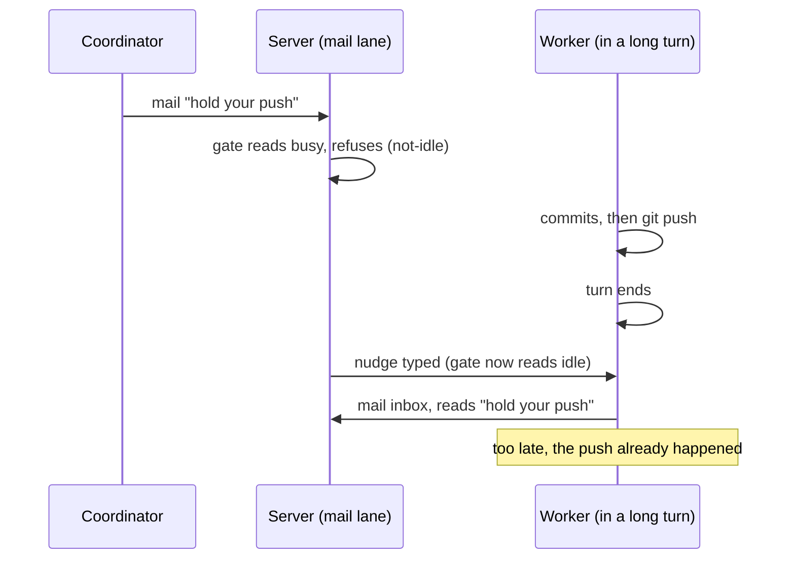
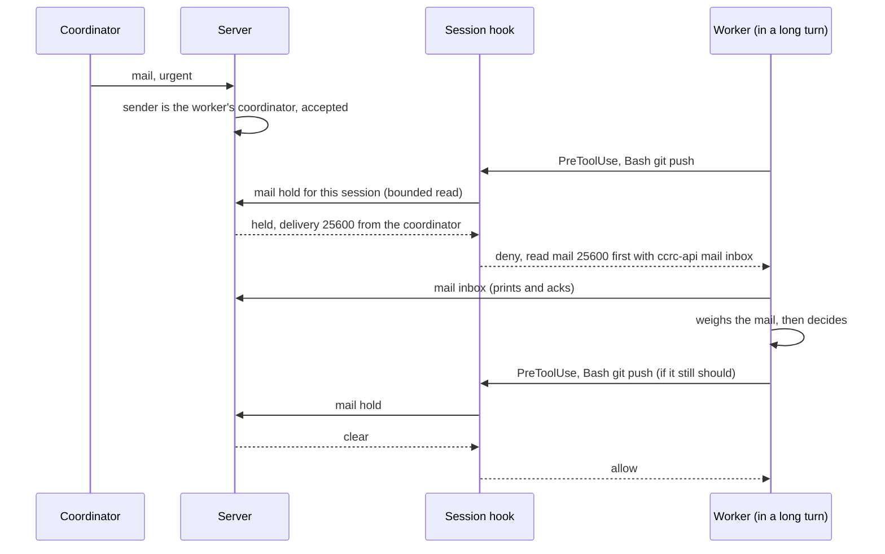
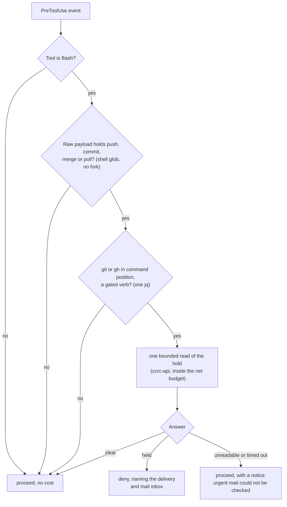
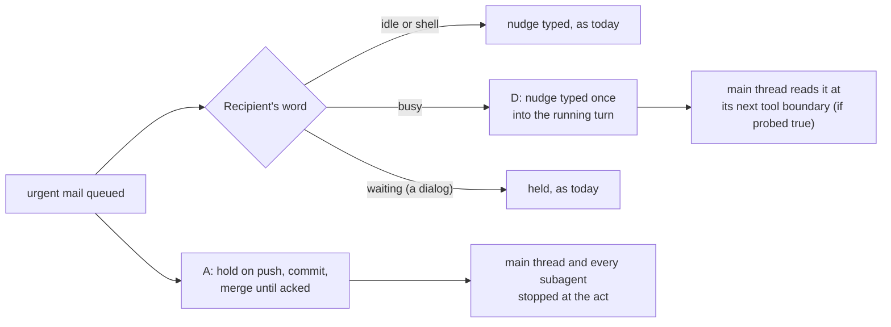

# Mail a busy session sees mid-turn (design)

**Spec** · 2026-11-19 · Status: draft for the coordinator, then the operator · Owner: the Overlord programme (#2491),
wave 165 · Related: `docs/superpowers/specs/2026-11-09-overlord-design.md` (§3.8, what it trusts),
`docs/superpowers/specs/2026-09-29-worker-stall-watch-design.md` (the mail gate's idle rule) · Docs only: no code ships
with it.

## In short

- **The problem.** ccrc hands a session its mail only when the session is idle. A worker deep in a long turn cannot
  see "hold your push" or "do not merge main yet" until the turn ends, and by then it may already have pushed.
- **Recommended: a hold at the act, plus a faster nudge (option C, built as A + D).** The session hook refuses
  `git push`, `git commit`, a merge of main and `gh pr merge` while an urgent mail to that session is unacked (A). The
  refusal names the mail and the one command that reads it. Separately, an urgent mail's one-line nudge may be typed
  into a busy pane, so a main thread can read it at its next tool call without reaching for a push (D).
- **Not recommended now: a pull client** (an MCP server, or a background listener the session watches, B). It adds a
  second delivery path, a process per session and a client-side cursor, and it still reaches neither a subagent nor a
  session that never started it. It returns only if D's probe shows Claude Code will not surface a typed line mid-turn.
- **What the hold is, and is not.** The hold makes the worker *read* the mail before it acts. It never makes the worker
  *obey* it: the mail stays content, never instruction (Overlord spec §3.8). Only the worker's coordinator, the operator
  and the server's own system mail may mark mail urgent, so no peer can freeze another session.
- **Measured.** The wire cannot say how long a delivered mail waited: `deliveredAt` is stored but never served. An
  hour's sample of outstanding mail through the API (§1.3) found six deliveries refused while the recipient was busy.
  Four of them waited more than 9 minutes. The first build step adds the read that measures this properly.
- **For you to check:** §4, Waiting on you. Is urgent mail limited to the three senders above? Should the hold fail
  open when the server cannot be read? Should D be probed and built before any pull client is considered?

## 1. Context

This section says what ccrc does today, measured from the tree on `main` at `ba2f67dac`, and what a busy session
misses.

### 1.1 How mail reaches a session today

A coordinator sends mail with `POST /api/mail`. The server stores the body and queues one delivery row per recipient.
The mail lane then types a single-line **nudge** into the recipient's pane ("ccrc-mail: you have new mail. Use the
client…", `server/src/coord/envelope.ts#renderMailNudge`). The session reads the body itself with
`ccrc-api mail inbox` and acks it. An unacked delivery is replayed later, up to a bounded number of times.

The nudge is typed only when the **mail gate** says the session is at rest (`server/src/turnidle.ts#mailTurnIdle`):

- `idle` delivers once the pane has been quiet for a short while.
- `shell` (an idle main loop over a background shell) delivers too, by default.
- `busy` delivers only under the hand-armed `mail-gate-busy` mode, and then only when the turn marker says the main
  turn has ended.
- `waiting` (a dialog owns the keyboard) never delivers.

So a running turn never receives a nudge, under any mode. That is deliberate. Typing into a running turn could land
inside a draft or a menu, and `sendPrompt` refuses with `turn-running` when the pane shows one
(`server/src/inject/send.ts#sendPrompt`, `refuseIfTurnRunning`).


*Figure 1. Today: a mail sent during a long turn waits for the turn to end. The worker can push before it reads it.*

### 1.2 Two claims of the brief, measured

| Claim | Measured on `ba2f67dac` | Status |
|---|---|---|
| Nothing marks a mail urgent | No `urgent` or `priority` field on `mail`, `mail_deliveries` (`server/src/coord/schema.ts`), `MailSummary` (`shared/api.ts`) or the ingress (`server/src/coord/routes.ts`). Every mail is equal. | Confirmed |
| The session hook has no mid-turn mail path | `ccd/session-hook.sh` reads mail nowhere on `PreToolUse` or `PostToolUse`. Its only mail-related arms are the SessionStart card's pointer to `mail list` and the roster card's wake on the nudge text (`UserPromptSubmit`). | Confirmed |

Things the hook *does* have, which this design builds on (sourced):

- **A deny at a tool boundary.** `PreToolUse` already answers `permissionDecision: "deny"` with a reason, for example
  the merge refusal over `gh … pr … merge` (`MERGE_PARSE_CAP` and its arm).
- **A budget order.** The landing-order advisory tests the raw payload with shell globs first (no fork). Only a
  payload that carries a sync verb pays for one `jq` that reads the command, and the regex matches `git` in command
  position, so a commit message that merely mentions a merge stays silent.
- **One network budget per invocation.** The hook's server reads (`_hook_timeout`, `HOOK_NET_BUDGET_MS`, 8 s) run on
  rare events only: SessionStart, UserPromptSubmit and the start report. No per-tool-call event reaches the network.
- **Subagents are told apart.** A subagent's event carries `agent_id`. The hook already uses it to refuse a subagent
  the role skills that ack mail and take claims (the role-skill deny, D-4934), and the worker skill says a subagent
  never acks.

### 1.3 How long mail waits while the recipient is busy

The brief asks how long coordinator-to-worker mail waits between queued and delivered while the recipient is busy.

**The API cannot answer it for delivered mail.** `mail_deliveries.deliveredAt`, `ingestedAt` and `ackedAt` are
stored (`server/src/coord/schema.ts`), but `MailSummary` serves none of them. It serves the queue time (`at`) and,
while a delivery is still outstanding, the gate that last refused it (`lastGate`, `gateCount`, `gateSince`, `gateAt`).
A delivered row's gate fields are cleared. `GET /api/feed` records mail at queue time only.

What the API does allow is sampling: list every live peer's outstanding mail once a minute and watch rows move from
`queued` to `delivered`. That gives a **lower bound** per delivery (first seen queued, to first seen delivered).

**Measured 2026-11-19, 00:56 to 01:48 UTC,** through `ccrc-api peers list` and `ccrc-api mail list --to <id>` for every
running peer of this project: 47 samples, one a minute, 18 deliveries seen outstanding. A row's wait is at least its
age at the last sample that still showed it queued, and at most about a minute more. No row was still queued at the
end.

| Mail | Deliveries | Gate seen refusing | Wait, lower bound |
|---|---|---|---|
| Wave briefs from dispatch, to a fresh worker | 4 | `not-quiet` only | 0.5 to 1.0 min |
| Mail sent by a session, refused at least once while the recipient was busy | 6 | `not-idle` | 0.2, 0.7, 9.0, 9.4, 11.0 and 11.0 min |
| Other session-sent mail | 8 | `not-quiet`, `cooldown` or none | 0.9 min or less |

*Table 1. Sampled waits. The six `not-idle` rows are the busy-recipient case. Four of them waited more than 9 minutes,
and they include a coordinator's addendum to a running worker's brief and an answer about migration slots, the kind of
mail this design is for.*

Footing: measured, lower bounds only, one project, one hour. A single client read (`mail list`) took 74 to 110 ms in
seven of eight timed calls at load average 11, and 439 ms in the eighth.

**The read that would answer it:** add `deliveredAt`, `ingestedAt` and `ackedAt` to `MailSummary` as additive fields
(absent from an older server, which a reader treats as unmeasured). Then `mail list --program <slug> --all 1` gives,
for each coordinator mail, its wait (`deliveredAt - at`) and how long it then stayed unread (`ackedAt - deliveredAt`).
The first build step (§5) adds it, so that the design can be judged on a measured baseline.

## 2. The options

This section describes each option and what it reaches, then compares them on the six questions of the brief.

### 2.1 A. Hook gate: a hold at the act

The sender marks the mail urgent. While any urgent delivery to a session is unacked, the session hook refuses that
session's push, commit, merge of main and `gh pr merge`. The refusal names the delivery and `ccrc-api mail inbox`. The
session reads the mail, which acks it, and the next attempt goes through.


*Figure 2. Option A: the push is refused until the urgent mail is read. Reading releases the hold. Whether to push
after reading stays the worker's call.*

The hook's arm keeps the budget order of the arms beside it, so a call that is not a gated command pays nothing.


*Figure 3. The gate's arm in the hook, cheapest test first. Only a gated command reaches the network, and a failed read
lets the act through with a notice (decision D3).*

### 2.2 B. Pull client: a listener the session watches

The session starts a client that polls the server with a cursor and prints a line per new mail (for example
`ccrc-api mail watch`, run under Claude Code's Monitor tool, or an MCP server exposing `mail_inbox`). Each printed line
arrives as a harness notification, and the session acks what it handled.

**What the outside project does.** opencrawl-core (public, Apache-2.0) was read through `gh` at
`ccb0b20d93bb9af2fccadebbf1bf08169b87e330` (`docs/board-agent-interface.md`, `docs/board-participation.md`,
`cli/src/board.ts`, `cli/src/board-agent.ts`, `src/board/inbox.mts`, its Claude Code `hooks.json`). Nothing from it
was run. Sourced findings:

- **Delivery is a background pull listener, not a hook.** The agent starts `board watch --notify-only` under Monitor
  (re-armed every 10 minutes). Its hooks inject no messages. Its own guide says installing the client "alone does not
  establish push delivery", and falls back to reading the inbox "at work boundaries".
- **The cursor is server-held.** The server keeps a pending page per session (up to 5 messages) with a sha256 cursor,
  replays the same page until it is acknowledged, and refuses a mismatched cursor with 409.
- **At-least-once, said plainly.** "No exactly-once delivery claim is made." Consumers dedupe by message id. The
  transport receipt and the agent's "handled" acknowledgement are two separate acks.
- **No urgency, no blocking, no subagents.** No priority field, nothing refuses an act while a message is unread, and
  delivery is keyed to one session id, main thread only.
- **Polling about every 10 s,** one listener per session behind a lock file, which exits after 30 quiet minutes. Its
  guide frames system notices as "evidence, not new authority or permission", without wrapping message text as data.

**What transfers to ccrc, and what ccrc already has.** ccrc already holds the cursor on the server: the delivery row is
the cursor, and an ack moves it. It already sends id-only notices (the nudge) with the body fetched on demand, and it
already tells delivered apart from read (`deliveredAt`, `ingestedAt`, `ackedAt`). Two ideas are worth taking: say
"at-least-once" as plainly as they do, and give a send an idempotency key (one is already in flight in this programme).
What does not transfer is the part this design needs most: a mid-turn guarantee, urgency, a hold, and subagent reach.
Their mid-turn path is Claude Code surfacing Monitor output, which they do not verify either.

### 2.3 C. A combination, and D, an urgent nudge into a busy pane

The brief's C pairs A's guarantee with B's reading. This spec proposes a fourth piece, **D**, as the reading half
instead of B, because it reuses the lane that already exists.

**D.** For an urgent delivery only, the mail gate may answer "deliver" on `busy`. The lane then types the same
one-line nudge into a running turn, once, with no replay while the turn runs. Claude Code queues text typed during a
turn. If the build shows queued text at the next tool boundary, the main thread sees "you have new mail" mid-turn and
can read it before it reaches for a push. A's hold still stands behind it.

> [!IMPORTANT]
> D rests on one fact this spec could not measure: whether the fleet's Claude Code build surfaces text typed during a
> running turn at the next tool boundary, or only when the turn ends. It is measured on the test box before D is built
> (§5). If the answer is "only at the end", D gives nothing over today, and B is reconsidered as the reading half.


*Figure 4. C as proposed: D brings the mail forward for the main thread, and A guarantees that no gated act happens
unread, in the main thread or any subagent.*

### 2.4 What reaches whom

| | Busy main thread | Busy subagent | A session that set nothing up |
|---|---|---|---|
| Today | Nothing until the turn ends | Nothing | Nudge at idle |
| A. Hook gate | Only when it tries a gated act. The refusal names the mail. | Yes, at its gated act. Told to stop and report to its parent, because a subagent never acks. | Yes, the hook is installed in every session |
| B. Pull client | A notification line, if the build surfaces Monitor output mid-turn (unmeasured) | No | No: the session must start the listener, and a restart or a `/clear` loses it |
| D. Urgent nudge | The nudge at its next tool boundary, if probed true | No: typed text goes to the main thread | Yes, it rides the existing lane |
| C = A + D | Both of the above | A's hold | Yes |

### 2.5 The six questions, option by option

| Question | A. Hook gate | B. Pull client | D. Urgent nudge |
|---|---|---|---|
| Exactly-once and ordering | Not a delivery: it reads the server's hold, so it adds no copy. The hold is "any unacked urgent delivery", and acking is idempotent. Mail stays at-least-once, read in delivery-id order by `mail inbox`. | A second reader of the same rows. Its cursor must be the server's ack state, never a file of its own, or the two disagree after a crash. | Same lane, same rows. Typed once while busy, and replayed under today's rules once the session is at rest. |
| 20+ sessions on one box | A server read only on a gated command, about 80 ms each (§1.3 timing). No process, no poller. | One process per session, about 2 requests a second for 20 sessions at a 10 s poll, all lost on every restart | No new load: one more verdict row in the lane's existing sweep |
| Hook slow or server down | The read is bounded inside the hook's net budget. On timeout the act proceeds with a notice (D3). | A crashed listener is silent, and nothing says so. | The lane's existing back-off and park. |
| Stale state | None held on the box. | A client cursor can go stale, so it must be server-held, as opencrawl-core does. | None held on the box. |
| Trust (§3.8) | The hold's authority is a server row (who sent it, whether that sender is the recipient's coordinator), never the body. The refusal prints ids and the sender's role only. | Every printed line is sender-written text reaching the model unasked. It would need the untrusted renderer. | The nudge is fixed server text and carries no body. |
| Cost in latency and tokens | Zero on every non-gated call (glob only). About 80 ms on a gated call. About 100 tokens per refusal, once per held act. | Silent polls cost no tokens. Each line is a notification turn. | About 150 tokens per nudge, the same line as today |

## 3. The recommended design (C = A + D)

This section fixes the parts of A and D that the decisions in §4 rest on. It is a design, not a plan: tasks go in the
plan that follows it.

### 3.1 Marking a mail urgent

- `POST /api/mail` takes an optional `urgent: true`. Absent means not urgent, so an older client is unchanged.
- **Who may mark it** is decided by one L1 function from server rows alone:
  - the coordinator of an open run whose worker or reviewer is the recipient (`claimedBy` of that run);
  - the server's own system mail (for example the landing line's ejection notice);
  - the operator, through a session-gated door.
  Any other sender is refused `urgent-not-allowed`, and the mail is not sent. A peer cannot hold another peer's push.
- The flag is one more column on `mail`, written once at ingress, its one writer. It needs a `coord.db` migration slot
  under the commuting-migrations rule (`docs/superpowers/specs/2026-11-11-coord-migrations-commute-design.md`).

### 3.2 The hold and its read

- **The hold** is derived, never stored: the urgent deliveries to a session whose state is not `acked`. It is one L1
  function over the delivery rows, so the hook, the console and the stall watch read the same answer.
- **The read** is `GET /api/mail/hold?to=<id>`, behind the box token, answering one of three: `clear`, `held` with the
  delivery ids and each sender's role, or `unmeasured`. `ccrc-api mail hold` is its client verb. Three answers, never
  two: an unreadable store is not `clear` (the "no overloaded null" rule).
- **What releases it** is the ack, which `mail inbox` makes when it prints the mail. Nothing else releases it, and no
  timer expires it: the recipient can always ack, so it can never be stuck.

### 3.3 The gate in the session hook

- **Gated acts:** `git push`, `git commit`, `git merge`, `git pull` or `git rebase` with main, and `gh pr merge`, each
  with `git` or `gh` in command position, by the same shape the landing-order advisory already matches.
- **The refusal text** names the delivery ids, the sender's role (coordinator, operator or server) and
  `~/.local/bin/ccrc-api mail inbox`. It never quotes the subject or the body: those are content, written by a model.
- **In a subagent** the refusal says that the parent session has urgent mail, and to stop and report to the parent.
  A subagent never acks ccrc mail, so the main thread reads it and the hold lifts for all of them.
- **Shadow first.** The arm ships recording what it would have refused, with no refusal, behind a switch with no writer
  in the tree. It goes live by the operator's hand, as the stall watch did.
- **It is an accident guard, not a wall.** `bash -c` with an assembled string, a script file, a git alias or another
  interpreter runs past it, as with every other refusal in this hook. The design says so rather than claim more.

### 3.4 The urgent nudge (D)

- `mailTurnIdle` gains one input, whether the delivery is urgent, and one row: an urgent delivery on `busy` delivers
  `via: 'busy-urgent'`. It is a row in the existing decider, never a second gate beside it.
- The lane types the nudge once per urgent delivery while busy, without `refuseIfTurnRunning`, and never replays it
  while the turn runs. `waiting` stays refused under every mode, because a dialog owns the keyboard.
- The draft stash is unchanged: a draft in the box is stashed around the delivery and restored, as today.

### 3.5 Why this adds no second delivery mechanism

The architecture rules ask for a recorded "legitimately different" reason for anything that sits beside an existing
owner.

| Piece | Beside what | Reason |
|---|---|---|
| A, the hold read | The mail lane's delivery | Not a delivery: it carries no body and moves no row. It is a time-of-check re-check at the act, one of the catalogue's "legitimately different" kinds. The lane stays the one writer of delivery state. |
| D, the urgent nudge | Nothing | It is the existing lane, with one more row in its existing decider |
| B, a pull client | The mail lane's delivery | Would be a second delivery path (another process on another box). Its only reason, reaching a busy main thread, is D's job. Rejected unless D's probe fails. |

## 4. Decisions

The author proposes these. The operator rules on the ones marked Open, and the coordinator on the rest.

| # | Decision | Options considered | Chosen, and why | Status |
|---|---|---|---|---|
| D1 | Where the guarantee lives | Hook gate, pull client, nothing | The hook gate (A): the only option that stops a subagent and every session without set-up | Proposed |
| D2 | What the gate reads | A server read on a gated command, a marker the server writes into the session's clips directory, a box timer | Server read: fresh, no new writer on the box. The agent may write only under `~/.cc-clips`, and a 60 s timer is too coarse for a push | Proposed |
| D3 | When the hold cannot be read | Fail open with a notice, fail closed | Open: a server restart during `ccrc update` would otherwise stop every commit on the fleet | Open |
| D4 | Who may mark mail urgent | The recipient's coordinator, the server and the operator, or any sender | Those three only, checked from server rows. Any sender could freeze a peer's work | Open |
| D5 | What releases the hold | The ack, a timer, the sender's run closing | The ack: reading is the point, and the recipient can always ack | Proposed |
| D6 | What the refusal shows | Ids and role, the subject, the body | Ids and the sender's role only. Subject and body are content (§3.8) | Proposed |
| D7 | The reading half | D (urgent nudge), B (pull client), none | D, after the test-box probe. B only if the probe fails | Open |
| D8 | The pull client (B) | Build it now, defer it, reject it | Deferred. Its reason is D's job, and it adds a process and a cursor per session | Deferred |
| D9 | First step | Build the hold first, measure first | Measure first: serve `deliveredAt`, `ingestedAt` and `ackedAt` so the baseline exists | Proposed |

## 5. Testing and proof

This section says how each piece is proved before it goes live.

- **The baseline.** Once `MailSummary` serves the three times, measure the wait of every coordinator mail in one
  programme over a week, split by the recipient's word at queue time. That is the number this design must lower.
- **D's probe, on the test box.** Run the fleet's Claude Code build, start a turn that runs several tool calls, type a
  line into the pane mid-turn, and record from the transcript whether the line arrived before the turn ended, and at
  which tool boundary. Repeat for a turn that is waiting on a subagent.
- **The hold.** L1 tests for the urgent-sender decider and the hold function, each with a mutation that reds when the
  rule is deleted. Session-hook tests in fixture HOMEs: a gated command with a held session is denied, an ungated one
  costs no read, a subagent gets the parent wording, a timed-out read proceeds with the notice, and a command that
  only mentions `git push` in a message stays silent.
- **Shadow evidence.** The arm's shadow log over a week: how many acts it would have refused, and how many of those
  were pushes made before the urgent mail was read. The operator arms it live from that evidence.

## 6. Promise delta

This spec is a design for review. It changes no Promise; the plan that builds it carries any delta.

```promise-delta
none - a design spec for review that ships no behaviour, and the build plan carries any Promise change
```

## Where things stand

### Agreed

- The problem and the two measured claims (§1.2), from the brief of 2026-11-19 and the tree at `ba2f67dac`.
- The operator's direction of 2026-11-19 that a client library is acceptable on its merits. This spec weighs it in
  §2.2 and §3.5 and defers it (D8).

### Waiting on you

- D3: should the hold fail open (recommended) when the server cannot be read?
- D4: is urgent mail limited to the recipient's coordinator, the server and you?
- D7: should D be probed and built as the reading half before any pull client is considered?

### Later

- B, the pull client. It returns if D's probe shows typed text waits for the turn's end, or if a session needs mail
  with no hook installed.
- A worker-skill and coordinator-skill clause for urgent mail (when a coordinator sends it, and that a worker reads it
  before a gated act). Both skills' clauses are pinned verbatim, so this is a wave of its own.
- The console: an urgent badge on a mail row, and the hold shown on the session card.

---

*Written by Claude for the Overlord programme. Diagrams are Mermaid text; the Copy Mermaid button on the docserver or
the spec viewer copies the source, which pastes into Lucid as editable shapes.*
