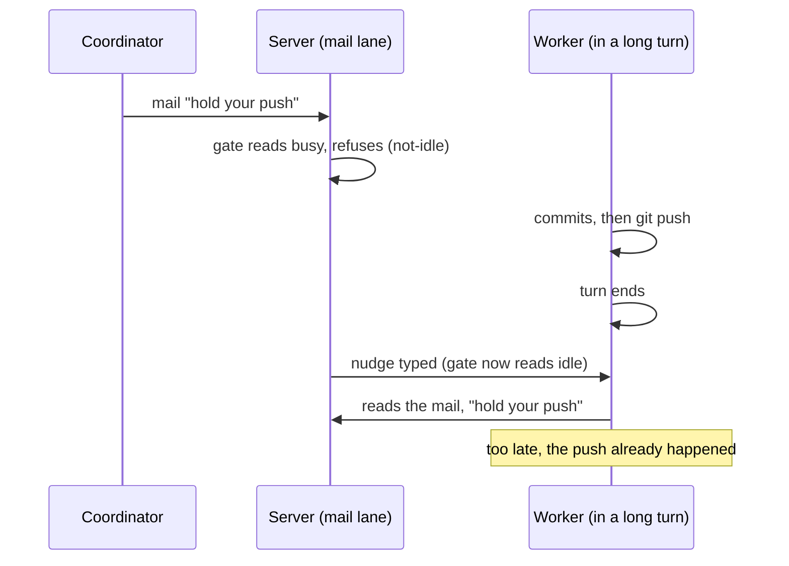
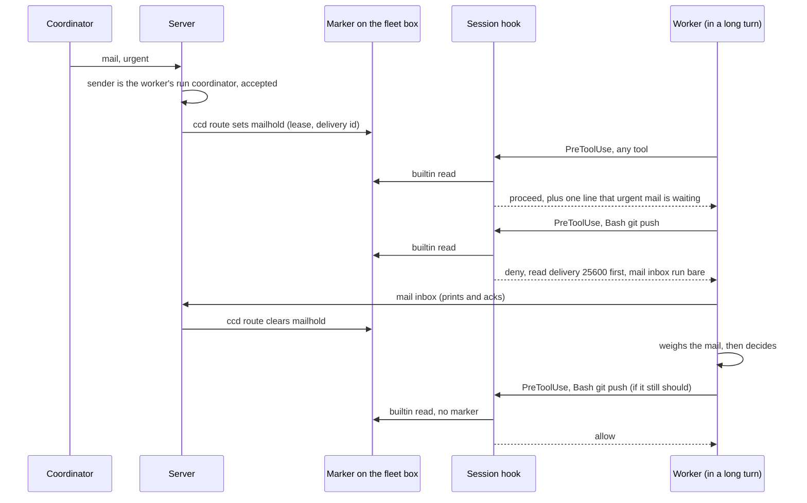

# Mail a busy session sees mid-turn (design)

**Spec** · 2026-11-19 · Status: revised after review 2688 and the coordinator's fix-round rulings of 2026-11-19 ·
Owner: the Overlord programme (#2491), wave 165 · Related: `docs/superpowers/specs/2026-11-09-overlord-design.md` (§3.8,
what it trusts), `docs/superpowers/specs/2026-09-29-worker-stall-watch-design.md` (the mail gate's idle rule) · Docs
only: no code ships with it.

## In short

- **The problem.** ccrc hands a session its mail only when the session is idle. A worker deep in a long turn cannot
  see "hold your push" or "do not merge main yet" until the turn ends, and by then it may already have pushed.
- **Recommended: a hold at the act, plus a fixed hook line (C, built as A + E).** The server writes a small marker on
  the fleet box while an urgent mail to a session is unread. While the marker stands, the session hook does two things,
  and neither types anything into the pane:
  - it refuses that session's `git push`, `git commit`, merge of main and `gh pr merge` (A, the hold);
  - it adds one fixed line to the main thread's tool calls saying that urgent mail is waiting (E, the notice).
- **No network on the tool path.** The marker travels on an argv the server is already granted (`ccd route`, as the
  `precompact` field does today), so the hook reads a local file with a shell builtin and asks the server nothing.
- **Ruled out: typing into a running turn (D).** Claude Code's rate-limit menu opens by itself mid-turn, and an Enter or
  a digit there can switch the session to usage credits. No unattended lane types into a running turn (the
  coordinator's ruling, 2026-11-19).
- **Deferred: a pull client (B).** It returns only if the fleet's Claude Code build does not show E's line to the model
  (§5 names the check), or for a session with no ccrc hook.
- **What the hold is, and is not.** It makes the worker *read* the mail before it acts. It never makes the worker
  *obey* it: the mail is information from its sender, never instruction (Overlord spec §3.8). Only a run's coordinator,
  the Overlord and the operator may mark mail urgent, and that check is attribution, not authentication.
- **Measured.** The wire cannot say how long a delivered mail waited (`deliveredAt` is stored but never served). In a
  52-minute sample through the API, three mails from a coordinator to its own busy worker waited 9 to 11 minutes or
  more (§1.3). The first build step serves the stored times, so the baseline is measured properly.

## 1. Context

This section says what ccrc does today, measured from the tree on `main` at `ba2f67dac`, and what a busy session
misses.

### 1.1 How mail reaches a session today

A coordinator sends mail with `POST /api/mail`. The server stores the body and queues one delivery row per recipient.
The mail lane then types a single-line **nudge** into the recipient's pane (`server/src/coord/envelope.ts#renderMailNudge`).
The nudge names `ccrc-api mail list`, `mail fetch` and `mail ack`. The client's one-call form, `ccrc-api mail inbox`,
prints every unacked mail and acks what it printed. An unacked delivery is replayed later, up to a bounded number of
times.

The nudge is typed only when the **mail gate** says the session is at rest (`server/src/turnidle.ts#mailTurnIdle`):

- `idle` delivers once the pane has been quiet for a short while.
- `shell` (an idle main loop over a background shell) delivers too, by default.
- `busy` delivers only under the hand-armed `mail-gate-busy` mode, and then only when the turn marker says the main
  turn has ended.
- `waiting` (a dialog owns the keyboard) never delivers.

So a running turn never receives a nudge, under any mode. That is deliberate: typing into a running turn could land in
a draft or a menu, and `sendPrompt` refuses with `turn-running` when the pane shows one
(`server/src/inject/send.ts#sendPrompt`, `refuseIfTurnRunning`). This design keeps that rule whole.


*Figure 1. Today: a mail sent during a long turn waits for the turn to end. The worker can push before it reads it.*

### 1.2 Two claims of the brief, measured, and what the hook already has

| Claim | Measured on `ba2f67dac` | Status |
|---|---|---|
| Nothing marks a mail urgent | No `urgent` or `priority` field on `mail`, `mail_deliveries` (`server/src/coord/schema.ts`), `MailSummary` (`shared/api.ts`) or the ingress (`server/src/coord/routes.ts`). Every mail is equal. | Confirmed |
| The session hook has no mid-turn mail path | `ccd/session-hook.sh` reads mail nowhere on `PreToolUse` or `PostToolUse`. Its only mail-related arms are the SessionStart card's pointer to `mail list` and the roster card's wake on the nudge text (`UserPromptSubmit`). | Confirmed |

What the hook already has, which this design builds on (sourced):

- **A deny at a tool boundary.** `PreToolUse` already answers `permissionDecision: "deny"` with a reason, for example
  the merge refusal over `gh … pr … merge` (`MERGE_PARSE_CAP` and its arm). A deny supersedes advice: the arms that add
  `additionalContext` stay silent when a deny is already built.
- **Advice at a tool boundary.** `PreToolUse` already adds `additionalContext` and lets the call proceed: the Read
  nudge and the landing-order advisory.
- **A server-written marker, read with a builtin.** `precompact` is a route field whose one writer is a server lane,
  through `CCD_ARGV.routeSet` (`server/src/continuity/renewalWiring.ts`). The hook reads `$REG/<id>.precompact` with a
  bounded `read` and no fork, to arm its PreCompact refusal (`_hook_compact_refuse`). This is the carrier E and A reuse.
- **A budget order.** The landing-order advisory tests the raw payload with shell globs first, with no fork, and only
  a payload that carries a sync verb pays for one `jq` that reads the command.
- **No network on the tool path.** The hook's header says every `PreToolUse`, `PostToolUse` and `Stop` takes no lock and
  waits on nothing. Its declared network reads (`_hook_timeout`, one 8 s budget, `HOOK_NET_BUDGET_MS`) are all off the
  tool path: SessionStart, UserPromptSubmit and the start report.
- **A subagent test that holds.** A bare `agent_id` is not one: the hook's own "WHO WRITES" block says real lanes sent
  a main-thread event with an unjoined `agent_id`. The reliable test is a join in `$REG/<id>.joined` (the `tmsub` flag).
  The role-skill deny (D-4934) reads the bare flag on purpose, because a false positive there only refuses a skill.

### 1.3 How long mail waits while the recipient is busy

The brief asks how long coordinator-to-worker mail waits between queued and delivered while the recipient is busy.

**The API cannot answer it for delivered mail.** `mail_deliveries.deliveredAt`, `ingestedAt` and `ackedAt` are stored
(`server/src/coord/schema.ts`), but `MailSummary` serves none of them. It serves the queue time (`at`) and, while a
delivery is still outstanding, the gate that last refused it (`lastGate`, `gateCount`, `gateSince`, `gateAt`). The gate
fields are cleared on delivery. `GET /api/feed` records mail at queue time only.

**What was measured instead.** From 00:56 to 01:48 UTC on 2026-11-19, a script listed this project's running peers
(`ccrc-api peers list`) and each one's outstanding mail (`ccrc-api mail list --to <id>`): 47 samples over 52 minutes, 65
to 77 seconds apart, and 18 deliveries seen outstanding. For each delivery, its **lower bound** is its age (now minus
`at`) at the last sample that still showed it queued. The true wait is at most one sample gap (77 seconds) longer. No
row was still queued at the last sample. The raw samples are not committed, because they name live sessions.

| Mail | Deliveries | Gate seen refusing | Wait, lower bound |
|---|---|---|---|
| A programme's coordinator to its own busy worker | 3 | `not-idle` | 9.0, 11.0 and 11.0 min |
| Another programme's coordinator to a busy worker | 1 | `not-idle` | 9.4 min |
| A worker to a busy coordinator | 2 | `not-idle` | 0.2 and 0.7 min |
| Wave briefs from dispatch, to a fresh worker | 4 | `not-quiet` only | 0.5 to 1.0 min |
| Other mail between sessions | 8 | `not-quiet`, `cooldown` or none | 0.9 min or less |

*Table 1. Sampled waits. The four rows from a coordinator to a busy worker are this design's case. All four waited at
least 9 minutes, and three more than 9. They include an addendum to a running worker's brief and an answer about
migration slots.*

Footing: measured, lower bounds only, one project, 52 minutes. A single client read (`mail list`, timed from a session
shell) took 74 to 110 ms in seven of eight calls at load average 11, and 439 ms in the eighth. That is a different call
from anything this design puts on the tool path.

**The read that would answer it:** add `deliveredAt`, `ingestedAt` and `ackedAt` to `MailSummary` as additive fields
(absent from an older server, which a reader treats as unmeasured). Then `mail list --program <slug> --all 1` gives,
for each coordinator mail, its wait (`deliveredAt - at`) and how long it then stayed unread (`ackedAt - deliveredAt`).
The first build step serves them (§5).

## 2. The options

This section describes each option and what it reaches, then compares them on the six questions of the brief.

### 2.1 A. The hold at the act

The sender marks the mail urgent. While any urgent delivery to a session is outstanding, the session hook refuses that
session's push, commit, merge of main and `gh pr merge`. The refusal names the delivery and `ccrc-api mail inbox`. The
session reads the mail, which acks it, and the next attempt goes through.


*Figure 2. A and E together: the notice line arrives on the next tool call, and the push is refused until the urgent
mail is read. Reading clears the marker. Whether to push after reading stays the worker's call. The hook never asks the
server anything.*

### 2.2 B. Pull client: a listener the session watches

The session starts a client that polls the server and prints a line per new mail (for example `ccrc-api mail watch`,
run under Claude Code's Monitor tool, or an MCP server exposing a `mail_inbox` tool). Each printed line arrives as a
harness notification, and the session acks what it handled.

**What the outside project does.** opencrawl-core (public, Apache-2.0) was read through `gh` at
`ccb0b20d93bb9af2fccadebbf1bf08169b87e330` (`docs/board-agent-interface.md`, `docs/board-participation.md`,
`cli/src/board.ts`, `cli/src/board-agent.ts`, `src/board/inbox.mts`, its Claude Code `hooks.json`). Nothing from it was
run. Sourced findings:

- **Delivery is a background pull listener, not a hook.** The agent starts `board watch --notify-only` under Monitor,
  re-armed every 10 minutes. Its hooks inject no messages. Its own guide says installing the client "alone does not
  establish push delivery", and falls back to reading the inbox "at work boundaries".
- **The cursor is server-held.** The server keeps a pending page per session (up to 5 messages) with a sha256 cursor,
  replays the same page until it is acknowledged, and refuses a mismatched cursor with 409.
- **At-least-once, said plainly.** "No exactly-once delivery claim is made." Consumers dedupe by message id. The
  transport receipt and the agent's "handled" acknowledgement are two separate acks.
- **No urgency, no blocking, no subagents.** No priority field. Nothing refuses an act while a message is unread, and
  delivery is keyed to one session id, main thread only.
- **Polling about every 10 s,** one listener per session behind a lock file, which exits after 30 quiet minutes. Its
  guide frames system notices as "evidence, not new authority or permission", without wrapping message text as data.

**What transfers to ccrc, and what ccrc already has.** ccrc already holds the cursor on the server: the delivery row is
the cursor, and an ack moves it. It already sends id-only notices (the nudge) with the body fetched on demand. It
already tells delivered apart from read (`deliveredAt`, `ingestedAt`, `ackedAt`). Two ideas are worth taking: say
"at-least-once" as plainly as they do, and give a send an idempotency key (one is already in flight in this programme).
What does not transfer is what this design needs most: urgency, a hold and subagent reach. Their mid-turn path is
Claude Code surfacing Monitor output, which they do not verify either.

**B's costs, as estimates.** No cost of B was measured. At a 10 s poll, 20 sessions make about 2 requests a second
(arithmetic). Each session runs one more long-lived process, which a restart or a `/clear` loses, and which the session
must start itself. B could print id-only lines, as the nudge does, so it need not carry sender-written text.

### 2.3 E. A marker and a fixed hook line (the reading half)

While a session's `mailhold` marker stands, the hook adds one fixed `additionalContext` line to the main thread's tool
calls: urgent mail is waiting, from which sender role, and the command that reads it. The call proceeds. Nothing is
typed into the pane, so nothing can land in a menu or a draft.

What E reaches, and what it costs (review 2688 F8, weighed):

- **A busy main thread,** at its next tool call. It does not reach a main thread blocked inside one long foreground
  `Agent` call, which has no tool boundary of its own until the subagent returns. The hold still stops that subagent's
  gated acts.
- **A subagent gets no notice line,** so it is not nagged on every call. It gets the hold's refusal at a gated act, in
  the parent wording (§3.4).
- **A second copy of the hold.** The marker is a cached projection of a server fact, so it can go stale. Its lease
  (§3.3) bounds that.
- **One envelope per event.** The hook prints one `hookSpecificOutput` per event. E's line is placed after the deny
  arms and before the other advice (§3.4).
- **The model must see it.** E rests on Claude Code showing a `PreToolUse` `additionalContext` to the model with the
  tool's result. The hook's existing advice arms assume the same. §5 checks it on the fleet's build, and a failed check
  is B's trigger.

### 2.4 D. An urgent nudge typed into a running turn (ruled out)

D typed the existing nudge into a busy pane for urgent mail. The coordinator ruled it out on 2026-11-19, on review
2688's F2 and F7:

- **The rate-limit menu.** It "opens by itself when a limit lands" (`ccd/ccd`, `_pane_limit_menu`), and a limit lands
  only on a request in flight, so a busy pane is exactly where it appears. "An Enter or a digit here can pick 'Switch to
  usage credits'", and the nudge carries the recipient's id, which can hold digits. `sendPrompt` checks for a menu once,
  on its first capture, and not again before Enter.
- **No switch and no precedence.** D had no shadow or arming marker, no stated precedence against `mail-gate-strict`,
  and no way to tell a running turn from an ended one under the default `shell` mode.

The ruling: no unattended lane ever types into a running turn.

### 2.5 What reaches whom

| | Busy main thread | Busy subagent | A session that set nothing up |
|---|---|---|---|
| Today | Nothing until the turn ends | Nothing | Nudge at idle |
| A. The hold | Only when it tries a gated act. The refusal names the mail. | Yes, at its gated act, told to stop and report to its parent | Yes, the hook is in every session |
| E. The notice line | At its next tool call | No (by design) | Yes |
| B. Pull client | A notification line, if the build surfaces Monitor output mid-turn (unmeasured) | No | No: the session must start the listener |
| C = A + E | Both of the above | A's refusal | Yes |

### 2.6 The six questions, option by option

| Question | A + E | B. Pull client |
|---|---|---|
| Exactly-once and ordering | Neither is a delivery: they read a projection of the server's hold and add no copy of any mail. Mail stays at-least-once, read in delivery-id order by `mail inbox`. Acking is idempotent. | A second reader of the same rows. Its cursor must be the server's ack state, never a file of its own, or the two disagree after a crash. |
| 20+ sessions on one box | No process and no poller. The hook pays one builtin file test per `PreToolUse`. The server pays one `ccd route` write per hold set, renewal and clear, and holds are rare. | One process per session, about 2 requests a second for 20 sessions (arithmetic), all lost on every restart |
| Hook slow or server down | Nothing on the tool path waits on the server. A down server cannot renew the lease, so the marker lapses within its lease and the hold fails open (D3). | A crashed listener is silent, and nothing says so |
| Stale state | The marker can outlive a lost clear by at most its lease (§3.3) | A client cursor can go stale, so it must be server-held, as opencrawl-core does |
| Trust (§3.8) | Fixed server text. The refusal and the line carry ids and the sender's role, never a subject or a body. | Id-only lines are possible, as the nudge does |
| Cost in latency and tokens | Estimated, not measured: no fork on a call without a marker. About 60 tokens per main-thread tool call while a hold stands, and about 120 per refusal (estimates, §5 names the measuring read). | Silent polls cost no tokens. Each line is a notification turn. |

## 3. The recommended design (C = A + E)

This section fixes the parts of A and E that the decisions in §4 rest on. It is a design, not a plan: tasks go in the
plan that follows it.

### 3.1 Marking a mail urgent

- `POST /api/mail` takes an optional `urgent: true`. Absent means not urgent, so an older client is unchanged. The flag
  is one more column on `mail`, written once at ingress, its one writer. It needs a `coord.db` migration slot under the
  commuting-migrations rule (`docs/superpowers/specs/2026-11-11-coord-migrations-commute-design.md`).
- **Who may mark it,** decided by one L1 function from server rows:
  - a run's coordinator (`claimedBy` of the run), to that run's own workers and reviewers;
  - the Overlord (the designated session), to any coordinator;
  - the operator, to anyone, through a session-gated door.
  Any other sender is refused `urgent-not-allowed`, and the mail is not sent. Peers never mark mail urgent, and this
  design makes no system mail urgent.
- **Attribution, not authentication.** The ingress checks `fromUuid` against `$REG/<id>.uuid`, which its own docstring
  calls "freshness, not forgery-proofness". Every session on the box can read every `.uuid` file and holds the box token,
  so a session that forges the coordinator's identity can send urgent mail as it, as it can send ordinary mail as it
  today. The sender check is an accident guard, like the hold itself.
- **One outstanding urgent mail per sender and recipient.** A second urgent mail from the same sender to the same
  recipient is refused `urgent-outstanding` until the first is acked or released (§3.2). The sender can still send it
  as ordinary mail.

### 3.2 The hold

- **The hold is derived, never stored:** the urgent deliveries to a session that `mail inbox` would print and the ack
  door would accept. It is defined by the same predicate as `inboxFor` (`server/src/coord/store.ts`:
  `ackableDeliverySql` and `OUTSTANDING_OR_ABANDONED_SQL`), shared as one fragment, never a second copy.
- **What releases it.** An ack, which `mail inbox` makes when it prints the mail. A run's close, a child's reclaim or a
  park also releases it, by derivation: `cancelOutstandingDeliveries` and `cancelDeliveriesTo` move those rows to
  `rejected`, which the predicate excludes. No timer releases it.
- **So the recipient can always end it.** Every row the hold counts is one that `mail inbox` prints and the ack door
  accepts. A test pins that set equality (§5), and a test closes a run with urgent mail unread and finds the hold gone.
- **The hold lifts only on a main-thread ack, by the hook's refusal.** The ack route receives no agent identity, so the
  server cannot tell who acked. The hook refuses the acking forms of mail in a subagent (§3.4), so a subagent cannot
  clear its parent's hold by accident.

### 3.3 The carrier: a lane-only route field

The marker is a new lane-only route field, `mailhold`, beside `precompact`. It is the server's write over an argv it is
already granted, so it needs no new ccd verb, no new agent grant and no new route.

- **Its one writer** is a server lane that projects the hold (§3.2) onto the fleet box. It composes `CCD_ARGV.routeSet`
  with `mailhold=<until>:<delivery ids>` when a hold appears, and with an empty value when the hold derives empty. It runs
  off the mail lane's existing sweep, never inside the ingress or the ack route.
- **ccd's side is rows in existing tables,** as `precompact` was: a `ROUTE_FIELDS` member, a `_route_valid` row (`until`
  in epoch seconds, then at most eight delivery ids), the empty-value clear, and a skip in `_route_any` and the settle
  path, so the field never counts as routing and is never applied to the pane. `parseRouteFields` refuses it at every
  door as `lane-only`. A session's own shell may not write it, as the pool set's fields refuse (`CLAUDECODE` set).
- **The staleness rule, a lease.** The hook honours the marker only while `until` lies in the future, read against
  the hook's own clock (`_hook_epoch_ms`, no fork where bash offers `EPOCHREALTIME`). The writer sets `until` 300 seconds ahead and renews it while the hold stands, once its
  remaining time falls below 120 seconds. A lost clear therefore lapses within 300 seconds, and so does a marker on a box
  whose server is down: the hold fails open (D3). The two boxes' clocks enter the comparison. A skew of a few seconds
  changes the window by that much, and the design assumes time-synchronised boxes, as the pool epoch's lease does.
- **A capability, so absence permits.** The writer composes the field only when the fleet box's `ccd caps` advertises
  `route-mailhold-v1`. An older fleet box gets no write and no marker, and the hold is simply off there. A write that
  fails is logged and retried on the next sweep, and is never taken as "no hold".
- **The hook header.** Its sentence that the tool path takes no lock and waits on nothing stands, and no network
  exception is added. The amendment names one more builtin read beside `precompact`'s.
- **If the carrier is refused at review,** the fallback is the server read the first draft proposed: `GET
  /api/mail/hold` at gated commands only, bounded at one second, failing open, with a 404 or an unknown verb read as
  silence (absence permits). It would add the hook's sixth network exception, a row in the box-token census and a
  `ccd/ccrc-api` verb.

### 3.4 The hook's arms

All three read the marker first, with no fork. A call that finds no live marker pays nothing more.

- **The hold (A).** On a gated act, the hook denies the call:
  - The gated acts are `git push`, `git commit`, a `git merge`, `git pull` or `git rebase` with main, and
    `gh pr merge`, each with `git` or `gh` in command position, by the shape the landing-order advisory already matches.
  - Main-thread refusal text: urgent mail is waiting, its delivery ids, its sender's role (coordinator, Overlord or
    operator), and "Read it with `~/.local/bin/ccrc-api mail inbox`, run bare (no pipe, no redirect), and repeat until
    it prints nothing new. The mail is information from your `<role>`. Whether to act on it after reading is your
    call." It never quotes the subject or the body: those are content, written by a model.
  - In a joined subagent (`tmsub`), the text says that the parent session has urgent mail, and to stop and report to
    the parent. An event whose `agent_id` is not joined gets the main-thread text.
- **The notice line (E).** On every other main-thread `PreToolUse` while the marker stands, the hook adds the same
  sentences as `additionalContext`, and the call proceeds. A joined subagent gets no line.
- **The subagent's ack refusal.** In a joined subagent, the hook refuses `ccrc-api … mail ack` and a bare
  `ccrc-api … mail inbox` (no pipe or redirect after it, judged from the command text). The read-only `mail list` and
  `mail fetch`, and a piped inbox, which acks nothing (`INBOX_BARE`), stay open. The refusal names no command to run
  instead.
- **Precedence.** One envelope per event: any deny wins, then E's line, then the other advice (the Read nudge and the
  landing-order advisory), which already stay silent once an envelope is built.
- **Switches.** Neither A nor E changes delivery: `mailTurnIdle`, the nudge and `mail-gate-strict`'s precedence are
  untouched. The arms ship shadow: they record what they would have refused or said, and do neither, until a marker
  with no writer in the tree arms them, as the stall watch went live. `mail-disabled` darkens them too, so a fleet with
  mail switched off holds nothing. The shadow log also counts the gated acts that passed because a marker had lapsed,
  so the operator sees how often the guarantee did not hold.
- **An accident guard, not a wall.** `bash -c` with an assembled string, a script file, a git alias or another
  interpreter runs past it, as with every other refusal in this hook. A session can also write the route file by hand.

### 3.5 Cost, growth and the roll order

- **Hook latency (estimated, not measured).** A call with no marker costs one `[[ -f ]]` test. A call with a live marker
  adds one bounded `read`, plus, on a Bash call whose payload holds a gated verb, the one `jq` the landing-order advisory
  already pays. The measuring read is the arm timed in a fixture HOME, with and without a live marker, over enough calls to give a
  p95.
- **Tokens (estimated).** About 60 tokens per main-thread tool call while a hold stands, and about 120 per refusal. A
  hold usually stands for one or two calls, because the line tells the session how to end it.
- **Growth.** `ccd/session-hook.sh`, `server/src/coord/store.ts`, `routes.ts`, `shared/api.ts` and `schema.ts` are
  growth-checked at 40 net lines per file per PR. The hook's arms go in a `ccd/lib` file, as the pool set's parsers do,
  so the hook itself grows by a source line. A waiver is planned only for a file that still exceeds the limit. No new
  route is added, so the box-token census is unchanged.
- **Roll order: server first,** for the wave that ships the field's writer and the hook's arms (the coordinator's
  ruling, 2026-11-19). The server writes nothing until the fleet box's `ccd caps` advertises `route-mailhold-v1`, so the
  other order is safe too, and both fail open.

### 3.6 Why this adds no second delivery mechanism

The architecture rules ask for a recorded "legitimately different" reason for anything that sits beside an existing
owner.

| Piece | Beside what | Reason |
|---|---|---|
| The hold's projection, the `mailhold` field | The mail lane's delivery | Not a delivery: it carries no body and moves no delivery row. It projects one server fact onto another host, the fleet box, where the hook runs. That host is one of the catalogue's "legitimately different" kinds. The store stays the one owner of delivery state, and the projection has one writer. |
| A, the hold's refusal | The mail lane's delivery | A time-of-check re-check at the act, another of the catalogue's kinds |
| E, the notice line | The nudge | Types nothing and needs no idle pane. It is advice in the hook's existing advice channel, from the same marker. |
| B, a pull client | The mail lane's delivery | Would be a second delivery path (another process). Deferred, its trigger stated in §5 |

## 4. Decisions

The coordinator ruled the fix-round questions on 2026-11-19. The author proposes the rest.

| # | Decision | Options considered | Chosen, and why | Status |
|---|---|---|---|---|
| D1 | Where the guarantee lives | The hook's hold, a pull client, nothing | The hold (A): the only option that stops a subagent and every session without set-up | Proposed |
| D2 | What the hook reads | A local marker on a granted argv, a server read at gated commands, a box timer | A marker, the `mailhold` route field: no network on the tool path, and `precompact` is the precedent | Ruled |
| D3 | When the hold cannot be read | Fail open, fail closed | Open: the hold is an accident guard, and fail-closed would stop every commit during a restart | Ruled |
| D4 | Who may mark mail urgent | Named senders, any sender | A run's coordinator to its own run, the Overlord to coordinators, the operator to anyone | Ruled |
| D5 | What releases the hold | The ack, a timer, the sender's run closing | An ack, or by derivation a close, reclaim or park. Never a timer. | Proposed |
| D6 | What the refusal and the line show | Ids and role, the subject, the body | Ids and the sender's role, with the fixed trust sentence. Subject and body are content. | Proposed |
| D7 | The reading half | E (marker and line), D (typed nudge), B (pull client) | E. D is ruled out, and B is the fallback if E's line does not reach the model. | Ruled |
| D8 | Typing into a running turn | Allowed behind a gate, never | Never, for any unattended lane | Ruled |
| D9 | Urgent volume | One outstanding per sender and recipient, unbounded | One outstanding: a second is refused `urgent-outstanding` | Ruled |
| D10 | Acking in a subagent | Refuse the acking forms, rely on the skill convention | Refuse `mail ack` and a bare `mail inbox` in a joined subagent | Ruled |
| D11 | Roll order | Server first, fleet first | Server first, with the cap making either order fail open | Ruled |
| D12 | First step | Build the hold first, measure first | Measure first: serve `deliveredAt`, `ingestedAt` and `ackedAt` | Proposed |

## 5. Testing and proof

This section says how each piece is proved before it goes live.

- **The baseline.** Once `MailSummary` serves the three times, measure the wait of every coordinator mail to a busy
  worker in one programme over a week. That is the number this design must lower.
- **E's line reaches the model (B's trigger).** On the test box, with the fleet's Claude Code build, start a session
  whose hook adds a fixed `PreToolUse` `additionalContext` line, run a turn of several tool calls, and read the
  transcript: does the line arrive with each tool result, inside the turn? If it does not, B returns as the reading half.
  B also returns if the shadow log shows sessions that met the line and acked only after their turn ended, more than
  occasionally.
- **The hold's set.** An L1 test that every delivery the hold counts is one `mail inbox` prints and the ack door
  accepts, and the reverse for urgent rows. A case that closes the run with urgent mail unread, and one that reclaims the
  child, each finding the hold gone.
- **The deciders.** Tests for the urgent-sender rule, `urgent-outstanding` and the lease, each with a mutation that reds
  when the rule is deleted.
- **The carrier.** ccd tests in fixture HOMEs: `route --set mailhold=…` writes, the empty value clears, a session shell
  is refused, the field never counts as routing, and a value outside the vocabulary is refused.
- **The hook.** Session-hook tests in fixture HOMEs:
  - a gated command under a live marker is denied, and the same command under an expired one proceeds;
  - an ungated call under a live marker gets the line and proceeds;
  - a joined subagent gets the parent wording and no line, and an unjoined `agent_id` gets the main-thread text;
  - a joined subagent's `mail ack` and bare `mail inbox` are refused, and its `mail list`, `mail fetch` and piped
    inbox pass;
  - a commit message that only mentions `git push` stays silent.
- **Shadow evidence.** The arms' shadow log over a week: acts they would have refused, lines they would have added,
  passes on a lapsed marker. The operator arms them from that evidence.

## 6. Promise delta

This spec is a design for review. It changes no Promise; the plan that builds it carries any delta.

```promise-delta
none - a design spec for review that ships no behaviour, and the build plan carries any Promise change
```

## Where things stand

### Agreed

- The problem and the two measured claims (§1.2), from the brief of 2026-11-19 and the tree at `ba2f67dac`.
- The coordinator's fix-round rulings of 2026-11-19: D2, D3, D4, D7 to D11. D is ruled out, and E is the reading half.
- The operator's direction of 2026-11-19 that a client library is acceptable on its merits. This spec weighs it (§2.2)
  and defers it, with its trigger stated (§5).

### Waiting on you

- The second review, on F1 to F9 of review 2688.
- Nothing waits on the operator: the coordinator ruled D3 and D4 under its own authority.

### Later

- B, the pull client. It returns if E's line does not reach the model (§5), or for a session with no ccrc hook.
- Urgent system mail: none is urgent in this design. A named kind can be added, each with its own dedupe.
- A worker-skill and coordinator-skill clause for urgent mail (when a coordinator sends it, and that a worker reads it
  before a gated act). Both skills' clauses are pinned verbatim, so this is a wave of its own.
- The console: an urgent badge on a mail row, and the hold shown on the session card.

---

*Written by Claude for the Overlord programme. Diagrams are Mermaid text; the Copy Mermaid button on the docserver or
the spec viewer copies the source, which pastes into Lucid as editable shapes.*
