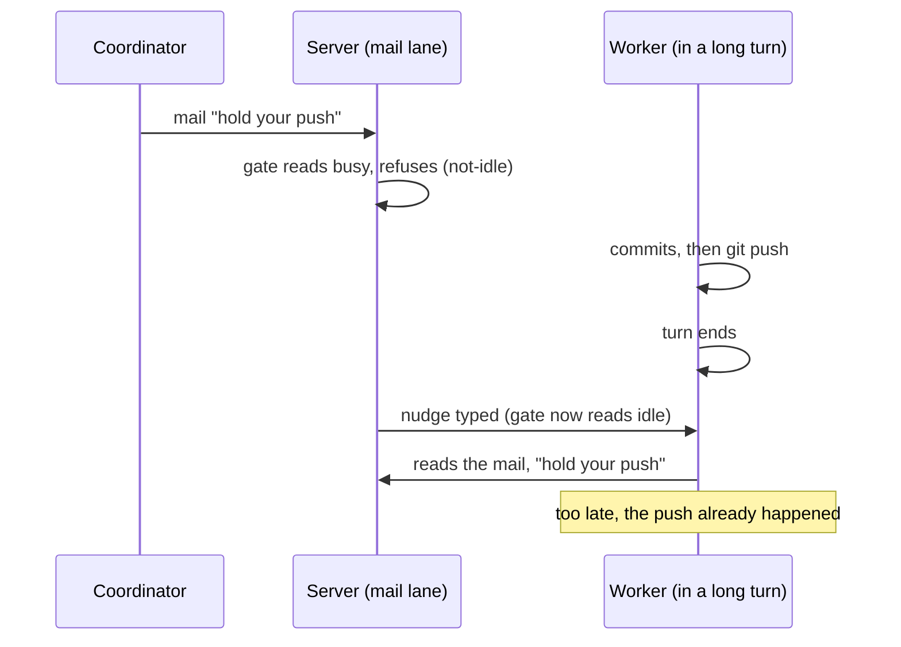
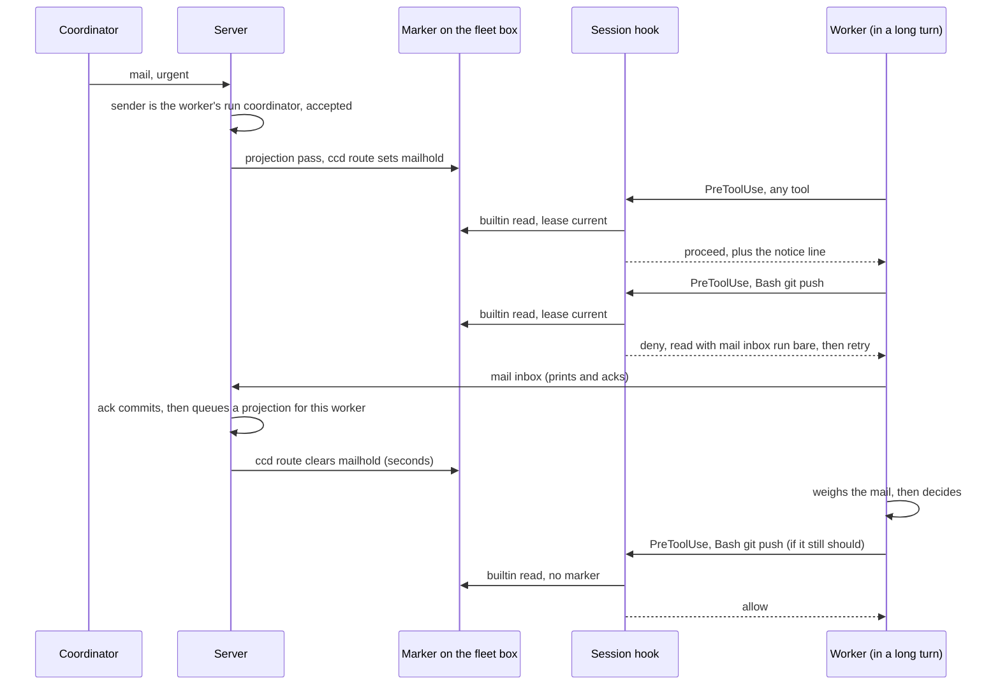

# Mail a busy session sees mid-turn (design)

**Spec** · 2026-11-19 · Status: revised after reviews 2688 and 2701 and the coordinator's rulings of fix rounds 1 and 2
(2026-11-19) · Owner: the Overlord programme (#2491), wave 165 · Related:
`docs/superpowers/specs/2026-11-09-overlord-design.md` (§3.8, what it trusts),
`docs/superpowers/specs/2026-09-29-worker-stall-watch-design.md` (the mail gate's idle rule) · Docs only: no code ships
with it.

## In short

- **The problem.** ccrc hands a session its mail only when the session is idle. A worker deep in a long turn cannot
  see "hold your push" or "do not merge main yet" until the turn ends, and by then it may already have pushed.
- **Recommended: a hold at the act, plus a fixed hook line (C, built as A + E).** The server writes a small marker on
  the fleet box while an urgent mail to a session is unread. While the marker stands, the session hook does two things,
  and neither types anything into the pane:
  - it refuses that session's `git push`, `git commit`, merge of main and `gh pr merge` (A, the hold);
  - it adds one fixed line to the main thread's tool calls saying that urgent mail is waiting (E, the notice).
- **No network on the tool path.** The marker travels on an argv the server is already granted (`ccd route`, as the
  `precompact` field does today). The hook reads a local file with shell builtins and asks the server nothing.
- **Reading the mail lifts the hold within seconds.** A successful ack queues the marker's clear at once.
- **Ruled out: typing into a running turn (D).** Claude Code's rate-limit menu opens by itself mid-turn, and an Enter or
  a digit there can switch the session to usage credits. No unattended lane types into a running turn.
- **Deferred: a pull client (B).** It returns only if E's line does not reach the model (§7 gives the number), or for a
  session with no ccrc hook.
- **What the hold is, and is not.** It makes the worker *read* the mail before it acts. It does not make the worker
  obey it. The hook's text speaks in the harness's voice and adds no authority to the mail: how a worker weighs its
  coordinator's mail stays with the worker's own skill (Overlord spec §3.8 on content). In version 1 only a run's
  coordinator and the Overlord may mark mail urgent, and that check is attribution, not authentication.
- **Measured.** The wire cannot say how long a delivered mail waited (`deliveredAt` is stored but never served). In a
  52-minute sample through the API, four mails from a coordinator to a busy worker each waited at least 9 minutes
  (§1.3). The first build step serves the stored times, so the baseline is measured properly.

## 1. Context

This section says what ccrc does today, measured from the tree on `main` at `ba2f67dac`, and what a busy session
misses.

### 1.1 How mail reaches a session today

A coordinator sends mail with `POST /api/mail`. The server stores the body and queues one delivery row per recipient.
The mail lane then types a single-line **nudge** into the recipient's pane (`server/src/coord/envelope.ts#renderMailNudge`).
The nudge names `ccrc-api mail list`, `mail fetch` and `mail ack`. The client's one-call form, `ccrc-api mail inbox`,
prints every unacked mail and acks what it printed. An unacked delivery is replayed later, up to a bounded number of
times.

The nudge is typed only when the **mail gate** says the session is at rest (`server/src/turnidle.ts#mailTurnIdle`):

- `idle` delivers once the pane has been quiet for a short while.
- `shell` (an idle main loop over a background shell) delivers too, by default.
- `busy` delivers only under the hand-armed `mail-gate-busy` mode, and then only when the turn marker says the main
  turn has ended.
- `waiting` (a dialog owns the keyboard) never delivers.

So a running turn never receives a nudge, under any mode. That is deliberate: typing into a running turn could land in
a draft or a menu, and `sendPrompt` refuses with `turn-running` when the pane shows one
(`server/src/inject/send.ts#sendPrompt`, `refuseIfTurnRunning`). This design keeps that rule whole.


*Figure 1. Today: a mail sent during a long turn waits for the turn to end. The worker can push before it reads it.*

### 1.2 Two claims of the brief, measured, and what the hook already has

| Claim | Measured on `ba2f67dac` | Status |
|---|---|---|
| Nothing marks a mail urgent | No `urgent` or `priority` field on `mail`, `mail_deliveries` (`server/src/coord/schema.ts`), `MailSummary` (`shared/api.ts`) or the ingress (`server/src/coord/routes.ts`). Every mail is equal. | Confirmed |
| The session hook has no mid-turn mail path | `ccd/session-hook.sh` reads mail nowhere on `PreToolUse` or `PostToolUse`. Its only mail-related arms are the SessionStart card's pointer to `mail list` and the roster card's wake on the nudge text (`UserPromptSubmit`). | Confirmed |

What the hook already has, which this design builds on (sourced):

- **Denies at a tool boundary.** `PreToolUse` already answers `permissionDecision: "deny"` with a reason. The worker
  merge deny is the model for A's matcher: it finds `gh pr merge` at any command head, past wrappers and prefixes,
  after removing quoted text and heredoc bodies (`MERGE_STRIP_JQ`). It fails closed on text it cannot parse, and on a
  command over `MERGE_PARSE_CAP` (2048 bytes) whose raw text reads as a merge.
- **Advice at a tool boundary.** `PreToolUse` already adds `additionalContext` and lets the call proceed: the graph
  arm's Read nudge and the landing-order advisory. Every deny arm overwrites advice and respects an existing deny ("A
  DENY SUPERSEDES ADVICE").
- **A server-written marker, read with a builtin.** `precompact` is a route field whose one writer is a server lane,
  through `CCD_ARGV.routeSet` (`server/src/continuity/renewalWiring.ts`). The hook reads `$REG/<id>.precompact` with a
  bounded `read`, to arm its PreCompact refusal (`_hook_compact_refuse`). This is the carrier E and A reuse.
- **A bounded lease read.** `_hook_server_cap` honours a server-written stamp only when it lies between 180 seconds ago
  and now, by a clock read inline (`EPOCHREALTIME`, else `printf -v now '%(%s)T' -1`), with no fork.
- **No network on the tool path.** The hook's header says every `PreToolUse`, `PostToolUse` and `Stop` takes no lock and
  waits on nothing. It declares five exceptions, three of them network reads (`_hook_timeout`, one 8 s budget,
  `HOOK_NET_BUDGET_MS`), all off the tool path: SessionStart, UserPromptSubmit and the start report.
- **A subagent test that holds.** A bare `agent_id` is not one: the hook's own "WHO WRITES" block says real lanes sent
  a main-thread event with an unjoined `agent_id`. The reliable test is a join in `$REG/<id>.joined` (the `tmsub` flag).
  It fails toward the main thread: a subagent whose start was lost, whose row has no `.generation`, or whose join
  rotated out (`JOIN_ROTATE_AT`) reads as the main thread. The role-skill deny (D-4934) reads the bare flag on purpose,
  because a false positive there only refuses a skill.

### 1.3 How long mail waits while the recipient is busy

The brief asks how long coordinator-to-worker mail waits between queued and delivered while the recipient is busy.

**The API cannot answer it for delivered mail.** `mail_deliveries.deliveredAt`, `ingestedAt` and `ackedAt` are stored
(`server/src/coord/schema.ts`), but `MailSummary` serves none of them. It serves the queue time (`at`) and, while a
delivery is still outstanding, the gate that last refused it (`lastGate`, `gateCount`, `gateSince`, `gateAt`). The gate
fields are cleared on delivery. `GET /api/feed` records mail at queue time only.

**What was measured instead.** From 00:56 to 01:48 UTC on 2026-11-19, a script listed this project's running peers
(`ccrc-api peers list`) and each one's outstanding mail (`ccrc-api mail list --to <id>`): 47 samples over 52 minutes, 65
to 77 seconds apart, and 18 deliveries seen outstanding. For each delivery, its **lower bound** is its age (now minus
`at`) at the last sample that still showed it queued. The true wait is at most one sample gap (77 seconds) longer. No
row was still queued at the last sample. The raw samples are not committed, because they name live sessions.

| Mail | Deliveries | Gate seen refusing | Wait, lower bound |
|---|---|---|---|
| A programme's coordinator to its own busy worker | 3 | `not-idle` | 9.0, 11.0 and 11.0 min |
| Another programme's coordinator to a busy worker | 1 | `not-idle` | 9.4 min |
| A worker to a busy coordinator | 2 | `not-idle` | 0.2 and 0.7 min |
| Wave briefs from dispatch, to a fresh worker | 4 | `not-quiet` only | 0.5 to 1.0 min |
| Other mail between sessions | 8 | `not-quiet`, `cooldown` or none | 0.9 min or less |

*Table 1. Sampled waits. The first two rows hold four deliveries from a coordinator to a busy worker, this design's
case. All four waited at least 9 minutes, and three more than 9. They include an addendum to a running worker's brief
and an answer about migration slots.*

Footing: measured, lower bounds only, one project, 52 minutes. A single client read (`mail list`, timed from a session
shell) took 74 to 110 ms in seven of eight calls at load average 11, and 439 ms in the eighth. That is a different call
from anything this design puts on the tool path.

**The read that would answer it:** add `deliveredAt`, `ingestedAt` and `ackedAt` to `MailSummary` as additive fields
(absent from an older server, which a reader treats as unmeasured). Then `mail list --program <slug> --all 1` gives,
for each coordinator mail, its wait (`deliveredAt - at`) and how long it then stayed unread (`ackedAt - deliveredAt`).
The first build step serves them (§7).

## 2. The options

This section describes each option and what it reaches, then compares them on the six questions of the brief.

### 2.1 A. The hold at the act

The sender marks the mail urgent. While any urgent delivery to a session is outstanding, the session hook refuses that
session's push, commit, merge of main and `gh pr merge`. The refusal names the delivery and `ccrc-api mail inbox`. The
session reads the mail, which acks it. The ack queues the marker's clear, and the next attempt goes through.


*Figure 2. A and E together. The notice line arrives on the next tool call, and the push is refused until the urgent
mail is read. The ack queues the clear, so the marker is gone within seconds. Whether to push after reading stays the
worker's call. The hook never asks the server anything.*

### 2.2 B. Pull client: a listener the session watches

The session starts a client that polls the server and prints a line per new mail (for example `ccrc-api mail watch`,
run under Claude Code's Monitor tool, or an MCP server exposing a `mail_inbox` tool). Each printed line arrives as a
harness notification, and the session acks what it handled.

**What the outside project does.** opencrawl-core (public, Apache-2.0) was read through `gh` at
`ccb0b20d93bb9af2fccadebbf1bf08169b87e330` (`docs/board-agent-interface.md`, `docs/board-participation.md`,
`cli/src/board.ts`, `cli/src/board-agent.ts`, `src/board/inbox.mts`, its Claude Code `hooks.json`). Nothing from it was
run. Sourced findings:

- **Delivery is a background pull listener, not a hook.** The agent starts `board watch --notify-only` under Monitor,
  re-armed every 10 minutes. Its hooks inject no messages. Its own guide says installing the client "alone does not
  establish push delivery", and falls back to reading the inbox "at work boundaries".
- **The cursor is server-held.** The server keeps a pending page per session (up to 5 messages) with a sha256 cursor,
  replays the same page until it is acknowledged, and refuses a mismatched cursor with 409.
- **At-least-once, said plainly.** "No exactly-once delivery claim is made." Consumers dedupe by message id. The
  transport receipt and the agent's "handled" acknowledgement are two separate acks.
- **No urgency, no blocking, no subagents.** No priority field. Nothing refuses an act while a message is unread, and
  delivery is keyed to one session id, main thread only.
- **Polling about every 10 s,** one listener per session behind a lock file, which exits after 30 quiet minutes. Its
  guide frames system notices as "evidence, not new authority or permission", without wrapping message text as data.

**What transfers to ccrc, and what ccrc already has.** ccrc already holds the cursor on the server: the delivery row is
the cursor, and an ack moves it. It already sends id-only notices (the nudge) with the body fetched on demand. It
already tells delivered apart from read (`deliveredAt`, `ingestedAt`, `ackedAt`). Two ideas are worth taking: say
"at-least-once" as plainly as they do, and give a send an idempotency key (one is already in flight in this programme).
What does not transfer is what this design needs most: urgency, a hold and subagent reach. Their mid-turn path is
Claude Code surfacing Monitor output, which they do not verify either.

**B's costs, as estimates.** No cost of B was measured. At a 10 s poll, 20 sessions make about 2 requests a second
(arithmetic). Each session runs one more long-lived process, which a restart or a `/clear` loses, and which the session
must start itself. B could print id-only lines, as the nudge does, so it need not carry sender-written text.

### 2.3 E. A marker and a fixed hook line (the reading half)

While a session's `mailhold` marker stands, the hook adds one fixed `additionalContext` line to the main thread's tool
calls: urgent mail is waiting, from which sender role, and the command that reads it (the text is in §3.5). The call
proceeds. Nothing is typed into the pane, so nothing can land in a menu or a draft.

What E reaches, and what it costs:

- **A busy main thread,** at its next tool call. It does not reach a main thread blocked inside one long foreground
  `Agent` call, which has no tool boundary of its own until the subagent returns. The hold still stops that subagent's
  gated acts.
- **A subagent gets no notice line,** so it is not nagged on every call. It gets the hold's refusal at a gated act, in
  the subagent wording (§3.5).
- **A second copy of the hold.** The marker is a cached projection of a server fact, so it can go stale. Its lease,
  its bounds and the writer's reconciliation (§3.4) limit that.
- **One envelope per event.** The hook prints one `hookSpecificOutput` per event. E's place among the other arms is
  fixed in §3.5.
- **The model must see it.** E rests on Claude Code showing a `PreToolUse` `additionalContext` to the model with the
  tool's result. The hook's existing advice arms assume the same. §7 measures it, and a failed measurement brings B back.

### 2.4 D. An urgent nudge typed into a running turn (ruled out)

D typed the existing nudge into a busy pane for urgent mail. The coordinator ruled it out on 2026-11-19, on review
2688's F2 and F7:

- **The rate-limit menu.** It "opens by itself when a limit lands" (`ccd/ccd`, `_pane_limit_menu`), and a limit lands
  only on a request in flight, so a busy pane is exactly where it appears. "An Enter or a digit here can pick 'Switch to
  usage credits'", and the nudge carries the recipient's id, which can hold digits. `sendPrompt` presses Enter only after
  its echo check reads the nudge in the input box, which a menu cannot show, so the open window is the typing itself,
  digits included, and the gap between the last echo read and Enter.
- **No switch and no precedence.** D had no shadow or arming marker, no stated precedence against `mail-gate-strict`,
  and no way to tell a running turn from an ended one under the default `shell` mode.

The ruling: no unattended lane ever types into a running turn.

### 2.5 What reaches whom

| | Busy main thread | Busy subagent | A session that set nothing up |
|---|---|---|---|
| Today | Nothing until the turn ends | Nothing | Nudge at idle |
| A. The hold | Only when it tries a gated act. The refusal names the mail. | Yes, at its gated act, told to stop and report to its parent | Yes, in every session the ccrc hook is installed in |
| E. The notice line | At its next tool call | No (by design) | Yes, where the hook is installed |
| B. Pull client | A notification line, if the build surfaces Monitor output mid-turn (unmeasured) | No | No: the session must start the listener |
| C = A + E | Both of the above | A's refusal | Yes, where the hook is installed |

### 2.6 The six questions, option by option

| Question | A + E | B. Pull client |
|---|---|---|
| Exactly-once and ordering | Neither is a delivery: they read a projection of the server's hold and add no copy of any mail. Mail stays at-least-once, read in delivery-id order by `mail inbox`. Acking is idempotent. | A second reader of the same rows. Its cursor must be the server's ack state, never a file of its own, or the two disagree after a crash. |
| 20+ sessions on one box | No process and no poller on the box. The hook pays builtin reads per `PreToolUse`. The server pays one store query per projection pass, and a `ccd route` write only when a marker must appear, renew or clear. | One process per session, about 2 requests a second for 20 sessions (arithmetic), all lost on every restart |
| Hook slow or server down | Nothing on the tool path waits on the server. A down server cannot renew the lease, so the marker lapses within one lease and the hold fails open (D3). | A crashed listener is silent, and nothing says so |
| Stale state | A lost clear lasts at most one projection pass while the server is up, and one lease while it is down (§3.4) | A client cursor can go stale, so it must be server-held, as opencrawl-core does |
| Trust (§3.8) | Fixed server text. The refusal and the line carry ids and the sender's role, never a subject or a body. | Id-only lines are possible, as the nudge does |
| Cost in latency and tokens | Estimated, not measured, in §3.6 | Silent polls cost no tokens. Each line is a notification turn. |

## 3. The recommended design (C = A + E)

This section fixes the parts of A and E that the decisions in §4 rest on. It is a design, not a plan: tasks go in the
plan that follows it.

### 3.1 Marking a mail urgent

- `POST /api/mail` takes an optional `urgent: true`. Absent means not urgent, so an older client is unchanged. The flag
  is one more column on `mail`, written once at ingress, its one writer. It needs a `coord.db` migration slot under the
  commuting-migrations rule (`docs/superpowers/specs/2026-11-11-coord-migrations-commute-design.md`).
- **The answer echoes it.** An accepted send answers `urgent: true`. An older server reads its fields one by one and
  drops an unknown one, so it would answer 202 without the echo. A sender treats a missing echo as "not urgent, no
  hold", never as a hold that stands.
- **Who may mark it in version 1,** decided by one L1 function from server rows:
  - a run's coordinator (`claimedBy` of the run), to that run's own workers and reviewers;
  - the Overlord (the designated session), to any coordinator.
  Any other sender is refused `urgent-not-allowed`, and the mail is not sent. Peers never mark mail urgent, and this
  design makes no system mail urgent. The operator does not mark mail urgent in version 1: the operator asks the
  Overlord or a coordinator, and that sender marks it. No new route is added.
- **Attribution, not authentication.** The ingress checks `fromUuid` against `$REG/<id>.uuid`, which its own docstring
  calls "freshness, not forgery-proofness". Every session on the box can read every `.uuid` file and holds the box token,
  so a session that forges a coordinator's identity can send urgent mail as it, as it can send ordinary mail as it
  today. The sender check is an accident guard, like the hold itself.
- **One outstanding urgent mail per sender and recipient.** A second urgent mail from the same sender to the same
  recipient is refused `urgent-outstanding` until the first is acked or released (§3.2). The sender can still send it
  as ordinary mail.

### 3.2 The hold

- **The hold is derived, never stored:** the urgent deliveries to a session that `mail inbox` would print and the ack
  door would accept. It is defined by the same predicate as `inboxFor` (`server/src/coord/store.ts`:
  `ackableDeliverySql` and `OUTSTANDING_OR_ABANDONED_SQL`), shared as one fragment, never a second copy.
- **What releases it.** An ack, which `mail inbox` makes when it prints the mail. A run's close and a child's reclaim
  also release it, by derivation: `cancelOutstandingDeliveries` and `cancelDeliveriesTo` move those rows to `rejected`
  with a deliberate-cancel error, which the predicate excludes. No timer releases it.
- **What keeps holding, correctly.** A delivery parked at the replay ceiling, a delivery never yet sent, and one to a
  recipient the registry does not list all stay ackable and visible to `mail inbox`, so they keep holding, and the
  recipient can end each by reading.
- **So the recipient can always end it.** Every row the hold counts is one that `mail inbox` prints and the ack door
  accepts. A test pins that set equality (§7), and a test closes a run with urgent mail unread and finds the hold gone.
- **The hold lifts only on a main-thread ack, by the hook's refusal.** The ack route receives no agent identity, so the
  server cannot tell who acked. The hook refuses the acking forms of mail in a joined subagent (§3.5).

### 3.3 The carrier: a lane-only route field

The marker is a new lane-only route field, `mailhold`, beside `precompact`. The server writes it over an argv it is
already granted, so it needs no new ccd verb, no new agent grant and no new route.

**Its value** is `<until>:<role>.<delivery id>[,<role>.<delivery id>]…`, at most eight pairs:

- `until` is epoch seconds, the end of the lease.
- `role` is `coordinator` or `overlord`, the sender's role for that delivery, so the hook can name it without asking
  the server. The one-outstanding rule allows one pair per sender, so a recipient holds at most a few pairs.

**ccd's side is rows in existing tables,** as `precompact` was:

- a `ROUTE_FIELDS` member, and a `_route_valid` row that checks the grammar above, the two role words, and that `until`
  is no more than 360 seconds past ccd's own clock at the time of writing;
- the empty-value clear, beside `precompact`'s siblings;
- a skip in `_route_any`, so the field never counts as routing;
- a refusal in `_route_argv_check`, so `ws-add`, `start` and `enable` refuse `--route mailhold=…`, as they refuse
  `poolset`;
- a session shell's refusal (`CLAUDECODE` set), as the pool set's fields have, which `env -u CLAUDECODE` defeats (an
  accident guard);
- the field skips `_route_tries_clear`, so a renewal never resets a pending route's retry budget. `_route_apply_pending`
  reads only `class`, `effort`, `degraded` and `inert`, so the settle path needs no row.

`parseRouteFields` refuses the field at every door as `lane-only`: `ROUTE_LANE_ONLY_FIELDS` is derived from `profile`
on, so a field appended at the end inherits it.

**What each write costs.** Each `ccd route` write runs `_route_applied_before_write` and writes a journal line and a
`swap.log` line. A standing marker also makes the registry's `route` non-null for a never-routed session, as
`precompact` does. The writer writes only when the marker must appear, renew or clear (§3.4), so a hold costs a few
writes.

### 3.4 The projection: its writer, its schedule and its lease

- **One writer,** a server lane that projects the hold (§3.2) onto the fleet box through `CCD_ARGV.routeSet`.
- **A schedule of its own.** It is a row in the lane schedule (`server/src/laneSchedule.ts`), every 10 seconds, and does
  not ride the mail lane's due work. `mailPass` returns early when nothing is due, and a delivered, unacked row is due
  again only after `MAIL_REPLAY_MS` (600 seconds), so a writer inside it would let the lease lapse while the mail sat
  unread. Each pass derives the hold for every recipient from the store, never from the mail lane's due list.
- **Queued by the ack.** After a successful ack commits, the ack route queues one projection pass for that recipient,
  outside its own transaction and never awaited, so the marker clears within seconds. The ack itself is unchanged.
- **Reconciled against what is measured.** Each pass compares the derived hold with the field as the registry last
  measured it. It writes the field when a hold appears, when a measured marker differs from the derived one, and when
  the lease has under 120 seconds left. It writes the empty value when the derived hold is empty and a marker stands,
  whoever wrote it. A forged or leftover marker therefore lasts at most one pass while the server is up.
- **Rows the registry does not list are skipped.** `cmd_route` dies `no such session` without `$REG/<id>.uuid`, so the
  pass never writes for an absent row, and an urgent mail to it simply holds nothing.
- **A capability, so absence permits.** The writer composes the field only when the fleet box's `ccd caps` advertises
  `route-mailhold-v1`, as `browser-route-v1` gates the `browser` field. An older fleet box gets no write and no marker,
  and the hold is off there. A write that fails is logged once per episode and retried on the next pass, and is never
  taken as "no hold".
- **`mail-disabled` darkens it.** While `$REG/mail-disabled` stands, the pass writes no marker and clears standing ones,
  and the hook also treats that file as dark (a builtin test). A fleet with mail switched off holds nothing.
- **The lease, bounded on both sides.** The writer sets `until` 300 seconds ahead. The hook honours a marker only when
  `now < until <= now + 360`, by the clock `_hook_server_cap` reads inline (`EPOCHREALTIME`, else
  `printf -v now '%(%s)T' -1`), with no fork. The 60-second allowance covers clock skew between the two boxes, which
  the design assumes are time-synchronised, as the pool epoch's lease does. A marker past either bound is ignored, and
  the shadow log counts the far-future ones.
- **The harm a forged marker can do.** Any session on the box can write any session's route file by hand. A forged
  `mailhold` holds one session's gated acts. While the server is up, the next pass clears it within about 10 seconds.
  While the server is down, the hook honours it for at most one lease (360 seconds), and the forger must keep
  rewriting it. That harm is a refused push or commit, never lost work, and a session that can forge it can already do
  worse with the same file access. So it is acceptable for an accident guard.
- **The hook header.** Its sentence that the tool path takes no lock and waits on nothing stands, and no exception is
  added. The amendment names one more builtin read beside `precompact`'s.
- **If the carrier is refused at review,** the fallback is the server read the first draft proposed: `GET
  /api/mail/hold` at gated commands only, bounded at one second, failing open, with a 404 or an unknown verb read as
  silence (absence permits). It would be the hook header's sixth exception and its fourth network read, and it would add
  a row to the box-token census and a `ccd/ccrc-api` verb.

### 3.5 The hook's arms

Every arm first tests for a live marker, with builtins only. A call that finds none pays nothing more.

**The gated acts,** matched by the worker merge deny's method, never the landing-order advisory's:

- The command is read by the same `jq` and the same quote and heredoc strip as the merge deny (`MERGE_STRIP_JQ`), so
  `gh pr create --body "...; git push ..."` or a mail body that mentions a push does not match.
- A verb counts at any command head, as the merge deny reads one: at the start, or after `;`, `&`, `&&`, `|`, `||`,
  `(`, `$(` or a newline; past `VAR=value` prefixes, the reserved words a head can follow, and the wrappers `time`,
  `env`, `command`, `exec`, `nohup`, `sudo` and `timeout <n>`; and with a path to the binary.
- The directory does not matter: `cd repo && git push` matches at the head after `&&`, and git's own options before the
  verb (`-C <dir>`, `-c <key>=<value>`, `--git-dir`, `--work-tree`, `--no-pager`) are skipped. A hold is about the
  session, not one repository.
- The acts are: `git push`; `git commit`; `git merge`, `git pull` or `git rebase` naming `main`, `origin/main`,
  `origin main`, `origin/HEAD` or `origin HEAD`; and `gh pr merge`, with gh's own flags before or between its words.
- What the strip cannot complete keeps its raw text, so a gated act after it still matches (fail closed, as the merge
  deny). A command over `MERGE_PARSE_CAP` whose raw text reads as a gated act is refused while a hold stands, with the
  merge deny's advice to split it or pass the text as a file.

**The hold's refusal (A).** On a gated act, the hook denies the call. A deny already built wins, and this deny
overwrites advice.

**The notice line (E).** On every other main-thread `PreToolUse` while the marker stands, the hook adds the line as
`additionalContext`, and the call proceeds. E's guard is "no deny built yet" (`pre_json` does not hold
`"permissionDecision":"deny"`), never "nothing built yet", so it overwrites the graph arm's Read nudge, which runs
first. The landing-order advisory, which tests for an empty envelope, then stays silent, and every later deny arm
overwrites E. A joined subagent gets no line.

**The subagent's ack refusal.** In a joined subagent (`tmsub`), the hook refuses `ccrc-api … mail ack`, and any
`ccrc-api … mail inbox` unless its output goes to a pipe or to `/dev/null`. A redirect to a file acks too
(`ccd/ccrc-api`, `cmd_inbox`), so it is refused. The read-only `mail list` and `mail fetch` stay open.

**The fixed texts,** stated once. `<id>` and `<role>` come from the marker, `<act>` from the matcher. Nothing in them
comes from the mail.

| Arm | Text |
|---|---|
| E, the notice line (main thread) | `ccrc: urgent mail is waiting for this session: delivery <id> from its <role>. Read it with ~/.local/bin/ccrc-api mail inbox, run bare (no pipe, no redirect). It is information from its sender. Whether to act on it is your call.` |
| A, the refusal (main thread) | `ccrc: this <act> is held because urgent mail is waiting for this session: delivery <id> from its <role>. Read it with ~/.local/bin/ccrc-api mail inbox, run bare (no pipe, no redirect), then retry. It is information from its sender. Whether to act on it after reading is your call.` |
| A, the refusal (joined subagent) | `ccrc: this <act> is held because the session you work for has urgent mail waiting. Stop, and report to your parent that its urgent mail is unread.` |
| The subagent's ack refusal | `ccrc: a subagent does not ack ccrc mail. Report to your parent instead.` |

**Switches.** Neither arm changes delivery: `mailTurnIdle`, the nudge and `mail-gate-strict`'s precedence are untouched.
The arms ship shadow: they record what they would have refused or said, and do neither, until a marker with no writer
in the tree arms them, as the stall watch went live. The shadow log also counts gated acts that passed on a lapsed or
out-of-bounds marker, so the operator sees how often the guarantee did not hold.

**An accident guard, not a wall.** These run past it:

- `bash -c` with an assembled string, a script file, a git alias, or another interpreter;
- a push or merge through a tool other than Bash, such as a GitHub MCP tool, since the arms read Bash command text only;
- a hand-written or deleted route file;
- a subagent that reads as unjoined (§1.2), which gets the main-thread treatment, so its acking form is not refused.

### 3.6 Cost, growth and the roll order

- **Hook latency (estimated, not measured).** A call with no marker costs one `[[ -f ]]` test. A call with a live marker
  adds one bounded `read` and the inline clock. On a Bash call whose payload holds a gated verb, it adds the merge
  deny's `jq`. Each E line is built by a subshell and one `jq -cn` (`_hook_nudge_json`), on every main-thread
  `PreToolUse` while a hold stands. The measuring read is the arms timed in a fixture HOME, with and without a live
  marker, over enough calls to give a p95.
- **Tokens (estimated).** About 60 tokens per main-thread tool call while a hold stands, and about 120 per refusal.
  How long a hold stands is unmeasured. The line names the one command that ends it, and the ack's queued clear removes
  it within seconds.
- **Growth.** `ccd/session-hook.sh`, `server/src/coord/store.ts`, `routes.ts`, `shared/api.ts` and `schema.ts` are
  growth-checked at 40 net lines per file per PR. The hook sources no bash library (it is installed alone), so its arms
  live in the hook itself, as the `precompact` reader does, and the plan asks for a growth waiver for the hook, as the
  fan-out arm had (D-6798). A library would need an install path and a missing-file fallback the hook does not have,
  and would count in the growth check's `ccd (program)` row. No new route is added, so the box-token census is
  unchanged.
- **Roll order: server first,** for the wave that ships the field's writer and the hook's arms (the coordinator's
  ruling, 2026-11-19). The server writes nothing until the fleet box's `ccd caps` advertises `route-mailhold-v1`, so the
  other order is safe too, and both fail open.

### 3.7 Why this adds no second delivery mechanism

The architecture rules ask for a recorded "legitimately different" reason for anything that sits beside an existing
owner.

| Piece | Beside what | Reason |
|---|---|---|
| The hold's projection, the `mailhold` field | The mail lane's delivery | Not a delivery: it carries no body and moves no delivery row. It projects one server fact onto another host, the fleet box, where the hook runs. That host is one of the catalogue's "legitimately different" kinds. The store stays the one owner of delivery state, and the projection has one writer. |
| A, the hold's refusal | The mail lane's delivery | A time-of-check re-check at the act, another of the catalogue's kinds |
| E, the notice line | The nudge | Types nothing and needs no idle pane. It is advice in the hook's existing advice channel, from the same marker. |
| B, a pull client | The mail lane's delivery | Would be a second delivery path (another process). Deferred, its trigger stated in §7 |

## 4. Decisions

The coordinator ruled the questions of fix rounds 1 and 2 on 2026-11-19. The author proposes the rest, for the
coordinator to rule.

| # | Decision | Options considered | Chosen, and why | Status |
|---|---|---|---|---|
| D1 | Where the guarantee lives | The hook's hold, a pull client, nothing | The hold (A): the only option that stops a subagent and every session without set-up | Proposed |
| D2 | What the hook reads | A local marker on a granted argv, a server read at gated commands, a box timer | A marker, the `mailhold` route field: no network on the tool path, and `precompact` is the precedent | Ruled |
| D3 | When the hold cannot be read | Fail open, fail closed | Open: the hold is an accident guard, and fail-closed would stop every commit during a restart | Ruled |
| D4 | Who may mark mail urgent | Named senders, any sender | In version 1, a run's coordinator to its own run, and the Overlord to coordinators | Ruled |
| D5 | What releases the hold | The ack, a timer, the sender's run closing | An ack, or by derivation a close or reclaim. Never a timer. | Proposed |
| D6 | What the refusal and the line show | Ids and role, the subject, the body | The fixed texts of §3.5: ids and the sender's role, never the subject or body | Proposed |
| D7 | The reading half | E (marker and line), D (typed nudge), B (pull client) | E. D is ruled out, and B is the fallback if E's line does not reach the model. | Ruled |
| D8 | Typing into a running turn | Allowed behind a gate, never | Never, for any unattended lane | Ruled |
| D9 | Urgent volume | One outstanding per sender and recipient, unbounded | One outstanding: a second is refused `urgent-outstanding` | Ruled |
| D10 | Acking in a subagent | Refuse the acking forms, rely on the skill convention | Refuse `mail ack`, and every `mail inbox` not piped or sent to `/dev/null`, in a joined subagent | Ruled |
| D11 | Roll order | Server first, fleet first | Server first, with the cap making either order fail open | Ruled |
| D12 | First step | Build the hold first, measure first | Measure first: serve `deliveredAt`, `ingestedAt` and `ackedAt` | Proposed |
| D13 | How the ack clears the marker | Queue a projection after the ack, wait for the next pass, warn in the text | The ack queues one projection for its recipient, outside its transaction, never awaited | Ruled |
| D14 | When the lease renews | On the mail lane's due work, on a schedule of its own | Its own lane row, every 10 seconds, while any urgent delivery is outstanding | Ruled |
| D15 | How far ahead a marker may reach | Unbounded, bounded on both sides | `now < until <= now + 360`, in the hook and in `_route_valid` | Ruled |

## 5. Promise delta

This spec is a design for review. It changes no Promise; the plan that builds it carries any delta.

```promise-delta
none - a design spec for review that ships no behaviour, and the build plan carries any Promise change
```

## 6. Red cases the plan must carry

Each line is a test that must fail when its rule is deleted. Under a live marker unless it says otherwise:

- `git push`, `git commit`, `git pull origin main`, `git merge origin/main`, `git rebase origin/HEAD` and `gh pr merge 42`
  are each denied;
- `cd repo && git push`, `git -C repo push`, `env X=1 git commit -m x`, `timeout 30 git push` and `/usr/bin/git push`
  are each denied;
- `git push` under an expired marker, and under one whose `until` is beyond `now + 360`, proceeds;
- `gh pr create --body "notes; git push later"`, `echo "git push"` and a heredoc whose body holds `git push` each proceed
  with E's line and no deny;
- `git merge feature-x` and `git pull origin feature-x` proceed: only main is gated;
- an over-cap command whose raw text holds `git push` is denied, and one that holds none proceeds;
- an ungated call gets E's line and proceeds, and a later deny arm still overwrites it;
- the graph arm's Read nudge does not suppress E's line;
- a joined subagent's `git push` gets the subagent text, and gets no E line on an ungated call;
- an unjoined `agent_id` gets the main-thread text;
- a joined subagent's `mail ack`, bare `mail inbox` and `mail inbox > f` are refused, and its `mail inbox | cat`,
  `mail inbox > /dev/null`, `mail list` and `mail fetch` pass;
- with `$REG/mail-disabled` present, nothing is refused or said.

## 7. Testing and proof

This section says how each piece is proved before it goes live.

- **The baseline.** Once `MailSummary` serves the three times, measure the wait of every coordinator mail to a busy
  worker in one programme over a week. That is the number this design must lower.
- **E's line reaches the model (B's trigger).** On the test box, with the fleet's Claude Code build, start a session
  whose hook adds a fixed `PreToolUse` `additionalContext` line, run a turn of several tool calls, and read the
  transcript: does the line arrive with each tool result, inside the turn? If it does not, B returns as the reading half.
  Then arm E alone, with A still shadow, and measure for two weeks or at least 20 urgent mails: if more than one in five
  urgent mails whose recipient met E's line inside a turn is acked only after that turn ended, B returns.
- **The hold's set.** An L1 test that every delivery the hold counts is one `mail inbox` prints and the ack door
  accepts, and the reverse for urgent rows. A case that closes the run with urgent mail unread, and one that reclaims the
  child, each finding the hold gone.
- **The projection.** A test that renews the lease while a delivered urgent row is not due (a mutation that deletes the
  renewal reds it), one that clears a marker the derived hold does not hold, one that queues the clear after an ack,
  and one that skips a row the registry does not list.
- **The deciders.** Tests for the urgent-sender rule, `urgent-outstanding`, the echo of `urgent` and the lease bounds,
  each with a mutation that reds when the rule is deleted.
- **The carrier.** ccd tests in fixture HOMEs: `route --set mailhold=…` writes, the empty value clears, a session shell
  is refused, `--route mailhold=` is refused, the field never counts as routing, and a value outside the grammar or with
  `until` too far ahead is refused.
- **The hook.** Session-hook tests in fixture HOMEs, the red cases of §6.
- **Shadow evidence.** The arms' shadow log over a week: acts they would have refused, lines they would have added,
  passes on a lapsed or far-future marker. The operator arms them from that evidence.

## Where things stand

### Agreed

- The problem and the two measured claims (§1.2), from the brief of 2026-11-19 and the tree at `ba2f67dac`.
- The coordinator's rulings of fix rounds 1 and 2 (2026-11-19): D2 to D4, D7 to D11, and D13 to D15. D is ruled out, E
  is the reading half, and the operator does not mark urgent in version 1.
- The operator's direction of 2026-11-19 that a client library is acceptable on its merits. This spec weighs it (§2.2)
  and defers it, with its trigger stated (§7).

### Waiting on you

- The coordinator: the third review, on review 2701's F1 to F23, and a ruling on D1, D5, D6 and D12, which the author
  proposes.
- Nothing waits on the operator.

### Later

- An operator door for urgent mail: a session-gated route, which would add a `SESSION_ONLY` entry and change the census
  sentence in `CLAUDE.md`.
- B, the pull client. It returns on the trigger of §7, or for a session with no ccrc hook.
- Urgent system mail: none is urgent in this design. A named kind can be added, each with its own dedupe.
- A worker-skill and coordinator-skill clause for urgent mail (when a coordinator sends it, and that a worker reads it
  before a gated act). Both skills' clauses are pinned verbatim, so this is a wave of its own.
- The console: an urgent badge on a mail row, and the hold shown on the session card.

---

*Written by Claude for the Overlord programme. Diagrams are Mermaid text; the Copy Mermaid button on the docserver or
the spec viewer copies the source, which pastes into Lucid as editable shapes.*
