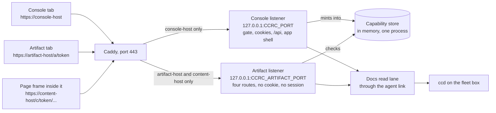
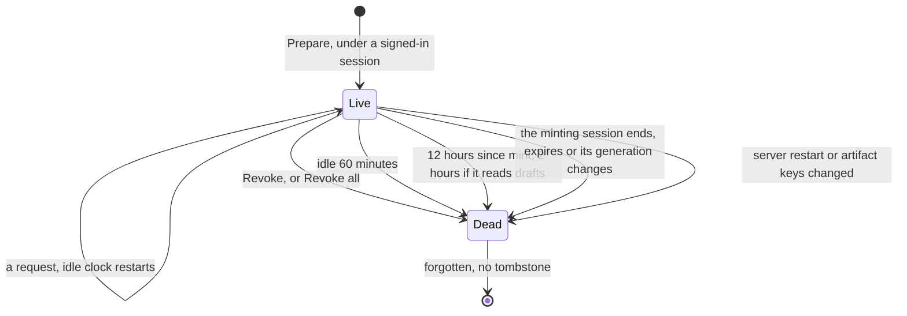
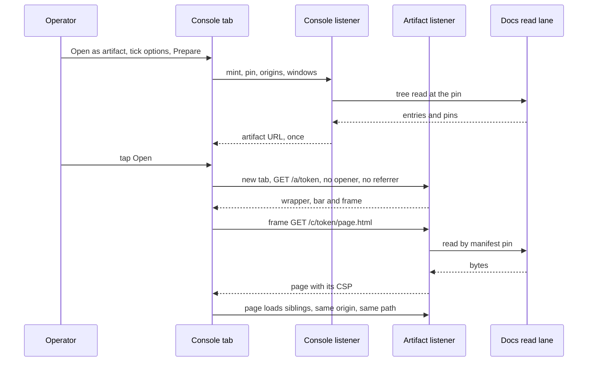
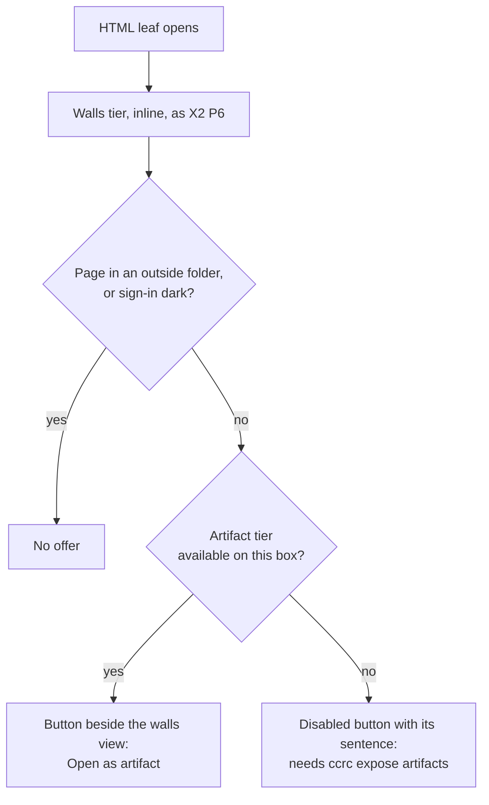

# Native Docs: HTML pages as artifacts, on an isolated origin

**Spec** · 2026-11-19 · Status: Draft, for review (X5, run 2837) · Owner: the operator · Linear: none · Related: docs/superpowers/specs/2026-11-18-native-docs-parity-design.md (X2), docs/superpowers/specs/2026-11-18-native-docs-draft-review-design.md (X3), docs/superpowers/specs/2026-10-01-native-docs-reader-design.md (base), docs/superpowers/plans/2026-11-07-native-docs-reader-completion.md, docs/superpowers/plans/2026-11-19-native-docs-html-artifacts.md (leaf plan), #1418

## In short

- **What this is.** The design that carries out your ruling of 2026-11-19 on X2's conflict C3 (ask 598): "we will need to support them, think claude artifacts levels of support, but maybe we should sandbox how they are hosted or adopt other safety measures". An HTML page in the docs can now run its own scripts, modules, workers, WebAssembly, fetches of its own sibling files, dialogs, downloads and, if you allow it at launch, windows, the way a hosted artifact does. The safety comes from where it runs: never on the console's origin.
- **Hosting (§2).** Pages run on two names of their own, outside the console's site: an artifact host that serves a fixed, script-free wrapper, and a content host that serves the page's files inside the wrapper's frame. Neither name is the console's, neither is below the console's domain, and the server answers them from a second listener that has no console route, no cookie, no session and no app shell. `ccrc expose artifacts` sets them up with stock Caddy and two more names. A box without them keeps X2's in-walls tier and never falls back to the console's origin.
- **Access (§3).** You open a page with "Open as artifact". The console, under your signed-in session, mints a 256-bit capability for that page's directory at one pinned version. The capability lives in memory only, dies with your session or a restart, after an idle hour or at 12 hours, and you can revoke it at once. A capability that reads uncommitted files lives at most 2 hours. Its content door is outside the auth gate and checks the capability itself. That door is named once in the census, on a listener the gate never sees.
- **Isolation (§4).** The wrapper frames the page with a sandbox that allows scripts, its own origin, forms, dialogs, downloads and pointer lock, and allows windows only if you ticked "Let it open windows". The wrapper's policy pins every frame navigation to the page's own capability path. The page's policy limits every request to its own files, plus any external hosts you confirmed at launch for scripts, styles, images and fonts. So by default the page cannot send what it shows anywhere, apart from residual browser channels that §4.4 names. The page has no channel to the console, and no secret is ever posted to it.
- **What stays fixed.** The reader frame stays `allow-scripts` only, the shell CSP stays `frame-src 'none'`, the mockup frame and its policy are unchanged, and X2's walls tier stays the default for every HTML leaf. The artifact tier is an opt-in: every HTML page offers "Open as artifact" beside its walls view. No console policy is widened. No live service, proxy, DNS record or config was touched to write this.
- **What you must check.** Nothing here waits on a product choice; every choice was technical and is argued with its alternatives. You approve the design as a whole. Using it later needs two more public names at setup (§2.4). Two departures are defined in the leaf plan: D-8786 records your ruling in X2's spec, and D-8787 scopes the completion plan's walls sentences to the console's origin.

## 1. Context

This section states what the walls do today, what your ruling changes, which boundaries do not move, and what public practice the design draws on.

### 1.1 Today: the walls tier

X2 designed an in-walls loader for HTML pages (X2 §4.8, wave P6): a `srcdoc` frame under `MOCKUP_SANDBOX_SCRIPTED` (exactly `allow-scripts`) and `MOCKUP_CSP` (`default-src 'none'` with inline scripts and `data:` assets), with sibling files inlined up to 64 assets and 5 MiB, and a shim answering relative `fetch` and `import` from that set (`pwa/src/docs/mockup/policy.ts#MOCKUP_CSP`, `#MOCKUP_SANDBOX_SCRIPTED`; `MockupFrame.tsx`). It runs most pages. X2 measured what stays standalone-only (X2 §4.8, 16 HTML pages on the fleet box, 2026-11-18):

| Wall | Pages | Why the walls cannot hold it |
|---|---|---|
| Sibling assets above 5 MiB in total | 3 | The asset budget |
| Dialogs (`alert`, `confirm`, `prompt`) | 2 | `allow-modals` is forbidden in the console's frames |
| Popups (`window.open`, `target="_blank"`) | 1 | `allow-popups` is forbidden |
| WebAssembly | 1 | `wasm-unsafe-eval` is not in `MOCKUP_CSP` |
| A page above 2 MiB | 1 | The HTML class cap |
| Workers (counted inside the module rows) | Not counted alone | `worker-src` falls back to `'none'` |
| Page downloads | Not counted alone | `allow-downloads` is forbidden |

### 1.2 The ruling, and what it changes

| Before | After |
|---|---|
| C3 waiting on you, recommendation (a): keep the walls (X2 §3) | Ruled 2026-11-19: support them, at artifact level, with the safety in the hosting. This spec is the "reviewed security design" X2's option (b) named |
| The widening "priced, not designed" (X2 §4.8) | Designed here |
| The completion plan's "no sandbox/CSP widening, no allow-modals" | Still binds every frame on the console's origin. The artifact tier is not on that origin (D-8787) |

### 1.3 Boundaries that do not move

| Boundary | Value | Where it is pinned |
|---|---|---|
| The console's origin runs no page code | Nothing a docs page contains executes with the console's origin | This brief; rich-docs §4.1 |
| Reader frame sandbox | Exactly `allow-scripts` | completion plan, Global Constraints |
| Shell CSP | `frame-src 'none'` (`pwa/index.html`) | completion plan, Global Constraints |
| Mockup frame | Sandbox `""` or exactly `allow-scripts`; `MOCKUP_CSP` unchanged | `pwa/src/docs/mockup/policy.ts` |
| Frame and console | No message channel, no window `message` listener in `pwa/src` | rich-docs §4.4 |
| The standalone reader | Not touched, named by role only | ledger, Carried constraints |
| Live services | No service, unit, proxy, DNS record or config is touched by this wave | brief |

### 1.4 What hosted-artifact platforms do (public sources)

| Practice | Source | Taken here |
|---|---|---|
| Untrusted active content goes on a separate sandbox domain that shares no cookies with the main site; copying the main site's credentials there would defeat the isolation | [Google security blog, 2012](https://security.googleblog.com/2012/08/content-hosting-for-modern-web.html) | A second site with no session (§2) |
| A sandbox domain on the Public Suffix List makes each subdomain its own site. Cross-origin isolation headers are recommended for active content | [web.dev, securely hosting user data](https://web.dev/articles/securely-hosting-user-data) | The names are checked against the console's site (§2.3). Every content response sets CORP (§4.3), and the wrapper sets COOP `same-origin-allow-popups` (§4.2) |
| Claude's artifacts use "iFrame sandboxes with full-site process isolation" and "strict Content Security Policies (CSPs) to enforce limited and controlled network access" | [Simon Willison, How Anthropic built Artifacts, 2024](https://www.simonwillison.net/2024/Aug/28/how-anthropic-built-artifacts) | A sandboxed frame on another site. Network limited to the page's own files and confirmed hosts (§4) |
| A meta-tag CSP inside an `allow-scripts` frame cannot be disabled from inside it, and a header CSP also carries directives a meta cannot, such as `frame-ancestors` | [Simon Willison, 2026](https://simonwillison.net/2026/Apr/3/test-csp-iframe-escape/) | Every artifact policy is a response header (§4.3) |
| `duckdns.org` is on the Public Suffix List (private section) | [publicsuffix.org list](https://publicsuffix.org/list/public_suffix_list.dat), measured 2026-11-19 | Two DuckDNS names are two sites (§2.3) |

These describe other systems. Each is a reason for a choice here, not a claim about this design's behaviour, which §10 measures.

## 2. Hosting

This section decides where page code runs and how the operator sets it up. The decision weighs isolation from the console against what a home box can actually obtain: one public address, stock Caddy and free names.

### 2.1 The decision

| Option | What it is | Threat it leaves | Chosen |
|---|---|---|---|
| (a) The console's origin, a path such as `/artifact/` | Page code runs same-origin with the console | The page reads the session cookie's effects, calls every `/api` route and the fleet socket. Forbidden outright | Rejected |
| (b) A subdomain of the console's name (`art.<console-host>`) | Different origin, same site | Same site: `SameSite=Lax` sends the console's cookie on requests from it, and a page can toss cookies onto the parent domain (`Domain=`), which the console would receive. `auth/gate.ts`'s own note: same-site is the CSRF hole it closes | Rejected |
| (c) A sandboxed `srcdoc` or `data:` frame in the console with an opaque origin | X2's walls, widened | Every widening is of the console's own frame policy: `allow-modals`, `allow-popups`, `wasm-unsafe-eval`, `worker-src`. The brief forbids widening the console's policies, and an opaque origin has no storage and no same-origin workers anyway | Rejected |
| (d) A separate registrable domain, same port 443, a second Caddy site, a second server listener | Another site with no cookie, no session and no console route | Phishing on a domain the operator owns, and a malicious page in a repository. §7 closes both | **Chosen** |
| (e) A separate machine or process for artifacts | Stronger process isolation | A new deployable, a new link to the fleet box, a capability store shared across processes. Its cost buys nothing (d) lacks, because the page is already in another browser site and the listener holds no credential | Rejected |
| (f) One origin per capability (`<token>.<artifact-site>`) | Each artifact isolated from the others | Every hostname lands in public Certificate Transparency logs, so per-token certificates publish the tokens. A wildcard certificate avoids that but needs a DNS-01 challenge, which stock Caddy cannot do for DuckDNS. ACME rate limits apply too | Rejected; Later for a box with wildcard DNS-01 (§12) |

### 2.2 Two names, one listener

Option (d) uses two names, not one. **The artifact host** serves only a fixed wrapper page: a header bar and one frame, with no script. **The content host** serves the page and its files inside that frame. Two names are needed because the page must run with a real origin (storage, same-origin workers and WebAssembly streaming need one) while staying cross-origin to the wrapper. If the page shared the wrapper's origin, it could reach into the wrapper and navigate the tab anywhere, which would void the wrapper's navigation limits (§4.2).


*Figure 1. Where each name lands. Caddy maps each name to one listener. Both listeners live in the one server process and share the in-memory capability store and the docs read lane. The artifact listener has no console route to reach, even through a misrouted name.*

- **A second listener, not Host routing on the first.** Measured on `main`: the server starts one listener (`server/src/index.ts`, `app.listen`), nothing reads the `Host` header, and the not-found handler answers any GET outside `/api` and `/ws` with the app shell (`server/src/server.ts`, `setNotFoundHandler`). With one listener, a content name pointed at it would serve the console's sign-in page on the content origin. A sign-in there would set a session cookie that page code could use. The artifact listener is therefore a second Fastify instance on its own loopback port. It registers exactly four routes and no static plugin, not-found shell or cookie parser. A test pins its route table (§10).
- **Host fences on both sides.** The artifact listener refuses any `Host` that is not one of its two names (421). The console listener refuses any request whose `Host` is an artifact name, also 421, so a Caddyfile that maps those names to the wrong port fails shut. This is a second check beside Caddy's routing, legitimately different: a security boundary, and a narrowing of the console, not a widening.
- **One process.** The capability store lives in memory and both listeners read it, so it needs no inter-process channel and no durable file (§3.5). One builder in `server/src/server.ts`, `buildServerWithArtifacts`, makes the session store, the docs composition and the capability store once and hands them to both instances; `buildServer` keeps its signature by returning its first instance. `index.ts` (L5) listens on both. `Deps` gains no field, so the session store stays off it, as its own comment requires.

### 2.3 Which names are allowed

The names are stated, never derived, as `CCRC_RP_ID` is: deriving a site from a hostname needs the Public Suffix List, which this repository does not take (`ccd/ccrc#cmd_expose`'s own note).

| Key (exposure file) | Value | Check at boot and in doctor |
|---|---|---|
| `CCRC_ARTIFACT_ORIGIN` | `https://<artifact-host>` | A bare https origin (the `originProblem` grammar, `server/src/auth/webauthn.ts`). Not equal to `CCRC_ORIGIN` |
| `CCRC_ARTIFACT_CONTENT_ORIGIN` | `https://<content-host>` | The same, and not equal to either other origin |
| `CCRC_ARTIFACT_PORT` | Loopback port, default 7790 | Not `CCRC_PORT` |

**The site rule, without the Public Suffix List.** For each artifact host H and the console host K, take their longest common run of trailing labels, S. H is accepted only if S is empty, S is a single label (a top-level domain), or S is an entry of `ARTIFACT_PUBLIC_SUFFIXES`, the tier's own accept list. Neither host may equal the other or end with `.` plus the other. The accept list holds only suffixes measured on the Public Suffix List: today exactly `duckdns.org` (read 2026-11-19, §1.4). It is deliberately not derived from `PUBLIC_SUFFIX_TRAPS` (`server/src/auth/webauthn.ts`). That list refuses bad passkey scopes, and reading it as an accept list would reverse its safety direction for any entry nobody measured. A test pins the accept list to its measured contents.

**Loopback, for development and the browser suite only.** When the console origin is `http://localhost:<port>`, the artifact origins may be `http://127.0.0.1:<port>` origins, and no other http origin is accepted. `localhost` and `127.0.0.1` are different sites, so the cookie boundary holds. The wrapper and the content may then differ by port alone, because they need different origins, not different sites. Everywhere else, both origins are https.

| Console host | Artifact host | Common suffix | Verdict |
|---|---|---|---|
| `<console-name>.duckdns.org` | `<artifact-name>.duckdns.org` | `duckdns.org`, a measured public suffix | Accepted: different sites |
| `<console-name>.nip.io` | `<artifact-name>.nip.io` | `nip.io`, not in the accept list | Refused: unmeasured, so it fails shut |
| `ccrc.example.test` | `art.example.test` | `example.test` | Refused: same site |
| `ccrc.example.test` | `art.example.invalid` | none | Accepted |
| `<console-name>.co.uk` | `<artifact-name>.co.uk` | `co.uk`, not listed | Refused: fails shut, a false refusal the operator can avoid with another name |

A name in angle brackets is a placeholder. The tests build each one from a label they generate per run, and every other test host is under a reserved name (`.test`, `.invalid`), so no case names a host that someone could own.

The rule refuses too much, never too little. Its one way to be wrong is a refusal. **All or nothing:** the three keys are either all present and valid, or the artifact tier is off: the mint door answers `artifact-host-unset` and the listener does not start. Unlike arming (`CCRC_AUTH` with its two partners), a partial set never bites, because the tier just stays dark. Doctor names the missing or invalid key.

### 2.4 How the operator sets it up

`ccrc expose artifacts` is a new arm of the existing verb, run after `ccrc expose duckdns` or `ccrc expose byo`. Like the existing arms, it writes ccrc-owned files only and prints the root steps rather than running them.

| Step | duckdns arm | byo arm | ip arm |
|---|---|---|---|
| Names | Two more DuckDNS labels, prompted (one label each, as today), under the same token | Two names the operator states, whose DNS points at the box | Refused: "an address has no second site; artifacts need names" |
| Exposure file (`_exp_env_write`, its one writer) | The three keys of §2.3. `CCRC_DDNS_DOMAIN`, which holds the console's full host today (`<console-name>.duckdns.org`), becomes the comma list of all three full hosts, console first, the one value the updater sends. `_exp_env_write` rewrites the whole file from its arguments, so every arm's caller reads the artifact keys and the extra hosts back from the current file and passes them through: re-running `ccrc expose duckdns` or `byo` keeps them | The three keys, carried forward the same way | None: re-running the ip arm drops the artifact keys and says "artifacts turned off: an address has no second site" |
| Caddyfile (`_exp_caddyfile`, REGENERATE class) | A second site block naming both hosts, with the stored `bind` when the console's block has one, and `reverse_proxy 127.0.0.1:<CCRC_ARTIFACT_PORT>`. It is placed after the console's block and has no `log` directive. Before both blocks goes a global options block that filters Caddy's default logger (below). Both blocks are generated from the exposure file on every run of any arm, so re-running `ccrc expose duckdns` keeps the artifact block | A dedicated registrable domain is required for the two names. Content code can set cookies on its own registrable domain, which on a shared domain would reach the operator's other services. The verb states this, and the site rule refuses the console's domain | None |
| Certificates | Stock Caddy automatic HTTPS, HTTP-01, one certificate per fixed name. No token ever appears in a name | The same | None |
| DDNS | The existing updater line sends `domains=${CCRC_DDNS_DOMAIN}`, so the unit file does not change. DuckDNS's update spec takes "a comma separated list of domains" and says a domain "does not need to include the .duckdns.org part", so full hosts are accepted, as the shipped unit already sends one ([DuckDNS spec](https://www.duckdns.org/spec.jsp)). AR-A1 measures the three on the box. Doctor's `name` check splits the list and resolves each full host with `getent hosts`, as it does the one today | The operator's DNS | None |
| What it prints | Its own landing text, not the console arms': copy the Caddyfile, `sudo systemctl reload caddy` (Caddy is already running; `enable --now` would not reload it), and restart the server, which reads the artifact keys at boot. No passkey line: the console's origin does not change, so no passkey is re-enrolled. On duckdns the arm first starts the DDNS update once itself (`systemctl --user start ccrc-ddns.service`, a user unit, as the duckdns arm already starts its timer), so the two names resolve before Caddy asks for their certificates | The same, without the DDNS step | Its refusal |
| Doctor | `name` resolves all three names. A new `artifacts` check covers the keys, the site rule, the second Caddy block and the listener's loopback answer | The same | `artifacts`: skipped, says why |

The console name, its certificate and its block are untouched by the new arm. Removing the tier is `ccrc expose artifacts --off`: it deletes the three keys, the two artifact hosts from `CCRC_DDNS_DOMAIN` and the second block. The next server start then has no artifact listener. Measured on `main`, `_exp_caddyfile` writes exactly one site block and reproduces only the stored bind, and the DDNS unit updates `${CCRC_DDNS_DOMAIN}` (`deploy/systemd/ccrc-ddns.service`). Both are extended, never forked (wave A4).

**Caddy's own logs carry no token.** The generated blocks write no access log. Caddy's default logger still records handler errors and proxy warnings, and Caddy attaches the request to those entries: its `uri` (path and query, token included) and its headers, where a `Referer` from a page holds a capability path. Two designed events cause one: a response aborted on a bad frame (the proxy's "aborting with incomplete response") and an artifact listener that is down (a 502 dial error). So whenever the artifact block is written, `_exp_caddyfile` writes this global options block first:

```
{
	log default {
		output stderr
		format filter {
			wrap json
			fields {
				request>uri delete
				request>headers>Referer delete
			}
		}
	}
}
```

It is stock Caddy, with no plugin: the `log` global option and its `filter` encoder ([global options](https://caddyserver.com/docs/caddyfile/options), [the filter encoder](https://caddyserver.com/docs/caddyfile/directives/log)). Every handler-error, proxy and access entry passes through the default logger, because no site block names a logger of its own. The filter deletes the two fields that can hold a token from all of them. Console entries lose their path too; they keep their host, status and error text. The error text itself carries no path in the designed events: a dial error names the upstream's address and port. `wrap json` is written out, so the form does not depend on a version's default. These facts were read in Caddy 2.11's source; the distribution's older Caddy package takes the same form, and lab row ART-L10 confirms the result on the installed Caddy. Where entries land: Caddy is a system unit, so they go to the system journal, readable by root and the journal-reader groups, not only by the operator's account. That is why no token may reach it. A console-only Caddyfile stays byte for byte as today. Whether a DuckDNS name's sub-labels resolve was not measured, so nothing relies on it: each artifact name is its own label.

### 2.5 A box with no second name

| Box | Behaviour |
|---|---|
| Artifact keys unset, invalid or partial | No artifact listener. "Open as artifact" shows disabled beside every HTML page's walls view, with "Running it in full needs this box's artifact host (`ccrc expose artifacts`)." |
| ip arm (`CCRC_EXPOSE_MODE` is `ip`) | Same, with "This box is reached by address, and artifacts need names." |
| Sign-in dark (`CCRC_AUTH` not on) | Mint refuses `auth-off` (§3.2). The walls tier works as today |

No path ever serves page code from the console's origin. The fallback is the walls tier or nothing.

## 3. Access

This section decides how a page is reached on the artifact hosts. The question is how to hand a browser tab a credential for one page's files that no one else can guess, that dies quickly, and that the operator controls.

### 3.1 The decision

| Option | Threat | Chosen |
|---|---|---|
| (a) No credential: the content host serves any doc by path | Anyone on the internet reads every repository's docs through the content host | Rejected |
| (b) The console's session cookie, shared to the artifact site | The page's code holds the operator's session. This is what Google's 2012 note warns defeats the isolation | Rejected |
| (c) A capability in the URL fragment, posted after a tap (X3's shape) | Safe against logs and robots, but a page's relative URLs (`./data.json`, module imports, `new Worker('./w.js')`, WebAssembly streaming) cannot carry a fragment, so every sibling load would need a cookie or a shim | Rejected for content. X3 reads one static snapshot, and an artifact loads many files by relative URL |
| (d) A capability cookie set on the content host after an exchange | The content frame is cross-site to the wrapper on DuckDNS names, so browsers that block third-party cookies drop it. It also adds an exchange door | Rejected |
| (e) A capability token in the URL path, minted by the console under a session, bound to that session, short-lived, in memory | The token is in the page's own URL, so the page knows it (it can already read its files), and it is in browser history (bounded by expiry and session binding). §7 closes the rest | **Chosen** |

### 3.2 Minting

"Open as artifact" opens a launch sheet (§6.2). Its Prepare button calls the mint door. The door works only for a signed-in session: it calls the account gate first (`server/src/accounts/gate.ts`, `cap: null`), which refuses `auth-off` while sign-in is dark, as the other doors that act in the operator's name do. It sits in the docs plugin, so the docs marker check (`foreign-request`: no navigation, same-origin only, `x-ccrc-docs: 1`) and the gate's origin check for writes both apply.

| Field | Value |
|---|---|
| Asked for | The page's project, its `DocPin` (committed at a commit, or a draft at a ref view with its `fp`), the confirmed external origins (at most 8), and `windows` (a boolean) |
| Server builds | The **manifest**: one tree read at that pin (the existing docs tree read and its caps, 5000 entries and 16 levels), keeping every file in the page's own directory and below. The tree read takes a ref name, not a commit (`server/src/ccdargv.ts#docsTree`), and answers whatever that ref holds now. So the door first checks that it read the pinned version: for a committed pin, the tree's `ref.commit` equals the pin's `commit`; for a draft pin, the tree's `ref.commit` equals the pin's `head`, and the page's own entry carries the pin's `fp`. Otherwise it refuses `pin-moved` and mints nothing. Each file gets its pin: the blob for a committed file, and for a draft the `fp`, or X2's `stat:<size>:<mtimeNs>` pin above the hash ceiling |
| Token | 32 bytes from `crypto.randomBytes`, base64url, 43 characters (256 bits). Only its SHA-256 is kept. The mint answer is a POST, so the server's credential mask runs over it (`server/src/server.ts#answerMasked`). A token that the mask would alter is drawn again before the answer is built, as X3 does, so the URL the operator receives is never masked |
| Id | 16 random bytes, base64url. A public handle for the list and Revoke, never a credential |
| Answer | The wrapper URL, once: `https://<artifact-host>/a/<token>`, with the manifest's file count and its uncommitted count. The URL is never answered again |
| Refusals | `auth-off`, `artifact-host-unset`, `not-html` (the pin's class is not `html`), `too-many` (live limit), `bad-origin` (an origin outside the exact-https grammar, or equal to or on the same host as the console, artifact or content origin: such a host would void the path scoping of §4.3), `unmeasured` (the tree read failed: nothing is minted), `pin-moved` (the branch moved, or the page's draft changed, since the operator opened the page: the sheet says "This page changed since you opened it. Reload it, then open it as an artifact.") |

**The scope read, before the mint.** The launch sheet first asks a read door, `GET /api/docs/artifacts/scope`, for the same pin. It answers the manifest's file count, its uncommitted count and its bytes, and mints nothing. So the operator sees what the page could read while the boxes are still unticked. The mint repeats the tree read and answers its own counts. If the drafts changed in between, the sheet shows the new counts before Open.

**Outside folders are not in this tier.** X2 rules that an outside folder is "never [read] without a signed-in session" (X2 §4.1), and the content door holds a capability, not a session. So a page in an outside folder opens within the walls only. Bringing folders in would be a departure from X2 §4.1 with its own argument (Later).

### 3.3 The capability's life


*Figure 2. A capability's life. Every way out of Live is immediate: the next request is a 404. Nothing revives a dead capability. Opening the page again mints a new one.*

| Rule | Value | Why |
|---|---|---|
| Idle expiry | 60 minutes since the last request on it | A page left open but unused stops working within an hour |
| Absolute expiry | 12 hours since mint, or 2 hours when the manifest holds any uncommitted file (`ARTIFACT_MAX_AGE_DRAFT_MS`) | Bounds a token kept in history, or carried out of the page (§7, A11). Drafts are the content a repository's writers do not already hold, so their window is shorter |
| Session binding | Valid only while the minting session verifies (same compare, generation and TTL rules as the gate). The current secret generation is measured on every request, uncached, as the gate does, and an absent or unusable secret ends every capability | Sign-out, session expiry or a passphrase change ends every capability that session minted, with no extra act |
| Live limit | 32 a box, 16 a session | Bounds memory and the operator's list |
| Storage | Memory only | A restart revokes everything. This is safe, and the operator just opens again |
| Revocation | Revoke one or Revoke all in Page details and the Docs index. Dead before the answer | The operator's control |
| Re-hand | Never. The list shows id, page, pin, minted, last request and expiry, never a URL | A link is not meant to travel. No Copy link is offered |

### 3.4 The content door, outside the gate

The artifact listener's four routes are its whole surface:

| Route | Host | Check | Answers |
|---|---|---|---|
| `GET /a/:token` | artifact host | Capability live; `Sec-Fetch-Dest: document` | The wrapper (§4.2) |
| `GET /c/:token/*` | content host | Capability live; the path is in the manifest; the fetch-metadata fences of §4.3 | The file's bytes, with its headers |
| `GET /clear` | content host | `Sec-Fetch-Dest: iframe` | An empty page with `Clear-Site-Data: "cache", "storage"`, loaded into the wrapper's own frame by its "Clear this host's data" link, so it clears the storage partition the artifacts use (top-level site: the artifact host). It never clears cookies, because `"cookies"` clears a whole registrable domain. Lab row ART-L11 measures what it clears under storage partitioning |
| `GET /` | either | none | A fixed page: "This host serves ccrc artifacts by private link only." 404 |

Every failure of the capability check gets one identical 404: an unknown, malformed, revoked or expired token, or a path outside the manifest. HEAD follows GET, every other method is 405, and nothing reads a request body.

**Census.** The routes register from one file, `server/src/artifacts/routes.ts`, on the artifact instance only. A hand-kept `ARTIFACT_DOORS` in `server/test/box-token-census.test.ts` is checked against that file in both directions, as every lane source is. A second test asserts that the artifact instance's whole route table equals `ARTIFACT_DOORS`. None of them consults the box token, a cookie or the session store's tokens. They read only the capability store, which itself asks the session store whether the minting session lives. The console's five mint-side doors join `DOCS_DOORS` and the auth gate's docs count, as X2's doors do. **No exempt class is added:** the content door is not on the console's listener, so the gate never sees it. This is why X3's class 9 and this design do not collide.

### 3.5 Reusing X3's store, or not

| Part of X3 (draft review) | Reused | Why |
|---|---|---|
| Token grammar: 32 random bytes, base64url, 43 characters | Yes, as a shared L0 helper both consume. R1 lands first with `isReviewToken` in `shared/docsReview.ts`. A1 moves its body to `shared/capabilityToken.ts` and keeps `isReviewToken` as a re-export, so R1's plan and tests are unchanged | One definition of a capability token. Storage differs: X3 names its files by the token's SHA-256 and keeps the token in its index so the owner can copy the link later. This store keeps only the hash, because no link is handed twice |
| One identical 404 for every miss | Yes | Same enumeration threat |
| Fragment plus tap | No | Relative loads cannot carry a fragment (§3.1) |
| Durable, never-backed-up store with tombstones | No | X3's store must outlive restarts, because a share lives 30 days. An artifact lives at most 12 hours, so memory is the right failure direction: a restart revokes everything |
| Read door on the console's origin, exempt class 9 | No | Page code must never share the console's origin. The content door lives on the artifact listener |

**No new durable storage owner.** The capability store is in memory, with one writer (the store's own module) and one process. It needs no backup rule and no `coord.db` migration.

## 4. Isolation of the page

This section decides how the page is framed, what its policy allows, and what it can send out. It is where the security weight of the design sits.

### 4.1 Frame or new tab

| Option | Threat | Chosen |
|---|---|---|
| (a) A frame in the console pointing at the content host | Needs the shell CSP to allow `frame-src https://<content-host>`, which widens the console's policy. The brief makes that a stop-and-ask, and it gains nothing over a tab | Rejected |
| (b) A new top-level tab showing the page itself | The page can set `location` or submit to anywhere, which no CSP can stop in a top-level document. It can also redraw itself as a ccrc screen with nothing to tell the two apart | Rejected |
| (c) A new tab holding the wrapper, which frames the page from the content host | The wrapper's header CSP pins the frame's navigations. Its bar is cross-origin to the page, so the page cannot alter it. The console's policies are untouched | **Chosen** |

The console opens the tab from a real link the operator taps, `<a href="https://<artifact-host>/a/<token>" target="_blank" rel="noopener noreferrer">`, shown after Prepare answers. A link rather than `window.open` after an await, because a popup opened after a network wait loses its user activation in some browsers. `noopener` means the tab holds no reference to the console. `noreferrer` means no `Referer` is sent. Neither the console nor the tab can reach the other.

### 4.2 The wrapper

The wrapper is one fixed HTML document built by the server from the capability's provenance, every value escaped. It has no script.

- **Its bar.** "Artifact · `project-a` · `docs/design/x/page.html` · at `abc1234` (or "draft") · Runs its own code · This is not ccrc: never type your ccrc passphrase here", then "Clear this host's data" (a link to `/clear` on the content host whose `target` is the frame's name, so the page is replaced by the clearing page) and a "Close" hint.
- **Its frame:** `<iframe src="https://<content-host>/c/<token>/<page>" sandbox="allow-scripts allow-same-origin allow-forms allow-modals allow-downloads allow-pointer-lock" allow="fullscreen; clipboard-write" referrerpolicy="no-referrer">`, plus `allow-popups` only when the capability says `windows`. Never `allow-top-navigation`, `allow-popups-to-escape-sandbox` or `allow-storage-access-by-user-activation`. `allow-scripts` with `allow-same-origin` is safe here only because the page's origin (the content host) differs from the wrapper's. The site rule keeps them different (§2.3), and a test pins it.
- **Its headers.** `Content-Security-Policy: default-src 'none'; style-src 'sha256-<bar stylesheet>'; img-src data:; frame-src https://<content-host>/c/<token>/ https://<content-host>/clear; base-uri 'none'; form-action 'none'; frame-ancestors 'none'`. Also `Cross-Origin-Opener-Policy: same-origin-allow-popups` (the console's link is `noopener`, so isolation from the console does not rest on it, and `same-origin` could sever a window the page opens. ART-L8 measures the window handle), `Referrer-Policy: no-referrer`, `X-Content-Type-Options: nosniff`, `Cache-Control: no-store` and `X-Robots-Tag: noindex, nofollow`.


*Figure 3. One launch. The console mints and hands one URL. The tab it opens has no opener, so nothing flows back. Every later byte comes through the artifact listener, which reads by the pins the mint recorded.*

### 4.3 The page's policy and the fences

Every content response carries the same header CSP, built per capability. Workers take their policy from their own script's response, so it must be on every response, not only the HTML. With `S` = `https://<content-host>/c/<token>/` and `O` = the confirmed origins:

```
default-src 'none';
script-src S 'unsafe-inline' 'unsafe-eval' 'wasm-unsafe-eval' blob: data: O;
style-src S 'unsafe-inline' data: O;
img-src S data: blob: O;
font-src S data: O;
media-src S data: blob:;
connect-src S data: blob:;
worker-src S blob:;
frame-src S;
child-src S blob:;
manifest-src 'none'; object-src 'none';
base-uri S; form-action 'none';
frame-ancestors https://<artifact-host> https://<content-host>;
sandbox allow-scripts allow-same-origin allow-forms allow-modals allow-downloads allow-pointer-lock [allow-popups]
```

| Choice | Why |
|---|---|
| Script source is open inside the scope (`'unsafe-inline'`, `'unsafe-eval'`, `'wasm-unsafe-eval'`) | The boundary is the origin and the egress directives, not the script text. Evidence pages inline scripts and some libraries evaluate code. This is "artifact level". The walls tier keeps its own stricter policy (§5) |
| Every source is the capability path `S`, not `'self'` | `'self'` would admit other capabilities' paths on the content host. A path-limited source admits only this page's files. The listener never redirects, so CSP's rule that ignores paths after a redirect never applies |
| `O` goes to script, style, image and font only, never `connect-src` | The same four directives today's Load external widens (`mockup/policy.ts#mockupCsp`). A page that fetches data from an outside API still fails, and the launch sheet says so |
| `sandbox` in the header as well as on the frame | If the content URL is ever opened top-level, the same sandbox still applies |
| `frame-ancestors` | Only the wrapper and the page's own nested pages may frame it |

**Other headers on every content response:** `X-Content-Type-Options: nosniff`, `Cross-Origin-Resource-Policy: same-origin`, `Referrer-Policy: no-referrer`, `X-DNS-Prefetch-Control: off`, `X-Robots-Tag: noindex, nofollow`, and `Permissions-Policy: camera=(), microphone=(), geolocation=(), usb=(), serial=(), hid=(), bluetooth=(), payment=(), display-capture=(), fullscreen=(self), clipboard-write=(self)`. No `Access-Control-Allow-Origin` is sent: every legitimate request is same-origin.

**Fetch-metadata fences.** Browsers send `Sec-Fetch-Dest`, `Sec-Fetch-Site` and `Sec-Fetch-Mode` on every HTTPS request. The content door decides with them before reading a byte:

| Request | Allowed when | Else |
|---|---|---|
| A navigation (`Sec-Fetch-Mode: navigate`) of any file | `Sec-Fetch-Dest: iframe` (the wrapper's frame, or the page's own nested frame); `document` only when the capability has `windows` | 403 fixed |
| Any request with `Sec-Fetch-Dest` `serviceworker`, `embed` or `object`, or a `Service-Worker` header | Never | 403 fixed: no service worker can install on the content host, and no plug-in content loads |
| Any other request (images, SVG as an image, scripts, workers, `fetch` of HTML or anything else) | `Sec-Fetch-Site: same-origin` | 403 fixed: no other site can embed or read the files |
| Any request with no `Sec-Fetch-Dest`, `Sec-Fetch-Mode` or `Sec-Fetch-Site` | Never | 403 fixed (fails closed. Lab row ART-L7 measures that every supported browser sends all three) |

The fences bind browsers only. A client that is not a browser can send any header, so for such a client the capability is the whole check (§7, A11).

### 4.4 Network egress: what the page can send out

| Option | What leaves | Chosen |
|---|---|---|
| (a) None: no outside host at all | Nothing but residual channels. Pages that load a CDN script fail | Rejected as the only mode, because 8 of X2's 16 pages load a CDN script or style |
| (b) Allow-listed: the page's own files by default. Outside hosts only those the operator ticks at launch, for script, style, image and font loads. Windows only if ticked | By default, nothing. With a ticked host, a request to that host can carry data in its URL, which the sheet says. With windows ticked, a window can navigate anywhere | **Chosen** |
| (c) Open | Anything, to anyone | Rejected |

**What the page can show, and so what could leave.** The page reads only its manifest: the files in its own directory and below, at one pinned version of one repository. It reads nothing of the console's: no cookie, no `/api`, no fleet socket, no other repository, no other capability. Whoever planted a hostile page in a repository could already read that repository at that version. The parts that are new to them are the drafts beside the page (uncommitted files the operator's sessions wrote) and the operator's browser itself (address, timing, fingerprint). So the launch sheet counts the files the page can read and says how many are uncommitted, and egress stays closed unless the operator ticks a box.

**Residual channels, stated, not closed** (judgement; ART-L5 measures the first two on the installed release):

- **WebRTC.** Major browsers do not put WebRTC's network traffic under CSP, so a STUN request to a host the page names can carry data.
- **DNS.** `X-DNS-Prefetch-Control: off` stops prefetch in Chromium. A page can still cause a lookup through a load the policy refuses only after resolving.
- **Ticked hosts.** A ticked host receives whatever the page puts in a request URL to it, as Load external's hosts can today.
- **Windows.** With windows ticked, a window the page opens is a top-level tab and can navigate anywhere.

### 4.5 No channel to the console

| Path | Closed by |
|---|---|
| Console to tab | `rel="noopener"`, on which this isolation rests. The wrapper's `Cross-Origin-Opener-Policy` is `same-origin-allow-popups` (§4.2), which keeps a window the page opens usable and does not itself sever the console. The console posts no message to the tab and listens for no window `message`, so the `pwa/src` rule of no window message listener holds |
| Tab to console | Different site: the session cookie is host-only on the console's name (`server/src/auth/cookie.ts`, no `Domain`), so it is never sent to an artifact name. A request from the page to the console is cross-site: a write is refused by the gate's origin check (`foreign-origin`), and a read cannot be read back (no CORS). The docs plugin also refuses anything not same-origin (`foreign-request`) |
| Secrets to the page | The mint answer goes to the console's tab only. The wrapper and the page receive the token (already in their URL) and the page's own files. No session id, box token, account name or console URL is ever written into the wrapper or any content response |

## 5. Bytes

This section decides how a page's files reach the artifact listener: from git, through the existing reads, under budgets, with caching.

| Rule | Value |
|---|---|
| Source | The docs read path the console already uses, through the whitelisted agent frames: `docs-show` up to its 4 MiB ceiling, and X2 P1's `docs-show-range` frames up to `DOCS_RANGE_MAX_BYTES` (64 MiB) above it. No new verb, grant or cap token. The artifact module declares a port, `ArtifactBytes`, which `server/src/docs/ccdsource.ts` implements through the existing reader. No live fleet read happens outside the agent |
| Which bytes | Only a manifest entry's pinned bytes: the blob, or the draft `fp`, or the stat pin checked against `fstat`. A draft changed since the mint answers 409 `draft-changed` for that file. Nothing is listed again after the mint |
| Streaming | A file above 1 MiB is streamed in range frames. The listener holds at most one 512 KiB frame and checks each frame's digest before writing it. Every response carries `Content-Length` from the manifest's size, so a body cut short (a frame that fails its digest aborts the response) is a failed load at the browser and at the proxy, never a short file that looks whole |
| Ranges | A request with one `Range` (`bytes=a-b`, `a-` or `-n`) gets 206 with `Content-Range`, read through the frames that cover it. Several ranges, or one the file cannot satisfy, get 416. `Accept-Ranges: bytes` is on every file. Media needs this: Safari on iOS plays no `<video>` without it, and seeking needs it everywhere (lab row ART-L12) |
| Per-file ceiling | `DOCS_RANGE_MAX_BYTES`, derived, never restated. Closes the page above 2 MiB and the 52 MB model X2 measured |
| Per-capability budget | At most 4 requests in flight and 1 GiB served an hour. Past the hour's bytes, 429 |
| Waiting, not refusing | A browser loads a page's files in parallel and never retries a failed subresource, so a fifth request is not refused. Past 4 in flight for its capability, or 16 box-wide, a request waits in its capability's queue, first come first served, up to `ARTIFACT_QUEUE_WAIT_MS` (60 s, one window of the prepare rate below). Each capability queues at most `ARTIFACT_QUEUE_PER_CAPABILITY` (64) requests; the 65th is 429. A request whose wait runs out answers 503 with `Retry-After: 5` and a fixed body |
| Snapshots | A file above `DOCS_LANE_LARGE_RAW` is read through X2 P1's range frames, which need a prepare that answers a snapshot id. The capability records one snapshot id per such manifest entry, for its whole life: the first request for that file prepares, every later request and every `Range` read of it reuses the id, and requests that arrive while it prepares wait for that one prepare. Only when P1 answers `snapshot-gone` (its snapshots live an hour) does it prepare once more. A file at most `DOCS_LANE_LARGE_RAW` needs no snapshot: it is read whole and a `Range` is cut from it |
| Prepare busy | A prepare waits for the artifact prepare slot (1 at a time, 3 a minute) inside the same bounded wait, and a `prepare-busy` answer from ccd waits and is tried again within it. When the wait runs out, that file answers the same 503 with `Retry-After: 5`. So a page with up to three large files starts at once, the next three wait up to a minute, and a page with more may lose a file on its first load; a reload finds the snapshots recorded and the other files in the browser cache |
| Box budget | At most 16 artifact responses in flight. The docs lane (`server/src/docs/lane.ts#docsReadLane`) only ever looks at its head job, admits any one job when idle, and shares its queue (`DOCS_LANE_QUEUE`) and wait with every caller. So the lane gains a source on each job and three rules for source `artifact`: a console job is admitted ahead of any queued artifact job; at most one artifact job runs at a time; and an artifact job's raw bytes are at most `DOCS_LANE_LARGE_RAW` (1 MiB), so larger files always come as range frames of 512 KiB, never as one large show that runs alone. Artifact jobs count against their own queue bound of 16, never the console's. Range prepares from artifact reads are limited by the server to 1 at a time and 3 a minute, half of ccd's box-wide 2 and 6 (X2 §4.3), so console prepares always keep the other half. These are rows in the existing lane and its admission decider, not a second lane |
| Server cache | None added. Small committed blobs already pass through the docs blob cache (`server/src/docs/cache.ts`, 64 MiB). Large files come from X2 P1's snapshot cache on the fleet box |
| Browser cache | The wrapper and every HTML response: `no-store`. Every other file: `private, max-age=<seconds the capability may still live, at most 3600>, immutable`, because a pin's bytes never change. So a reload of a 3D page does not re-read 52 MB, and a dead capability cannot start a page, since its HTML is never cached |
| MIME | The artifact tier's own table in `shared/artifacts.ts`: `html`/`htm` `text/html`, `js`/`mjs` `text/javascript`, `css`, `json`, `wasm` `application/wasm` (needed by streaming compile), `glb` `model/gltf-binary`, `gltf` `model/gltf+json`, `bin` `application/octet-stream`, the raster types by derivation from `DOCS_RASTER_TYPES`, `svg`, `ico`, the four font types, `txt`, `csv`, `md` `text/markdown`, `mp4`, `webm`, `mp3`, `wav`, `ogg`. Anything else is `application/octet-stream` with `Content-Disposition: attachment` |

## 6. Tiers

This section decides how the walls tier and the artifact tier sit side by side.

### 6.1 The decision

| Option | Cost | Chosen |
|---|---|---|
| (a) Artifact tier for every HTML page | Every page needs the artifact names and a new tab, and every page runs with a real origin even when the walls would do | Rejected |
| (b) Walls default; "Open as artifact" offered beside the walls view on every HTML page | The inline view stays instant and needs no setup. Full support is one tap away on every page. Nothing has to decide which pages the walls fail: the shipped census does not detect dialogs, `window.open`, WebAssembly or downloads, and X2 P6 reports only its budget refusals, so a detector would be new code that misses cases | **Chosen** |
| (b′) The same, but offered only where the walls refused something | Needs a refusal detector nothing produces today, and a page it misses has no way to run in full | Rejected |
| (c) Walls only (X2's recommendation (a)) | Overruled by your ruling of 2026-11-19 | Rejected |


*Figure 4. Which tier a page meets. The walls tier always renders first and stays the default. Every HTML page in a project offers Open as artifact beside it when the box has the tier. Nothing decides by what the walls refused.*

### 6.2 The launch sheet

| Part | Content |
|---|---|
| Title | "Open as artifact" |
| Why | "The view above runs this page within ccrc's walls, where dialogs, windows, downloads, WebAssembly, workers and large files may not work. As an artifact it runs in full, in a new tab." Any refusal X2 P6 reported for this page (its budget lines) is repeated under it |
| What runs | "This page's own code runs in a new tab on `<artifact-host>`, a separate site with no ccrc session. It can read the N files beside it at this version (M uncommitted). It cannot reach ccrc." N and M come from the scope read, before anything is minted |
| Outside hosts | One unticked checkbox per origin the pre-scan found (the census `origins.ts` already makes), each saying "loads from this host can carry what the page shows to it, and may see this link". At most 8. An origin on the console's, artifact or content host is never offered |
| Above the folder | "N references point above this page's folder and will not load", from the pre-scan |
| Others open | "Another artifact is open. Pages run as artifacts can share data with each other while open", when the box has another live capability |
| Windows | Unticked: "Let it open windows. A window it opens can send what the page shows anywhere." |
| Buttons | Prepare (mints with the boxes as ticked; a tick changed after Prepare revokes that capability and needs Prepare again), then Open (the real link), and Cancel |

### 6.3 No shared policy between tiers

The two tiers share no policy constant. The artifact tier's sandbox tokens, CSP builder, MIME table and budgets live in `shared/artifacts.ts` (L0) and `server/src/artifacts/policy.ts` (L1). `MOCKUP_SANDBOX_*`, `MOCKUP_CSP`, `MOCKUP_ASSET_MIME` and the mockup budgets stay in `pwa/src/docs/mockup/policy.ts`, unchanged. The two share only the exact-https-origin grammar, a pure check that is vocabulary, not policy. It moves from `mockup/policy.ts` to `shared/` (L0) by a characterization-first move, so the launch sheet and the server validate origins with one function. A single-definition scan pins that no artifact file imports a `MOCKUP_` constant and the mockup policy imports nothing from `shared/artifacts.ts`.

## 7. Threat model

This section names each threat the brief lists, plus the ones the design itself raised, and closes each or states its residual. Footing: Judgement unless a row says Sourced or names its lab row. §10 maps each to its test.

| # | Threat | How it would happen | What closes it | Residual |
|---|---|---|---|---|
| A1 | Page code reaches the console | It runs same-origin or same-site with the console | Another site, checked by the site rule (§2.3). Host-only cookie. A separate listener with no console route. Host fences both ways (§2.2) | None known |
| A2 | Phishing on the artifact domain | A page draws a ccrc sign-in and asks for the passphrase | The wrapper bar, which the page cannot alter, says "This is not ccrc". The artifact listener serves no sign-in. Passkeys are bound to the console's RP ID and cannot be used on the artifact site. Password managers do not offer the console's entry on another site. Egress is closed by default | A passphrase typed into any artifact can leave later: a page with egress closed can store it in the shared content origin, and a later artifact with a ticked host, windows or a WebRTC channel can send it. Full screen hides the bar until Esc. The sheet's "Others open" line and the bar's warning are the mitigation |
| A3 | Drive-by download | A page starts a download on load | `allow-downloads` lets a page save files, which go only to the operator's disk. Whether a download needs a user gesture is browser behaviour, measured by ART-L4. If any supported browser starts one with no gesture, `allow-downloads` moves to a launch-sheet opt-in | Until ART-L4 measures it: Judgement |
| A4 | Auto-opened windows | A page opens windows on load | `allow-popups` only when ticked. Browsers' popup blockers still require a gesture | With windows ticked, those windows have open egress, as the sheet says |
| A5 | Resource abuse, client | A page loops, mines or eats memory | It runs in its own tab and its own site's process (desktop site isolation), never in the console's. The operator closes the tab | A phone without strict site isolation shares the process pool. Lab row ART-L6 records it |
| A6 | Resource abuse, server and fleet | A page re-fetches large files in a loop, or many artifacts open at once | 4 in flight and 1 GiB an hour per capability, and at most 64 waiting, each for at most a minute. One prepare per large file for the capability's life. 16 responses and 32 live capabilities a box. The lane's artifact rules (§5): one artifact job at a time, console jobs first, frames of 512 KiB, half the range prepares. The browser cache for immutable files. The read never lists again | Bounded load. A page that keeps requesting keeps its capability alive until the absolute expiry, 12 hours or 2 with drafts, and keeps one artifact lane slot busy for that long |
| A7 | Token leakage, Referer | The page links or loads out | `Referrer-Policy: no-referrer` on the wrapper and every content response; `noreferrer` on the console's link | A page's own `<meta name="referrer">`, harmless or not, overrides the header, so loads to a ticked host can carry the URL, token included, in `Referer`. The sheet's outside-host line says a ticked host "may see this link" |
| A8 | Token leakage, history and sync | The artifact URL stays in browser history, synced to the operator's devices | Expiry (idle 1 h, 12 h) and session binding: once the minting session ends, the URL is dead | A device that syncs history holds a dead URL, or a live one for up to an hour after the last use |
| A9 | Token leakage, previews and logs | A link pasted into a chat app; an access log; Caddy's error and proxy entries, which land in the system journal | ccrc never sends the URL anywhere and offers no Copy link. `X-Robots-Tag`. The generated blocks write no access log; the generated global block filters Caddy's default logger, deleting `request>uri` and the `Referer` header from every entry (§2.4); the listener logs no path on any console method (a test spies on all of them) | An operator who copies the address bar shares a bearer link until it expires. ART-L10 confirms the filter on the installed Caddy |
| A10 | Token leakage, certificates | Tokens in hostnames reach CT logs | Tokens never appear in a hostname. Certificates are for the two fixed names only | None |
| A11 | A malicious page in a repository | A contributor commits a hostile page | It reads only its manifest, of a repository its author could already read. Egress is closed by default. It has no channel to the console. The sheet shows how many uncommitted files it can read before anything is minted. Drafts shorten the absolute expiry to 2 hours | The capability is a bearer credential that works from any client, and the fetch-metadata fences bind browsers only. A page that sends its own URL out through a residual channel (§4.4) lets someone else read every file in its manifest, drafts included, after the tab closes, until the absolute expiry, because their requests keep the idle clock running. Revoke all ends it at once |
| A12 | Service-worker scope | A page installs a worker that persists and intercepts later artifacts | The fetch-metadata fence refuses every request with `Sec-Fetch-Dest: serviceworker` or a `Service-Worker` header, so no worker script is ever served for registration. `worker-src` does not exclude it, because it admits scripts under the capability path. The wrapper host serves no script at all | None known; a browser that registered a worker without those headers would meet the fence's missing-header refusal |
| A13 | Cross-origin storage and channels | One artifact reads, poisons or talks to another | All artifacts share the content origin, as all pages on the standalone reader shared its origin. ccrc stores nothing there, and the listener never reads a cookie. "Clear this host's data" clears the storage partition artifacts use, measured by ART-L11 | Two pages from different repositories share local storage, IndexedDB, cookies and the live channels (BroadcastChannel, SharedWorker, Web Locks, storage events) while open or across visits. A page that sets cookies until requests pass the proxy's header limit makes the content host fail until the operator clears that site's data in the browser. Per-capability origins are rejected for now (§2.1 (f)) |
| A14 | The page impersonates ccrc | A page styled as the console | The address bar shows the artifact host, the wrapper bar says what it is, the bar is cross-origin to the page, and the page cannot navigate the tab | Full screen. A careless glance |
| A15 | Misrouted names | Caddy maps an artifact name to the console's port | The console's host fence answers 421, so no sign-in page is ever served on an artifact name | None known |
| A16 | A content URL opened top-level | Someone pastes `/c/<token>/page.html` into a tab | Fetch-metadata: an HTML file opened as `document` is refused unless windows are ticked, and the header `sandbox` applies anyway | None known |
| A17 | Token guessing | Brute force on `/a/` or `/c/` | 256 bits, and one identical 404 for every miss. A miss is one in-memory lookup with no disk read | None |
| A18 | Cookie tossing onto the console | Content code sets `Domain=<parent>` cookies | The site rule makes the artifact names another site, so a parent-domain cookie can never cover the console's name | A byo pair the rule refuses is refused, never accepted |
| A19 | Dark console | Sign-in off | Mint refuses `auth-off`. With no session there is no binding, so no capability can exist | None |
| A20 | A ticked host on ccrc's own names | A page references `https://<content-host>/...` so the sheet offers that host | The sheet never offers, and the mint refuses `bad-origin`, an origin equal to or on the same host as the console, artifact or content origin. Otherwise `script-src` and `img-src` would admit the whole content host and void the path scoping | None |

## 8. Parity

This section maps the standalone-only losses X2 measured onto how this design closes them, and onto completion Task 17's rows.

| Loss (X2 §4.8) | Pages | Closed by | Task 17 row | Acceptance row |
|---|---|---|---|---|
| Sibling assets above 5 MiB in total | 3 | No total asset budget, per-file ceiling 64 MiB, streamed reads (§5) | Complete parity inventory (F12) | AR-A3 |
| WebAssembly | 1 | `wasm-unsafe-eval`, `application/wasm` (§4.3, §5) | Complete parity inventory (F12) | AR-A3 |
| Workers | in the module rows | `worker-src S blob:` (§4.3) | Complete parity inventory (F12) | AR-A3 |
| A page above 2 MiB | 1 | Per-file ceiling 64 MiB, streamed (§5) | Complete parity inventory (F13), Large files | AR-A3 |
| Dialogs | 2 | `allow-modals` on the artifact frame (§4.2), measured in every engine by ART-L9 | Complete parity inventory (F11) | AR-A2 |
| Popups | 1 | `allow-popups` when the operator ticks windows (§4.2), with a usable handle measured by ART-L8 | Complete parity inventory (F11) | AR-A2 |
| Page downloads | not counted alone | `allow-downloads` (§4.2, A3) | Complete parity inventory (F11) | AR-A2 |
| Runtime fetches of siblings beyond the walls' set | 4 | Real same-origin `fetch` under `connect-src S` (§4.3) | Complete parity inventory (F12) | AR-A3 |

C3 and rows F11, F12 (beyond the walls) and F13 move from Conflict to Gap, designed here. A row moves from Gap to Same when its acceptance row passes on the installed release, with the artifact names set up. Two differences from the standalone reader are recorded, not waived. A page that fetches from an outside API fails, because `connect-src` takes no outside host. A page opened as an artifact runs in a new tab, not inline. On a box with no artifact names, the rows stay as X2's walls tier leaves them, and F records that box as a box without the tier.

## 9. Rings, contexts and census

This section names every new file and door with its ring, context and owner, under the project's rules. Everything is in the docs context.

| File | Ring | Role |
|---|---|---|
| `shared/artifacts.ts` | L0 | Wire types, refusal words, constants (`ARTIFACT_IDLE_MS`, `ARTIFACT_MAX_AGE_MS`, `ARTIFACT_MAX_AGE_DRAFT_MS`, `ARTIFACT_PUBLIC_SUFFIXES`, `ARTIFACT_MAX_LIVE`, `ARTIFACT_MAX_LIVE_PER_SESSION`, `ARTIFACT_MAX_ORIGINS`, `ARTIFACT_MAX_INFLIGHT`, `ARTIFACT_MAX_INFLIGHT_BOX`, `ARTIFACT_HOURLY_BYTES`), the MIME table, the sandbox token lists |
| `shared/capabilityToken.ts` | L0 | The token grammar shared with X3. A `node:crypto` mint would make it `.mjs` by the L0 rule, so the L0 file holds only the grammar and length; the mint stays in each module's L3 |
| `shared/httpsOrigin.ts` | L0 | The exact-https-origin grammar, moved from `mockup/policy.ts` |
| `server/src/artifacts/policy.ts` | L1 | The site rule, the config decision, mint admission, the manifest scope, the CSP and header builders, the fetch-metadata fence, the budget decisions |
| `server/src/artifacts/ports.ts` | L2 | `ArtifactBytes` (pinned reads), `ArtifactTree` (the manifest's tree read), `SessionLiveness` (the minting session lives or not), each with its failure contract |
| `server/src/artifacts/store.ts` | L3 | The in-memory capability store, its one writer |
| `server/src/artifacts/liveness.ts` | L3 | The `SessionLiveness` adapter: the session store's `livenessOf` against the secret generation measured on each call |
| `server/src/artifacts/wrapper.ts` | L1 | The wrapper document, a pure builder with every value escaped |
| `server/src/artifacts/routes.ts` | L4 | The four artifact routes, on the artifact instance |
| `server/src/docs/routes.ts` | L4 (exists) | Gains the five mint-side doors |
| `server/src/index.ts` | L5 (exists) | Composes the second instance when the config decision says on |
| `ccd/ccrc` | ccd | `expose artifacts`, the Caddyfile block, the DDNS labels, doctor's `artifacts` check |
| `pwa/src/docs/artifact/` | L1 words and policy, L4 sheet | The launch sheet, the list, the tier routing |

| Door | Kind | Gate | Census |
|---|---|---|---|
| `GET /api/docs/artifacts` | Read: availability and this box's live list, no URL | Session when armed | `DOCS_DOORS`; the auth gate's docs count; the GET masking inventory of `server/test/secret-mask.test.ts` |
| `GET /api/docs/artifacts/scope` | Read: the manifest's counts for a pin, minting nothing | Session when armed; `auth-off` while sign-in is dark, as the mint | `DOCS_DOORS`; docs count; the masking inventory |
| `POST /api/docs/artifacts` | Write: mint | Session; the account gate first, `auth-off` dark | `DOCS_DOORS`; docs count |
| `POST /api/docs/artifacts/:id/revoke` | Write, a narrowing | Session; works dark | `DOCS_DOORS`; docs count |
| `POST /api/docs/artifacts/revoke-all` | Write, a narrowing | Session; works dark | `DOCS_DOORS`; docs count |
| `GET /a/:token`, `GET /c/:token/*`, `GET /clear`, `GET /` | Artifact listener | Capability, outside the gate (not on its listener) | `ARTIFACT_DOORS`, both directions against `server/src/artifacts/routes.ts`, and the instance's whole route table |

None carries the box token, so the CLAUDE.md box-token bullet owes none a sentence. The artifact module is its own directory, so the `docs-ring` role table gains no file. But `server/test/single-definition/docs-ring.test.ts` pins `ccdsource.ts`'s import list, which gains `../artifacts/ports.js` and `shared/artifacts.ts`. `server/test/rings/totality.test.ts` needs `server/src/artifacts/**` in the architecture spec's ring and context map, as context C9 beside `docs/**` and `readerLab/**`. `server/test/rings/fastify-l4.data.ts` gains `server/src/artifacts/routes.ts`. **New storage owners: none durable.** The capability store is memory in one process. The exposure file gains three keys from its one writer. The Caddyfile gains one block from its one writer.

## 10. Testing and proof

This section says how each claim is proved. The leaf plan carries the tasks, mutation rows MX5.1 to MX5.48 and acceptance rows AR-A1 to AR-A5. The lab rows run on the installed release in F.

| Claim | Proof |
|---|---|
| The artifact listener has exactly four routes and no shell | A route-table test against the real composition. A GET of `/index.html`, `/api/auth/status` and `/assets/x.js` on it is 404 |
| Host fences | `app.inject` with each wrong `Host` on each listener gives 421 |
| The site rule | The table of §2.3, as cases, its placeholders built from generated labels. The accept list equals exactly `['duckdns.org']`, and no `PUBLIC_SUFFIX_TRAPS` entry outside it is accepted |
| One identical 404 | Unknown, malformed, revoked, expired, idle, session-ended and out-of-manifest give byte-identical responses |
| Session binding | A capability dies when its session is revoked, expires or its generation changes, with no other act |
| CSP and headers | Each header and directive pinned per response kind. Mutation rows drop each one |
| Fetch-metadata | Each row of §4.3's fence table, plus a missing header, both on the pure decider and through the `/c/` route itself, so a route that stopped asking the decider goes red. An SVG used as an image and a same-origin `fetch` of an HTML file load |
| Bytes | Pins honoured; a draft change answers 409; a frame digest failure aborts; ceilings one byte below, at and above |
| Budgets | A fifth request in flight waits and is then served; the 65th queued request, the 1 GiB hour and the 33rd capability refuse; a wait that runs out answers 503. Console docs reads keep a lane slot while an artifact read holds one. A page with more than four parallel loads and several files above 1 MiB loads whole |
| No shared policy | Single-definition scans in both directions (§6.3) |
| Browser behaviour | Browser-suite cases on loopback names: navigation out of the frame is blocked, the wrapper bar cannot be reached from the page, `window.opener` is null in the tab, no `Referer` arrives, a service worker cannot register, and storage on the console's origin is unreachable |

| Lab row | Measures, on the installed release, desktop and phone | Decides |
|---|---|---|
| ART-L1 | A page in the frame cannot navigate the frame or the tab off its capability path | §4.2 holds |
| ART-L2 | The console's session cookie never reaches either artifact name | A1 |
| ART-L3 | A planted parent-domain cookie from the content host never reaches the console's name | A18 |
| ART-L4 | Whether a download starts without a gesture under `allow-downloads` | A3: keep, or move to an opt-in |
| ART-L5 | WebRTC and DNS reach from a page with egress closed | §4.4's residual, recorded |
| ART-L6 | Process isolation of the artifact tab on the phone | A5's residual, recorded |
| ART-L7 | Every supported browser sends `Sec-Fetch-Dest`, `Sec-Fetch-Mode` and `Sec-Fetch-Site` | The fail-closed fence does not break a supported browser |
| ART-L8 | A window opened by a page with windows ticked returns a usable handle under the wrapper's COOP | §4.2's `same-origin-allow-popups` |
| ART-L9 | `alert`, `confirm` and `prompt` work in the cross-origin frame in every supported engine | AR-A2; if an engine blocks them, the sheet says so for that browser |
| ART-L10 | No token appears in the system journal after an aborted response and after a 502, with the generated log filter in place | A9 holds. If a token appears, the tier is turned off on that box (`ccrc expose artifacts --off`) and the operator is asked before F passes; never a silent residual |
| ART-L11 | What "Clear this host's data" clears under storage partitioning | A13 |
| ART-L12 | A `<video>` with seeking plays on the phone and on desktop | §5 Ranges |

## 11. Departures from approved designs

Two departures, defined in the leaf plan's `## Deviations found` with the exact sentences they change, each carrying out your ruling of 2026-11-19 on C3 (ask 598):

| Number | What it changes | Lands with |
|---|---|---|
| D-8786 | X2's spec: the C3 row, the In short bullet "What you must check", the C3 bullet in "Waiting on you", the §4.8 bullet "Not within the walls" and the paragraph "The widening, priced, not designed" now record the ruling and point here. Because that In short bullet names C1 too, C1's ruling (ask 596, a fresh start) is recorded in the same act: its §3 row, its §4.9 sentence and its "Waiting on you" bullet, which moves to Agreed | Wave A1 |
| D-8787 | The completion plan's Global Constraints sentences on sandbox and CSP widening and `allow-modals` now bind frames on the console's origin. The artifact tier, on its own site, is the reviewed design those sentences wait for | Wave A3, the first wave whose code serves a page |

The block's third number is unused, recorded in the plan without a definition.

## 12. Promise delta

This design changes no Promise. It designs required parity scope that the native Docs reader programme already records (#1418): HTML pages that the standalone reader runs.

```promise-delta
none - design of recorded required parity scope of the native Docs reader programme (HTML pages beyond the walls, X2 conflict C3 as ruled 2026-11-19); no Promise capability or scenario changes
```

## Where things stand

### Agreed

- Your ruling of 2026-11-19 on C3 (ask 598): support HTML pages at artifact level, with the safety in how they are hosted.
- The boundaries of §1.3: the console's origin runs no page code; the reader frame, the shell CSP and the mockup frame are unchanged.

### Waiting on you

- **Approve this design.** No product choice is open: hosting, access, isolation, egress, bytes and tiers were decided as technical choices with their alternatives in §2 to §6. What approval commits you to later is two more public names for the box at setup (§2.4), and the two departures of §11.

### Later

- Implementation: waves A1 to A5 of the leaf plan, each dispatched by the coordinator, ordered against X2's P1 to P6 and X3's R1 to R4 there.
- The lab rows ART-L1 to ART-L12 and acceptance rows AR-A1 to AR-A5, in F (completion Task 17).
- One origin per artifact (§2.1 (f)), on a box whose DNS supports a wildcard certificate by DNS-01: it would close A13's residual. Brought back by an operator who asks for it, or by a lab row that finds cross-artifact storage used in practice.
- Outside folders in the artifact tier: a departure from X2 §4.1's "never without a signed-in session", with its own argument. Brought back when the operator asks for HTML pages in outside folders to run in full.
- Sharing an artifact with another person: out of scope. Draft review (X3) shares static snapshots. A shared, running artifact would need its own design.
- Cross-origin isolation (COOP with COEP) for pages that need `SharedArrayBuffer`. The standalone reader does not offer it either. Brought back by a page that needs it.

---

*Written by Claude for the operator. Diagrams are Mermaid text; Copy Mermaid on a figure card copies the source.*
