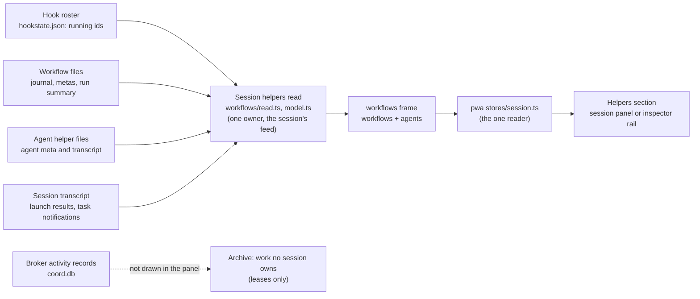
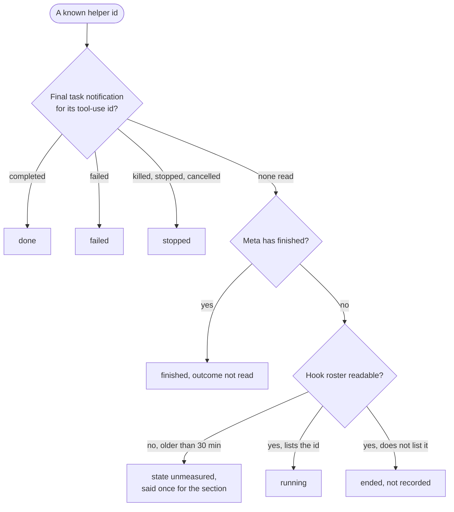
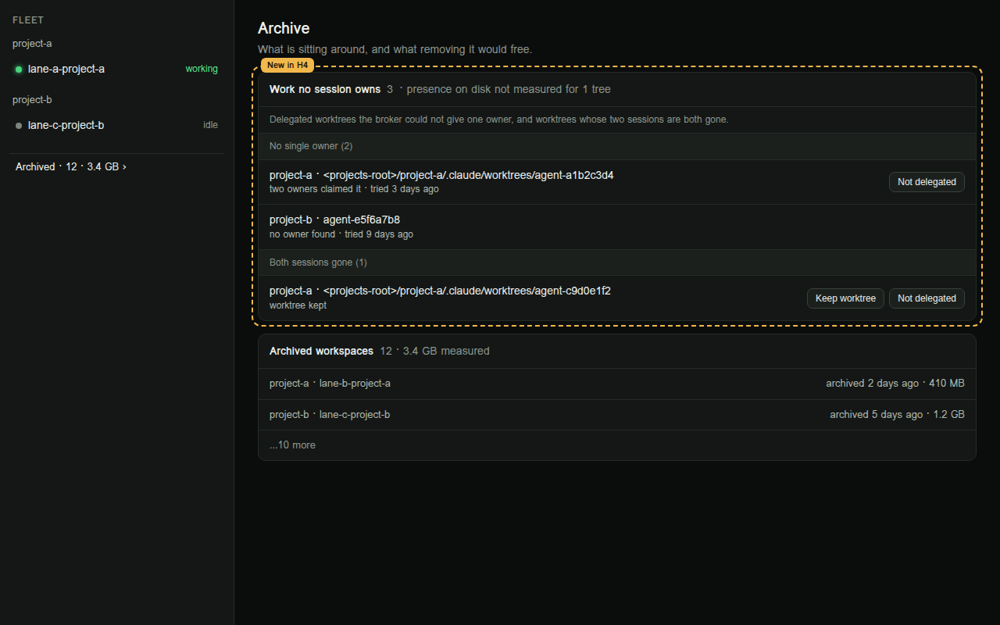
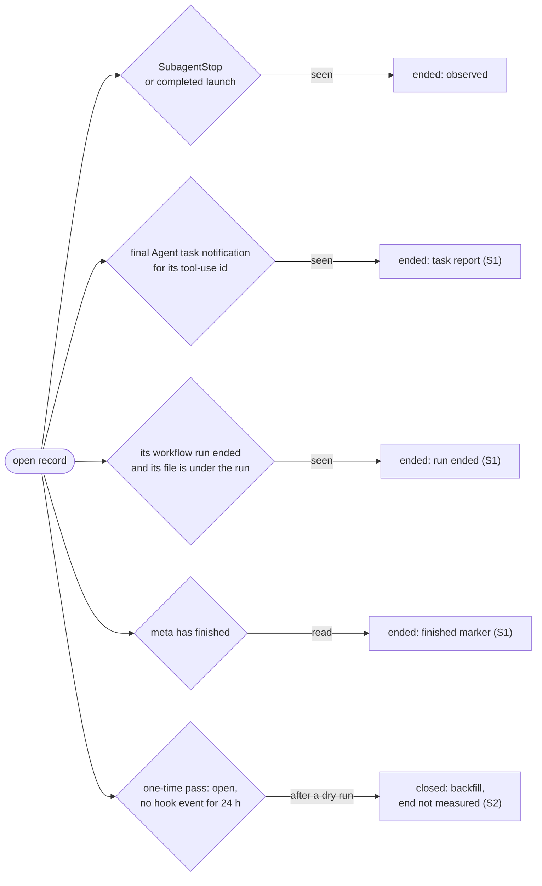
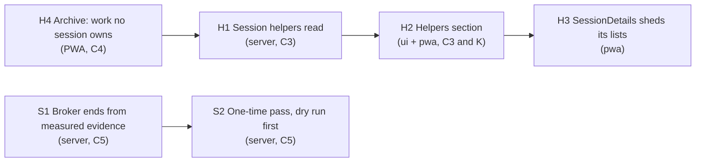

# A session's helpers, live in its own panel

**Spec** · 2026-11-19 · Status: Draft, for the operator's approval · Owner: Desktop polish (Task C49) · Linear: none · Related: `docs/superpowers/plans/2026-10-22-desktop-polish.md` (Tasks C46, C48), `docs/superpowers/specs/2026-11-02-delegation-visibility-design.md`, `docs/superpowers/specs/2026-10-04-delegation-broker-design.md`, `docs/superpowers/specs/2026-10-29-ccrc-history-w4-subagents-touched-design.md`

## In short

The operator asked on 2026-11-19 to see, inside the session they are looking at, "actual information about any running
workflows and subagents ... in a useful way". The fleet list no longer draws any of it (C46, C48). The session's own panel is
thin today. It shows a subagent's name and elapsed time, plus a list of broker records that read `agent · not confirmed`, and
some of those records are a month old.

This spec makes the session panel the one place this information lives. A **Helpers** section lists every subagent and
workflow the session is running, running ones first. Each row shows what the helper is doing, its kind, model and effort,
its measured state, how long it has run and when it last wrote anything. A workflow row also shows its phase and its agents
done out of total. A finished helper keeps its row with a one-line outcome for ten minutes, folded, and its row opens to the
helper's final report.

Every fact comes from files ccrc already reads or can read on the session's own feed, so the fleet does no new polling. The
broker's activity records are not drawn in the panel, because they say nothing about the helper itself.

The spec also designs three things around the panel:

- a home for delegated worktrees that no session owns, as a section of the Archive screen;
- a broker change that closes records from measured ends;
- a one-time pass, run once with a dry run first, that closes the 2,391 records the broker never closed, without deleting
  anything or inventing an end time.

What to check: the row grammar in §4, the freshness promises in §5, and the coordinator's three calls in "Where things
stand".

## 1. Context

The operator's words (2026-11-19): "inside the session in the right hand panel I still want to see actual information about
any running workflows and subagents, for the session i'm inside of, in a useful way though please". On a desktop, the fleet
list is the left panel and the open session is the right-hand one. On a phone, the session is the whole screen.

This follows the operator's ruling of the same day that the fleet list draws none of it. C46 and C47 took the counts off.
C48, running beside this task, removes every delegation row from the fleet list, unowned worktrees included.

Every finding below is labelled **measured** (a command or a read-only query was run and its result seen) or **inferred**
(read from code or deduced). The data was read read-only on 2026-11-19. Only counts and key names are given here, never
content: this repository is public. The source reads are at `main` 39af0ba5be.

## 2. What ccrc can read today

Five sources carry facts about a session's helpers. Two of them, the workflow reader and the session transcript, are already
read on the session's own feed. The panel is built on those two, plus the hook's roster as the one "is it still running"
signal.

### 2.1 The measured sources

| Source | What it carries | Freshness | Owner of the read | Footing |
|---|---|---|---|---|
| Hook roster, `$REG/<id>.hookstate.json` key `subagents` | Per running helper: `id`, `name`, `startedAt`. It adds an entry on SubagentStart and removes it on SubagentStop. It empties on SessionStart, and on a main-thread Stop with no background work. It keeps at most 32. No model, effort, description or outcome. | Written on every hook event. Unusable past `HOOKSTATE_FRESH_MS` (30 min) of silence. | `server/src/hookstate.ts#reviveSubagents`, which drops `id` today. Wire: `FleetSession.subagents` (`{name, startedAt}[]`). | Measured (code) |
| The session's workflow files: `<session dir>/subagents/workflows/<run>/journal.jsonl`, `agent-<aid>.meta.json` and `.jsonl`, and `<session dir>/workflows/<run>.json` | Per workflow: name, phases, per-agent label, phase and state (`started`, `result`, `failed`), tokens, and the run's final status. The journal has no timestamps. | Each reading of the session's feed: driven by the fleet watcher's 2 s tick, with a 30 s backstop. Bounded per tick. | `server/src/workflows/read.ts#SessionWorkflows` (L3) and `model.ts` (L1). Wire: the `workflows` session-socket frame, `shared/workflows.ts#WorkflowView`. | Measured (code) |
| Agent helper files: `<session dir>/subagents/agent-<aid>.meta.json` and `.jsonl` | Meta: `agentType`, `description`, `model`, `effort` (sometimes), `toolUseId`, `spawnDepth`, and `finished`, the only on-disk end marker, set on 197 of 205 recent metas. Transcript lines carry `timestamp`, the resolved model and `usage`. A failed or stopped helper's state is NOT on disk. | Written by Claude Code as the helper works. | No reader today. `server/src/watch.ts#readAgentMeta` reads a meta for the worktree path only. | Measured (files and code) |
| The session's own transcript: the Agent and Workflow tool calls, and background-task notifications | Launch input: `description`, `subagent_type`, `model`, `effort` (24 of 37 calls), `run_in_background`. Launch result: `status: async_launched`, `agentId`, `resolvedModel` (36 of 36 sampled results were async). Completion: a `task-notification` with `status` (`completed`, `failed`, `killed`, `stopped`), `summary`, `result`, and for a workflow its agent counts. | When Claude Code writes the record, then the next reading of the feed. | `server/src/transcript/parse.ts` on the session socket. The notification is parsed in `shared/api.ts#parseTaskNotification`, which the chat already uses (`pwa/src/session/chatItems.ts`). | Measured (one recent session sampled, and code) |
| The broker's activity records, `delegation_activities` in `coord.db` | `sourceKind`, `displayName`, `openedAt`, `lastEventAt`, `executionState` (`active`, `ended`, or `unknown`, which has no writer). Opened by SubagentStart or a launch result. Closed by SubagentStop, a `completed` launch result, or a workflow's terminal notification, which closes the run and its `<run>-<n>` rows. | The broker lane, every 60 s (`DIVERGENCE_SWEEP_MS`). | `server/src/coord/delegation-checkpoint.ts#DelegationCheckpointBuilder` (the fold, the one writer). Projection: `delegation-projection.ts#livenessOf`. | Measured (code) |
| ccrc history's subagent work (W4) | The history sweep's walk has a subagent arm: it walks `subagents/` and each run directory, and ingests helper transcripts with their meta companions into the history store. It reads the meta's `toolUseId` and never reads the journal. A store of past text, not a live state. | The sweep's cadence. | `ccd/history/lib.mjs` (`AGENT_LEVELS`, the walk's levels) and the sweep; tests in `server/test/history-agents-ingest.test.ts`. | Measured (code) |

*Table 1. Every source, what it carries and who reads it.*

Two facts decide the design:

- **The broker cannot say whether a helper is running.** `livenessOf` calls a record `live` whenever its parent session is up
  in the same incarnation. It never looks at the helper (sourced: `delegation-projection.ts#livenessOf`, and §1 of the
  delegation visibility spec). That is why every row reads `not confirmed`.
- **A failed or stopped Agent helper is known only from the notification** in the session's transcript. Its meta file does
  not record it (measured on the files).

### 2.2 The stale records

The query ran read-only (`node:sqlite`, `readOnly: true`) against the server's coordination database, on 2026-11-19 around
20:00 UTC. It returned counts only.

| Measure | Value |
|---|---|
| Activity records, all | 30,281 |
| Open (`active`) | 2,391: 1,899 bash-worktree, 445 agent, 47 workflow |
| Open, by age since opened | 7 under 1 h, 27 under 1 day, 42 under 7 days, 1,462 under 30 days, 853 at 30 days or more |
| Open with no hook event after the one that opened them | 2,062 of 2,391 |
| Open agent or workflow records under their parent's latest incarnation, the parent seen within the hour | 261. These are the rows the panel draws as `not confirmed`: 9 opened 30 days ago or more, 222 between 7 and 30 days ago. |
| Ended records, how long they ran | 27,736 under 1 h, 154 under 1 day, **none longer** |
| Sample: 150 open agent records under live parents | 150 have hook events, **0** have a SubagentStop |
| Sample: the 60 newest open agent records | all have a SubagentStart, none a SubagentStop |

*Table 2. The broker's open records, measured.*

**Why they never closed.** The open agent records were matched read-only against the helper files on the fleet box:

| Group | Count | What it means | Footing |
|---|---|---|---|
| Opened more than 7 days ago | 377 | No helper file of any kind remains on disk for any of them. They cannot be measured now. Claude Code's transcript retention is the likely reason. | Measured count, inferred reason |
| Opened within 7 days, the helper is a **workflow agent** | 69 | Each workflow agent fires SubagentStart, but no SubagentStop. Its record opens as an `agent` keyed by its agent id. The workflow's end closes only the run row and its `<run>-<n>` rows, so the record stays open forever. **This is the main cause today.** | Measured (count and paths), and sourced (`foldNotification` matches `<run>-<n>` only) |
| Opened within 7 days, an Agent helper whose meta says `finished` | 11 | The helper finished, but no stop event reached the broker. | Measured |
| Opened within 7 days, an Agent helper with no `finished`, transcript written in the last 10 minutes | 11 | Probably really running, including this task's own helpers. | Measured |
| Opened within 7 days, an Agent helper with no `finished`, quiet for longer | 4 | Unknown: killed, interrupted or cleared. | Measured count, unknown cause |

*Table 3. Why the open agent records stayed open. The groups overlap where one agent id has metas in more than one
configuration directory: 95 meta matches cover 78 distinct ids.*

**What an open record whose helper went quiet means.** An open record means only that the broker saw a start and no end. It
never means "running", and the panel never draws one (§4.4). Section 7 closes records from measured ends (S1). It also
designs a one-time pass that closes the old records (S2).

## 3. Design

The panel is fed by one server reader, the one that already reads this session's workflows. It is extended to read the
session's Agent helpers beside them. The broker stays where it is; it feeds the panel nothing.

*Figure 1. Four sources meet in one reader on the session's own feed; the broker's records stay out of the panel.*

### 3.1 One owner, extended

`SessionWorkflows` already reads `<session dir>/subagents/workflows/`, inside the agent's read whitelist, within per-tick
budgets. Agent helpers live one directory up, `<session dir>/subagents/agent-<aid>.*`. This spec extends that reader and its
pure fold. It adds no second reader of helper files: the consolidate-don't-duplicate rule names this owner.

The reader does not list the directory. One session measured hundreds of run directories, and helper files pile up over its
life. Instead it reads by id, from the two id sources already in the session stream's hands:

1. **The hook roster** (running helpers). The session stream already reads the hook state every reading (`applyHook` in
   `server/src/sessionws.ts`). `reviveSubagents` keeps `id`, as a server-internal field.
2. **The session transcript's Agent launch results and task notifications** (helpers launched or finished while the stream
   was open). The transcript parser surfaces `agentId`, `toolUseId` and the notification's `status`, `summary` and `result`
   to the fold, through `parseTaskNotification`, the one parser the chat already uses.

For each known id that is not yet final, the reader reads the meta once, and again when the helper's transcript grows, until
it is final. It reads one tail of the transcript (`TAIL_BYTES`) when its size changes, for the last line's `timestamp` and its
usage. Those reads share `AGENT_READS_PER_TICK` with the workflow agents.

### 3.2 How an Agent helper's state is decided

State is decided in L1 (`model.ts`), from measured facts only, in this order:

*Figure 2. A helper's state, decided from the strongest measured fact first. Nothing is ever inferred to be running.*

`ended, not recorded` is a real end, not a guess. Claude Code removes a helper from the roster on its stop, or when the main
thread stops with no background work left. It is drawn as `ended`, with no outcome line.

`state unmeasured` happens only when the hook state is stale. The section then says so in one line, and no row carries the
word.

## 4. What the panel shows

The Helpers section replaces today's workflow strip (`ui/src/components/workflow-strip.tsx`, D-5560). It also replaces the
subagent list in SessionDetails. It sits where the workflow strip sits: in the strips under the transcript between 900 and
1599 px, and as a section of the inspector rail at 1600 px and up, where the rail already holds the mail and the tasks. With
no helpers and nothing unmeasured it draws nothing, as the workflow strip does today.

### 4.1 The section head

| Situation | Head reads |
|---|---|
| Helpers running | `Helpers · 3 running` (plus `· 2 finished` when the finished fold is non-empty) |
| Only finished helpers in the last 10 min | `Helpers · 2 finished` |
| Hook state stale | `Helpers · live state unmeasured (no hook event for 41m)`, once |
| The workflow files could not be read | today's `progress unreadable` on the row, unchanged |

*Table 4. The head says the count once; the rows never repeat it.*

### 4.2 A running row

| Part | Agent helper | Workflow |
|---|---|---|
| Line 1, what it is doing | The launch's `description` (meta `description`) | The script's name (`WorkflowView.name`) |
| Kind | `subagent · <agentType>`, e.g. `subagent · Explore` | `workflow` |
| Model and effort | `Sonnet · high`, from the meta. A missing effort is left out, never guessed. | Not shown at run level: its agents differ |
| State | `running` | `running`, plus today's `N failed` when agents failed |
| Progress | none | `phase <title> · 7/12 agents`, plus the existing meter |
| Elapsed | `12m5s`, from the first transcript line's `timestamp`, ticking on the client clock | from `startedAt`, as today |
| Last activity | `active 20s ago`, from the helper transcript's last line `timestamp`. Past 10 minutes it reads `quiet 14m`, a fact with no state change. | `active 20s ago`, from the journal file's change time (new, `lastActivityAt`) |
| Tokens | `↓ 41k`, from the last usage line, when measured | `↓ 2.5m tokens`, as today |

*Table 5. One running row, by kind. Every part is a measured fact or is left out.*

### 4.3 A finished row

A finished helper moves into a fold, `Finished · last 10 min (N)`, closed by default. It leaves 10 minutes after its end
(`HELPER_FINISHED_KEEP_MS`). Its row is line 1 as above, then one line:

| State | Second line | Opens to |
|---|---|---|
| `done` | `done · 4m12s ·` the notification's `summary`, one line | the helper's final report (the notification's `result`), capped, with Copy |
| `failed` | `failed · 1m3s ·` summary | the report, if any |
| `stopped` | `stopped · 22s` | nothing more |
| `finished, outcome not read` | `finished · 6m` (the notification is outside what the stream has read) | nothing more |
| `ended` | `ended · 9m` | nothing more |
| workflow `completed`, `failed`, `killed` | today's words: `done`, `failed`, `stopped`, with `12/12 agents` | the existing phases and agents list |

*Table 6. A finished row says its outcome in one line, then folds away.*

A workflow keeps today's 30 s on the wire (`WORKFLOW_EVICT_MS`, Claude Code's own). The PWA keeps a finished workflow under
the fold for the same 10 minutes from the last frame that carried it. So both kinds behave alike to the reader, and the
server's parity with Claude Code is untouched.

### 4.4 What the panel never shows

- **No broker record row.** The `N delegated` disclosure's activity rows (`agent · not confirmed`, `stop not seen`) leave the
  session panel. Each helper they recorded is a Helpers row with a measured state. A record with no measured helper is a
  record, not a helper, and is not drawn. The disclosure keeps the lease rows C48 moves there (worktrees, with their acts).
- **No word the operator cannot act on.** Not `not confirmed`, not `unmeasured` per row. An unmeasured fact is left out of
  the row and said once in the head.
- **No running claim without a measurement.** `running` comes only from the hook roster, read fresh, with no end recorded.

### 4.5 The header

SessionDetails' `⑂ N subagents` disclosure and its name-and-elapsed list are removed. The Helpers section is the one list, so
a second list and a second count of the same helpers would disagree between ticks. The header's status keeps
`working · N in background` and its title (D-8771's one allowance).

### 4.6 Mockup

*Figure 3. Desktop, 1280 px, Refined skin, dark. Helpers sits in the strips under the transcript. At 1600 px and up the same
section sits in the inspector rail.*

*Figure 4. Phone, 360 px. Collapsed: the head and the first two rows' line 1. Open: two-line rows, the finished fold last.*

*Figure 5. The Archive screen's new section for delegated worktrees no session owns (§6). This is the coordinator's call, ask
649.*

The mockup's source page is `docs/design/2026-11-19-session-helpers-design/mockup.html`. Its data is invented.

## 5. Freshness each fact can honestly promise

| Fact | How fresh | Why |
|---|---|---|
| Running, or ended (roster) | Within one reading of the session's feed after the hook event: the 2 s watcher tick | The hook writes on every SubagentStart and Stop |
| Live state as a whole | Unmeasured once the hook state is 30 minutes old | `HOOKSTATE_FRESH_MS` |
| done, failed, stopped, summary, result | When Claude Code writes the notification, then one reading | The transcript is read on the same feed |
| Description, kind, model, effort | From the first reading after launch; they do not change | Meta written at launch |
| Last activity, elapsed, tokens | One reading after the helper's transcript grows, within `AGENT_READS_PER_TICK` | Read by size change, shared budget |
| Workflow phase, agents done and total | As today: one reading, with bounded journal chunks | Unchanged reader |
| Workflow last activity | One reading after the journal grows | The journal's change time |
| The section on a session nobody has open | Not read at all | The session feed runs only for an open session socket |

*Table 7. Every promise is bounded by a named reading, never by a guess.*

**Cost.** The reads happen only for sessions someone has open: the session feed is per open session, not fleet-wide. With
about 20 sessions on the fleet and one or two open, an open session with N unfinished helpers costs at most one stat and one
tail read per helper per reading. That is under the existing 24-read budget, and costs nothing once a helper is final. The
fleet watcher, the hook and the agent protocol do not change.

## 6. Work no session owns: its home

C48 removes unowned delegated worktrees from the fleet list, and with them the only door to `Attach to…`. They get a section
of the Archive screen, **Work no session owns**. The Archive screen already answers "what is sitting around". The fleet
foot's existing Archived row reaches it, so the fleet list gains nothing. This is the coordinator's call (ask 649).

Each row shows the worktree's project, branch, the session that made it (when recorded), its age and today's workspace
qualifier. It offers the three existing acts: `Attach to…`, `Keep` and `Not delegated`. Each act goes through the existing
session-gated doors, `POST /api/leases/:lease/resolve` and `POST /api/leases/:lease/operator-retain`. The words come from
`pwa/src/fleet/delegationWords.ts` (`ATTACH_WORD`, `KEEP_WORD`, `NOT_DELEGATED_WORD`, `unownedLine`). Nothing new is said or
written. The section reads `DelegationProjectionWire.unowned` from the fleet store. With none, it draws nothing.

## 7. The broker's records: closing from measured ends

The broker keeps its records, its owner and its projection. This spec adds closing evidence it does not have today, in two
server tasks, both in C5 Coordination. The owner of both is the broker's one writer of an activity,
`DelegationCheckpointBuilder` in `server/src/coord/delegation-checkpoint.ts`, through its journal
(`server/src/coord/delegation-journal.ts`).

*Figure 6. Every way a record closes, with its evidence named. Only S2's pass closes without a measured end, and it says so.*

### 7.1 S1: closing from measured ends

- **An Agent's final task notification ends its record.** `foldNotification` indexes Workflow launches only today ("An
  Agent's notification is never touched"). It gains Agent launches by tool-use id, keyed as Workflow launches are.
- **A workflow's end ends its agents' records.** When a run's final notification ends the run, every open `agent` record of
  the same parent and incarnation whose helper file sits under that run's `transcriptDir` ends with it. This closes the 69
  workflow-agent records of Table 3, the main source today.
- **A meta's `finished` marker ends its record.** The broker already reads `agent-<id>.meta.json` positively to open a record.
  The same read ends it when the marker is present.
- Each end records its basis in a new column, `endBasis`, with one of `observed`, `task-report`, `run-ended`,
  `finished-marker` or `backfill-unmeasured`. Today's ends read as `observed`. `endedAt` is the evidence's own time. The
  migration refuses to start rather than open empty, as every coordination migration does.

### 7.2 S2: the one-time pass (the coordinator's call, ask 650)

These conditions are the coordinator's, carried as given:

1. **Designed here, built in its own PR.** Nothing in this task writes the coordination database.
2. **Nothing is deleted and no end time is invented.** Each record is marked closed with `endBasis = backfill-unmeasured`
   and `endedAt` null. The reason reads "closed by the one-time pass; its real end was not measured". The record stays
   readable, and the pass can be undone: a journal entry of its own reopens exactly the records it names.
3. **It runs once, through the broker's existing writer,** as one journal entry folded by `DelegationCheckpointBuilder`. It
   is idempotent: a second run finds nothing to close. It touches only records that are open and have had no hook event for
   **24 hours**. Table 2 shows why that bound is enough: no record that ended ran longer than a day.
4. **A dry run first** reports the count it would close, by kind and age, and writes nothing.
5. **It is the coordinator's call,** which the operator can overturn.

Compaction (`delegation-compaction.ts`) retires only ended records. It must skip `backfill-unmeasured` records, so the pass
deletes nothing later either.

## 8. Wire changes

All changes are additive. `FLEET_PROTO` stays 1, and the agent protocol does not change. Each field has one reader.

| Change | Where | Its one reader | An older peer |
|---|---|---|---|
| `agents?: AgentHelperView[]` on the `workflows` frame | `shared/workflows.ts` (type), `server/src/workflows/model.ts` (decides) | `pwa/src/stores/session.ts` (the frame's reducer) | Absent: no Agent rows, the workflow rows as today |
| `agentsUnmeasured?: { hookAgeMs: number }` on the same frame | same | same | Absent: nothing said |
| `WorkflowView.lastActivityAt?: number \| null` | `shared/workflows.ts` | the same reducer, which the strip reads | Absent: the row leaves out `active … ago` |
| `AgentHelperView`: `id`, `description`, `agentType`, `model`, `effort`, `state`, `startedAt`, `endedAt`, `lastActivityAt`, `tokens`, `summary`, `report` (capped) | `shared/workflows.ts`, beside `WorkflowView` | the same reducer | — |
| The hook roster keeps `id` | `server/src/hookstate.ts` (server-internal; `FleetSession.subagents` unchanged) | `server/src/sessionws.ts` | — |
| `delegation_activities.endBasis` | `server/src/coord/schema.ts` migration | `DelegationCheckpointBuilder` | Not on any wire: ended rows are not projected |

*Table 8. Every wire change, additive, with one reader each.*

`AgentHelperState` is `running | done | failed | stopped | finished | ended`. The runtime list is derived from a
`Record<AgentHelperState, true>`, as `WORKFLOW_STATES` is. `report` is capped at 16 KiB and `summary` at one line of 200
bytes. A cut report says so.

## 9. Rings and contexts of the new pieces

| Piece | File | Ring | Context |
|---|---|---|---|
| `AgentHelperView`, `AgentHelperState`, `HELPER_FINISHED_KEEP_MS` | `shared/workflows.ts` | L0 | K (shared kernel) |
| Agent state decision, fold of ids and notifications | `server/src/workflows/model.ts` | L1 | C3 Session Conversation |
| Meta and transcript-tail reads by id | `server/src/workflows/read.ts` | L3 | C3 |
| Wiring the roster ids and transcript facts into the read | `server/src/sessionws.ts` | L4 | C3 |
| The roster's `id` | `server/src/hookstate.ts` | L1 | C1 Fleet Registry |
| The launch and notification facts surfaced to the fold | `server/src/transcript/parse.ts` | L1 | C3 |
| The Helpers section, rows, head, finished fold | `ui/src/components/workflow-strip.tsx`, extended in place | L4 | K (design system) |
| The rail's section | `pwa/src/inspector/HelpersSection.tsx` (new) | L4 | C3 (`inspector/**`) |
| The frame's reducer | `pwa/src/stores/session.ts` | L4 | C3 |
| Archive's unowned section | `pwa/src/fleet/ArchiveUnownedWork.tsx` (new, `fleet/Archive*.tsx` row) | L4 | C4 Workspace Lifecycle |
| Ends from measured evidence, `endBasis`, the one-time pass | `server/src/coord/delegation-checkpoint.ts`, `delegation-journal.ts`, `schema.ts`, `delegation-compaction.ts` | L1 / L3 | C5 Coordination |

*Table 9. Each new piece's ring and context, by the architecture spec's rules.*

## 10. The phone layout

At 360 px the Helpers strip sits where the workflow strip sits today, above the timers and the plan. Collapsed, it shows the
head and line 1 of the first two running rows. Each row is one line, ellipsised, with its state word kept visible at the end.
Open, it becomes one scroll body, at most 50% of the viewport high. Each row has two lines:

- line 1: what it is doing;
- line 2: `kind · model · effort · state · elapsed · active … ago`. When the line is too long, model and effort wrap to a
  third line, and the state and the times never do.

A finished row's tap target opens its report inline. The control is a real `<button>` with `aria-expanded`, at least 44 px
high. Nothing depends on a title attribute, because phones do not show titles.

## 11. The build, one PR each, in landing order

Each task starts red: its first commit adds the tests that fail on `main`.

*Figure 7. Two independent lines. H4 lands first because C48 removes the only door to unowned work. H3 lands only after
H2, so nothing leaves the panel before its replacement is there.*

| Task | What | Red first | Depends on |
|---|---|---|---|
| **H4** | Archive's "Work no session owns" section, reading `DelegationProjectionWire.unowned`, with the three existing acts | A render test: an unowned entry draws one row with three acts, and none draws nothing; the act calls the existing doors | C48 merged |
| **H1** | `agents` on the `workflows` frame: the roster keeps `id`, the parser surfaces launch and notification facts, `model.ts` decides state per Figure 2, `read.ts` reads by id within the budget, `lastActivityAt` on workflows | A decision table over every branch of Figure 2. A budget test: N helpers, at most `AGENT_READS_PER_TICK` reads. A frame test: an absent `agents` from an older server. A mutant for each branch, run with the mutation runner | — |
| **H2** | The Helpers section in the strip and in the rail; the 10-minute finished fold; the report expand; the phone layout | Render tests for Tables 4 to 6 at 360 and 1280 px. A browser test that the strip moves to the rail at 1600 px. A no-word census: no row says `not confirmed` or `unmeasured` | H1 |
| **H3** | SessionDetails loses the subagent disclosure and the activity rows; the delegated disclosure keeps C48's lease rows; dated amendments to the delegation visibility and broker specs | `card-header-facts` pins on the new header, and a new SessionDetails render test that draws no subagent list and no activity row. A census that `LIVENESS_QUALIFIER` words appear in no session-panel output | H2 |
| **S1** | Ends from Agent task reports, run ends and finished markers; the `endBasis` column; compaction skips backfill rows | Fold tests per evidence kind. A migration test that refuses rather than opens empty. A replay test: rebuild from the journal gives the same ends | — |
| **S2** | The one-time pass: a dry-run report, then one journal entry; the undo entry; idempotence | A dry run writes nothing. A second run closes nothing. Undo reopens exactly the named records. Records younger than 24 h are untouched | S1 |

*Table 10. Six PRs, each red first, in the order they land.*

## 12. Decisions

Decisions are ruled by the operator, by the coordinator on a structured ask, or are this spec's own call, marked
Judgement.

| # | Decision | Options considered | Chosen, and why | Status |
|---|---|---|---|---|
| D-8794 | The session's own panel, not the fleet list, carries a session's helper information | The fleet list; the session panel | The session panel: the operator's ruling of 2026-11-19 | Ruled |
| C1 | Where unowned delegated work lives | Archive section; its own screen; the coordinator's page | Archive section: it already answers "what is sitting around", and the fleet list gains nothing (ask 649) | Ruled |
| C2 | The 2,391 open records | Close in one pass; leave them | One pass, on the five conditions in §7.2 (ask 650) | Ruled |
| C3 | Opening a helper's output | Its result now and its transcript later; both now | Result now; the read-only helper transcript view is Later (the third ask, on opening a helper's output) | Ruled |
| J1 | Extend `SessionWorkflows`, or add a new reader | Extend; new reader | Extend: the same directory, budget and feed; a second reader has no "legitimately different" reason | Judgement |
| J2 | How to find helper ids | List the directory; read by id from the roster and the transcript | By id: listing costs grow with the session's life, and ids are already in hand | Judgement |
| J3 | Where "running" comes from | Broker liveness; transcript recency; hook roster | Hook roster, read fresh: the one source that removes an entry on the helper's own stop | Judgement |
| J4 | Broker records in the panel | Keep with condition words; hide; fold into one line | Hide: they say nothing the operator can act on, and every live helper they name is a Helpers row | Judgement |
| J5 | The header's subagent list | Keep; remove | Remove: one list, one count | Judgement |
| J6 | Finished keep | 30 s like Claude Code; 10 min folded | 10 min, folded, for both kinds; the server's 30 s for workflows stays | Judgement |
| J7 | The pass's quiet bound | 1 h; 24 h; 7 days | 24 h: no ended record ran longer than a day | Judgement |
| J8 | A recurring quiet close after the pass | Now; later | Later, if S1's measured ends leave records open (see Later) | Judgement |

*Table 11. Every decision, with its footing.*

### Deviations

- **D-8794** — `session-panel-carries-helpers`: Task C49, issued on 2026-11-19. The session's own panel, not the fleet list,
  carries a session's helper information, subagents and workflows alike, by the operator's ruling of 2026-11-19. The Helpers
  section is the one list. It supersedes SessionDetails' subagent list (D-5232's reader) and drops the session panel's
  broker activity rows (the delegation visibility spec's §5 header list). The record keeps the lease rows C48 moves there.

## 13. Testing and proof

- Each build task carries its red-first tests (Table 10), with mutants run by the mutation runner for every new decision
  branch.
- H1 ends with a fleet measurement on a session that runs a workflow and two background Agent helpers. It records each row's
  state against the notification that later arrives, and counts any `running` row whose helper had ended.
- S2's dry run is pasted, as counts, into its PR before the pass runs.

## 14. Words used here

| Word | Meaning |
|---|---|
| Helper | A subagent (launched by the Agent tool) or a workflow, together with its agents, that a session started |
| Hook roster | The list of running helpers the session hook keeps from SubagentStart and SubagentStop |
| Activity record | The broker's row for one helper it saw start, in the coordination database |
| Unowned work | A delegated worktree no live session owns |
| Reading | One pass of the session's feed, which reads the session's files for its open socket |

## Where things stand

### Agreed

- The operator, 2026-11-19: inside the session they are in, the right-hand panel shows actual, useful information about the
  session's running workflows and subagents.
- The operator, 2026-11-19: the fleet list draws none of it (C46, C47, and C48 beside this task).

### Waiting on you

- Approval of this design, and of the coordinator's three calls below, which you may overturn:
  - **Ask 649:** unowned delegated work lives in a section of the Archive screen (§6, Figure 5).
  - **Ask 650:** the 2,391 open broker records are closed once, by the five conditions in §7.2.
  - **The third ask (opening a helper's output):** a helper row opens its result now; the helper's own transcript view comes later.

### Later

- A read-only view of a helper's own transcript, through a new bounded, session-gated read and the existing transcript
  parser. Its design weighs the history store, which already holds helper transcripts, as the source. It comes back after H2, at the operator's word (the third ask, on opening a helper's output).
- A recurring quiet close in the broker, if S1's measured ends still leave records open a week after S1 lands. Measure the
  open count then.
- Background shell commands and monitors in the Helpers section. They are background tasks too, but the operator asked about
  workflows and subagents.
- Stop and skip controls for an Agent helper from its row. The workflow controls (D-5935) stay where they are.
- Retiring `FleetSession.subagents` once no reader is left after H3.
- Helper rows in the instrument skin's status mode, which draws no helpers today.

---

*Written by Claude for the operator, desktop polish Task C49. Diagrams are Mermaid text; the mockups are PNGs rendered from
the committed mockup page.*
