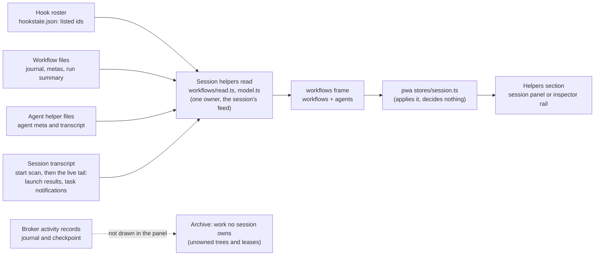
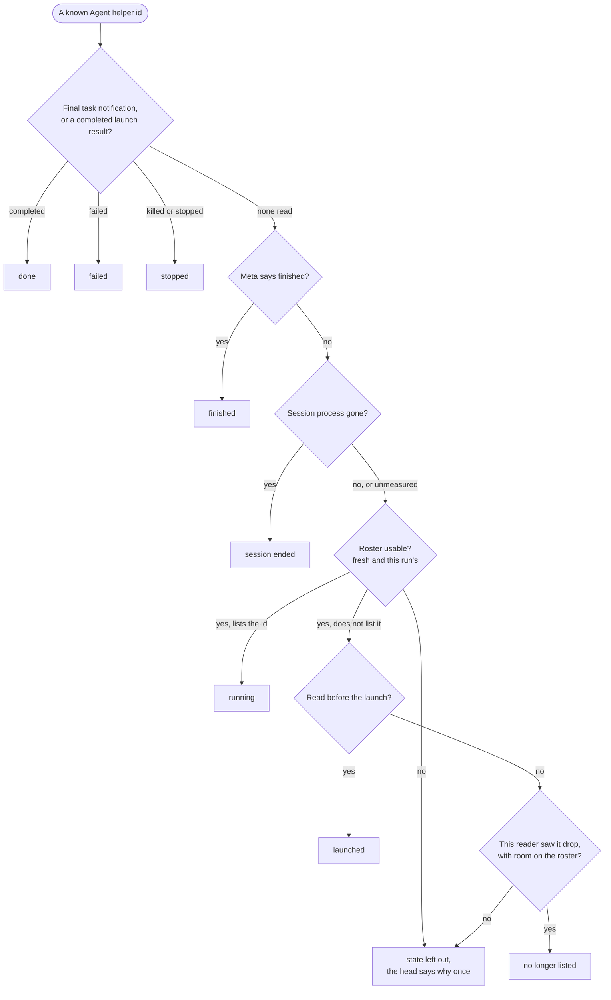
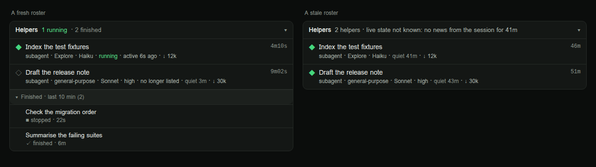
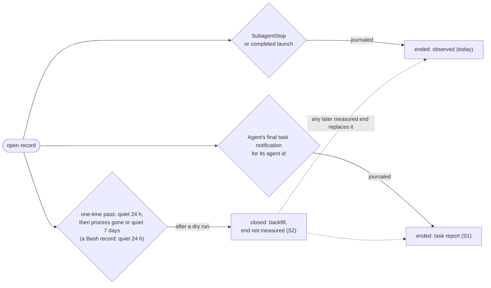
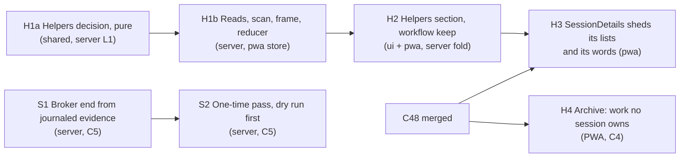

# A session's helpers, live in its own panel

**Spec** · 2026-11-19, revised 2026-11-20 after reviews 2861 and 2888 · Status: Draft, for the operator's approval · Owner: Desktop polish (Task C49) · Linear: none · Related: `docs/superpowers/plans/2026-10-22-desktop-polish.md` (Tasks C46, C48), `docs/superpowers/specs/2026-11-02-delegation-visibility-design.md`, `docs/superpowers/specs/2026-10-04-delegation-broker-design.md`, `docs/superpowers/specs/2026-10-29-ccrc-history-w4-subagents-touched-design.md`

## In short

The operator asked on 2026-11-19 to see, inside the session they are in, "actual information about any running workflows
and subagents ... in a useful way". This spec gives the session panel one **Helpers** section that lists each subagent and
workflow with what it is doing, its kind, model and effort, its measured state, how long it has run and when it last wrote
anything, and keeps a finished one for ten minutes, folded, opening to its report. The broker's records, and every word on
the panel the operator cannot act on, leave it; the `N delegated` chip goes with them. Around the panel it designs a home on
the Archive screen for delegated work no session owns, one new broker end from an Agent's task report, and a one-time,
dry-run-first close of the broker's old open records. Check the row grammar in §4, the freshness and cost promises in §5, and
the coordinator's three calls in "Where things stand".

## 1. Context

The operator's words (2026-11-19): "inside the session in the right hand panel I still want to see actual information about
any running workflows and subagents, for the session i'm inside of, in a useful way though please". On a desktop, the fleet
list is the left panel and the open session is the right-hand one. On a phone, the session is the whole screen.

This follows the operator's ruling of the same day that the fleet list draws none of it. C46 and C47 took the counts off.
C48 (#3096, merged 2026-11-20) removed every delegation row from the fleet list, and moved a session's worktrees into the
session's own details.

Today the session panel draws, in SessionDetails (`pwa/src/session/SessionDetails.tsx`):

- the `⑂ N subagents` button and its list, a name and an elapsed time per helper;
- the `N delegated` chip, whose title reads "recorded delegation entries, not a current agent count; execution not
  confirmed", and its disclosure of broker activity rows, each with a condition word such as `not confirmed`;
- after that disclosure and outside it, the worktrees section C48 added (`SessionWorktrees.tsx`), whose rows carry a
  liveness word (`not confirmed`, `stop not seen`, `session asleep`, `end recorded` or `unmeasured`) beside their controls;
- the workflow strip under the transcript, at every width.

Every finding below is labelled **measured** (a command or a read-only query was run and its result seen), **sourced** (read
from the code, cited by file and symbol) or **inferred** (deduced). The data was read read-only, and each measurement names
when. Only counts and key names are given here, never content: this repository is public. The source reads are at `main`
39af0ba5be, and at 261dd928a7 (after C48) for SessionDetails, its worktrees and §6.

## 2. What ccrc can read today

Six sources carry facts about a session's helpers. Two of them, the workflow reader and the session transcript, are already
read on the session's own feed. The panel is built on those two, plus the hook's roster as the one "is it still listed"
signal.

### 2.1 The sources

| Source | What it carries | Freshness | Owner of the read | Footing |
|---|---|---|---|---|
| Hook roster, `$REG/<id>.hookstate.json` key `subagents` | Per listed helper: `id`, `name` (the agent's name, else its type), `startedAt`. A SubagentStart that carries an agent id adds one, whatever its type, so a workflow's agents are listed too. A SubagentStop removes its id. It keeps the newest 32. Every SessionStart except a compaction empties it. A main-thread Stop with no background work empties it; one with 1 to 8 background subagents, all listed, cuts it to those ids. A Stop with more than 8 background tasks, with any other delegated kind such as a workflow, or with an unmeasured count leaves it alone, and an unreadable hook state skips the write. | Written on every hook event. Unusable past `HOOKSTATE_FRESH_MS` (30 min) of silence. | `server/src/hookstate.ts#reviveSubagents`, which drops `id` today. Wire: `FleetSession.subagents` (`{name, startedAt}[]`), copied in `server/src/fleet.ts`. The session stream reads the watcher's published copy (`sessionFeed.ts#hookRead`), up to 10 s old. | Sourced |
| The session's workflow files: `<session dir>/subagents/workflows/<run>/journal.jsonl`, `agent-<aid>.meta.json` and `.jsonl`, and `<session dir>/workflows/<run>.json` | Per workflow: name, phases, per-agent label, phase and state (`started`, `result`, `failed`), tokens, the run's final status and end. The journal has no timestamps. | Each reading of the session's feed: the watcher's pane publication, on its 2 s tick. Bounded per reading. | `server/src/workflows/read.ts#SessionWorkflows` and `model.ts`. Wire: the `workflows` member of `SessionStreamMsg` (`shared/api.ts`), carrying `shared/workflows.ts#WorkflowView`. | Sourced |
| Agent helper files: `<session dir>/subagents/agent-<aid>.meta.json` and `.jsonl` | Meta: `agentType`, `description`, `model`, `effort` (sometimes), `toolUseId` (most, not all), `spawnDepth`, and `finished`, the only on-disk end marker. In samples: `finished` on 197 of 205 and on 160 of 185; `toolUseId` on 150 of 170 and 165 of 185. Transcript lines carry `timestamp`, the resolved model and `usage`. A failed or stopped helper's state is NOT on disk. | Written by Claude Code as the helper works. | No panel reader. `server/src/watch.ts#readAgentMeta` reads a meta for an isolation worktree's path, in the broker's lane. | Measured |
| The session's own transcript: the Agent and Workflow tool calls, their results, and background-task notifications | Launch input: `description`, `subagent_type`, `model`, `effort` (24 of 37 calls), `run_in_background`. Launch result (`toolUseResult`): `async_launched` with `agentId` and `resolvedModel` for a background helper (36 of 36 sampled), or `completed` with the report for a foreground one. Completion: a `task-notification` whose task id is the agent id (105 of 105 committed Agent captures, 2.1.280 to 2.1.319), with `status` (seen: `completed` 324, `failed` 1, `killed` 3, `stopped` 3), `summary`, `result`. | When Claude Code writes the record, then the next reading. | `server/src/transcript/parse.ts` and `tail.ts`, which hand the stream `ChatEvent[]` only: no launch result reaches it today. The notification arrives as a `system` event that `shared/api.ts#parseTaskNotification` reads. | Measured |
| The broker's activity records: the journal and checkpoint, projected into `delegation_activities` in `coord.db` | `sourceKind`, `displayName`, `openedAt`, `lastEventAt`, `executionState` (`active`, `ended`, or `unknown`, which has no writer). Opened by SubagentStart, a launch result, or a positive meta read. Ended by SubagentStop, a `completed` launch result, or a workflow's terminal notification, which ends the run and its `<run>-<n>` rows. | The broker lane, every 60 s (`DIVERGENCE_SWEEP_MS`). | `server/src/coord/delegation-checkpoint.ts#DelegationCheckpointBuilder` (the fold, the one writer). Projection: `delegation-projection.ts#livenessOf`. | Sourced |
| ccrc history's subagent work (W4) | The history sweep walks `subagents/` and each run directory, and ingests helper transcripts with their meta companions into the history store. A store of past text, not a live state. | The sweep's cadence. | `ccd/history/lib.mjs` (`AGENT_LEVELS`) and the sweep; tests in `server/test/history-agents-ingest.test.ts`. | Sourced |

*Table 1. Every source, what it carries and who reads it.*

Two facts decide the design:

- **The broker cannot say whether a helper is running.** `livenessOf` calls a record `live` whenever its parent session is up
  in the same incarnation. It never looks at the helper (sourced: `delegation-projection.ts#livenessOf`, and §1 of the
  delegation visibility spec). That is why every row reads `not confirmed`.
- **A failed or stopped Agent helper is known only from the notification** in the session's transcript. Its meta file does
  not record it (measured on the files).

### 2.2 The broker's open records

All the queries below ran read-only (`node:sqlite`, `readOnly: true`) against the server's coordination database and
returned counts only. Each row says when its query ran.

| Kind | All | Open | Open, by the week they were opened |
|---|---|---|---|
| agent | 25,033 | 442 | 146 from 10-18 to 10-23; 191 from 10-23 to 10-30; 32, 8 and 65 in the three weeks since |
| workflow | 892 | 48 | 15; 20; then 2, 2 and 9 |
| bash-worktree | 5,264 | 1,899 | all 1,899 from 10-18 to 10-23, the last opened 10-22 09:18 UTC |
| **All** | **31,189** | **2,389** | 2,271 opened before 10-30 |

*Table 2. Open records by kind and age, one query at 2026-11-20 04:29 UTC. The first activity in the database is from
2026-10-18 06:49 UTC.*

| Measure | Value | When |
|---|---|---|
| Agent records opened in the last 7 days | 16,189, of which 65 are open (0.4%) | 04:29 UTC, Table 2's query |
| Hook spool on the fleet box, last 24 h: workflow agents | 2,116 SubagentStarts, 2,112 with a SubagentStop for the same agent id | 04:27 UTC |
| Hook spool, last 24 h: other agent types | 866 SubagentStarts, 861 with a Stop | 04:27 UTC |
| Journal, workflow-agent Starts and Stops per day since 2026-11-05 | Equal to within a few each day (for example 3,926 and 3,931 on one day) | 04:28 UTC |
| Open agent records opened before 10-30 (337) | Every one has its SubagentStart in the journal and no SubagentStop under any incarnation | 04:32 UTC |
| Open bash-worktree records, a sample of 200 of 1,899 | Every one has its PreToolUse in the journal and no PostToolUse | 04:32 UTC |
| Open bash-worktree records a lease names | 0 of 1,899 (lineage not measured; S2's dry run counts it) | 04:32 UTC |
| How long agent records ran, ended in the last 7 days (16,124) | median 0.5 min, 99th percentile 30 min, 99.9th 98 min, longest 887 min (14.8 h) | 04:30 UTC |
| Quiet gaps between consecutive journaled events naming one agent id, last 7 days (477,213 gaps over 18,855 agents) | median 2 s, 99th percentile 1.6 min, 99.9th 7.7 min, longest 629 min (10.5 h) | 05:47 UTC |
| Open agent records of the last 7 days whose parent had a later SessionStart | 28 of 66; every such SessionStart was a `compact` or a `resume` under the same Claude Code session id. The other 38 have no later session event | 04:34 UTC |
| Agent records of the last 7 days that ended by their own Stop after a SessionStart | 26 of 16,126: 24 after a `compact`, 2 after a `resume` | 04:34 UTC |

*Table 3. Why the open records stayed open. All on 2026-11-20; a hook-spool recount by review 2888 found the same ratio
(about 99.8%) on lower counts, because the spool prunes hourly files older than 24 h.*

**What this says.**

- **Workflow agents do fire SubagentStop.** The first revision said they never did; the committed hook captures and the live
  spool both show the Stop, and the broker ends those records today. Review 2861 found it (F1).
- **The backlog is history.** 2,271 of the 2,389 open records were opened before 10-30. In those weeks the journal received
  Starts and Pres but not the matching Stops and Posts, so those records never ended. The 1,899 bash-worktree records also
  predate the fold change of 2026-10-22 (commit bb1a9478db, D-6267 to D-6272), under which a Bash Pre that carried a
  listing opened an active record that only its Post could end (sourced: that commit's diff). Why the Stops and Posts of that
  period never reached the journal was not measured: which hook build the fleet box ran then is not recorded anywhere this
  task can read.
- **Today's residue is small, and its cause is not found.** Of the agent records opened in the last 7 days, 0.4% are open.
  28 of the 66 belong to a parent with a later `compact` or `resume`, but that does not end a helper: 26 records ended by
  their own Stop after one. Whether the rest are still running, or ended without a Stop, was not measured.

So the broker's live path works. S1 (§7.1) adds one end from evidence already in the journal, which does not depend on the
residue's cause, and S2 (§7.2) closes the history once.

## 3. Design

The panel is fed by one server reader, the one that already reads this session's workflows. It is extended to read the
session's Agent helpers beside them. The broker stays where it is; it feeds the panel nothing. Figure 1 shows the flow.


*Figure 1. Four sources meet in one reader on the session's own feed; the broker's records stay out of the panel.*

### 3.1 One owner, extended

`SessionWorkflows` already reads `<session dir>/subagents/workflows/`, inside the agent's read whitelist, within per-reading
budgets. Agent helpers live one directory up, `<session dir>/subagents/agent-<aid>.*`, which the whitelist also covers. This
spec extends that reader and its pure fold. It adds no second panel reader of helper files: the consolidate-don't-duplicate
rule names this owner. The broker's `watch.ts#readAgentMeta` stays a separate reader of the same file, legitimately
different: another context (C5, not C3), another field (an isolation worktree's path), another lane.

The reader does not list the directory. One session measured hundreds of run directories, and helper files pile up over its
life. Instead it reads by id, from two id sources the stream holds:

1. **The hook roster.** The session stream already reads the hook state on every reading (`applyHook` in
   `server/src/sessionws.ts`). `reviveSubagents` keeps `id`, optional, as a server-internal field: an id that fails the
   hook's own rule (`[A-Za-z0-9_-]`, 1 to 64 characters) reads as absent, never as a malformed hook state, because id-less
   entries still occur (D-5375). `server/src/fleet.ts`, which copies the roster onto `FleetSession.subagents`, strips it, so
   the fleet wire and the state cache are unchanged.
2. **The session transcript.** A new, server-internal second output of the transcript tailer, `HelperFact[]`, carries the
   two facts the chat does not need: an Agent or Task launch result (`toolUseResult`: its status, `agentId`, resolved model,
   and for a foreground helper its report) and a task notification (task id, status, summary, result). One pure parser,
   `helperFactsOf(line)` in `server/src/transcript/parse.ts`, reads them from the raw line; `ChatEvent` and the chat wire do
   not change. It resets wherever the backlog resets (§11, H1b).

**The start scan.** A stream that starts mid-session, on a reload or a new socket, has read only the backlog: the last 50
events within the last 1 MiB (`BACKLOG_N`, `transcript/tail.ts`). So at stream start the reader scans the transcript
backwards, with the existing back-reader (`server/src/backread.ts#walkBack`), for helper facts only. It stops at whichever
comes first:

- **Time:** it has passed both the earliest `startedAt` on the roster and 10 minutes before now, so it covers every listed
  helper and every helper that could still be in the ten-minute keep;
- **Bytes:** `HELPER_SCAN_BYTES`, 8 MiB.

A reconnect that resumes at the client's offset (`sessionws.ts#start`, a matching `since`) scans the same way, because the
reader is rebuilt with the stream. So a reload and a reconnect get the same rows within that bound. Beyond it, a helper
whose launch result or notification lies more than 8 MiB back is drawn from the roster and its meta alone: a listed one is
`running`, a finished one reads `finished` with no report, and one neither listed nor finished on its meta has its state
left out. §5 states the cost.

**Workflow agents are not Agent rows.** The roster lists a workflow's agents beside the Agent helpers. An id becomes an Agent
row only when an Agent or Task launch result names it, or its meta sits at the Agent path `subagents/agent-<aid>.meta.json`
with an `agentType` other than `workflow-subagent`. A roster entry whose `name` is `workflow-subagent` is ruled out without a
read (measured: every one of 200 sampled metas under the workflow path has that type, and none of 185 at the Agent path).

**The read and the frame gate.** `SessionWorkflows.read` returns "absent" at once today when `subagents/workflows/` does not
exist, the usual case for a session that runs only Agent helpers, and `checkWorkflows` then sends no frame. H1b moves that
early return inside the workflow arm, and the Agent arm runs regardless. Whether a frame is due ("never had": no workflows
directory and no known helper id) moves from `checkWorkflows` into `model.ts#workflowsFrame`, so the delivery code decides
nothing.

### 3.2 How an Agent helper's state is decided

State is decided in L1 (`model.ts`), from measured facts only, in the order of Figure 2.


*Figure 2. An Agent helper's state, decided from the strongest measured fact first. Nothing is ever inferred to be running,
and dropping off the roster is never called an end.*

- **`done`, `failed`, `stopped`** come from the task notification, or, for a foreground helper, from its `completed` launch
  result, whose report is the row's report.
- **`running`** means: listed on a usable roster, so started, with no stop seen since the roster's last reset. A missed Stop
  while a workflow is among the background work (the hook then skips its prune) can leave an id listed until the next reset.
  That staleness is bounded by the next SessionStart or prune, and is why the row also shows its last activity.
- **`launched`** covers the moment between a launch result and the roster that lists it. The roster's time is the published
  copy's read time (`HookReading.at`), not the hook state's `updatedAt`, which SubagentStart and Stop leave alone
  (`_hook_keep_main_stamp`). A listing ranks above it: it is positive evidence the helper started.
- **`no longer listed`** is not an end. It needs a drop this reader saw: listed in one reading, absent in the next, with
  fewer than 32 listed in both and no SessionStart between them. A drop it did not see, after a reload or a roster reset,
  or at the cap, leaves the state out. At a seen drop the reader re-reads the meta at once, so a helper that finished moves
  straight to `finished`.
- **`session ended`** comes from the process state the reader already receives for the workflow orphan rule (`Proc` in
  `model.ts`, built in `sessionws.ts`). A process that is gone cannot be running a helper.
- **State left out** happens only when the roster cannot be used (Table 4) and the helper is not otherwise final.

The final states are `done`, `failed`, `stopped` and `finished`. `no longer listed` and `session ended` claim no end: their
rows stay in the main list, below the running ones, and never move into the finished fold.

## 4. What the panel shows

The Helpers section replaces today's workflow strip (`ui/src/components/workflow-strip.tsx`, D-5560) and the subagent list in
SessionDetails. Between 900 and 1599 px it sits where the workflow strip sits, in the strips under the transcript. At 1600 px
and up it moves into the inspector rail. That move is new: today the workflow strip renders at every width, and only the mail
and task strips move to the rail (`SessionScreen.tsx`, `inspectorHoldsStrips`). H2 adds the rail section and the same
hidden-rail fallback the mail and task strips use. With no helpers and nothing to say, it draws nothing, as the workflow strip
does today. Figures 3 to 5 show it.

### 4.1 The section head

The head says each count once; the rows never repeat it. It also carries every "could not measure" sentence, once, so no row
has to.

| Situation | Head reads |
|---|---|
| Helpers running | `Helpers · 3 running`, plus `· 2 finished` when the finished fold is non-empty |
| Only finished helpers in the last 10 min | `Helpers · 2 finished` |
| Roster stale, a known helper not final | `Helpers · 2 helpers · live state not known: no news from the session for 41m` |
| No hook state file, a known helper not final | `live state not known: this session reports nothing yet` |
| Hook state unreadable or malformed, a known helper not final | `live state not known: the session's report could not be read` |
| Hook state from another run, or not yet registered | `live state not known: the session's report is from an earlier run` |
| A drop the reader did not see (reload, reset or a full list) | `live state not known for 1 helper` |
| A workflow's tokens not measured | `tokens not known for 1 workflow` |
| A workflow's progress unreadable | `progress not known for 1 workflow` |
| The read budget leaves helpers unread this reading | `9 helpers: the busiest 6 refresh every few seconds, the rest more slowly` |

*Table 4. The head's words. Every "not known" line is said once, and only when a helper it concerns is drawn.*

An idle session whose hook state went stale with every helper final says nothing: those lines need a known helper that is
not final (`agentsUnmeasured` is sent only then, §8). The workflow counts come from the rows themselves (null `tokens`, null
`done`), counted by a pure words module, `pwa/src/session/helpersWords.ts`, so one fact has one carrier.

### 4.2 A running row

| Part | Agent helper | Workflow |
|---|---|---|
| Line 1, what it is doing | The launch's `description` (meta `description`) | The script's name (`WorkflowView.name`) |
| Kind | `subagent · <agentType>`, for example `subagent · Explore` | `workflow` |
| Model and effort | `Sonnet · high`, from the meta. A missing effort is left out, never guessed. | Not shown at run level: its agents differ |
| State | `running`, `launched`, `no longer listed`, `session ended`, or left out (Figure 2) | `running`, plus today's `N failed` when agents failed |
| Progress | none | `phase <title> · 7/12 agents`, plus the existing meter. Unreadable progress is left out and said in the head. |
| Elapsed | `12m5s`, from the launch result's transcript `timestamp`, else the roster's `startedAt`, ticking on the client clock | from `startedAt`, as today |
| Last activity | `active 20s ago`, from the helper transcript's last line `timestamp`. Past 10 minutes it reads `quiet 14m`, in the muted colour: a fact, with no state change and no act. | `active 20s ago`, from the newest of the journal's and the running agents' transcripts' change times, as `read.ts#decideAndFold` already takes them (new on the wire, `lastActivityAt`) |
| Tokens | `↓ 41k`, from the last usage line, when measured; left out otherwise | `↓ 2.5m tokens` when measured; left out otherwise, and said in the head |

*Table 5. One row in the main list, by kind. Every part is a measured fact or is left out. On a phone, line 2 leaves the
tokens out (§10).*

### 4.3 A finished row

A finished helper moves into a fold, `Finished · last 10 min (N)`, closed by default. Its row is line 1 as above, then one
line:

| State | Second line | End time, its source | Opens to |
|---|---|---|---|
| `done` | `done · 4m12s ·` the notification's `summary`, one line | the notification's, or the foreground launch result's, transcript `timestamp` | the final report (the notification's `result`, or the launch result's report) |
| `failed` | `failed · 1m3s ·` summary | the notification's `timestamp` | the report, if any |
| `stopped` | `stopped · 22s` | the notification's `timestamp` | nothing more |
| `finished` | `finished · 6m` (no notification within what the stream has read) | the helper transcript's last line `timestamp`, said as its last write | nothing more |
| workflow `completed`, `failed`, `killed` | today's words: `done`, `failed`, `stopped`, with `12/12 agents` | the run summary's start plus duration, else its file time, as today | the existing phases and agents list |

*Table 6. A finished row says its outcome in one line, with an end time from a named source, then folds away.*

An opened report shows its first 4 lines, then `Show all (N lines)` and Copy. The frame does not carry reports (§5): opening
a row asks the server for that one report over the session socket (`helper-report`, §8), at most 16 KiB; a cut report says
so.

**One owner for the keep.** The server's fold (`model.ts`) keeps a finished Agent helper or workflow in the frame for
`HELPER_FINISHED_KEEP_MS` (10 minutes) after its end time, for both kinds, sends each with its `endedAt`, and keeps at most
`HELPER_KEPT_MAX` (20) finished rows, the newest. For workflows this replaces the 30 s eviction (`WORKFLOW_EVICT_MS`, applied
today in `read.ts#finishedView` and `model.ts#selectRows`); both readers move to the new constant, and the old one retires
with its pins. That change lands with H2, the section that folds them: an older PWA, or today's strip, would otherwise draw
finished workflows unfolded for ten minutes (§8 says what an older PWA sees after H2). A kept finished run is read once and
then left quiet, so it costs no stat per reading. The PWA store applies each frame as it does today, by replacement, and
decides nothing.

The ten minutes are the coordinator's ruling on review 2861 (F5): long enough for the operator to look back after a helper
reports, short enough that the fold stays a few rows. A finished row whose end time cannot be read is not kept: it is drawn
in the reading that decided it and leaves with the next.

### 4.4 What the panel never shows

These rules cover the whole session panel: the Helpers section, the header and SessionDetails.

- **No broker record row, and no count of them.** The `N delegated` chip, its title and its disclosure of activity rows
  (`agent · not confirmed`, `stop not seen`) leave the session panel. The chip counts broker records, which its own title
  calls "not a current agent count"; the Helpers head's count replaces it. Each helper those records named is a Helpers row
  with a measured state.
- **No word the operator cannot act on.** Not `not confirmed`, not `unmeasured`, and none of the liveness words a worktree
  row carries today (`not confirmed`, `stop not seen`, `session asleep`, `end recorded`, `unmeasured`). A worktree row says
  what the operator acts on: the worktree's path, its disposition (`worktree kept`, `moving to a run`, `moved to a run`,
  else nothing) and its controls (`Keep worktree`, `Attach to…`, `Not delegated`). An unmeasured fact is left out of a row
  and said once in the head.
- **No running claim without a measurement.** `running` comes only from a usable roster that lists the id.
- **No end without a measurement.** `no longer listed` and `session ended` are not called ends, and never enter the
  finished fold.

### 4.5 The header

SessionDetails loses the `⑂ N subagents` button and its name-and-elapsed list (drawn by `pwa/src/fleet/SessionMeta.tsx`) and
the `N delegated` chip with its disclosure; `pwa/src/fleet/sessionFacts.ts` stops building both. The Helpers section is the
one list, so a second list and a second count of the same helpers would disagree between ticks. The worktrees section stays,
with its rows in the words of §4.4. The header's status keeps `working · N in background` and its title (D-8771's one
allowance).

### 4.6 Mockup

The figures are PNGs under `docs/design/`, which GitHub shows; ccrc's Docs reader shows images only from its own six
sections, so in the reader the figures do not load. Their captions say what each shows.


*Figure 3. Desktop, 1280 px, Refined skin, dark. Helpers sits in the strips under the transcript; the finished fold is shown
opened, with one report open. At 1600 px and up the same section sits in the inspector rail.*


*Figure 4. The other states, desktop. Left: a fresh roster, with `no longer listed` in the main list and `stopped` and
`finished` in the fold. Right: a stale roster, said once in the head, with no state on the rows.*


*Figure 5. Phone, 360 px. Collapsed: the head and line 1 of the first two running rows. Open: two-line rows, the finished
fold last.*


*Figure 6. The Archive screen's new section (§6). This is the coordinator's call, ask 649.*

The mockup's source page is `docs/design/2026-11-19-session-helpers-design/mockup.html`. Its data is invented.

## 5. Freshness and cost

This section states how fresh each fact can honestly be, and what reading it costs. Every promise is bounded by a named
reading, never by a guess.

| Fact | How fresh | Why |
|---|---|---|
| Running, launched, no longer listed (roster) | One reading after the hook event, plus the published copy's age: at most about 12 s | The watcher publishes the hook state on its 2 s tick and the stream accepts a copy up to 10 s old |
| Live state as a whole | Not known once the hook state is 30 minutes old | `HOOKSTATE_FRESH_MS` |
| done, failed, stopped, summary | When Claude Code writes the notification or the launch result, then one reading | The transcript is read on the same feed |
| Description, kind, model, effort | From the first reading after the meta is read; they do not change | Meta written at launch |
| Last activity, tokens | One reading after the helper's transcript grows, within the helper tier's rotation | Read by size change |
| Workflow phase, agents done and total | As today: one reading, with bounded journal chunks | Unchanged reader |
| A reload or a reconnect | The same rows, within the start scan's bound (§3.1) | The scan rebuilds the facts the backlog lacks |
| The section on a session nobody has open | Not read at all | The session feed runs only for an open session socket |

*Table 7. How fresh each fact is.*

**Where a reading comes from.** A reading is the watcher's pane publication (`sessionFeed.ts`), on its 2 s tick. The stream's
own 30 s `tick()` re-resolves the session's row and transcript and reads no helper files. The reader is a field of
`SessionStream`, one per open socket, so every cost below is per open socket.

**The helper tier.** Agent helpers get a read budget of their own, `HELPER_READS_PER_TICK` = 12 reads per reading, declared in
`read.ts` beside `AGENT_READS_PER_TICK` (24) for the workflows, so neither starves the other. A stat and a read each count as
one. The tier spends in this order:

1. one meta read for each id first known this reading (none for a roster entry named `workflow-subagent`);
2. one meta read for each drop seen this reading;
3. for each helper that is not final, one stat of its transcript, and when it grew, one read of the new bytes, at most
   `TAIL_BYTES` (64 KiB), rotated by a cursor so the helpers left unread this reading come first next time;
4. one meta stat per helper every 15 readings (`RESTAT_EVERY`), and a read when it changed, until the helper is final;
5. for a helper first seen already final, one tail read for its last write.

So with R reads left after steps 1 and 2, `floor(R / 2)` growing helpers refresh per reading; with no new ids, 6. A final
helper costs nothing after step 5. Elapsed comes from the launch result or the roster, so there is no head read.

**The worst case per open socket.** 12 reads per reading, at most 6 of them transcript reads of up to 64 KiB: 384 KiB over the
agent link per reading, about 192 KiB/s at the 2 s tick. In practice a read carries only the bytes written since the last one.

**The start scan.** Once per stream start: at most `HELPER_SCAN_BYTES` (8 MiB) read backwards in 64 KiB chunks through the
agent link, at most 16 chunks (1 MiB) per reading, so the scan finishes within 8 readings, about 16 s, while the rows it
completes fill in. Measured cost of a typical case is unknown until H1b builds it; H1b's closing measurement states it.

**The frame to the browser.** The frame carries no report text. An Agent helper's view is under 1 KiB (its description is the
launch's one line, its summary capped at 200 bytes); with at most 32 listed and 20 kept, an Agent arm is under 52 KiB, and
in practice a few KiB. The frame is re-sent whenever its JSON changes, which `lastActivityAt` and tokens do on most readings
in which a helper writes: at worst one frame per 2 s per socket. A report travels once, when a row is opened.

The fleet watcher, the hook and the agent protocol do not change.

## 6. Work no session owns: its home

C48 (#3096) removed two things from the fleet list: the unowned rows, whose one door was `Not delegated`, and the
offline-coordinator group's lease rows whose sessions are both unlisted. Neither row ever offered `Attach to…` or
`Keep worktree` for unowned work: before C48 (at 39af0ba5be), `unownedControls` in `pwa/src/fleet/delegationWords.ts`
returned `Not delegated` alone, and only where the projection hid a lease. C48 deleted that function, the verdict words and
the unowned line with the rows.

They get a section of the Archive screen, **Work no session owns** (Figure 6). The Archive screen already answers "what is
sitting around". The fleet foot's existing Archived row reaches it, so the fleet list gains nothing. This is the
coordinator's call (ask 649). The section holds two kinds of row, under two subheads, `No single owner` and
`Both sessions gone`:

| Row kind | Read from | It shows | Its acts |
|---|---|---|---|
| An unowned tree | `DelegationProjectionWire.unowned` (`DelegationUnownedWire`) | the project; the path, or the admin record when no path is known; the verdict word (`no owner found` or `two owners claimed it`); the attempt time as its age (`tried 3 days ago`) | `Not delegated` only where a lease is hidden (`leaseId`), through `POST /api/leases/:lease/resolve` |
| A worktree whose parent and worker are both unlisted (C48's review 2877, F1) | `DelegationProjectionWire.leases`, where neither session is a row of the fleet list | the project; the worktree's path; its disposition word (§4.4), else nothing | the controls `worktreeControls` gives (`pwa/src/fleet/delegationWords.ts`): `Keep worktree` and `Not delegated` in the states that offer them, and `Attach to…` only where its rule allows, which needs a listed parent |

*Table 8. The two rows of the Archive section. H4 re-adds the verdict words and the unowned row's one act, which C48
deleted; the lease controls, the disposition words and both doors are still on main.*

Neither row carries a liveness word or the bare word `unmeasured`. Where a tree's presence on disk was not measured (the
wire's workspace word), the section head says it once: `presence on disk not measured for 1 tree`. The note under the
section's title says what it holds: "Delegated worktrees the broker could not give one owner, and worktrees whose two
sessions are both gone."

Every other lease has a session panel after C48. An activity record whose session is not listed gets no home: helpers live
only in their own session, and the stale records are S1's and S2's work. With nothing of either kind, the section draws
nothing.

Two acts for an unowned tree are Later, each waiting on its own server field. `Attach to…` waits on D-8095's field, the hidden
lease's parent on the unowned wire. `Keep worktree` waits on the hidden lease's disposition reaching the unowned wire:
`worktreeControls` offers it from the disposition, which `DelegationUnownedWire` does not carry.

## 7. The broker's records

The broker keeps its records, its owner and its projection. This spec adds an end from evidence the broker already journals
(S1), and closes the history once (S2). Both are server tasks in C5 Coordination, owned by the broker's one writer of an
activity, `DelegationCheckpointBuilder` in `server/src/coord/delegation-checkpoint.ts`. Figure 7 shows every way a record
ends.


*Figure 7. Every way a record ends, with its evidence named. Only S2's pass closes without a measured end, and it says so.*

### 7.1 S1: an end from journaled evidence

S1 decides only from evidence already in the journal, so a rebuild from the journal gives the same ends. It has one arm, and
it does not depend on why today's residue missed its Stop (§2.2): a task report is a second, independent end signal.

- **An Agent's final task notification ends its record.** The hook already spools the notification (`UserPromptSubmit` with
  the task id, tool-use id and status), and the record's natural key already holds the agent id. `foldNotification` indexes
  Workflow launches only today ("An Agent's notification is never touched"). S1 joins an Agent's notification directly on
  the natural key (session, incarnation, `agent`, task id) through the mapping, with no launch index, so a compaction that
  cut the launch record cannot make it miss, and no index needs cleaning at a cut. `endedAt` is the notification's observed
  time; `endBasis` is `task-report`.

Three arms were weighed and dropped:

- **A parent's restart.** A later `compact` or `resume` does not end a helper: 26 agent records of the last 7 days ended by
  their own Stop after one (Table 3), so ending on it would invent ends.
- **A workflow's end.** Its agents' records do not need it: their Stops arrive (Table 3).
- **A meta's `finished` marker.** It is not in the journal, and reading it in the broker would add a broker reader of helper
  metas for a field the panel reads.

The last two come back only as Later backstops, if S1's week-after measurement shows open records they would close, and then
only with the watch lane journaling the evidence first.

**`endBasis`** is new: `observed`, `task-report` or `backfill-unmeasured`. It is optional, and its absence means `observed`, so
every record ended today reads as it does. A later measured end of any kind replaces a `backfill-unmeasured` one, basis and
`endedAt` together: the fold ends a record today only while it is not ended, and S1 widens that to "not ended, or ended by the
backfill".

**Two effects at S1's first boot.** `foldNotification` also runs on the recovery path, "the one place a covered record edits a
row". So the first boot after S1 ends, at once, every open agent record whose notification the journal still retains. That
moves the open counts, and S2's dry run runs after S1 has booted. It also fires the adoption effect below on those records'
leases at once. S1 tests both: a boot replay over a journal with a retained notification, and a record retired before its
notification arrives, which must not refuse the fold.

**The adoption effect.** The adoption decider takes an ended activity with an `endedAt` as terminal evidence for its lease
(`delegation-adoption.ts#terminalOf`). S1's new ends are such evidence: a lease made by an Agent helper whose task report ended
its record gets its terminal time then, instead of waiting for the parent's death evidence. Adoption watches start sooner, and
with the operator's delegation-adopt switch on, a finished delegated worktree is kept sooner. S1 pins this with a test: an
isolation-worktree lease whose agent's task report arrives gets that report's time as its terminal time.

**The carriers.** The authority is the journal plus the checkpoint; `coord.db` is a projection of them. S1 changes:

| Format | Change | An older server |
|---|---|---|
| The journal's entry grammar (`delegation-journal.ts#validateEntry`) | None: the arm folds evidence already journaled as `evidence-accepted` | Reads it as before |
| The checkpoint's activity codec (`Fields.of`, closed key list) | An optional key, `endBasis` | Refuses the checkpoint: `bad-shape: activity has the unknown key "endBasis"` |
| The projectability assertion (`assertDelegationCheckpointProjectable`) | A new rule, for rows that carry `endBasis` only: `backfill-unmeasured` requires a null `endedAt`, and `task-report` requires an `endedAt`. Rows without the key are not touched, so no row on disk today can fail it | — |
| The projection, `delegation_activities`, its row type and codec (`delegation-model.ts`: `DelegationActivityRow`, `delegationActivityCodec`) | A nullable `endBasis` column, by a migration that refuses to start rather than open empty; `sameActivity` compares it | Reads its named columns, as before |

*Table 9. What S1 changes in the broker's durable formats.*

**Rollback.** An older server refuses the new checkpoint, as it did after bb1a9478db: the lane reconstructs until a
roll-forward. S1 follows that precedent and says so in its PR. Its test of this is a pin, not a red: a frozen copy of
today's activity key list, given a post-change checkpoint, refuses with `bad-shape`, and the lane reports it rather than
opening empty.

### 7.2 S2: the one-time pass (the coordinator's call, ask 650)

These conditions are the coordinator's, carried as given:

1. **Designed here, built in its own PR.** Nothing in this task writes the coordination database.
2. **Nothing is deleted and no end time is invented.** Each record is marked closed: state `ended`, `endedAt` null,
   `endBasis = backfill-unmeasured`. The basis is the reason. Its words, in `shared/`, read "closed by the one-time pass; its
   real end was not measured". Ended records are not projected to any wire, so the reason is readable in the checkpoint and
   the database, and in the dry run's report.
3. **It runs once, through the broker's existing writer:** a `DelegationCheckpointBuilder` method run inside the durability
   layer's `commitLocked`, the way D-6268's zero-delta retire runs. The journal's grammar does not change. It is idempotent:
   a second run finds nothing to close.
4. **A dry run first** reports the count it would close, by kind and age, how many a lease or lineage names, and how many
   failed the positive check. It writes nothing.
5. **It is the coordinator's call,** which the operator can overturn.

**What it touches.** Open records of all three kinds (Table 2): 442 agent, 48 workflow and 1,899 bash-worktree, at the last
count, less any S1's first boot ends. A record qualifies only when both hold:

- **Quiet 24 hours.** An agent record's `lastEventAt` moves on every journaled event that names its agent id: its Start and
  Stop, and its own tool events, which the hook spools with the agent id. The bound rests on the measured gaps between those
  events: across 477,213 gaps in the last 7 days the longest was 10.5 h, the 99.9th percentile 7.7 minutes (Table 3). It also exceeds the longest measured run of an ended agent record, 14.8 h (Table 3).
- **A positive check before closing.** For an agent or workflow record, one of: its parent's incarnation is not the current
  one, or the parent is absent from the registry (the adoption decider's own death evidence), or it has been quiet for
  7 days, more than eleven times the longest measured run. A `compact` or `resume` is not evidence (Table 3). A record that
  passes neither stays open and is counted in the dry run. For a bash-worktree record: a Bash call's Post arrives within its
  tool timeout, at most 10 minutes (inferred from Claude Code's Bash limits), so 24 hours of quiet is the check.

**Who runs it.** The operator, by hand: the dry run, then the pass. S2's plan names the trigger. If it is a route, it is
session-gated, joins `box-token-census.test.ts`, and CLAUDE.md's door prose names it; if it is a command, it refuses inside a
session, as `ccrc history`'s writing verbs do.

**A rebuild.** The pass is a checkpoint change, not a journal entry, like D-6268's retire. A reconstruction from the journal
alone, as after a rollback past S1, reopens the backfilled records. The pass is then run again; it is idempotent and asks for
its dry run first.

**Why S2, and not the zero-delta retire, takes the bash-worktree records.** `retireZeroDeltaBash` (D-6268) retires only ended
records whose Pre and Post listings were equal. These records have no Post, so no listing fact, and that owner deletes, which
condition 2 forbids. The fold of today never opens such a record, so they are a closed class.

**Every reader of a backfill row.**

| Reader | A backfill row reads as | Same as before the pass? |
|---|---|---|
| `delegation-projection.ts#livenessOf` | ended (it reads the state only) | No, and that is the point: it is not drawn anywhere |
| `projectDelegation` (the wire) | dropped, as every ended record is | No, as above |
| `delegation-adoption.ts#terminalOf` | not terminal evidence (it needs an `endedAt`); the decider falls back to the parent's death evidence | Yes |
| `delegation-adoption.ts#activityEnded` | not ended: it already requires an `endedAt`, so it needs no change | Yes |
| `delegation-compaction.ts`, the identity and workflow holds | held, as an open record is: S2 makes the holds read the basis | Yes |
| `delegation-compaction.ts`, the retirable set and `retireBehindCut` | never retired: S2 makes both skip the basis | Yes |
| The raw-lease window (`endedAt ?? openedAt`) | ends at `openedAt` | Yes |
| `retireZeroDeltaBash` | untouched: no listing fact | Yes |
| `assertDelegationCheckpointProjectable` | valid: the basis requires a null `endedAt` | — |

*Table 10. Every reader of `endedAt` or the state, and what it makes of a backfill row.*

**Undo.** A second builder method, run the same way, reopens every record whose basis is `backfill-unmeasured`, which only the
pass writes, so it reopens exactly the records the pass closed. A record no event touched since the pass comes back
byte-for-byte as it was; one an event touched keeps the `lastEventAt` that event gave it. S2's tests pin both directions.

## 8. Wire changes

All changes to the session frame are additive. `FLEET_PROTO` stays 1, and the agent protocol does not change. Each field has
one reader. The broker's format changes are §7's, not the wire's.

| Change | Where | Its one reader | An older peer |
|---|---|---|---|
| `agents?: AgentHelperView[]` on the `workflows` member of `SessionStreamMsg` | `shared/api.ts` (the frame), `shared/workflows.ts` (the view), `server/src/workflows/model.ts` (decides) | `pwa/src/stores/session.ts#applySessionMsg` | Absent: no Agent rows, the workflow rows as today |
| `agentsUnmeasured?: HelpersUnmeasured` on the same frame, sent only when a known helper is not final | same | same | Absent: nothing said |
| `readEvery?: { refreshed: number; of: number }` on the same frame, when the helper tier rotates | same | same | Absent: nothing said |
| `WorkflowView.lastActivityAt?: number \| null` | `shared/workflows.ts` | the same reducer | Absent: the row leaves out `active … ago` |
| Finished workflows kept 10 minutes (H2) | `server/src/workflows/model.ts` and `read.ts` | the same reducer | An older PWA draws them, unfolded, for 10 minutes instead of 30 s |
| `AgentHelperView`: `id`, `description`, `agentType`, `model`, `effort`, `state`, `startedAt`, `endedAt`, `lastActivityAt`, `tokens`, `summary`, `hasReport` | `shared/workflows.ts`, beside `WorkflowView` | the same reducer | — |
| `{ type: 'helper-report'; id }` on `SessionClientMsg`, and its answer `{ type: 'helper-report'; id; report; cut }` on `SessionStreamMsg` | `shared/api.ts`; parsed in `server/src/server.ts` beside `visible` | the server's session message parser; the store, for the answer | An older server parses it as null and ignores it, so the row's report does not open |
| The hook roster keeps `id`, optional | `server/src/hookstate.ts` (server-internal); `server/src/fleet.ts` strips it, so `FleetSession.subagents` is unchanged | `server/src/sessionws.ts` | — |

*Table 11. Every wire change, additive, with one reader each.*

`AgentHelperState` is `launched | running | done | failed | stopped | finished | unlisted | gone | unmeasured`. Its runtime
list derives from a `Record<AgentHelperState, true>`, as `WORKFLOW_STATES` does, and its words (`no longer listed` for
`unlisted`, `session ended` for `gone`, the rest as written) sit beside it. `summary` is one line of at most 200 bytes. A
report is at most 16 KiB, and a cut one says so.

`HelpersUnmeasured` is a small union, read from the stream's raw hook read (`readHookStateRawMeasured`, through
`sessionFeed.ts#hookRead`), not from `foldHookStateRead`, which folds five of these into one "no state":

```ts
type HelpersUnmeasured =
  | { why: 'stale'; hookAgeMs: number }
  | { why: 'absent' }
  | { why: 'unreadable' }   // a failed read, or a malformed file
  | { why: 'foreign' }      // the state of another run of this session
  | { why: 'unregistered' } // the session's identity is not registered yet
  | { why: 'unseen'; helpers: number }; // drops this reader did not see
```

Each case has its head words in Table 4; `foreign` and `unregistered` share one line.

## 9. Rings and contexts of the new pieces

This table places each new piece by the architecture spec's rules: ring by what a file imports and does, context by the
context map.

| Piece | File | Ring | Context |
|---|---|---|---|
| `AgentHelperView`, `AgentHelperState`, `HelpersUnmeasured`, `HELPER_FINISHED_KEEP_MS`, `HELPER_KEPT_MAX` | `shared/workflows.ts` | L0 | K (shared kernel) |
| The frame's new members, the `helper-report` messages | `shared/api.ts` | L0 | K |
| Agent state decision, the keep, the frame gate, the fold of ids and helper facts | `server/src/workflows/model.ts` | L1 | C3 Session Conversation |
| Meta and transcript reads by id, the helper tier (`HELPER_READS_PER_TICK`), the start scan (`HELPER_SCAN_BYTES`) | `server/src/workflows/read.ts` | L3: it calls the FleetIO port. Its imports alone (a type import of the port) would read L1, so H1b adds a ring header that says L3. | C3 |
| `helperFactsOf`, the launch result and notification parser | `server/src/transcript/parse.ts` | L1 | C3 |
| The tailer's second output, `HelperFact[]` | `server/src/transcript/tail.ts` | L3 | C3 |
| Wiring the roster ids, the raw hook read and the helper facts into the read; the report request | `server/src/sessionws.ts`, `server/src/server.ts` (the message parser) | L4 | C3 |
| The roster's `id` | `server/src/hookstate.ts` | L3: it calls the FleetIO port for the raw read | C1 Fleet Registry |
| The fleet copy that strips it | `server/src/fleet.ts` | L3 | C1 |
| The Helpers section, rows, head, finished fold | `ui/src/components/workflow-strip.tsx`, extended in place | L4 | the design system (`ui/src` is outside the context map) |
| The head's counts and words | `pwa/src/session/helpersWords.ts` (new) | L1 | C3 |
| The rail's section | `pwa/src/inspector/HelpersSection.tsx` (new) | L4 | C3 (`inspector/**`) |
| The frame's reducer, `SessionSnapshot`, `snapshotOf` | `pwa/src/stores/session.ts` | L4 | C3 |
| The header facts that drop the subagent list and the chip | `pwa/src/fleet/sessionFacts.ts` | L1 | C1 (the `fleet/**` row of the map) |
| The header's view that drew them | `pwa/src/fleet/SessionMeta.tsx` | L4 | C1 |
| The worktree row's words without liveness | `pwa/src/fleet/delegationWords.ts` (`worktreeLine`) | L1 | C1 |
| SessionDetails, its worktrees section | `pwa/src/session/SessionDetails.tsx`, `SessionWorktrees.tsx` | L4 | C3 |
| Archive's section | `pwa/src/fleet/ArchiveUnownedWork.tsx` (new, a `fleet/Archive*.tsx` row) | L4 | C4 Workspace Lifecycle |
| The new end, `endBasis`, the pass, the readers that read the basis | `server/src/coord/delegation-checkpoint.ts`, `delegation-model.ts`, `delegation-compaction.ts`, `delegation-durability.ts`, `schema.ts` | L1 and L3 | C5 Coordination |

*Table 12. Each new piece's ring and context.*

## 10. The phone layout

At 360 px the Helpers strip sits where the workflow strip sits today, above the timers and the plan (Figure 5). Collapsed, it
shows the head and line 1 of the first two running rows. Each is one line, ellipsised, with its state word kept visible at
the end. Open, it becomes one scroll body, at most 50% of the viewport high. Each row has two lines:

- line 1: what it is doing;
- line 2: `kind · model · effort · state · elapsed · active … ago`, the kind with its agent type
  (`subagent · general-purpose`), and no tokens. When the line is too long it wraps; the state and the times stay together.

The head is the toggle: a real `<button>` with `aria-expanded`, at least 44 px high. A finished row's tap target opens its
report inline, at least 44 px high. Nothing depends on a title attribute, because phones do not show titles.

## 11. The build, one PR each

Each task starts red: its first commit adds the tests that fail on `main`. A test that pins behaviour main already has is
labelled a characterization pin, not a red. The mutants of every new decision branch run with the coordinator skill's
mutation runner (`ccd/coordinator-skill/references/mutation-run.py`). Figure 8 shows the order.


*Figure 8. Three independent lines. H4 needs only C48; landing it first is a preference, so unowned work is not without a
home for long. H3 lands only after H2 and C48, so nothing leaves the panel before its replacement is there.*

| Task | What | Red first | Depends on |
|---|---|---|---|
| **H4** | Archive's "Work no session owns": unowned trees and worktrees with both sessions unlisted (Table 8), the verdict words re-added, the presence line in the head | Render tests: an unowned tree draws its verdict and age and offers `Not delegated` only with a `leaseId`; a both-unlisted worktree draws its path and disposition and `worktreeControls`' acts; no row draws a liveness word or `unmeasured`; the head says the presence line once; none of either draws nothing; each act calls its existing door | C48 merged |
| **H1a** | Pure pieces: the shared types and constants, `helperFactsOf`, and `model.ts`'s decision (Figure 2), the workflow-agent exclusion, the Agent keep and the frame gate | A decision table over every branch of Figure 2, the foreground completed launch included; the exclusion by name, agent type and meta path; the keep's window for each end source of Table 6; `agentsUnmeasured` only with a non-final helper; `no longer listed` only from a seen drop. A mutant per branch | — |
| **H1b** | The roster's optional `id` (and `fleet.ts` stripping it), the tailer's `HelperFact[]` output, the start scan, the reads by id with the helper tier and its rotation, `lastActivityAt` on workflows, the frame and its gate, the `helper-report` request, and the reducer accepting the new members in `SessionSnapshot` and `snapshotOf` | A budget test: the tier spends in its order, and rotation reaches every growing helper. A scan test: a reload and a reconnect give the same rows within the bound, and a helper beyond it draws from roster and meta alone. A frame test for a session with helpers and no workflow directory, and one for an older server's frame without `agents`. A test that a bad roster id reads as absent, not malformed, and that `FleetSession.subagents` carries no `id`. The four reset sites keep their behaviour and clear the new members: `applySessionMsg`'s backlog for another transcript, the store's initial state and `disconnect()`, and on the server `sendBacklogAndTail` and the reader's rebuild when the session directory changes | H1a |
| **H2** | The Helpers section in the strip and in the rail, the finished fold, the report expand, the phone layout, and the workflow keep moved from 30 s to 10 minutes on the server | Render tests for Tables 4 to 6 at 360 and 1280 px. A browser test that the section moves to the rail at 1600 px and falls back when the rail is hidden. A word census: no row says `not confirmed` or `unmeasured`, and no row in the fold is `no longer listed` or `session ended`. A fold test for the workflow keep | H1b |
| **H3** | SessionDetails loses the subagent button and list, the `N delegated` chip, its title and its activity rows; `sessionFacts.ts` stops building them and `SessionMeta.tsx` stops drawing them; the worktree rows lose their liveness words (`worktreeLine`); dated amendments to the delegation visibility and broker specs | First, red: a SessionDetails render test that draws no subagent list, no `N delegated` chip and no activity row; a worktree row test that draws path, disposition and controls and no liveness word; a word census over the whole session panel's output (header, SessionDetails, worktrees, Helpers) that no `LIVENESS_QUALIFIER` word and no `unmeasured` appears. Then `card-header-facts` pins on the new header | H2, C48 merged |
| **S1** | The task-report end on the natural key, `endBasis` in the codec, the row type, the projection and the assertion, `sameActivity`, and a measured end replacing a backfill one | Fold tests for the arm, including a record retired before its notification. A boot-replay test: the first boot after S1 ends a record whose notification the journal retains. A replay test: a rebuild from the journal gives the same ends. The adoption effect's test (§7.1). A migration test that refuses rather than opens empty. Characterization pins, labelled so: a captured workflow's Start and Stop give an ended `agent` record, which no test was found to assert today; and the frozen old key list refuses a post-change checkpoint | — |
| **S2** | The one-time pass: its trigger, the dry-run report, the positive check, the builder method in `commitLocked`, the basis read by every reader of Table 10, and the undo | A dry run writes nothing. A second run closes nothing. A record that fails the positive check stays open, and a `compact` or `resume` alone never passes it. Every row of Table 10, as a test. Undo reopens exactly the closed records, byte for byte for untouched ones. Records younger than 24 h are untouched | S1 |

*Table 13. Seven PRs, each red first.*

## 12. Decisions

Decisions are ruled by the operator, called by the coordinator on a structured ask (the operator may overturn those), or are
this spec's own call, marked Judgement.

| # | Decision | Options considered | Chosen, and why | Status |
|---|---|---|---|---|
| D-8794 | The session's own panel, not the fleet list, carries a session's helper information | The fleet list; the session panel | The session panel: the operator's ruling of 2026-11-19 | Agreed |
| C1 | Where unowned delegated work lives | Archive section; its own screen; the coordinator's page | Coordinator's call, ask 649: the Archive section. It already answers "what is sitting around", and the fleet list gains nothing | Proposed |
| C2 | The open records | Close in one pass; leave them | Coordinator's call, ask 650: one pass, on the five conditions in §7.2 | Proposed |
| C3 | Opening a helper's output | Its result now and its transcript later; both now | Coordinator's call, ask 651: the result now; the read-only helper transcript view is Later | Proposed |
| C4 | Worktree rows and the `N delegated` chip in the session panel | Keep their words; drop the liveness words and the chip | Coordinator's ruling on review 2888: drop them; a row says path, disposition and controls | Proposed |
| C5 | How a reload or reconnect rebuilds the rows | A bounded transcript scan at stream start; say less | Coordinator's ruling on review 2888: the bounded scan of §3.1 | Proposed |
| J1 | Extend `SessionWorkflows`, or add a new reader | Extend; new reader | Extend: the same directory, budget and feed; a second panel reader has no "legitimately different" reason. The broker's `readAgentMeta` is one: another context, field and lane | Judgement |
| J2 | How to find helper ids | List the directory; read by id from the roster and the transcript | By id: listing costs grow with the session's life, and ids are already in hand | Judgement |
| J3 | Where "running" comes from | Broker liveness; transcript recency; hook roster | Hook roster, read when usable: the one source that removes an entry on the helper's own stop | Judgement |
| J4 | Broker records in the panel | Keep with condition words; hide; fold into one line | Hide: they say nothing the operator can act on, and every live helper they name is a Helpers row | Judgement |
| J5 | The header's subagent list | Keep; remove | Remove: one list, one count | Judgement |
| J6 | Finished keep | 30 s like Claude Code; 10 min folded | 10 min, folded, for both kinds, decided by the server's fold alone (the coordinator's ruling on review 2861, F5) | Judgement |
| J7 | The pass's quiet bound | 1 h; 24 h; 7 days | 24 h, with a positive check (process gone, or 7 days quiet), on the measured gaps of §7.2 | Judgement |
| J8 | A recurring quiet close after the pass | Now; later | Later, if S1's ends leave records open (see Later) | Judgement |
| J9 | S1's arms | Task report, restart, run end, finished marker | The task report: it is journaled. A restart is measured not to end a helper; the other two need evidence the journal does not hold, and measurement shows no need | Judgement |
| J10 | Reports on the frame | In every frame; on demand | On demand: 20 kept reports would make every frame up to 320 KiB | Judgement |

*Table 14. Every decision, with its footing.*

### Deviations

- **D-8794** — `session-panel-carries-helpers`: Task C49, issued on 2026-11-19. The session's own panel, not the fleet list,
  carries a session's helper information, subagents and workflows alike, by the operator's ruling of 2026-11-19. The Helpers
  section is the one list. It supersedes SessionDetails' subagent list (D-5232's reader), and drops the session panel's
  broker activity rows and `N delegated` chip (the delegation visibility spec's §5 header list) and the liveness words on its
  worktree rows. The ledger's definition is the plan's Task C49 line; this entry carries the full text.

## 13. Promise delta

This design ships no behaviour; each build task carries any Promise change of its own.

```promise-delta
none - a design spec for review that ships no behaviour, and the build tasks carry any Promise change
```

## 14. Testing and proof

How we will know it works:

- Each build task carries its red-first tests (Table 13), with mutants run by the mutation runner for every new decision
  branch.
- H1b ends with a fleet measurement on a session that runs a workflow and two background Agent helpers. It records each row's
  state against the notification that later arrives, counts any `running` row whose helper had ended, counts any workflow
  agent drawn as an Agent row (expected: none), and measures the start scan's bytes and time on a reload.
- It also measures what a failed or killed Agent helper leaves on disk besides the notification, which no capture shows yet.
- S1 ends with a measurement a week after it lands: the open agent records of that week, and how many S1 ended.
- S2's dry run is pasted, as counts, into its PR before the pass runs.

## 15. Words used here

These are the terms this spec uses in a narrow sense.

| Word | Meaning |
|---|---|
| Helper | A subagent (launched by the Agent tool) or a workflow, together with its agents, that a session started |
| Hook roster | The list of helper ids the session hook keeps from SubagentStart and SubagentStop, reset at SessionStart and pruned at some main-thread Stops |
| Running | Listed on a usable roster: started, and no stop seen since the roster's last reset |
| No longer listed | Dropped from the roster, in a drop this reader saw with room on the roster, with no end measured |
| Session ended | The session's process is measured gone, with no end of the helper measured |
| Activity record | The broker's record of one helper or Bash call it saw start, in its journal and checkpoint |
| Unowned work | A delegated worktree the broker could not give one owner, or a lease whose sessions are both gone |
| Reading | One pass of the session's feed, which reads the session's files for its open socket |
| Start scan | The bounded backwards read of the transcript at stream start, for helper facts only |
| Backfill | S2's close of a record whose end was not measured |

## Where things stand

### Agreed

- The operator, 2026-11-19: inside the session they are in, the right-hand panel shows actual, useful information about the
  session's running workflows and subagents.
- The operator, 2026-11-19: the fleet list draws none of it (C46, C47 and C48).

### Waiting on you

- Approval of this design, and of the coordinator's calls below, which you may overturn:
  - **Ask 649:** unowned delegated work lives in a section of the Archive screen (§6, Figure 6).
  - **Ask 650:** the open broker records are closed once, by the five conditions in §7.2.
  - **Ask 651:** a helper row opens its result now; the helper's own transcript view comes later.
  - **On review 2888:** the session panel's worktree rows lose their liveness words and the `N delegated` chip goes (§4.4);
    a reload rebuilds the rows by a bounded transcript scan (§3.1).

### Later

- A read-only view of a helper's own transcript, through a new bounded, session-gated read and the existing transcript
  parser. Its design weighs the history store, which already holds helper transcripts, as the source. It comes back after
  H2, when the operator asks for it.
- `Attach to…` for an unowned tree, when D-8095's server field (the hidden lease's parent on the unowned wire) exists; and
  `Keep worktree` for one, when the hidden lease's disposition reaches the unowned wire.
- A broker end from a workflow run's end, or from a meta's `finished` marker, only if S1's week-after measurement shows open
  records they would close, and only with the watch lane journaling that evidence first.
- A recurring quiet close in the broker, if S1's ends still leave records open a week after S1 lands. Measure the open count
  then.
- Background shell commands and monitors in the Helpers section. They are background tasks too, but the operator asked about
  workflows and subagents.
- Stop and skip controls for an Agent helper from its row. The workflow controls (D-5935) stay where they are.
- Retiring `FleetSession.subagents` once no reader is left after H3.
- Helper rows in the instrument skin's status mode, which draws no helpers today.

---

*Written by Claude for the operator, desktop polish Task C49. Diagrams are Mermaid text; the mockups are PNGs rendered from
the committed mockup page.*
