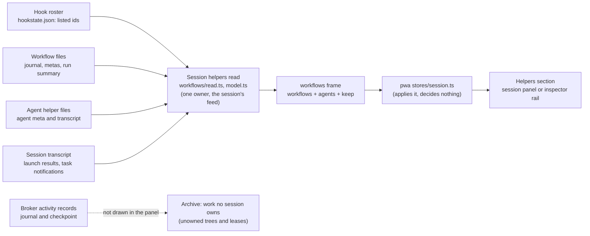
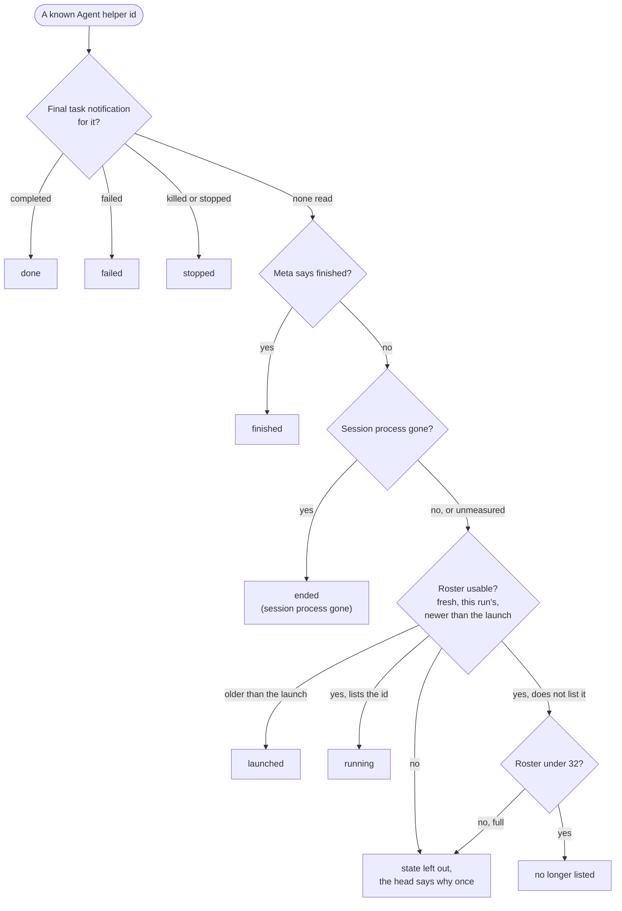
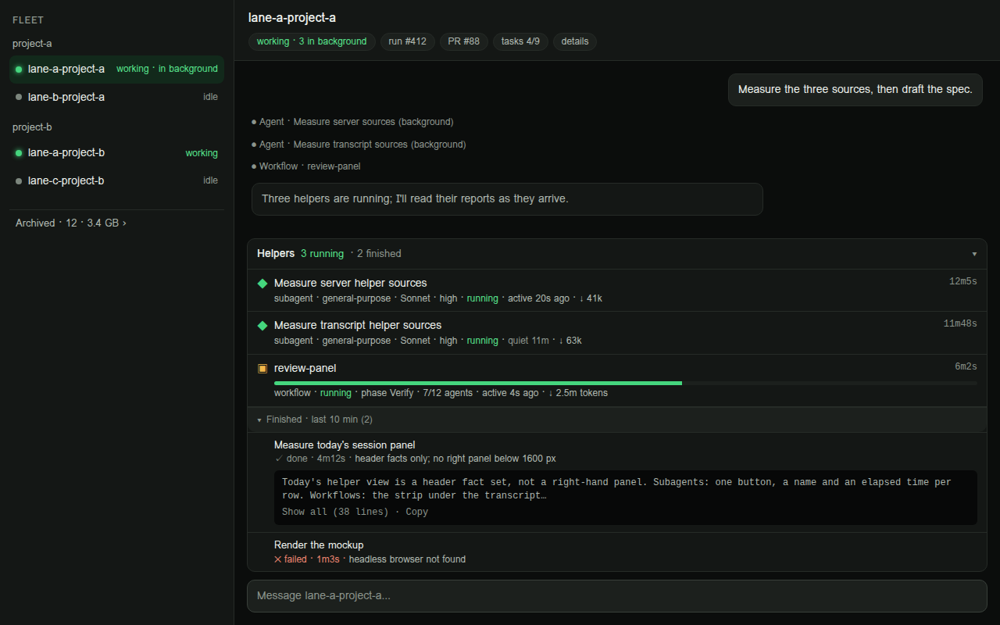
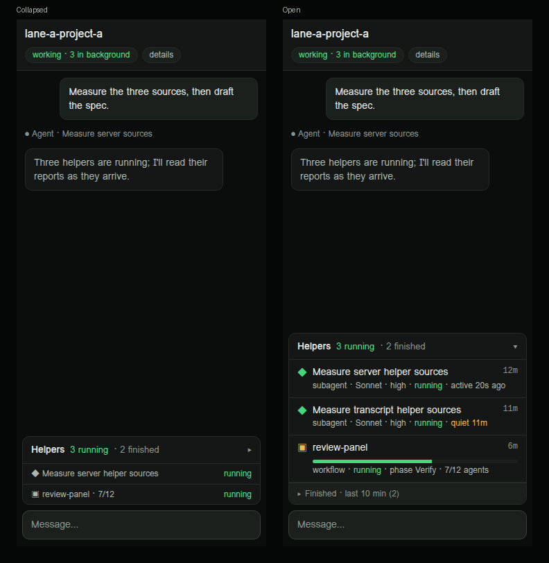
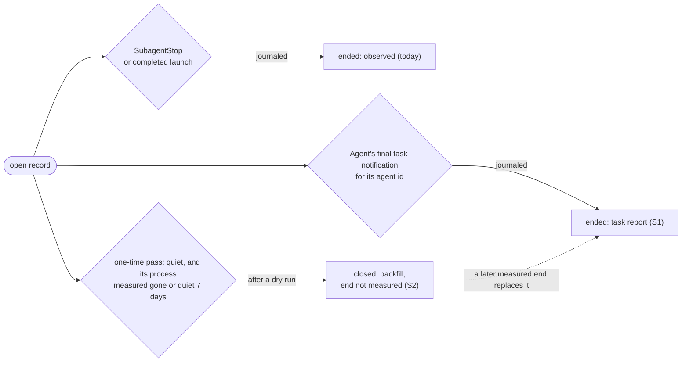
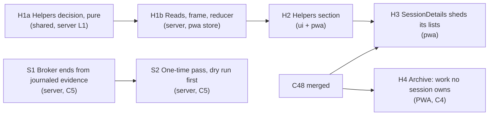

# A session's helpers, live in its own panel

**Spec** · 2026-11-19, revised 2026-11-20 after review 2861 · Status: Draft, for the operator's approval · Owner: Desktop polish (Task C49) · Linear: none · Related: `docs/superpowers/plans/2026-10-22-desktop-polish.md` (Tasks C46, C48), `docs/superpowers/specs/2026-11-02-delegation-visibility-design.md`, `docs/superpowers/specs/2026-10-04-delegation-broker-design.md`, `docs/superpowers/specs/2026-10-29-ccrc-history-w4-subagents-touched-design.md`

## In short

The operator asked on 2026-11-19 to see, inside the session they are looking at, "actual information about any running
workflows and subagents ... in a useful way". The fleet list no longer draws any of it (C46, C48). The session's own panel is
thin today. It shows a subagent's name and elapsed time, plus a list of broker records that read `agent · not confirmed`, and
some of those records are a month old.

This spec makes the session panel the one place this information lives. A **Helpers** section lists every subagent and
workflow the session is running, running ones first. Each row shows what the helper is doing, its kind, model and effort,
its measured state, how long it has run and when it last wrote anything. A workflow row also shows its phase and its agents
done out of total. A finished helper keeps its row with a one-line outcome for ten minutes, folded, and its row opens to the
helper's final report. The server decides all of it, the ten-minute keep included.

Every fact comes from files ccrc already reads or can read on the session's own feed, so the fleet does no new polling. The
broker's activity records are not drawn in the panel, because they say nothing about the helper itself.

The spec also designs three things around the panel:

- a home for delegated worktrees that no session owns, as a section of the Archive screen;
- a broker end from evidence the broker already journals: an Agent's final task report;
- a one-time pass, run once with a dry run first, that closes the old records the broker never closed, without deleting
  anything or inventing an end time.

The open records are mostly history. Of 2,389 open records, 2,271 were opened in the broker's first two and a half weeks
(2026-10-18 to 11-04). Since then the broker ends about 99.6% of its agent records (§2.2).

What to check: the row grammar in §4, the freshness and cost promises in §5, and the coordinator's three calls in "Where
things stand".

## 1. Context

The operator's words (2026-11-19): "inside the session in the right hand panel I still want to see actual information about
any running workflows and subagents, for the session i'm inside of, in a useful way though please". On a desktop, the fleet
list is the left panel and the open session is the right-hand one. On a phone, the session is the whole screen.

This follows the operator's ruling of the same day that the fleet list draws none of it. C46 and C47 took the counts off.
C48, which ran beside this task and merged on 2026-11-20 (#3096), removes every delegation row from the fleet list.

Every finding below is labelled **measured** (a command or a read-only query was run and its result seen), **sourced** (read
from the code, cited by file and symbol) or **inferred** (deduced). The data was read read-only, and each table names when.
Only counts and key names are given here, never content: this repository is public. The source reads are at `main`
39af0ba5be.

## 2. What ccrc can read today

Five sources carry facts about a session's helpers. Two of them, the workflow reader and the session transcript, are already
read on the session's own feed. The panel is built on those two, plus the hook's roster as the one "is it still listed"
signal.

### 2.1 The sources

| Source | What it carries | Freshness | Owner of the read | Footing |
|---|---|---|---|---|
| Hook roster, `$REG/<id>.hookstate.json` key `subagents` | Per listed helper: `id`, `name`, `startedAt`. A SubagentStart that carries an agent id adds one, whatever its agent type, so a workflow's agents are listed too. A SubagentStop removes its id. It keeps the newest 32. Every SessionStart except a compaction empties it. A main-thread Stop with no background work empties it; one with 1 to 8 background subagents cuts it to the ids Claude Code lists; one that lists a workflow among its background work leaves it alone. No model, effort, description or outcome. | Written on every hook event. Unusable past `HOOKSTATE_FRESH_MS` (30 min) of silence. | `server/src/hookstate.ts#reviveSubagents`, which drops `id` today. Wire: `FleetSession.subagents` (`{name, startedAt}[]`). The session stream reads the watcher's published copy (`sessionFeed.ts#hookRead`), up to 10 s old. | Sourced (`ccd/session-hook.sh`, the roster block and its resets) |
| The session's workflow files: `<session dir>/subagents/workflows/<run>/journal.jsonl`, `agent-<aid>.meta.json` and `.jsonl`, and `<session dir>/workflows/<run>.json` | Per workflow: name, phases, per-agent label, phase and state (`started`, `result`, `failed`), tokens, the run's final status and end. The journal has no timestamps. | Each reading of the session's feed: driven by the fleet watcher's 2 s tick, with a 30 s backstop. Bounded per tick. | `server/src/workflows/read.ts#SessionWorkflows` and `model.ts`. Wire: the `workflows` member of `SessionStreamMsg` (`shared/api.ts`), carrying `shared/workflows.ts#WorkflowView`. | Sourced |
| Agent helper files: `<session dir>/subagents/agent-<aid>.meta.json` and `.jsonl` | Meta: `agentType`, `description`, `model`, `effort` (sometimes), `toolUseId` (not always: 150 of 170 in one sample), `spawnDepth`, and `finished`, the only on-disk end marker (197 of 205 recent metas; 147 of 170 in the review's sample). Transcript lines carry `timestamp`, the resolved model and `usage`. A failed or stopped helper's state is NOT on disk. | Written by Claude Code as the helper works. | No live reader. `server/src/watch.ts#readAgentMeta` reads a meta for an isolation worktree's path only. | Measured (files) and sourced |
| The session's own transcript: the Agent and Workflow tool calls, and background-task notifications | Launch input: `description`, `subagent_type`, `model`, `effort` (24 of 37 calls), `run_in_background`. Launch result: `status: async_launched`, `agentId`, `resolvedModel` (36 of 36 sampled results were async). Completion: a `task-notification` whose task id is the agent id (every committed capture, 2.1.280 to 2.1.319), with `status` (seen: `completed` 324, `failed` 1, `killed` 3, `stopped` 3), `summary`, `result`, and for a workflow its agent counts. | When Claude Code writes the record, then the next reading of the feed. | `server/src/transcript/parse.ts` on the session socket. The notification is parsed by `shared/api.ts#parseTaskNotification`, which the chat already uses (`pwa/src/session/chatItems.ts`). | Measured (one recent session sampled) and sourced |
| The broker's activity records: the journal and checkpoint, projected into `delegation_activities` in `coord.db` | `sourceKind`, `displayName`, `openedAt`, `lastEventAt`, `executionState` (`active`, `ended`, or `unknown`, which has no writer). Opened by SubagentStart, a launch result, or a positive meta read. Ended by SubagentStop, a `completed` launch result, or a workflow's terminal notification, which ends the run and its `<run>-<n>` rows. | The broker lane, every 60 s (`DIVERGENCE_SWEEP_MS`). | `server/src/coord/delegation-checkpoint.ts#DelegationCheckpointBuilder` (the fold, the one writer). Projection: `delegation-projection.ts#livenessOf`. | Sourced |
| ccrc history's subagent work (W4) | The history sweep walks `subagents/` and each run directory, and ingests helper transcripts with their meta companions into the history store. A store of past text, not a live state. | The sweep's cadence. | `ccd/history/lib.mjs` (`AGENT_LEVELS`) and the sweep; tests in `server/test/history-agents-ingest.test.ts`. | Sourced |

*Table 1. Every source, what it carries and who reads it.*

Two facts decide the design:

- **The broker cannot say whether a helper is running.** `livenessOf` calls a record `live` whenever its parent session is up
  in the same incarnation. It never looks at the helper (sourced: `delegation-projection.ts#livenessOf`, and §1 of the
  delegation visibility spec). That is why every row reads `not confirmed`.
- **A failed or stopped Agent helper is known only from the notification** in the session's transcript. Its meta file does
  not record it (measured on the files).

### 2.2 The broker's open records

All the queries below ran read-only (`node:sqlite`, `readOnly: true`) against the server's coordination database, and
returned counts only. Each table is one query and says when it ran. Table 2 and Table 3 are one snapshot; the first
revision's tables, run at different times, are replaced.

| Kind | All | Open | Open, by the week they were opened |
|---|---|---|---|
| agent | 25,033 | 442 | 146 from 10-18 to 10-23; 191 from 10-23 to 10-30; 32, 8 and 65 in the three weeks since |
| workflow | 892 | 48 | 15; 20; then 2, 2 and 9 |
| bash-worktree | 5,264 | 1,899 | all 1,899 from 10-18 to 10-23, the last opened 10-22 09:18 UTC |
| **All** | **31,189** | **2,389** | 2,271 opened before 10-30 |

*Table 2. Open records by kind and age, one query at 2026-11-20 04:29 UTC. The first activity in the database is from
2026-10-18 06:49 UTC.*

| Measure | Value | Footing |
|---|---|---|
| Agent records opened in the last 7 days | 16,189, of which 65 are open (0.4%) | Measured (Table 2's query) |
| Hook spool on the fleet box, last 24 h: workflow agents | 2,116 SubagentStarts, 2,112 with a SubagentStop for the same agent id | Measured, 2026-11-20 04:27 UTC |
| Hook spool, last 24 h: other agent types | 866 SubagentStarts, 861 with a Stop | Measured, same read |
| Journal, workflow-agent Starts and Stops per day since 2026-11-05 | Equal to within a few each day (for example 3,926 and 3,931 on one day) | Measured, 2026-11-20 04:28 UTC |
| Open agent records opened before 10-30 (337) | Every one has its SubagentStart in the journal and no SubagentStop under any incarnation | Measured, 2026-11-20 04:32 UTC |
| Open bash-worktree records, a sample of 200 of 1,899 | Every one has its PreToolUse in the journal and no PostToolUse | Measured, same query |
| Open bash-worktree records a lease names | 0 of 1,899 (lineage not measured; S2's dry run counts it) | Measured, same query |
| How long agent records ran, ended in the last 7 days (16,124) | median 0.5 min, 99th percentile 30 min, 99.9th 98 min, longest 887 min (14.8 h) | Measured, 2026-11-20 04:30 UTC |
| Open agent records of the last 7 days whose parent had a later SessionStart | 28 of 66; every such SessionStart was a `compact` or a `resume` under the same Claude Code session id. The other 38 have no later session event | Measured, 2026-11-20 04:34 UTC |
| Agent records of the last 7 days that ended by their own Stop after a SessionStart | 26 of 16,126: 24 after a `compact`, 2 after a `resume` | Measured, same query |

*Table 3. Why the open records stayed open.*

**What this says.**

- **The first revision's "main cause" was wrong.** It said a workflow agent fires SubagentStart and never SubagentStop. The
  committed hook captures and the live spool both show the Stop, and the broker ends those records today. What was measured
  then was only that 69 open records had no Stop in the journal; the cause was asserted, not measured. Review 2861 found it
  (F1).
- **The backlog is history (2,271 of 2,389).** In the broker's first weeks, the journal received Starts and Pres but not
  the matching Stops and Posts, so those records never ended. The 1,899 bash-worktree records also predate the fold change of
  2026-10-22 (commit bb1a9478db, D-6267 to D-6272), under which a Bash Pre that carried a listing opened an active record
  that only its Post could end (sourced: that commit's diff). Why the Stops and Posts of that period never reached the
  journal was not measured: which hook build the fleet box ran then is not recorded anywhere this task can read.
- **Today's residue is small, and its cause is not found.** 66 agent records of the last 7 days are open. 28 of them
  belong to a parent with a later `compact` or `resume`, but that does not end a helper: 26 records ended by their own Stop
  after one. The other 38 have no later session event. Whether they are still running, or ended without a Stop, was not
  measured.

So the broker's live path works. S1 (§7.1) adds one end from evidence already in the journal, which does not depend on the
residue's cause, and S2 (§7.2) closes the history once.

## 3. Design

The panel is fed by one server reader, the one that already reads this session's workflows. It is extended to read the
session's Agent helpers beside them. The broker stays where it is; it feeds the panel nothing. Figure 1 shows the flow.


*Figure 1. Four sources meet in one reader on the session's own feed; the broker's records stay out of the panel.*

### 3.1 One owner, extended

`SessionWorkflows` already reads `<session dir>/subagents/workflows/`, inside the agent's read whitelist, within per-tick
budgets. Agent helpers live one directory up, `<session dir>/subagents/agent-<aid>.*`, which the whitelist also covers. This
spec extends that reader and its pure fold. It adds no second reader of helper files: the consolidate-don't-duplicate rule
names this owner.

The reader does not list the directory. One session measured hundreds of run directories, and helper files pile up over its
life. Instead it reads by id, from two id sources already in the session stream's hands:

1. **The hook roster.** The session stream already reads the hook state on every reading (`applyHook` in
   `server/src/sessionws.ts`). `reviveSubagents` keeps `id`, as a server-internal field.
2. **The session transcript's Agent launch results and task notifications.** The transcript parser surfaces `agentId`,
   `toolUseId` and the notification's task id, `status`, `summary` and `result` to the fold, through
   `parseTaskNotification`, the one parser the chat already uses. A notification joins its helper by task id, which is the
   agent id, and by the meta's `toolUseId` only where the meta has one.

**Workflow agents are not Agent rows.** The roster lists a workflow's agents beside the Agent helpers. An id becomes an Agent
row only when an Agent or Task launch result names it, or its meta sits at the Agent path `subagents/agent-<aid>.meta.json`
with an `agentType` other than `workflow-subagent`. Every other listed id is a workflow's agent, counted by its workflow row,
or nothing the panel draws.

**The read and the frame gate.** `SessionWorkflows.read` returns "absent" at once today when `subagents/workflows/` does not
exist, the usual case for a session that runs only Agent helpers, and `checkWorkflows` then sends no frame. H1b moves that
early return inside the workflow arm. The Agent arm runs regardless, and the "never had" gate keys on "no workflows
directory and no known helper id".

### 3.2 How an Agent helper's state is decided

State is decided in L1 (`model.ts`), from measured facts only, in the order of Figure 2.


*Figure 2. An Agent helper's state, decided from the strongest measured fact first. Nothing is ever inferred to be running,
and dropping off the roster is never called an end.*

- **`running`** means: started, and no stop seen since the roster's last reset. A missed Stop while a workflow is among the
  background work (the hook then skips its prune) can leave an id listed until the next reset. That staleness is bounded by
  the next SessionStart or the next prune, and is why the row also shows its last activity.
- **`no longer listed`** is not an end. The roster dropped the id with room to spare, and nothing measured why. It reads
  `no longer listed`, never `ended`.
- **`ended (session process gone)`** comes from the process state the reader already receives for the workflow orphan rule
  (`Proc` in `model.ts`, built in `sessionws.ts`). A process that is gone cannot be running a helper.
- **`launched`** covers the moment between a launch result in the live transcript tail and the roster that lists it: the
  roster can be the watcher's published copy, up to 10 s old. A roster older than the launch result cannot rule.
- **State left out** happens only when the roster cannot be used (Table 4) and the helper is not otherwise final.

## 4. What the panel shows

The Helpers section replaces today's workflow strip (`ui/src/components/workflow-strip.tsx`, D-5560) and the subagent list in
SessionDetails. Between 900 and 1599 px it sits where the workflow strip sits, in the strips under the transcript. At 1600 px
and up it moves into the inspector rail. That move is new: today the workflow strip renders at every width, and only the mail
and task strips move to the rail (`SessionScreen.tsx`, `inspectorHoldsStrips`). H2 adds the rail section and the same
hidden-rail fallback the mail and task strips use. With no helpers and nothing to say, it draws nothing, as the workflow strip
does today. Figures 3 and 4 show it.

### 4.1 The section head

The head says each count once; the rows never repeat it. It also carries every "could not measure" sentence, once, so no row
has to.

| Situation | Head reads |
|---|---|
| Helpers running | `Helpers · 3 running`, plus `· 2 finished` when the finished fold is non-empty |
| Only finished helpers in the last 10 min | `Helpers · 2 finished` |
| Roster stale, a known helper not final | `live state unmeasured: no hook event for 41m` |
| No hook state file, a known helper not final | `live state unmeasured: this session has no hook state` |
| Hook state unreadable or malformed, a known helper not final | `live state unmeasured: the hook state could not be read` |
| Hook state from another run of this session | `live state unmeasured: the hook state is from an earlier run` |
| Roster full and a known id not on it | `live state unmeasured: the hook's list is full` |
| A workflow's tokens unmeasured | `tokens unmeasured for 1 workflow` |
| A workflow's progress unreadable | `progress unreadable for 1 workflow` |
| The read budget leaves helpers unread this reading | `refreshing 6 of 9 each reading` |

*Table 4. The head's words. Every unmeasured line is said once, and only when a helper it concerns is drawn.*

An idle session whose hook state went stale with every helper final says nothing: the unmeasured lines need a known helper
that is not final (`agentsUnmeasured` is sent only then, §8).

### 4.2 A running row

| Part | Agent helper | Workflow |
|---|---|---|
| Line 1, what it is doing | The launch's `description` (meta `description`) | The script's name (`WorkflowView.name`) |
| Kind | `subagent · <agentType>`, for example `subagent · Explore` | `workflow` |
| Model and effort | `Sonnet · high`, from the meta. A missing effort is left out, never guessed. | Not shown at run level: its agents differ |
| State | `running`, `launched`, or left out (Figure 2) | `running`, plus today's `N failed` when agents failed |
| Progress | none | `phase <title> · 7/12 agents`, plus the existing meter. Unreadable progress is left out and said in the head. |
| Elapsed | `12m5s`, from the launch result's transcript `timestamp`, else the roster's `startedAt`, ticking on the client clock | from `startedAt`, as today |
| Last activity | `active 20s ago`, from the helper transcript's last line `timestamp`. Past 10 minutes it reads `quiet 14m`, in the muted colour: a fact, with no state change and no act. | `active 20s ago`, from the journal file's change time (new, `lastActivityAt`) |
| Tokens | `↓ 41k`, from the last usage line, when measured; left out otherwise | `↓ 2.5m tokens` when measured; left out otherwise, and said in the head |

*Table 5. One running row, by kind. Every part is a measured fact or is left out.*

### 4.3 A finished row

A finished helper moves into a fold, `Finished · last 10 min (N)`, closed by default. Its row is line 1 as above, then one
line:

| State | Second line | End time, its source | Opens to |
|---|---|---|---|
| `done` | `done · 4m12s ·` the notification's `summary`, one line | the notification's transcript `timestamp` | the final report (the notification's `result`) |
| `failed` | `failed · 1m3s ·` summary | the notification's `timestamp` | the report, if any |
| `stopped` | `stopped · 22s` | the notification's `timestamp` | nothing more |
| `finished` | `finished · 6m` (the notification is outside what the stream has read) | the helper transcript's last line `timestamp`, said as its last write | nothing more |
| `no longer listed` | `no longer listed · last write 9m ago` | the helper transcript's last line `timestamp` | nothing more |
| `ended (session process gone)` | `ended (session process gone) · last write 9m ago` | the helper transcript's last line `timestamp` | nothing more |
| workflow `completed`, `failed`, `killed` | today's words: `done`, `failed`, `stopped`, with `12/12 agents` | the run summary's start plus duration, else its file time, as today | the existing phases and agents list |

*Table 6. A finished row says its outcome in one line, with an end time from a named source, then folds away.*

An opened report shows its first 12 lines, then `Show all (N lines)` and Copy. The report travels capped at 16 KiB; a cut
report says so.

**One owner for the keep.** The server's fold (`model.ts`) keeps a finished Agent helper or workflow in the frame for
`HELPER_FINISHED_KEEP_MS` (10 minutes) after its end time, for both kinds, and sends each with its `endedAt`. It replaces the
30 s eviction (`WORKFLOW_EVICT_MS`, applied today in `read.ts#finishedView` and `model.ts#selectRows`); both readers move to
the new constant, and the old one retires with its pins. The PWA store applies each frame as it does today, by replacement,
and decides nothing. A reload, a reconnect or a backlog restate gets the same rows, because the server decides from the end
time and its own clock. A finished row whose end time cannot be read is not kept: it is drawn in the reading that decided it
and leaves with the next.

**A reopened stream.** Ids come from the roster and from the transcript the stream reads. A helper that finished while nobody
had the session open shows in the fold if its end is less than 10 minutes old when the session is opened; an older one does
not.

### 4.4 What the panel never shows

- **No broker record row.** The `N delegated` disclosure's activity rows (`agent · not confirmed`, `stop not seen`) leave the
  session panel. Each helper they recorded is a Helpers row with a measured state. A record with no measured helper is a
  record, not a helper, and is not drawn. The disclosure keeps the lease rows C48 moves there (worktrees, with their acts).
- **No word the operator cannot act on.** Not `not confirmed`, and not `unmeasured` on a row. An unmeasured fact is left out
  of the row and said once in the head, workflows included: a workflow row with unmeasured tokens or unreadable progress
  leaves that part out.
- **No running claim without a measurement.** `running` comes only from a usable roster that lists the id, with no end
  recorded.
- **No end without a measurement.** `no longer listed` is not called an end.

### 4.5 The header

SessionDetails' `⑂ N subagents` disclosure and its name-and-elapsed list are removed, and `pwa/src/fleet/sessionFacts.ts`
stops building them. The Helpers section is the one list, so a second list and a second count of the same helpers would
disagree between ticks. The header's status keeps `working · N in background` and its title (D-8771's one allowance).

### 4.6 Mockup


*Figure 3. Desktop, 1280 px, Refined skin, dark. Helpers sits in the strips under the transcript. At 1600 px and up the same
section sits in the inspector rail.*


*Figure 4. Phone, 360 px. Collapsed: the head and line 1 of the first two running rows. Open: two-line rows, the finished
fold last.*


*Figure 5. The Archive screen's new section (§6). This is the coordinator's call, ask 649.*

The mockup's source page is `docs/design/2026-11-19-session-helpers-design/mockup.html`. Its data is invented.

## 5. Freshness and cost

This section states how fresh each fact can honestly be, and what reading it costs. Every promise is bounded by a named
reading, never by a guess.

| Fact | How fresh | Why |
|---|---|---|
| Running, launched, no longer listed (roster) | One reading after the hook event, plus the published copy's age: at most about 12 s | The watcher publishes the hook state on its 2 s tick and the stream accepts a copy up to 10 s old |
| Live state as a whole | Unmeasured once the hook state is 30 minutes old | `HOOKSTATE_FRESH_MS` |
| done, failed, stopped, summary, result | When Claude Code writes the notification, then one reading | The transcript is read on the same feed |
| Description, kind, model, effort | From the first reading after the meta is read; they do not change | Meta written at launch |
| Last activity, tokens | One reading after the helper's transcript grows, within the helper tier's rotation | Read by size change |
| Workflow phase, agents done and total | As today: one reading, with bounded journal chunks | Unchanged reader |
| Workflow last activity | One reading after the journal grows | The journal's change time |
| The section on a session nobody has open | Not read at all | The session feed runs only for an open session socket |

*Table 7. How fresh each fact is.*

**Cost.** The reads happen only for sessions someone has open: the session feed is per open session, not fleet-wide.

- Agent helpers get a read tier of their own, `HELPER_READS_PER_TICK` = 12, beside the workflows' 24, so a busy workflow
  cannot starve them and they cannot starve it.
- Per unfinished Agent helper, per reading: one stat of its transcript; when it grew, one read of the new bytes, at most
  `TAIL_BYTES` (64 KiB). The meta is read once when the id is first known, then stat'ed once every 15 readings
  (`RESTAT_EVERY`) and read again only when it changed, until the helper is final. Elapsed comes from the launch result or
  the roster, so there is no head read.
- Worst case: 12 reads per reading per open session, at most 6 of them transcript reads of up to 64 KiB each, so at most
  384 KiB over the agent link per reading. In practice a read carries only the bytes written since the last one.
- More than 6 growing helpers: a cursor rotates through them, so each is refreshed at least every `ceil(N / 6)` readings,
  and the head says so (Table 4).
- A final helper costs nothing. The fleet watcher, the hook and the agent protocol do not change.

## 6. Work no session owns: its home

C48 (#3096, merged 2026-11-20) removed two things from the fleet list: the unowned rows, whose one door was `Not
delegated`, and the offline-coordinator group's lease rows whose sessions are both unlisted. Neither row ever offered
`Attach to…` or `Keep worktree` for unowned work: before C48 (at 39af0ba5be), `unownedControls` in
`pwa/src/fleet/delegationWords.ts` returned `Not delegated` alone, and only where the projection hid a lease. C48 deleted that
function with the rows. The first revision said otherwise, and so did the brief and C48's scope mail; review 2861 found it (F3).

They get a section of the Archive screen, **Work no session owns** (Figure 5). The Archive screen already answers "what is
sitting around". The fleet foot's existing Archived row reaches it, so the fleet list gains nothing. This is the
coordinator's call (ask 649). The section holds two kinds of row:

| Row kind | Read from | It shows | Its acts |
|---|---|---|---|
| An unowned tree | `DelegationProjectionWire.unowned` (`DelegationUnownedWire`) | the project; the path, or the admin record when no path is known; the verdict word (`no owner found` or `two owners claimed it`); the workspace qualifier where it says one (`unmeasured`); the attempt time as its age (`tried 3 days ago`) | `Not delegated` only where a lease is hidden (`leaseId`), through `POST /api/leases/:lease/resolve` |
| A lease whose parent and worker are both unlisted (C48's review 2877, F1) | `DelegationProjectionWire.leases`, where neither session is a row of the fleet list | the line and the acts exactly as the offline-coordinator group drew them before C48: `from <parent> · via <worker>`, raw ids where unlisted | the lease controls `worktreeControls` gives (`pwa/src/fleet/delegationWords.ts`, kept by C48 for the session's own worktrees): `Keep worktree` and `Not delegated` in the states that offer them, and `Attach to…` only where its rule allows, which needs a listed parent |

*Table 8. The two rows of the Archive section. Every word and act existed before C48; the words, the lease controls and both doors are still on main, and H4 restores the unowned row's one act (`Not delegated` on a hidden lease) on its new page.*

Every other lease has a session panel after C48. An activity record whose session is not listed gets no home: helpers live
only in their own session, and the stale records are S1's and S2's work. With nothing of either kind, the section draws
nothing.

`Attach to…` and `Keep worktree` for an unowned tree are Later. They wait on D-8095's optional server field, the hidden
lease's parent on the unowned wire.

## 7. The broker's records

The broker keeps its records, its owner and its projection. This spec adds ends from evidence the broker already journals
(S1), and closes the history once (S2). Both are server tasks in C5 Coordination, owned by the broker's one writer of an
activity, `DelegationCheckpointBuilder` in `server/src/coord/delegation-checkpoint.ts`. Figure 6 shows every way a record
ends.


*Figure 6. Every way a record ends, with its evidence named. Only S2's pass closes without a measured end, and it says so.*

### 7.1 S1: ends from journaled evidence

S1 decides only from evidence already in the journal, so a rebuild from the journal gives the same ends. It has one arm,
and it does not depend on why today's residue missed its Stop (§2.2): a task report is a second, independent end signal.

- **An Agent's final task notification ends its record.** The hook already spools the notification (`UserPromptSubmit` with
  the task id, tool-use id and status), and the launch result already names the agent id. `foldNotification` indexes
  Workflow launches only today ("An Agent's notification is never touched"). It gains Agent launches, joined by task id,
  which is the agent id. `endedAt` is the notification's observed time; `endBasis` is `task-report`.
Three arms were weighed and dropped:

- **A parent's restart.** A later `compact` or `resume` does not end a helper: 26 agent records of the last 7 days ended by
  their own Stop after one (Table 3), so ending on it would invent ends. - **A workflow's end.** Its agents' records do not need it: their Stops arrive (Table 3).
- **A meta's `finished` marker.** It is not in the journal, and reading it in the broker would make a second reader of
  helper metas beside H1's.

The last two are Later, as backstops, only if S1's week-after measurement shows open records they would close, and then
only with the watch lane journaling the evidence first.

**`endBasis`** is new: `observed`, `task-report` or `backfill-unmeasured`. It is optional, and its absence
means `observed`, so every record ended today reads as it does. A later measured end replaces a `backfill-unmeasured` one,
basis and `endedAt` together: the fold ends a record today only while it is not ended, and S1 widens that to "not ended, or
ended by the backfill".

**The adoption effect.** The adoption decider takes an ended activity with an `endedAt` as terminal evidence for its lease
(`delegation-adoption.ts#terminalOf`). S1's new ends are such evidence: a lease made by an Agent helper whose task report ended
its record gets its terminal time then, instead of waiting for the parent's death evidence. Adoption watches
start sooner, and with the operator's delegation-adopt switch on, a finished delegated worktree is kept sooner. S1 pins this
with a test: an isolation-worktree lease whose agent's task report arrives gets that report's time as its terminal time.

**The carriers.** The authority is the journal plus the checkpoint; `coord.db` is a projection of them. S1 changes:

| Format | Change | An older server |
|---|---|---|
| The journal's entry grammar (`delegation-journal.ts#validateEntry`) | None: the arm folds evidence already journaled as `evidence-accepted` | Reads it as before |
| The checkpoint's activity codec (`Fields.of`, closed key list) | An optional key, `endBasis` | Refuses the checkpoint: `bad-shape: activity has the unknown key "endBasis"` |
| The projectability assertion (`assertDelegationCheckpointProjectable`) | `backfill-unmeasured` requires a null `endedAt`; every other ended record requires an `endedAt` | — |
| The projection, `delegation_activities` | A nullable `endBasis` column, by a migration that refuses to start rather than open empty | Reads its named columns, as before |

*Table 9. What S1 changes in the broker's durable formats.*

**Rollback.** An older server refuses the new checkpoint, as it refused after bb1a9478db: the lane reconstructs until a
roll-forward. S1 follows that precedent and says so in its PR, and its red-first set includes the case: the pre-change codec,
given a post-change checkpoint, refuses with `bad-shape` and the lane reports it, never opening empty.

### 7.2 S2: the one-time pass (the coordinator's call, ask 650)

These conditions are the coordinator's, carried as given:

1. **Designed here, built in its own PR.** Nothing in this task writes the coordination database.
2. **Nothing is deleted and no end time is invented.** Each record is marked closed: state `ended`, `endedAt` null,
   `endBasis = backfill-unmeasured`. The basis is the reason. Its words, in `shared/`, read "closed by the one-time pass; its
   real end was not measured". Ended records are not projected to any wire, so the reason is readable in the checkpoint and
   the database, and in the dry run's report.
3. **It runs once, through the broker's existing writer,** as one checkpoint-only change through
   `DelegationDurability`, the path D-6268's zero-delta retire takes. The journal's grammar does not change. It is
   idempotent: a second run finds nothing to close.
4. **A dry run first** reports the count it would close, by kind and age, how many a lease or lineage names, and how many
   failed the positive check. It writes nothing.
5. **It is the coordinator's call,** which the operator can overturn.

**What it touches.** Open records of all three kinds (Table 2): 442 agent, 48 workflow and 1,899 bash-worktree, at the last
count. A record qualifies only when both hold:

- **Quiet 24 hours.** An agent record's `lastEventAt` moves only on its own Start and Stop, so quiet means open with no Stop.
  The bound is justified by the measured run lengths of agent records that did end: the longest of the last 7 days ran
  14.8 h, the 99.9th percentile 98 minutes (Table 3).
- **A positive check before closing.** For an agent or workflow record, one of: its parent's incarnation is not the current
  one, or the parent is absent from the registry (the adoption decider's own death evidence), or it has been quiet for
  7 days, more than eleven times the longest measured run. A `compact` or `resume` is not evidence (Table 3). A record that
  passes neither stays open and is counted in the dry run. For a bash-worktree record: a Bash call's Post arrives within its
  tool timeout, at most 10 minutes (inferred from Claude Code's Bash limits), so 24 hours of quiet is the check.

**Why S2, and not the zero-delta retire, takes the bash-worktree records.** `retireZeroDeltaBash` (D-6268) retires only ended
records whose Pre and Post listings were equal. These records have no Post, so no listing fact, and that owner deletes,
which condition 2 forbids. The fold of today never opens such a record, so they are a closed class.

**Every reader of a backfill row.**

| Reader | A backfill row reads as | Same as before the pass? |
|---|---|---|
| `delegation-projection.ts#livenessOf` | ended (it reads the state only) | No, and that is the point: it is not drawn anywhere |
| `projectDelegation` (the wire) | dropped, as every ended record is | No, as above |
| `delegation-adoption.ts#terminalOf` | not terminal evidence (it needs an `endedAt`); the decider falls back to the parent's death evidence | Yes |
| `delegation-adoption.ts#activityEnded` | not ended: S2 makes it read the basis | Yes |
| `delegation-compaction.ts`, the identity and workflow holds | held, as an open record is: S2 makes the holds read the basis | Yes |
| `delegation-compaction.ts`, the retirable set and `retireBehindCut` | never retired: S2 makes both skip the basis | Yes |
| The raw-lease window (`endedAt ?? openedAt`) | ends at `openedAt` | Yes |
| `retireZeroDeltaBash` | untouched: no listing fact | Yes |
| `assertDelegationCheckpointProjectable` | valid: the basis requires a null `endedAt` | — |

*Table 10. Every reader of `endedAt` or the state, and what it makes of a backfill row.*

**Undo.** A second checkpoint-only change reopens every record whose basis is `backfill-unmeasured`, which only the pass
writes, so it reopens exactly the records the pass closed. S2's tests pin both directions, and that a reopened record is
byte-for-byte what it was before the pass.

**Rollback.** As S1 (§7.1): an older server refuses a checkpoint carrying `endBasis`.

## 8. Wire changes

All changes to the session frame are additive. `FLEET_PROTO` stays 1, and the agent protocol does not change. Each field has
one reader. The broker's format changes are §7's, not the wire's.

| Change | Where | Its one reader | An older peer |
|---|---|---|---|
| `agents?: AgentHelperView[]` on the `workflows` member of `SessionStreamMsg` | `shared/api.ts` (the frame), `shared/workflows.ts` (the view), `server/src/workflows/model.ts` (decides) | `pwa/src/stores/session.ts#applySessionMsg` | Absent: no Agent rows, the workflow rows as today |
| `agentsUnmeasured?: HelpersUnmeasured` on the same frame, sent only when a known helper is not final | same | same | Absent: nothing said |
| `workflowsUnmeasured?: { tokens: number; progress: number }` on the same frame: how many drawn workflows lack each | same | same | Absent: the head says nothing, the rows as today |
| `readEvery?: { refreshed: number; of: number }` on the same frame, when the helper tier rotates | same | same | Absent: nothing said |
| `WorkflowView.lastActivityAt?: number \| null` | `shared/workflows.ts` | the same reducer | Absent: the row leaves out `active … ago` |
| `AgentHelperView`: `id`, `description`, `agentType`, `model`, `effort`, `state`, `startedAt`, `endedAt`, `lastActivityAt`, `tokens`, `summary`, `report` (capped) | `shared/workflows.ts`, beside `WorkflowView` | the same reducer | — |
| The hook roster keeps `id` | `server/src/hookstate.ts` (server-internal; `FleetSession.subagents` unchanged) | `server/src/sessionws.ts` | — |

*Table 11. Every wire change, additive, with one reader each.*

`AgentHelperState` is `launched | running | done | failed | stopped | finished | unlisted | gone | unmeasured`. Its runtime
list derives from a `Record<AgentHelperState, true>`, as `WORKFLOW_STATES` does, and its words (`no longer listed`, `ended
(session process gone)`, the rest as written) sit beside it. `report` is capped at 16 KiB and `summary` at one line of 200
bytes.

`HelpersUnmeasured` is a small union, read from the stream's raw hook read (`readHookStateRawMeasured`, through
`sessionFeed.ts#hookRead`), not from `foldHookStateRead`, which folds four of these into one "no state":

```ts
type HelpersUnmeasured =
  | { why: 'stale'; hookAgeMs: number }
  | { why: 'absent' }
  | { why: 'unreadable' } // a failed read, or a malformed file
  | { why: 'foreign' }    // the state of another run of this session
  | { why: 'full' };      // 32 listed, and a known id not among them
```

Each case has its head words in Table 4.

## 9. Rings and contexts of the new pieces

This table places each new piece by the architecture spec's rules: ring by what a file imports and does, context by the
context map.

| Piece | File | Ring | Context |
|---|---|---|---|
| `AgentHelperView`, `AgentHelperState`, `HelpersUnmeasured`, `HELPER_FINISHED_KEEP_MS`, `HELPER_READS_PER_TICK` | `shared/workflows.ts` | L0 | K (shared kernel) |
| The frame's new members | `shared/api.ts` (`SessionStreamMsg`) | L0 | K |
| Agent state decision, the keep, the fold of ids and notifications | `server/src/workflows/model.ts` | L1 | C3 Session Conversation |
| Meta and transcript reads by id, the helper tier | `server/src/workflows/read.ts` | L3: it calls the FleetIO port. Its imports alone (a type import of the port) would read L1, so H1b adds a ring header that says L3. | C3 |
| Wiring the roster ids, the raw hook read and the transcript facts into the read; the frame gate | `server/src/sessionws.ts` | L4 | C3 |
| The roster's `id` | `server/src/hookstate.ts` | L1 | C1 Fleet Registry |
| The launch and notification facts surfaced to the fold | `server/src/transcript/parse.ts` | L1 | C3 |
| The Helpers section, rows, head, finished fold | `ui/src/components/workflow-strip.tsx`, extended in place | L4 | the design system (`ui/src` is outside the context map) |
| The rail's section | `pwa/src/inspector/HelpersSection.tsx` (new) | L4 | C3 (`inspector/**`) |
| The frame's reducer | `pwa/src/stores/session.ts` | L4 | C3 |
| The header facts that drop the subagent list | `pwa/src/fleet/sessionFacts.ts` | L1 | C3 |
| Archive's section | `pwa/src/fleet/ArchiveUnownedWork.tsx` (new, a `fleet/Archive*.tsx` row) | L4 | C4 Workspace Lifecycle |
| The two new ends, `endBasis`, the pass, the readers that read the basis | `server/src/coord/delegation-checkpoint.ts`, `delegation-adoption.ts`, `delegation-compaction.ts`, `delegation-durability.ts`, `schema.ts` | L1 and L3 | C5 Coordination |

*Table 12. Each new piece's ring and context.*

## 10. The phone layout

At 360 px the Helpers strip sits where the workflow strip sits today, above the timers and the plan (Figure 4). Collapsed, it
shows the head and line 1 of the first two running rows. Each is one line, ellipsised, with its state word kept visible at
the end. Open, it becomes one scroll body, at most 50% of the viewport high. Each row has two lines:

- line 1: what it is doing;
- line 2: `kind · model · effort · state · elapsed · active … ago`, the kind with its agent type
  (`subagent · general-purpose`). When the line is too long it wraps; the state and the times stay together.

The head is the toggle: a real `<button>` with `aria-expanded`, at least 44 px high. A finished row's tap target opens its
report inline, at least 44 px high. Nothing depends on a title attribute, because phones do not show titles.

## 11. The build, one PR each

Each task starts red: its first commit adds the tests that fail on `main`. The mutants of every new decision branch run with
the coordinator skill's mutation runner (`ccd/coordinator-skill/references/mutation-run.py`). Figure 7 shows the order.


*Figure 7. Three independent lines. H4 needs only C48; landing it first is a preference, so unowned work is not without a
home for long. H3 lands only after H2 and C48, so nothing leaves the panel before its replacement is there.*

| Task | What | Red first | Depends on |
|---|---|---|---|
| **H4** | Archive's "Work no session owns": unowned trees and leases with both sessions unlisted (Table 8) | Render tests: an unowned tree draws its verdict and age and offers `Not delegated` only with a `leaseId`; a both-unlisted lease draws the pre-C48 line and `worktreeControls`' acts; none of either draws nothing; each act calls its existing door | C48 merged |
| **H1a** | Pure pieces: the shared types and constants, the roster's `id` kept server-side, the transcript's launch and notification facts, and `model.ts`'s decision (Figure 2), the workflow-agent exclusion and the keep | A decision table over every branch of Figure 2, the exclusion by agent type and by meta path, the keep's window for each end source of Table 6, and `agentsUnmeasured` only with a non-final helper. A mutant per branch | — |
| **H1b** | The reads by id with the helper tier and its rotation, `lastActivityAt` on workflows, the frame and its gate, and the reducer accepting the new members | A budget test: N growing helpers cost at most `HELPER_READS_PER_TICK` reads, and rotation reaches each within `ceil(N / 6)` readings. A frame test for a session with helpers and no workflow directory. A frame test for an older server's frame without `agents`. The reducer's three reset sites keep their behaviour: `applySessionMsg`'s backlog for another transcript, the store's initial state, and `disconnect()`; on the server, `sendBacklogAndTail`'s reset of the last frame | H1a |
| **H2** | The Helpers section in the strip and in the rail, the finished fold, the report expand, the phone layout | Render tests for Tables 4 to 6 at 360 and 1280 px. A browser test that the section moves to the rail at 1600 px and falls back when the rail is hidden. A word census: no row says `not confirmed` or `unmeasured`, and no row says `ended` without a measured end | H1b |
| **H3** | SessionDetails loses the subagent disclosure and the activity rows, `sessionFacts.ts` stops building them, and the delegated disclosure keeps C48's lease rows; dated amendments to the delegation visibility and broker specs | `card-header-facts` pins on the new header, and a new SessionDetails render test that draws no subagent list and no activity row. A census that `LIVENESS_QUALIFIER` words appear in no session-panel output | H2, C48 merged |
| **S1** | The task-report end, `endBasis` in the codec, the projection and the assertion, and a measured end replacing a backfill one | Fold tests for the arm, and a fixture replay: a captured workflow's Start and Stop give an ended `agent` record, which no test was found to assert today. A replay test: a rebuild from the journal gives the same ends. The adoption effect's test (§7.1). The older-codec refusal. A migration test that refuses rather than opens empty | — |
| **S2** | The one-time pass: the dry-run report, the positive check, the checkpoint-only change, the basis read by every reader of Table 10, and the undo | A dry run writes nothing. A second run closes nothing. A record that fails the positive check stays open, and a `compact` or `resume` alone never passes it. Every row of Table 10, as a test. Undo reopens exactly the closed records, byte for byte. Records younger than 24 h are untouched | S1 |

*Table 13. Seven PRs, each red first.*

## 12. Decisions

Decisions are ruled by the operator, called by the coordinator on a structured ask (the operator may overturn those), or are
this spec's own call, marked Judgement.

| # | Decision | Options considered | Chosen, and why | Status |
|---|---|---|---|---|
| D-8794 | The session's own panel, not the fleet list, carries a session's helper information | The fleet list; the session panel | The session panel: the operator's ruling of 2026-11-19 | Agreed |
| C1 | Where unowned delegated work lives | Archive section; its own screen; the coordinator's page | Coordinator's call, ask 649: the Archive section. It already answers "what is sitting around", and the fleet list gains nothing | Proposed |
| C2 | The open records | Close in one pass; leave them | Coordinator's call, ask 650: one pass, on the five conditions in §7.2 | Proposed |
| C3 | Opening a helper's output | Its result now and its transcript later; both now | Coordinator's call, ask 651: the result now; the read-only helper transcript view is Later | Proposed |
| J1 | Extend `SessionWorkflows`, or add a new reader | Extend; new reader | Extend: the same directory, budget and feed; a second reader has no "legitimately different" reason | Judgement |
| J2 | How to find helper ids | List the directory; read by id from the roster and the transcript | By id: listing costs grow with the session's life, and ids are already in hand | Judgement |
| J3 | Where "running" comes from | Broker liveness; transcript recency; hook roster | Hook roster, read when usable: the one source that removes an entry on the helper's own stop | Judgement |
| J4 | Broker records in the panel | Keep with condition words; hide; fold into one line | Hide: they say nothing the operator can act on, and every live helper they name is a Helpers row | Judgement |
| J5 | The header's subagent list | Keep; remove | Remove: one list, one count | Judgement |
| J6 | Finished keep | 30 s like Claude Code; 10 min folded | 10 min, folded, for both kinds, decided by the server's fold alone | Judgement |
| J7 | The pass's quiet bound | 1 h; 24 h; 7 days | 24 h, with a positive check (process gone, or 7 days quiet): the longest measured run of an ended agent record is 14.8 h | Judgement |
| J8 | A recurring quiet close after the pass | Now; later | Later, if S1's ends leave records open (see Later) | Judgement |
| J9 | S1's arms | Task report, restart, run end, finished marker | The task report: it is journaled. A restart is measured not to end a helper; the other two need evidence the journal does not hold, and measurement shows no need | Judgement |

*Table 14. Every decision, with its footing.*

### Deviations

- **D-8794** — `session-panel-carries-helpers`: Task C49, issued on 2026-11-19. The session's own panel, not the fleet list,
  carries a session's helper information, subagents and workflows alike, by the operator's ruling of 2026-11-19. The Helpers
  section is the one list. It supersedes SessionDetails' subagent list (D-5232's reader) and drops the session panel's
  broker activity rows (the delegation visibility spec's §5 header list). The record keeps the lease rows C48 moves there.

## 13. Testing and proof

How we will know it works:

- Each build task carries its red-first tests (Table 13), with mutants run by the mutation runner for every new decision
  branch.
- H1b ends with a fleet measurement on a session that runs a workflow and two background Agent helpers. It records each row's
  state against the notification that later arrives, counts any `running` row whose helper had ended, and counts any
  workflow agent drawn as an Agent row (expected: none).
- It also measures what a failed or killed Agent helper leaves on disk besides the notification, which no capture shows yet.
- S1 ends with a measurement a week after it lands: the open agent records of that week, and how many S1 ended.
- S2's dry run is pasted, as counts, into its PR before the pass runs.

## 14. Words used here

These are the terms this spec uses in a narrow sense.

| Word | Meaning |
|---|---|
| Helper | A subagent (launched by the Agent tool) or a workflow, together with its agents, that a session started |
| Hook roster | The list of helper ids the session hook keeps from SubagentStart and SubagentStop, reset at SessionStart and pruned at some main-thread Stops |
| Running | Listed on a usable roster: started, and no stop seen since the roster's last reset |
| No longer listed | Dropped from a roster that had room, with no end measured |
| Activity record | The broker's record of one helper or Bash call it saw start, in its journal and checkpoint |
| Unowned work | A delegated worktree the broker could not give one owner, or a lease whose sessions are both gone |
| Reading | One pass of the session's feed, which reads the session's files for its open socket |
| Backfill | S2's close of a record whose end was not measured |

## Where things stand

### Agreed

- The operator, 2026-11-19: inside the session they are in, the right-hand panel shows actual, useful information about the
  session's running workflows and subagents.
- The operator, 2026-11-19: the fleet list draws none of it (C46, C47 and C48).

### Waiting on you

- Approval of this design, and of the coordinator's three calls below, which you may overturn:
  - **Ask 649:** unowned delegated work lives in a section of the Archive screen (§6, Figure 5).
  - **Ask 650:** the open broker records are closed once, by the five conditions in §7.2.
  - **Ask 651:** a helper row opens its result now; the helper's own transcript view comes later.

### Later

- A read-only view of a helper's own transcript, through a new bounded, session-gated read and the existing transcript
  parser. Its design weighs the history store, which already holds helper transcripts, as the source. It comes back after
  H2, at the operator's word (ask 651).
- `Attach to…` and `Keep worktree` for an unowned tree, when D-8095's server field (the hidden lease's parent on the unowned
  wire) exists.
- A broker end from a workflow run's end, or from a meta's `finished` marker, only if S1's week-after measurement shows open
  records they would close, and only with the watch lane journaling that evidence first.
- A recurring quiet close in the broker, if S1's ends still leave records open a week after S1 lands. Measure the open count
  then.
- Background shell commands and monitors in the Helpers section. They are background tasks too, but the operator asked about
  workflows and subagents.
- Stop and skip controls for an Agent helper from its row. The workflow controls (D-5935) stay where they are.
- Retiring `FleetSession.subagents` once no reader is left after H3.
- Helper rows in the instrument skin's status mode, which draws no helpers today.

---

*Written by Claude for the operator, desktop polish Task C49. Diagrams are Mermaid text; the mockups are PNGs rendered from
the committed mockup page.*
